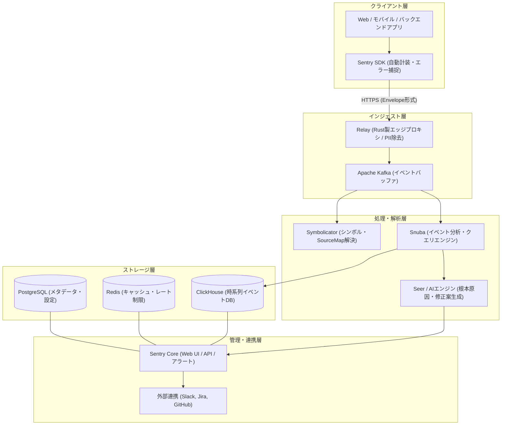

# **Sentry 調査レポート**

## **1. 基本情報**

* **ツール名**: Sentry
* **ツールの読み方**: セントリー
* **開発元**: Functional Software, Inc.（通称 Sentry）
* **公式サイト**: [https://sentry.io/](https://sentry.io/)
* **関連リンク**:
  * GitHub: [https://github.com/getsentry/sentry](https://github.com/getsentry/sentry)
  * ドキュメント: [https://docs.sentry.io/](https://docs.sentry.io/)
  * レビューサイト: [G2](https://www.g2.com/products/sentry/reviews) | [ITreview](https://www.itreview.jp/products/sentry/reviews)
* **カテゴリ**: オブザーバビリティ/APM
* **概要**: Sentryは、Webフロントエンド、バックエンド、モバイル、デスクトップ、AIエージェントまで幅広くカバーする、開発者中心のエラー追跡およびパフォーマンス監視プラットフォームである。未処理の例外やパフォーマンスボトルネックをリアルタイムに検知し、発生行のコードやユーザー操作の再現（Session Replay）、AIエージェントによる自動原因分析・修正コード提示（Seer / Autofix）までを一気通貫で提供する。

## **2. 目的と主な利用シーン**

* **解決する課題**:
  * 本番環境で発生したエラーの検知遅れや、ユーザーからの問い合わせ頼りによる障害覚知の防止
  * 難読化されたJavaScriptやネイティブアプリのクラッシュログにおける原因特定コストの増大
  * マイクロサービスや非同期分散処理におけるレイテンシボトルネックの特定困難さ
  * 障害発生時の再現手順調査や、修正コード作成・PR作成にかかるエンジニアの工数負荷
* **想定利用者**:
  * フロントエンド・バックエンド・モバイルのソフトウェアエンジニア
  * SRE（Site Reliability Engineering）および運用担当者
  * QAエンジニアおよびテクニカルサポート担当者
  * LLM / AIエージェントアプリケーションの開発者
* **利用シーン**:
  * **本番エラーのリアルタイム検知とトリアージ**: リリース直後のバグ発生をSlackやPagerDutyで即時覚知し、影響ユーザー数や頻度から優先度を判断
  * **クライアントクラッシュの再現とデバッグ**: Web/モバイルアプリで例外が起きた直前のDOM操作やネットワークリクエストを「Session Replay」で動画のように再生確認
  * **分散トレーシングによるAPIレイテンシ改善**: フロントエンドのクリックからバックエンドAPI、データベースクエリに至る処理時間を可視化し、遅延クエリを特定
  * **AIによる自動インシデント修復**: 例外発生時にAI（Seer）がコードベースを読み込み、根本原因を診断した上でGitHubに修正PRを自動作成

### **2.1 代表的な利用フロー**

```mermaid
swimlane-beta TB
  subgraph User["エンドユーザー / 開発者"]
    A[Web/モバイルアプリで例外エラーが発生]
    F[Sentryで問題分析・修正PRを作成]
  end
  subgraph ClientSDK["クライアント / Sentry SDK"]
    B[スタックトレースとメタデータを収集]
    C[機密情報をマスキングしRelayへ送信]
  end
  subgraph SentryService["Sentry プラットフォーム"]
    D[Relayで検証・レート制限を適用]
    E[Snubaへ保存しAI(Seer)が根本原因を分析]
  end
  subgraph NotificationSystem["外部連携 / 通知"]
    G[SlackやJiraへ即時アラート送信]
  end
  A --> B
  B --> C
  C --> D
  D --> E
  E --> G
  G --> F
```

* **代表的な流れ**: エンドユーザーの操作によってアプリ上でエラーが発生すると、組み込まれたSentry SDKがスタックトレースやブレッドクラム（直前操作履歴）を瞬時に収集・サニタイズして送信する。Sentryバックエンド（Relay・Snuba）がイベントを集約・分析し、Seerによる原因診断を実施した上で、Slack等のチャットツールへ通知を届け、開発者が修正PR作成まで迅速に行う。

## **3. 主要機能**

* **エラートラッキングとスマートグループ化**:
  未処理の例外やクラッシュをリアルタイムに検知し、同一原因のエラーを単一の「Issue（課題）」として自動グルーピング。スタックトレース、発生コード行、変数、HTTPヘッダー、環境情報を1画面に整理して表示する。
* **SourceMap / シンボル解決（Symbolicator）**:
  Minify・難読化されたJavaScriptや、iOS（dSYM）、Android（ProGuard/R8）、C/C++/Rust（DWARF/PDB）のネイティブクラッシュログを自動で逆変換し、人間が読める元のソースコード行と関数名へ復元する。
* **パフォーマンスモニタリング（APM & Tracing）**:
  Web Vitals（LCP, FID, CLS, INP）やAPIレスポンスタイム、データベースの遅延クエリをトランザクション単位で追跡。フロントエンドからバックエンドにまたがる分散トレーシング（Trace Waterfall）を提供する。
* **Session Replay（セッションリプレイ）**:
  ユーザーがエラーに遭遇した前後の画面操作（マウスの動き、クリック、スクロール、ネットワーク通信）をブラウザ上で動画のように再生。機密情報（パスワードや個人情報）はクライアント側で厳格にマスキングされる。
* **Seer & Autofix（AIデバッグ・自動修復）**:
  SentryのAIエンジン「Seer」がエラーの文脈と接続されたGitリポジトリ（GitHub/GitLab）のソースコードを解析。根本原因の特定（RCA）からコード修正案の提示、GitHub Pull Requestの自動起票まで自律的に支援する。
* **Continuous Profiling（継続的プロファイリング）**:
  プロダクション環境で常に稼働させても極めてオーバーヘッドが小さい（1%未満）プロファイラ。関数・行レベルでのCPU使用量やメモリ消費プロファイルを可視化し、非効率なコードパスを特定する。
* **AI & LLM Monitoring（Agent Tracing）**:
  OpenAI、Anthropic、LangChain、LlamaIndex、Cloudflare Agentsなどを用いたAIアプリの入出力トークン数、モデル呼び出しレイテンシ、ツール呼び出し（Tool Calls / MCP）、会話セッションごとの推論コストを可視化・追跡する。
* **Cron Monitoring（Crons） & Uptime Monitoring**:
  バッチ処理やスケジュール実行されるジョブ（Cron）のチェックインを監視し、ジョブの失敗や予定時刻に実行されなかった未実行インシデントを即座にアラート通知。Webサイトの死活監視も統合管理可能。
* **Logs & Metrics（ログ管理とカスタムメトリクス）**:
  構造化ログの取り込み、検索、トレース/エラーとの紐付けを実現。カスタムビジネスメトリクスやカウンタを定義して時系列グラフ化できる。

## **4. 動作原理・システム構成**

* **アーキテクチャ**:
  Sentryは、エッジインジェストプロキシ（Relay）、分散メッセージング（Kafka）、カラム型時系列検索エンジン（Snuba + ClickHouse）、ネイティブシンボル処理エンジン（Symbolicator）、およびWeb/管理コア（Python/Django）からなる高スループット分散マイクロサービス構成をとる。クラウド完結型SaaSとして提供されるほか、オープンソース版（Self-Hosted）をDocker環境上に構築することも可能である。



* **主要コンポーネントとデータフロー**:
  * **Sentry SDK**: アプリケーション内に常駐し、例外ハンドラやHTTP/DBインターセプターを通じてエラー・スパン・パンくずリスト（Breadcrumbs）を自動収集。Envelopeと呼ばれるバイナリ/JSON複合フォーマットで送信する。
  * **Relay（Rust製）**: 受信ゲートウェイとして機能し、プロジェクト設定をインメモリでキャッシュ。無効なイベントのドロップ、レート制限、および個人情報（PII: Personally Identifiable Information）のマスキングを社内ネットワークやクラウド内部に入る直前のエッジで実行する。
  * **Kafka & Snuba**: Kafkaをバッファとして秒間数万件のイベントを高速ストリーミングし、ClickHouseの分散ストレージにSnuba経由でカラムナー格納。複雑なフィルタリングや集計クエリをミリ秒単位で処理する。
  * **Symbolicator（Rust製）**: スタックトレース内の未解決メモリアドレスや難読化シンボルを受け取り、アップロードされたデバッグ情報（dSYM, ProGuard, SourceMap）と照合してソースコード上の位置を特定する。
  * **Sentry Core（Python/Django）**: ユーザー管理、権限設定、アラートルール判定、通知配信、およびReact製のダッシュボードWeb UIを提供する。
* **特筆すべき要素技術**:
  * **Rustによるデータパイプライン高速化**: パフォーマンスがクリティカルなRelayおよびSymbolicatorはRustでスクラッチから開発されており、低メモリ・低レイテンシで毎分膨大なクラッシュデータを処理する。
  * **ClickHouseによる時系列ペタバイト解析**: 従来のPostgreSQL単体からClickHouse + Snuba構成へ刷新したことで、数十億件規模のエラー・スパンデータに対する高速フルスキャンと集計クエリを実現。
  * **Envelopeフォーマット**: 1つのHTTPリクエスト内で、エラー、セッションデータ、トレーススパン、アタッチメントなどの異種データを効率よく分割・ストリーミング処理する独自の通信プロトコルを採用。

## **5. 開始手順・セットアップ**

* **前提条件**:
  * Sentryのアカウント（SaaS版）またはSelf-Hosted環境
  * 監視対象アプリケーションの開発環境（Node.js, Python, Go, Java, iOS, Android等）
  * プロジェクト作成時に発行される「DSN（Data Source Name）」
* **インストール/導入**:

  例として、モダンなJavaScript / TypeScript（Node.jsまたはフロントエンド）環境での導入手順を示す。

  ```bash
  # パッケージマネージャーを使用したインストール
  pnpm add @sentry/node
  # またはフロントエンド
  pnpm add @sentry/browser
  ```

* **初期設定**:
  アプリケーションのエントリーポイントの最上部で `Sentry.init` を呼び出す。

  ```typescript
  import * as Sentry from "@sentry/node";

  Sentry.init({
    dsn: "https://your_public_key@o000000.ingest.sentry.io/0000000",
    // パフォーマンストレースのサンプリングレート（本番では0.1〜0.2などを推奨）
    tracesSampleRate: 1.0,
    // 開発環境と本番環境の区別
    environment: process.env.NODE_ENV || "production",
    // リリースバージョンの指定（コミットハッシュやタグ）
    release: "my-app@1.0.0",
  });
  ```

* **クイックスタート**:
  意図的に例外をスローして疎通確認を行う。

  ```typescript
  try {
    throw new Error("Sentryテストエラー: セットアップが完了しました");
  } catch (error) {
    Sentry.captureException(error);
  }
  ```

  実行後、Sentryのダッシュボードの「Issues」画面に即座にエラーが登録され、スタックトレースやOS/ランタイム情報が表示されればセットアップは完了。

## **6. 特徴・強み (Pros)**

* **圧倒的なコードレベルの可視性とコンテキスト情報**:
  単なるエラーメッセージだけでなく、クラッシュ直前のユーザー操作ログ（Breadcrumbs）、HTTPリクエストヘッダー、環境変数、呼び出しスタック、さらにはソースコードの該当行の前後数行がインラインで表示され、デバッグ作業が格段に迅速化する。
* **100以上の言語・フレームワークに対応する網羅的なSDK**:
  React, Next.js, Vue, Angular, Node.js, Python (Django, FastAPI), Go, Ruby, Java/Kotlin, Rust, iOS (Swift), Android, Flutter, Unity, Unreal Engineなど、モダンな主要技術スタックのほぼ全てに専用SDKが用意されており、自動計装（Auto-instrumentation）が効く。
* **AIデバッグ（Seer）とAutofixによる自動修復**:
  エラー原因の推測にとどまらず、リポジトリのソースコードを参照してバグの修正差分を生成し、ワンクリックまたは自動でGitHub Pull Requestを作成可能。トラブルシューティング工数を最大70%以上削減する。
* **オープンソース（セルフホスト可能）と寛容な無料枠**:
  コアリポジトリが公開されておりオンプレミス環境でセルフホストできるほか、SaaS版でも個人開発者向けの「Developerプラン」が永続無料で提供され、月間5,000件のエラーや500万スパンを無料で利用できる。
* **Session Replayによる「バグの動画再現」**:
  ユーザーからの「動かない」という曖昧な報告に対し、画面上のマウスの動きやクリック、コンソールエラー、ネットワーク遅延を動画のように見返すことができるため、不具合再現にかかるやり取りを不要にする。

## **7. 弱み・注意点 (Cons)**

* **エラー急増（バグストーム）時の従量課金コストリスク**:
  無限ループや外部API障害などによって大量のエラーが短時間に発生した場合、イベント枠を即座に消費し、Pay-As-You-Go（従量課金）の設定次第では想定外の請求が発生するリスクがある。Spike Protectionやクォータ制限（Spending Limits）の事前設定が必須。
* **デフォルトアラートによる「通知疲れ」の発生**:
  新規Issueやエラー頻度の初期アラートルールが広範に設定されていると、些細な警告や軽微な404エラーなどでSlack通知が埋め尽くされがちになる。プロジェクトごとに適切なフィルター（IgnoreルールやFingerprinting）を設計する必要がある。
* **インフラ全体の統合メトリクス監視では専門APMに劣る**:
  サーバーホスト、Kubernetesクラスタ、ネットワークトラフィックなどの包括的なインフラ監視に関しては、DatadogやDynatraceなどのインフラ特化型ツールに比べるとカバー範囲が限定的である。
* **管理画面（UI）の多機能化と英語UIの学習コスト**:
  エラー監視に加えて、APM、Replay、Profiling、Crons、Logs、AI Monitoringと機能が急拡大したため、管理画面のメニューや設定項目が多く初学者が迷いやすい。また、公式ドキュメントやWeb UIは日本語ローカライズされておらず英語が基本となる（エラーログ内の日本語文字列自体は正常に取り扱い可能）。

## **8. 料金プラン**

Sentryは、ユーザー数（シート数）課金ではなく、基本月額＋イベント取り込み量（従量課金）のモデルを採用している。すべての有料プランでシート数（ユーザーアカウント数）は無制限である。

| プラン名 | 月額料金（年払い） | 月額料金（月払い） | 主な特徴・対象ユーザー |
|:---|:---|:---|:---|
| **Developer（無料）** | **無料** ($0) | **無料** ($0) | 個人開発者・ホビー用途。1ユーザー、月間5,000エラー、500万スパン、5GBログ、50セッションリプレイ、保持期間30日 |
| **Team** | **$26 / 月** | **$29 / 月** | 成長中のスタートアップ・小規模開発チーム。**ユーザー数無制限**、月間50,000エラー、500万スパン、5GBログ、保持期間90日、サードパーティ連携（Slack, GitHub等）、カスタムダッシュボード |
| **Business** | **$80 / 月** | **$89 / 月** | 中〜大規模組織。ユーザー数無制限、Teamの全機能＋高度なアナリティクス、SAML SSO、SCIM、高度なデータボリューム制御、インサイト分析、Seer AI機能拡張 |
| **Enterprise** | **個別見積もり** | **個別見積もり** | 大規模エンタープライズ。カスタムイベント量、専任テクニカルアカウントマネージャー（TAM）、カスタムデータ保持期間、カスタムSLA、請求書払い対応 |

* **課金体系**:
  * 基本プランに含まれる枠（Errors, Spans, Replays, Logs, Cron Monitors）を超過した分については、従量課金（Pay-As-You-Go）で加算される。
  * 予算上限（Spending Limit）を設定することで、想定外の課金を確実に防止できる。
  * Continuous ProfilingやSeer（AI自動修復）などの拡張機能はアドオンまたは利用枠に応じた従量計算となる。
* **無料トライアル**:
  * Businessプランの機能を14日間、クレジットカード登録なしで試用可能。

## **9. 導入実績・事例**

* **導入企業**:
  * 全世界で130,000以上の組織、400万人以上の開発者に利用されている。
  * 主な導入企業: Atlassian, Reddit, Anthropic, GitHub, Cloudflare, Disney, Canva, Dropbox, Microsoft, Matic Robots など。
* **導入事例**:
  * **Atlassian**: セルフホスト版からSentry SaaSへ5日間で移行を完了。インフラ運用保守負担を解消し、年間約4,160時間のエンジニアリング工数を削減。
  * **Reddit**: 毎秒数万件に及ぶトラフィックから発生するエラーをSentryで集約・フィルタリングし、クリティカルなバグの解決スピードを大幅に向上。
  * **Anthropic**: AIモデルやハードウェア関連の大規模分散インシデントの検知とトラブルシューティングにおいてSentryを活用し、インフラのスケーリングを支える。
  * **Matic Robots**: 自律型清掃ロボットの組み込みソフトウェアにSentryを導入し、顧客からの問い合わせ不具合およびソフトウェア関連チケットを75〜90%削減。
* **対象業界**:
  * Webサービス、SaaS、AI・LLM開発、モバイルアプリ、ゲーム開発、IoT・ロボティクス、フィンテック、メディアなど、ソフトウェアを自社開発するすべての産業。

## **10. サポート体制**

* **ドキュメント**:
  * [Sentry Documentation](https://docs.sentry.io/): 各言語・フレームワーク別の導入チュートリアル、設定リファレンス、ベストプラクティスが極めて詳細に網羅されている。
  * インタラクティブなセットアップガイドがダッシュボード内に用意されており、コードスニペットのコピー＆ペーストで即座に設定できる。
* **コミュニティ**:
  * [GitHub Discussions](https://github.com/getsentry/sentry/discussions): オープンソース版やSDKに関する活発なQA・議論が行われている。
  * [Discord](https://discord.gg/sentry): 開発者コミュニティサーバーが開設されており、リアルタイムでエンジニア同士の情報交換が可能。
* **公式サポート**:
  * **Developer（無料）**: コミュニティサポートおよびドキュメントによるセルフヘルプ。
  * **Team / Business**: チケットベースのメールサポート（平日営業時間対応）。
  * **Enterprise**: 24時間365日の高優先度インシデント対応、SLA保証、専任カスタマーサクセスマネージャー（CSM）による技術支援。

## **11. エコシステムと連携**

### **11.1 API・外部サービス連携**

* **API**:
  * 包括的なRESTful APIおよびWebhooksを提供。プロジェクト、組織、Issue、イベントの取得・更新・解決をプログラムから操作可能。
  * `sentry-cli`: リリース作成、SourceMapアップロード、コミット連携、環境変数管理をCI/CDパイプライン上で実行する公式CLIツールを提供。
* **外部サービス連携**:
  * **ソースコード管理 / CI/CD**: GitHub, GitLab, Bitbucket, Vercel, Netlify, AWS CodeBuild, CircleCI
  * **コミュニケーション / 通知**: Slack, Microsoft Teams, Discord, PagerDuty, Opsgenie, Webhook
  * **課題管理 / プロジェクト管理**: Jira, Linear, Asana, Azure DevOps, GitHub Issues
  * **APM / オブザーバビリティ**: Datadog, Grafana, OpenTelemetry

### **11.2 技術スタックとの相性**

主要なフレームワークやプログラミング言語との相性を以下に示す。

| 技術スタック | 相性 | メリット・推奨理由 | 懸念点・注意点 |
|:---|:---:|:---|:---|
| **Next.js (Vercel)** | ◎ | 公式SDK（`@sentry/nextjs`）完備。サーバー/クライアント/エッジの全自動計装、SourceMap自動アップロード対応 | ビルド時のSourceMapアップロード処理でCI時間がわずかに増加する点に留意 |
| **Node.js (Express / NestJS / Hono)** | ◎ | 安定版SDKを提供。リクエストごとのトレースや未処理例外の自動捕捉が容易 | 分散トレーシング利用時はOpenTelemetry依存関係のバージョン管理に注意 |
| **Python (FastAPI / Django)** | ◎ | `sentry-sdk`による強力なインテグレーション。ASGI/WSGIミドルウェア、DBクエリ解析、Celery連携が極めて優秀 | 高スループット時はサンプリングレートの適切なチューニングが必要 |
| **React / Vue / Svelte (SPA)** | ◎ | クライアント側でのエラー捕捉、Session Replay、Web Vitals測定がワンライナーで動作 | ユーザーのプライバシー保護のため、Replay時のテキストマスキング設定を要確認 |
| **Mobile (iOS / Android / Flutter)** | ◎ | SymbolicatorによるdSYM/ProGuardの自動シンボル解決、オフライン時のキャッシュ送信対応 | ネイティブクラッシュシンボルのアップロード自動化をCI/CDに組み込む必要あり |
| **Go** | ◯ | `sentry-go`によるパニック検知、ゴルーチン内のエラー捕捉に対応 | Goの明示的エラー処理（`if err != nil`）文化のため、手動キャプチャ記述の規約決めが重要 |
| **Rust / C++** | ◯ | Minidumpやブレークパッド対応。クラッシュダンプのシンボリケーションが充実 | Web言語に比べると初期のシンボルファイル配置と設定の手間がやや多い |

## **12. セキュリティとコンプライアンス**

* **認証**:
  * Google, GitHub, Microsoftアカウントを利用したシングルサインオン（SSO）。
  * Businessプラン以上では、SAML 2.0（Okta, OneLogin, Azure AD等）およびSCIMによる自動ユーザープロビジョニングに対応。
  * 全プランで2段階認証（2FA/MFA）を強制可能。
* **データ管理**:
  * **データ暗号化**: 転送中（TLS 1.2/1.3）および保管時（AES-256）の暗号化を徹底。
  * **データスクラビング（PII除去）**: パスワード、クレジットカード番号、APIキー、機密ヘッダーをSDKおよびRelayレイヤーで自動マスク・破棄。カスタム正規表現によるマスキングルール設定が可能。
  * **リージョン選択**: 米国（US）および欧州（EU）のデータレジデンシーを選択可能。
* **準拠規格**:
  * **SOC 2 Type II**: 独立した第三者監査機関によるセキュリティ・可用性・機密性に関するSOC 2 Type II認証を取得・維持。
  * **ISO 27001**: 情報セキュリティマネジメントシステム（ISMS）の国際標準認証を取得。
  * **HIPAA**: 医療データを扱う顧客向けに、Businessプラン以上でBusiness Associate Agreement（BAA）の締結に対応。
  * **GDPR**: EU一般データ保護規則に準拠し、データ処理補足条項（DPA）を提供。

## **13. 操作性 (UI/UX) と学習コスト**

* **UI/UX**:
  * ダークモードを基調とした洗練されたモダンUIを採用。
  * **Issue画面の一覧性**: エラーの種類、発生箇所、最新発生日時、累積発生回数、影響ユーザー数が一目で把握できる。
  * **直感的なパンくずリスト（Breadcrumbs）**: エラー発生までのユーザーのクリック、ページ遷移、XHR/Fetchリクエスト、ログ出力が時系列で整理され、バグの文脈が直感的に追える。
  * **Trace Waterfallビュー**: 2026年10月のアップデートにより、長いトレースの時間圧縮表示や属性ピン留め機能が追加され、複雑なマイクロサービス間の呼び出し構造をストレスなくブラウジング可能。
* **学習コスト**:
  * **基本機能**: SDKをインストールしてDSNを設定するだけで、未処理例外が即座に管理画面へ届くため、導入のハードルは極めて低い（所要時間約5分〜15分）。
  * **高度な機能の活用**: パフォーマンストレースのサンプリング設定（`tracesSampler`）、SourceMapのCI/CD自動アップロード、カスタムフィンガープリント（グループ化ルールのカスタマイズ）、およびタグによるユーザーメタデータの設計には、一定の設計・学習コストを要する。

## **14. ベストプラクティス**

* **効果的な活用法 (Modern Practices)**:
  * **リリース管理（Releases）とコミット追跡の連携**:
    デプロイ時にCI/CDからSentry CLIでReleaseを登録し、Gitコミットログを紐付けることで、「どのデプロイ・どのコミットが新しいエラーを引き起こしたか（Suspect Commits）」を自動特定する。
  * **環境（Environment）の厳密な分離**:
    `production`, `staging`, `development` をタグ付けし、本番環境のアラートのみを緊急通知チャンネルにルーティングする。
  * **サンプリングレートの最適化（Dynamic Sampling）**:
    大量のトラフィックがある本番環境では、すべてのトランザクションを送信せず、`tracesSampleRate` を10%〜20%に絞るか、`tracesSampler` 関数を用いてエラー発生時や重要な決済トランザクションのみを100%記録する設定を行う。
  * **SeerとGitHub連携による自動修正サイクルの確立**:
    AI機能「Seer」を有効化し、GitHubリポジトリへの読み取り・PR作成権限を付与することで、トリアージからPRレビューまでの時間を最小化する。
* **陥りやすい罠 (Antipatterns)**:
  * **SourceMapの未登録による難読化コード放置**:
    JavaScriptのSourceMapをSentryにアップロードしないと、エラー箇所が `app.min.js:1:3420` のように表示されデバッグが不可能になる。CI/CDビルドステップで必ずアップロードを行うこと。
  * **個人情報（PII）や機密トークンの生ログ送信**:
    フォームの入力値やURLクエリパラメータに含まれる個人情報（氏名、メールアドレス、JWT等）が無防備に送信されないよう、SDKの `beforeSend` フックやRelayのデータスクラビングルールを精査すること。
  * **すべての例外をSlack通知する「全件通知の罠」**:
    発生したすべてのエラーを通知するとチーム全体が通知をミュートしてしまう。新規発生（New Issue）時や、発生頻度が急上昇（Spike）した時のみ通知するアラートルールを作成する。

## **15. ユーザーの声（レビュー分析）**

* **調査対象**: G2, Capterra, ITreview, TrustRadius, 開発者コミュニティ
* **総合評価**:
  * **G2**: 4.5 / 5.0（レビュー数 200件以上）
  * **Capterra**: 4.6 / 5.0
  * **ITreview**: APM・エラー監視カテゴリーにおいて安定した評価を獲得
* **ポジティブな評価**:
  * **「バグの発見から解決までが圧倒的に早い」**: スタックトレース、直前のユーザー操作ログ、影響ユーザー数が綺麗に1画面にまとまっており、再現調査にかかる時間が激減したという声が多い。
  * **「Session Replayが神機能」**: クライアント側のバグ報告で「何をしたら起きたかわからない」と言われた場合でも、実際の操作画面を見直すだけで即座に不具合手順を把握できると絶賛されている。
  * **「SDKの導入が非常に簡単」**: 各種フレームワーク（特にNext.jsやDjango）において、数行の設定コードだけで自動計装が完了する手軽さが高く評価されている。
* **ネガティブな評価 / 改善要望**:
  * **「エラーがループした時のコスト増加が怖い」**: 想定外のバグ多発でイベント枠が枯渇し、従量課金の上限に達してしまう懸念が挙げられている（適切なSpike Protection設定が推奨される）。
  * **「アラートの調整が難しい」**: 初期状態のアラートではノイズが多く、通知ルールを細かくチューニングするまでに試行錯誤が必要という指摘がある。
  * **「画面が多機能すぎて複雑」**: エラー監視以外の機能（APM、Replay、Profiling等）が増えたことで、設定画面やナビゲーションがやや直感的でなくなったと感じるユーザーも存在する。
* **特徴的なユースケース**:
  * **サイレントエラーの先回り修正**: ユーザーが問い合わせてこない潜在的な画面崩れや決済失敗をSentryで検知し、ユーザーから苦情が入る前に先回りしてHotfixをデプロイする運用。
  * **AIエージェントの推論コスト・失敗監視**: LLMアプリケーションにおけるプロンプト実行のトークン消費や外部APIツールのタイムアウトを可視化し、モデル呼び出しの効率化に活用。

## **16. 直近半年のアップデート情報**

* **2026-10**: **Trace Waterfallの機能強化とAIエージェント会話のフィルタリング一般提供**
  * 分散トレース画面において、長時間のアイドルスパンを縮小する「時間圧縮」機能、重要スパンの「属性ピン留め」、Web Vitalsバッジの統合をリリース。
  * `Explore > Agents` において、AIエージェントの会話ログを総コスト、トークン消費量、ツール呼び出し数、エラー有無で高度にソート・抽出できる機能を一般提供（GA）開始。
* **2026-09**: **JavaScript SDK v11アップデートとAgent Tracingの標準化**
  * JavaScript SDK v11への進化に伴い、OpenAI、Anthropic、LangChainなどの主要AIプロバイダとの計装を強化。トークン使用量とコストの正規化収集に対応。
* **2026-08**: **Cocoa SDKにおけるフィーチャーフラグ追跡対応とダッシュボード改善**
  * iOS/macOS向けCocoa SDK（v9.22.0+）にて、エラー直前に評価された最大100件のフィーチャーフラグ状態を自動キャプチャ。LaunchDarklyやStatsig等の変更と連携可能に。
  * ダッシュボードの検索性・一覧性を向上させるQoLアップデートを実施。
* **2026-07**: **Cloudflare Agents向け計装APIおよびSvelteKit 3サポート**
  * Cloudflare Agents向けに `instrumentAgentWithSentry` APIを提供し、RPC呼び出しや会話IDの自動スパン生成に対応。
  * 次世代WebフレームワークSvelteKit 3への対応とNode向け最小OpenTelemetryプロバイダへのデフォルト移行を実施。
* **2026-06**: **`@sentry/hono` SDKの正式安定版（v10.55.0）リリース**
  * 軽量WebフレームワークHono向けの公式SDKを安定版としてリリースし、エラー捕捉・トレース・メトリクス追跡の完全統合をサポート。

(出典: [Sentry Changelog](https://changelog.sentry.dev/) / [Sentry GitHub Releases](https://github.com/getsentry/sentry/releases))

## **17. 類似ツールとの比較**

### **17.1 機能比較表 (星取表)**

| 機能カテゴリ | 機能項目 | Sentry | Datadog | New Relic | Bugsnag |
|:---:|:---|:---:|:---:|:---:|:---:|
| **エラー監視** | スタックトレース・グループ化 | ◎<br><small>業界最高水準の解析</small> | ◯<br><small>ログから相関解析</small> | ◯<br><small>標準的なエラー収集</small> | ◎<br><small>洗練されたグループ化</small> |
| **デバッグ支援** | Session Replay | ◎<br><small>DOM再現・マスキング</small> | ◎<br><small>Session Replay対応</small> | ◯<br><small>アドオン機能</small> | △<br><small>外部ツール連携中心</small> |
| **AI支援** | 自動原因診断・PR生成 | ◎<br><small>Seer/Autofix完備</small> | ◯<br><small>Bits AI（対話型要約）</small> | ◯<br><small>New Relic AI</small> | △<br><small>限定的なAI要約</small> |
| **APM / トレース** | 分散トレーシング | ◯<br><small>コード・アプリ中心</small> | ◎<br><small>フルスタック・大規模網羅</small> | ◎<br><small>強力なAPM分析</small> | △<br><small>基本的な性能計測</small> |
| **インフラ監視** | サーバー / K8s / NW監視 | △<br><small>Crons・Uptime中心</small> | ◎<br><small>業界随一の網羅性</small> | ◎<br><small>インフラ統合監視</small> | ×<br><small>非対応</small> |
| **OSS / セルフホスト** | オープンソース版の提供 | ◎<br><small>Self-Hosted可能</small> | ×<br><small>完全SaaSクローズド</small> | △<br><small>エージェントのみOSS</small> | ×<br><small>完全SaaSクローズド</small> |
| **料金体系** | 開発者向け無料枠 | ◎<br><small>永続無料プランあり</small> | △<br><small>14日試用のみ</small> | ◯<br><small>月100GB無料枠あり</small> | ◯<br><small>小規模無料枠あり</small> |
| **非機能要件** | 日本語UI対応 | △<br><small>英語UI（ログは日本語可）</small> | ◎<br><small>日本語UI・サポート完備</small> | ◎<br><small>日本語UI・サポート完備</small> | △<br><small>英語UI</small> |

### **17.2 詳細比較**

| ツール名 | 特徴 | 強み | 弱み | 選択肢となるケース |
|---------|------|------|------|------------------|
| **Sentry** | コードレベルのエラー・性能監視に特化した開発者ファーストのプラットフォーム | スタックトレースの精度、Session Replay、Seerによる自動PR生成、セルフホスト可能、ユーザー数無制限の料金体系 | インフラ全体の統合監視（ホストやネットワーク）が手薄、英語UI | アプリケーション開発者が主導して素早くバグを発見・修正したい場合、開発者人数が多くシート課金を避けたい組織 |
| **Datadog** | クラウドインフラ、ログ、APM、セキュリティを網羅する総合オブザーバビリティSaaS | 圧倒的なインフラ連携力、ダッシュボードの柔軟性、日本語完全対応、エンタープライズ実績 | 導入・運用のコストが高額になりやすい、ホスト単位・ユーザー単位の課金設計が複雑 | 大規模なクラスタやハイブリッドクラウド基盤を運用し、インフラからアプリまで全社横断で一元管理したいエンタープライズ |
| **New Relic** | ユーザー体験からバックエンドまでを包括するフルスタック可観測性プラットフォーム | 月間100GBまでの無料データ枠、強力なクエリ言語（NRQL）、テレメトリデータの一元管理 | 従量課金とユーザー課金の組み合わせでコスト見通しが複雑化しやすい | ログやメトリクスを大量に収集し、NRQLを用いた詳細なデータ分析や可視化を行いたいチーム |
| **Bugsnag** | モバイルおよびWebアプリケーションのエラーモニタリングに特化したツール | モバイルクラッシュ（iOS/Android）の安定性スコア測定、リリース健全性の可視化 | APMやプロファイリング、セッションリプレイなどのオブザーバビリティ機能が限定的 | モバイルアプリのクラッシュ率管理に特化し、シンプルなエラー追跡のみを求めているチーム |

## **18. 総評**

* **総合的な評価**:
  Sentryは、世界中の開発者に愛用されるエラー監視のデファクトスタンダードであり、単なるログ収集ツールから「コードレベルの総合オブザーバビリティ・自動デバッグ基盤」へと進化を遂げている。特に2026年現在のSentryは、Session Replayによる障害再現の視覚化に加え、AIエンジン「Seer」と「Autofix」による根本原因分析および修正Pull Requestの自動生成を実現しており、障害対応のサイクルタイムを抜本的に短縮する強力な武器となっている。
* **推奨されるチームやプロジェクト**:
  * **モダンなWeb・モバイルアプリ開発チーム**: Next.js、React、Vue、iOS、Androidなどを採用し、迅速なリリースサイクルを回すアジャイルチーム。
  * **開発者人数が多い組織**: ユーザー数無制限の料金モデルのため、エンジニア全員にアカウントを付与して開発組織全体で品質改善を進めたい企業。
  * **AIエージェント・LLMアプリケーションを開発するチーム**: トークン消費やモデルのレイテンシ、ツール呼び出しを可視化したいプロダクト。
  * **機密保持や社内ポリシーでセルフホストが必要なチーム**: 金融機関や厳格なオンプレミス運用が求められるエンタープライズ。
* **選択時のポイント**:
  * インフラ基盤全体のハードウェア監視やネットワーク監視を最優先する場合はDatadog等の専門ツールが適しているが、**「コードのどこがバグの原因か」「どの行をどう直せばよいか」というアプリケーション層の課題解決にはSentryが最も費用対効果高く機能する**。
  * 導入時は、エラー急増による想定外の請求を防ぐために必ず予算上限（Spending Limits）を設定し、SourceMap自動アップロードをCI/CDに組み込むことが成功の鍵となる。
