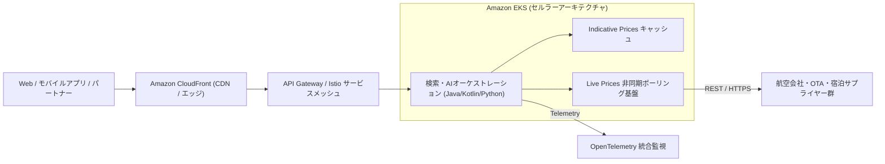

# **Skyscanner 調査レポート**

## **1. 基本情報**

* **ツール名**: Skyscanner
* **ツールの読み方**: スカイスキャナー
* **開発元**: Skyscanner Limited（イギリス・エディンバラ本社、親会社: Trip.com Group）
* **公式サイト**: [https://www.skyscanner.jp/](https://www.skyscanner.jp/)
* **関連リンク**:
  * ドキュメント（開発者ポータル）: [https://developers.skyscanner.net/](https://developers.skyscanner.net/)
  * パートナーポータル: [https://www.partners.skyscanner.net/](https://www.partners.skyscanner.net/)
  * ニュースルーム: [https://www.skyscanner.net/news](https://www.skyscanner.net/news)
* **カテゴリ**: ライフスタイル/生活サービス
* **概要**: Skyscannerは、2003年にイギリスで設立された世界最大級の旅行メタサーチ（価格比較）プラットフォームである。世界中の1,200社以上の航空会社（LCC含む）、オンライン旅行代理店（OTA）、宿泊施設（Stays）、レンタカー会社の価格と空席情報をリアルタイムで横断比較し、ユーザーを最適な予約先へ案内する。直販を行うOTAとは異なり中立的な比較検索に特化しており、近年は自然言語によるAI旅行検索「Explore with AI」やChatGPT連携など、対話型AIを活用した機能拡張も進めている。

## **2. 目的と主な利用シーン**

* **解決する課題**: 航空会社や旅行代理店ごとに分散した運賃・空席情報を個別に検索する手間を省き、隠れた手数料や時期による価格差を可視化して「最もお得で条件に合う旅行プラン」を迅速に見つける課題を解決する。
* **想定利用者**: コストを抑えて航空券や宿を探したい個人旅行者・バックパッカー、複数ルートを比較したい出張者、および旅行データやアフィリエイトリンクを組み込みたい旅行メディア・開発者。
* **利用シーン**:
  * 出発地のみを指定し、目的地を「すべての場所」に設定して予算内で渡航可能な最安の国・都市を発見する。
  * 「月全体」「最安値の月」カレンダーや価格変動アラート（DROPS含む）を活用し、航空券が最も安い時期を見極めて購入する。
  * 「Explore with AI」に自然言語で希望（気候、予算、時期など）を伝え、AIが提案する目的地候補からフライトや宿泊先（Stays）をまとめて比較する。

### **2.1 代表的な利用フロー**

```mermaid
swimlane-beta TB
  subgraph User["ユーザー"]
    A["検索条件・自然言語プロンプトを入力"]
    E["比較結果からプランを選択"]
    G["遷移先で予約・決済を完了"]
  end
  subgraph Skyscanner["Skyscanner"]
    B["キャッシュ・AIで候補を解析"]
    D["最安値・おすすめ順に比較表示"]
    F["トラッキング付きディープリンクを生成"]
  end
  subgraph Partners["航空会社・OTA API"]
    C["リアルタイム運賃・空席データを返却"]
  end
  subgraph BookingSite["予約先サイト (航空会社/OTA)"]
    H["最終在庫確認と発券処理"]
  end
  A --> B
  B -->|"Live Prices API照会"| C
  C --> D
  D --> E
  E --> F
  F -->|"リダイレクト"| G
  G --> H
```

* **代表的な流れ**: ユーザーが条件またはAIプロンプトを入力すると、Skyscannerが提携する航空会社やOTAのAPIからリアルタイムの運賃・空席情報を取得して一覧表示する。ユーザーがプランを選択すると、Skyscannerはトラッキング用のディープリンク経由で該当事業者の予約サイトへリダイレクトし、最終的な予約・決済は遷移先サイト上で完結する。

## **3. 主要機能**

* **航空券・ホテル・レンタカー横断比較検索**: 世界中の1,200社以上の航空会社（フルサービスキャリアおよびLCC）や大手OTAのデータを一括検索し、「おすすめ」「最安値」「最速」などの軸で比較表示する。
* **「すべての場所（Everywhere）」検索**: 目的地を固定せず「すべての場所」を指定することで、出発地からその時期に最も安く渡航できる国や都市をランキング形式で探索できる。
* **柔軟な日程検索（月全体・最安値の月）**: 具体的な出発日・帰国日を決めずに1ヶ月単位や年間最安値ベースで価格カレンダーを表示し、数日の日程調整による大幅な節約を支援する。
* **プライスアラート / DROPS**: 指定した路線の価格変動を自動監視し、値下がりや急落（DROPS）を検知した際にメールやアプリ通知で知らせる。
* **Explore with AI（AI旅行探索）**: 2026年7月にベータ提供が開始された自然言語対応の探索ツール。「12月に日本へ行く安い航空券」のような会話形式の入力から、価格・気候・所要時間・現地の雰囲気を踏まえた提案を行う。
* **Road Trip Planner（ロードトリップ計画）**: 景観・文化・アクティビティなどの好みに応じてドライブ旅行のルート、立ち寄りスポット、レンタカー手配をAIで一括提案する。
* **Stays（宿泊施設検索）**: 旧「Hotels」からリブランドされた宿泊比較機能で、500万件以上のホテル・民泊・ユニークな宿泊施設の価格とレビューを横断比較できる。
* **Flight Tracker（フライトトラッカー）**: 搭乗予定便のリアルタイム運航状況に加え、ターミナル、搭乗ゲート、手荷物受取ターンテーブル情報まで確認できる。
* **Travel APIs（法人・開発者向けAPI）**: 認定パートナー向けにFlights（Live/Indicative Prices）、Stays、Car Hire、Geo/CultureなどのRESTful JSON APIを提供している。

## **4. 動作原理・システム構成**

* **アーキテクチャ**: Amazon Web Services（AWS）上に全面構築されたクラウドネイティブなマルチリージョン・マイクロサービス構成（セルラーアーキテクチャ）。従来は.NET/SQL Serverのモノリスだったが、Java/Kotlinを中心とするステートレスなマイクロサービス群へ刷新された。



* **主要コンポーネントとデータフロー**:
  * **Indicative Prices（参考価格）とLive Prices（リアルタイム価格）の分離**: 1日あたり約1,000億件規模の価格データを扱うため、一覧探索や「すべての場所」検索などの広範なクエリはキャッシュされたIndicativeデータで高速応答し、詳細検索や選択時にはLive Prices APIのCreate/Pollライフサイクルで提携各社へリアルタイム照会を行う。
  * **Amazon EKSとSpotインスタンスの最適化**: マルチテナントのKubernetesクラスタ（Amazon EKS）を複数リージョンで運用し、EC2 Spotインスタンスを積極活用することで大規模トラフィック処理と大幅な計算コスト削減を両立している。
  * **エッジ配信とデザインシステム**: 世界110以上のドメイン・市場向けにAmazon CloudFrontとサーバーレスエッジ関数で静的資産や画像を最適化配信している。また、UI基盤として自社開発しOSSとしても公開しているデザインシステム「Backpack」（React / iOS / Android対応）により、Web・アプリ全体の一貫性を保っている。
* **特筆すべき要素技術**:
  * サービス間通信にgRPCおよびIstioサービスメッシュを採用し、OpenTelemetryベースでクライアント端末からKubernetesコンテナまでを一貫トレースしている。
  * ボット対策およびAPI保護のため、PerimeterX等を用いたアクセス制御とディープリンク生成時のアトリビューション追跡（Impact連携等）を実装している。

## **5. 開始手順・セットアップ**

### 一般ユーザー（Web・モバイルアプリ）

* **前提条件**: Webブラウザ（PC/スマートフォン）またはiOS/Android端末。アカウント登録やクレジットカード登録は検索・比較のみであれば不要（プライスアラート等の保存機能を使う場合は無料アカウント登録が必要）。
* **インストール/導入**:
  * Web版は [https://www.skyscanner.jp/](https://www.skyscanner.jp/) にアクセスするだけで即座に利用可能。
  * モバイルアプリはApp StoreまたはGoogle Playから「Skyscanner」を検索してインストールする。
* **クイックスタート**: トップ画面で「出発地」「目的地（または『すべての場所』）」「出発日・復路日（または『月全体』）」「人数・クラス」を選択して検索を実行する。

### 開発者・パートナー向け（Travel APIs）

* **前提条件**: 商用利用またはアフィリエイトパートナーとしての事前審査・承認が必要（一般公開のセルフサービスキーは提供されていない）。
* **初期設定**:
  1. [Skyscanner Partners](https://www.partners.skyscanner.net/) または [Developer Portal](https://developers.skyscanner.net/) からパートナー申請を提出する。
  2. 審査通過後、管理パネルからAPIキーを取得する。
* **クイックスタート（Live Prices API 呼び出し例）**:
  * リクエストヘッダー `x-api-key` に取得したAPIキーを設定し、JSON形式でセッション作成（Create）および結果取得（Poll）を実行する。

  ```bash
  curl -X POST "https://partners.api.skyscanner.net/apiservices/v3/flights/live/search/create" \
    -H "x-api-key: <YOUR_API_KEY>" \
    -H "Content-Type: application/json" \
    -d '{
      "query": {
        "market": "JP",
        "locale": "ja-JP",
        "currency": "JPY",
        "queryLegs": [
          {
            "originPlaceId": {"iata": "TYO"},
            "destinationPlaceId": {"iata": "OSA"},
            "date": {"year": 2026, "month": 12, "day": 15}
          }
        ],
        "adults": 1
      }
    }'
  ```

## **6. 特徴・強み (Pros)**

* **圧倒的な提携ネットワークと価格発見力**: 世界中の1,200社以上の航空会社（LCCを含む）と大小さまざまなOTAを横断検索するため、航空会社公式サイトや一部大手OTAのみを対象とする検索サイトよりも安価な航空券を発見しやすい。
* **「すべての場所」「月全体」など探索型UIの完成度**: 行き先や日程が未確定の段階でも予算ベースで旅先を決められるため、柔軟な旅行計画との相性が極めて高い。
* **ユーザー側の手数料が完全無料かつ中立的**: 検索・比較・アラート設定に一切のサービス料がかからず、表示順序も「最安値」「おすすめ」「最速」で明確に切り替えられる。
* **対話型AIと実用機能の積極的な統合**: 「Explore with AI」や「Road Trip Planner」、ChatGPTアプリ連携、搭乗ゲートまで表示する「Flight Tracker」など、単なる価格比較を超えた旅行体験を提供している。

## **7. 弱み・注意点 (Cons)**

* **予約・キャンセル対応は遷移先の事業者に依存**: Skyscanner自体は航空券を販売しないため、予約変更・返金・欠航時のサポート品質は実際に決済した航空会社またはOTAに依存する。特に最安値に表示されるマイナーな海外OTAは、日本語サポート非対応や手数料トラブルが報告されることがある。
* **価格変動や売り切れのタイムラグ**: リアルタイム同期の仕様上、Skyscanner上で最安値が表示されていても、遷移先の予約画面に進んだ時点で価格が上昇したり満席になっていたりするケースがある。
* **日本語対応の状況**: Webサイト、iOS/Androidアプリ、ヘルプセンターは完全に日本語化されているが、開発者ポータル（`developers.skyscanner.net`）やニュースルーム、および遷移先の一部海外OTAは英語のみの対応となる。

## **8. 料金プラン**

Skyscannerは一般旅行者（B2C）に対しては完全無料で提供されており、収益は航空会社・OTA・広告主などのパートナー企業（B2B）からの手数料や広告費で賄われている。

| プラン / 利用形態 | 料金 | 主な特徴・対象ユーザー |
|---------|------|---------|
| **一般ユーザー（Web / アプリ）** | 無料 | 航空券・Stays・レンタカーの比較検索、プライスアラート、AI機能（Explore with AI等）をすべて手数料無料で利用可能。 |
| **アフィリエイト / 広告パートナー** | 成果報酬・クリック課金（非公開・個別契約） | CPC（クリック課金）またはCPA（予約成立に応じた成果報酬）、スポーンサー広告枠の提供。航空会社・OTA向け。 |
| **Travel APIs（法人・開発者）** | 個別審査・商用契約（非公開） | 自社サービスへの航空券・宿泊検索組み込み向け。トラフィック規模や収益シェア条件に応じた審査制。 |

* **課金体系**: 一般ユーザーは完全無料（予約代金は遷移先事業者に直接支払い）。パートナー企業向けはCPC、CPA（レベニューシェア）、ディスプレイ広告、B2B需要インサイトデータの提供によるマネタイズ。
* **無料トライアル**: 一般ユーザー向け機能は登録不要で常時無料。API利用は商業審査が必要。

## **9. 導入実績・事例**

* **パートナー・連携企業**:
  * **航空会社**: British Airways（ブリティッシュ・エアウェイズ）、Lufthansa（ルフトハンザ航空）をはじめとする世界中の大手フルサービスキャリアおよびLCC各社。
  * **OTA（オンライン旅行代理店）**: Expedia（エクスペディア）、Booking.com（ブッキング・ドットコム）、Trip.com などのグローバル大手OTA。
  * **アフィリエイト基盤**: 提携パートナーのオンボーディング・計測・支払い自動化に impact.com を導入し、世界中のパブリッシャーや旅行テック企業とのAPI連携をスケールさせている。
* **導入事例・効果**: 航空会社やOTAにとっては高意図な予約直前ユーザーの獲得チャネルとして機能し、スポーンサー広告やダイナミックな価格配信による予約コンバージョン（GBV）拡大に活用されている。
* **対象業界**: 旅行・航空業界、宿泊・ホスピタリティ業界、旅行メディア・アフィリエイト事業、フィンテック（旅行特典連携アプリ等）。

## **10. サポート体制**

* **ドキュメント**: 一般ユーザー向けの日本語ヘルプセンター（FAQ・トラブルシューティング）が充実している。開発者向けには `developers.skyscanner.net` にAPIリファレンス、変更履歴、cURL/Python/JavaScriptのクイックスタートガイドが整備されている（英語）。
* **コミュニティ**: 公式のユーザーフォーラムや公開Slackは設けていないが、デザインシステム「Backpack」はGitHub上でオープンソースコミュニティと連携している。また、技術知見は公式エンジニアリングブログ（Medium等）で積極的に発信されている。
* **公式サポート**: 一般ユーザー向けのWeb問い合わせフォーム（日本語対応）を提供。ただし、予約後の変更・キャンセルについては購入先の航空会社・OTAのサポート窓口へ直接連絡する必要がある。パートナー・API利用者向けには専任のパートナーサポートおよび管理パネルが提供される。

## **11. エコシステムと連携**

### **11.1 API・外部サービス連携**

* **API**: 認定パートナー向けにRESTful JSON API（`partners.api.skyscanner.net/apiservices/v3/...`）を提供。Flights（Live / Indicative Prices）、Stays、Car Hire、Geo/Culture（空港・都市オートサジェスト、通貨・言語変換）、Affiliates Link APIなどを網羅している。
* **外部サービス連携**:
  * **ChatGPT**: ChatGPT向けの専用アプリ連携を提供し、チャット画面内から直接フライト検索を行い予約画面へ遷移できる。
  * **航空会社・OTAシステム**: 1,200社以上のサプライヤーAPIおよびGDS（Global Distribution System）連携。
  * **アフィリエイト計測**: impact.com によるディープリンク計測・報酬管理。

### **11.2 技術スタックとの相性**

Travel APIs（v3 REST API）を利用する場合の一般的な相性は以下の通りである。公式SDKは公開されておらず、標準的なHTTPS/RESTクライアントで実装する設計となっている。

| 技術スタック | 相性 | メリット・推奨理由 | 懸念点・注意点 |
|:---|:---:|:---|:---|
| **Python (FastAPI / Django)** | ◯ | 開発者ポータルに公式の実装例があり、非同期ポーリング処理の実装が容易 | 公式SDKは提供されないため `httpx` / `requests` 等で実装が必要 |
| **Node.js / TypeScript (Next.js等)** | ◯ | 開発者ポータルにJavaScript例があり、JSONレスポンスの扱いやBFF構成との相性が良い | APIキー保護のため必ずサーバーサイド（API Route等）経由で呼び出す必要がある |
| **Java / Kotlin** | ◯ | Skyscanner自社バックエンドでも採用されており、高並列なLive Pricesポーリングに適している | 公式SDKはなくOpenAPI/RESTクライアントの自前構築が必要 |
| **クライアントサイドSPA直接呼び出し** | × | - | `x-api-key` の漏洩リスクおよびCORS・ボット対策制約のため非推奨 |

## **12. セキュリティとコンプライアンス**

* **認証**: Travel APIsはHTTPヘッダーでの必須APIキー認証（`x-api-key`）を採用し、事前審査を通過したパートナーのみに発行される。不正スクレイピング防止のためのトークン制御や、一般ユーザー向けアカウントの認証保護も実施している。
* **データ管理**: 検索リクエストでは不要な個人識別情報（PII）を極力保持・転送しないデータ最小化設計を採用している。通信経路はTLS v1.3およびHSTSによる厳格なHTTPS暗号化を実施し、ドメイン保護としてDMARC（`p=reject`）・SPFを適用している。
* **準拠規格**: GDPR（EU一般データ保護規則）およびCCPA（カリフォルニア州消費者プライバシー法）に準拠したプライバシー管理・Cookie同意制御を実施。また、外部セキュリティ研究者向けの脆弱性報告（バグバウンティ）プログラムを運用している。

## **13. 操作性 (UI/UX) と学習コスト**

* **UI/UX**: 自社のデザインシステム「Backpack」に基づく一貫したクリーンなUIを備えており、PC・スマートフォンアプリともに視認性が高い。フィルター機能（乗継回数、航空会社、時間帯、空港指定）や「最安値・おすすめ・最速」のタブ切り替えが直感的で、旅行検索の初心者でも迷わず操作できる。
* **学習コスト**: 一般ユーザーとしての利用における学習コストは極めて低い。一方、パートナー向けAPIの組み込みにおいては、Create/Poll型の非同期検索ライフサイクルや利用規約（商標・UIガイドライン）の理解が必要となる。

## **14. ベストプラクティス**

* **効果的な活用法 (Modern Practices)**:
  * **探索と予約の使い分け**: まずSkyscannerの「すべての場所」「月全体」「Explore with AI」で最安の時期やルートを特定し、実際の予約は「航空会社の公式サイト」または日本語サポートが充実した大手OTAを選択することで、安さと安心感を両立できる。
  * **DROPS・プライスアラートの併用**: 旅程に余裕がある場合は即決せずアラートを設定し、価格下落のタイミングを待つ。
* **陥りやすい罠 (Antipatterns)**:
  * **最安値OTAの規約未確認での予約**: 表示された最安値だけで未知の海外OTAに遷移し、手荷物追加料金やキャンセル不可条件を見落とすケースが多いため、予約画面で最終総額とキャンセル規定を必ず確認する必要がある。
  * **認可外のスクレイピング**: Web画面への自動スクレイピングは厳格なボット対策（PerimeterX等）で即座にブロックされ、規約違反となるため、データ連携には必ず正規のパートナーAPI申請を行うこと。

## **15. ユーザーの声（レビュー分析）**

* **調査対象**: Trustpilot、App Store、Google Play
* **総合評価**: 4.4〜4.5 / 5.0（Trustpilot）、約 4.5 / 5.0（App Store / Google Play）
* **ポジティブな評価**:
  * 「世界中の航空会社や代理店を一瞬で比較でき、他サイトより安いチケットが見つかる」（Trustpilotより要約）
  * 「『すべての場所』検索や月間カレンダー、価格変動アラートが旅行計画に非常に役立つ」（App Store / Trustpilotより要約）
  * 「UIが洗練されており、最速・最安の比較が直感的で使いやすい」（Trustpilotより要約）
* **ネガティブな評価 / 改善要望**:
  * 「最安値のリンク先に遷移すると既に売り切れていたり、価格が上がっていたりすることがある」（App Storeレビューより要約）
  * 「海外の格安OTAに案内された際、変更やキャンセルのサポートが英語のみで不安を感じた」（Reddit / Trustpilotより要約）
  * 「直販サイトではないため、予約後のトラブル時にSkyscanner側で直接対応してもらえない点の理解が必要」（利用者口コミより要約）
* **特徴的なユースケース**:
  * 目的地を決めずに週末や連休の「すべての場所」検索から格安の弾丸旅行先を決める使い方や、Skyscannerで最安ルートを見つけた上で航空会社公式サイトから直接予約する「相場調査ツール」としての活用が定着している。

## **16. 直近半年のアップデート情報**

* **2026-10-19**: 年次トレンドレポート「Travel Trends 2027（"Travel, Better Spent"）」の先行インサイトを公開し、価値重視の旅行消費動向とAI活用の拡大傾向を発表。
* **2026-07-01**: 「Skyscanner Summer Product Release 2026」を発表。自然言語で航空券・旅行先を探索できる「Explore with AI」（ベータ版）、ドライブ旅行計画ツール「Road Trip Planner」、リアルタイムの搭乗ゲート・手荷物受取情報まで表示する「Flight Tracker」の強化、および「DROPS」価格急落アラートの拡充を実施。
* **2026-05-28**: 宿泊施設検索カテゴリを「Hotels」から「Stays」へ公式リブランドし、350万件以上（その後500万件超へ拡大）の多様な宿泊施設在庫に対応。

(出典: [Skyscanner ニュースルーム](https://www.skyscanner.net/news))

## **17. 類似ツールとの比較**

### **17.1 機能比較表 (星取表)**

| 機能カテゴリ | 機能項目 | Skyscanner | Google Flights | Kayak | Trip.com | トラベルコ |
|:---:|:---|:---:|:---:|:---:|:---:|:---:|
| **検索機能** | 航空券横断比較 | ◎<br><small>1,200社以上・海外OTAも網羅</small> | ◯<br><small>航空会社公式中心で高速</small> | ◎<br><small>ハッカー運賃など独自検索</small> | △<br><small>自社販売プラン中心</small> | ◯<br><small>日本の大手旅行会社に強い</small> |
| **探索機能** | 曖昧検索・AI提案 | ◎<br><small>すべての場所・Explore with AI</small> | ◎<br><small>地図探索・価格グラフが高速</small> | ◯<br><small>Explore機能あり</small> | ◯<br><small>AI旅行アシスタント搭載</small> | △<br><small>条件指定型の検索が中心</small> |
| **予約体験** | サイト内完結予約 | △<br><small>基本は外部へリダイレクト</small> | ×<br><small>外部サイトへ遷移</small> | △<br><small>一部サイト内予約対応</small> | ◎<br><small>OTAとして決済・発券完結</small> | ×<br><small>外部の旅行会社へ遷移</small> |
| **サポート** | 日本語予約サポート | △<br><small>遷移先OTAに依存</small> | △<br><small>遷移先（公式中心）に依存</small> | △<br><small>遷移先OTAに依存</small> | ◎<br><small>24時間日本語サポート</small> | ◯<br><small>日本国内の大手代理店中心</small> |
| **非機能要件** | 日本語UI・国内対応 | ◎<br><small>Web・アプリ完全日本語対応</small> | ◎<br><small>完全日本語対応</small> | ◯<br><small>日本語対応</small> | ◎<br><small>完全日本語対応</small> | ◎<br><small>国内運営でツアー比較に強い</small> |

### **17.2 詳細比較**

| ツール名 | 特徴 | 強み | 弱み | 選択肢となるケース |
|---------|------|------|------|------------------|
| **Skyscanner** | 世界最大級の旅行メタサーチ | 提携OTA・LCCの網羅性が高く、「すべての場所」検索やAI探索に強い | 遷移先の海外OTA品質にばらつきがある | - |
| **Google Flights** | Google提供の高速フライト検索 | 検索速度が極めて速く、航空会社公式価格が中心で安心感が高い | マイナーな格安海外OTAは対象外となりやすい | 日程や相場をサクサク調べ、公式直販で安心して予約したい場合 |
| **Kayak** | 多機能なグローバルメタサーチ | 往路・復路で別航空会社を組む「ハッカー運賃」や価格予測が優秀 | 情報量が多く、UIがやや複雑に感じられる場合がある | 複雑なルートや最安値予測を重視する場合 |
| **Trip.com** | Skyscannerの親会社である大手OTA | 自社で予約・決済・24時間日本語サポートまで完結し独自セールが豊富 | 他社OTAとの横断的な最安値比較には向かない | 比較の手間を省き、クーポン活用や日本語サポートを重視して予約したい場合 |
| **トラベルコ** | 日本国内最大級の総合旅行比較 | JTBやHISなど日本の大手旅行会社やツアー・パッケージ比較に強い | 海外発着や超マイナー海外OTAの網羅性はSkyscannerに劣る | 国内旅行や日本の旅行会社のパッケージツアーを比較したい場合 |

## **18. 総評**

* **総合的な評価**:
  * Skyscannerは、世界中の膨大な航空券・宿泊施設・レンタカーの価格データを中立的かつ無料で横断比較できる点で、旅行メタサーチとして業界最高水準の実用性を備えている。2026年には「Explore with AI」や「Stays」へのリブランド、ChatGPT連携などAI時代の検索体験への進化も着実に進めており、高い評価を維持している。
* **推奨されるチームやプロジェクト**:
  * 出張コストを最適化したい企業のトラベル担当・個人旅行者、柔軟な日程・行き先で最安ルートを探したいユーザー、および正規のパートナー契約を通じて旅行検索機能を自社サービスへ組み込みたいWeb・アプリ開発チームに推奨できる。
* **選択時のポイント**:
  * 「1円でも安い選択肢や未定の行き先を広く探す」用途ではSkyscannerが第一候補となる。一方、予約後の手厚い日本語サポートやワンストップ決済を求める場合はTrip.comなどのOTAを、検索スピードと航空会社直販の安心感を優先する場合はGoogle Flightsを併用・使い分けるのが最適である。
