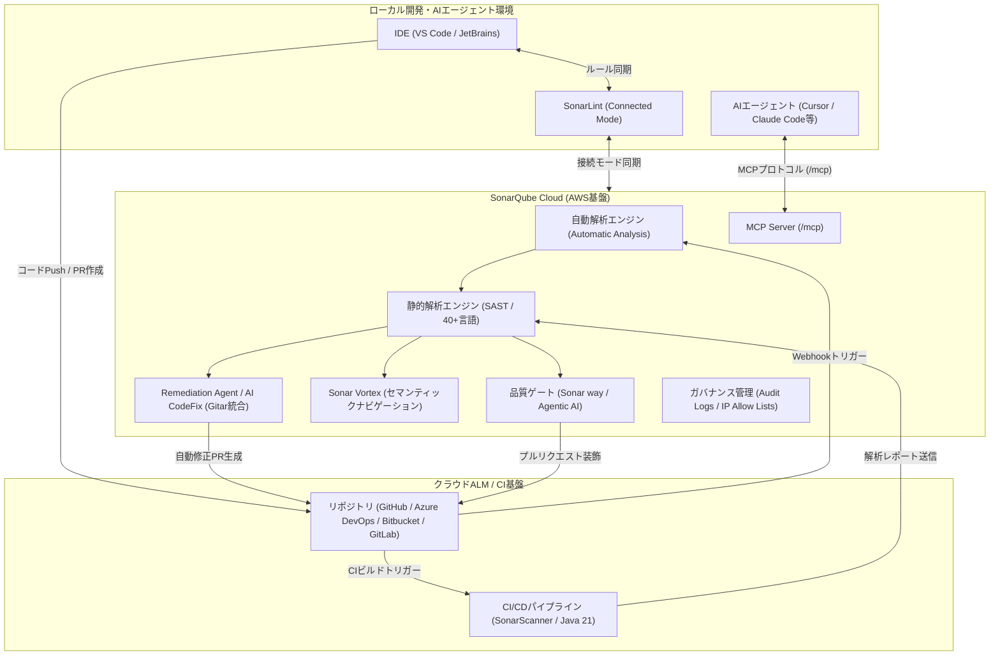

# **SonarQube Cloud 調査レポート**

## **1. 基本情報**

* **ツール名**: SonarQube Cloud (旧 SonarCloud)
* **ツールの読み方**: ソナーキューブ クラウド / ソナークラウド
* **開発元**: SonarSource
* **公式サイト**: [https://sonarcloud.io/](https://sonarcloud.io/)
* **関連リンク**:
  * ドキュメント: [https://docs.sonarcloud.io/](https://docs.sonarcloud.io/)
  * レビューサイト: [G2](https://www.g2.com/products/sonarqube/reviews) | [Capterra](https://www.capterra.com/p/168436/SonarCloud/)
  * コミュニティ: [https://community.sonarsource.com/c/sc/9](https://community.sonarsource.com/c/sc/9)
* **カテゴリ**: セキュリティ/静的解析
* **概要**: SonarQube Cloud は、開発者のワークフローに統合された完全マネージド型のクラウドコード品質・セキュリティ解析（SAST）プラットフォームです。40以上のプログラミング言語に対応し、バグ、脆弱性、セキュリティホットスポット、コードの臭い（Code Smells）を自動検出し、プルリクエストの段階で修正を促します。近年はAIエージェント時代に対応し、Agentic AI向け品質ゲート、MCP (Model Context Protocol) 連携、未解決負債を自律修正するRemediation Agentなどを標準装備しています。

## **2. 目的と主な利用シーン**

* **解決する課題**: プルリクエスト段階でのコード品質低下や脆弱性混入の早期防止（シフトレフト）、AI生成コードの急増に伴う品質・セキュリティの劣化、サーバーの構築・パッチ適用・運用保守に伴う管理コストの削減。
* **想定利用者**: クラウドALMを活用するソフトウェアエンジニア、DevOps/プラットフォームチーム、セキュリティエンジニア、オープンソースプロジェクトのメンテナ、AIコーディングツールを活用する開発組織。
* **利用シーン**:
  * GitHub, GitLab, Bitbucket, Azure DevOps 上のプルリクエストに対する自動コードレビューとマージ制御
  * オープンソースプロジェクトにおける高品質なコードベースの維持（無料枠活用）
  * AIコーディングアシスタント（Cursor, Windsurf, Claude Code, GitHub Copilot）が生成したコードのリアルタイム品質・セキュリティ検証
  * マルチリポジトリやマイクロサービス群のコード品質およびセキュリティ標準の統一ガバナンス

### **2.1 代表的な利用フロー**

```mermaid
swimlane-beta TB
  subgraph User["開発者 / AIエージェント"]
    A["コード修正・機能実装"]
    F["解析結果確認・PRマージ"]
  end
  subgraph ALM["クラウドALM (GitHub等)"]
    B["プルリクエスト作成・Push"]
    E["PR装飾・チェック判定表示"]
  end
  subgraph Cloud["SonarQube Cloud"]
    C["静的解析 & Agentic検証"]
    D["Quality Gate判定 & 自動修正提案"]
  end
  A --> B
  B --> C
  C --> D
  D --> E
  E --> F
```

* **代表的な流れ**: 開発者またはAIエージェントがコードを実装してプルリクエストを作成すると、クラウドALM（GitHub等）からSonarQube CloudへWebhookまたはCIスキャンが連携されます。SonarQube Cloud側で静的解析およびAIエージェント向け検証が実行され、Quality Gateの合否判定とPR装飾（コメントおよびステータスチェック）がリポジトリに自動反映されます。問題がある場合はAI CodeFixの修正案やRemediation AgentによるPR作成を活用して修正し、マージを完了します。

## **3. 主要機能**

* **マルチ言語解析**: Java, JavaScript, TypeScript, Python, C#, C++, Go, Rust, Kotlin, Swift, Ruby, PHPなど、40以上の主要なプログラミング言語およびIaC（Terraform, AWS CloudFormation等）を網羅。
* **自動解析 (Automatic Analysis) & 一括インポート (Bulk Repository Import)**: GitHub, GitLab, Azure DevOps, Bitbucket のワークスペースからワンクリックで全リポジトリを一括インポート可能。JS/TSやPython等の特定言語ではCI設定ファイル不要の自動解析に対応。
* **プルリクエスト装飾 (Pull Request Decoration)**: プルリクエストの変更行に対して直接インラインコメントを投稿し、バグや脆弱性、カバレッジ低下の原因と修正ガイドを表示。
* **品質ゲート (Quality Gates) & Sonar way for Agentic AI**: 「新規コードのカバレッジ80%以上」「クリティカル問題ゼロ」などの基準を設定。AI生成コードのリスク特性（依存関係や信頼性を重視し、微細なスタイル指摘を抑制）に特化した専用品質ゲートを提供。
* **SonarLint 連携 (Connected Mode)**: VS CodeやJetBrainsなどの主要IDEに拡張機能SonarLintを導入し、SonarQube Cloudの解析ルールセットとリアルタイム同期。
* **AI CodeFix**: 発見されたIssueに対して、LLMを活用してワンクリックで適用可能な修正差分を提示（主要言語の70%以上のIssueに対応）。
* **Remediation Agent**: GitHub等のプルリクエストを通じ、バックログにある既存の品質問題をスケジュールに従って自律的に修正・PR作成するエージェント機能。
* **Hunter Agent**: 従来の構文解析では発見が難しい、複雑なビジネスロジック欠陥やアクセス制御の不備をバックグラウンドでディープに自律探索。
* **Agentic Analysis & Sonar Vortex**: AIコーディングエージェントが生成したコードをリアルタイムで検証。セマンティックコードナビゲーション「Sonar Vortex」により、LLMのトークン消費を抑制しながら高精度なコンテキストを提供。
* **Model Context Protocol (MCP) Server**: AIエージェント（Cursor, Claude Code等）から直接SonarQube Cloudの解析データやルールセットにアクセスできる標準MCPエンドポイント（`/mcp`）を提供。
* **アーキテクチャ解析 (Architecture Analysis)**: 意図したソフトウェアアーキテクチャやレイヤー設計を定義し、プルリクエスト時のアーキテクチャドリフト（設計逸脱）を自動検知。

## **4. 動作原理・システム構成**

* **アーキテクチャ**: Amazon Web Services (AWS) 上でホストされる完全マネージド型のクラウドネイティブSaaS。
* **主要コンポーネントとデータフロー**:
  * **クライアント・IDE層**: ローカル環境（IDE）でSonarLintが動作し、クラウドとルール定義を同期。AIエージェントはMCP（Model Context Protocol）経由でSonarQube Cloudと直接やり取り。
  * **クラウドALM / CI層**: GitHub, Azure DevOps, Bitbucket, GitLab のリポジトリイベントを契機に、Automatic Analysis または CIパイプライン（Java 21ランタイム環境上のSonarScanner）が解析を実行。
  * **クラウド解析バックエンド**: AST（抽象構文木）生成、高度な汚染解析（Taint Analysis）、シンボリック実行を実施。Sonar Vortexがコード構造をセマンティックに整理し、Quality Gate判定、AI CodeFix生成、Remediation PR発行を一元処理。
* **特筆すべき要素技術**:
  * **クロスファイル汚染解析**: 複数ファイルや関数を跨ぐユーザー入力の流れを追跡し、インジェクション脆弱性を高精度に特定。
  * **MCPエンドポイント (`/mcp`)**: リバースプロキシ経由でAIエージェントに構造化コンテキストと解析結果を高速返却。
  * **Java 21 ランタイム標準採用**: 高速な並行処理とスキャナーエンジンの最適化を実現。



## **5. 開始手順・セットアップ**

* **前提条件**:
  * GitHub, Bitbucket, Azure DevOps, GitLab のいずれかのアカウント
  * CIパイプラインでSonarScannerを実行する場合は **Java 21 以上** のランタイム環境
* **導入手順**:
  1. 公式サイト（[https://sonarcloud.io/](https://sonarcloud.io/)）にアクセスし、既存のALMアカウントでログイン。
  2. 組織（Organization）を選択し、SonarQube Cloud アプリケーションをインストール。
  3. 「Import all repositories」を利用して対象リポジトリを一括インポート、または個別プロジェクトを作成。
  4. Automatic Analysis 対応言語（JS/TS, Python等）は即座に解析が開始。コンパイル言語（Java, C#, C++等）はCIパイプライン（GitHub Actions, Azure Pipelines等）にスニペットを追加。
* **初期設定**:
  * Quality Gate の選択（標準の "Sonar Way" または AI主導開発向けの "Sonar way for Agentic AI"）。
  * 解析対象範囲のカスタマイズ（`sonar-project.properties` における `sonar.sources`, `sonar.tests`, `sonar.exclusions` の定義）。
* **クイックスタート（GitHub Actionsワークフロー例）**:

```yaml
name: SonarQube Cloud Analysis
on:
  push:
    branches: [main]
  pull_request:
    types: [opened, synchronize, reopened]
jobs:
  sonarcloud:
    runs-on: ubuntu-latest
    steps:
      - uses: actions/checkout@v4
        with:
          fetch-depth: 0
      - name: Set up JDK 21
        uses: actions/setup-java@v4
        with:
          java-version: '21'
          distribution: 'temurin'
      - name: SonarQube Cloud Scan
        uses: SonarSource/sonarqube-scan-action@v5
        env:
          GITHUB_TOKEN: ${{ secrets.GITHUB_TOKEN }}
          SONAR_TOKEN: ${{ secrets.SONAR_TOKEN }}
```

## **6. 特徴・強み (Pros)**

* **完全マネージド＆インフラ運用ゼロ**: サーバー構築、DB管理、パッチ適用、スケーリングが一切不要で、常に最新の解析エンジンを即座に利用可能。
* **AIエージェント時代への先行対応**: MCP Server統合、Hunter Agent、Remediation Agent、Sonar Vortexなど、AIがコードを書く時代の品質・セキュリティ管理基盤として最も進んでいる。
* **Clean as You Code の実効性**: レガシーコードの負債に圧倒されることなく、「新しく追加・変更したコード」の品質維持に集中できる優れた開発思想と機能設計。
* **OSSコミュニティへの無償提供**: パブリックリポジトリに対してEnterprise相当の解析機能を完全無料で開放。
* **主要クラウドALMとの一括統合**: GitHubだけでなく、Azure DevOpsやBitbucketでもワークスペース全体の一括インポートに対応し、導入障壁が極めて低い。

## **7. 弱み・注意点 (Cons)**

* **オンプレミス版（Server）比の拡張性制約**: カスタムプラグインの自由な導入やデータベースレベルの直接調整はできず、SaaSの規約と機能範囲に準拠する必要がある。
* **クラウド送信の前提**: ソースコードのASTおよび解析メタデータがクラウド（AWS）上のSonarSource環境に送信されるため、完全閉域網や社外持ち出しが厳禁の組織では採用が難しい。
* **コード行数（LOC）課金**: 解析対象プライベートリポジトリの最大LOC数に基づく料金体系のため、大規模なモノレポやレガシーコードベースでは上位ティアへのアップグレードが必要。
* **英語中心のUI/ドキュメント**: Webインターフェースや公式ドキュメント、ルール解説は基本的に英語であり、日本語UIは公式提供されていない。

## **8. 料金プラン**

| プラン名 | 月額料金 | 主な特徴・制限 |
|:---|:---|:---|
| **Free (OSS / 個人)** | 無料 | パブリックリポジトリ（OSS）は無制限で無料。プライベートリポジトリは最大50k LOC（最大5メンバー）まで利用可能。 |
| **Team** | $34/月〜 | プライベートプロジェクト用。100k LOCから開始（LOC規模に応じて段階的にスケーリング）。無制限の組織メンバー、ブランチ/PR解析、高度なALM連携。 |
| **Enterprise** | 要問い合わせ | 大規模組織向け。階層型組織管理、監査ログ（Audit Logs）、IP制限リスト（IP Allow Lists）、Jira Cloud連携、PDFポートフォリオレポート、専任サポートSLA。 |

* **課金体系**: 組織内のプライベートプロジェクトにおける最大解析コード行数（LOC: Lines of Code）に基づく定額段階制。空行、コメント、テストコードはLOCのカウント対象から除外されます。
* **無料トライアル**: Teamプランの全機能を14日間試用可能な無料トライアルが用意されています。

## **9. 導入実績・事例**

* **導入企業**: 世界各国の数万社におよぶ企業やオープンソースコミュニティで採用。多くの人気OSSプロジェクト（Spring, Apache等の関連プロジェクト含む）でSonarQube Cloudの品質バッジが掲示されている。
* **導入事例**: クラウドネイティブな開発環境へ移行した企業において、プルリクエストごとのマージブロック基準（Quality Gate）を導入し、本番障害件数やセキュリティ脆弱性の混入を大幅削減した事例が多数報告されている。
* **業界評価**: 2026年 Gartner® Magic Quadrant™ の Technical Debt Management Tools（技術的負債管理ツール）分野において、SonarSourceが「Leader」に選出。

## **10. サポート体制**

* **ドキュメント**: [SonarQube Cloud Documentation](https://docs.sonarcloud.io/) にて、初期導入からCI設定、API仕様、ルール詳細まで体系的に網羅（英語）。
* **コミュニティ**: [Sonar Community Forum](https://community.sonarsource.com/c/sc/9) で開発チームや世界中のエンジニアが活発にディスカッション・Q&Aを実施。
* **公式サポート**: 有償プラン（Team/Enterprise）向けにサポートポータルおよびチケット制サポートを提供。EnterpriseプランではSLA保証や技術アカウント管理が利用可能。

## **11. エコシステムと連携**

### **11.1 API・外部サービス連携**

* **API**: 充実した RESTful Web API が公開されており、メトリクス取得、ユーザー管理、Quality Gate設定の自動化が可能。
* **MCP (Model Context Protocol)**: `/mcp` エンドポイントを介して Cursor、Claude Code、Windsurf 等のAIツールとネイティブ接続可能。
* **外部サービス連携**: GitHub, GitLab, Bitbucket, Azure DevOps との深い連携に加え、Jira Cloud（課題追跡連携）、Slack / Microsoft Teams（Webhook通知）に対応。

### **11.2 技術スタックとの相性**

| 技術スタック | 相性 | メリット・推奨理由 | 懸念点・注意点 |
|:---|:---:|:---|:---|
| **JavaScript / TypeScript** | ◎ | Automatic Analysisにより設定ファイル不要で即座に解析可能 | 特になし |
| **Java / Kotlin** | ◎ | Maven / Gradle プラグインで簡単統合。最新Java 21ランタイムで高速動作 | CI環境にJDK 21以上の導入が必須 |
| **Python** | ◎ | 自動解析および各種フレームワーク（Django/FastAPI等）に高精度対応 | 複雑な型アノテーションの解釈に一部留意 |
| **C# (.NET)** | ◯ | .NET スキャナーによりビルドプロセスと緊密に連携 | ビルドステップへの統合設定が必要 |
| **C / C++** | ◯ | Build Wrapper または Compilation Database による高精度解析 | ビルド環境のキャプチャ手順が必要 |
| **IaC (Terraform / CloudFormation)** | ◯ | インフラ構成のセキュリティミス・ベストプラクティス違反を検知 | ポリシーのカスタマイズ範囲に制限あり |

## **12. セキュリティとコンプライアンス**

* **認証**: GitHub, Bitbucket, Azure DevOps, GitLab のOAuth認証に対応。EnterpriseプランではSAML 2.0 SSOおよびSCIMプロビジョニングをサポート。
* **データ管理**: AWS (Amazon Web Services) 上で暗号化（保管時AES-256、転送時TLS 1.3）管理。解析処理完了後、ソースコード自体はサーバー上に永続保存されない（キャッシュおよびメタデータのみ保持）。
* **準拠規格**: SOC 2 Type II 認証、ISO/IEC 27001 認証取得済み。OWASP Top 10, CWE/SANS Top 25, OWASP MASVS（モバイル）、OWASP Top 10 for LLMs に準拠したセキュリティチェックを提供。
* **ガバナンス機能**: 組織内のセキュリティ監査用 **Audit Logs**、接続元制限を行う **IP Allow Lists**、新規プロジェクトの **Private-by-default（初期非公開）** 設定を完備。

## **13. 操作性 (UI/UX) と学習コスト**

* **UI/UX**: 洗練されたモダンなWebダッシュボード。「Overall Code」と「New Code」が明確に分離されており、現在のスプリントやPRで注力すべき品質指標が一目で把握できる。プロジェクト別ダッシュボードのカスタマイズも可能。
* **学習コスト**: 初期導入は数クリックで完了するため極めて低い。一方で、Quality Gateの閾値調整や、検出されたIssueが自社アーキテクチャに適合するかどうかの判断（Won't Fix / False Positive の運用）には一定の開発プラクティス習得が推奨される。

## **14. ベストプラクティス**

* **効果的な活用法 (Modern Practices)**:
  * **Clean as You Code の徹底**: 過去のレガシー負債の全件修正を目指すのではなく、「New Code（新規・変更コード）」に対して厳格なQuality Gateを設定し、負債の新規混入を確実に阻止する。
  * **Agentic AI 向け品質ゲートの適用**: AIコーディングアシスタントを多用するリポジトリでは、「Sonar way for Agentic AI」を採用して依存関係とセキュリティ脆弱性に集中し、レビューの摩擦を最小化する。
  * **SonarLint Connected Mode と MCP の併用**: IDEローカルでコミット前にリアルタイム検知し、AIエージェントにはMCP経由で解析コンテキストを与えることで、CIでの手戻りをゼロに近づける。
* **陥りやすい罠 (Antipatterns)**:
  * **CIパイプラインのJavaバージョン放置**: スキャナーのJava 21必須化に伴い、古いJava 11/17環境のCIランナーでビルドを実行して解析エラーを引き起こすミス。
  * **LOC制限の浪費**: 自動生成コードや外部ベンダーライブラリを `sonar.exclusions` で除外指定せず、無駄にLOC上限を消費してしまうこと。
  * **誤検知の放置によるオオカミ少年化**: プロジェクトに適さないルールを有効にしたまま放置し、開発者が警告を無視する文化に陥ること。不要なルールはプロファイルから調整するか適切に除外する。

## **15. ユーザーの声（レビュー分析）**

* **調査対象**: G2, Capterra, Reddit
* **総合評価**: 4.4 / 5.0 (静的コード解析分野でトップクラスの高評価)
* **ポジティブな評価**:
  * 「インフラ管理が不要で、GitHubのOrganizationを選択するだけで数分で全リポジトリの解析が始まった」
  * 「プルリクエストに直接具体的な改善コードや理由がコメントされるため、ジュニア層の教育にも大いに役立っている」
  * 「オープンソースプロジェクトなら無償でエンタープライズ級の解析機能が使える点が素晴らしい」
* **ネガティブな評価 / 改善要望**:
  * 「LOC（コード行数）ベースの課金モデルのため、リファクタリング前の巨大なコードベースを抱えているとコストが高額になりやすい」
  * 「大規模なモノレポにおけるプロジェクト分割や解析スコープの設定がやや複雑に感じられる」
  * 「UIやルールの詳細解説が英語のみのため、日本語の公式サポートやローカライズが待たれる」
* **特徴的なユースケース**:
  * AIコーディングアシスタント（Cursor等）の導入に伴い、AIが生成したコードの品質担保とサードパーティ依存関係の安全性チェックを行う「自動品質関門」としての活用。

## **16. 直近半年のアップデート情報**

* **2026-10**: AIエージェント時代に特化した品質ゲート **「Sonar way for Agentic AI」** およびセマンティックコードナビゲーション **「Sonar Vortex」** を提供。AI生成コードのリスク特性（依存関係・信頼性重視）に適合し、LLMトークン消費を効率化。
* **2026-09**: Azure DevOps および Bitbucket ワークスペース向けに **一括リポジトリインポート（Bulk Repository Import）** 機能を展開。進捗インジケータおよびサマリーレポート出力に対応。
* **2026-08**: AIコーディングアシスタント（Cursor, Claude Code等）から直接SonarQube Cloudの解析データを取得可能な **Model Context Protocol (MCP) Server**（`/mcp`）を標準統合。
* **2026-07**: SonarQube Cloudのスキャナー実行環境において **Java 21 ランタイムへの完全移行** を実施（Java 17以下の非推奨化と自動プロビジョニングの提供）。
* **2026-06**: 複雑なロジック欠陥やアクセス制御不備を自律探索する **「Hunter Agent」** の導入、および意図した設計からの乖離を検知する **アーキテクチャ解析（Architecture Analysis）** を強化。
* **2026-05**: AIコードレビュー基盤「Gitar」の技術統合に伴い、未解決コードバックログを自律修正・PR化する **「Remediation Agent」** をオープンベータ提供。AI CodeFixの対応Issueカバー率を70%以上に拡大。
* **2026-05**: エンタープライズ向けガバナンス機能として、**監査ログ（Audit Logs）**、**IP制限リスト（IP Allow Lists）**、**Jira Cloud連携**、**新規プロジェクトのPrivate-by-default化** を正式実装。
* **2026-05**: 2026年 Gartner® Magic Quadrant™ の Technical Debt Management Tools（技術的負債管理ツール）分野において **Leader** に選出。

(出典: [SonarSource Blog](https://www.sonarsource.com/blog/) / [Sonar Community Updates](https://community.sonarsource.com/c/sc/9))

## **17. 類似ツールとの比較**

### **17.1 機能比較表 (星取表)**

| 機能カテゴリ | 機能項目 | SonarQube Cloud | SonarQube Server | Snyk Code | GitHub Advanced Security |
|:---:|:---|:---:|:---:|:---:|:---:|
| **導入形態** | 提供形態 | SaaS (AWS) | オンプレミス / セルフホスト | SaaS | SaaS (GitHub統合) |
| **コード解析** | 対応言語数 | ◎<br><small>40言語以上</small> | ◎<br><small>30〜40言語</small> | ◯<br><small>主要20言語程度</small> | ◯<br><small>CodeQL対応言語</small> |
| **品質管理** | Code Smells / 負債管理 | ◎<br><small>Clean as You Code</small> | ◎<br><small>Clean as You Code</small> | △<br><small>セキュリティ中心</small> | △<br><small>セキュリティ中心</small> |
| **AIエージェント** | Agentic AI対応 / MCP | ◎<br><small>MCP / Vortex / Remediation</small> | ◯<br><small>AI CodeFix / MCP</small> | ◯<br><small>DeepCode AI修正</small> | ◎<br><small>Copilot Autofix</small> |
| **セキュリティ** | SAST / 脆弱性検知 | ◯<br><small>Taint Analysis対応</small> | ◯<br><small>Taint Analysis対応</small> | ◎<br><small>高精度脆弱性検知</small> | ◎<br><small>CodeQL / Secret Scanning</small> |
| **インフラ運用** | サーバー管理コスト | ◎<br><small>不要 (完全マネージド)</small> | ×<br><small>サーバー・DB管理必須</small> | ◎<br><small>不要 (完全マネージド)</small> | ◎<br><small>不要 (完全マネージド)</small> |
| **コスト** | OSS無料プラン | ◎<br><small>無制限で全機能無料</small> | ◎<br><small>Community版無料</small> | △<br><small>月間テスト回数制限</small> | ◎<br><small>パブリック無料</small> |

### **17.2 詳細比較**

| ツール名 | 特徴 | 強み | 弱み | 選択肢となるケース |
|:---|:---|:---|:---|:---|
| **SonarQube Cloud** | 業界標準SonarQubeのSaaS版。AI時代に向けたガバナンス機能（MCP、Remediation Agent等）を搭載。 | インフラ管理不要、GitHub等の主要ALMとの一括連携、40言語以上の圧倒的網羅性、OSS無料。 | プラグイン自由度や詳細設定はServer版に劣る。LOC課金。 | クラウドALMを利用し、サーバー運用保守をゼロに抑えて高品質・セキュリティを担保したい開発組織。 |
| **SonarQube Server** | セルフホスト・オンプレミス型SonarQube。 | 閉域網での完全運用、社内データガバナンス、カスタムプラグイン導入の自由度。 | サーバー・DBの構築、バージョンアップ、スケーリングなどの運用負荷が高い。 | 金融機関や官公庁など、ソースコードの社外クラウド持ち出しが厳格に禁止されている環境。 |
| **Snyk Code** | 開発者ファーストのセキュリティ特化型SASTツール。 | 高度な脆弱性データベース、Snyk Open Source (SCA) やコンテナセキュリティとの統合力。 | コード品質（保守性、Code Smells、命名規則等）の網羅性はSonarSourceに及ばない。 | アプリケーションセキュリティ（SAST/SCA/コンテナ）の脆弱性排除を最優先とするセキュリティチーム。 |
| **GitHub Advanced Security** | GitHubにネイティブ統合されたCodeQLベースのセキュリティスイート。 | GitHub UIとの一体感、シークレットスキャン、Copilot Autofixとの親和性。 | GitHub環境に依存し、他ALM（GitLab, Bitbucket等）では使えない。導入コストが高め。 | 開発環境全体をGitHub Enterpriseで統一しており、ネイティブなセキュリティ機能を活用したい組織。 |

## **18. 総評**

* **総合的な評価**:
  SonarQube Cloud は、長年業界標準として君臨するSonarQubeの強力なコード品質・静的解析（SAST）能力を、一切のインフラ管理コストなしで導入できる最高峰のSaaSソリューションです。特に2026年に入り、Gitar統合による「Remediation Agent」、AIエージェント向け品質ゲート「Sonar way for Agentic AI」、MCP Server統合などを矢継ぎ早にリリースし、単なる静的解析ツールから「AIエージェント時代のコード品質・セキュリティガバナンス基盤」へと決定的な進化を遂げています。
* **推奨されるチームやプロジェクト**:
  * GitHub、GitLab、Bitbucket、Azure DevOps を用いてクラウド開発を行うスタートアップからエンタープライズ企業。
  * Cursor、Claude Code、GitHub Copilot などのAIコーディングツールを積極的に導入し、コード品質の低下や依存関係リスクを防ぎたいチーム。
  * サーバー管理・インフラ保守にエンジニアリソースを割きたくないDevOpsチーム。
  * 信頼性の高い品質バッジを掲示し、クリーンなコードベースを維持したいオープンソースプロジェクト。
* **選択時のポイント**:
  自社の開発ポリシーにおいて「ソースコード/ASTをクラウドに送信可能か（セキュリティ基準）」と「サーバー運用コストを排除したいか」が第一の判断基準となります。クラウド移行に問題がなく、開発速度と品質を両立させたい組織にとっては、導入手順の容易さ・主要ALMとの親和性・OSS無償枠を含めて最も推奨できる選択肢です。
