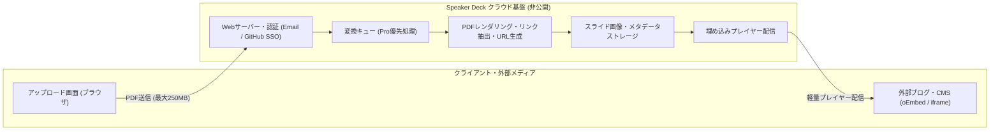

# **Speaker Deck 調査レポート**

## **1. 基本情報**

<!--
【ガイドライン】
- 必須: ツール名、開発元、公式サイト、カテゴリ、概要
- 概要は2-3文で簡潔に記述
-->

* **ツール名**: Speaker Deck
* **ツールの読み方**: スピーカーデック
* **開発元**: Speaker Deck, LLC
* **公式サイト**: [https://speakerdeck.com/](https://speakerdeck.com/)
* **関連リンク**:
  * 公式ブログ: [Speaker Deck Blog](https://blog.speakerdeck.com/)
  * ドキュメント: [Help Center](https://help.speakerdeck.com/)
  * レビューサイト: G2、Capterraにはレビューの登録なし（ITreviewには「スライド共有サービス」カテゴリで登録あり）。
* **カテゴリ**: スライド/プレゼンテーション
* **概要**: PDFファイルをアップロードするだけで、高品質なスライド共有プレイヤーに変換してくれるサービス。GitHubがかつて所有していた経緯もあり、特に技術者コミュニティでの利用率が高い。

## **2. 目的と主な利用シーン**

<!--
【ガイドライン】
- 3-5項目を箇条書きで記述
- 想定利用者を具体的に記載
- 末尾に「代表的な利用フロー」をスイムレーンで添付する
-->

* **解決する課題**:
  * スライド共有サービスにおける「フォント崩れ」や「レイアウト崩れ」の防止。
  * 広告過多で重いビューアによるユーザー体験の悪化の解消。
* **想定利用者**:
  * **エンジニア・開発者**: 勉強会やカンファレンスの登壇資料を共有。
  * **カンファレンス主催者**: イベント全体の登壇資料をまとめて公開。
  * **デザイナー・マーケター**: ポートフォリオやピッチ資料、ストーリーボードの共有。
* **利用シーン**:
  * 技術カンファレンス（RubyKaigi, DroidKaigi等）での登壇スライド公開
  * ブログやWebメディアへのスライド埋め込み
  * 社内勉強会資料のアーカイブ

### **2.1 代表的な利用フロー**

```mermaid
swimlane-beta TB
  subgraph User["ユーザー（登壇者）"]
    A[スライドをPDFで書き出し]
    B[タイトル・公開範囲を設定しアップロード]
    E[共有URL・埋め込みコードを取得]
  end
  subgraph SpeakerDeck["Speaker Deck"]
    C[PDFをページ画像とリンク座標へ変換]
    D[ローマ字URLスラッグとプレイヤーを生成]
  end
  subgraph Viewer["閲覧者・外部メディア"]
    F[ブログやSNS上でスライドを閲覧]
  end
  A --> B
  B --> C
  C --> D
  D --> E
  E --> F
```

* **代表的な流れ**: 登壇者がPDF化したスライドをアップロードすると、Speaker Deck側でページ単位の画像・クリック可能リンク・URLスラッグを自動生成し、生成された埋め込みコードやURLを通じて外部メディアやSNS上の閲覧者へ配信する。

## **3. 主要機能**

<!--
【ガイドライン】
- 5-10項目の主要機能を箇条書きで記述
- 各機能は1-2文で概要を説明
-->

* **PDFアップロード**: PDFファイルをドラッグ＆ドロップするだけで、ページごとに分割されたスライドプレイヤーを生成。
* **高品質な埋め込みプレイヤー**: レスポンシブ対応で、モバイルでもPCでも美しく表示される軽量なプレイヤー。oEmbedおよびiframeでの埋め込みに対応。
* **ソーシャル共有**: X (Twitter) やFacebookへのOGP対応共有。
* **スライド内リンク**: PDF内のハイパーリンクを認識し、スライド上でクリック可能にする機能（2025年12月追加）。
* **ローマ字URL自動生成**: 日本語タイトルを含むプレゼンテーションタイトルから、自然で可読性の高いローマ字URLスラッグを自動生成（2026年8月改善）。
* **コレクション機能**: アカウント内の複数のスライドを整理し、コレクションとしてまとめてナビゲーションしやすくする機能。
* **Pro機能（有料）**:
  * 優先スライド処理（Priority slide processing）
  * パスワード保護 / 限定公開URL (Private URLs) / カスタムURL
  * スライドのダウンロード禁止設定
  * 予約投稿 (Scheduled publishing)
  * サインイン中の広告非表示および埋め込みプレイヤーのブランディング削除
  * スライドノート（各スライドへの補足テキスト追加）
  * 指定ドメインでのみ埋め込みを許可する制限機能 (Domain-level privacy)
  * 埋め込みプレイヤーのプログレスバーの色変更

## **4. 動作原理・システム構成**

<!--
【ガイドライン】
- ツールの動作原理、システム構成（アーキテクチャ）、データの流れ、通信フローなどを記述
- クライアント・サーバー型、ローカルファースト、クラウド完結など、ツールのアーキテクチャ特性を明記
- 可能であればMermaidによる構成図やフロー図を含めること
-->

* **アーキテクチャ**: クラウド完結型のSaaS構成。内部のソースコードやインフラ詳細は非公開だが、Webアップロード画面、非同期のPDF変換パイプライン、および埋め込みプレイヤー配信基盤で構成されている。
* **主要コンポーネントとデータフロー**:
  * **アップロード・メタデータ登録**: ユーザーがブラウザからPDF（Free最大150MB / Pro最大250MB）とタイトル・公開設定を送信。
  * **PDF変換・解析パイプライン**: バックエンドの変換ワーカー（Proプランは優先キューで処理）がPDFを各ページの画像データへレンダリングすると同時に、PDF内のハイパーリンク座標やテキスト情報、タイトルからのローマ字URLスラッグを生成。
  * **プレイヤー配信・埋め込み**: 生成されたスライドデータとメタデータをWebプレイヤーおよびoEmbedエンドポイント経由で外部ブログ・CMSへ配信。



* **特筆すべき要素技術**:
  * **PDFラスタライズとリンクオーバーレイ**: フォント埋め込みやレイアウトを崩さずページ画像化しつつ、PDF内のリンク領域を抽出してプレイヤー上にクリッカブル領域として重ね合わせる仕組み。
  * **oEmbedプロトコル対応**: URLを貼り付けるだけでWordPressや各種ブログプラットフォームが自動的に埋め込みプレイヤーを展開可能。
  * **日本語タイトル対応URLスラッグ生成**: 2026年8月のアップデートにより、日本語タイトルからより正確なローマ字スラッグを自動生成する処理へ改善。

## **5. 開始手順・セットアップ**

<!--
【ガイドライン】
- アカウント作成から「Hello World」的な最初の動作確認までの手順
- 主要なコマンドや設定項目を記載
-->

* **前提条件**:
  * Webブラウザ（Chrome, Safari, Edge等）
  * アカウント作成（メールアドレス、またはGitHubアカウント）
* **インストール/導入**:
  SaaS型のためインストールは不要。ブラウザから公式サイトにアクセスして利用開始。

  ```bash
  # URL
  https://speakerdeck.com/
  ```

* **初期設定**:
  * アカウント作成後、プロフィール（Bio、Webサイトリンク）を設定。
* **クイックスタート**:
  * ログイン後、ヘッダーの「Upload a deck」ボタンをクリック。
  * PDFファイルをドラッグ＆ドロップ。
  * タイトル、説明文、カテゴリ・タグを設定して「Save this deck」をクリック。

## **6. 特徴・強み (Pros)**

<!--
【ガイドライン】
- 3-5項目を箇条書きで記述
- 競合との差別化ポイントを明確に
-->

* **PDF完全準拠**: PDFをベースとしているため、PowerPointやKeynoteのバージョン違いによるフォントやレイアウトの崩れが一切発生しない。
* **クリーンなUI**: 競合サービス（SlideShareなど）に比べて広告表示が控えめで（Proではサインイン中の広告非表示や埋め込みブランディング削除が可能）、コンテンツを邪魔しないシンプルなデザイン。
* **開発者親和性**: Markdownやコードブロックを多用するエンジニアのスライド（PDF化されたもの）と相性が良く、GitHubアカウントでのログインや日本語タイトルのローマ字URL生成にも対応。

## **7. 弱み・注意点 (Cons)**

<!--
【ガイドライン】
- 3-5項目を箇条書きで記述
- 日本語対応の状況は必ず含める
-->

* **アニメーション・動画非対応**: PDFに変換してアップロードする仕組み上、PowerPointのアニメーションや動画埋め込み、画面切り替え効果は再現できない。
* **日本語検索の弱さとUI言語**: テキスト抽出は行われるが、サイト自体が英語UIであり、日本語の検索精度やOCR機能は日本の競合サービス（Docswell）に比べると弱い。
* **差替更新・アップロード制限**: URLを維持したままの中身差し替えには対応しておらず（再アップロードが必要）、無料プランでは1日10件・生涯100件までのアップロード制限がある。

## **8. 料金プラン**

<!--
【ガイドライン】
- 表形式で整理することを推奨
- 最新の料金情報であることを確認
- 価格は通貨を明記（例: $10/月、¥1,000/月）
-->

| プラン名 | 料金 | 主な特徴 |
|---|---|---|
| **Free** | 無料 | 1日10ファイルまで・生涯100ファイル制限。1ファイル最大150MB。公開共有のみ。広告表示あり。 |
| **Pro** | $8/月<br>($80/年※) | 無制限アップロード。1ファイル最大250MB。優先スライド処理、プライベートURL、パスワード保護、カスタムURL、ダウンロード禁止、ブランディング削除・広告非表示、予約投稿、スライドノート、埋め込みドメイン制限。 |

※年額プランはBlack Friday等のキャンペーン期間中に **$50/年** などの割引価格で提供されることがある。

* **課金体系**: 月額または年額サブスクリプション（USD建て）。いつでもキャンセル可能で、請求期間終了までPro特典を維持。
* **無料トライアル**: Proプランのトライアルについては公式サイトに明記なし（Freeプランで基本的な公開・埋め込み機能を確認可能）。

## **9. 導入実績・事例**

<!--
【ガイドライン】
- 具体的な企業名を3-5社挙げる
- 導入事例がない場合は「公開事例なし。ただし、〜の分野での利用が報告されている」等
-->

* **導入企業**: Mercari, LINE, Plaid, SugarCRM など、多くのテック企業がテックブログやイベントで利用。
* **導入事例**:
  * **Mercari**: エンジニアの登壇資料をSpeaker Deckで公開し、テックブログに埋め込んで活用。
  * **Rails World**: カンファレンスのセッション資料の公式アーカイブ場所として利用。
* **対象業界**: ソフトウェア開発、Web制作、スタートアップ界隈でデファクトスタンダードに近い地位にある。

## **10. サポート体制**

<!--
【ガイドライン】
- ドキュメント、コミュニティ、公式サポートの3項目を必ず含める
- URLがあれば記載
-->

* **ドキュメント**: [Help Center](https://help.speakerdeck.com/) にFAQ、アップロード手順、WordPress/Wix/Canvas向けの埋め込みガイドがまとまっている。
* **コミュニティ**: 特定の公式ユーザーフォーラムはないが、X (Twitter) や技術ブログ上で開発者コミュニティによる情報発信が活発。
* **公式サポート**: メール（`support@speakerdeck.com`）での問い合わせ窓口あり（英語対応）。

## **11. エコシステムと連携**

<!--
【ガイドライン】
- API、外部連携、技術スタックとの相性を包括的に記述
-->

### **11.1 API・外部サービス連携**

<!--
【ガイドライン】
- APIの有無と公開状況を明記
- 主要連携サービスを5-10個リストアップ
-->

* **API**: 公開REST APIは提供されていないが、**oEmbed** に対応しており、WordPress、Wix、Canvas LMS、各種CMSやブログプラットフォームへの埋め込みが容易。
* **外部サービス連携**: GitHubアカウントを使用したSSO（シングルサインオン）に対応。

### **11.2 技術スタックとの相性**

<!--
【ガイドライン】
- 主要なフレームワークや言語との相性を表形式で整理
- 相性: ◎ (非常に良い), ◯ (良い), △ (工夫が必要/一部非対応), × (非推奨)
-->

| 技術スタック | 相性 | メリット・推奨理由 | 懸念点・注意点 |
|:---|:---:|:---|:---|
| **Markdown (Marp/Slidev)** | ◎ | PDFエクスポートしてアップロードするフローが確立されている | アニメーションは無効化される |
| **Keynote / PowerPoint** | ◯ | PDF化してアップロードすればデザインを完全維持できる | 動画や音声は反映されない |
| **WordPress / Hugo** | ◎ | oEmbedやiframeで簡単に記事内にスライドを埋め込める | 特になし |

## **12. セキュリティとコンプライアンス**

<!--
【ガイドライン】
- 認証、データ管理、準拠規格の3項目を必ず調査
- 情報が見つからない場合は「公式サイトで公開されていない。問い合わせが必要。」と記載
- 「不明」「見つからず」のみの記載は避ける
-->

* **認証**: メールアドレスまたはGitHubアカウントによる認証。
* **データ管理**: Proプランではスライドを非公開（パスワード保護、限定公開URL、本人限定「Only myself」設定、埋め込みドメイン制限）に設定可能。
* **準拠規格**: 詳細なコンプライアンス認証（SOC2等）の取得状況は公式サイト上で公開されていない。個別の問い合わせが必要。

## **13. 操作性 (UI/UX) と学習コスト**

<!--
【ガイドライン】
- 実際の使用感や、類似ツールとの比較を含める
-->

* **UI/UX**: 「アップロードして公開する」という機能に特化しており、迷う要素がない極めてシンプルなUI。
* **学習コスト**: PDFを作成できるスキルがあれば、ツールの学習コストはほぼゼロ。

## **14. ベストプラクティス**

<!--
【ガイドライン】
- ツールを効果的に活用するための推奨事項や、避けるべきアンチパターンを記述
- 公式ドキュメントのBest Practicesや、熟練エンジニアの知見を参考にする
-->

* **効果的な活用法 (Modern Practices)**:
  * スライド作成ツール（Keynote, PowerPoint, Gamma, Slidev）で「PDFエクスポート」を行い、Speaker Deckにアップロードする。公式ヘルプでは鮮明な表示のため、横幅 **1024px以上（最大1920px）** での書き出しが推奨されている。
  * ブログ記事やイベントレポート記事に埋め込みコード（Embed Code）を貼り付けて、記事の滞在時間を延ばす。
* **陥りやすい罠 (Antipatterns)**:
  * アニメーションを前提としたスライド構成にしてしまい、PDF化した際に意味が通じなくなる（ステップ表示など）。
  * 小さすぎるフォントを使用する（モバイル閲覧時に読みにくくなる）。

## **15. ユーザーの声（レビュー分析）**

<!--
【ガイドライン】
- 必須調査サイト: G2, Capterra, ITreview（日本語レビュー）のうち該当するもの
- 追加調査サイト: App Store, Google Play, X(Twitter), Reddit等
- 総合評価スコアがあれば必ず記載
- ポジティブ・ネガティブ各3項目以上
-->

* **調査対象**: ITreview、開発者ブログ、X (Twitter)
* **総合評価**: 3.5 / 5.0（ITreview「スライド共有サービス」カテゴリより引用。G2・Capterraにはレビューの登録なし）。開発者コミュニティでは長年愛用されており信頼性は高い。
* **ポジティブな評価**:
  * 「SlideShareが重くなったり使いにくくなった際、Speaker Deckに移行して快適になった」（技術ブログより要約）
  * 「PDFベースなので勝手にレイアウトやフォントが変わらず安心」（開発者ブログ・Xより要約）
  * 「UIがシンプルで広告が控えめなため、ブログやQiita/Zennへの埋め込みに最適」（ITreview・技術ブログより要約）
* **ネガティブな評価 / 改善要望**:
  * 「日本語検索がいまいちで、国内資料の探しやすさではDocswellに劣る」（X・技術ブログより要約）
  * 「動画が埋め込めないのが残念（YouTubeリンク等で代用が必要）」（開発者ブログより要約）
  * 「詳細なアクセス解析やページごとの閲覧分析機能が不足している」（ITreviewより要約）

## **16. 直近半年のアップデート情報**

<!--
【ガイドライン】
- 日付の降順（新しいものが上）
- 3-10項目をリストアップ
- 各項目に日付と概要を含める
- 情報源のURLを記載
-->

* **2026-08-10**: **Better URLs for Japanese Presentations** - 日本語タイトルのプレゼンテーションをアップロードした際のURL生成ロジックを改善。より正確で自然なローマ字（Romanized）URLが自動生成されるようになった。既存プレゼンテーションの再処理依頼（`support@speakerdeck.com` 宛）および旧URLからの自動リダイレクトにも対応。
* **2025-12-28**: **2025’s Most Viewed Speaker Deck Presentations** - 年間ランキング（Most Viewed Decks）の発表。
* **2025-12-27**: **Introducing Clickable Links** - スライド内のリンクをクリック可能にする機能を追加。これまでPDF内のリンクは無効化されていたが、閲覧者が直接リソースにアクセス可能になった。
* **2025-12-26**: **Trending Storyboards of 2025** - ストーリーボード機能のトレンド公開。

(出典: [Speaker Deck Blog](https://blog.speakerdeck.com/))

## **17. 類似ツールとの比較**

<!--
【ガイドライン】
- 3-5個の類似ツールと比較
- **機能比較表（星取表）**と**詳細比較**の2つの観点で記述する
-->

### **17.1 機能比較表 (星取表)**

<!--
【記載ルール】
- 縦軸に主要機能、横軸にツールを配置
- 記号の意味:
  - ◎: 非常に優れている / カタログスペック以上の機能 / 独自強み
  - ◯: 対応している / 標準的な機能
  - △: 一部対応 / 制限あり / アドオンが必要
  - ×: 非対応
  - -: 不明 / 該当なし
- 中立性を保つため、比較対象のツールが得意とする機能も平等にリストアップすること
-->

| 機能カテゴリ | 機能項目 | Speaker Deck | SlideShare | Docswell | Google Slides |
|:---:|:---|:---:|:---:|:---:|:---:|
| **基本機能** | PDF再現性 | ◎<br><small>完全維持</small> | ◯<br><small>概ね維持</small> | ◎<br><small>完全維持</small> | △<br><small>変換時崩れあり</small> |
| **表現力** | アニメーション | ×<br><small>非対応</small> | ×<br><small>非対応</small> | ×<br><small>非対応</small> | ◎<br><small>対応</small> |
| **メディア** | 動画共有 | ×<br><small>非対応</small> | △<br><small>制限あり</small> | ◎<br><small>MP4掲載・限定共有可</small> | △<br><small>埋め込みのみ</small> |
| **運用** | 差替更新 | ×<br><small>再アップロード必要</small> | ◯<br><small>可能</small> | ◎<br><small>URL維持で更新可</small> | ◎<br><small>常時最新</small> |
| **機能** | スライド内リンク | ◎<br><small>対応（2025年12月〜）</small> | ×<br><small>非対応</small> | ◎<br><small>クリッカブル</small> | ◎<br><small>対応</small> |
| **UX** | 広告の少なさ | ◎<br><small>非常に少ない</small> | △<br><small>多い</small> | ◯<br><small>適度</small> | ◎<br><small>なし</small> |
| **非機能要件** | 日本語検索・OCR | △<br><small>弱め</small> | ◯<br><small>普通</small> | ◎<br><small>非常に強い（OCR対応）</small> | ◎<br><small>強い</small> |

### **17.2 詳細比較**

<!--
【ガイドライン】
- 定性的な違いや、どのようなユーザーに向いているかを記述
-->

| ツール名 | 特徴 | 強み | 弱み | 選択肢となるケース |
|---|---|---|---|---|
| **Speaker Deck** | 開発者向け、シンプル | PDFレイアウトの完全維持、クリーンなUI | アニメーション不可、動画不可、日本語検索弱 | エンジニアの登壇資料、デザイン重視のPDF共有 |
| **SlideShare** | 老舗、Scribd傘下 | 膨大なユーザー数、SEOの強さ | 広告が多い、動作が重い場合がある | グローバルにリーチしたい場合 |
| **Docswell** | 日本発の共有サービス | 日本語検索・OCRに強い、URL維持更新、動画共有・限定共有対応 | ユーザー数はSlideShareに劣る | 日本国内向けのマーケティング、継続更新資料や動画共有が必要な場合 |
| **Google Slides** | 編集・共有一体型 | ブラウザで編集してそのまま共有可、アニメーション対応 | 埋め込みプレイヤーがやや重い、他ツールで作ったPDFの取り込みは不向き | 編集機能を重視する場合、動画やアニメーションを使いたい場合 |

## **18. 総評**

<!--
【ガイドライン】
- 総合評価、推奨チーム、選択ポイントの3項目を必ず含める
- 客観的で中立的な評価を心がける
-->

* **総合的な評価**:
  * Speaker Deckは、**「作ったそのままのデザインで見せる」** ことに特化した、非常に硬派で信頼性の高いツールである。多機能ではないが、スライド共有に必要な機能（高画質表示、軽量な埋め込み、ダウンロード制御、クリック可能リンク）が高いレベルでまとまっている。2026年8月には日本語タイトルのローマ字URL生成も改善されており、特にITエンジニア界隈でのブランディングには欠かせないプラットフォーム。
* **推奨されるチームやプロジェクト**:
  * **技術広報・DevRel**: エンジニアの登壇資料をアーカイブし、企業の技術力をアピールする用途。
  * **デザインにこだわるマーケター**: フォントやレイアウトにこだわった資料を、崩さずにWebで公開したい場合。
* **選択時のポイント**:
  * **PDFで作った資料を崩さずにグローバル・技術者向けに見せたい**ならSpeaker Deck、**URL維持の差し替え更新や日本語検索・動画共有を重視する**ならDocswellが有力な選択肢となる。
  * **アニメーションや動画**を見せたいならGoogle SlidesやYouTubeへ動画としてアップロードすることを検討すべき。
