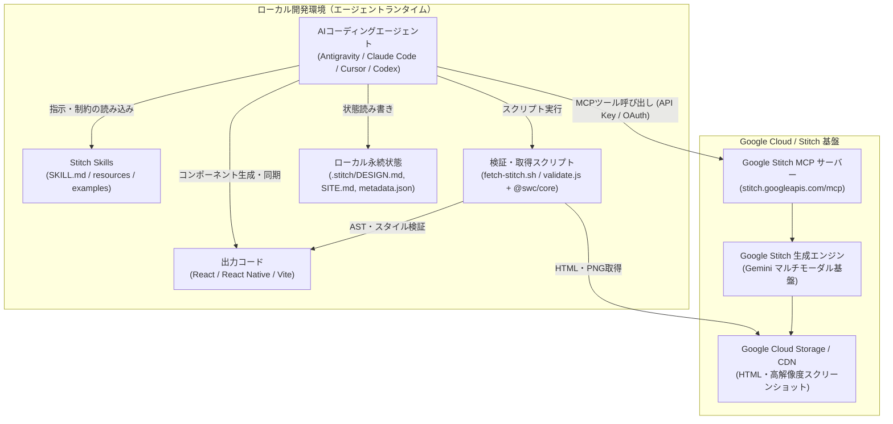

# **Stitch Skills 調査レポート**

## **1. 基本情報**

* **ツール名**: Stitch Skills (google-labs-code/stitch-skills / Stitch Design Skills)
* **ツールの読み方**: スティッチ スキルズ
* **開発元**: Google Labs
* **公式サイト**: [https://github.com/google-labs-code/stitch-skills](https://github.com/google-labs-code/stitch-skills)
* **関連リンク**:
  * GitHub: [https://github.com/google-labs-code/stitch-skills](https://github.com/google-labs-code/stitch-skills)
  * ドキュメント（Stitch MCP Setup）: [https://stitch.withgoogle.com/docs/mcp/setup/](https://stitch.withgoogle.com/docs/mcp/setup/)
  * Google Stitch 公式サイト: [https://stitch.withgoogle.com/](https://stitch.withgoogle.com/)
* **カテゴリ**: エージェントスキル/標準仕様
* **概要**: Stitch Skillsは、Google Labsが公開しているAIエージェント向けの公式スキルおよびプラグインライブラリです。オープン標準である[Agent Skills](https://agentskills.io)仕様に準拠しており、Google StitchのMCP（Model Context Protocol）サーバーと連携してUIデザイン生成、デザインシステム（`DESIGN.md`）管理、およびReact・React Native・Viteダッシュボードなどへのコード変換をAIコーディングエージェント上で直接実行可能にします。

## **2. 目的と主な利用シーン**

* **解決する課題**:
  * AIコーディングエージェントによるUI実装で発生しがちなデザイン崩れ（いわゆる「AI Slop」）や、プロジェクト固有のカラー・タイポグラフィの不整合を解消する。
  * デザインツール（Google Stitch）とコードエディタ・CLI間の手動ハンドオフ作業をなくし、デザイン変更とフロントエンド実装を同期させる。
  * 曖昧な自然言語プロンプトを、UI/UXの専門用語やレイアウト構造を含んだ高品質なデザイン指示へ自動変換する。
* **想定利用者**:
  * Claude Code、Cursor、Codex、Gemini CLI、Antigravityなどを活用するフロントエンド・フルスタック開発者
  * AIを活用した高速プロトタイピングやデザインシステム運用を行うUI/UXデザイナー
  * マルチページWebサイトの自律的な構築ループを回したいプロダクト開発チーム
* **利用シーン**:
  * テキストや参考画像からGoogle Stitch上で新規UI画面や複数バリエーションを生成し、そのままReactコンポーネントへ変換する。
  * 既存のReact・Vue・Angular・Svelte等のフロントエンドコードから`DESIGN.md`や静的HTMLを抽出し、Google Stitch側へ逆取り込み（Code-to-Design）する。
  * `.stitch/SITE.md`と`.stitch/DESIGN.md`を長期記憶（憲法）として維持しながら、`stitch-loop`による自律的なマルチページサイト構築を実行する。

### **2.1 代表的な利用フロー**

```mermaid
swimlane-beta TB
  subgraph User["ユーザー（開発者・デザイナー）"]
    A["自然言語でUI生成・変換を指示"]
    F["生成されたUIコード・デザインを確認"]
  end
  subgraph Agent["AIコーディングエージェント"]
    B["SKILL.mdを読み込み手順・制約を把握"]
    D["ローカルスクリプトでアセット取得・AST検証"]
    E["コンポーネントコードとDESIGN.mdを出力"]
  end
  subgraph StitchMCP["Google Stitch MCPサーバー"]
    C["デザイン生成・画面メタデータ取得を実行"]
  end
  A --> B
  B --> C
  C --> D
  D --> E
  E --> F
```

* **代表的な流れ**: ユーザーがAIコーディングエージェントにUI生成や変換を指示すると、エージェントが該当スキルの`SKILL.md`を読み込んで手順・ゲート条件を解釈します。その後、エージェントはGoogle Stitch MCPサーバーを通じてデザイン生成やメタデータ取得を行い、同梱のシェルスクリプトや`@swc/core`ベースのAST検証スクリプトを実行して高品質なコンポーネントや`DESIGN.md`を出力します。

## **3. 主要機能**

Stitch Skillsは用途別に**3つのプラグイン（計16スキル）**として構成されています。

* **`stitch-design` プラグイン（デザインワークフロー）**:
  * **`stitch::generate-design`**: テキストや画像から新規画面を生成し、既存画面の編集やダークモード・高密度レイアウトなどの複数バリエーションを展開します。
  * **`stitch::code-to-design`**: React、Vue、Angularなどの既存フロントエンドコードを静的HTMLおよびデザインシステム抽出演算を通じてGoogle Stitchプロジェクトへ変換・アップロードします。
  * **`stitch::manage-design-system` / `stitch::extract-design-md`**: プロジェクトのソースコードから`DESIGN.md`を抽出したり、`.stitch/DESIGN.md`をGoogle Stitchへアップロードして全画面へテーマ適用したりします。
  * **`stitch::extract-static-html` / `stitch::upload-to-stitch`**: 実行中のWebアプリ（認証保護されたページや開発用オーバーレイの除去を含む）から自己完結型の静的HTMLを抽出し、画像やモックアップとともにStitchプロジェクトへ送信します。
* **`stitch-build` プラグイン（コード生成・ビルド）**:
  * **`stitch::react-components`**: Stitch画面のHTMLとスクリーンショットを取得し、`tailwind.config`からトークンを抽出してモジュール化されたVite + Reactコンポーネントへ変換・同期します。`@swc/core`によるAST構文・Props型・カラーハードコード検証を内蔵しています。
  * **`stitch::react-native`**: StitchのHTMLデザインを、StyleSheetやプラットフォーム固有コードを備えた本番品質のReact Nativeコンポーネントへ変換します。
  * **`react-vite-dashboard`**: TanStack Queryや`DESIGN.md`トークン、Web3読み取りパターンを取り入れたReact + Viteダッシュボードを構築します。
  * **`remotion` / `shadcn-ui`**: Stitchプロジェクトの画面遷移をズームやトランジション付きの紹介動画として生成するRemotionスキル、およびshadcn/uiの導入・カスタマイズ支援スキルを提供します。
* **`stitch-utilities` プラグイン（プロンプト強化・自律構築支援）**:
  * **`design-md` / `taste-design`**: Stitchプロジェクトを解析して意味的な言語で`DESIGN.md`を生成する機能、および安直なAIデザイン（AI Slop）を排した高品質タイポグラフィ・配色基準の`DESIGN.md`を生成する機能を提供します。
  * **`enhance-prompt`**: 「設定画面を作って」といった曖昧な指示を、UI/UXキーワードと構造を含むStitch最適化プロンプトへ磨き上げます。
  * **`stitch-loop` / `site-md`**: プロジェクトの憲法となる`.stitch/SITE.md`を生成し、バトン渡しファイル（`.stitch/next-prompt.md`）を更新しながらマルチページサイトを自律的・反復的に構築します。

## **4. 動作原理・システム構成**

* **アーキテクチャ**: **オープン標準スキル定義（Markdown + ローカルスクリプト）＋ リモートMCPクライアント・サーバー構成**を採用しています。リポジトリ自体はサーバープロセスを持たず、AIコーディングエージェントのローカル環境（プロジェクトまたはユーザーホーム配下）に展開され、GoogleがホストするリモートMCPサーバー（`https://stitch.googleapis.com/mcp`）とローカルのCLIツール群を仲介します。
* **主要コンポーネントとデータフロー**:
  * **`SKILL.md`（ミッションコントロール）**: 各スキルの行動規範、ゲート条件（GATE）、禁止事項（Anti-patterns）、利用可能ツール（`allowed-tools`）を定義します。
  * **`scripts/`（実行・検証エンフォーサー）**: Google Cloud Storage上のHTML/スクリーンショットを確実に取得する`fetch-stitch.sh`や、`@swc/core`でTypeScript/TSXのASTを走査し`Props`インターフェース定義漏れや`className`内の直接Hexカラー指定を検知する`validate.js`を含みます。
  * **`resources/` & `examples/`**: チェックリスト、スタイルガイド（`style-guide.json`）、ゴールドスタンダードの実装例を格納し、生成品質を担保します。
  * **永続状態ファイル（`.stitch/`）**: `DESIGN.md`（デザイン契約）、`SITE.md`（サイト憲法）、`metadata.json`（最終同期時刻や画面マップ）、`next-prompt.md`（自律ループのバトン）をローカルに保存し、セッションを跨いだ一貫性を保ちます。



* **特筆すべき要素技術**:
  * **ゲート付きプロンプト設計（Gated Execution）**: `SKILL.md`内でPhaseごとに必須ゲートを設け、スクリーンショットの視覚確認（Visual Audit）や`fetch-stitch.sh`経由の取得を飛ばすショートカットを抑止します。
  * **ASTベース静的検証（`@swc/core`）**: 正規表現だけでなくSWCパーサーでTSX構文木を解析することで、コンポーネントの型安全性とデザイントークン準拠を自動保証します。
  * **バトンリレー式自律ループ**: `stitch-loop`では`.stitch/next-prompt.md`に次ページの要件を書き出すことで、コンテキスト長の上限に左右されない反復構築を実現しています。

## **5. 開始手順・セットアップ**

* **前提条件**:
  * Node.js（`npx`および検証スクリプト実行のため v18.0.0 以上推奨）
  * 対応するAIコーディングエージェント（Codex、Antigravity、Gemini CLI、Claude Code、Cursor、OpenCodeなど）
  * **Google Stitch MCPサーバー**の事前設定（GoogleアカウントでのStitch利用と、`STITCH_API_KEY`またはGoogle Cloud `gcloud` OAuth認証の準備）
* **インストール/導入**:
  利用するエージェントに応じてプラグイン単位または個別スキル単位で導入します。

  ```bash
  # 1. 個別スキルを選択して導入する場合（汎用CLI）
  npx skills add google-labs-code/stitch-skills

  # 2. Claude Code 向けプラグイン一括導入（プロジェクトスコープ）
  npx plugins add google-labs-code/stitch-skills --scope project --target claude-code

  # 3. Cursor 向けプラグイン一括導入（ワークスペーススコープ）
  npx plugins add google-labs-code/stitch-skills --scope workspace --target cursor

  # 4. Codex CLI 向けマーケットプレイス登録（スパースチェックアウト対応）
  codex plugin marketplace add google-labs-code/stitch-skills --ref main \
    --sparse .agents/plugins \
    --sparse plugins/stitch-design \
    --sparse plugins/stitch-build \
    --sparse plugins/stitch-utilities
  ```

* **初期設定**:
  1. [Google Stitch MCP Setup](https://stitch.withgoogle.com/docs/mcp/setup/)に従い、Google Stitch設定画面からAPIキーを発行するか、`gcloud auth login`でStitch APIを有効化します。
  2. エージェントのMCP設定ファイル（`mcp.json`や`opencode.json`など）にStitch MCPエンドポイントを登録し、環境変数`STITCH_API_KEY`にプレースホルダーではなくご自身のキーを設定します。

  ```json
  {
    "mcpServers": {
      "stitch": {
        "url": "https://stitch.googleapis.com/mcp",
        "env_http_headers": {
          "X-Goog-Api-Key": "<YOUR_STITCH_API_KEY>"
        }
      }
    }
  }
  ```

* **クイックスタート**:
  * 導入後、エージェントのチャット画面で以下のように指示するだけでスキルが発火します。
    * プロンプト改善: `Enhance this prompt: 'make a settings page'`
    * 画面生成: `Make a browse tab for a mobile app for romance and date night ideas.`
    * React変換: `Convert all screens in Stitch project projects/123 to React components.`

## **6. 特徴・強み (Pros)**

* **主要コーディングエージェントへの広範なポータビリティ**: Agent Skillsオープン標準に準拠しているため、特定のベンダー製IDEにロックインされず、Antigravity、Gemini CLI、Claude Code、Cursor、Codex、OpenCodeで同じスキル資産を使い回せます。
* **デザインとコードの双方向同期（Round-trip）**: テキスト・画像からデザインを作るだけでなく、既存のReact/Vue/Angularアプリから`DESIGN.md`や静的HTMLを吸い上げてStitchへ戻す`code-to-design`までカバーしており、既存プロダクトの刷新にも対応できます。
* **検証スクリプトによる高いコード品質**: 単なるプロンプト集にとどまらず、`@swc/core`を用いたAST検証やシェルスクリプトによる確実なアセット取得を組み込んでいるため、出力コンポーネントの構文エラーやトークン逸脱を機械的に防げます。
* **`DESIGN.md` / `SITE.md`による一貫性維持**: 複数画面を跨いでも色・フォント・余白・ナビゲーション方針がブレないよう、ローカルのMarkdown憲法ファイルを中心に設計されています。

## **7. 弱み・注意点 (Cons)**

* **Stitch MCPサーバーへの依存**: スキルの大部分がGoogle Stitch MCPサーバーのツール呼び出しを前提としているため、StitchアカウントやAPIキー・Google Cloud認証のセットアップが完了していないと動作しません。
* **スキル間の依存関係と導入の複雑さ**: `npx skills add`で一部スキルのみを選択導入する場合、依存する他スキルが不足してワークフローが完結しないケースがあります（公式READMEでもプラグイン単位の導入が推奨されています）。
* **日本語対応の制約**: リポジトリのREADME、`SKILL.md`、チェックリスト、エラーメッセージはすべて英語で記述されており、日本語UIの生成や日本語プロンプトに対する発火チューニングの公式ガイドは提供されていません。
* **公式サポート対象外の実験的プロジェクト**: リポジトリ末尾および`SECURITY.md`に「Googleの公式サポート製品ではない（Not an officially supported Google product）」と明記されており、SLAや長期保証はありません。

## **8. 料金プラン**

Stitch Skills自体はApache-2.0ライセンスのオープンソースソフトウェアであり、**完全無料**で利用できます。ただし、連携先であるGoogle Stitchおよび各AIコーディングエージェントの利用料金が別途適用されます。

| 項目 | 料金 | 主な特徴・制限 |
|---------|------|---------|
| **Stitch Skills 本体** | 無料（Apache-2.0） | 全16スキル・3プラグインを制限なく利用・改変可能 |
| **Google Stitch（連携先）** | 無料（Google Labs提供枠） | 標準の無料枠（月間生成回数上限あり）でMCP経由のデザイン生成・取得が可能 |
| **AIエージェント / LLM API** | 従量課金または各プラン準拠 | Claude Code、Cursor、Codex、Gemini CLI等の実行コストは利用者負担 |

* **課金体系**: ソフトウェア本体は無償。実行に必要なLLMトークンおよびGoogle Stitch側の利用枠に依存。
* **無料トライアル**: OSSのためトライアル期間なし（常時無料）。

## **9. 導入実績・事例**

* **導入企業**: Google Labs自身が公式リファレンスおよび`stitch-loop`の作例（`jules.top`トラッキングサイト構築例など）で活用しているほか、オープンソースコミュニティ（GitHubスター数9,400超、フォーク数1,100超）を通じて個人開発者やスタートアップ、Web制作チームで広く試用されています。特定の商用エンタープライズ導入企業名は公式には公開されていません。
* **導入事例**:
  * Google Stitchでプロトタイピングした画面群を`stitch::react-components`でVite + Reactアプリへ一括変換・同期する開発フロー。
  * 既存のWeb3・DeFi向けフロントエンドやSaaS管理画面から`extract-design-md`でデザインシステムを抽出し、別画面の追加開発に再利用する事例。
* **対象業界**: Webアプリケーション開発、SaaSプロトタイピング、モバイルアプリ開発（React Native）、クリエイティブ・UIデザイン制作。

## **10. サポート体制**

* **ドキュメント**: GitHubリポジトリの`README.md`および各スキル配下の`SKILL.md`、`resources/`、`examples/`に詳細な手順とチェックリストが整備されています。Stitch MCPの接続手順は[Google Stitch公式ドキュメント](https://stitch.withgoogle.com/docs/mcp/setup/)で提供されています。
* **コミュニティ**: GitHubのIssuesおよびPull Requestsを通じてバグ報告や新規スキルのコントリビューションが活発に行われています（コントリビューションガイド`CONTRIBUTING.md`完備）。
* **公式サポート**: 実験的プロジェクト（Google Labs）のため、メール・電話・チャットによる有償公式サポート窓口はありません。脆弱性報告のみGitHub Security Advisoryで受け付けています（報奨金プログラム対象外）。

## **11. エコシステムと連携**

### **11.1 API・外部サービス連携**

* **API / プロトコル**: 本ツール自体はAPIサーバーを提供せず、**Model Context Protocol（MCP）**クライアントとしてAIエージェント経由でGoogle Stitch MCPサーバー（`https://stitch.googleapis.com/mcp`）と通信します。
* **主要連携ツール・サービス**:
  * **AIコーディングエージェント**: Antigravity、Claude Code、Cursor、OpenCode、Gemini CLI、Codex
  * **外部MCP連携**: Chrome DevTools MCP Server（`stitch-loop`等での生成ページ視覚検証にオプション連携）
  * **メディア・動画生成**: Remotion（Stitchプロジェクトからのウォークスルー動画生成）
  * **UIコンポーネント**: shadcn/ui、Tailwind CSS、TanStack Query

### **11.2 技術スタックとの相性**

| 技術スタック | 相性 | メリット・推奨理由 | 懸念点・注意点 |
|:---|:---:|:---|:---|
| **React + Vite / Tailwind CSS** | ◎ | 専用スキル（`react-components` / `react-vite-dashboard`）と`@swc/core` AST検証が標準完備 | Stitch生成HTMLの`tailwind.config`抽出が前提 |
| **React Native** | ◎ | 専用スキル（`react-native`）によりStyleSheetおよびプラットフォーム固有コードへ変換可能 | CI上の検証は基本コンポーネント例が中心 |
| **shadcn/ui** | ◎ | 専用スキルとセットアップ・カスタマイズ・マイグレーションガイドが同梱 | React系環境での利用が前提 |
| **Vue / Angular / Svelte** | ◯ | `code-to-design`や`extract-design-md`に専用リファレンスがあり既存コードからの抽出に対応 | Stitchからの直接コード生成スキルはReact系ほど充実していない |
| **Python / バックエンド中心** | × | フロントエンドUI生成・変換に特化しているため直接の対象外 | API・バックエンド連携は別途実装が必要 |

## **12. セキュリティとコンプライアンス**

* **認証**: 連携するGoogle Stitch MCPサーバーの認証には、**Stitch API Key**（HTTPヘッダー `X-Goog-Api-Key` / 環境変数 `STITCH_API_KEY`）または **Google Cloud IAM OAuth**（`gcloud auth login`によるアクセストークン発行）を使用します。オープンソースリポジトリ自体に認証機能はありません。
* **データ管理**: `SKILL.md`やスクリプトはユーザーのローカル環境で実行され、抽出された`DESIGN.md`やコンポーネントコードもローカルに保存されます。デザイン生成・取得リクエスト時のみ、Google Stitch MCPサーバーおよびGoogle Cloud Storageと通信します。
* **準拠規格**: リポジトリ自体はApache-2.0ライセンスのOSSプロジェクトであり、ISO27001やSOC2などの認証取得対象ではありません（`SECURITY.md`にてGoogle公式サポート製品外・バグバウンティ対象外であることを明記）。

## **13. 操作性 (UI/UX) と学習コスト**

* **UI/UX**: 専用のGUI画面は持たず、使い慣れたAIコーディングエージェントのチャット・CLI上から自然言語で呼び出す体験を提供します。`stitch-design` / `stitch-build` / `stitch-utilities`の3プラグインに整理されており、役割が直感的です。
* **学習コスト**: `npx plugins add`や`npx skills add`で導入できるためスキル自体の導入は容易ですが、**Stitch MCPサーバーの認証設定**（APIキーまたは`gcloud` OAuth）と、`SKILL.md`が要求する**`DESIGN.md`・`SITE.md`を中心としたワークフロー**の理解には多少の学習コストがかかります。

## **14. ベストプラクティス**

* **効果的な活用法 (Modern Practices)**:
  * **プラグイン単位での一括導入**: スキル間の相互依存による欠損を防ぐため、個別インストールではなく`stitch-design`・`stitch-build`・`stitch-utilities`のプラグイン単位で導入する。
  * **憲法ファイル（`SITE.md` / `DESIGN.md`）を先に確定する**: いきなり画面を量産せず、`site-md`と`design-md`（または`taste-design`）でプロジェクトの全体方針とデザイントークンを固めてから`stitch-loop`や`react-components`を回す。
  * **プロンプト強化の併用**: 初回生成前に`enhance-prompt`を通すことで、Google Stitch側の生成精度を大幅に引き上げる。
* **陥りやすい罠 (Antipatterns)**:
  * **MCP未設定のままスキルだけ導入する**: `STITCH_API_KEY`等の設定がないと、エージェントがStitchツールを呼び出せずエラーになる。
  * **OpenCodeでの命名規則違反**: OpenCodeはスキル`name`とフォルダ名が小文字ケバブケースで一致していることを要求するため、`stitch::...`形式の名前をそのままコピーすると読み込まれない（リネームが必要）。
  * **Visual Auditのスキップ**: スクリーンショット確認を省略するとレイアウト崩れに気づかないままコード変換が進むため、ゲート手順を省略しない。

## **15. ユーザーの声（レビュー分析）**

* **調査対象**: GitHub（Issues / PRs / Stars）、Reddit（`r/UXDesign`等）、開発者技術ブログ（Medium、TypingMind、個人ブログ等）
  ※本ツールはOSSスキルライブラリであるため、G2・Capterra・ITreview等のBtoB SaaSレビューサイトには未掲載です。
* **総合評価**: GitHubスター数 **9,442** / フォーク数 **1,160**（2026年11月時点）と非常に高い注目を集めています。
* **ポジティブな評価**:
  * **「AI Slop（安っぽいAI生成UI）」の解消**: 従来のAIコード生成で起きがちだったバラバラなCSSやデザイン崩れが、Stitch MCPと`DESIGN.md`を噛ませることで一貫したデザインシステムに沿ったReactコードになる点が高く評価されています（Reddit・開発者ブログより要約）。
  * **デザインと開発のギャップ縮小**: デザイナーとエンジニア間の手動ハンドオフが不要になり、自然言語からプロトタイプ〜実装まで一気通貫で進められる点が好評です（`r/UXDesign`等での議論より要約）。
  * **エージェント非依存の汎用性**: `SKILL.md`ベースの標準形式であるため、Claude CodeからCursor、Codexへ乗り換えてもそのまま使える柔軟性が支持されています（GitHub・開発者ブログより要約）。
* **ネガティブな評価 / 改善要望**:
  * **初期セットアップのハードル**: Stitch MCPのエンドポイント設定やAPIキー・`gcloud`認証、エージェントごとのパス差異（特にOpenCode等でのリネーム作業）に戸惑う声が見られます（GitHub Issuesより要約）。
  * **スキル間の依存関係と大規模出力の扱い**: 一部スキル単体では動かず依存スキルの把握が必要な点や、大規模なHTML/CSS抽出時の調整に関するフィードバックが報告されています（GitHub Issues / PRより要約）。
  * **実験的プロダクトゆえの仕様変化**: Google Labs製であるため、ドキュメントのリンク切れ修正や各エージェント対応の追従がコミュニティPRに頼る場面もあります。
* **特徴的なユースケース**:
  * 既存のWebアプリ（開発中のローカルサーバーや認証付きダッシュボード）を`extract-static-html`でスナップショット取得し、Google Stitchに逆取り込みしてUIリデザイン案を生成・再実装するリバースエンジニアリング的活用。

## **16. 直近半年のアップデート情報**

* **2026-08-17**: `stitch-utilities`プラグインに**`site-md`スキル**を追加（PR #91）。プロジェクト要件からサイト全体の方針・サイトマップ・ロードマップを記した`.stitch/SITE.md`憲法を生成し、`stitch-loop`の長期記憶として機能させることが可能になりました。
* **2026-07-30**: `stitch-design`プラグインの静的HTML抽出機能（`extract-static-html`）を強化（PR #89）。開発用オーバーレイの自動除去やルートタイトルの適切な付与に対応しました。
* **2026-07-29**: `stitch-design`において**Angularフレームワークのサポート**および**認証保護（Auth-gated）ページ**の抽出・ドキュメント対応を追加（PR #88）。
* **2026-07-21**: **OpenCode向けの手動インストール手順・MCP設定ガイド**を公式READMEに追加（PR #87）。同日、`validate.js`の不正引数クラッシュ修正、Hexカラー正規表現の網羅性改善、CIにおけるReact Native検証の追加も実施されました（PR #83, #84, #85, #86）。
* **2026-07-13**: `stitch-build`プラグインに**`react-vite-dashboard`スキル**を追加（PR #75）。TanStack Queryと`DESIGN.md`トークンを用いたReact + Viteダッシュボード生成に対応しました。
* **2026-05-18**: **`v1.0`（Stitch Skills Plugins Release）**を公開。`stitch-design`、`stitch-build`、`stitch-utilities`の3プラグイン構成およびマーケットプレイス形式（`.agents/plugins/marketplace.json`）を導入しました。

(出典: [GitHub Releases](https://github.com/google-labs-code/stitch-skills/releases) / [GitHub Commits](https://github.com/google-labs-code/stitch-skills/commits/main))

## **17. 類似ツールとの比較**

### **17.1 機能比較表 (星取表)**

| 機能カテゴリ | 機能項目 | Stitch Skills | Vercel Agent Skills | Anthropic Agent Skills | Gemini Skills |
|:---:|:---|:---:|:---:|:---:|:---:|
| **基本機能** | UIデザイン生成・コード変換 | ◎<br><small>Stitch MCP連携で生成〜変換</small> | △<br><small>React/Next.js実装ガイド中心</small> | △<br><small>汎用ドキュメント・作成支援</small> | ×<br><small>API/SDK実装に特化</small> |
| **専門領域** | デザインシステム統合管理 | ◎<br><small>DESIGN.md抽出・適用・AST検証</small> | ◯<br><small>Web設計ガイドライン提供</small> | ×<br><small>専用機能なし</small> | ×<br><small>専用機能なし</small> |
| **標準・互換** | Agent Skills標準準拠 | ◎<br><small>主要エージェント6種以上に公式対応</small> | ◎<br><small>18種以上のエージェントに対応</small> | ◎<br><small>標準規格の提唱元</small> | ◎<br><small>skills CLI等で広く導入可能</small> |
| **技術基盤** | 外部MCPサーバー連携 | ◎<br><small>Google Stitch MCPと密結合</small> | △<br><small>主に静的知識・CLI中心</small> | ◯<br><small>MCPと併用可能</small> | △<br><small>Gemini API/SDK知識が中心</small> |
| **非機能要件** | 日本語ドキュメント対応 | △<br><small>公式は英語のみ</small> | △<br><small>公式は英語のみ</small> | △<br><small>公式は英語のみ</small> | △<br><small>公式は英語のみ</small> |

### **17.2 詳細比較**

| ツール名 | 特徴 | 強み | 弱み | 選択肢となるケース |
|---------|------|------|------|------------------|
| **Stitch Skills** | Google Stitch MCPと連携するUIデザイン〜フロントエンド実装特化スキル集 | デザイン生成、`DESIGN.md`管理、AST検証付きReact/RN変換まで一気通貫 | Google Stitch MCPの事前設定とAPIキー/OAuth認証が必須 | UIデザインからReact/Vite/React Native実装までをAIエージェントで自動化したい場合 |
| **Vercel Agent Skills** | React/Next.jsやVercelデプロイのベストプラクティスを提供するスキル集 | 18種以上のエージェント対応とNext.js/Vercel最適化の知見が豊富 | 外部のビジュアルデザイン生成エンジンとの直接連携機能はない | 既存のNext.js/Reactアプリのパフォーマンス改善やデプロイ自動化を行いたい場合 |
| **Anthropic Agent Skills** | Agent Skills標準の本家リポジトリ。Office文書生成や汎用開発スキルを収録 | 段階的開示（Progressive Disclosure）の設計と本番品質のOffice関連スキル | UIデザイン生成やフロントエンドフレームワーク変換の専用機能は薄い | エージェントに汎用的な業務タスク（docx/pdf/pptx等）や独自スキル基盤を導入したい場合 |
| **Gemini Skills** | Gemini API / Vertex AI / Live APIの最新SDK実装知識を提供するスキル集 | 急速に進化するGemini SDKの仕様ギャップを埋め、正確なAPI実装を支援 | UIデザインやフロントエンドコンポーネント生成には非対応 | Gemini APIやLive APIを用いたバックエンド・AIアプリ開発を行う場合 |

## **18. 総評**

* **総合的な評価**:
  * Stitch Skillsは、単なる「プロンプト集」を超え、Google Stitchのビジュアル生成能力と`@swc/core`によるAST静的検証、`DESIGN.md` / `SITE.md`による状態管理を組み合わせた、極めて完成度の高いエージェントスキルスイートです。デザインとフロントエンド実装の分断を埋める実践的なリファレンス実装として高く評価できます。
* **推奨されるチームやプロジェクト**:
  * Antigravity、Claude Code、Cursor、CodexなどのAIコーディングエージェントを日常的に利用しており、デザインの一貫性を保ちながらReact / React NativeのUI開発を高速化したいフロントエンド開発チームやスタートアップに強く推奨されます。
* **選択時のポイント**:
  * 導入にあたってはGoogle Stitch MCPサーバーの認証設定が前提となるため、まずは無料枠のStitch APIキーを発行し、単発スキルではなく`stitch-design`や`stitch-build`などのプラグイン単位で導入してワークフロー全体を検証するのが最適です。
