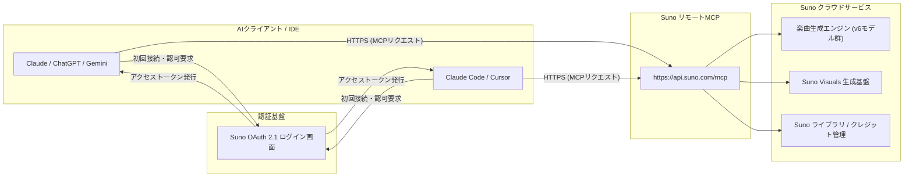

# **Suno MCP 調査レポート**

## **1. 基本情報**

* **ツール名**: Suno MCP
* **ツールの読み方**: スノ エムシーピー
* **開発元**: Suno, Inc.
* **公式サイト**: [https://suno.com/mcp](https://suno.com/mcp)
* **関連リンク**:
  * ドキュメント / ヘルプセンター: [https://help.suno.com/](https://help.suno.com/)
  * リリースノート: [https://suno.com/release-notes](https://suno.com/release-notes)
  * レビューサイト: [G2 (Suno)](https://www.g2.com/products/suno/reviews) | [Trustpilot (Suno)](https://www.trustpilot.com/review/suno.com)
* **カテゴリ**: MCPサーバー
* **概要**: Suno MCPは、AI音楽生成プラットフォーム「Suno」が公式に提供するリモートModel Context Protocol（MCP）サーバー（エンドポイント: `https://api.suno.com/mcp`）である。Claude、ChatGPT、Gemini、Claude Code、CursorなどのMCP対応AIアシスタントや開発ツールから、タブを切り替えることなく対話形式で楽曲の生成、拡張、カバー・マッシュアップ作成、ビジュアル生成、およびSunoライブラリの管理を直接実行できる。

## **2. 目的と主な利用シーン**

* **解決する課題**:
  * **タブ切り替えとコンテキスト分断の解消**: これまでAIアシスタントで歌詞や動画構成を練った後、SunoのWeb画面へ移動してプロンプトを再入力・調整する手間をなくし、会話の文脈を保ったまま音楽制作を完結させる。
  * **APIキー管理・ローカル構築の負担軽減**: 従来の非公式ラッパー（ブラウザ自動操作や非公開APIスクレイピング）やAPIキー発行を伴う連携と異なり、リモートエンドポイントへのOAuthサインインのみで安全に導入できる。
  * **制作ワークフローの自動化・精密制御**: チャット上の自然言語指示と正確な数値パラメータ指定を組み合わせ、BGMのバリエーション生成やリミックスの反復テストを効率化する。
* **想定利用者**:
  * 動画クリエイター（YouTube、TikTok、ショート動画制作者）
  * ミュージシャン・ソングライター・プロデューサー
  * ゲーム開発者・インディーアプリ開発者
  * CursorやClaude Codeを日常的に利用するエンジニア・クリエイティブディレクター
* **利用シーン**:
  * **会話文脈を活かした作詞・作曲**: AIと壁打ちした歌詞やストーリー設定、映像の絵コンテをそのまま引き継いでオリジナル楽曲を生成する。
  * **ボイスメモ・素材音源からの楽曲化**: 手元のボイスメモやサウンドバイトをアップロードし、メロディを活かしたフルアレンジ楽曲へ変換する。
  * **既存トラックのリミックス・展開作成**: Sunoライブラリ内の過去曲を参照し、アコースティックカバー化、スローテンポ化、マッシュアップ、特定区間からの延長を実行する。
  * **楽曲連動ビジュアルの制作**: 有料プランにおいて、生成した楽曲に合わせたアートワークやループ動画（Suno Visuals）をチャット上から連続して制作する。

### **2.1 代表的な利用フロー**

```mermaid
swimlane-beta TB
  subgraph User["ユーザー"]
    A["AIチャットで企画・歌詞・曲調を指示"]
    E["生成楽曲の試聴・リミックスや追加修正を指示"]
  end
  subgraph Client["AIクライアント (MCPホスト)"]
    B["会話文脈からプロンプト・パラメータを構成"]
    D["生成結果・ライブラリ情報を受信して提示"]
  end
  subgraph SunoMCP["Suno MCPサーバー (api.suno.com/mcp)"]
    C["OAuthトークン検証・MCPツール実行"]
  end
  subgraph SunoCloud["Suno クラウド基盤"]
    F["クレジット消費・楽曲生成・ライブラリ保存"]
  end
  A --> B
  B -->|"MCPツール呼び出し (HTTPS)"| C
  C --> F
  F -->|"トラックURL・メタデータ返却"| C
  C --> D
  D --> E
```

* **代表的な流れ**: ユーザーがClaudeやCursorなどのAIクライアント上で楽曲のイメージを伝えると、クライアントが会話文脈を踏まえてSuno MCPサーバー（`https://api.suno.com/mcp`）のツールを呼び出す。Suno MCPはOAuthで紐づいたSunoアカウントのクレジットを用いてクラウド上で楽曲を生成・ライブラリ保存し、その結果をAIクライアント経由でユーザーへ返却する。

## **3. 主要機能**

* **対話型楽曲生成（インスピレーション / カスタムモード）**: プレーンテキストのアイデアからAIが歌詞とスタイルを補完して生成するほか、歌詞・タイトル・ジャンル・スタイルを細かく指定した生成に対応する。
* **音声アップロードからの楽曲化（Start from Audio）**: ユーザーのボイスメモや録音したサウンドバイトを基に、元のメロディや雰囲気を保持したままフルアレンジの楽曲を生成できる。
* **リミックス・カバー・延長・マッシュアップ**: ライブラリに保存済みの楽曲を指定し、別ジャンルへのカバー作成、2曲のマッシュアップ、既存トラックの延長（Extend）をチャット上から実行できる。
* **Suno Visuals 連携**: 任意のトラックに対してアートワークやループ映像・マルチショット動画クリップを生成する機能を備える（有料プラン対象）。
* **ライブラリ・プレイリスト管理**: 自身のSunoクラウドライブラリ内の楽曲検索、プレイリストの作成・整理、生成トラックの自動同期を行う。
* **クレジット残高確認・冪等性保護**: チャット上で現在のSunoプランの残りクレジット数を照会できるほか、同一の冪等性キー（idempotency key）による二重課金防止やダウンロードクレジット消費前の確認挙動が報告されている。
* **クリップ詳細解析**: 既存トラックの推定BPM、キー（調）、ビート数、セクションマーカー、単語単位の歌詞タイミング情報などを取得し、AIによる精密な再編集に活用できる。

## **4. 動作原理・システム構成**

* **アーキテクチャ**: 完全マネージド型リモートMCPサーバー（Cloud SaaS + Streamable HTTP / リモートMCPコネクタ構成）。ローカルマシン上にPythonやNode.jsのサーバープロセスやPlaywright等のブラウザ自動化環境を常駐させる必要がなく、Suno側がホストする単一エンドポイント `https://api.suno.com/mcp` へ直接接続する。
* **主要コンポーネントとデータフロー**:
  * **MCPクライアント（ホスト）**: Claude、ChatGPT、Gemini、Claude Code、Cursorなどが、ユーザーの自然言語指示を解釈し、MCP仕様に準拠したツール呼び出しリクエストをHTTPSで送信する。
  * **認証レイヤー（OAuth 2.1）**: 初回接続時にブラウザ経由でSunoアカウントへのサインインおよびアクセス許可画面が表示され、APIキーのコピー＆ペーストなしでユーザートークンがクライアントへ安全に紐づく。
  * **Suno MCPサーバー（`api.suno.com/mcp`）**: 受信したツールリクエストを検証し、Sunoのバックエンド音楽生成エンジン（v6モデル群）およびビジュアル生成基盤・ライブラリAPIへ橋渡しする。
  * **クラウド推論・ストレージ基盤**: SunoはGPU推論とバッチ前処理のスケーリングにサーバーレスGPU基盤（Modal等）を活用しており、生成されたオーディオやメタデータは即座にユーザーのSunoアカウントライブラリへ永続化される。
* **特筆すべき要素技術**:
  * **Model Context Protocol (MCP)**: Anthropicが提唱したオープン標準プロトコルを採用し、多様なLLMクライアントとの相互運用性を確保。
  * **キーレスOAuth認証**: 開発者向けAPIキーの発行やシークレット管理を不要とし、一般クリエイターでも数クリックで安全に外部AI連携を可能にしている。



## **5. 開始手順・セットアップ**

* **前提条件**:
  * Sunoアカウント（Freeプランを含む全プランで利用可能。ただしVisuals機能は有料プランが必要）。
  * 対応するMCPクライアント（Claude、ChatGPT、Gemini、Claude Code、Cursorなど）。なお、各AIアプリ側の仕様によりカスタムMCPコネクタの追加が有料プラン限定となっている場合がある。
  * ローカルランタイムやAPIキーの事前取得は不要。
* **インストール / 導入（クライアント別設定）**:

  **1. Claude Code（CLI）の場合**
  ```bash
  # SunoリモートMCPサーバーを追加
  claude mcp add --transport http suno https://api.suno.com/mcp
  ```
  追加後、Claude Codeのセッション内で `/mcp` コマンドを実行し、表示される案内からSunoアカウントへサインインする。

  **2. Cursor の場合**
  `Customize` → `MCPs` → `New MCP Server (User)` を開き、`mcp.json` に以下を追記して保存する。
  ```json
  {
    "mcpServers": {
      "suno": {
        "url": "https://api.suno.com/mcp"
      }
    }
  }
  ```

  **3. Claude / ChatGPT / Gemini（Web・デスクトップアプリ）の場合**
  * **Claude**: `Customize` → `Connectors` → `+` → `Add custom connector` を開き、名前に `Suno`、URLに `https://api.suno.com/mcp` を入力して接続する。
  * **ChatGPT**: `Plugins` → `Add` → `Add custom MCP server` を開き、名前に `Suno`、Connection (Server URL) に `https://api.suno.com/mcp` を設定し、「Create as a plugin」→「Connect Suno」で認可する。
  * **Gemini**: `Customize` → `Connectors` → `+` → `Add Custom MCP server` に `https://api.suno.com/mcp` を登録し、チャット内で `@Suno` をメンションして利用する。

* **初期設定**:
  * 初回ツール呼び出し時または接続設定時に表示されるOAuthログイン画面で、自身のSunoアカウントにサインインし接続を承認する。
* **クイックスタート（プロンプト例）**:
  * 接続完了後、AIチャットに以下のように指示するだけで楽曲生成が始まり、Sunoライブラリに自動保存される。
    * 「作業用のローファイ・ビートを1曲作って、雰囲気の異なるバリエーションを3パターン提案して」
    * 「Sunoの最新曲をベースに、テンポを落としたアコースティックカバーを作って」

## **6. 特徴・強み (Pros)**

* **APIキー不要・環境構築ゼロの導入体験**: ローカルへのパッケージインストールやブラウザ自動化（Playwright等）の設定が不要で、エンドポイントURLの登録とOAuth認証だけで即座に利用できる。
* **対話コンテキストのシームレスな継承**: チャット内で議論した動画の脚本、歌詞案、マーケティング企画のトーン＆マナーをAIが理解した状態で楽曲生成パラメーターへ落とし込める。
* **無料プランを含む全ティア対応**: Suno FreeプランのユーザーであってもMCP経由で楽曲生成とライブラリ同期を利用でき、導入のハードルが極めて低い。
* **公式サーバーならではの安全性と安定性**: 非公式のスクレイピングやセッションCookie流用に依存するコミュニティ製MCPと異なり、アカウントBANリスクやUI変更による機能停止の懸念が少ない。

## **7. 弱み・注意点 (Cons)**

* **パラメータ検証・ガードレールの未成熟さ（β版特有の課題）**: ユーザー検証により、廃止されたモデル名の指定や楽曲長を超えるタイムスタンプ指定を行っても事前エラーにならず、そのまま生成処理が走りクレジットが消費されてしまうケースが報告されている。
* **クライアント側の制約とUI表示のばらつき**: インライン再生プレーヤーの表示がホスト側AIクライアントの対応状況に左右されるほか、AIアプリ側（ChatGPTやClaude等）のカスタムコネクタ機能自体が有料プラン限定となる場合がある。
* **日本語ドキュメント・サポートの限定**: `suno.com/mcp` の公式案内やリリースノート、エラーメッセージは英語が中心であり、日本語での詳細なMCP技術ドキュメントは充実していない（生成楽曲の日本語歌詞歌唱自体はSuno本体で対応）。
* **商用利用権・著作権面の制約**: FreeプランでMCP経由生成した楽曲には商用利用権が付与されず、また生成AI音楽全般を取り巻く著作権・ライセンス規約はプランや改定状況に応じた確認が不可欠である。

## **8. 料金プラン**

Suno MCP自体の接続・利用に追加料金はかからず、接続したSunoアカウントの既存プランとクレジットプールがそのまま適用される（標準的な楽曲生成1回につき10クレジット消費・2バリエーション出力が目安）。

| プラン名 | 料金 | 主な特徴 |
|---------|------|---------|
| **Free プラン** | 無料 | 毎日50クレジット付与（繰越不可）。Suno MCPの接続・楽曲生成は利用可能だが、ダウンロード数制限あり・**商用利用不可**。 |
| **Pro プラン** | $10/月（年払いで$8/月） | 月2,500クレジット（約500曲分）、月20曲ダウンロード、生成・ダウンロード楽曲の**商用利用権**付与。Suno Visuals等の有料機能も利用可能。 |
| **Premier プラン** | $30/月（年払いで$24/月） | 月10,000クレジット（約2,000曲分）、月60曲ダウンロード、商用利用権付与。Suno Studio（MIDI・エフェクト・ステム分離等）へのアクセスを含む。 |
| **上位プラン / 追加クレジット** | $100〜$120/月 等 | ヘビーユーザー向けのPlatinumプラン（15,000クレジット・120ダウンロード等）や追加クレジットパック購入にも対応。 |

* **課金体系**: 月額/年額サブスクリプション＋クレジット消費型（日次・月次クレジットの翌期繰越は不可）。
* **無料トライアル**: Freeプランが永続無料で利用可能。なお、接続するAIクライアント（Claude、ChatGPT等）側でカスタムMCPコネクタを使うためにクライアント側の有料プランが必要になる場合がある。

## **9. 導入実績・事例**

* **導入企業**: Suno MCP単体としての特定企業による公式導入事例は公式サイト上で公開されていない（2026年10月発表のβ段階のため）。ただし、Sunoプラットフォーム全体としてはMicrosoft（Microsoft CopilotへのSuno統合）との連携実績や、インフラ面でのサーバーレスGPU基盤「Modal」の採用事例が公開されている。
* **導入事例（クリエイター・開発者コミュニティ）**:
  * **AIエージェントとの制作パイプライン統合**: Reddit（`r/SunoAI` / `r/mcp`）などでは、メタタグ規約や作曲ガイドラインを「スキル」や参照ドキュメントとしてClaude/Cursorに読み込ませ、一貫した品質で楽曲を反復生成・テストするワークフローが報告されている。
  * **同一条件でのA/Bテスト**: Web UIのスライダー手動操作ではなく、チャットから正確な数値を指定して1変数だけを変えた比較生成を行う用途で活用されている。
* **対象業界**: 動画メディア制作、ゲーム・アプリ開発、広告・マーケティング制作、個人の音楽・ポッドキャスト制作分野での利用が中心。

## **10. サポート体制**

* **ドキュメント**: 公式MCPページ（[https://suno.com/mcp](https://suno.com/mcp)）に設定手順・FAQが掲載されているほか、ヘルプセンター（[https://help.suno.com/](https://help.suno.com/)）およびリリースノート（[https://suno.com/release-notes](https://suno.com/release-notes)）で製品全体の仕様を確認できる。言語は英語が中心。
* **コミュニティ**: 公式DiscordやReddit（`r/SunoAI` 等）を中心にユーザー同士の情報交換やプロンプト・MCP活用ノウハウの共有が活発に行われている。
* **公式サポート**: メール窓口（`support@suno.com`）およびヘルプセンター経由での問い合わせに対応。ただしTrustpilot等のレビューでは、課金・解約に関するサポート応答速度に改善を求める声もある。

## **11. エコシステムと連携**

### **11.1 API・外部サービス連携**

* **API / プロトコル**: 一般向けの汎用REST APIキーではなく、Model Context Protocol（MCP）に準拠したリモートHTTPSエンドポイント（`https://api.suno.com/mcp`）とOAuth 2.1認証を提供している。
* **主要連携サービス**:
  * Claude（Web / デスクトップ）
  * Claude Code（CLI）
  * ChatGPT
  * Google Gemini
  * Cursor
  * その他、カスタムリモートMCPサーバー（Streamable HTTP / OAuth）に対応したAIエージェント・IDE

### **11.2 技術スタックとの相性**

Suno MCPはローカルライブラリではなくSaaS型リモートMCPサーバーとして動作するため、プログラミング言語やWebフレームワークへの依存はほぼなく、**接続元となるMCPホスト（AIクライアント）の対応状況**が相性を左右する。

| 技術スタック / クライアント | 相性 | メリット・推奨理由 | 懸念点・注意点 |
|:---|:---:|:---|:---|
| **Claude / Claude Code** | ◎ | 公式が手順を明記しており、`claude mcp add` コマンドやコネクタUIで即座にOAuth連携可能 | インラインプレーヤー表示やカスタムコネクタ利用はクライアント側プランに依存する場合がある |
| **Cursor** | ◎ | `mcp.json` にURLを数行記述するだけでエディタ内からBGMや効果音イメージを即生成できる | ゲーム開発等の音声ファイル取り込みはSunoライブラリからのダウンロード工程が別途必要 |
| **ChatGPT / Gemini** | ◯ | プラグイン/コネクタ設定からURL登録だけで利用でき、企画・脚本と連動した作曲に最適 | 接続メニューの提供状況はプランやアカウントロールアウト状況に左右される |
| **独自アプリ（Python / Node.js等）** | △ | MCPクライアントSDKを用いれば接続可能だが、ブラウザベースのOAuth対話認証が前提となる | ヘッドレスなサーバー間自動バッチ処理向けのAPIキー認証には公式対応していない |

## **12. セキュリティとコンプライアンス**

* **認証**: OAuth 2.1準拠のユーザー認証フローを採用しており、ローカル設定ファイルに平文のAPIキーやパスワードを保存する必要がない。
* **データ管理**: Sunoのプライバシーポリシー（[https://suno.com/privacy](https://suno.com/privacy)）に基づき、アカウント情報や「Interactive Chat Information」（プロンプト・歌詞・入力データ）がクラウド上で処理・保存される。クラウド基盤にはAWS、Cloudflare、Vercel等が利用されている。なお、入力プロンプトや生成コンテンツはサービス改善やAIモデルの学習・パーソナライズに利用される場合があるため、機密性の高い未公開企画の入力には注意が必要である。
* **準拠規格**: EEA（欧州経済領域）向けGDPRに基づくデータアクセス・削除権等の規定をプライバシーポリシーに明記。一方で、エンタープライズ向けのSOC 2 Type IIレポートやISO27001取得状況、個別のDPA（データ処理契約）については公式サイト上で一般公開されておらず、エンタープライズ導入時の要件確認には `support@suno.com` 等への個別問い合わせが必要である。

## **13. 操作性 (UI/UX) と学習コスト**

* **UI/UX**: 専用Webアプリを開いてフォームやスライダーを操作する代わりに、普段使い慣れたAIチャットの対話UIからそのまま音楽制作を行えるため、UXの一貫性が非常に高い。一方で、生成された楽曲の細かなタイムライン編集やDAW的な調整を行う場合は、最終的にSuno WebアプリやSuno Studio側での操作が必要になる。
* **学習コスト**: エンドポイントURLのコピー＆ペーストとOAuthログインのみで完結するため、初期導入の学習コストは極めて低い。ただし、思い通りの曲調を得るためのメタタグ設計やパラメータ指定のコツは、Suno本体のプロンプト設計知見に依存する。

## **14. ベストプラクティス**

* **効果的な活用法 (Modern Practices)**:
  * **事前設計とスタイルガイドの共有**: AIクライアント側のプロジェクト指示やカスタムスキルに「希望するジャンル表記・メタタグ構成・歌詞フォーマット」を定義しておき、その文脈を参照させてSuno MCPを呼び出すことで品質のばらつきを抑える。
  * **1変数ずつ変えた反復検証**: ベースとなるスタイルプロンプトを固定したまま、チャット上で「テンポだけを10%落として」「ボーカルを女性に変えて」と指示し、差分検証を高速に回す。
  * **既存資産の二次活用**: ゼロから生成するだけでなく、過去のヒット曲やボイスメモを起点にカバー・延長・Visuals制作へと連鎖させる。
* **陥りやすい罠 (Antipatterns)**:
  * **パラメータ妥当性をAI任せにして大量生成する**: モデル名の誤記や楽曲長を超えるタイムスタンプ指定でも生成が実行されてクレジットを消費する事例があるため、重要な生成前には使用モデルや秒数・クレジット残高をAIに確認させる。
  * **Freeプラン生成物の商用利用**: MCP経由であってもFreeプランで作成した楽曲には商用利用権がないため、商用プロジェクトに組み込む場合は必ずPro以上のプランで生成・管理する。
  * **機密情報のプロンプト混入**: 会話履歴全体からAIがプロンプトを自動構成する際、社内未公開のプロジェクト名や機密情報が歌詞・プロンプトに含まれないよう注意する。

## **15. ユーザーの声（レビュー分析）**

* **調査対象**: Reddit（`r/SunoAI`、`r/mcp`）、およびSunoプラットフォーム全体の評価としてG2・Trustpilotを参照。
* **総合評価**: Suno全体として **4.0+ / 5.0 (G2)**、一方で課金・サポート面では **1.5 / 5.0 (Trustpilot)** とクリエイティブ性能と運用サポートで評価が二極化している（Suno MCP単体のG2/Capterra個別スコアは未集計）。
* **ポジティブな評価**:
  * 「Web UIのスライダーを手動で調整する代わりに、会話で正確な数値を指定して同一条件のテストを回せる点が非常に便利」（Redditより要約）
  * 「クリップの推定BPMやキー、セクションマーカー、単語単位の歌詞タイミングまで取得して分析に使えるのが強力」（Redditより要約）
  * 「音楽制作の専門知識がなくても、テキストから短時間でスタジオ品質のボーカル入り楽曲を作れる」（G2より要約）
* **ネガティブな評価 / 改善要望**:
  * 「廃止されたモデル名や範囲外のタイムスタンプを指定してもエラーにならず、そのまま生成が走ってクレジットが消費されてしまうことがある」（Redditより要約）
  * 「LLMクライアント（Claude、Gemini、GPT等）によって同じ音声クリップの解析結果にばらつきが出たり、インライン再生プレーヤーが正常に表示されない場合がある」（Redditより要約）
  * 「Suno本体のサブスクリプション自動更新や解約手続き、ダウンロード制限の変更に対するサポート対応が遅い」（Trustpilotより要約）
* **特徴的なユースケース**:
  * 楽曲制作向けのメタタグ・プロンプト設計ルールをまとめた参照ドキュメントをClaudeのスキルとして登録し、Suno MCPと組み合わせて高精度な自動作詞・作曲ワークフローを構築する事例。

## **16. 直近半年のアップデート情報**

* **2026-10-28**: **Suno MCP（Beta）を発表・提供開始**。公式リモートMCPサーバー（`https://api.suno.com/mcp`）を公開し、Claude、ChatGPT、Gemini、Claude Code、Cursor等からの対話型楽曲生成・リミックス・Visuals連携・ライブラリ管理に対応。
* **2026-10**: **Speech機能（ベータ版）を追加**（Suno本体機能アップデート）。音声・語り表現のバリエーションが拡大。
* **2026-09**: **v6モデルファミリー（v6 / v6-wild / v6-mini）を展開**。オーディオ品質や最大8分の長尺生成に加え、自然言語による部分編集、画像・動画・音声を含むマルチモーダル入力に対応し、旧世代モデルを段階的に統合。
* **2026年夏〜秋**: **Suno StudioのMIDI・ステム分離機能を大幅強化**。`.mid` ファイルのアップロードおよびチャットからのMIDI生成、MIDI-to-Audio変換、テンポ追従付きのステム→MIDIエクスポートなどを拡充。

(出典: [Suno公式リリースノート](https://suno.com/release-notes) / [Suno公式ブログ](https://suno.com/blog))

## **17. 類似ツールとの比較**

### **17.1 機能比較表 (星取表)**

| 機能カテゴリ | 機能項目 | Suno MCP | Audio Studio MCP | ElevenLabs (MCP含む) | コミュニティ製 Suno MCP |
|:---:|:---|:---:|:---:|:---:|:---:|
| **基本機能** | ボーカル入りフル楽曲生成 | ◎<br><small>v6モデルで高品質生成</small> | ×<br><small>BGM・効果音特化</small> | ◯<br><small>音楽・音声・SFXに対応</small> | ◎<br><small>Suno Webを裏で操作</small> |
| **基本機能** | 効果音・ナレーション音声合成 | △<br><small>音楽・Speech中心</small> | ◎<br><small>効果音生成に特化機能あり</small> | ◎<br><small>業界最高水準のTTS/SFX</small> | △<br><small>Suno本体の仕様に準拠</small> |
| **MCP連携** | 導入の手軽さ（ゼロ構築） | ◎<br><small>リモートURL＋OAuthのみ</small> | △<br><small>ローカルGPU・モデル導入要</small> | ◎<br><small>公式リモートMCP＋OAuth</small> | ×<br><small>Playwright/CDP構築要</small> |
| **運用・コスト** | 完全ローカル/OSS実行 | ×<br><small>クラウドSaaS</small> | ◎<br><small>OSS・ローカルGPU完結</small> | ×<br><small>クラウドSaaS</small> | △<br><small>ラッパーはOSSだがクラウド依存</small> |
| **非機能要件** | 公式サポート・安定性 | ◯<br><small>公式提供（現在β版）</small> | △<br><small>コミュニティOSS</small> | ◎<br><small>公式エンタープライズ対応</small> | ×<br><small>UI変更や規約リスクあり</small> |

### **17.2 詳細比較**

| ツール名 | 特徴 | 強み | 弱み | 選択肢となるケース |
|---------|------|------|------|------------------|
| **Suno MCP** | Suno公式のリモートMCPサーバー（OAuth連携） | APIキーやローカル環境不要。ボーカル曲・リミックス・Visualsまで会話文脈で一貫生成可能 | β版のため一部パラメータ検証が甘い。ローカル完結・完全オフライン実行は不可 | 既存のClaude/ChatGPT/Cursor環境から手軽に高品質なボーカル楽曲やリミックスを作りたい場合 |
| **Audio Studio MCP** | Stable Audio 3を用いたローカル実行型OSS MCPサーバー | 完全無料・ローカルGPU（Apple Silicon/NVIDIA）完結でデータ外部送信なし。BGMや効果音に強い | ボーカル入りフル楽曲の生成には不向き。相応のローカルPCスペックが必要 | 機密プロジェクトやゲーム開発で、オフラインかつコストゼロでBGM・効果音を大量生成したい場合 |
| **ElevenLabs** | 音声合成・音楽・SFX・動画まで網羅する総合AIメディア基盤（公式MCP提供） | TTSやボイスクローン、効果音品質が極めて高く、APIやエンタープライズ統制も充実 | クレジット体系がやや複雑で、ボーカル入り楽曲生成の自由度・音楽特化度はSunoに一歩譲る | 動画ナレーション・多言語吹き替え・効果音とBGMを単一基盤で統合管理したい場合 |
| **コミュニティ製 Suno MCP** | PlaywrightやChrome DevTools Protocolで `suno.com` を自動操作する非公式OSS | 公式MCP公開前から存在し、ローカルファイル保存や独自CLI連携を柔軟にカスタマイズ可能 | ブラウザ認証やCAPTCHA回避・DOM変更への追従が必要で、動作が不安定になりやすい | 公式リモートMCPが対応していない特殊なローカル自動化や独自フックを組み込みたい開発者向け |

## **18. 総評**

* **総合的な評価**:
  * Suno MCPは、生成AI音楽プラットフォームの代表格であるSunoの機能を、ローカル環境構築やAPIキー管理なしに主要AIアシスタントへ直結できる画期的な公式MCPサーバーである。会話の文脈をそのまま楽曲やVisualsの制作に引き継げる体験はクリエイティブ制作の摩擦を大きく下げており、Sunoのv6モデル群や既存ライブラリともシームレスに統合されている。一方で、β版ゆえのパラメータ検証の甘さやホスト側クライアント依存の表示制限など、運用上の細かい課題も残る。
* **推奨されるチームやプロジェクト**:
  * 日常的にClaude、ChatGPT、Gemini、Cursor等を使って企画・脚本・ゲーム開発を進めており、同じ作業画面から即座にテーマ曲やBGM、プロトタイプ楽曲を試作したい個人クリエイターや小規模制作チーム。
* **選択時のポイント**:
  * 「ボーカル入りの完成度の高い楽曲」と「セットアップの手軽さ」を重視するなら **Suno MCP** が最適である。一方、「音声・効果音・ナレーション中心で企業レベルの統制が必要」なら **ElevenLabs**、「データ外部送信なし・完全無料でBGMや効果音をローカル生成したい」なら **Audio Studio MCP** を選択するのが合理的である。
