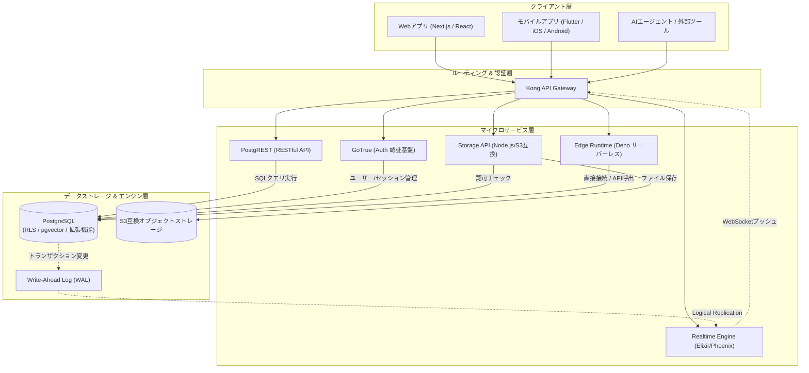

# **Supabase 調査レポート**

## **1. 基本情報**

* **ツール名**: Supabase（スパベース）
* **ツールの読み方**: スパベース / スーパベース
* **開発元**: Supabase Inc.（共同創業者: Paul Copplestone, Ant Wilson / 本社: シンガポール・サンフランシスコ）
* **公式サイト**: [https://supabase.com/](https://supabase.com/)
* **関連リンク**:
  * GitHub: [https://github.com/supabase/supabase](https://github.com/supabase/supabase)
  * ドキュメント: [https://supabase.com/docs](https://supabase.com/docs)
  * レビューサイト: [G2](https://www.g2.com/products/supabase/reviews)
* **カテゴリ**: データベース/データストレージ
* **概要**: Supabaseは、PostgreSQLデータベースを中心に据えたオープンソースのBaaS（Backend as a Service）プラットフォームである。「The Open Source Firebase Alternative（オープンソースのFirebase代替）」を掲げ、リレーショナルデータベース、ユーザー認証、リアルタイムデータ同期、オブジェクトストレージ、エッジサーバーレス関数、ベクトル検索（pgvector）をワンストップで提供する。プロプライエタリなクラウドベンダーへのロックインを回避しつつ、Webやモバイル、AIアプリケーションを迅速に構築・運用できる開発基盤として世界中で広く支持されている。

## **2. 目的と主な利用シーン**

* **解決する課題**:
  * バックエンドサーバーやデータベースのゼロからの構築・インフラ保守に伴う膨大な工数とコスト
  * 従来のプロプライエタリなBaaS（Firebase等）におけるNoSQL特有のクエリ制約やベンダーロックインの懸念
  * 認証・ファイルストレージ・リアルタイム通信・AIベクトル検索など、個別サービスを繋ぎ合わせる複雑なシステム設計
  * フロントエンド開発チームがバックエンド専任エンジニアなしで迅速にMVP（実用最小限の製品）を市場投入する難しさ
* **想定利用者**:
  * フルスタックWebエンジニア、フロントエンド開発者、モバイルアプリ開発者
  * 創業期のスタートアップや個人開発者（インディハッカー）
  * RAG（検索拡張生成）やセマンティック検索を実装するAIアプリケーション開発者
  * 迅速なPoC（概念実証）や社内DXツールを開発するエンタープライズ開発チーム
* **利用シーン**:
  * **モダンWeb/モバイルアプリケーションの高速開発**: Next.js、Nuxt、Flutter、React Nativeなどと連携し、認証・DB・ストレージ・リアルタイム配信を一括で導入
  * **生成AI・RAG（Retrieval-Augmented Generation）基盤**: pgvectorを用いたドキュメント埋め込みベクトルの保存と高速類似度検索、AIエージェントからのMCP連携
  * **マルチテナントSaaSの構築**: PostgreSQLのRow Level Security（RLS）によるテナント・ユーザー単位の堅牢なデータ分離
  * **協調編集・リアルタイム通知**: チャット、オンラインホワイトボード、ダッシュボードのライブ更新などのイベント配信

### **2.1 代表的な利用フロー**

Supabaseを利用した代表的なアプリケーション開発およびデータ更新・配信のライフサイクルを以下に示す。

```mermaid
swimlane-beta TB
  subgraph Client["クライアント (Web/モバイル)"]
    A[ユーザー操作・データ送信]
    G[リアルタイム画面更新]
  end
  subgraph Gateway["APIゲートウェイ (Kong)"]
    B[JWT検証 & ルーティング]
    F[WebSocketメッセージ転送]
  end
  subgraph Services["Supabase バックエンドサービス"]
    C[PostgREST / Auth / Storage]
    E[Realtime: WAL変更検知]
  end
  subgraph Database["PostgreSQL データベース"]
    D[RLS評価・トランザクション実行]
  end
  A --> B
  B --> C
  C --> D
  D --> E
  E --> F
  F --> G
```

* **代表的な流れ**: クライアントから送信されたリクエストはKong API GatewayでAPIキーやJWTトークンが検証され、各バックエンド（PostgREST等）へ振り分けられる。PostgreSQL内部でRow Level Security（RLS）が評価された上でデータが安全に読み書きされ、更新イベントはRealtimeサービスがLogical Replication（WAL）から検知してWebSocket接続中のクライアントへ即座にプッシュ配信される。

## **3. 主要機能**

* **専用PostgreSQLデータベース (Dedicated Postgres)**:
  すべてのプロジェクトに完全なPostgreSQLインスタンスが割り当てられ、完全な管理者権限（スーパーユーザー権限に近い操作性）と、pgvector、PostGIS、pg_cronなどの豊富なPostgres拡張機能が利用可能。
* **自動生成RESTful & GraphQL API (Instant APIs)**:
  データベーススキーマの定義や変更を検知し、PostgRESTおよびpg_graphqlを通じて、安全かつハイパフォーマンスなCRUD APIを自動的に生成。
* **統合認証システム (Supabase Auth)**:
  メール/パスワード、マジックリンク、電話番号SMS認証、主要OAuthプロバイダ（Google, GitHub, Apple, Azureなど）、SAML 2.0 SSOに対応し、PostgreSQLのRow Level Security（RLS）とネイティブに連携。
* **リアルタイム通信 (Supabase Realtime)**:
  データベースの変更ログ（Write-Ahead Log）をリッスンし、WebSocket経由でテーブル変更のブロードキャスト、プレゼンス機能（オンライン状態管理）、クライアント間メッセージングを低遅延で提供。
* **オブジェクトストレージ (Supabase Storage)**:
  大容量ファイル（画像、動画、文書）のアップロード・配信をS3互換APIで提供。RLSによるファイル単位の厳密な認可、画像リサイズや最適化CDN配信に対応。
* **エッジサーバーレス関数 (Edge Functions)**:
  Denoランタイムを基盤とし、TypeScriptで記述されたサーバーレス関数を世界各地のエッジロケーションで高速実行。Webhook受信やサードパーティ決済API連携などを担う。
* **ベクトル検索 & AIツールキット (pgvector & AI)**:
  OpenAI等の埋め込みベクトルをPostgres内にネイティブ保存し、HNSWインデックスによる高速コサイン/L2類似度検索を実行可能。公式MCP（Model Context Protocol）サーバーによるAIエージェント連携もサポート。
* **Web管理ダッシュボード (Supabase Studio)**:
  テーブル構造の視覚的編集、SQLエディタ、スキーマ図の自動生成、ログ探索、組み込みAIアシスタントによるSQL自動生成やパフォーマンスアドバイザーを搭載。
* **宣言的スキーマ & コードファースト開発 (Declarative Schemas 2.0)**:
  SQLファイルやコードでスキーマを定義し、差分マイグレーション（`pg-delta`）を自動生成。CLIと連携したGitベースの開発ワークフローを実現。
* **データパイプライン (Supabase Pipelines)**:
  PostgreSQLのトランザクションログから、BigQuery、ClickHouse、Snowflake、DuckLakeなどの分析用DWHへリアルタイムにデータを複製・ストリーミング。

## **4. 動作原理・システム構成**

Supabaseは、複数のオープンソースコンポーネントがPostgreSQLを中心に疎結合で協調動作するアーキテクチャを採用している。



* **アーキテクチャ**:
  クラウド完結型マネージドプラットフォームとして提供されると同時に、Docker ComposeやKubernetesを利用した完全なセルフホスト（オンプレミス / 自社クラウド）にも対応したハイブリッドな構成。
* **主要コンポーネントとデータフロー**:
  * **Kong API Gateway**: 外部からのすべてのHTTP/WebSocketトラフィックを受け付け、APIキーの検証、JWTトークンのデコード、適切な内部マイクロサービスへのリバースプロキシを行う。
  * **PostgREST**: PostgreSQLのスキーマとリレーション定義をメモリ上にキャッシュし、受信したRESTfulクエリを単一の高効率なSQL文に変換して直接データベースへ実行。N+1問題を回避し、極めて低いオーバーヘッドでレスポンスを返す。
  * **GoTrue**: Go言語で構築された認証サーバー。メール認証、OAuthトークン交換、JWT（アクセストークン / リフレッシュトークン）の発行を行い、認証状態をPostgreSQLの `auth` スキーマに保存。
  * **Realtime**: Elixir / Phoenixで構築された分散WebSocketサーバー。PostgreSQLの論理レプリケーション（WAL）ストリームを監視し、行レベルセキュリティ（RLS）に合致するクライアントにのみ差分データを送信。
  * **PostgreSQL & Row Level Security (RLS)**: システムの心臓部。ユーザーのリクエストに含まれるJWT（`auth.uid()` 等）をセッション変数にセットし、PostgresネイティブのRLSポリシーを行単位で強制適用。アプリケーション層に認可ロジックを持たせることなく、データベース自身が安全性を保証する。
* **特筆すべき要素技術**:
  * **pgvector**: ベクトルデータの類似度検索を行うPostgreSQL拡張。HNSWインデックスをサポートし、数百万件規模の埋め込みを高精度かつ数ミリ秒で検索可能。
  * **Supavisor**: Supabaseが独自開発したElixir製PostgreSQL接続プーラー。数万〜数十万規模のサーバーレス接続を効率的に集約・管理。
  * **OrioleDB & Multigres**: 高負荷な更新処理におけるテーブル肥大化（Bloat）を抑えVACUUMを不要にする次世代ストレージエンジン（OrioleDB）や、Vitessチームのノウハウを活かした分散Postgres OS（Multigres）を順次統合。

## **5. 開始手順・セットアップ**

Supabaseは、Webダッシュボード（Cloud）とローカル開発環境（CLI）の双方から迅速にセットアップできる。

* **前提条件**:
  * Node.js 18以上、または各言語ランタイム（Python, Flutter等）
  * Supabaseアカウント（クラウド利用時）
  * ローカル開発を行う場合はSupabase CLI（最新バージョンではDocker不要のネイティブプロセス起動も可能）
* **インストール/導入**:

  ```bash
  # Supabase CLIのインストール (macOS/Homebrew)
  brew install supabase/tap/supabase

  # またはnpm/pnpm経由での利用
  pnpm add -D supabase
  ```

  クライアントライブラリのインストール:
  ```bash
  pnpm add @supabase/supabase-js
  ```

* **初期設定**:
  1. [Supabase Dashboard](https://supabase.com/dashboard) にログインし、「New project」をクリックして組織・プロジェクト名・DBパスワード・リージョン（例: Tokyo）を選択。
  2. プロジェクト作成完了後、「Project Settings」>「API」から `Project URL` と `anon public key` を取得。
  3. プロジェクトルートの `.env.local` に環境変数を設定。

  ```env
  NEXT_PUBLIC_SUPABASE_URL=https://your-project-id.supabase.co
  NEXT_PUBLIC_SUPABASE_ANON_KEY=your-anon-key
  ```

* **クイックスタート**:
  フロントエンドでのクライアント初期化とデータ取得のコード例:

  ```typescript
  import { createClient } from '@supabase/supabase-js'

  // クライアントの初期化
  const supabaseUrl = process.env.NEXT_PUBLIC_SUPABASE_URL!
  const supabaseAnonKey = process.env.NEXT_PUBLIC_SUPABASE_ANON_KEY!
  export const supabase = createClient(supabaseUrl, supabaseAnonKey)

  // データの取得例 (RLSが自動適用される)
  async function fetchPosts() {
    const { data, error } = await supabase
      .from('posts')
      .select('id, title, content, created_at')
      .order('created_at', { ascending: false })

    if (error) console.error('Error fetching posts:', error)
    return data
  }
  ```

  ローカル環境でのプロジェクト初期化:
  ```bash
  # プロジェクトの初期設定
  supabase init

  # ローカル開発環境の起動
  supabase start
  ```

## **6. 特徴・強み (Pros)**

* **標準PostgreSQLのパワーと完全な非ロックイン**:
  プロプライエタリな独自NoSQLに依存するFirebaseとは異なり、中身は完全なPostgreSQLであるため、標準的なSQLクエリ、複雑なJOIN、集計関数、既存のORM（Prisma, Drizzle, TypeORM等）、外部BIツールとの接続がそのまま可能。必要に応じてセルフホスト環境や他社クラウドへ自由に移行できる。
* **データベース直結の堅牢なセキュリティ (RLS)**:
  PostgreSQL標準のRow Level Security（RLS）を採用しているため、クライアントから直接データベースAPIを叩く構成でも、データベース層で確実に不正アクセスを遮断。認可チェック漏れによる脆弱性を構造的に防ぐ。
* **オールインワンの優れた開発者体験 (DX)**:
  データベース、認証、ストレージ、リアルタイム通信、エッジ関数、ベクトル検索が高度に統合されており、管理画面（Studio）から直感的にテーブル作成・データ閲覧・ポリシー設定・SQL実行が可能。型定義の自動生成（`supabase gen types typescript`）によりフロントエンドでの型安全性が保証される。
* **AI・LLMネイティブな拡張性**:
  pgvectorを標準搭載しているため、リレーショナルデータと埋め込みベクトルを同一テーブルで管理可能。外部の専用ベクトルデータベースを追加契約・同期運用する手間が省け、公式MCPサーバーを介してAIコーディングツールとの連携も容易。
* **コードファーストなマイグレーションと宣言的スキーマ**:
  最新のDeclarative Schemas 2.0（`pg-delta`）やローカル開発環境のネイティブプロセス起動により、DockerのオーバーヘッドなしでAIエージェントやCI/CDパイプラインとシームレスに連携可能。

## **7. 弱み・注意点 (Cons)**

* **Row Level Security (RLS) の設計・デバッグコスト**:
  RLSは非常に強力である反面、SQLによるポリシー記述に慣れていない開発者には学習コストが高い。ポリシー内に複雑なサブクエリを含めるとパフォーマンスが急激に低下するリスクがあり、設定ミスで空のレスポンスが返ってきた際の原因特定（データ不在なのか権限不一致なのか）に時間を要する場合がある。
* **無料プランの自動一時停止仕様**:
  Freeプランのプロジェクトは7日間連続でAPIリクエスト等のアクティビティがないと自動的にポーズ（停止）される。ダッシュボードから手動で再開できるものの、社内PoCやたまにしか使わない検証環境では復帰の待ち時間（数十秒〜数分）が発生する。
* **スケールアップ時の追加コスト管理**:
  プロジェクト単位で専用コンピュートインスタンス（Micro, Small, Medium等）が割り当てられるため、トラフィックやデータ量が増大してインスタンスサイズをスケールアップする際や、帯域幅・MAU超過時の従量課金体系を把握・管理しておく必要がある（Cost Control機能での上限設定が推奨される）。
* **日本語ドキュメントおよび日本語公式サポートの制約**:
  公式ドキュメントやStudio管理画面は基本的に英語であり、日本語での公式サポート窓口は提供されていない。国内ユーザーコミュニティや技術ブログの情報量は多いものの、最新機能や高度なトラブルシューティングでは英語の一次情報を読み解く必要がある。

## **8. 料金プラン**

Supabaseは「組織（Organization）」単位でプランを契約し、組織内のプロジェクト数やコンピュートサイズ、超過リソースに応じたハイブリッド課金モデルを採用している。

| プラン名 | 料金 | 主な特徴 |
|---------|------|---------|
| **Free** | $0/月 | ・最大2アクティブプロジェクト<br>・500MB データベース容量/プロジェクト<br>・1GB ファイルストレージ<br>・50,000 MAU（月間アクティブユーザー）<br>・5GB 出力トラフィック (Egress)<br>・7日間非アクティブで自動停止 |
| **Pro** | $25/組織/月〜<br>(超過従量課金) | ・無制限プロジェクト作成可能<br>・毎月$10分のコンピュートクレジット含む（Micro 1台分相当）<br>・プロジェクト自動停止なし<br>・8GB データベース容量/プロジェクト（超過: $0.125/GB）<br>・100GB ファイルストレージ（超過: $0.0213/GB）<br>・100,000 MAU含む（超過: $0.00325/MAU）<br>・250GB 出力トラフィック含む<br>・日次自動バックアップ（7日間保持） |
| **Team** | $599/組織/月〜<br>(超過従量課金) | ・Proの全機能を含む<br>・SOC2コンプライアンス対応<br>・SAML 2.0 SSO（シングルサインオン）標準対応<br>・高度なチーム権限管理・監査ログ<br>・優先サポートおよび専用コミュニケーションチャネル<br>・28日間のログ保持期間 |
| **Enterprise** | 個別見積もり | ・カスタムSLA（最大99.99%の稼働率保証）<br>・専任アカウントマネージャー & 24/7緊急オンコール<br>・HIPAAコンプライアンス（BAA締結）対応<br>・専用インフラストラクチャ / プライベート接続（AWS PrivateLink）<br>・カスタムバックアップ頻度・長期保持 |

* **課金体系**:
  * 組織単位の基本月額料金に加え、コンピュート時間（プロジェクトごとに選択するインスタンスサイズ: Micro, Small, Medium, Large等）および追加ストレージ・トラフィック・超過MAUに対する従量課金。
  * 予期せぬ過大請求を防ぐための「Cost Control（費用上限設定）」がダッシュボード上で標準提供されている。
* **無料トライアル**:
  * Freeプランが無期限で利用可能（クレジットカード登録不要）。

## **9. 導入実績・事例**

* **導入企業**:
  * **Udio**: 急成長を遂げたAI音楽生成プラットフォーム。ローンチ初月に100万人を超えるユーザーの爆発的なトラフィック急増をSupabaseのPostgresインフラで支え切った。
  * **Lovable**: 自然言語指示からWebアプリケーションを即座に生成する話題のAIアプリビルダー。生成されるアプリ群のバックエンドインフラ基盤としてSupabaseを全面的に採用。
  * **Brevo (旧Sendinblue)**: 大手CRM/マーケティングプラットフォーム。社内エンジニアリングのバックログを待つことなく、AIを活用した営業支援ワークフローを迅速に構築。
  * **eXp Realty**: 米国大手の不動産テック企業。数千人規模のエージェント向けポータルの刷新においてSaaSコストの削減と開発サイクルの劇的な短縮を実現。
  * **Kayhan Space**: 衛星軌道管理・宇宙状況把握ソリューション。バックエンド基盤を移行したことで開発スピードが8倍に向上。
  * **QA.tech**: 自律型AIテストエージェント企業。認証、DB、ストレージをSupabaseで統合しエンタープライズ対応のセキュリティを迅速に確立。
* **導入事例からわかる効果**:
  * インフラ管理の自動化により、少人数チームでも大規模トラフィックに耐えうるフルスタックアプリケーションのローンチが可能となった。
  * pgvectorのネイティブ統合により、AI/LLMを活用した次世代プロダクトのバックエンドが単一基盤で完結した。
* **対象業界**:
  * 生成AI・LLM関連スタートアップ、SaaS事業者、Web/モバイル受託開発企業、不動産・金融・航空宇宙などのデジタル新規事業。

## **10. サポート体制**

* **ドキュメント**:
  * 公式サイト（[https://supabase.com/docs](https://supabase.com/docs)）に網羅的なドキュメントが整備されている。各フレームワーク別の導入チュートリアル、Postgres/SQLリファレンス、クライアントSDKドキュメント、アーキテクチャ解説、サンプルアプリ集が極めて充実している。
* **コミュニティ**:
  * **GitHub Discussions**: 活発なQ&Aや機能リクエストが交わされている。
  * **Discord**: 10万人以上の開発者が参加するグローバルコミュニティがあり、チャンネル別で活発に技術相談が行われている。
  * **YouTube / X (Twitter)**: 公式チュートリアル動画やLaunch Weekのデモ動画が定期的に配信されている。
* **公式サポート**:
  * **Free / Proプラン**: ダッシュボードからのチケット制サポート（英語対応）。Proプランは優先対応。
  * **Team / Enterpriseプラン**: 専任エンジニアによる優先サポート、Slack Connectによるダイレクトコミュニケーション、SLAに基づく24時間365日の緊急障害対応。

## **11. エコシステムと連携**

### **11.1 API・外部サービス連携**

* **API**:
  * **Data API (PostgREST)**: 自動生成されるRESTful API。フィルタリング、ページネーション、リレーショナル展開をサポート。
  * **GraphQL API (pg_graphql)**: GraphQLスキーマを自動生成し、Postgresネイティブで処理。
  * **Management API**: プロジェクトの作成、設定変更、マイグレーション実行などを外部から完全自動化。
* **外部サービス連携**:
  * **認証プロバイダ**: Google, GitHub, Apple, Azure, Discord, Twitter, Facebook, Slack, GitLab, Bitbucket, Keycloak, WorkOS等。
  * **ホスティング/デプロイ基盤**: Vercel（公式インテグレーションあり）、Netlify、Cloudflare Pages、AWS、Fly.io。
  * **AI・LLMエコシステム**: OpenAI、LangChain、LlamaIndex、Hugging Face、Anthropic Claude。公式MCP（Model Context Protocol）サーバーによるCursorやClaude Codeとの直接連携。
  * **DWH/データパイプライン**: BigQuery, ClickHouse, Snowflake, DuckLakeへのCDCレプリケーション（Supabase Pipelines）。
  * **監視・オブザーバビリティ**: Datadog, Logflare, Prometheusメトリクスエンドポイント連携。

### **11.2 技術スタックとの相性**

| 技術スタック | 相性 | メリット・推奨理由 | 懸念点・注意点 |
|:---|:---:|:---|:---|
| **Next.js (App Router / SSR)** | ◎ | 公式SDK（`@supabase/ssr`）およびテンプレート完備。Cookieベースのセッション管理とServer Components連携が極めて洗練されている。 | Server ActionsとMiddlewareでのセッション更新処理の順序に若干の注意が必要。 |
| **React / Vite (SPA)** | ◎ | `@supabase/supabase-js` を用いた直接呼び出しが容易。RLSによるセキュアなクライアント直接アクセスが強み。 | 環境変数のクライアント公開設定（anon keyのみ）を徹底する必要がある。 |
| **Flutter / React Native** | ◎ | 公式Dart/Flutter SDKおよびReact Native用アダプターが提供され、モバイルディープリンク認証やオフラインキャッシュに対応。 | モバイルOSごとのOAuthリダイレクトURL設計を適切に行う必要がある。 |
| **Python (FastAPI / LangChain)** | ◎ | 公式Python SDKが整備されており、AI/MLワークフローでのpgvector検索やデータ操作が極めてスムーズ。 | 初期はJavaScript SDK先行だったが、現在は公式ファーストパーティとして活発に更新中。 |
| **Node.js / Express / NestJS** | ◯ | バックエンドサーバーから `service_role` キーを用いて管理者権限で直接操作可能。既存のPrismaやDrizzle ORMもそのまま接続可能。 | コネクションプーラー（Supavisor）経由で接続しないと接続数上限に達しやすい。 |
| **Go / Rust** | ◯ | 標準のPostgreSQLドライバ（pgx, diesel, sqlx）を使って直接DBに接続可能。REST API経由のアクセスも可能。 | 公式専用高水準SDKはコミュニティ主導のものが中心。 |

## **12. セキュリティとコンプライアンス**

* **認証**:
  * JWT（JSON Web Token）によるステートレス認証。最新版では非対称署名（ECDSA / RSA）に対応。
  * 多要素認証（MFA）を標準サポート（TOTPアプリ、SMS、WhatsApp）。
  * エンタープライズ向けにSAML 2.0 / SSOプロバイダ（Okta, Azure AD, Google Workspace）連携を提供。
* **データ管理**:
  * 保存時暗号化（AES-256）および転送時暗号化（TLS 1.3）を全レイヤーで適用。
  * PostgreSQLのRow Level Security（RLS）による厳密な行レベルアクセス制御。
  * データの地理的保存場所として、東京（ap-northeast-1）や大阪を含む世界各国のAWSリージョンを選択可能。
  * Point-in-Time Recovery（PITR / 任意時点復元）オプションにより、秒単位での障害復旧が可能。
* **準拠規格**:
  * **SOC 2 Type II** 認定を取得済み。
  * **GDPR**（EU一般データ保護規則）および **CCPA**（カリフォルニア州消費者プライバシー法）に準拠。
  * **HIPAA** コンプライアンス（EnterpriseプランにてBAA: 業務提携契約の締結に対応）。
  * **ISO 27001** 認証取得済み。

## **13. 操作性 (UI/UX) と学習コスト**

* **UI/UX**:
  * **Supabase Studio (Webコンソール)**: AirtableやNotionのように直感的なGUIでテーブル閲覧・セル直接編集ができる「Table Editor」、シンタックスハイライト・自動補完・Explain実行が可能な「SQL Editor」、ER図を自動可視化する「Schema Visualizer」など、極めて完成度が高い。
  * **AIアシスタント機能**: ダッシュボード内に組み込まれたAIが、自然言語の指示からSQLクエリやRLSポリシーを自動生成・デバッグ支援してくれるため、SQL作成の手間が大幅に軽減される。
* **学習コスト**:
  * フロントエンド開発者にとって、SQLの基本さえ理解していれば初日からCRUDアプリを構築できるほど直感的である。
  * 一方で、本番運用に必要な「RLSポリシーの厳密な記述」「PostgreSQLのインデックス設計」「ストアドプロシージャ/トリガーの活用」「コネクションプーリング設定」には一定のリレーショナルデータベースの専門知識が求められる。

## **14. ベストプラクティス**

* **効果的な活用法 (Modern Practices)**:
  * **すべての公開テーブルでRLSを有効化**: テーブルを作成した直後に必ずRLS（Row Level Security）を有効にし、明示的なポリシーが設定されていない限り外部アクセスを全拒否（デフォルト拒否）にする。
  * **外部キーと検索カラムへの適切なインデックス作成**: RLSポリシー内で参照される `user_id` や外部キー、頻繁にフィルタされるカラムにB-treeインデックスを作成し、RLS評価に伴うテーブルフルスキャンを防止する。
  * **TypeScript型の自動生成パイプライン**: `supabase gen types typescript --project-id ... > types/supabase.ts` をCI/CDに組み込み、スキーマ変更時にフロントエンドコードが自動的に型検証される環境を整える。
  * **Supavisor（コネクションプーラー）の利用**: VercelやAWS Lambdaなどのサーバーレス環境から直接Postgresに接続する際は、接続枯渇を防ぐためにトランザクションモード（ポート6543）のコネクションプーラーを経由させる。
  * **Declarative SchemasとGit連携**: スキーマ定義をSQLファイルとしてバージョン管理し、`pg-delta` による差分マイグレーション運用を徹底する。
* **陥りやすい罠 (Antipatterns)**:
  * **`service_role` キーのクライアント側露出**: すべてのRLSポリシーをバイパスする最高権限キー（`service_role`）をブラウザやモバイルアプリのコードに埋め込んでしまう重大なセキュリティミス。公開して良いのは `anon` キーのみである。
  * **非効率なRLSポリシーによるパフォーマンス崩壊**: RLSポリシー内で別の巨大テーブルをJOINしたり相関サブクエリを実行すると、クエリ1行ごとにサブクエリが走り、DBのCPU使用率が100%に張り付く原因となる。ポリシー内では `auth.uid()` を直接比較するか、セキュリティ定義関数（Security Definer）を適切に活用する。
  * **直接接続によるPostgresコネクション枯渇**: サーバーレス環境（Next.js API Routes等）からプーラーを通さず直接DB（ポート5432）に大量接続し、PostgreSQLの最大接続数エラー（`remaining connection slots are reserved`）を引き起こす。
  * **ベクトル検索におけるインデックス未構築**: pgvectorで数万件以上のベクトルを格納しているにもかかわらずHNSWインデックスを作成せず、全件線形スキャン（フラット検索）を実行してクエリがタイムアウトする。

## **15. ユーザーの声（レビュー分析）**

* **調査対象**: G2, Capterra, ITreview, Product Hunt, Reddit, X (Twitter)
* **総合評価**:
  * **G2**: 4.5 / 5.0 (高評価)
  * **Capterra**: 4.5 / 5.0 (高評価)
* **ポジティブな評価**:
  * 「FirebaseのNoSQLによるクエリの制約や複雑な集計の苦痛から解放された。本物のPostgreSQLなので、JOINもWindow関数も思いのままに扱える。」
  * 「認証、ストレージ、データベースが完全に一元化されており、Next.jsとの組み合わせでMVPをわずか数日でローンチできた。開発速度が圧倒的。」
  * 「pgvectorが標準で入っているため、追加のベクトルデータベースを契約・同期することなく、既存のビジネスデータと同一のトランザクション内でAI検索を実装できる点が素晴らしい。」
  * 「Studio管理画面の出来が素晴らしく、テーブル編集やSQL作成が快適。AIアシスタントのSQL生成も非常に実用的。」
* **ネガティブな評価 / 改善要望**:
  * 「Freeプランのプロジェクトが7日間アクティビティなしで自動停止されるため、開発初期や社内検証段階でたびたび手動再開の手間が発生するのが煩わしい。」
  * 「RLSポリシーのデバッグが難しく、想定通りのレコードが取得できない際に、クエリの間違いなのか権限設定の不備なのかの切り分けに苦労する。」
  * 「プロジェクトごとに専用コンピュートインスタンスが立ち上がるため、小さな検証用プロジェクトを複数作るとProプランの基本枠を超えて追加費用がかさみやすい。」
  * 「公式の日本語ドキュメントや日本語サポートがなく、英語が苦手なメンバーへの引き継ぎに少しハードルがある。」
* **特徴的なユースケース**:
  * **AIコーディングエージェントとの協調開発基盤**: CursorやClaude Codeなどの自律型コーディングエージェントにSupabase MCPサーバーを接続し、エージェント自身がスキーマの差分分析・マイグレーション・テストデータの投入を自律的に行う開発ワークフローが急増している。

## **16. 直近半年のアップデート情報**

* **2026-10-02**: 「Supabase Select 2026」を開催。Dockerデーモンを必要とせずネイティブプロセスとしてSupabaseを起動できる「Agent-Ready Local Development」、SQLファイルから自動マイグレーションを生成する「Declarative Schemas 2.0 (`pg-delta`)」、データベースの至近で時間無制限のバックエンドサービスを実行できる「Supabase Compute（Private Alpha）」、アプリケーション固有のMCPサーバー構築テンプレート、VitessチームによるPostgres向けオープンソース分散OS「Multigres」、VACUUM不要化を目指すストレージエンジン「OrioleDB（Public Beta）」、DWHレプリケーション「Supabase Pipelines（Public Alpha）」を発表。
* **2026-07-28**: 「Launch Week 15」を開催。非対称暗号（ECDSA / RSA）に対応した新APIキー体系（Publishable / Secret keys）、Apache Icebergと連携した「Analytics Buckets」、ファイルアップロード上限の500GBへの拡大とキャッシュ転送費の大幅引き下げ（$0.03/GB）、Deno 2.1ベースでコールドスタート時間を最大97%短縮しS3互換永続ファイルストレージのマウントに対応した「Edge Functions」、Figmaのデザインから直接Supabaseバックエンドを接続できる「Figma Make Integration」をリリース。
* **2026-04-15**: 「Launch Week 14」を開催。Webダッシュボードから直接Edge Functionsをデプロイできる機能、データベース変更を直接リアルタイム配信する「Realtime Broadcast from Database」、Data APIリクエストを最寄りのリードレプリカに自動ルーティングする機能、AIツール（Claude / Cursor）と直接対話するための公式MCP（Model Context Protocol）サーバーをリリース。

(出典: [Supabase Official Blog & Updates](https://supabase.com/blog))

## **17. 類似ツールとの比較**

### **17.1 機能比較表 (星取表)**

| 機能カテゴリ | 機能項目 | Supabase | Firebase (Google) | PocketBase | Appwrite |
|:---:|:---|:---:|:---:|:---:|:---:|
| **コア基盤** | データベースエンジン | ◎<br><small>完全なPostgreSQL</small> | ◯<br><small>Firestore (NoSQL)</small> | △<br><small>SQLite (組み込み)</small> | ◯<br><small>MariaDB / ClickHouse</small> |
| **データモデリング** | リレーショナル / JOIN | ◎<br><small>高度なSQL / 外部結合</small> | ×<br><small>NoSQL (非正規化必須)</small> | ◯<br><small>基本的なリレーション</small> | ◯<br><small>リレーショナル対応</small> |
| **セキュリティ** | 行レベルアクセス制御 | ◎<br><small>PostgreSQL標準RLS</small> | ◯<br><small>Security Rules</small> | ◯<br><small>API Rules (式記述)</small> | ◯<br><small>ロール/パーミッション</small> |
| **リアルタイム** | 変更ストリーミング | ◎<br><small>WAL監視 / WebSocket</small> | ◎<br><small>Firestoreリアルタイム同期</small> | ◯<br><small>SSE (Server-Sent Events)</small> | ◯<br><small>WebSocketイベント</small> |
| **AI / ベクトル** | ベクトル検索 (Vector DB) | ◎<br><small>pgvector / HNSW標準内蔵</small> | △<br><small>Vertex AI拡張連携</small> | ×<br><small>非対応 (自前実装)</small> | △<br><small>プラグイン拡張</small> |
| **開発体験** | ローカル開発 / セルフホスト | ◎<br><small>Docker / ネイティブCLI</small> | △<br><small>エミュレータ提供(閉源)</small> | ◎<br><small>単一バイナリで超軽量</small> | ◯<br><small>Docker Compose</small> |
| **エコシステム** | サーバーレス関数 | ◎<br><small>Edge Functions (Deno)</small> | ◎<br><small>Cloud Functions (Node/Py)</small> | △<br><small>Go拡張 / JSフック</small> | ◎<br><small>Cloud Functions (多言語)</small> |
| **ライセンス** | オープンソース性 | ◎<br><small>Apache 2.0 (脱ロックイン)</small> | ×<br><small>プロプライエタリ (GCP固定)</small> | ◎<br><small>MITライセンス</small> | ◎<br><small>BSD-3-Clause</small> |

### **17.2 詳細比較**

| ツール名 | 特徴 | 強み | 弱み | 選択肢となるケース |
|---------|------|------|------|------------------|
| **Supabase** | PostgreSQLを中心としたオープンソースBaaS。フルマネージドクラウドとセルフホストの両対応。 | リレーショナルデータの表現力、pgvectorによるAI親和性、脱ベンダーロックイン、豊富なエコシステム。 | RLSの設計・運用の学習コスト、無料プロジェクトの自動停止仕様。 | SQLを活用した堅牢なアプリ、AI/RAG機能を持つプロダクト、将来的な移行性を重視する場合。 |
| **Firebase** | Googleが提供するNoSQL中心の老舗BaaSプラットフォーム。 | Google Cloudとのシームレスな統合、プッシュ通知やCrashlyticsなどモバイル向けの包括的機能群。 | プロプライエタリによるベンダーロックイン、複雑なJOINクエリや集計の困難さ、高額な課金リスク。 | モバイルネイティブアプリでGoogleサービスと深く連携させたい場合や、スキーマレスなドキュメントDBを好む場合。 |
| **PocketBase** | Go言語とSQLiteで構築された単一バイナリの超軽量オープンソースBaaS。 | 単一実行ファイルのみで動作する極めて容易なセルフホスト、リソース消費の少なさ、シンプルな管理画面。 | 公式マネージドクラウドの不在、SQLite依存による水平スケーリングや大規模分散処理への限界。 | 個人開発、社内小規模ツール、コストを抑えて月数百円のVPSで完結させたい小規模プロジェクト。 |
| **Appwrite** | DockerベースのオープンソースBaaSプラットフォーム。 | 多言語対応のCloud Functions、直感的なダッシュボード、セルフホストとCloudプランの提供。 | PostgreSQLネイティブな拡張機能（pgvectorや高度なSQL機能）の恩恵が得られない。 | Dockerベースのオンプレミス運用を好む場合や、多様な言語でFunctionsを書きたい場合。 |

## **18. 総評**

* **総合的な評価**:
  Supabaseは、「PostgreSQL」という世界で最も信頼されているリレーショナルデータベースを基盤に据え、モダンなWeb・モバイル・AI開発に必要な全要素（認証、リアルタイム配信、ストレージ、エッジ関数、ベクトル検索）を卓越した開発者体験でまとめ上げた、現代のBaaS市場における最高峰のプラットフォームである。従来のBaaSが抱えていた「プロプライエタリな独自NoSQLによるベンダーロックイン」という最大の弱点を根本から解消しており、スタートアップからエンタープライズの新規事業まで、自信を持って主軸基盤として選定できる。
* **推奨されるチームやプロジェクト**:
  * **Next.jsやFlutterを採用するフルスタック/フロントエンドチーム**: バックエンド専任チームを置かずに迅速にプロダクトを立ち上げたいチームに最適。
  * **生成AI・RAG（検索拡張生成）プロダクト**: リレーショナルデータとベクトル埋め込み（pgvector）を同一データベースで整合性高く一元管理したいプロジェクト。
  * **データポータビリティと拡張性を重視するプロジェクト**: 将来的な事業規模拡大に伴い、AWS上の独自Postgresやオンプレミス環境へ制限なく移行できる柔軟性を確保しておきたい企業。
* **選択時のポイント**:
  * モバイル特有の機能（プッシュ通知や解析）とGoogleエコシステムへの全面依存を許容できるならFirebaseも選択肢となるが、リレーショナルデータの整合性やSQLの表現力、AI検索を少しでも必要とするならばSupabaseが第一候補となる。
  * 運用コストを最小化して1台のVPSで完結させたい極小プロジェクトならPocketBaseが適しているが、将来的なスケーラビリティやマネージドな運用保守の恩恵を受けたい場合はSupabaseを選択すべきである。
