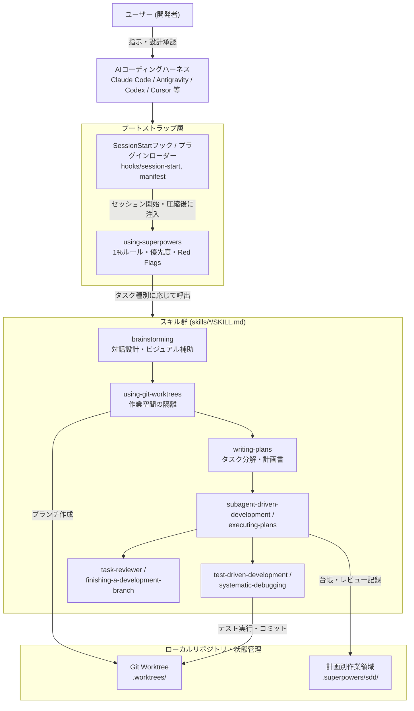

# **Superpowers 調査レポート**

## **1. 基本情報**

* **ツール名**: Superpowers (`obra/superpowers`)
* **ツールの読み方**: スーパーパワーズ
* **開発元**: Prime Radiant (Jesse Vincent / `obra`)
* **公式サイト**: [https://github.com/obra/superpowers](https://github.com/obra/superpowers)
* **関連リンク**:
  * GitHub: [https://github.com/obra/superpowers](https://github.com/obra/superpowers)
  * 開発元サイト: [https://primeradiant.com](https://primeradiant.com)
  * 初期リリース解説記事: [https://blog.fsck.com/2025/10/09/superpowers/](https://blog.fsck.com/2025/10/09/superpowers/)
  * レビューサイト: G2、Capterra、ITreviewに単独の製品登録なし（OSSのプラグイン／スキルフレームワークとしてGitHub・Reddit・Hacker News等で評価）
* **カテゴリ**: AI開発ワークフロー
* **概要**: Superpowersは、Jesse Vincent（`obra`）およびPrime Radiantが開発する、AIコーディングエージェント向けのオープンソース・スキルフレームワーク兼ソフトウェア開発手法です。エージェントがユーザーの意図を十分に確認せずいきなりコードを書き始める「バイブコーディング」の弊害を防ぐため、対話的なブレインストーミング、Git worktreeによる作業隔離、詳細な実装計画策定、Red-Green-Refactorの厳格なTDD、サブエージェント主導の実装とコードレビューという一連のエンジニアリング工程を自律的に強制します。Claude Codeをはじめとする16種類のコーディングエージェント（ハーネス）に対応しています。

## **2. 目的と主な利用シーン**

* **解決する課題**:
  * **仕様確認なしの暴走実装**: AIエージェントが曖昧なプロンプトのまま即座にコード生成へ進み、ユーザーの意図とズレた実装を量産する問題。
  * **テストの省略と手戻り**: テストを後回しにしたり既存テストを壊したりして、修正ループ（堂々巡り）に陥る問題。
  * **コンテキスト肥大化による品質劣化**: 長時間セッションでエージェントのコンテキストウィンドウが汚れ、後半の実装精度が低下する問題。
* **想定利用者**:
  * Claude Code、Codex、Cursor、Antigravity、Gemini CLI等を日常的に利用するソフトウェアエンジニア
  * AIエージェントによる生成コードの品質・保守性・テストカバレッジを担保したい開発チーム
  * 長時間（数時間規模）の自律開発タスクを安定して完遂させたいテックリード
* **利用シーン**:
  * **新規機能の設計から実装までの一気通貫開発**: 要件が曖昧な状態から対話的に仕様と設計書を固め、タスク分割とTDDで安全に機能を追加する。
  * **並列ブランチでの安全な機能検証**: `using-git-worktrees` により現在の作業ツリーを汚さずに隔離環境を構築し、複数タスクを並行処理する。
  * **難解なバグの根本原因調査**: `systematic-debugging` スキルにより場当たり的なパッチ当てを禁止し、4段階の根本原因分析と再現テストを経て修正する。

### **2.1 代表的な利用フロー**

```mermaid
swimlane-beta TB
  subgraph User["ユーザー（開発者）"]
    U1["やりたいこと・目的を指示"]
    U2["質問に回答し設計書を承認"]
    U3["マージ・PR作成等の完了方法を選択"]
  end
  subgraph Agent["AIコーディングエージェント"]
    A1["SessionStartでusing-superpowersを自動読込"]
    A2["brainstormingで要件・設計を対話整理"]
    A3["writing-plansでタスク計画書を作成"]
    A4["タスク単位でサブエージェントを起動・検証"]
  end
  subgraph Superpowers["Superpowers (SKILL.md / Hooks)"]
    S1["1%ルールで該当スキル呼出を強制"]
    S2["TDD・2段階レビューの規律を注入"]
  end
  subgraph GitEnv["Git / ローカル環境"]
    G1["using-git-worktreesで隔離ブランチを作成"]
    G2["Red-Green-Refactorでテスト・実装・コミット"]
    G3["finishing-a-development-branchで後処理"]
  end
  U1 --> A1
  A1 --> S1
  S1 --> A2
  A2 --> U2
  U2 --> G1
  G1 --> A3
  A3 --> A4
  A4 --> S2
  S2 --> G2
  G2 --> G3
  G3 --> U3
```

* **代表的な流れ**: セッション開始時に `SessionStart` フック（またはスキル記述）経由で `using-superpowers` が読み込まれ、エージェントはタスク着手の前に必ず `brainstorming` を起動してユーザーと設計合意を形成します。承認後、Git worktreeによる隔離環境上で `writing-plans` がタスク分解を行い、`subagent-driven-development` と `test-driven-development` の規律に従って実装・レビュー・マージ準備までを自動推進します。

## **3. 主要機能**

Superpowersは `skills/` 配下に15種類の構成可能（Composable）なスキル群を搭載しています。

* **using-superpowers（メタスキル・ブートストラップ）**: セッション開始時に注入され、「1%でも該当する可能性がある場合は作業前に必ずスキルを呼び出す」という行動規範と、言い訳防止テーブル（Red Flags）をエージェントに徹底させます。
* **brainstorming（要件・設計の対話的策定）**: 実装前に「なぜそれが必要か」「何を作るか」を対話で引き出し、プロジェクト規模に応じてチャット合意または設計ドキュメント（Design Doc）を作成し、ビルダー視点のチェックとユーザー承認を得ます。選択式のビジュアルコンパニオン機能も備えます。
* **using-git-worktrees（作業空間の自動隔離）**: 既存のworktreeやサブモジュールを検出しつつ、ハーネス固有ツールまたは `git worktree` を用いて隔離ブランチを作成し、プロジェクト初期化とクリーンなテストベースラインを検証します。
* **writing-plans（粒度の細かい実装計画作成）**: 承認された設計に基づき、2〜5分程度で完了するタスク単位へ分割し、対象ファイルパス・シグネチャ・テストアサーション・検証手順を明記した計画書を生成します。
* **subagent-driven-development（サブエージェント主導開発）**: 計画内の独立タスクごとにコンテキストがクリーンな実装用サブエージェントを起動し、各タスク後に「仕様準拠＋コード品質」のタスクレビュー（`task-reviewer-prompt.md`）と修正ループ、最後にブランチ全体の最終レビューを実行します。
* **executing-plans（インライン計画実行）**: サブエージェントを使わず単一セッション内で全タスクを連続実行し、最後に1回のフレッシュなレビューを行う低トークン消費モードを提供します。
* **test-driven-development（厳格なRed-Green-Refactor）**: 「失敗するテストなしにプロダクションコードを書かない」鉄則を課し、テストより先に書かれたコードの削除や、改ざん・形骸化テストを防ぐガイドライン（`writing-good-tests.md`）を適用します。
* **systematic-debugging & verification-before-completion（体系的デバッグと完了検証）**: バグ修正時の推測による当てずっぽうな変更を禁じ、4段階の根本原因分析と完了前の実コマンド検証を義務付けます。
* **diagnosing-superpowers（セッション自己診断）**: スキルが発火しない、計画を無視したなどの問題発生時にセッションのトランスクリプトを解析し、行レベルの根拠レポートや個人情報等を除去（scrub）したバグ報告バンドルを生成します。
* **requesting-code-review / receiving-code-review / finishing-a-development-branch / dispatching-parallel-agents / writing-skills**: コードレビューの依頼・受領作法、並列エージェント制御、マージ／PR作成／ワークツリー削除の完了処理、新規スキルの作成・テスト手法まで網羅しています。

## **4. 動作原理・システム構成**

* **アーキテクチャ**: ローカルファーストのプラグイン／プロンプト注入型フレームワーク。独自のLLM推論サーバーや常駐デーモンを持たず、既存のAIコーディングエージェント（ハーネス）のプラグイン機構・フック機構・スキルローダー上で動作するMarkdown（`SKILL.md`）と軽量スクリプト群で構成されています。
* **主要コンポーネントとデータフロー**:
  * **ブートストラップ層（`hooks/`・各ハーネス用マニフェスト）**: Claude Code、Cursor、GitHub Copilot等では `SessionStart` フック（`hooks/session-start` / `hooks/run-hook.cmd`）が起動・`/clear`・コンパクション時に `skills/using-superpowers/SKILL.md` をコンテキストへ注入します。AntigravityやCodex、OpenCode、Pi等では各ハーネス固有のプラグインマニフェスト（`.antigravity-plugin/plugin.json`、`.codex-plugin/`、`.opencode/`、`.pi/` 等）またはスキル記述を通じてロードされます。
  * **スキル定義層（`skills/*/SKILL.md`）**: YAMLフロントマター（`name`, `description`）とMarkdown本文で手順・制約・判断基準・アンチパターンを定義し、エージェントが必要に応じて段階的に読み込みます。
  * **状態管理・ワークスペース層（`.superpowers/sdd/<plan-basename>/`）**: サブエージェント主導開発（SDD）の進行台帳（`progress.md` やタスクブリーフ、レビューパッケージ）を計画単位のディレクトリに保存し、最終レビュー完了後に自動削除してGit履歴のみを恒久記録として残します。



* **特筆すべき要素技術**:
  * **シェルフォークレス高速フック（`hooks/session-start`）**: Windows（Git Bash）や破損した `PATH` 環境でも遅延・失敗しないよう、`dirname` や `cat` 等の外部コマンド呼び出しやパイプを排除し、Bash組み込みの文字列置換のみでJSONコンテキストを生成します。
  * **計画スコープ型SDDワークスペース**: 過去の別計画の進捗台帳を誤読するコンテキスト汚染を防ぐため、計画ファイル名ごとに `.superpowers/sdd/<plan-basename>/` へ隔離し、完了時に自動クリーンアップします。
  * **Eval駆動のプロンプト最適化（`superpowers-evals`）**: 変更のたびに実際のエージェント挙動をブラインド評価・マイクロテストで検証し、無駄な質問数やルール違反率を定量的に削減しています。

## **5. 開始手順・セットアップ**

* **前提条件**:
  * 対応するAIコーディングエージェント（Claude Code、Antigravity、Codex、Cursor、Gemini CLI、GitHub Copilot CLI、OpenCode 等）が導入済みであること
  * Git（`using-git-worktrees` を利用する場合）、および一部スクリプト・Windows環境では Bash / Git for Windows
  * Superpowers自体はオープンソースであり、専用のアカウント登録やクレジットカード登録は不要（各ハーネス側のLLM利用環境のみ必要）
* **インストール/導入**:
  利用するハーネスごとに導入コマンドが用意されています（代表的な例）。

  ```bash
  # Claude Code（公式マーケットプレイス経由）
  /plugin install superpowers@claude-plugins-official

  # Antigravity CLI
  agy plugin install https://github.com/obra/superpowers

  # Gemini CLI
  gemini extensions install https://github.com/obra/superpowers

  # Devin CLI
  devin plugins install obra/superpowers
  ```

  Cursorではチャット欄で `/add-plugin superpowers`、Codex CLIでは `/plugins` から `superpowers` を検索してインストールできます。
* **初期設定**:
  * インストール後、特別な設定ファイル編集は不要で、`SessionStart` フックまたはスキル発見機構により自動有効化されます。
  * Visual Companionのロゴ読み込みによる最小限のテレメトリを無効化したい場合は、環境変数 `SUPERPOWERS_DISABLE_TELEMETRY=1`（またはClaude Codeの `DISABLE_TELEMETRY`）を設定します。
* **クイックスタート**:
  * インストール後に新しいセッションを開き、以下のように機能開発を依頼すると、`brainstorming` スキルが自動発火して設計対話が始まります。

  ```text
  Let's make a react todo list
  ```

## **6. 特徴・強み (Pros)**

* **圧倒的な工程規律と再現性**: 単に「TDDを心がけて」とプロンプトに書くのではなく、テストより先に書いたコードを削除させる規則や、2段階のサブエージェントレビュー・修正ループ（5回サーキットブレーカー付き）など、AIの「手抜き・思い込み（Rationalization）」を封じる実践的なガードレールが組み込まれています。
* **16種類の主要ハーネスへのクロスプラットフォーム対応**: Claude Code、Antigravity、Codex App/CLI、Cursor、Devin CLI、Factory Droid、Gemini CLI、GitHub Copilot CLI、Grok Build CLI、Kimi Code、OpenCode、Pi、Qwen Code、Hermes Agent、Museまで単一リポジトリで幅広くカバーしています。
* **コンテキスト汚染を防ぐサブエージェント設計**: 親エージェント（コントローラー）が計画管理とレビュー調整に専念し、各タスクの実装・レビューはクリーンなコンテキストを持つサブエージェントに委譲するため、長時間の自律開発でも精度が落ちにくい構造です。
* **実戦と評価（Eval）に基づく高速な改善**: 実際の開発トランスクリプトの失敗事例を分析し、定量的なevalベンチマークでプロンプトを磨き上げているため、無駄な質問やトークン消費を継続的に削減しています。

## **7. 弱み・注意点 (Cons)**

* **トークン消費量と実行時間の増加**: 小さなバグ修正や簡単な変更でも計画・TDD・サブエージェント・レビューの各ゲートを通過しようとするため、APIコストや待ち時間が大きくなりやすい点に注意が必要です（v6.3.0以降でタスク規模に応じた省略や、低コストな `executing-plans` モードも用意されています）。
* **ハーネス固有の制約への依存**: ハーネスによってはコンパクション後のフック再注入が非対応（Hermes Agentなど）であったり、スキル名のプレフィックス仕様が異なったりするため、長時間セッションでは動作差が生じる場合があります。
* **日本語対応の状況**: スキル本文（`SKILL.md`）、メタプロンプト、公式ドキュメント、リリースノートはすべて英語で記述されています。日本語での指示に対してもLLMの能力で応答自体は可能ですが、スキル自体の公式日本語版は提供されていません。

## **8. 料金プラン**

| プラン名 | 料金 | 主な特徴 |
|---------|------|---------|
| **OSS版（MIT License）** | 無料 | 全15スキル・全ハーネス向けプラグイン・ソースコードを制限なく利用可能 |
| **商用サポート / エンタープライズ向け** | 要問い合わせ | Prime Radiantによる商用サポート、追加ツール、マネージド支出支援（`sales@primeradiant.com` へ連絡） |

* **課金体系**: Superpowers本体は完全無料のオープンソースソフトウェアです。実行時に使用するLLM（Claude、OpenAI、Gemini等）のAPI料金または各コーディングエージェントのサブスクリプション費用が別途発生します。
* **無料トライアル**: オープンソースのため試用期限や機能制限なく即座に利用できます。

## **9. 導入実績・事例**

* **導入実績の概要**: GitHub上で32万以上のスターと2.8万以上のフォークを獲得しており、個人開発者からプロダクト開発チームまで極めて広いコミュニティで採用されています。なお、開発元のPrime Radiant自身も2025年10月以降、Jesse Vincent氏自身が手動でコードを書かず、SuperpowersとAIエージェント群のオーケストレーションによって開発・運用を行っていることが公開されています。
* **導入事例・利用形態**:
  * **公式プラグインマーケットプレイスへの採用**: Anthropic（Claude Code公式プラグイン）、OpenAI（Codex公式プラグイン）、xAI（Grok公式プラグイン）などの公式マーケットプレイスに掲載・採用されています。
  * **開発現場での活用**: QiitaやZenn等の技術ブログ、Reddit（r/ClaudeCode等）において、FlutterやDjango、React/TypeScript等の実プロジェクトで「Vibe Codingから脱却し、仕様策定とTDDを定着させる手法」としての実践事例が多数報告されています。
* **対象業界**: Web・SaaS開発、モバイルアプリ開発、DevOps・インフラ自動化、スタートアップのプロダクト開発全般。

## **10. サポート体制**

* **ドキュメント**: リポジトリ内の `README.md`、`RELEASE-NOTES.md`、`docs/` 配下の各種ハーネス別ガイド（`README.opencode.md`, `README.kimi.md` 等）、および各スキルの `SKILL.md` が整備されています。
* **コミュニティ**: 公式Discordサーバー（招待リンクがREADMEに公開）およびGitHub Issues（`https://github.com/obra/superpowers/issues`）で活発に質疑応答・バグ報告が行われています。セッション診断用の `diagnosing-superpowers` スキルを使ったバグ報告フローも用意されています。
* **公式サポート**: オープンソース版はコミュニティベース（英語）。企業向けの商用サポートや追加ツールが必要な場合は、Prime Radiant（`sales@primeradiant.com`）への個別問い合わせ窓口が案内されています。

## **11. エコシステムと連携**

### **11.1 API・外部サービス連携**

* **API**: 独立したWeb APIサービスではなく、各AIコーディングエージェントのプラグイン／スキル仕様（Claude Code Plugin、Agent Skills形式、Pi Package、Gemini Extension等）に準拠したファイル群として提供されます。
* **外部サービス・ハーネス連携**:
  * **AIコーディングツール**: Claude Code、Antigravity、OpenAI Codex（App / CLI）、Cursor、Devin CLI、Factory Droid、Gemini CLI、GitHub Copilot CLI、Grok Build CLI、Kimi Code、OpenCode、Pi、Qwen Code、Hermes Agent、Muse
  * **開発基盤・リポジトリ**: Git（`git worktree`）、GitHub / GitLab等のGitホスティング基盤（Forge非依存のPR作成・ブランチ完了フロー）

### **11.2 技術スタックとの相性**

Superpowersは特定のプログラミング言語やWebフレームワークに依存せず、プロジェクトのテストランナーやGit環境と組み合わせて動作します。

| 技術スタック / 環境 | 相性 | メリット・推奨理由 | 懸念点・注意点 |
|:---|:---:|:---|:---|
| **Claude Code** | ◎ | 公式マーケットプレイス登録済み。`SessionStart` フック、サブエージェント機能と完全連携 | サブエージェント多用時はトークン消費量に注意 |
| **Antigravity / Codex / Cursor** | ◎ | 専用プラグインマニフェストを提供。ネイティブのスキル・ワークツリー機能と協調動作 | ハーネスにより起動・更新手順が若干異なる |
| **TypeScript / Python / Go 等のテスト整備済み環境** | ◎ | `test-driven-development` のRed-Green-Refactorサイクルがテストランナーと高相性 | テスト環境が未構築のプロジェクトでは初期セットアップが必要 |
| **Windows (Git Bash / PowerShell)** | ◯ | `run-hook.cmd` やPowerShell対応が継続的に改善され、WSL未導入環境でも動作 | 企業端末の制限でスクリプト実行ポリシーが厳しい場合は調整が必要 |
| **テスト実行不可・レガシー環境** | △ | 設計・計画スキル（`brainstorming`, `writing-plans`）は有効に活用可能 | 自動テストが回せない環境ではTDDスキルの強みを十分に発揮できない |

## **12. セキュリティとコンプライアンス**

* **認証**: Superpowers自体はローカル実行のOSSプラグインであり、独自の認証基盤やユーザーアカウントは持ちません。利用する各AIコーディングエージェント（Claude Code等）およびGit環境の認証設定をそのまま継承します。
* **データ管理**: ソースコードや計画書・SDD作業ログ（`.superpowers/sdd/`）はすべてユーザーのローカル環境内で処理されます。LLMへのデータ送信可否や保持ポリシーは接続先のAIプロバイダ契約に準拠します。なお、任意機能の「Visual Companion」は起動時にバージョン把握のためPrime Radiantサイトからロゴ画像を読み込みますが、プロジェクト内容やプロンプトは送信されず、`SUPERPOWERS_DISABLE_TELEMETRY` 等の環境変数で完全に無効化できます。また、バグ報告用の `diagnosing-superpowers` には機密情報を除去（scrub）する仕組みが備わっています。
* **準拠規格**: OSSプラグイン単体としてのSOC2・ISO27001等の取得情報はない（公式サイトでは公開されていない。エンタープライズ向け商用利用時の要件確認はPrime Radiantへの個別問い合わせが必要）。また、v7.0.0等ではカレントディレクトリ内の偽装 `bash.cmd` 実行を防ぐWindowsフックのセキュリティ強化も行われています。

## **13. 操作性 (UI/UX) と学習コスト**

* **UI/UX**: 基本は各コーディングエージェントのCLI／チャット画面上で自然言語の対話として進行し、設計フェーズでは必要に応じてブラウザ上で図やUI案を比較できる「Visual Companion」も起動できます。ユーザーは特別なスラッシュコマンドを暗記しなくても、通常の依頼を投げるだけで適切なスキルが自動発動する体験が特徴です。
* **学習コスト**: 導入と初回利用の敷居は低いものの、「いきなりコードを書かせず、まず設計対話と承認を行う」「テストファーストを徹底する」という開発スタイルへの意識切り替えが求められます。小規模タスクでの手順の重さに慣れるまでは、`executing-plans` の選択や質問スキップの使い分けを把握する必要があります。

## **14. ベストプラクティス**

* **効果的な活用法 (Modern Practices)**:
  * **タスク規模に応じたモード選択**: 大規模・複雑な機能開発にはコンテキスト分離とタスク単位レビューが効く `subagent-driven-development` を使い、小規模で単純な変更やコストを抑えたい場合は `executing-plans`（インライン実行）を選択する。
  * **プロジェクト固有ルールとの併用**: `CLAUDE.md` や `AGENTS.md` にプロジェクト固有の規約やビルド・テストコマンドを明記しておくと、`using-superpowers` の優先順位ルールによりSuperpowersの工程とシームレスに融合する。
  * **セッション異常時の自己診断活用**: スキルが発火しない、計画から逸脱したと感じた場合は、手動で原因を探る前に `diagnosing-superpowers` を呼び出してトランスクリプトから根拠を特定する。
* **陥りやすい罠 (Antipatterns)**:
  * **軽微な1行修正にフル工程を適用する**: 単純なタイポ修正や色変更まで厳格な設計書・サブエージェント工程を回すと時間とトークンを浪費するため、不要な場合は明示的にスキップ指示を出す。
  * **テストなし実装の黙認**: エージェントが「今回は時間短縮のため後でテストを書きます」と合理化しようとした際に許可すると、Superpowersの品質保証ループが崩れる。
  * **古いワークツリーや未削除状態ディレクトリの放置**: セッションを強制終了したまま放置するとworktreeが残るため、完了時は `finishing-a-development-branch` で後処理を行う。

## **15. ユーザーの声（レビュー分析）**

* **調査対象**: Reddit（r/ClaudeCode, r/ClaudeAI 等）、Hacker News、Qiita等の技術ブログ
* **総合評価**: 単独レビューサイト（G2/Capterra/ITreview）上の数値スコアは未登録ながら、GitHubスター数32万超を記録し、AIコーディングコミュニティ内で最も評価の高いワークフロープラグインの一つとして言及されています。
* **ポジティブな評価**:
  * **「Toy-gradeからEngineering-gradeへ」**: out-of-the-boxのAIエージェントがテストをスキップして場当たり的なパッチを当てる問題に対し、強力な構造的ガードレールとして機能する点が高く評価されています（Redditより要約）。
  * **手戻りループの劇的な削減**: 「設計→計画→テスト→実装→レビュー」の明確なゲートを設けることで、モデルが矛盾に陥って無意味にトークンを消費し続ける現象（Spinning）が減ったとの声が多く見られます（Hacker News / Redditより要約）。
  * **バイブコーディングからの脱却**: 日本語技術ブログ（Qiita等）では、単なる勢い任せの生成ではなく、MITの優秀なインターンをマネジメントするように堅実なエンジニアリングプロセスをAIに踏ませられる点が支持されています。
* **ネガティブな評価 / 改善要望**:
  * **トークン消費量と速度の重さ**: すべてのタスクでフォーマルな計画・サブエージェント・多段階レビューを走らせると、1行のバグ修正にも長い時間と多くのAPIクォータを消費し「官僚的（heavy-handed）に感じる」という不満が挙げられています（Hacker News / Redditより要約）。
  * **厳格すぎるデフォルトへの摩擦**: 最新の推論能力が高いフロンティアモデルでは、冗長なMarkdown指示や強制的なTDD・worktree運用がかえって足かせや過剰防衛になる場面があるとの指摘もあります（Redditより要約）。
  * **長期セッションでのコンテキスト圧迫**: スキル本文や状態管理のやり取りが増えることで、セッション後半のトークンコストが気になるという声があります。
* **特徴的なユースケース**:
  * 数時間単位で放置しても計画から逸脱せずに実装・テスト・自己レビューを完走させる長尺自律開発や、既存プロジェクトの難解なバグに対する再現テスト駆動のデバッグワークフローで特に重宝されています。

## **16. 直近半年のアップデート情報**

* **2026-11-03 (v7.0.2)**: `brainstorming` の対話ロジックを改善し、目的（why）を最初に問いつつ不要な確認質問を削減（評価テストでフィラー質問を41→23に減少）。選択肢提示時に推奨案を添えるよう改良したほか、Copilot（Windows PowerShell対応）やPi・Hermes・OpenCodeなど6ハーネスのブートストラップ不具合を修正し、`SessionStart` フックのフォークレス化で高速化を実現。
* **2026-10-21 (v7.0.1)**: v7.0.0で刷新した `brainstorming` に対し、定型的すぎる質問を抑えてプロジェクト文脈を先に調査してから質問するよう調整。
* **2026-10-09 (v7.0.0)**: `brainstorming` スキルをゼロから再構築し、タスク規模に応じたプロセス自動調整やビルダー視点の事前チェックを導入。さらにAntigravity向けネイティブプラグインマニフェスト（`.antigravity-plugin/plugin.json`）を追加し、Windowsでの `run-hook.cmd` のPATH・セキュリティ問題を修正。
* **2026-09-25 (v6.4.2)**: `writing-plans` を軽量化し、コード全文を計画に書き出すのではなくシグネチャやテストアサーション等の意思決定情報のみを記録する形式へ改善。
* **2026-08-12 (v6.3.0)**: Devin CLI、Hermes Agent、Grok Build CLIへの対応を追加。タスク規模（spike / bounded / architectural）に応じた `brainstorming` の儀式簡略化と、SDDコントローラーが軽微な計画矛盾で停止せず裁定を記録して続行する機能（Rulings）を導入。
* **2026-07-23 (v6.2.0)**: SDDワークスペースを計画ファイル単位（`.superpowers/sdd/<plan-basename>/`）へ分離し、レビュー修正ループを実装サブエージェントの再開（resume）方式＋5回サーキットブレーカーへ刷新。TDD参照文書も `writing-good-tests.md` へ再編。
* **2026-06-30 (v6.1.0)**: 全セッションで注入される `using-superpowers` とハーネス別参照文書を圧縮し、セッションあたりのトークンコストを削減。Codex用マーケットプレイスマニフェストを追加。
* **2026-06-16 (v6.0.0)**: サブエージェントのタスク別2段階レビューを単一の `task-reviewer-prompt.md` へ統合し、eval上で同等品質を維持しつつ約2倍の高速化と約50%のトークン削減を達成。Kimi Code、Pi、Antigravity対応を追加。

(出典: [Superpowers リリースノート (RELEASE-NOTES.md)](https://github.com/obra/superpowers/blob/main/RELEASE-NOTES.md) / [GitHub Releases](https://github.com/obra/superpowers/releases))

## **17. 類似ツールとの比較**

### **17.1 機能比較表 (星取表)**

| 機能カテゴリ | 機能項目 | Superpowers | Matt Pocock Skills | TAKT | cc-sdd | Spec Kit |
|:---:|:---|:---:|:---:|:---:|:---:|:---:|
| **ワークフロー** | 設計・仕様策定支援 | ◎<br><small>対話型brainstormingと設計書承認</small> | ◎<br><small>/grill-me・ADR・用語集整備</small> | ◯<br><small>YAML定義＋形式仕様対応</small> | ◎<br><small>Kiro式の要件→設計→タスク分割</small> | ◎<br><small>Specify→Plan→Tasksの段階生成</small> |
| **開発規律** | TDD・テスト強制 | ◎<br><small>Red-Green-Refactorと反パターン排除</small> | ◎<br><small>厳格なTDDスキルを搭載</small> | ◯<br><small>YAMLルールでテスト工程を定義可</small> | △<br><small>仕様書基準でテスト強制は弱め</small> | △<br><small>計画に含めるが強制機構は限定的</small> |
| **実行制御** | サブエージェント・並列/隔離実行 | ◎<br><small>タスク単位SDD＋Git worktree自動隔離</small> | ◎<br><small>チケット単位のサブエージェント分離</small> | ◎<br><small>並列レビュー＋Worktree分離実行</small> | ◯<br><small>/kiro-implで自律実装</small> | △<br><small>主に単一エージェント向けタスク展開</small> |
| **品質保証** | 自動レビュー・修正ループ | ◎<br><small>タスク毎レビュー＋全体最終レビュー</small> | ◎<br><small>2軸の並列コードレビュー</small> | ◎<br><small>多視点ペルソナの並列レビュー＆修正</small> | △<br><small>仕様書との整合確認中心</small> | △<br><small>人間による各フェーズ確認が主</small> |
| **対応範囲** | マルチハーネス対応 | ◎<br><small>Claude/Antigravity/Codex等16種</small> | ◯<br><small>Claude/Codex/Copilot/Gemini/Cursor</small> | ◯<br><small>Claude/Codex/Cursor等＋Web UI</small> | ◯<br><small>Claude/Cursor/Gemini等8種</small> | ◯<br><small>主要AIエディタ・CLIに対応</small> |
| **非機能要件** | 日本語対応 | △<br><small>英語中心（日本語プロンプト動作は可）</small> | △<br><small>英語中心（用語集での調整推奨）</small> | ◎<br><small>日本語ドキュメント・開発元情報充実</small> | ◎<br><small>--lang jaで13言語出力対応</small> | △<br><small>英語ドキュメント中心</small> |

### **17.2 詳細比較**

| ツール名 | 特徴 | 強み | 弱み | 選択肢となるケース |
|---------|------|------|------|------------------|
| **Superpowers** | 15種のスキルとフックでSDLC全体を強制する手法 | 16ハーネス対応、TDDとサブエージェント開発の規律が極めて堅牢 | 軽微な作業では手順・トークン消費が重くなりやすい | エージェントに開発工程全体（設計〜TDD〜レビュー）を自律・高信頼で任せたい場合 |
| **Matt Pocock Skills** | 27種のエンジニアリング実践スキル集 | ソクラテス式質問、ADR/用語集整備、User/Model呼出分離 | 英語中心で、独自ワークフローへの組み込みが必要 | 業務ドメインの用語整理や設計の深掘り（`/grill-me`）を重視する場合 |
| **TAKT** | YAMLベースのエージェント・オーケストレーター | 宣言的なワークフロー定義、Web UI、並列ペルソナレビュー、日本語充実 | YAML設計やCLIツールとしての初期構成が必要 | チーム独自のレビュー観点やマルチエージェント構成をYAMLで厳密に制御したい場合 |
| **cc-sdd** | Kiro式仕様書駆動開発（SDD）を導入するCLI | `--lang ja` の多言語対応、要件〜設計〜タスクの定型テンプレート | テスト駆動やセッション診断等の実行時規律は控えめ | 日本語でKiro互換の仕様書ドキュメントを残しながら開発を進めたい場合 |
| **Spec Kit** | GitHub公式の仕様駆動開発ツールキット | シンプルなコマンド体系で仕様書・計画・タスクを整理 | サブエージェント隔離や自動修正ループ等の自律実行機能は限定的 | 既存のGitHub Copilot等の環境へ軽量に仕様駆動プロセスを導入したい場合 |

## **18. 総評**

* **総合的な評価**:
  * Superpowersは、AIコーディングエージェントの最大の弱点である「確認不足のままコードを書き散らし、テストを省いて破綻する」という問題に対し、ソフトウェア工学の王道プロセス（対話設計、Git worktree隔離、細粒度計画、Red-Green-Refactor TDD、2段階レビュー）をスキルとして構造化した、極めて完成度の高いオープンソースフレームワークです。16種類の主要ハーネスへの幅広い対応と、evalに基づく継続的な品質改善（v7.0.2時点）により、単なるプロンプト集を超えた実用的な開発基盤として確立されています。
* **推奨されるチームやプロジェクト**:
  * Claude Code、Antigravity、Codex、Cursor等を用いた中〜大規模の機能開発や、長時間の自律コーディングで品質とテスト網羅性を維持したいエンジニア・開発チームに強く推奨できます。
* **選択時のポイント**:
  * 徹底したTDDとサブエージェント単位の品質ゲートを求めるなら **Superpowers** が最適です。一方で、ドメイン用語集やADRの整備を軸にしたい場合は **Matt Pocock Skills**、YAMLで多視点レビューと実行パイプラインを細かく制御したい場合や日本語ドキュメントを重視する場合は **TAKT**、日本語でのKiro形式ドキュメント生成を優先する場合は **cc-sdd** を比較検討するとよいでしょう。
