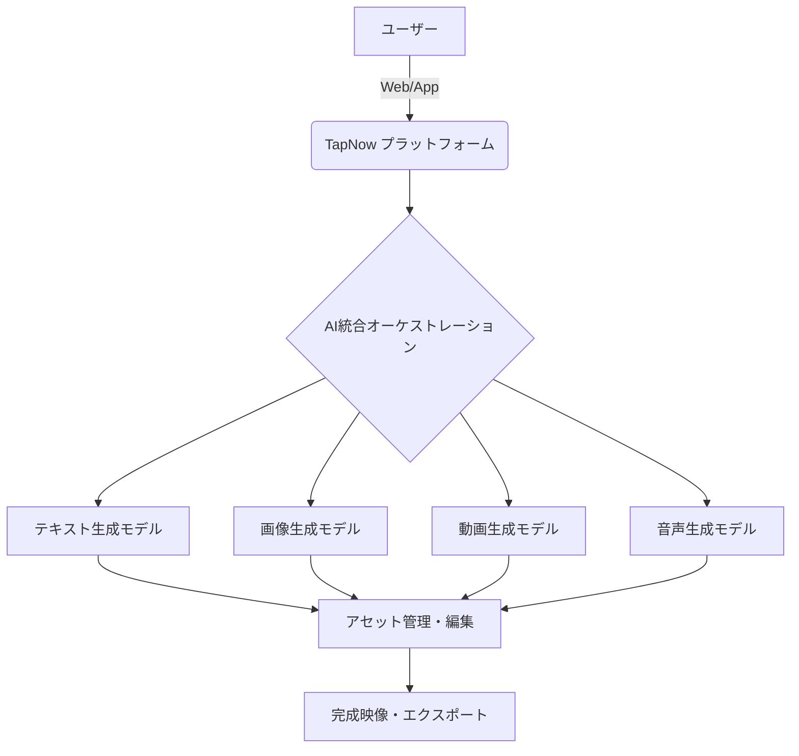

# **TapNow 調査レポート**

## **1. 基本情報**

* **ツール名**: TapNow
* **ツールの読み方**: タップナウ
* **開発元**: Tamar AI Inc.
* **公式サイト**: [https://www.tapnow.ai/](https://www.tapnow.ai/)
* **関連リンク**:
  * ブログ: [https://blog.tapnow.media/en/](https://blog.tapnow.media/en/)
* **カテゴリ**: AI動画生成プラットフォーム
* **概要**: TapNowは、テキスト、画像、音声、動画のAIモデルをシームレスに連携させて映像制作が行える「Creative OS」である。ツールの枠を超え、クリエイターがAIを活用して作品を制作し、独自のプラットフォームを通じて観客に届けるまでのエコシステムを提供する。

## **2. 目的と主な利用シーン**

* **解決する課題**: 複数のAIモデル（テキスト・画像・動画・音声）をまたいだ制作ワークフローの分断や技術的障壁を解消し、クリエイティブな意思決定に集中できる環境を提供する。
* **想定利用者**: 映像クリエイター、映画製作者、広告代理店、マーケティングチーム
* **利用シーン**:
  * AIネイティブなショートフィルムや映像作品の開発とプロトタイピング
  * 広告用映像クリエイティブの迅速な制作
  * ストーリーボードの作成やビジュアルアイデアの実験

## **3. 主要機能**

* **マルチモーダル統合機能**: テキスト、画像、音声、動画の生成モデルを単一の環境でオーケストレーションし、一貫した制作フローを実現する。
* **ワークフローオーケストレーション**: AIを活用したクリエイティブプロセスの各フェーズ（プロンプト作成から動画生成、編集）をシームレスに繋ぐ。
* **アプリ対応**: Webだけでなく、アプリ版も提供しており多様な環境からのアクセスが可能。
* **エコシステム連携**: 作品配信プラットフォーム「Glanze」と連携し、制作後の配信をサポートする。
* **コミュニティ参加機能**: クリエイターコミュニティへの参加や、グローバルなイベント（10,000 Parallel Universes等）を通じた作品発表の場を提供する。

## **4. 動作原理・システム構成**

* **アーキテクチャ**: クラウドベースのSaaSプラットフォーム
* **主要コンポーネントとデータフロー**:
  * ユーザーはWebブラウザまたは専用アプリを通じてインターフェースにアクセスし、クラウド上の各種AIモデル（テキスト・画像・動画・音声生成モデル）と対話しながらアセットを生成・編集する。
* **特筆すべき要素技術**:
  * 複数の生成系AIモデルを統合制御するオーケストレーションエンジン

## **5. 開始手順・セットアップ**

* **前提条件**:
  * Webブラウザ、または専用アプリをダウンロード
  * アカウントの作成が必要
* **インストール/導入**:
  公式サイトからアプリをダウンロード、またはWeb上で開始する。
* **初期設定**:
  アカウントを作成し、ワークスペースにアクセスしてプロジェクトを開始する。
* **クイックスタート**:
  無料プランでサインアップし、用意されているAIモデルを選択して、テキストや画像からの動画生成を開始する。

## **6. 特徴・強み (Pros)**

* AIによる生成だけでなく、独自のAIネイティブ作品配信プラットフォーム「Glanze」と連携し、クリエイターの作品を観客に届ける出口まで用意している。
* 複数の生成AIモデルをまたぐワークフローの摩擦を最小限に抑える設計（Zero friction）。
* Alibaba、Google、TikTokなど、世界的な大手企業やクリエイティブチームに信頼され、利用されている実績がある。

## **7. 弱み・注意点 (Cons)**

* 統合的な環境であるため、特定の高度な専門機能（例：非常に詳細なVFX編集など）は専用の動画編集ソフトに劣る可能性がある。
* 料金プランや個別の機能制限について、公式サイト上の情報が少なく、本格的な導入には問い合わせが必要な場合がある。
* 日本語対応に関する詳細情報が公式サイト上で限定的である。

## **8. 料金プラン**

| プラン名 | 料金 | 主な特徴 |
|---------|------|---------|
| **無料プラン** | 無料 | 基本的な機能の利用、トライアル用（Get started for free） |
| **Enterprise** | 要問い合わせ | 企業向けの高度な機能やサポート |

* **課金体系**: 詳細なプラン体系は公式サイトのPricingページ、または直接の問い合わせで確認が必要。
* **無料トライアル**: アカウント作成で無料プランから開始可能。

## **9. 導入実績・事例**

* **導入企業**: Alibaba, Google Ads, Google Cloud, TikTok, YouTube, ByteDance, Tencent, WPP, HONDA, The Trade Desk など。
* **導入事例**: 世界的なクリエイティブチームや広告主の映像制作ワークフローに組み込まれている。
* **対象業界**: 広告、映画製作、メディア、エンターテインメント

## **10. サポート体制**

* **ドキュメント**: Web上で利用ガイドなどを提供
* **コミュニティ**: クリエイター向けのコミュニティを展開し、クリエイターコミュニティを重視している（Discord等）。
* **公式サポート**: Enterprise向けの専用サポートなどを提供。

## **11. エコシステムと連携**

### **11.1 API・外部サービス連携**

* **API**: 詳細は非公開だが、マルチモーダルモデルの統合インターフェースとして機能する。
* **外部サービス連携**: 独自の配信プラットフォーム「Glanze」との連携があり、制作から配信までのエコシステムを形成している。

### **11.2 技術スタックとの相性**

| 技術スタック | 相性 | メリット・推奨理由 | 懸念点・注意点 |
|:---|:---:|:---|:---|
| **Webブラウザ** | ◎ | クラウドベースのSaaSとしてブラウザから直接利用可能 | インターネット接続が必須 |
| **モバイル/デスクトップアプリ** | ◯ | 専用アプリ経由でシームレスな操作が可能 | プラットフォームごとの対応状況の確認が必要 |

## **12. セキュリティとコンプライアンス**

* **認証**: アカウントによる認証。Enterprise向けにはさらに高度な要件に対応している可能性あり。
* **データ管理**: プライバシーポリシーやGenerated Content Licenseに基づくコンテンツ権利保護とデータ管理。
* **準拠規格**: 一般的なSaaSとしてセキュリティ要件を満たすが、詳細な規格についてはエンタープライズプランでの確認が必要。

## **13. 操作性 (UI/UX) と学習コスト**

* **UI/UX**: 「Zero friction（摩擦なし）」を謳っており、直感的に複数のAIモデルを組み合わせて映像制作ができる洗練されたインターフェース。
* **学習コスト**: AIによる自動化と直感的なUIにより、従来の高度な映像制作ソフトと比べて学習コストは低く抑えられている。

## **14. ベストプラクティス**

* **効果的な活用法 (Modern Practices)**:
  * 企画段階からTapNow内で完結させ、テキストでのアイデア出しから画像・映像生成へとシームレスに移行するワークフローを構築する。
  * 「10,000 Parallel Universes」のようなイニシアチブを参考に、少人数チームでの実験的な映像作品（AIネイティブ・シネマ）の制作に活用する。
* **陥りやすい罠 (Antipatterns)**:
  * AIの自動生成に過度に依存し、クリエイター自身の「Taste（センスや選択）」が欠落した没個性的な作品になってしまうこと。AIはあくまでツールであり、クリエイティブな意思決定は人間が行うべきである点に留意する。

## **15. ユーザーの声（レビュー分析）**

* **調査対象**: 主要なレビューサイトには十分な登録がないが、カンヌやヴェネツィアなどの映画祭での実績から分析。
* **総合評価**: 大手テクノロジー企業や広告代理店からの採用実績が信頼性を示している。
* **ポジティブな評価**:
  * 複数のAIモデルのオーケストレーションが簡単で摩擦がない。
  * 映像制作への技術的ハードルを下げ、アイデアの具現化に集中できる。
  * 「10,000 Parallel Universes」のような、独立系クリエイターを支援する取り組みが評価されている。
* **ネガティブな評価 / 改善要望**:
  * レビューサイトに登録がないため具体的なネガティブフィードバックは見当たらない。
  * 一般ユーザー向けの料金体系が不透明であるという懸念が予想される。
* **特徴的なユースケース**:
  カンヌ国際映画祭やヴェネツィア国際映画祭での「AIネイティブ・シネマ」の展示・上映など、プロフェッショナルな映画製作領域でも活用されている。

## **16. 直近半年のアップデート情報**

* **2026-09-16**: ヴェネツィア国際映画祭にて、AIネイティブシリーズや映画のための新しいプラットフォーム「Glanze」の発表と、プレビュー可能な40以上のタイトルの公開。
* **2026-09-07**: ヴェネツィア国際映画祭にて、「10,000 Parallel Universes」イニシアチブで制作されたAIネイティブ作品の特別上映を実施。
* **2026-09-04**: ヴェネツィア国際映画祭のVenice Production Bridgeにて「AI x Cinema」フォーラムを開催し、AIと映画制作に関する議論を主導。

(出典: [The Future of Creativity Is Taking Shape - TapNow Blog](https://blog.tapnow.media/en/))

## **17. 類似ツールとの比較**

### **17.1 機能比較表 (星取表)**

| 機能カテゴリ | 機能項目 | TapNow | Luma AI | Dreamina |
|:---:|:---|:---:|:---:|:---:|
| **基本機能** | 動画生成 | ◎ <small>マルチモデル統合</small> | ◎ <small>高品質な動画生成</small> | ◎ <small>テキスト/画像からの生成</small> |
| **基本機能** | 画像・音声連携 | ◎ <small>統合環境で対応</small> | △ <small>動画生成に特化</small> | ◯ <small>画像生成も可能</small> |
| **エコシステム** | 作品配信PF | ◎ <small>Glanze連携</small> | × <small>制作ツールとして完結</small> | × <small>制作ツールとして完結</small> |
| **エンタープライズ** | 大規模導入実績 | ◎ <small>グローバル企業</small> | ◯ <small>API提供あり</small> | ◯ <small>API提供あり</small> |

### **17.2 詳細比較**

| ツール名 | 特徴 | 強み | 弱み | 選択肢となるケース |
|---------|------|------|------|------------------|
| **TapNow** | クリエイティブOSとしての統合環境 | 複数モデルのオーケストレーションと独自の配信PF(Glanze) | 独立した専用モデルの尖った性能では劣る可能性がある | 制作から配信までの統合的なフローや、本格的な映像作品を制作したい場合 |
| **Luma AI** | 高品質な動画生成モデル | テキストや画像から極めて高品質でリアルな動画を生成 | 動画生成に特化しており、音声などとの統合は別ツールが必要 | 単一の高品質な動画クリップを生成したい場合 |
| **Dreamina** | 扱いやすい動画・画像生成ツール | 直感的なUIで品質の高い動画生成が可能 | 複雑な制作フローを統合的に管理する機能は弱い | 手軽に高品質な動画素材を生成したい場合 |

## **18. 総評**

* **総合的な評価**:
  TapNowは、単なる「動画生成ツール」ではなく、映像制作に必要な複数のAIモデル（テキスト・画像・音声・動画）をオーケストレーションする「Creative OS」である。さらに、制作したAIネイティブな作品を配信する独自のプラットフォーム「Glanze」を展開している点が非常にユニークであり、クリエイターを中心に据えた強固なエコシステムを築いている。
* **推奨されるチームやプロジェクト**:
  広告代理店、マーケティングチーム、そしてAIを活用した新しい表現手法（AIネイティブ・シネマ）を模索する映像クリエイターや映画製作者。
* **選択時のポイント**:
  単一の生成AIモデルを使いたいのか、それとも制作フロー全体をAIで統合・最適化したいのかが選択の鍵となる。複数のAIモデルを組み合わせて複雑な映像作品を制作・管理したい場合は、TapNowが強力な選択肢となる。
