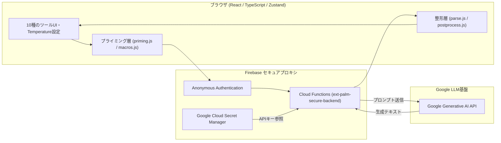

# **TextFX 調査レポート**

## **1. 基本情報**

<!--
【ガイドライン】
- 必須: ツール名、開発元、公式サイト、カテゴリ、概要
- 概要は2-3文で簡潔に記述
-->

* **ツール名**: TextFX
* **ツールの読み方**: テキストエフエックス
* **開発元**: Google (Google Creative Lab)
* **公式サイト**: [https://textfx.withgoogle.com/](https://textfx.withgoogle.com/)
* **関連リンク**:
  * GitHub: [https://github.com/google/generative-ai-docs/tree/main/demos/palm/web/textfx](https://github.com/google/generative-ai-docs/tree/main/demos/palm/web/textfx)
  * ドキュメント: [Google Developers Blog](https://developers.googleblog.com/how-its-made-textfx-is-a-suite-of-ai-tools-made-in-collaboration-with-lupe-fiasco/)
* **カテゴリ**: 特定用途AIアシスタント
* **概要**: Google Creative Labがグラミー賞受賞ラッパーLupe Fiascoと共同開発した、創造的執筆支援のためのAI実験ツール。完成した文章を自動生成するのではなく、直喩・分解・頭韻・視点転換など10種類の専用ツールを通じて、ライターやアーティストの言語表現や発想を拡張する。

## **2. 目的と主な利用シーン**

<!--
【ガイドライン】
- 3-5項目を箇条書きで記述
- 想定利用者を具体的に記載
- 末尾に「代表的な利用フロー」をスイムレーンで添付する
-->

* **解決する課題**: ライターズブロック（執筆のスランプ）の打破、創造的な言葉選びの支援、新しい視点やアイデアの発見。
* **想定利用者**: ラッパー、作詞家、詩人、コピーライター、小説家などのクリエイター、およびプロンプトエンジニアリングを学ぶ開発者。
* **利用シーン**:
  * **作詞・作曲**: 韻を踏む言葉や類似の響きを持つフレーズを探す。
  * **アイデア出し**: 単語から連想される意外な概念やシーンを生成する。
  * **表現の拡張**: 直喩（Simile）や頭韻（Alliteration）を使って文章を豊かにする。
  * **視点の転換**: 特定のトピックについて異なる視点（POV）からの意見を得る。

### **2.1 代表的な利用フロー**

```mermaid
swimlane-beta TB
  subgraph User["ユーザー"]
    A[ツール選択・単語とTemperatureを入力]
    F[出力カードを確認・クリップボードへ保存]
  end
  subgraph Frontend["TextFX Webアプリ (React/Vite)"]
    B[Few-shotプロンプトを組み立て]
    E[生成結果をパース・整形表示]
  end
  subgraph Proxy["Firebase バックエンド"]
    C[匿名認証とCloud Functions経由で中継]
  end
  subgraph LLM["Google LLM API"]
    D[テキスト候補を生成]
  end
  A --> B
  B --> C
  C --> D
  D --> E
  E --> F
```

* **代表的な流れ**: ユーザーがWeb画面で10種のツールから1つを選びキーワードとTemperatureを指定すると、フロントエンドが専用のFew-shotプロンプトを構築し、Firebaseバックエンド経由でGoogleのLLM APIへリクエストを送信して生成結果をカード形式で提示する。

## **3. 主要機能**

<!--
【ガイドライン】
- 5-10項目の主要機能を箇条書きで記述
- 各機能は1-2文で概要を説明
-->

* **Simile (直喩)**: ある物事や概念について、創造的な直喩（〜のような）を生成する。
* **Explode (分解)**: 単語を、似た響きを持つフレーズや単語に分解する（言葉遊びに最適）。
* **Unexpect (意外性)**: シーンや状況に対して、意外性のある展開や要素を追加する。
* **Chain (連鎖)**: 関連する概念や単語を連鎖させて、物語や歌詞の展開を助ける。
* **POV (視点)**: トピックに対して、様々なキャラクターや視点からの意見を生成する。
* **Alliteration (頭韻)**: 指定した文字で始まる、トピックに関連した単語をリストアップする。
* **Acronym (頭字語)**: 単語の文字を使って、その意味に沿った頭字語を作成する。
* **Fuse (融合)**: 2つの異なる概念や物事の共通点や交点を見つけ出す。
* **Scene (シーン)**: 単語やフレーズから、五感（視覚、聴覚など）に訴える詳細なシーン描写を生成する。
* **Unfold (展開)**: 単語を他の言葉やフレーズの中に埋め込み、新しい意味や文脈を作り出す。
* **Look Under the Hood (内部プロンプト表示)**: 各ツールがLLMに送信しているFew-shotプライミングプロンプトの全文をUI上で確認できる学習・透明性機能。

## **4. 動作原理・システム構成**

* **アーキテクチャ**: クライアント・サーバー型のWebアプリケーション（SPAフロントエンド + サーバーレスプロキシ構成）。ホスト版（`textfx.withgoogle.com`）はGoogle App Engine（`app.yaml`）およびGoogle Frontend上で配信されている。
* **主要コンポーネントとデータフロー**:
  * **フロントエンド（React 18 / TypeScript / Vite 4 / Zustand）**: ユーザー入力やTemperatureパラメータ、生成履歴の状態管理を担当する。`src/lib/priming.js` に定義された各ツール専用のFew-shotプライミング例と `macros.js`・`adaptPromptDataFormat.ts` を用いてプロンプトを組み立てる。
  * **セキュアAPIプロキシ（Firebase Anonymous Auth / Cloud Functions / Secret Manager）**: クライアントコードへAPIキーを埋め込むリスクを避けるため、Firebaseの匿名認証とCloud Functions（Firebase Extension「Call PaLM API Securely」/`ext-palm-secure-backend`）を経由してGoogleのLLM APIを呼び出す設計になっている。
  * **ポストプロセス層（`src/lib/parse.js`, `postprocess.js`）**: LLMから返却されたテキスト候補を解析・フィルタリングし、UI上のカードとして整形表示する。
* **特筆すべき要素技術**:
  * **Few-shotプライミング**: チャット形式ではなくテキスト補完モデル向けに複数の入出力ペア（例示）をプロンプトに埋め込むことで、特定の言語的制約（頭韻や音韻分解など）に沿った出力を安定的に誘導している。
  * **開発当初と現在のモデル基盤**: オープンソースコードは2023年公開時点のPaLM API（`generateText()`）を前提としているが、GoogleのAIプラットフォーム自体は後継のGemini APIエコシステムへ移行している。



## **5. 開始手順・セットアップ**

<!--
【ガイドライン】
- アカウント作成から「Hello World」的な最初の動作確認までの手順
- 主要なコマンドや設定項目を記載
-->

* **前提条件（Web版利用時）**:
  * モダンWebブラウザ（Chrome推奨）
  * インターネット接続（ホスト版はアカウント登録不要またはGoogleの画面案内に従いすぐに試用可能）
* **前提条件（ローカル開発・セルフホスト時）**:
  * Node.js 18.15.0以上
  * Firebaseプロジェクト（Blaze従量課金プラン：Firebase Extension利用のため）およびGoogle Cloud Secret Managerの有効化
* **Web版クイックスタート**:
  1. 公式サイト [textfx.withgoogle.com](https://textfx.withgoogle.com/) にアクセス。
  2. 左側のメニューからツール（例: "Simile"）を選択。
  3. 入力フィールドに単語（例: "Life"）を入力し、"Run" ボタンをクリックして生成結果を確認。
  4. "Temperature" スライダーで創造性の度合いを調整し、"Look Under the Hood" で内部プロンプトを確認可能。
* **ローカル開発セットアップ（OSS版）**:

  ```bash
  git clone https://github.com/google/generative-ai-docs.git
  cd generative-ai-docs/demos/palm/web/textfx
  npm install
  # src/lib/firebase.config.js に自身のFirebaseプロジェクト設定（プレースホルダーを置換）を記述
  npm run dev
  ```

  * Firebase Console側でAnonymous Authenticationを有効化し、`ext-palm-secure-backend` Cloud FunctionsのInvoker権限を設定する。APIキーはSecret Managerに格納し、ソースコードへ直接記載しない。

## **6. 特徴・強み (Pros)**

<!--
【ガイドライン】
- 3-5項目を箇条書きで記述
- 競合との差別化ポイントを明確に
-->

* **特化型AIツール**: 一般的なチャットボットとは異なり、韻を踏む、頭韻を探すなど、特定の創造的タスクに特化している。
* **Lupe Fiascoとのコラボレーション**: プロのラッパーの思考プロセスをモデル化しており、実用的なクリエイティブ支援が可能。
* **パラメータ調整と透明性**: "Temperature"（温度）パラメータで創造性を調整できるほか、"Look Under the Hood" でプロンプト設計そのものを閲覧できる。
* **完全無料・OSS公開**: Googleの実験的プロジェクトとして無料で提供されており、フロントエンドおよびプライミングプロンプトのコードがApache 2.0ライセンスで公開されている。

## **7. 弱み・注意点 (Cons)**

<!--
【ガイドライン】
- 3-5項目を箇条書きで記述
- 日本語対応の状況は必ず含める
-->

* **日本語未対応**: インターフェースおよび生成されるコンテンツは基本的に英語のみ対応。日本語を入力しても期待通りの結果が得られないことが多い。
* **実験的性質と開発停止**: Google Creative Labによる特定時点のスナップショット（README上で進化を意図しない実験プロジェクトと明記）であり、新機能の追加やPaLM APIからGemini APIへの公式コード移行は行われていない。
* **長文生成には不向き**: 短いフレーズやアイデア出しに特化しており、記事や小説全体の執筆には適していない。

## **8. 料金プラン**

<!--
【ガイドライン】
- 表形式で整理することを推奨
- 最新の料金情報であることを確認
- 価格は通貨を明記（例: $10/月、¥1,000/月）
-->

| プラン名 | 料金 | 主な特徴 |
|---------|------|---------|
| **無料プラン（Web版）** | 無料 | すべての10種類のツールを無料で利用可能。 |
| **セルフホスト（OSS版）** | 従量課金 | コード自体はApache 2.0で無料だが、Firebase BlazeプランおよびLLM APIの利用料が発生する。 |

* **課金体系**: Web版は完全無料。
* **無料トライアル**: なし（最初から無料）。

## **9. 導入実績・事例**

<!--
【ガイドライン】
- 具体的な企業名を3-5社挙げる
- 導入事例がない場合は「公開事例なし。ただし、〜の分野での利用が報告されている」等
-->

* **導入企業**: 個人クリエイター向けの実験ツールであるため、特定の企業導入事例は公開されていない。ただし、音楽制作・広告クリエイティブ・教育・プロンプトエンジニアリング学習の分野での利用が報告されている。
* **活用事例**:
  * ラッパーのLupe Fiasco自身が開発に関わり、Google I/O等のデモや解説動画で活用方法を披露している。
  * 教育現場でのクリエイティブ・ライティング授業や、開発者がFew-shotプロンプト設計を学ぶリファレンスとしての利用。
* **対象業界**: 音楽（ヒップホップ、作詞）、エンターテインメント、広告（コピーライティング）、教育。

## **10. サポート体制**

<!--
【ガイドライン】
- ドキュメント、コミュニティ、公式サポートの3項目を必ず含める
- URLがあれば記載
-->

* **ドキュメント**: [Google Developers Blog](https://developers.googleblog.com/how-its-made-textfx-is-a-suite-of-ai-tools-made-in-collaboration-with-lupe-fiasco/) および GitHubリポジトリの `README.md` に開発背景や技術的なセットアップ手順が掲載されている。
* **コミュニティ**: 専用の公式フォーラムはないが、GitHub Issues/PRやReddit、SNS上でユーザーが活用法やプロンプト設計について議論している。
* **公式サポート**: 実験的プロジェクトのため、個別のテクニカルサポートは提供されていない。

## **11. エコシステムと連携**

<!--
【ガイドライン】
- API、外部連携、技術スタックとの相性を包括的に記述
-->

### **11.1 API・外部サービス連携**

<!--
【ガイドライン】
- APIの有無と公開状況を明記
- 主要連携サービスを5-10個リストアップ
-->

* **API**: TextFX独自の公開REST APIはない。OSSコードではFirebase Extensions（Call PaLM API Securely）を介してGoogleのPaLM APIを呼び出す構成が採用されているが、新規開発向けには後継のGemini API（`ai.google.dev`）の利用が推奨される。
* **外部サービス連携**: 直接的な外部連携機能（Slack、Notion、Google Docs等への直接エクスポート）はなく、生成されたテキストをコピーまたはダウンロードして他のツールで使用する形式。

### **11.2 技術スタックとの相性**

<!--
【ガイドライン】
- 主要なフレームワークや言語との相性を表形式で整理
- 相性: ◎ (非常に良い), ◯ (良い), △ (工夫が必要/一部非対応), × (非推奨)
-->

| 技術スタック | 相性 | メリット・推奨理由 | 懸念点・注意点 |
|:---|:---:|:---|:---|
| **React / TypeScript (Vite)** | ◎ | OSS本体がReact 18 + TypeScript + Vite 4で実装されており、そのまま流用・改造できる。 | 依存パッケージのバージョンが2024年時点で固定されている。 |
| **Firebase** | ◎ | Anonymous Auth・Cloud Functions・Secret Manager連携が公式READMEで標準サポートされている。 | Blaze（従量課金）プランが必要。 |
| **Node.js** | △ | ビルドおよび開発サーバー実行環境として必須。 | TextFX専用のNode.js SDKやAPIは提供されていない。 |
| **Python** | △ | プライミングプロンプト（`priming.js`）を抽出してGemini Python SDKへ移植可能。 | 公式のPython版TextFX実装は存在しない。 |

## **12. セキュリティとコンプライアンス**

<!--
【ガイドライン】
- 認証、データ管理、準拠規格の3項目を必ず調査
- 情報が見つからない場合は「公式サイトで公開されていない。問い合わせが必要。」と記載
- 「不明」「見つからず」のみの記載は避ける
-->

* **認証**: OSS構成ではFirebase Anonymous Authenticationを使用。APIキーはクライアントに保持せずGoogle Cloud Secret Managerで管理する設計。
* **データ管理**: Googleのプライバシーポリシーおよび利用規約に準拠。実験的プロジェクトであるため、機密情報や個人情報の入力は避けるべきである。
* **準拠規格**: 実験的サービスのため、特定の企業向けセキュリティ認証（SOC2、ISO27001など）の取得状況は公式サイトで公開されていない。

## **13. 操作性 (UI/UX) と学習コスト**

<!--
【ガイドライン】
- 実際の使用感や、類似ツールとの比較を含める
-->

* **UI/UX**: シンプルで洗練されたデザイン。左側のサイドバーから10種類のツールを選び、中央でパラメータ入力と生成結果のカードを確認できる直感的なインターフェース。
* **学習コスト**: 非常に低い。各ツールには説明とサンプル入力（Example）が用意されており、数分で使い方を理解できる。

## **14. ベストプラクティス**

<!--
【ガイドライン】
- ツールを効果的に活用するための推奨事項や、避けるべきアンチパターンを記述
- 公式ドキュメントのBest Practicesや、熟練エンジニアの知見を参考にする
-->

* **効果的な活用法 (Modern Practices)**:
  * **Temperatureの活用**: 創造的・意外性のある結果が欲しい場合はTemperatureを上げ（0.7以上）、安定した関連語が欲しい場合は下げる。
  * **組み合わせ利用**: "Scene"で描写を広げ、その中の単語を"Explode"や"Alliteration"で加工するなど、複数のツールを組み合わせて使う。
  * **プロンプト学習への応用**: "Look Under the Hood" で表示されるFew-shotプロンプトを参考にし、Gemini API等で独自の日本語版クリエイティブツールを構築する。
* **陥りやすい罠 (Antipatterns)**:
  * **完成品の期待**: TextFXはあくまで「断片」や「アイデア」を提供するツールであり、完成された文章や歌詞全体を出力するものではない。
  * **日本語入力**: 英語のFew-shot例をベースにしているため、日本語を入力しても音韻や言葉遊びが意図通り機能しないことが多い。

## **15. ユーザーの声（レビュー分析）**

<!--
【ガイドライン】
- 必須調査サイト: G2, Capterra, ITreview（日本語レビュー）のうち該当するもの
- 追加調査サイト: App Store, Google Play, X(Twitter), Reddit等
- 総合評価スコアがあれば必ず記載
- ポジティブ・ネガティブ各3項目以上
-->

* **調査対象**: Product Hunt, Reddit, X (Twitter)（B2B SaaS向けレビューサイトG2/Capterra/ITreviewには実験ツールのため未掲載）
* **総合評価**: 4.2/5.0 (Product Huntなどでの定性的評価)
* **ポジティブな評価**:
  * 「ライターズブロックを解消し、別の切り口を与えてくれる最適なツール」
  * 「韻を踏むだけでなく、音の響きや意味のつながりを分解して提案してくれるのが新しい」
  * 「UIが美しく操作が軽快で、Look Under the Hoodでプロンプトが見られるのも勉強になる」
* **ネガティブな評価 / 改善要望**:
  * 「日本語などの多言語に対応してほしい」
  * 「生成結果のプロジェクト保存や、より高度なエクスポート機能が欲しい」
  * 「PaLM APIベースの古い実装のままで、最新のGeminiモデル向けOSS更新が行われていない」
* **特徴的なユースケース**:
  * 英語の作詞活動において、韻を踏む単語やダブルミーニングのヒントを探す際に辞書代わりに使用。
  * 即興ラップの練習用素材や、コピーライティングのブレインストーミング素材として単語を生成。

## **16. 直近半年のアップデート情報**

<!--
【ガイドライン】
- 日付の降順（新しいものが上）
- 3-10項目をリストアップ
- 各項目に日付と概要を含める
-->

* **2026-01-26**: 親リポジトリ（`google/generative-ai-docs`）の最新更新を確認。TextFXディレクトリ（`demos/palm/web/textfx`）自体は2024年11月以降変更がなく、READMEで明記された「特定時点のスナップショット（進化を意図しない実験プロジェクト）」として維持されている。ホスト版Webアプリ（`textfx.withgoogle.com`）は2026年11月時点でも無料で稼働を継続している。
* **2024-11-25**: 複数ファイルにわたるタイポの修正（PR #538）を実施。
* **2024-02-12**: 依存関係パッケージ（`vite` 4.5.2、`react-devtools-core`、`@babel/traverse` 等）のセキュリティ・メンテナンスアップデートおよび `postprocess.js` の更新を実施。
* **2023-08-02**: `google/generative-ai-docs`リポジトリにてソースコードを公開。
* **2023-05-10**: Google I/O 2023にてTextFXを発表および公開。

(出典: [GitHub Commits (textfx)](https://github.com/google/generative-ai-docs/commits/main/demos/palm/web/textfx) | [google/generative-ai-docs](https://github.com/google/generative-ai-docs) | [TextFX 公式サイト](https://textfx.withgoogle.com/))

## **17. 類似ツールとの比較**

<!--
【ガイドライン】
- 3-5個の類似ツールと比較
- **機能比較表（星取表）**と**詳細比較**の2つの観点で記述する
-->

### **17.1 機能比較表 (星取表)**

| 機能カテゴリ | 機能項目 | 本ツール (TextFX) | Gemini | ChatGPT | Claude | RhymeZone |
|:---:|:---|:---:|:---:|:---:|:---:|:---:|
| **創造性** | 言葉遊び・韻 | ◎<br><small>10種の特化機能</small> | ◯<br><small>プロンプト次第</small> | ◯<br><small>プロンプト次第</small> | ◯<br><small>プロンプト次第</small> | ◎<br><small>辞書・検索ベース</small> |
| **汎用性** | 長文生成・推論 | ×<br><small>非対応</small> | ◎<br><small>Gemini 4 Argon等</small> | ◎<br><small>得意</small> | ◎<br><small>Claude 4.8等</small> | ×<br><small>辞書のみ</small> |
| **言語** | 日本語対応 | ×<br><small>英語のみ</small> | ◎<br><small>多言語対応</small> | ◎<br><small>多言語対応</small> | ◎<br><small>多言語対応</small> | ×<br><small>英語のみ</small> |
| **透明性** | プロンプト/OSS公開 | ◎<br><small>OSS・UI上で確認可</small> | △<br><small>クローズド</small> | △<br><small>クローズド</small> | △<br><small>クローズド</small> | ×<br><small>非公開</small> |
| **価格** | 無料利用 | ◎<br><small>完全無料</small> | ◯<br><small>無料枠あり</small> | ◯<br><small>無料枠あり</small> | ◯<br><small>無料枠あり</small> | ◎<br><small>無料</small> |

### **17.2 詳細比較**

| ツール名 | 特徴 | 強み | 弱み | 選択肢となるケース |
|---------|------|------|------|------------------|
| **本ツール (TextFX)** | 言葉遊びや韻に特化したGoogleの実験ツール。 | ラッパーや詩人向けの独自の視点（Explode, Chain等）とOSS公開。 | 英語のみ。新規開発停止中。長文は書けない。 | 英語での作詞、キャッチコピー作成、Few-shotプロンプト学習。 |
| **Gemini** | Googleの最新マルチモーダルAIモデルファミリー。 | Gemini 4 Argon等の高い推論力、日本語対応、Google連携。 | TextFXのような専用UIで単機能に絞った試行は行いにくい。 | 日本語を含む多言語での作詞支援、長文構成、マルチモーダル制作。 |
| **ChatGPT** | OpenAIの汎用対話型AI。 | 高い汎用性、Canvas機能等による対話的な文章編集。 | 音や文字に着目した提案にはプロンプトの工夫が必要。 | 汎用的なライティング支援、構成案の作成、長文執筆。 |
| **Claude** | Anthropicの高度な推論・文章生成AI。 | 自然で洗練された文章表現、Claude 4.8等の高い文脈理解力。 | 音韻・韻踏み特化のプリセット機能はない。 | 質の高い長文執筆、世界観の構築、日本語でのクリエイティブ支援。 |
| **RhymeZone** | 韻を踏む単語を検索する辞書サイト。 | 確実な韻、類義語、反意語を網羅的に検索できる。 | AIではないため、文脈に応じた「意外性」のある提案はできない。 | 確実に韻を踏む英単語リストが欲しい時。 |

## **18. 総評**

<!--
【ガイドライン】
- 総合評価、推奨チーム、選択ポイントの3項目を必ず含める
- 客観的で中立的な評価を心がける
-->

* **総合的な評価**:
  TextFXは、一般的な対話型生成AIとは一線を画す「言葉遊び」に特化したユニークなツールである。ラッパーや詩人といった、言葉の「響き」や「意外性」を重視するクリエイターにとっては強力なインスピレーション源となるほか、「Look Under the Hood」やOSSコードを通じてFew-shotプライミングの設計思想を学べる点でも価値が高い。一方で、OSSとしては2024年11月以降更新が止まったスナップショット状態であり、日本語未対応かつ長文生成には向かないため、日本のユーザーにとっては英語コンテンツ作成時の補助ツールやプロンプト学習教材としての位置づけとなる。
* **推奨されるチームやプロジェクト**:
  * 英語圏向けのキャッチコピーやスローガンを考案するマーケティングチーム。
  * 英語での作詞・作曲を行うミュージシャンやアーティスト。
  * Few-shotプロンプトエンジニアリングを学ぶ開発者やクリエイティブ・ライティングの教育者。
* **選択時のポイント**:
  * 「文章」ではなく「単語」や「フレーズ」のアイデアが欲しい場合、かつ英語で直感的に10種の言語操作を試したい場合に最適。
  * 日本語での作詞や長文執筆、継続的な機能アップデートを求める場合は、Gemini・ChatGPT・Claudeなどの最新汎用LLMの活用が適している。
