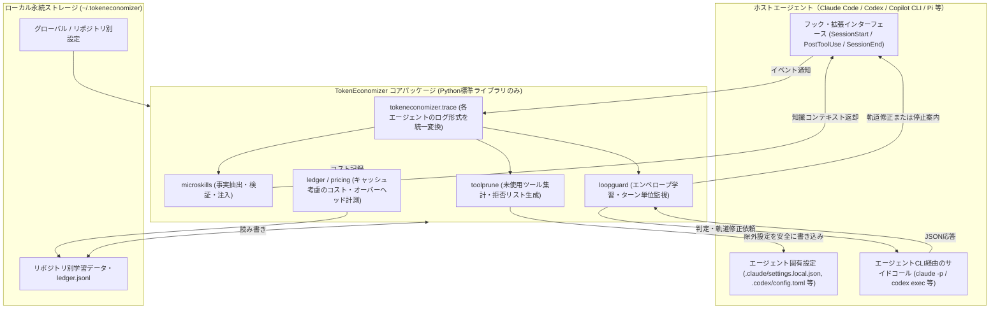

# **TokenEconomizer 調査レポート**

## **1. 基本情報**

* **ツール名**: TokenEconomizer
* **ツールの読み方**: トークンエコノマイザー
* **開発元**: Microsoft（Microsoft Research / Microsoft Security）および UC Berkeley の共同研究・開発チーム
* **公式サイト**: [https://tokeneconomizer.github.io/](https://tokeneconomizer.github.io/)
* **関連リンク**:
  * GitHub: [https://github.com/microsoft/TokenEconomizer](https://github.com/microsoft/TokenEconomizer)
  * ドキュメント: [plugin/README.md](https://github.com/microsoft/TokenEconomizer/blob/main/plugin/README.md)
  * 論文（arXiv）: [https://arxiv.org/abs/2610.22732](https://arxiv.org/abs/2610.22732)
* **カテゴリ**: AIモデル拡張/プラグイン
* **概要**: TokenEconomizerは、AIコーディングエージェントのモデル重みやシステムプロンプト、エージェント本体のコードを変更することなく、過去のセッション経験からローカルで学習してトークン消費と推論コストを削減するオープンソースのブラックボックス型コスト制御プラグイン。同一リポジトリで繰り返し実行されるエージェント作業における「知識の再探索」「未使用ツールの読み込み」「失敗ループ」の3大浪費を抑制し、SWE-Benchタスクで平均18.4〜30.9%のコスト削減とタスク成功率（Pass@1）の維持・向上を実証している。

## **2. 目的と主な利用シーン**

* **解決する課題**: 現在のAIコーディングエージェントは原則としてセッションごとにステートレスであり、同じリポジトリで作業するたびにビルド手順やテストコマンドの再発見、毎回使われないMCPツール定義の送信、同一エラーを繰り返す非生産的なループによって膨大なトークンを消費する課題を解決する。
* **想定利用者**: Claude Code、OpenAI Codex CLI、GitHub Copilot CLI、Piなどのコーディングエージェントを同一リポジトリで日常的に活用するソフトウェアエンジニア、およびAIエージェント利用コストの最適化を図りたい開発チーム。
* **利用シーン**:
  * 大規模モノレポや独自のビルド・テスト環境を持つリポジトリでの継続的なバグ修正・機能開発におけるAPI/サブスクリプション消費量の削減
  * 多数のMCP（Model Context Protocol）サーバーを接続した開発環境における、未使用ツールスキーマの自動除外によるコンテキスト圧縮
  * ヘッドレス実行（`claude -p` や `codex exec` 等）や自律型タスク実行時にエージェントが同一エラーで無限ループに陥る事態の早期検知と軌道修正

### **2.1 代表的な利用フロー**

```mermaid
swimlane-beta TB
  subgraph User["開発者"]
    A[エージェントでタスクを実行]
    F[結果確認・必要に応じ割り込み]
  end
  subgraph Agent["コーディングエージェント"]
    B[セッション開始・プロンプト送信]
    D[ツール実行・テスト反復]
    G[セッション終了・ログ保存]
  end
  subgraph Plugin["TokenEconomizer プラグイン"]
    C[学習済み知識注入・未使用ツール除外]
    E[ループ監視・ジャッジ判定と軌道修正]
    H[セッション履歴解析・ローカル状態更新]
  end
  A --> B
  B --> C
  C --> D
  D --> E
  E --> D
  E --> F
  D --> G
  G --> H
```

* **代表的な流れ**: 開発者が対応エージェントで作業を開始すると、TokenEconomizerのフックがセッション開始時に過去学習したリポジトリ知識（Micro-skills）を注入し、未使用ツールをエージェント設定から除外する。作業中はツール実行ごとに失敗ループを監視して必要時に軌道修正（Redirect）をコンテキストへ差し込み、セッション終了後にログを解析して `~/.tokeneconomizer` に経験を蓄積する。

## **3. 主要機能**

* **Micro-skills（リポジトリ知識の自動学習と注入）**: 過去のセッションで繰り返し発生したコマンド失敗（例: `pytest` ではなく `python -m pytest` が必要など）や、一定回数（デフォルト `k=3` セッション）ごとにモデルが提案する知識をローカルに蓄積する。3セッション以上で裏付けられた事実のみをセッション開始時に注入し、後続セッションで矛盾が生じた場合は自動的に破棄する（デフォルトはオフ、またはLLM呼び出しなしの `envfacts` モードを選択可能）。
* **Tool Pruning（未使用ツールの動的除外）**: 毎ターン送信されるツール定義（特にMCPサーバー群）の使用状況を追跡し、一定のプロンプト数（デフォルト `p=10`）かつ複数セッション（`m=2`）以上、あるいは `s=5` セッション連続で未使用のツールをエージェント自身のローカル設定ファイル（`.claude/settings.local.json` 等）経由で次回セッションから除外する。プロンプトキャッシュの無効化を防ぐため、リポジトリが一定時間（デフォルト `q=60` 分）アイドル状態になってから反映する設計となっている。
* **Failure-Loop Intervention（失敗ループガード）**: リポジトリにおける通常のターン長（エラーなしで終了したターン数の基準値 `e=5`）を学習した上で、同一エラーの反復やエラー蓄積が見られたターンをジャッジモデルで判定し、確信度 `c=0.7` 以上で別アプローチを促す軌道修正メッセージ（Redirect）を挿入する。ジャッジなしでも通常長の `b=2.5` 倍を超えて空転する場合は強制的に軌道修正し、それでも改善しない場合はユーザーに停止方法（EscキーやCtrl+C等）を通知する。
* **Repository Map（オプションのリポジトリマップ注入）**: `aider-chat` と連携してリポジトリ内の主要ファイルとシンボル（シグネチャのみ）のマップを生成・キャッシュし、セッション開始時に最大 `2048` トークンでコンテキストに注入する。これによりエージェントが闇雲にファイルを探索するコストを削減する（LLM呼び出し不要）。
* **マルチエージェント対応と履歴インポート**: Claude Code、Codex、GitHub Copilot CLI、Piの4エージェントを正式サポートし、opencode、Cursor Agent、Grok Build、Hermes Agent、Antigravity CLI、Factory Droidを実験的サポートする。Claude Codeでは導入前の過去セッションログをバックグラウンドで読み込む `history_import` 機能も備える。
* **キャッシュ課金準拠のコスト台帳（Ledger）**: プロンプトキャッシュの再読み込み単価を考慮した正確なトークンコスト計算を行い、プラグイン自身が行ったモデル呼び出し（ProposerやJudge）のオーバーヘッドも含めて `~/.tokeneconomizer/repos/` 配下の `ledger.jsonl` に記録し、`te status` コマンドで可視化する。

## **4. 動作原理・システム構成**



* **アーキテクチャ**: 完全ローカルファーストのプラグイン／外部制御プレーン型アーキテクチャを採用している。エージェント本体のソースコードやモデル重みには一切手を加えず、各エージェントが公式に提供するフック（Hook）機構や拡張機能API、およびエージェント自身の設定ファイルを介してブラックボックス的に入出力と設定を制御する。
* **主要コンポーネントとデータフロー**:
  * **`tokeneconomizer.trace`**: 各エージェント（Claude CodeのJSONL、Codexログ、Copilot CLIログ等）の異なるセッションログ形式を共通のトラジェクトリ形式へ正規化する。
  * **`tokeneconomizer.stage` / `domain.DomainAdapter`**: `before_task`、`build_tools`、`after_task` などの抽象化されたステージを通じて、プラグイン実行環境（`LiveAdapter`）とベンチマーク評価環境（`experiments/te_bench`）の双方から同じ3つの削減機構を呼び出せる設計になっている。
  * **サイドコールの仕組み**: プラグイン専用のAPIキーや認証情報は一切持たず、事実提案（Proposer）やループ判定（Judge）のLLM呼び出しはホストエージェント自身のCLI（`claude -p`、`codex exec`、`copilot -p`、`pi -p` 等、ツールをすべて無効化した軽量呼び出し）を通じて実行される。macOS 27（Apple Intelligence有効環境）では `local_model=fm` を指定することで `/usr/bin/fm` によるオンデバイス推論（0トークン課金）も利用できる。
* **特筆すべき要素技術**:
  * **依存関係ゼロの軽量設計**: コアパッケージはPython 3.10以降の標準ライブラリのみで実装されており、外部パッケージの競合が起きない。
  * **Git非汚染と安全性ガード**: 生成した `.claude/settings.local.json` 等は `.git/info/exclude` へ自動登録してリポジトリを汚さず、ユーザーが記述した既存の拒否ルールは変更しない。また、シンボリックリンクがリポジトリ外を指す場合や設定ファイルが破損している場合は自動書き込みを中止し、提案状態に留める安全機構を持つ。

## **5. 開始手順・セットアップ**

* **前提条件**:
  * Python 3.10以降が `PATH` に通っていること（または `TE_PYTHON` 環境変数で指定）。
  * 対応エージェント（Claude Code 2.1.300〜2.1.310、Codex 0.153.1〜0.164.0、Copilot CLI 1.0.83〜1.0.102、Pi 1.2.0〜1.3.0 等）のいずれかがインストール・認証済みであること。
  * TokenEconomizer専用のアカウント登録や追加APIキーは不要。
* **インストール/導入**（例: Claude Code の場合）:

  ```bash
  git clone https://github.com/microsoft/TokenEconomizer.git
  claude plugin marketplace add "$PWD/TokenEconomizer"
  claude plugin install tokeneconomizer@tokeneconomizer
  ```

  ※ Codexの場合は `codex plugin marketplace add` / `codex plugin add`、Copilot CLIの場合は `copilot plugin marketplace add` / `copilot plugin install`、Piの場合は `pi install git:github.com/microsoft/TokenEconomizer` を使用する。Antigravity CLI（`agy`）やCursor Agent、Factory Droid向けには `python3 scripts/build_plugin.py` でバンドルをビルドして導入する。
* **初期設定**:
  * エージェントを対象リポジトリで起動し、フォルダおよびプラグインスクリプトの実行を信頼（Trust）する。
  * Claude CodeおよびCopilot CLIでは、マシンごとに1回（およびエージェントのアップデート後に）エージェント内でツールカタログ取得コマンドを実行する。

  ```text
  /tokeneconomizer:toolprune refresh-catalog
  ```

* **クイックスタート**:
  * エージェント内で `/tokeneconomizer:status`（Codexでは `$tokeneconomizer:status`、Piでは `/te status`、またはターミナルから `~/.tokeneconomizer/bin/te status`）を実行し、ステータスブロックが正常に表示されれば導入完了。以降は通常通りエージェントを利用するだけで自動的に学習とコスト制御が動作する。

## **6. 特徴・強み (Pros)**

* **実証済みの高いコスト削減効果と品質維持**: SWE-Benchの277タスク（6リポジトリ×5種類のエージェント・モデル組み合わせ）において、プラグイン自身のモデル呼び出しコストを含めた上で平均18.4〜30.9%のコスト削減を達成し、全30セルでベースラインを下回ったほか、5組み合わせ中4つでPass@1（タスク成功率）が向上した。
* **完全非侵襲・可逆的なブラックボックス設計**: エージェントのコードやモデルを変更せず、エージェント標準のフックと設定ファイルのみで動作する。自動除外したツールは `toolprune restore` で即座に復元でき、誤った学習事実も後続の矛盾検知で自動削除される。
* **プロンプトキャッシュを意識した賢明な更新タイミング**: ツール一覧を変更するとプロンプトキャッシュが破棄されて再書き込みコストが発生するため、Tool Pruningはリポジトリが60分間アイドル状態になるまで設定の書き換えを待機し、逆効果を防ぐ。
* **幅広いマルチエージェント対応**: Claude Code、Codex、GitHub Copilot CLI、Piに加え、Antigravity CLI、Cursor Agent、opencode、Grok Build、Hermes Agent、Factory Droidなど主要な次世代コーディングエージェント群を幅広くカバーしている。

## **7. 弱み・注意点 (Cons)**

* **コールドスタート期間のオーバーヘッド**: リポジトリごとの過去セッションから学習する仕組みのため、最初の数タスク（コミュニティの検証では概ね5〜6タスク目まで）は学習コストや分析オーバーヘッドにより純減効果が出にくい。
* **Micro-skillsのデフォルト無効とサイドコール制約**: `microskills` はモデル呼び出しコストを伴うためデフォルトで `off` に設定されており、恩恵を最大化するには `config set microskills=on`（またはLLM不要の `envfacts`）の有効化が必要となる。また、実験的サポートのエージェント（Antigravity CLIやCursor Agent等）ではTool Pruningやサイドコールの一部機能が制限される。
* **ローカル・マシン単位での状態保持**: 学習した経験やツール使用履歴は各開発者のローカル環境（`~/.tokeneconomizer`）に保存されるため、チームメンバー間でリポジトリの学習結果を自動共有・同期する仕組みは現時点で備わっていない。
* **日本語対応の状況**: ドキュメント、CLI出力、コマンド説明、およびエラーメッセージはすべて英語で提供されており、日本語UIや日本語での公式サポートは用意されていない（ただしMicro-skillsの事実抽出自体は言語非依存で動作する）。

## **8. 料金プラン**

| プラン名 | 料金 | 主な特徴 |
|---------|------|---------|
| **オープンソース版 (MIT License)** | 無料 | GitHubから全機能を制限なく利用可能。商用のエンタープライズ環境でも無料 |

* **課金体系**: ソフトウェア自体は完全無料（MITライセンス）。ただし、運用中に実行されるループガードのジャッジモデル呼び出しや、Micro-skills有効時のファクト提案（Proposer）呼び出しは、利用中のホストエージェント（Claude Code、Codex等）の既存契約（サブスクリプション枠またはAPI従量課金）を通じて消費される。macOS 27の `local_model=fm` を利用する場合はジャッジ等のコストを0円に抑えることが可能。
* **無料トライアル**: オープンソースのため試用期間の制限はない。`config set shadow=true` を設定すれば、実際の変更を加えずに削減シミュレーションとログ記録のみを行うシャドウモードでの事前評価も可能。

## **9. 導入実績・事例**

* **公開事例・ベンチマーク実績**: Microsoft Research、Microsoft Security、およびUC Berkeleyの研究チームによる共同プロジェクトとして2026年10月に公開され、GitHubスター数は7,500件超に達している（2026年11月時点）。特定企業の商用導入事例は公式には公開されていないものの、論文および公式サイト上で以下のベンチマーク実績が報告されている。
  * **SWE-Bench（6リポジトリ・277タスク）**: Claude Code（Sonnet 5 / Opus 4.8）、Codex（GPT-5.6 Terra / Sol）、Copilot CLI（Sonnet 5）の5組み合わせで平均18.4〜30.9%のコスト削減を達成。
  * **Web-Bench**: フロントエンド／Web開発タスクにおいて16〜21%のコスト削減を実証。
  * **セキュリティ監査ベンチマーク（CredData / ReposVul）**: すべてのタスクが異なる新規リポジトリという厳しい条件下でも、ツール除外やループ検知により6〜20%のコスト削減を確認。
* **対象業界**: ソフトウェア開発全般、特に大規模リポジトリを継続的に保守するエンタープライズ開発チームや、AIエージェントをCI/CD・自動修正パイプラインに組み込む組織で注目されている。

## **10. サポート体制**

* **ドキュメント**: GitHubリポジトリ内の [README.md](https://github.com/microsoft/TokenEconomizer/blob/main/README.md)、エージェント別の詳細手順を網羅した [plugin/README.md](https://github.com/microsoft/TokenEconomizer/blob/main/plugin/README.md)、設計仕様書である [docs/ARCHITECTURE.md](https://github.com/microsoft/TokenEconomizer/blob/main/docs/ARCHITECTURE.md) および `docs/PLUGIN.md`、さらにインタラクティブな解説と実行トレースを備えた [公式プロジェクトページ](https://tokeneconomizer.github.io/) が極めて充実している。
* **コミュニティ**: [GitHub Issues / Pull Requests](https://github.com/microsoft/TokenEconomizer/issues) を中心に、外部コントリビューターからのPR（VS Code Copilotサポートや各種バグ修正など）が日々活発にやり取りされている。
* **公式サポート**: 研究・OSSプロジェクトであるため、SLA付きの商用サポート窓口や日本語サポートは提供されていない。セキュリティ脆弱性の報告については `SECURITY.md` に従い、Microsoft Security Response Center（`aka.ms/SECURITY.md`）経由の窓口が案内されている。

## **11. エコシステムと連携**

### **11.1 API・外部サービス連携**

* **API / CLI**: 外部公開のWeb APIではなく、Pythonパッケージ（`tokeneconomizer`）とCLIツール（`te`）、および各エージェントのプラグイン／フック仕様を通じて連携する。設定は環境変数（`TE_MICROSKILLS`、`TE_TOOLPRUNE`、`TE_LOOPGUARD`、`TE_DISABLE` 等）でも動的に上書き可能。
* **外部サービス・エージェント連携**:
  * **公式サポートエージェント**: Claude Code、OpenAI Codex CLI、GitHub Copilot CLI（およびVS Code Copilotセッションターゲット）、Pi
  * **実験的サポートエージェント**: Antigravity CLI（`agy`）、Cursor Agent、opencode（1.x / 2.x）、Grok Build、Hermes Agent、Factory Droid
  * **補完ツール連携**: `rtk`（Rust Token Killer）との併用が公式にサポート・解説されており、コマンド出力圧縮（`rtk`）とセッション横断の経験学習（`TokenEconomizer`）を競合せず組み合わせられる。また、`aider-chat` を用いたリポジトリマップ生成機能も統合されている。

### **11.2 技術スタックとの相性**

| 技術スタック | 相性 | メリット・推奨理由 | 懸念点・注意点 |
|:---|:---:|:---|:---|
| **Claude Code / Codex / Copilot CLI** | ◎ | 公式プラグインマーケットプレイス・フック・設定書き換えに完全対応し、全3機構を利用可能 | `refresh-catalog` の初回実行やフック承認の手順が必要 |
| **Python 3.10+ (macOS / Linux)** | ◎ | コアパッケージが標準ライブラリのみで動作し、導入が容易 | Python 3.10未満の環境では動作しない |
| **Windows (Git Bash / WSL)** | ◯ | Claude CodeやAntigravity CLI（`te.cmd` バッチランチャー）で動作確認済み | Cursor Agentなど一部エージェントのフックがPOSIXシェル前提で非対応 |
| **Antigravity CLI / Cursor / Droid (実験的)** | △ | Micro-skillsやループガードの一部を利用可能 | ホスト側の公開インターフェース制約によりTool Pruningやモデル呼び出しが制限される |
| **ローカルLLM / オンデバイス (macOS 27)** | ◯ | `local_model=fm` によりApple Foundation Modelsでジャッジ推論を無料実行可能 | macOS 27＋Apple Intelligence環境に限定される |

## **12. セキュリティとコンプライアンス**

* **認証**: TokenEconomizer自体はユーザー認証やAPIキーの保存・管理を一切行わない。モデル呼び出しが必要な場合はホストエージェントのCLI（`claude -p` 等）を経由し、ホスト側が保持する既存のログインセッションや認証機構をそのまま利用する。
* **データ管理**: 学習されたリポジトリ知識、ツール使用頻度、コスト台帳、セッションダイジェストはすべて開発者のローカルマシン（`~/.tokeneconomizer`）に保存され、開発元のクラウドサーバーへコードや学習データが送信されることはない。また、ProposerやJudgeへのサイドコールにもファイル本文やユーザーの生プロンプトは送信されず、80〜120文字にトリミングされたコマンド形状やエラー要約のみが渡される。
* **準拠規格**: OSSプラグインであるため単体でのSOC2やISO27001取得はないが、Microsoftのオープンソースセキュリティポリシー（`SECURITY.md`）に準拠して脆弱性報告を受け付けている。なお、信頼できないリポジトリのコマンド出力を通じた間接的プロンプトインジェクションへの懸念から、Micro-skillsはデフォルトでオフに設定されている。

## **13. 操作性 (UI/UX) と学習コスト**

* **UI/UX**: 専用のGUIは持たず、各コーディングエージェント内のスラッシュコマンド（`/tokeneconomizer:status` や `$tokeneconomizer:status`）またはターミナル上の `te` コマンドで操作する。処理の通知はセッション開始時やツール呼び出し時に1行の簡潔なメッセージとして出力されるため、通常の作業フローを妨げない。また、`te doctor` コマンドで環境の健全性やエラーログを即座に診断できる。
* **学習コスト**: 導入後の日常利用においてユーザーが意識すべき操作はほとんどなく、学習コストは低い。ただし、`k, p, m, s, q, e, c, r, b` といった多数のしきい値パラメータや、エージェントごとの挙動差異（ツール除外の対象が単一ツール単位かMCPサーバー単位かなど）をチューニングする場合は公式ドキュメントの理解が必要となる。

## **14. ベストプラクティス**

* **効果的な活用法 (Modern Practices)**:
  * **初期導入時の履歴インポートとカタログ更新**: Claude Codeでは `config set history_import=on --global` を設定して過去のセッション資産を即座に学習させ、さらに `/tokeneconomizer:toolprune refresh-catalog` を実行して全ロード済みツールを把握させることで、初日からTool Pruningの精度を高められる。
  * **`rtk` との併用**: シェル出力のリアルタイム圧縮を行う `rtk` と組み合わせることで、「出力の肥大化防止（`rtk`）」と「知識定着・ツール削減・ループ抑止（`TokenEconomizer`）」の相乗効果を得られる。
  * **リスクを抑えた段階的導入**: いきなり `microskills=on` にせず、まずはデフォルト設定（Tool Pruning + Loop Guard）や `microskills=envfacts`（モデル呼び出しなしの環境事実学習）から始め、リポジトリの性質に合わせて調整する。
* **陥りやすい罠 (Antipatterns)**:
  * **クローンフォルダの移動・削除**: Claude CodeやCodexはクローンしたディレクトリを直接参照してフックを実行するため、インストール後に `TokenEconomizer` フォルダを移動・削除すると動作しなくなる。
  * **Codexプロジェクトの未信頼状態**: Codexで対象フォルダを「Trust」していない場合、`.codex/config.toml` に書き込まれたツール除外設定が反映されない。
  * **単発リポジトリへの過度な期待**: 一度きりしか触らないリポジトリでは学習フェーズのコストを回収できないため、継続的に開発するリポジトリで有効化する（`enabled=false --global` にして特定リポジトリのみ `enabled=true` にする運用が推奨されている）。

## **15. ユーザーの声（レビュー分析）**

* **調査対象**: GitHub（7,500+ Stars）、Hacker News、Reddit、X（Twitter）、および海外技術ブログのコミュニティ反応
* **総合評価**: BtoB SaaS向けのG2・Capterra・ITreviewには現時点で登録がないが、GitHub上でのスター急増やHacker News・Redditでの活発な議論から、AI開発者コミュニティにおける注目度と評価は非常に高い。
* **ポジティブな評価**:
  * 「エージェントやモデルに一切手を加えず、SWE-Benchで18〜31%ものコスト削減を論文データ付きで実証している点が実用的で信頼できる」（技術ブログ・Hacker News）
  * 「プロンプトキャッシュの有効期限（60分アイドル）を考慮してツール除外のタイミングを遅らせるなど、実際の課金構造を深く理解した設計が素晴らしい」（Reddit・X）
  * 「使わないMCPツールが毎ターン膨大なトークンを消費する問題に対し、自動で設定ファイルを整理してくれるのが便利」（GitHub・Reddit）
* **ネガティブな評価 / 改善要望**:
  * 「最初の5〜6タスクは学習コストがかかり、トータルコストが下がり始めるまでにタイムラグ（コールドスタート問題）がある」（Reddit）
  * 「学習データがローカルの `~/.tokeneconomizer` に閉じるため、チーム内でリポジトリの経験値を共有できる仕組みが欲しい」（コミュニティディスカッション）
  * 「Claude Codeで手動のdenyリストを丁寧に書けば同様のツール削減はできるため、小規模環境では導入の手間と比較して検討が必要」（X・技術レビュー）
* **特徴的なユースケース**:
  * 複数のMCPサーバーを常時接続して開発しているエンジニアが、プロジェクトごとに不要なMCPツール群を自動で切り離す「動的なコンテキストダイエット」としての活用。
  * 深夜のバッチ処理やヘッドレス実行（`claude -p` 等）でエージェントが同じテストエラーで空転して高額なAPI請求が発生するのを防ぐセーフティネットとしての活用。

## **16. 直近半年のアップデート情報**

* **2026-11-18**: `loopguard` のエンベロープ判定におけるパーセンタイル・学習しきい値に関するテストおよび検証を強化（[PR #254](https://github.com/microsoft/TokenEconomizer/commits/main)）。
* **2026-11-17**: VS Code上のGitHub Copilotサポートの追加、Codexにおける推論トークン（reasoning tokens）の重複カウント修正、および `toolprune` におけるdenyリスト適用後のセッションカタログ読み込み改善をマージ（[コミット履歴](https://github.com/microsoft/TokenEconomizer/commits/main)）。
* **2026-11-05**: Factory Droidの実験的サポートおよび実モデルでのMicro-skills注入検証を完了。同月中にCursor Agent（`cursor-agent 2026.11.05`）やAntigravity CLI（`agy 1.5.1/1.5.2` Windows/macOS/Linux）への対応も拡充。
* **2026-10-26**: 初回公式リリース **v0.1.0** を公開（Claude Code、Codex、GitHub Copilot CLI、Piに対応し、arXiv論文 `2610.22732` と同時公開）。

(出典: [GitHub Releases](https://github.com/microsoft/TokenEconomizer/releases) / [GitHub Commits](https://github.com/microsoft/TokenEconomizer/commits/main))

## **17. 類似ツールとの比較**

### **17.1 機能比較表 (星取表)**

| 機能カテゴリ | 機能項目 | TokenEconomizer | RTK | Headroom | LiteLLM |
|:---:|:---|:---:|:---:|:---:|:---:|
| **削減手法** | セッション横断の知識学習 (Micro-skills) | ◎<br><small>自動抽出・検証注入</small> | ×<br><small>コマンド圧縮に特化</small> | △<br><small>会話履歴の圧縮のみ</small> | ×<br><small>ゲートウェイ層のため非対応</small> |
| **削減手法** | 未使用ツールの自動除外 (Tool Pruning) | ◎<br><small>設定ファイル経由で自動除外</small> | ×<br><small>非対応</small> | ×<br><small>非対応</small> | ×<br><small>非対応</small> |
| **削減手法** | コマンド出力・コンテキスト圧縮 | △<br><small>Repo Mapのみ対応</small> | ◎<br><small>シェル出力を60-90%圧縮</small> | ◎<br><small>ログ・JSON・検索結果を圧縮</small> | ×<br><small>非対応</small> |
| **制御・保護** | 失敗ループ検知・軌道修正 | ◎<br><small>統計エンベロープ+ジャッジ</small> | ×<br><small>非対応</small> | ×<br><small>非対応</small> | △<br><small>予算上限・レート制限のみ</small> |
| **コスト管理** | モデルルーティング・プロキシ機能 | ×<br><small>エージェントCLI経由</small> | ×<br><small>シェルプロキシのみ</small> | ◯<br><small>透過LLMプロキシ</small> | ◎<br><small>100以上のLLM統合・負荷分散</small> |
| **非機能要件** | 日本語対応 | ×<br><small>英語ドキュメント・UIのみ</small> | △<br><small>英語中心</small> | △<br><small>英語中心</small> | △<br><small>英語中心（日本語情報多）</small> |

### **17.2 詳細比較**

| ツール名 | 特徴 | 強み | 弱み | 選択肢となるケース |
|---------|------|------|------|------------------|
| **TokenEconomizer** | エージェントのセッション履歴を学習し、知識注入・ツール除外・ループ停止を行うプラグイン | コードや出力を歪めず、セッションを跨いだ学習とプロンプトキャッシュ温存を両立 | コールドスタート期間があり、ローカル保存のためチーム共有が未対応 | 同一リポジトリでClaude Code等を継続利用し、ツール肥大化や空転を防ぎたい場合 |
| **RTK** | Rust製の高速CLIプロキシで、エージェントが実行するシェルコマンドの出力を圧縮 | 導入直後から即座に60〜90%の出力トークン削減効果が得られ、オーバーヘッドが10ms未満 | セッション横断の知識学習やループ検知機能はない | テストログやGit差分の大量出力によるトークン浪費を今すぐ抑えたい場合（併用推奨） |
| **Headroom** | エージェントとLLM APIの間に挟む透過プロキシ型のコンテキスト圧縮レイヤー | ログ・DB結果・RAG検索結果など幅広いペイロードを60〜95%圧縮可能 | プロキシ構成が必要であり、エージェントのツール設定自体は最適化しない | 大量の外部データや長大なログをLLMへ渡すワークフローのコストを下げたい場合 |
| **LiteLLM** | 100以上のLLMプロバイダーをOpenAI互換APIで統合するAIゲートウェイ | チーム単位での予算上限管理、フォールバック、モデルルーティングに極めて強い | エージェントのコンテキスト最適化やループ介入などのエージェント特化機能はない | 組織全体で複数モデルのAPIコスト管理・アクセス制御・予算管理を一元化したい場合 |

## **18. 総評**

* **総合的な評価**:
  * TokenEconomizerは、AIコーディングエージェントのコスト最適化を「単発プロンプトの圧縮」ではなく「リポジトリ単位の経験学習とエージェント制御」という新しいアプローチで解決する優れたオープンソースツールである。Microsoft ResearchとUC Berkeleyによる学術的裏付け（SWE-Benchで18.4〜30.9%削減）と、実用的なキャッシュ考慮設計・非侵襲プラグイン構造が高く評価でき、総合スコアは83点とした。
* **推奨されるチームやプロジェクト**:
  * Claude Code、Codex、GitHub Copilot CLI、Piなどのエージェントを同一リポジトリで日々活用している開発者や、多数のMCPサーバーを接続してトークン消費が膨らみがちなプロジェクトに強く推奨できる。
* **選択時のポイント**:
  * 即効性のあるコマンド出力圧縮を求める場合は `RTK` の単独導入または併用が有効であり、組織全体のAPI予算・モデルルーティング管理が主目的であれば `LiteLLM` が適している。一方、エージェントが同じリポジトリで同じ失敗や無駄な探索・未使用ツール送信を繰り返している課題を根本から解消したい場合に、TokenEconomizerが最有力な選択肢となる。
