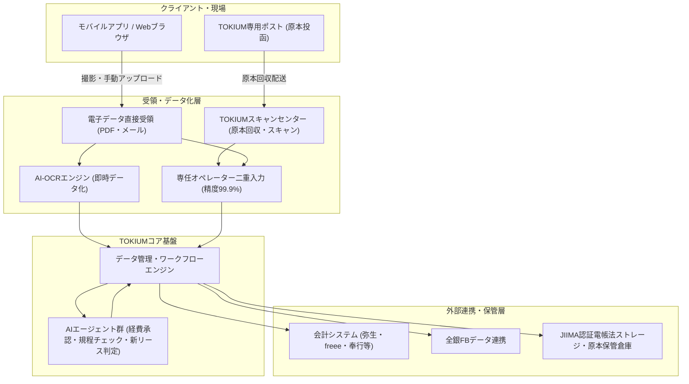

# **TOKIUM 調査レポート**

## **1. 基本情報**

* **ツール名**: TOKIUM
* **ツールの読み方**: トキウム
* **開発元**: 株式会社TOKIUM
* **公式サイト**: [https://www.keihi.com/](https://www.keihi.com/)
* **関連リンク**:
  * ドキュメント: [https://support.keihi.com/](https://support.keihi.com/)
  * レビューサイト: [ITreview](https://www.itreview.jp/products/receipt-post/reviews)
* **カテゴリ**: 経理/財務
* **概要**: TOKIUM（旧 Dr.経費精算）は、経費精算、請求書受領、請求書発行、文書管理、契約管理などを統合した総合支出管理（BSM: Business Spend Management）プラットフォームです。領収書や請求書をスマートフォンで撮影または専用ポストに投函するだけで、AIとオペレーターが高精度にデータ化し、原本回収・保管まで代行することで、企業の経理業務における完全ペーパーレス化を実現します。

## **2. 目的と主な利用シーン**

* **解決する課題**:
  * 領収書や請求書の原本管理、糊付け作業、ファイリングの手間
  * 手入力によるミスや、申請者・承認者の工数負担
  * 電子帳簿保存法やインボイス制度への法令対応コスト
  * 締め日直前の請求書処理集中と支払承認フローの滞留
* **想定利用者**: 全従業員（経費申請）、経理担当者（仕訳・支払・保管管理）、管理職・役員（承認）、経営層（支出可視化・内部統制）。
* **利用シーン**:
  * **経費精算**: スマートフォンで領収書を撮影し、自動データ化された内容で申請。紙原本は専用ポストへ投函するだけで完了。
  * **請求書受領（TOKIUMインボイス）**: 紙・PDF・メールで届く請求書をTOKIUMが代行受領または自社アップロードし、データ化。目的に応じてオペレーター補正または即時AI-OCRを選択して承認・支払依頼。
  * **請求書発行（TOKIUM請求書発行）**: 請求書の作成から送付前社内承認、取引先への電子送付までをワンストップで管理。
  * **電子帳簿保存・契約管理**: 国税関係書類や契約書を一元管理し、法的要件の遵守やAIによる新リース会計基準の判定を実施。

### **2.1 代表的な利用フロー**

```mermaid
swimlane-beta TB
  subgraph User["申請者・従業員"]
    A["領収書撮影 または 専用ポストへ投函"]
    F["承認・処理結果の確認"]
  end
  subgraph System["TOKIUM基盤 (AI・クラウド)"]
    B["データ受領・AI-OCR即時読み取り"]
    D["AI規程チェック・自動仕訳生成"]
  end
  subgraph BPO["専任オペレーター (スキャンセンター)"]
    C["原本回収・スキャン・目視補正 (精度99.9%)"]
  end
  subgraph Approver["承認者・経理部門"]
    E["AI判定結果の確認・ワンクリック承認"]
    G["会計ソフト連携・全銀データ出力"]
  end
  A --> B
  B --> C
  C --> D
  D --> E
  E --> G
  G --> F
```

* **代表的な流れ**: 申請者が領収書をスマホ撮影または専用ポストに投函すると、TOKIUM基盤と専任オペレーターが連携して99.9%の精度でデータ化を実行。AIエージェントによる規程チェックと仕訳生成を経て承認者がスムーズに承認し、会計システム連携や全銀FBデータの出力までシームレスに処理されます。

## **3. 主要機能**

* **自動データ化（AI + オペレーター）**: 領収書や請求書をAIとオペレーター（精度99.9%）がデータ化。手入力や修正の手間を極限まで削減。
* **AI-OCR即時入力選択（TOKIUMインボイス）**: 自社でアップロードする請求書について、高精度な「オペレーター入力」と即時データ化が可能な「AI-OCR入力」を目的に応じて選択可能。締め日直前の急ぎの処理にもスピーディーに対応。
* **原本回収・保管代行**: 領収書等の紙原本をオフィス設置の専用ポストに投函するだけで、回収・突合・保管・法定期間経過後の廃棄までTOKIUMが代行（千葉スキャンセンター等）。
* **TOKIUM請求書発行 & ワークフロー**: 請求書の作成から電子送付に加え、送付前に上長や経理部門の申請・承認ワークフローを挟むことで、未承認書類の誤送を防止しガバナンスを担保。
* **スマート承認 & AI経費承認**: スマホアプリやブラウザから場所を選ばず申請・承認が可能。AIが社内規程に照らし合わせて一次判定や差し戻しを代行（AI承認件数は累計50万件を突破）。
* **TOKIUM AI新リース判定**: 契約書と関連する書類をAIが自動検知し、新リース会計基準に基づく判定を実施。判定の根拠条文ハイライト表示や、外国語契約書の原文判定にも対応。
* **TOKIUM AIヘルプデスク**: 300以上の社内規程を集約したAIエージェントが、従業員からの経理・社内ルールに関する質問に即座に回答。Google Chrome拡張機能によりWeb作業中もシームレスに利用可能。
* **AI agentic BPO**: 専任オペレーターとAIエージェントを組み合わせ、企業固有の複雑な業務フロー（出張手配、請求照合、例外処理等）の再設計から運用までを一気通貫で代行。
* **ICカード・法人カード連携**: Suica・PASMO等の交通系ICカードをスマートフォンにかざすだけで履歴読み取り。主要法人クレジットカードの利用明細も自動取り込み。
* **会計ソフト & 全銀データ連携**: 国内主要会計ソフト（弥生会計、勘定奉行、freee、マネーフォワード クラウド会計、PCA会計、SAP等）に合わせた仕訳データ生成と、全銀フォーマットの振込用FBデータ出力に対応。

## **4. 動作原理・システム構成**

* **アーキテクチャ**:
  クラウドネイティブなマルチテナントSaaS基盤を中心に、自社AI-OCRエンジン、AIエージェント機能群、および物理拠点を統合したBPOオペレーション（千葉スキャンセンター等の原本受領・スキャン拠点、分散オペレーター網）を連携させたハイブリッドアーキテクチャ。
* **主要コンポーネントとデータフロー**:
  * **クライアント・受付層**: モバイルアプリ（iOS/Android）、Webブラウザ、メール転送・API連携による電子ファイル受領、およびオフィス設置の「TOKIUM専用ポスト」。
  * **受領・データ化層**: 電子領収書・PDF請求書はAI-OCRエンジンにより即時テキスト化、または専任オペレーター網へ分配されて二重入力・突合を実施。紙原本はスキャンセンターで高解像度スキャン後、電子化キューに投入。
  * **コア基盤層**: ワークフローエンジンによる承認ルート制御、AIエージェントによる規程チェック・仕訳推論・新リース判定、およびJIIMA認証に準拠したセキュアな国税関係書類データ保管。
  * **外部連携・出力層**: 会計システム向け仕訳API/CSV生成、ファームバンキング（全銀協フォーマット）データ生成、および原本保管倉庫（耐火設備完備）での物理原本長期保管。
* **特筆すべき要素技術**:
  * **ハイブリッド入力パイプライン**: AI-OCRによる高速読み取りと、個人情報をマスキングした分散オペレーターによる二重入力・クロスチェック技術により、99.9%の入力精度を達成。
  * **文書解析・RAGエージェント**: 社内規程や外国語を含む複雑な契約書を構造解析し、リース判定基準条文の特定や規程違反検知を行う大規模言語モデル連携基盤。
  * **法令準拠セキュアストレージ**: 電子帳簿保存法スキャナ保存要件および電子取引データ保存要件を満たすタイムスタンプ付与、版管理、改ざん防止検証機構。



## **5. 開始手順・セットアップ**

* **前提条件**:
  * 法人契約が必要（公式サイトより問い合わせ・見積もり）。
  * 導入コンサルタントによる伴走支援サポート。
* **導入手順**:
  1. 公式サイトから問い合わせ・資料請求。
  2. ヒアリング・要件定義・見積もり・契約締結。
  3. 導入キックオフミーティング（専任導入コンサルタントが担当）。
  4. 初期設定（マスタ登録、承認ルート構築、専用ポスト配備）。
  5. 社内説明会・パイロット運用・全社本格運用開始。
* **初期設定**:
  * **勘定科目・税区分マスタ**: 利用中の会計ソフトのフォーマットに合わせて仕訳マスタを登録。
  * **承認ルート・ワークフロー設定**: 役職・金額・部門に応じた承認ルートをGUI上で柔軟に定義。
  * **ユーザー登録**: CSVインポートまたはSSO連携（SAML等）により従業員アカウントを一括発行。
  * **物理ポストの設置**: 社内の拠点やフロアに原本回収用ポストを設置し、回収フローを周知。

## **6. 特徴・強み (Pros)**

* **原本回収から保管まで代行する「真の完全ペーパーレス」**:
  単なるスキャン・電子化アプリにとどまらず、原本の回収・突合・点検・倉庫保管・廃棄までBPOとして代行するため、社内経理が紙に一切触れる必要がなくなる。
* **99.9%の超高精度と即時AI-OCRの選択制**:
  オペレーター補正による99.9%以上のデータ化精度を基本としつつ、TOKIUMインボイスでは即時データ化が可能なAI-OCR入力も選択可能となり、精度と速度の両面を用途に応じて柔軟に使い分けられる。
* **全社員展開が容易な「利用人数無制限」の料金体系**:
  ユーザー数（ID数）課金ではなく、データ化枚数等に基づく従量課金体系のため、全従業員にIDを配布しても追加アカウント費用が発生しない。
* **AIエージェントとBPOを融合した高度な業務代行**:
  「AI経費承認」や「AI agentic BPO」により、チェック・差し戻し・規程ヘルプデスクなど、従来人間が手作業で行っていた業務フローの根本的な省力化が可能。
* **全社規模での充実したサポート体制**:
  導入時の専任コンサルタントによる伴走支援に加え、運用開始後も管理者だけでなく全従業員がチャット・メールサポートを利用できる体制を完備。

## **7. 弱み・注意点 (Cons)**

* **処理枚数に応じたコスト変動**:
  従量課金制を採用しているため、領収書や請求書の取扱件数が極めて多い企業では月額利用料が膨らむ可能性がある（導入前の枚数試算とプラン設計が必要）。
* **原本投函ルールの社内周知と定着**:
  「回収専用ポストに投函する」という物理的な運用変更を全従業員に定着させる必要があり、初期の社内アナウンスやフォローが不可欠。
* **オペレーター代行のリードタイムと即時性の使い分け**:
  オペレーターによる目視点検や原本郵送を伴う工程では一定のリードタイム（通常1営業日程度）が発生する。急ぎで即時処理したい請求書には、2026年に追加された「AI-OCR入力」選択機能を活用するなどの運用ルールの整備が推奨される。
* **多言語・グローバル対応の範囲**:
  管理画面や基本サポートは原則として日本語主体。2026年10月にAI新リース判定において外国語契約書の原文判定に対応したものの、システム全体の多言語展開を求めるグローバル企業においては一部機能の対応範囲を確認する必要がある。

## **8. 料金プラン**

| プラン名 | 料金 | 主な特徴 |
|---|---|---|
| **TOKIUM経費精算** | 月額10,000円〜 + 従量課金 | 領収書枚数に応じた従量課金。利用人数無制限。交通系ICカード連携、原本保管代行。 |
| **TOKIUMインボイス** | 月額10,000円〜 + 従量課金 | 請求書受領機能。オペレーター入力と即時AI-OCR入力が選択可能。利用人数無制限。 |
| **TOKIUM請求書発行** | 月額10,000円〜 + 従量課金 | 請求書発行・送付機能。社内申請・承認ワークフローにより未承認送付を防止。 |
| **TOKIUM電子帳簿保存** | 月額10,000円〜 + 従量課金 | 法定要件を満たす国税関係書類の一元保存。保存容量に応じた料金。 |
| **TOKIUM契約管理** | 要問い合わせ | 契約書の電子管理・AI新リース判定（外国語対応・条文ハイライト）等の拡張機能。 |
| **AI agentic BPO / AIオプション** | 要問い合わせ | AI経費承認、AIヘルプデスク、専任オペレーターとAIエージェントによる業務代行。 |

* **課金体系**: 基本利用料（月額10,000円〜）＋ 従量課金（データ化件数・保存件数）。初期費用および各種オプション費用が別途発生。
* **無料トライアル**: デモ画面の案内や個別相談を実施（詳細は公式サイトより要問い合わせ）。

## **9. 導入実績・事例**

* **導入企業**: シリーズ累計導入社数3,000社超、累計データ化枚数1億枚突破（2026年9月発表）。
* **上場・資本提携動向**:
  * 2026年10月に東京証券取引所グロース市場への新規上場承認を取得（証券コード：664A、上場予定日：2026年11月25日）。
  * 2026年10月に芙蓉総合リース株式会社とBPO領域における包括業務提携契約を締結。
* **主要な導入事例**:
  * **JR西日本ステーションシティ株式会社**: 請求書受領・処理プロセスの刷新と月次決算早期化を目的にTOKIUMを導入（2026年10月）。
  * **信和ホールディングス株式会社**: グループ16社を統括するバックオフィスに「TOKIUM AI経費承認」を導入し、承認工数の削減とガバナンス強化を実現（2026年8月）。
  * **株式会社ボルテックス**: 「TOKIUM AIヘルプデスク」を導入し、300以上の社内規程をAIエージェントに集約して問い合わせ対応工数を大幅削減（2026年5月）。
  * **日本航空株式会社 (JAL)**: グループ全体の経費精算業務を集約し、ペーパーレス化と業務効率化を大規模に推進。
  * **株式会社トリドールホールディングス**: 国内外の多店舗における領収書処理を一元化し、現場店長やバックオフィスの管理工数を大幅削減。
  * **株式会社カカクコム**: 請求書受領業務のオンライン化・電子化により、リモートワーク推進と月次処理の迅速化を実現。
* **対象業界**: 飲食・小売・サービスチェーン（多拠点展開企業）、製造、IT、不動産、運輸など、領収書・請求書枚数の多い中堅〜大企業を中心に幅広く採用。

## **10. サポート体制**

* **ドキュメント**: [TOKIUMサポートセンター](https://support.keihi.com/)にて、機能別の操作マニュアル、FAQ、初期設定ガイド、解説動画が網羅的に公開されている。
* **コミュニティ**: 一般公開のオープンフォーラムはないが、導入企業向けのセミナーや情報交換カンファレンス（「TOKIUM AX VISION」等）が定期開催されている。
* **公式サポート**:
  * **導入支援**: 専任コンサルタントがキックオフから運用定着まで伴走。マスタ構築や社内説明会まで支援。
  * **運用サポート**: 管理者のみならず、全従業員が利用できるチャットサポート・メールサポートを提供しており、迅速なレスポンス体制が評価されている。

## **11. エコシステムと連携**

### **11.1 API・外部サービス連携**

* **API**: 外部連携用APIを提供しており、社員・組織マスタの自動同期や仕訳データの自動取り込みが可能。
* **主要連携サービス**:
  * **会計システム**: 弥生会計、勘定奉行、PCA会計、freee会計、マネーフォワード クラウド会計、SuperStream、OBIC7、SAP S/4HANA、Oracle Cloud ERPなど、国内主要ソフトおよびERPに対応。
  * **決済・カード連携**: VISA、Mastercard、JCB、American Express等の各種法人クレジットカード明細、およびモバイルSuica・PASMO等の交通系ICカード履歴連携。
  * **金融機関連携**: 全銀協規定フォーマットに準拠した総合振込用FB（ファームバンキング）データを出力。
  * **ブラウザ連携**: 「TOKIUM AIヘルプデスク」向けGoogle Chrome拡張機能を提供。

### **11.2 技術スタックとの相性**

| 技術スタック | 相性 | メリット・推奨理由 | 懸念点・注意点 |
|:---|:---:|:---|:---|
| **クラウド会計SaaS (freee / MF等)** | ◎ | APIまたは標準CSV連携により仕訳・支払データがスムーズに同期可能。 | 特になし。 |
| **主要ERP (SAP / Oracle / OBIC)** | ◎ | 大規模企業向けの複雑な部門・プロジェクトコードマッピングに対応。 | 導入初期のマスタ設計と連携テストに一定の工数を要する。 |
| **オンプレミス会計ソフト** | ◯ | 柔軟なカスタムCSV出力フォーマット設定により既存システムへそのままインポート可能。 | CSVの手動取り込み運用が発生する場合がある。 |
| **SSO / ID管理 (IdP)** | ◎ | SAML 2.0等によるシングルサインオンとアカウント一元管理に対応。 | 設定時にIdP管理者との連携が必要。 |

## **12. セキュリティとコンプライアンス**

* **認証**: 2段階認証、SAML 2.0準拠のシングルサインオン（SSO）、IPアドレス制限に対応。
* **データ管理**: 通信の常時SSL/TLS暗号化、国内高信頼データセンター（AWS日本リージョン等）でのデータ保管、厳格なバックアップ体制。
* **準拠規格**:
  * **JIIMA認証**: 電子帳簿保存法対応ソフトとして認証取得（スキャナ保存ソフト、電子取引ソフト）。
  * **Pマーク（プライバシーマーク）**: 認定取得済み。
  * **ISMS（ISO/IEC 27001）**: 認証取得済み。
  * **原本保管倉庫**: 防災・耐火設備、免震構造、24時間セキュリティ監視を備えた専用倉庫での原本保管。

## **13. 操作性 (UI/UX) と学習コスト**

* **UI/UX**:
  スマートフォンアプリは領収書撮影に最適化されたシンプルなUI。領収書をかざすだけで自動認識し連続撮影が可能。Web管理画面も直感的なダッシュボード設計で、承認待ち件数やエラーが一目で把握できる。
* **学習コスト**:
  一般従業員側は「スマホで撮影してポストに投函する」だけの運用であるため、事前の集合研修が不要なレベルで学習コストが極めて低い。管理者・承認者側もAIによるアシスト表示があるため短期間で定着可能。

## **14. ベストプラクティス**

* **効果的な活用法 (Modern Practices)**:
  * **原本回収ポストの拠点配備**: 本社・支社・店舗などの動線上に回収ポストを設置し、月次での集約送付フローを標準化する。
  * **AI-OCRとオペレーター入力の使い分け**: 月初や通常期はオペレーター補正による99.9%精度を基本とし、月次締め日直前の急ぎの請求書はAI-OCR入力を選択して即時処理する。
  * **AI経費承認と自動チェックの積極活用**: 定型的な少額経費や交通費のチェックをAIに委託し、承認者は例外的な高額申請やAIのアラート検知案件に注力する。
  * **請求書発行ワークフローによる誤送防止**: 取引先送付前に社内承認を必須化し、企業の請求ガバナンスとインボイス制度対応を両立させる。
* **陥りやすい罠 (Antipatterns)**:
  * **社内での紙原本二重保管**: システム導入後も不安から社内で紙原本をファイリング保管してしまうこと（TOKIUMのJIIMA認証ストレージと原本保管サービスに一元化すべき）。
  * **紙運用の承認フローのそのままの移植**: 紙時代の過度に多段階なハンコ承認フローをそのまま移行し、承認ボトルネックを生じさせること。
  * **全件の手動目視確認**: AIチェック結果を信用せず全て人間が目視再確認することで、導入による省力化効果を相殺してしまうこと。

## **15. ユーザーの声（レビュー分析）**

* **調査対象**: ITreview、各種導入企業インタビュー
* **総合評価**: 3.7 / 5.0 (ITreview)
* **ポジティブな評価**:
  * 「領収書の糊付けや月末の精算作業から完全に解放され、現場からも経理からも圧倒的に感謝された」
  * 「オペレーター入力の精度が極めて高く、他社OCRツールで頻発していた誤認識の手直し作業がほぼゼロになった」
  * 「急ぎの請求書受領で即時AI-OCR入力が選べるようになり、月末処理の柔軟性が向上した」
  * **サポートの質**: 管理者だけでなく一般社員からの問い合わせチャットにも素早く丁寧に回答してくれるため、社内ヘルプデスクの手間が減った。
* **ネガティブな評価 / 改善要望**:
  * 「オペレーター入力の場合、撮影からデータ化完了までに一定のタイムラグ（数時間〜1営業日）が生じるため、月末ギリギリの申請時は注意が必要」
  * 「処理件数が増えるとその分従量課金コストが増加するため、費用対効果の社内説明に工夫が要る」
  * 「通信環境や領収書の状態によってはアップロードや再撮影が必要になる場合がある」
* **特徴的なユースケース**:
  * 全国展開の飲食・小売チェーンで、各店舗からの郵送作業と本社での確認・保管の手間を全廃し、店長が店舗運営に集中できる環境を構築。

## **16. 直近半年のアップデート情報**

* **2026-10-29**: 「TOKIUM請求書発行」にて、申請や承認が可能なワークフロー機能の提供を開始。作成から社内承認、取引先への送付までを一気通貫で管理可能に。
* **2026-10-28**: 「TOKIUM AI新リース判定」が、外国語の契約書を原文のまま判定可能にアップデート。
* **2026-10-16**: 東京証券取引所グロース市場への新規上場承認（証券コード：664A、上場予定日：2026年11月25日）。
* **2026-10-16**: 芙蓉総合リースとTOKIUM、BPO領域における包括業務提携契約を締結。
* **2026-09-16**: TOKIUM、領収書や請求書、契約書などの累計データ化枚数が1億枚を突破。
* **2026-08-26**: 「TOKIUMインボイス」にてAI-OCRを用いた請求書入力が可能に。高精度な「オペレーター入力」と即時処理可能な「AI-OCR入力」を用途に応じて選択可能に。
* **2026-07-30**: 「TOKIUM AI新リース判定」、AI判定の根拠条文をハイライト表示する機能を追加。
* **2026-07-28**: 「TOKIUM AI経費承認」、AIによる承認件数が累計50万件を突破。
* **2026-07-24**: 「TOKIUM AIヘルプデスク」にGoogle Chrome向け拡張機能が追加。
* **2026-05-25**: AIエージェントと専任オペレーターが企業の業務を代行する新事業「AI agentic BPO」を開始。
* **2026-05-20**: 「TOKIUM AI新リース判定」機能をリリース。紐づけられた関連契約をAIが自動検知。

(出典: [TOKIUM ニュース](https://corp.tokium.jp/news/))

## **17. 類似ツールとの比較**

### **17.1 機能比較表 (星取表)**

| 機能カテゴリ | 機能項目 | 本ツール (TOKIUM) | マネーフォワード クラウド経費 | 楽楽精算 | Concur Expense |
|:---:|:---|:---:|:---:|:---:|:---:|
| **入力支援** | オペレーター入力 | ◎<br><small>標準で高精度(99.9%)</small> | △<br><small>オプション</small> | ◯<br><small>オプション</small> | ◯<br><small>外部BPO等</small> |
| **入力速度** | 即時AI-OCR入力 | ◯<br><small>インボイスで選択可能</small> | ◎<br><small>標準搭載</small> | ◯<br><small>標準搭載</small> | ◎<br><small>標準搭載</small> |
| **原本管理** | 原本保管代行 | ◎<br><small>回収・スキャンから保管・廃棄まで</small> | ×<br><small>なし</small> | ×<br><small>なし</small> | ◯<br><small>パートナー連携等</small> |
| **コスト** | 料金体系 | ◯<br><small>従量課金(人数無制限)</small> | ◯<br><small>ユーザー課金</small> | ◯<br><small>ユーザー課金</small> | △<br><small>エンタープライズ価格</small> |
| **連携** | 会計システム連携 | ◯<br><small>主要全ソフト(CSV/API)</small> | ◎<br><small>MFシリーズ連携最強</small> | ◯<br><small>柔軟なCSVマッピング</small> | ◎<br><small>SAP等ERP連携</small> |
| **ペーパーレス** | 電帳法対応 | ◎<br><small>JIIMA認証取得</small> | ◎<br><small>JIIMA認証取得</small> | ◎<br><small>JIIMA認証取得</small> | ◎<br><small>JIIMA認証取得</small> |
| **AI・自動化** | AIエージェント/BPO | ◎<br><small>AI agentic BPO/AI承認</small> | ◯<br><small>AI仕訳・OCR</small> | ◯<br><small>自動仕訳等</small> | ◯<br><small>AI監査機能等</small> |

### **17.2 詳細比較**

| ツール名 | 特徴 | 強み | 弱み | 選択肢となるケース |
|---|---|---|---|---|
| **TOKIUM (本ツール)** | 完全ペーパーレスとAI+BPOの融合 | 原本の回収・保管まで完全に代行。高精度オペレーターと即時AI-OCRの選択制。AI agentic BPOによる業務代行。利用人数無制限。 | 原本スキャンやオペレーター代行では一定のリードタイムが必要。 | 紙処理そのものを社内から無くしたい企業、全社員に安価にアカウントを配備したい企業、AI×BPOで業務工数を劇的に減らしたい企業。 |
| **マネーフォワード クラウド経費** | MFシリーズとの統合 | 会計、給与、勤怠など自社シリーズとの強固なデータ連携。カード・電子マネーのリアルタイム同期。 | 原本保管代行サービスは標準提供されていない。 | 既にマネーフォワードシリーズを基幹導入している、または検討中の企業。 |
| **楽楽精算** | 導入実績と柔軟な設定 | 国内トップクラスの導入実績。企業の細かな規程や複雑な承認ルートに合わせた高度なカスタマイズ性。 | 原本保管代行なし。UIや操作感がややクラシック。 | 既存の承認ルールや画面項目を細かく忠実に再現したい企業。 |
| **Concur Expense** | グローバル対応力 | 多言語・多通貨・世界各国の税制対応。グローバル規模でのガバナンス強化やSAPとの親和性。 | 導入・運用コストが高額になりがちで、中小規模には不向き。 | グローバル展開を行う大企業、SAP環境で全社統合を図るエンタープライズ。 |

## **18. 総評**

* **総合的な評価**:
  TOKIUMは、従来の「経費精算ソフトウェア」の枠組みを大きく超え、ソフトウェアと物理的オペレーション（BPO）、そしてAIエージェントを融合させた次世代の総合支出管理（BSM）プラットフォームです。領収書の原本回収・点検・保管までアウトソースできる唯一無二のペーパーレス体験に加え、2026年には「AI agentic BPO」の開始、即時AI-OCR入力の選択制導入、請求書発行ワークフローの拡充、外国語契約書に対応した「AI新リース判定」など、企業の経理DX（AX: AI Transformation）を支える機能群が急速に進化しています。2026年10月の東証グロース市場上場承認も経て、企業基盤としても一層の信頼性を獲得しています。
* **推奨されるチームやプロジェクト**:
  * 従業員数が多く、多拠点・多店舗展開（小売・飲食・サービス等）を行っている中堅〜大企業。
  * 電子帳簿保存法対応やインボイス制度対応を機に、社内から紙の原本管理を完全に撤廃したい企業。
  * 経理担当者が定常的な入力作業や一次チェックに追われ、付加価値の高い財務・管理会計業務にシフトしたい組織。
* **選択時のポイント**:
  最大の分岐点は「社内から紙原本の回収・保管業務そのものを手放したいかどうか」です。原本管理代行と高精度データ化を求めるならTOKIUMが最有力候補となります。急ぎの請求書にはAI-OCR即時データ化が選べるようになったことで即時性の弱点も克服されており、自社の処理枚数に応じた従量課金コストの試算を行った上で導入を進めることが推奨されます。
