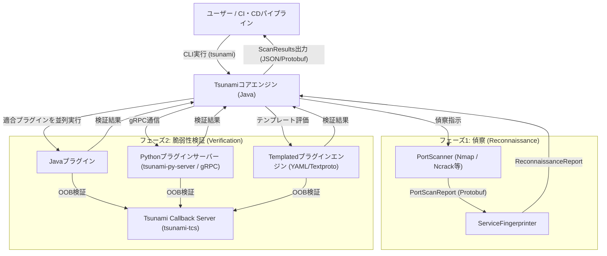

# **Tsunami Security Scanner 調査レポート**

## **1. 基本情報**

* **ツール名**: Tsunami Security Scanner
* **ツールの読み方**: ツナミ / ツナミ・セキュリティ・スキャナー
* **開発元**: Google
* **公式サイト**: [https://google.github.io/tsunami-security-scanner/](https://google.github.io/tsunami-security-scanner/)
* **関連リンク**:
  * GitHub: [https://github.com/google/tsunami-security-scanner](https://github.com/google/tsunami-security-scanner)
  * GitHub (プラグイン集): [https://github.com/google/tsunami-security-scanner-plugins](https://github.com/google/tsunami-security-scanner-plugins)
  * DeepWiki: [https://deepwiki.com/google/tsunami-security-scanner](https://deepwiki.com/google/tsunami-security-scanner)
* **カテゴリ**: セキュリティ/脆弱性診断
* **概要**: Tsunami Security Scanner（Tsunami）は、Googleが開発・公開している汎用ネットワークセキュリティスキャナーです。リモートコード実行（RCE）など影響が極めて大きい脆弱性を、誤検知（False Positive）を最小限に抑えながら高い確度で自動検出・検証することを目的としています。

## **2. 目的と主な利用シーン**

* **解決する課題**: 本番環境やクラウド上の大規模ネットワークに公開されたホストに存在する、深刻度の高いネットワーク脆弱性を誤検知なく確実に発見・検証すること。
* **想定利用者**: セキュリティエンジニア、ペネトレーションテスター、DevSecOpsチーム。
* **利用シーン**:
  * クラウドやオンプレミスに公開された外部エンドポイント（アタックサーフェス）の定期的なセキュリティ監査。
  * CI/CDパイプラインやKubernetes（GKE等）上の定期バッチへの組み込みによる継続的な脆弱性スキャン。
  * 新規に公開された重大CVEに対する、自社インフラへの迅速な横展開チェック（カスタムプラグインの即時実装と展開）。

### **2.1 代表的な利用フロー**

```mermaid
swimlane-beta TB
  subgraph User["ユーザー"]
    A[スキャン対象IP・ポートを指定して実行]
    F[構造化されたスキャン結果を確認・対応]
  end
  subgraph Core["Tsunamiコアエンジン"]
    B[偵察フェーズの開始]
    D[検出されたサービスに適合するプラグインを選定]
    E[検証結果を集約しレポート出力]
  end
  subgraph Plugins["プラグイン群・TCS"]
    C[Nmap等によるポートスキャンとサービス特定]
    G[非破壊の脆弱性検証とOOBコールバック確認]
  end
  subgraph Target["対象ホスト"]
    H[ポート応答・検証ペイロードへの応答]
  end
  A --> B
  B --> C
  C --> H
  H --> D
  D --> G
  G --> H
  G --> E
  E --> F
```

* **代表的な流れ**: ユーザーが対象ホストを指定してTsunamiを実行すると、コアエンジンが偵察プラグイン（Nmap等）を用いて開放ポートと稼働サービスを特定し、該当する脆弱性検証プラグインとコールバックサーバー（TCS）を連携させて実害のない範囲で脆弱性の有無を実証・報告します。

## **3. 主要機能**

* **Reconnaissance (偵察機能)**: `PortScanner` プラグインインターフェースを通じてNmap等の既存ツールと連携し、対象ホストの開放ポート、プロトコル、ネットワークサービスを網羅的に特定します。
* **Service Fingerprinting (フィンガープリンティング)**: ポートスキャン結果やサービスバナー・応答を解析し、稼働しているWebアプリケーション（Grafana、Confluence、Spring Boot等）やソフトウェアの正確なバージョンを特定します。
* **Vulnerability Verification (脆弱性検証)**: 単なるバージョン番号の一致確認ではなく、特定されたサービスに合致する検証プラグイン（`VulnDetector`）を並列実行し、安全なPoCペイロードを用いて脆弱性が実際に悪用可能かを検証します。
* **マルチ言語・宣言型プラグインシステム**: Javaネイティブプラグインに加え、gRPC経由で動作するPythonプラグイン、さらにYAML/Textproto形式でHTTPリクエストとマッチ条件を記述できるTemplatedプラグイン（Templated Detector）に対応しています。
* **Tsunami Callback Server (TCS) によるOOB検証**: ブラインドRCEやSSRFなどの脆弱性を確実に検証するため、外部からのHTTP/DNSコールバックを受信・記録する専用コールバックサーバー（`tsunami-tcs`）を備えています。
* **高確度・非破壊スキャン**: RCE、認証バイパス、認証情報なしの管理UI公開、OSコマンドインジェクションなど、致命的な脅威に絞って非破壊で検証するため、大規模環境でもアラート疲れを起こしにくい設計です。

## **4. 動作原理・システム構成**

* **アーキテクチャ**: ローカルまたはDockerコンテナ上で完結して動作する、2段階パイプライン型の拡張可能スキャニングエンジンです。コアエンジンはJava（Gradleビルド）で実装され、内部データ交換にはProtocol Buffers（Protobuf）を採用しています。PythonプラグインとはgRPCで通信します。



* **主要コンポーネントとデータフロー**:
  1. **偵察フェーズ**: コアエンジンが `PortScanner`（Nmap等）を呼び出して `PortScanReport` を生成し、続いて `ServiceFingerprinter` がサービスのソフトウェア種別とバージョンを特定して `ReconnaissanceReport` を作成します。
  2. **検証フェーズ**: コアエンジンは特定されたサービス情報に基づき、該当する `VulnDetector`（Java / Python / Templated）のみを選択して並列実行します。OOB（Out-of-Band）確認が必要な場合は `tsunami-tcs` を経由してコールバックを検証し、最終的に `ScanResults` としてレポートを出力します。
* **特筆すべき要素技術**:
  * **Dockerマルチステージ構成**: GitHub Container Registry（`ghcr.io/google/tsunami-scanner-full`）にて、コアエンジン・全プラグイン・Pythonサーバー・TCSを統合した実行環境が提供されています。
  * **gRPC + Protobuf**: 言語に依存しないプラグイン拡張（Pythonプラグインサーバー等）と型安全なスキャン結果のシリアライズを実現しています。

## **5. 開始手順・セットアップ**

* **前提条件**:
  * Docker（推奨。フルイメージ内にJava、Python、Nmap、Ncrack、TCS、全プラグインが同梱されています）
  * アカウント登録・クレジットカード登録は不要
* **インストール/導入**:
  公式のDockerイメージをGitHub Container Registryから取得します。

  ```bash
  # 最新フルイメージの取得とコンテナ起動
  docker pull ghcr.io/google/tsunami-scanner-full
  docker run -it --rm ghcr.io/google/tsunami-scanner-full bash
  ```

* **初期設定**:
  Pythonプラグインやコールバックサーバー（TCS）を利用する場合は、コンテナ内でバックグラウンドプロセスを起動します（コンテナ外部からコールバックを受信する場合はDockerの `-p` オプションでポートフォワードを設定します）。

  ```bash
  # Pythonプラグインサーバーの起動（必要な場合）
  tsunami-py-server >/tmp/py_server.log 2>&1 &

  # コールバックサーバー (TCS) の起動（OOB検証を使う場合）
  tsunami-tcs >/tmp/tcs_server.log 2>&1 &
  ```

* **クイックスタート**:
  コンテナ内で `tsunami` コマンドを実行し、対象IPアドレスをスキャンします。`--port-ranges-target` や `--detectors-include` でスキャン範囲を絞ることも可能です。

  ```bash
  # ローカルホストを対象としたスキャン実行例（Pythonプラグインサーバー連携あり）
  tsunami --ip-v4-target=127.0.0.1 \
    --python-plugin-server-address=127.0.0.1 \
    --python-plugin-server-port=34567
  ```

## **6. 特徴・強み (Pros)**

* **誤検知の極小化**: バージョン番号の照合だけでなく、非破壊な検証リクエストやOOBコールバックを用いて「実際に脆弱性が悪用可能か」を確認するため、ノイズの少ない高精度な結果が得られます。
* **多様なプラグイン拡張性**: Java、Python（gRPC経由）、Templated（宣言的YAML/Textproto）の3系統で検出器を作成でき、最新のCVEに対して迅速に独自ルールを追加できます。
* **ハイパースケール対応と高速性**: Google社内の大規模インフラ監視を前提に設計されており、特定されたサービスに適合するプラグインのみを並列実行するため高速に動作します。
* **完全無料・OSS**: Apache License 2.0の下で公開されており、ライセンス費用なしで大規模環境にも制限なく展開可能です。

## **7. 弱み・注意点 (Cons)**

* **検出対象の限定性**: XSS、CSRF、軽微な設定ミスやSSL暗号スイートの弱さなど、RCEや重大な情報漏洩に直結しない脆弱性は原則として検出対象外です。
* **コンプライアンス監査用途には不向き**: 網羅的なパッチ適用状況の確認やPCI-DSS等のコンプライアンスチェックリストを満たす目的には、別途NessusやOpenVAS等の汎用スキャナーが必要です。
* **APIやプラグイン構造の変化**: 活発に開発が続けられているため、コアAPIやコンテナ構成がアップデートに伴って変更される場合があります。
* **日本語対応**: 公式ドキュメント、CLI出力、プラグイン説明はすべて英語であり、日本語の公式サポートはありません。

## **8. 料金プラン**

| プラン名 | 料金 | 主な特徴 |
|---------|------|---------|
| **オープンソース (OSS)** | 無料 | Apache License 2.0の下で全機能・全公開プラグインが利用可能 |

* **課金体系**: 完全無料のオープンソースソフトウェア（商用プラン・有償版なし）。
* **無料トライアル**: 該当なし（常に無料で利用可能）。

## **9. 導入実績・事例**

* **導入企業**: 個別の民間企業による導入事例は公式には限定公開ですが、開発元であるGoogle社内の大規模インターネット公開資産の継続的監視に活用されています。また、米国CISA（サイバーセキュリティ・インフラストラクチャセキュリティ庁）のセキュリティリソースカタログでも紹介されています。
* **導入事例**: クラウド（GKE等）上の定期スキャンパイプラインに組み込み、公開エンドポイントのRCEや管理UIの無認証露出を自動検知するアタックサーフェス監視ツールとして利用されるケースが代表的です。
* **対象業界**: テクノロジー、クラウド事業者、金融、その他大規模な外部公開インフラを運用する組織全般。

## **10. サポート体制**

* **ドキュメント**: [公式ドキュメント（GitHub Pages）](https://google.github.io/tsunami-security-scanner/) にて、アーキテクチャ解説、Dockerでの実行手順、Java/Python/Templatedプラグインの開発ガイドが提供されています。
* **コミュニティ**: GitHubの [コアリポジトリ](https://github.com/google/tsunami-security-scanner) および [プラグインリポジトリ](https://github.com/google/tsunami-security-scanner-plugins) のIssue / Pull Requestを通じて活発な開発・コミュニティ貢献が行われています。また、Tsunami Patch Rewards Program (PRP) による報奨金制度も運用されています。
* **公式サポート**: オープンソースプロジェクト（"not an official Google product" と明記）であるため、商用SLAを伴う公式サポート窓口は提供されていません。

## **11. エコシステムと連携**

### **11.1 API・外部サービス連携**

* **プラグインAPI / gRPC**: JavaベースのプラグインAPIに加え、gRPCを用いたPythonプラグインサーバー（`tsunami-py-server`）および宣言的なTemplatedプラグインエンジンをサポートしています。
* **外部ツール連携**: 偵察フェーズで `Nmap` や `Ncrack` などの標準的なネットワークセキュリティツールを内部ラッパー経由で呼び出して連携します。また、出力結果（JSON/Protobuf）を外部のSIEM、Slack通知、チケット管理システム等へパイプライン連携して利用できます。

### **11.2 技術スタックとの相性**

| 技術スタック | 相性 | メリット・推奨理由 | 懸念点・注意点 |
|:---|:---:|:---|:---|
| **Docker / コンテナ** | ◎ | 公式フルイメージ（`ghcr.io/google/tsunami-scanner-full`）で即座に実行可能 | コールバックサーバー利用時は適切なポート公開設定が必要 |
| **Java** | ◎ | コアエンジンおよび標準プラグインの主要言語で全機能を利用可能 | GradleビルドやGuice等のDI知識が必要になる場合がある |
| **Python** | ◯ | `tsunami-py-server`（gRPC）経由でPython製の検出器を実装可能 | スキャン実行前にPythonサーバープロセスの起動が必要 |
| **YAML / Templated** | ◎ | コーディング不要でHTTPベースの脆弱性検出器を迅速に定義可能 | 複雑なプロトコル制御や多段ロジックにはJava/Pythonが必要 |
| **CI/CDパイプライン** | ◯ | CLIおよびコンテナ完結のためGitHub ActionsやGKE CronJob等に組込容易 | スキャン対象へのネットワーク到達性と実行時間の考慮が必要 |

## **12. セキュリティとコンプライアンス**

* **認証**: ローカル/自社環境で実行するCLIスキャナーであるため、ツール自体にユーザー認証やSSO機能はありません（実行環境のアクセス制御に依存）。
* **データ管理**: スキャン対象の情報や検出結果はすべて実行環境内のローカルファイルまたは標準出力に保存され、外部SaaSへ自動送信されることはありません。
* **準拠規格**: 公式サイトで特定のコンプライアンス認証（SOC2、ISO27001等）の取得は公開されていない。なお、スキャン実行時は対象ホストに対してアクティブな検証リクエストを送信するため、必ず許可された対象（自社管理資産等）に対してのみ実行する必要があります。

## **13. 操作性 (UI/UX) と学習コスト**

* **UI/UX**: Web管理画面を持たない純粋なCLIツールです。JSON/Protobuf形式のレポート出力を前提としており、エンジニアや自動化パイプライン向けの操作感となっています。
* **学習コスト**: Dockerのフルイメージを使った基本スキャンの実行は非常に容易です。Templatedプラグインの作成も比較的低い学習コストで習得できますが、Javaで複雑なプロトコル（HTTP/2など）を扱うカスタムプラグインを開発する場合は、TsunamiのProtobufスキーマやプラグインAPIの理解が必要です。

## **14. ベストプラクティス**

* **効果的な活用法 (Modern Practices)**:
  * 個別ビルドや旧来のセットアップスクリプトではなく、公式提供のDockerフルイメージ（`ghcr.io/google/tsunami-scanner-full`）を利用し、最新の検出プラグイン一式を常に維持する。
  * 新規CVEへの緊急対応時は、まずTemplatedプラグイン（YAML/Textproto）で迅速に検出器を記述・展開し、複雑な検証が必要な場合のみJava/Pythonプラグインを選択する。
  * ブラインドRCEやSSRFの検証精度を高めるため、Tsunami Callback Server（`tsunami-tcs`）を外部到達可能な環境で併用する。
* **陥りやすい罠 (Antipatterns)**:
  * 古いドキュメントにある `quick_start.sh` やMavenリリースに依存すること（現在はDockerコンテナベースの利用が公式推奨）。
  * XSSやCSRF、網羅的なOSパッケージのCVEチェックを期待してTsunami単体で運用すること（静的SCAにはTrivyやOSV-Scanner、WebアプリDASTにはZAP等を併用すべき）。

## **15. ユーザーの声（レビュー分析）**

* **調査対象**: G2、Capterra、ITreviewにレビューの登録なし。Reddit（r/netsec、r/cybersecurity、r/blueteamsec）および技術ブログ・YouTubeの解説から収集。
* **総合評価**: レビューサイト上のスコアなし（専門コミュニティでは「大規模外部監視に特化した高確度スキャナー」として高評価）
* **ポジティブな評価**:
  * 「バージョン番号の照合だけでなく実際のPoCで検証するため、誤検知が極めて少なく運用チームが疲弊しない。」（Redditより要約）
  * 「Dockerイメージを使えば環境構築の手間が少なく、Kubernetes上の定期スキャンにも組み込みやすい。」（技術ブログより要約）
  * 「認証なしの外部視点から、重大なRCEや露出している管理UIを素早く炙り出せる点が優れている。」（Redditより要約）
* **ネガティブな評価 / 改善要望**:
  * 「NessusやOpenVASのような網羅的なスキャナーではなく、標準で検出できる脆弱性の種類が厳選されすぎている。」（Redditより要約）
  * 「中小規模のネットワークやコンプライアンス監査目的では機能過多または目的不一致になりやすく、カスタムプラグインの自作が前提になりがち。」（Redditより要約）
  * 「元々の開発ステータス（Pre-alpha表記時代）からコードベースが継続的に変化しており、独自プラグインの追従メンテナンスに手間がかかる。」（技術ブログより要約）
* **特徴的なユースケース**:
  * パブリッククラウド上に分散した大量のエンドポイントに対する、誤検知ゼロを重視した継続的アタックサーフェス監視。

## **16. 直近半年のアップデート情報**

* **2026-11-26**: プラグインリポジトリにて、HTTP/2関連脆弱性（CVE-2026-123007）検出プラグイン（`Cve2026123007Detector` / `H2FlowControlProbe`）のStage 2受信ウィンドウ制御やソケットバッファ処理を改善。
* **2026-11-25**: プラグインリポジトリにて、RedisのRCE脆弱性と単なる読み書きアクセス可能状態を明確に区別する検出ロジックを追加。
* **2026-11-23**: 11月20日〜23日にかけて、MinIOクラスター情報漏洩（CVE-2023-28432）、Spring Boot Actuator露出、Laravel（CVE-2021-3129）、Apache mod_proxy SSRF（CVE-2021-40438）、Atlassian Confluence RCE（CVE-2022-26134 / CVE-2023-22518）、PHP CGI引数インジェクションRCE（CVE-2024-4577）、Docker Engine API無認証公開などのTemplated Detector群を大幅追加。
* **2026-11-16**: コアエンジンの `NetworkServiceUtils` を更新し、`https-alt`、`ssl/https-alt`、`ssl/http-alt` をHTTPS Webサービスとして認識するよう拡張。
* **2026-11-13**: コアエンジンの `OkHttpHttpClient` にて、HTTP 101 Switching Protocolsレスポンスを適切に処理するよう修正。
* **2026-09-29**: Templatedプラグインエンジンを拡張し、HTTP `OPTIONS` メソッドおよびレスポンスボディのハンドリングをサポート（PR #170）。
* **2026-06-23**: Templatedプラグインエンジンに新しいテンプレート変数を追加（PR #156）。
* **2026-06-05**: Pythonプラグインサーバーにおいて、Python 3.14環境での `asyncio` イベントループ生成処理を修正。
* **2026-02-19**: v0.2.0 をリリース。Golang proto定義の再生成や内部コードベースの同期を実施。
* **2025-10-16**: Tsunami Patch Rewards Program (PRP) のアップデート。ペイアウトシステムの簡素化や、Go言語でのフィンガープリンティング機能の書き直し（実験中）を発表。

(出典: [GitHub Releases](https://github.com/google/tsunami-security-scanner/releases) / [コアリポジトリコミット履歴](https://github.com/google/tsunami-security-scanner/commits/master) / [プラグインリポジトリコミット履歴](https://github.com/google/tsunami-security-scanner-plugins/commits/master) / [公式ブログ](https://google.github.io/tsunami-security-scanner/blog/))

## **17. 類似ツールとの比較**

### **17.1 機能比較表 (星取表)**

| 機能カテゴリ | 機能項目 | 本ツール | ZAP | Trivy | OSV-Scanner |
|:---:|:---|:---:|:---:|:---:|:---:|
| **動的スキャン** | ネットワーク/サービス偵察 | ◎<br><small>Nmap等と連携しポート・サービスを高精度特定</small> | △<br><small>Webアプリ(HTTP/HTTPS)に特化</small> | ×<br><small>静的スキャン・K8s設定検査が中心</small> | ×<br><small>依存関係・バイナリの静的解析に特化</small> |
| **動的スキャン** | Webアプリ脆弱性 (XSS/CSRF等) | ×<br><small>RCE等の致命的脅威に特化し原則対象外</small> | ◎<br><small>OWASP ZAPの主力領域で網羅的</small> | ×<br><small>DAST機能は非対応</small> | ×<br><small>DAST機能は非対応</small> |
| **静的スキャン** | 依存関係・コンテナ脆弱性 (SCA) | ×<br><small>稼働中ホストの動的検証に特化</small> | ×<br><small>動的スキャンのみ</small> | ◎<br><small>コンテナ・IaC・言語パッケージを包括スキャン</small> | ◎<br><small>OSV.devとOSV-Scalibrで高精度解析</small> |
| **精度・拡張性** | 誤検知の少なさ・カスタム拡張 | ◎<br><small>実PoC/OOB検証とJava/Python/Templated拡張</small> | ◯<br><small>豊富なアドオン・Automation Framework対応</small> | ◯<br><small>Regoによるカスタムポリシー対応</small> | ◎<br><small>コール分析やGuided Remediation対応</small> |

### **17.2 詳細比較**

| ツール名 | 特徴 | 強み | 弱み | 選択肢となるケース |
|---------|------|------|------|------------------|
| **本ツール** | 高確度な汎用ネットワークセキュリティスキャナー | RCE等の致命的脆弱性を実検証により誤検知なく検出。Java/Python/Templatedで拡張可能。 | XSS等の一般的なWeb脆弱性や静的SCAは対象外。 | ネットワーク上に公開されたホストの致命的な脆弱性を自動で発見・実証したい場合。 |
| **ZAP** | 世界で広く利用されるOSSのWebアプリ脆弱性スキャナー（DAST） | WebアプリのXSS/SQLi等を網羅的に診断可能。MCPサーバー連携や自動化も強力。 | ネットワーク層やインフラ全般のポート・サービス偵察には不向き。 | WebアプリケーションやAPIの網羅的な動的脆弱性診断を行いたい場合。 |
| **Trivy** | コンテナ・リポジトリ・クラウド環境の包括的静的スキャナー | コンテナイメージ、IaC、コード、K8s設定を高速かつ包括的にスキャン可能（v0.76系）。 | 稼働中ホストへの動的なネットワーク・エクスプロイト検証機能はない。 | CI/CDパイプライン内でコンテナやコード・IaCの静的な脆弱性を検出したい場合。 |
| **OSV-Scanner** | OSV.devデータベースとOSV-Scalibrを用いたOSS依存関係スキャナー | ロックファイルやバイナリの脆弱性を高精度に特定し、自動修復提案にも対応（v2.7系）。 | ネットワークレベルの動的スキャン機能は持たない。 | 開発中プロジェクトの依存ライブラリやコンテナ内の既知脆弱性を管理したい場合。 |

## **18. 総評**

* **総合的な評価**:
  Tsunami Security Scannerは、Googleの大規模インフラ運用の知見から生まれた、極めて実践的なオープンソースのネットワーク脆弱性スキャナーです。2026年後半もコアエンジンのHTTP/プロトコル対応改善や、Templated Detectorを中心とした多数の新規CVE検出プラグインの追加が活発に続いており、進化を続けています。すべてを網羅して大量の警告を出すのではなく、RCEなど本当に危険な脆弱性に絞って誤検知なく実証するアプローチは、運用現場の負荷軽減に大きく寄与します。
* **推奨されるチームやプロジェクト**:
  * パブリッククラウド上に多数の外部公開エンドポイントを抱え、継続的なアタックサーフェス監視を自動化したいセキュリティ・運用チーム。
  * 重大なゼロデイ・新規CVEの公開時に、独自プラグイン（特にTemplatedプラグイン）を迅速に作成して全社展開したいセキュリティ診断チーム。
* **選択時のポイント**:
  コンテナや依存関係の静的解析にはTrivyやOSV-Scanner、Webアプリケーションの網羅的なDASTにはZAPが適しています。Tsunamiはそれらを置き換えるものではなく、稼働中のネットワークサービスに対する「致命的脆弱性の高確度な動的検証」を担う補完的な中核ツールとして組み合わせるのが最適です。
