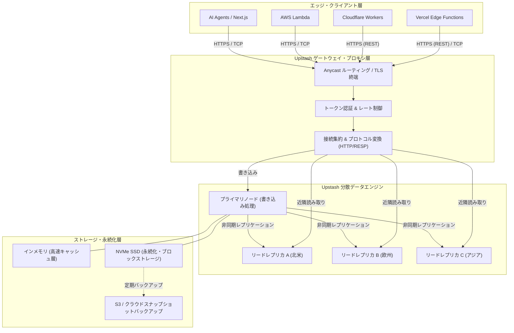

# **Upstash 調査レポート**

## **1. 基本情報**

* **ツール名**: Upstash
* **ツールの読み方**: アップスタッシュ
* **開発元**: Upstash, Inc.（米国カリフォルニア州サンノゼ、CEO: Enes Akar、2021年設立）
* **公式サイト**: [https://upstash.com/](https://upstash.com/)
* **関連リンク**:
  * GitHub（公式組織 / 各種SDK）: [https://github.com/upstash](https://github.com/upstash)
  * ドキュメント: [https://upstash.com/docs](https://upstash.com/docs)
  * レビューサイト: [Product Hunt](https://www.producthunt.com/products/upstash) | [G2](https://www.g2.com/products/upstash/reviews)
* **カテゴリ**: データベース/データストレージ
* **概要**: Upstashは、VercelやCloudflare Workers、AWS Lambdaをはじめとするサーバーレスおよびエッジコンピューティング環境に特化したクラウドデータプラットフォームである。従来のデータベースで課題となっていたステートフルなTCPコネクション枯渇問題を、ネイティブなHTTP/REST APIプロトコルとコネクションプーリング層によって根本から解決。Redis互換データベース、ベクトルデータベース（Vector）、メッセージング・スケジューラ（QStash）、長期実行オーケストレーション（Workflow）、AIエージェント向け実行環境（Box）など、最新のWebおよびAI開発に必要なバックエンドサービス群をScale-to-Zero（アイドル時コストゼロ）のサーバーレスモデルで提供している。

## **2. 目的と主な利用シーン**

* **解決する課題**:
  * **サーバーレス環境におけるコネクション枯渇問題**: AWS LambdaやVercel Edge Functions等のステートレスな短命実行環境から従来のデータベース（RedisやRDBMS）に直接TCP接続を行うと、同時実行数のスパイクによって接続数上限（Max Clients）を容易に突破し、エラーやコールドスタート遅延を招く課題を解決。
  * **エッジランタイム（V8 Isolates）のネットワーク制約**: Cloudflare Workersなどのエッジ環境では生TCPソケットが制限される場合があるが、標準のHTTP/HTTPS（`fetch`）経由で低遅延にデータを読み書きできる手段を提供。
  * **非同期タスク・長時間実行ジョブの管理コスト**: サーバーレス環境特有の実行時間制限（タイムアウト）に対し、常時稼働サーバー（EC2やコンテナ）を立てることなく、信頼性の高いキュー処理やCronジョブ、多段階ワークフローを実行可能にする。
  * **固定費・運用管理オーバーヘッドの削減**: トラフィックがゼロのアイドル状態ではコストが発生しない「Scale-to-Zero」を実現し、クラスタ管理やノードサイジング、パッチ適用の手間を排除。

* **想定利用者**:
  * フルスタックWebエンジニア / フロントエンドエンジニア（Next.js、Nuxt、Remix、SvelteKit利用者）
  * サーバーレス / エッジアーキテクチャを採用するクラウドバックエンド開発者
  * AIアプリケーション・LLMエージェント開発者（セマンティック検索、RAG、コンテキスト履歴管理）
  * インフラ専任を持たずに素早くMVPを立ち上げたいスタートアップや個人開発者

* **利用シーン**:
  * **グローバルAPIレート制限・セッション管理**: `@upstash/ratelimit` をエッジミドルウェアに導入し、悪意あるリクエストやAPI不正利用をユーザー単位・IP単位でミリ秒未満の判定速度でブロック。
  * **LLMレスポンスや動的コンテンツの高速キャッシュ**: 生成AIの回答やサードパーティAPIの実行結果をUpstash Redisにキャッシュし、トークン消費の削減とレイテンシ短縮を同時に達成。
  * **サーバーレス非同期ジョブ＆Webhook配信**: Stripeなどの外部Webhook受信時に即座に200 OKを返し、Upstash QStash経由で指数バックオフ付き自動リトライを伴うバックグラウンド処理を実行。
  * **AIエージェントの自律コード実行と長期ワークフロー**: Upstash Workflowで状態永続化を行いながら、Upstash Boxのセキュアなコンテナサンドボックス内でAIにテスト実行やGit操作を行わせる。

### **2.1 代表的な利用フロー**

Webアプリケーション（Next.js / Cloudflare Workers）からエンドユーザーのリクエストを受け取り、UpstashのRedisおよびWorkflow/QStashを連携させて低遅延処理と非同期処理を分離する代表的な処理フローを示す。

```mermaid
swimlane-beta TB
  subgraph ユーザー
    A[Web・APIリクエスト送信]
    F[高速なレスポンスを受信]
  end
  subgraph エッジアプリケーション
    B[エッジ関数が起動]
    C[レート制限・キャッシュ照会]
    E[非同期タスクをキューへ投入]
  end
  subgraph Upstash
    D[Redis: 低遅延判定・キャッシュ返却]
    G[QStash/Workflow: ジョブをスケジューリング]
  end
  subgraph バックエンドワーカー
    H[遅延実行エンドポイントがタスクを処理]
  end
  A --> B
  B --> C
  C --> D
  D --> E
  E --> F
  E --> G
  G --> H
```

* **代表的な流れ**: クライアントからリクエストを受信したエッジ関数が、まずUpstash Redisに対してHTTP経由でレート制限検証とキャッシュ取得を同期実行する。Upstashからのミリ秒単位の応答を受けて即座にユーザーへレスポンスを返却した後、重い後続処理（AI推論や通知配信など）はQStash/Workflowへ非同期にエンキューされ、バックグラウンドで安全にリトライ制御されながら実行される。

## **3. 主要機能**

* **Upstash Redis（サーバーレスKVS / キャッシュ）**:
  * 完全なRedis互換性を持つインメモリデータストア。標準RESP（TCP）プロトコルに加え、エッジフレンドリーなHTTPS REST APIを提供。
  * 接続数無制限・アイドル時Scale-to-Zero・自動スケーリング設計により、コネクションプーリングの管理を不要化。
  * グローバルデータベース（Global Database）機能により、世界各国のリードレプリカに非同期自動複製され、エッジから最寄りの拠点へ超低レイテンシで読み出し可能。

* **Upstash Vector（サーバーレスベクトル検索）**:
  * 高次元ベクトル埋め込みと類似度検索（コサイン類似度、ユークリッド距離、ドット積）をサーバーレスで提供。
  * メタデータフィルタリング、名前空間（Namespaces）、および自動埋め込み生成（Upstash側でのEmbeddingモデル実行）をサポート。
  * AIのRAG（検索拡張生成）やレコメンデーションエンジンを最小限のインフラ構成で即座に構築可能。

* **Upstash QStash（サーバーレスメッセージキュー＆スケジューラ）**:
  * HTTPリクエストをトリガーとするメッセージキューおよびCronスケジューラ。
  * 配信先エンドポイント（Webhook URL）を指定するだけで、自動リトライ、指数バックオフ、デッドレターキュー（DLQ）、メッセージ重複排除、署名検証を自動処理。
  * メッセージの一時停止（Delay）、Cron構文による定期実行をサーバーレス環境から簡単にスケジュール可能。

* **Upstash Workflow（耐久性サーバーレスオーケストレーション）**:
  * サーバーレス関数の実行時間制限（例: 10秒〜数分）を超える長時間ジョブを、コードベースのステップ関数として宣言的に記述可能。
  * `context.run`, `context.sleep`, `context.call` などのシンプルなAPIにより、状態永続化、自動リトライ、ステップ単位の並行度・流量制御（Flow Control）を実現。

* **Upstash Ratelimit（高精度エッジレート制限ライブラリ）**:
  * 固定ウィンドウ、スライディングウィンドウ、トークンバケットアルゴリズムを実装したTypeScript/JavaScript向け公式ライブラリ。
  * エッジ関数上で数行のコードを記述するだけで、DDoS攻撃防御、ブルートフォース攻撃対策、LLM利用量クォータ管理をミリ秒未満のオーバーヘッドで実現。

* **Upstash Box（AIエージェント向けクラウドサンドボックス）**:
  * AIエージェントに安全なクラウド実行環境（隔離コンテナ）を提供する新世代インフラ。
  * 永続ファイルシステム、GitHub連携、Bashシェル実行、Playwright用ヘッドレスChromiumブラウザを内包し、自律コーディングエージェントのテスト・ビルド・ブラウジングを安全に隔離実行。

* **Remote MCP（Model Context Protocol）サーバー＆MCP Apps**:
  * Claude Code、Cursor、ChatGPTなどのAIクライアントから、Upstashのデータベースやキューリソースを自然言語やツール経由で直接操作できる標準プロトコルサーバーを提供。

## **4. 動作原理・システム構成**

Upstashは、従来の「サーバーを常時起動して単一ホストに接続する」アーキテクチャとは根本的に異なり、マルチテナント型クラウドネイティブ設計とマルチティア（階層化）ストレージを採用している。

* **アーキテクチャモデル**: クラウドネイティブ・マルチテナント・分散型サーバーレスアーキテクチャ。
* **主要コンポーネントとデータフロー**:
  1. **エッジ・APIプロキシ層**: エッジ関数やクライアントから送信されたHTTP/RESTリクエストを受け取るロードバランサとプロキシレイヤー。ここでTLS終端、リクエスト認証（Bearerトークン検証）、接続集約、およびコマンドのパースが行われる。
  2. **コネクションプーリング＆ルーティングエンジン**: 外部からはステートレスなHTTP通信を受け付けつつ、内部のデータベースクラスタに対して最適化されたパイプライン接続を維持。これにより、数万のサーバーレス関数が同時に立ち上がっても、バックエンドのデータベース接続が枯渇しない。
  3. **マルチティアストレージエンジン（RAM + NVMe SSD）**: 高速なメモリアクセス層（RAM）に加え、ディスク永続化層（高速NVMe SSD）を組み合わせた階層ストレージを採用。アクセス頻度の高いホットデータはメモリ上に保持され、コールドデータは安全にディスクへ退避・フラッシュされる。これにより、Redisのインメモリ高速性と低価格な大容量永続性を両立している。
  4. **グローバルレプリケーション層**: プライマリリージョンへの書き込みトランザクションを、世界各地域（北米、欧州、アジア等）のリードレプリカへ非同期ストリーミング複製。エッジコンピューティングからの読み取り要求は地理的に最も近いレプリカへ自動ルーティングされる。



* **特筆すべき要素技術**:
  * **Dual-Protocol（デュアルプロトコル）サポート**: 単一のデータベースインスタンスに対して、標準のRedis TCPプロトコル（RESP）とHTTPS REST API（`/set/key/value`、パイプライン対応）の双方が完全並行でアクセス可能。
  * **HTTP Keep-Aliveとパイプライン最適化**: REST経由であってもHTTP/1.1やHTTP/2のKeep-Alive接続と一括送信（Pipeline / Transaction）をサポートし、ラウンドトリップのオーバーヘッドを極小化。
  * **RocksDBベースの永続化層**: インメモリデータを定期的にディスク構造（LSM-tree等）へスナップショット永続化し、クラスタ障害時のデータ復元性とコスト効率を担保。

## **5. 開始手順・セットアップ**

### **前提条件**
* Node.js（v18以上推奨）または Python（3.9以上）
* Upstashアカウント（GitHubまたはGoogleアカウントで無料作成可能、クレジットカード不要）

### **インストール/導入**

TypeScript / JavaScript（Node.js、Next.js、Cloudflare Workers等）の場合:

```bash
# Redis SDKおよびレート制限ライブラリのインストール
npm install @upstash/redis @upstash/ratelimit
```

Python環境の場合:

```bash
# Python用公式SDKのインストール
pip install upstash-redis
```

### **初期設定**

1. [Upstash Console](https://console.upstash.com/) にサインアップし、「Create Database」をクリック。
2. データベース名、タイプ（RegionalまたはGlobal）、プライマリリージョン（東京リージョン `ap-northeast-1` も選択可能）を選択して作成。
3. 作成後のダッシュボードから `UPSTASH_REDIS_REST_URL` と `UPSTASH_REDIS_REST_TOKEN` を取得。
4. プロジェクトの `.env.local` 等に設定:

```env
UPSTASH_REDIS_REST_URL="https://<YOUR_DATABASE_SLUG>.upstash.io"
UPSTASH_REDIS_REST_TOKEN="<YOUR_UPSTASH_REST_TOKEN>"
```

### **クイックスタート**

Next.js App RouterやAPIルートでの使用例（TypeScript）:

```typescript
import { Redis } from "@upstash/redis";

// 環境変数から自動初期化
const redis = Redis.fromEnv();

export async function GET(request: Request) {
  // キャッシュからデータを取得
  const cacheKey = "latest_announcements";
  const cachedData = await redis.get(cacheKey);

  if (cachedData) {
    return Response.json({ source: "cache", data: cachedData });
  }

  // キャッシュミス時の重い処理
  const freshData = { message: "Hello from Upstash Serverless Redis!", timestamp: Date.now() };

  // 60秒のTTLを設定してキャッシュ保存
  await redis.set(cacheKey, JSON.stringify(freshData), { ex: 60 });

  return Response.json({ source: "origin", data: freshData });
}
```

レート制限（Rate Limiting）の実装例:

```typescript
import { Redis } from "@upstash/redis";
import { Ratelimit } from "@upstash/ratelimit";

const redis = Redis.fromEnv();

// 10秒間に5回までのリクエストを許可するスライディングウィンドウ
const ratelimit = new Ratelimit({
  redis: redis,
  limiter: Ratelimit.slidingWindow(5, "10 s"),
  analytics: true,
});

export async function handleRequest(userIdentifier: string) {
  const { success, limit, remaining, reset } = await ratelimit.limit(userIdentifier);

  if (!success) {
    return new Response("Too Many Requests", {
      status: 429,
      headers: {
        "X-RateLimit-Limit": limit.toString(),
        "X-RateLimit-Remaining": remaining.toString(),
        "X-RateLimit-Reset": reset.toString(),
      },
    });
  }

  return new Response("OK", { status: 200 });
}
```

## **6. 特徴・強み (Pros)**

* **コネクション管理からの完全な解放**:
  * 従来のRedisではサーバーレス関数からの大量同時接続でTCPコネクションプールが枯渇しがちだったが、UpstashのREST APIはステートレスなHTTPリクエストで通信するため、数万の同時実行でもコネクション枯渇エラーが絶対に発生しない。
* **圧倒的に経済的なScale-to-Zero従量課金**:
  * トラフィックがない夜間やアイドル時は完全ゼロ円。プロビジョニング済みインスタンスのような最低維持費（$15〜$30/月）がかからず、個人開発やスタートアップの検証フェーズにおいてコストを極小化できる。
* **手厚い無料枠（Free Tier）**:
  * クレジットカード登録不要で、Redisでは月間500,000コマンド・250MBストレージ、QStashでは日次1,000メッセージ、Vectorでは日次10,000クエリが恒久的に無料提供されている。
* **AI・モダンWebエコシステムとの深い統合**:
  * Vercel Marketplace、Cloudflare Workers、Fly.io、AWS Lambda、Next.js等にワンクリックで統合可能。さらにAIエージェント向けのサンドボックス（Box）やRemote MCPサーバーを他社に先駆けて展開。
* **Global Databaseによる世界的低遅延**:
  * 世界中の各リージョンへデータを自動非同期レプリケーション。エッジ関数から物理的に最も近いレプリカへルーティングされ、グローバルユーザーに対しても数ミリ秒の超高速読み取りを提供。

## **7. 弱み・注意点 (Cons)**

* **日本語ドキュメントおよび国内サポートの不在**:
  * 公式Webサイト、ドキュメント、エラーメッセージ、管理画面はすべて英語のみで提供されている。日本語ローカライズ版は提供されておらず、障害時の問い合わせ窓口も英語での対応となるため、社内導入時の言語的ハードルが存在する。
* **常時高スループット環境でのコスト逆転**:
  * 従量課金（10万コマンドあたり$0.20）の特性上、秒間数千〜数万リクエストが四六時中継続するような大規模高負荷システムでは、AWS ElastiCacheや専有型Redis Enterpriseと比較して月額費用が割高になるケースがある（※この場合はFixed Planへの切り替えや専用構成の検討が必須）。
* **HTTP利用時における単一コマンドのオーバーヘッド**:
  * REST API経由の通信は、ローカルネットワーク上のダイレクト生TCP接続（サブミリ秒）と比較すると、HTTPS/TLSハンドシェイクやHTTPヘッダの分、わずかにレイテンシが大きくなる（1〜5ms程度）。数マイクロ秒を争うハイ frequency 取引システム等には不向き。
* **ダッシュボード閲覧時のコマンドカウント消費**:
  * Upstash Consoleの「Data Browser」でキー一覧を検索・プレビューする際、内部的にスキャンコマンドが発行されるため、無料枠や従量課金のコマンド数カウントに計上される点に初心者が戸惑いやすい。

## **8. 料金プラン**

Upstashは「Free」「Pay-As-You-Go（従量課金）」「Fixed（定額プラン）」「Enterprise（エンタープライズ）」の柔軟な4階層モデルを採用している。

| プラン名 | 料金 | 主な仕様・制限 | 推奨ユースケース |
|:---|:---|:---|:---|
| **Free Tier** | 無料<br><small>クレジットカード不要</small> | ・Redis: 500,000 コマンド/月、250 MB ストレージ、帯域10 GB/月<br>・Vector: 10,000 リクエスト/日<br>・QStash / Workflow: 1,000 リクエスト/日<br>・1アカウントあたり1データベース | 個人開発、プロトタイプ、技術検証、趣味プロジェクト |
| **Pay-As-You-Go (従量課金)** | 基本料金 $0<br><small>使った分だけ課金</small> | ・Redisコマンド: $0.20 / 100,000 コマンド<br>・ストレージ: $0.25 / GB / 月 (初月1GB無料)<br>・帯域: 200 GB/月まで無料 (以降 $0.03/GB)<br>・Vector: $0.40 / 100K リクエスト<br>・QStash / Workflow: $1.00 / 100K メッセージ<br>・月間予算上限（Budget Cap）設定可能 | トラフィック変動の激しいWebアプリ、エッジ/サーバーレス本番運用、MVP |
| **Fixed Plans (定額プラン)** | $10/月〜<br><small>容量に応じて段階設定</small> | ・一定のコマンド数・データ容量枠をフラット課金で提供<br>・スループット上限の引き上げ<br>・Prod Pack（監視Insight、SOC 2/HIPAA、暗号化）の追加可能 | 予測可能で継続的なトラフィック、Celery/BullMQ等の常時稼働ワーカー |
| **Enterprise** | 要問い合わせ<br><small>カスタム見積もり</small> | ・専有インフラ（Single-tenant / VPC Peering）<br>・99.99% SLA保証<br>・専任アカウントマネージャー、24/7/365 サポート<br>・請求書払い（Invoice対応）、HIPAA BAA締結 | 大規模エンタープライズ、金融・医療系ワークロード |

* **課金体系**: リクエスト（コマンド/メッセージ/ステップ）数および保持データストレージ容量に基づく純粋従量課金。データベースごとに月間上限予算（Monthly Budget Cap）を設定可能で、設定額に達した場合は追加課金を行わずにレートリミットをかけるセーフティ機構が備わっている。
* **無料トライアル**: クレジットカード登録不要の永続的なFree Tierが提供されており、いつでも即座に検証可能。

## **9. 導入実績・事例**

* **導入企業**:
  * **Supabase**: オープンソースFirebase代替として知られるBaaS大手。Edge Functionsのグローバル実行における低遅延な共有データストアおよびキャッシュ層としてUpstash Redisを採用。
  * **Zapier**: ノーコード自動化の先駆者。Vercel Edge Functions上での悪意あるIPブロッキングおよびグローバルAPIレート制限のバックエンドとしてUpstash Redisを全面活用。
  * **Branch**: 企業価値数十億ドル規模の急成長インシュアテック（保険テクノロジー）企業。インフラ運用チームを最小限に保ちながら、完全サーバーレスアーキテクチャの中核データベースとしてUpstashを採用し、厳格な保険コンプライアンス要件をクリア。
  * その他、**HashiCorp**、**MakerLog**、数千社に及ぶVercel/Next.jsエコシステムのスタートアップが利用。

* **導入事例から見る効果**:
  * **接続エラーゼロの達成**: 従来のRedisクラスタで多発していた「Error: max number of clients reached」がHTTPプロキシ化により完全消滅。
  * **インフラ保守コストの大幅削減**: インスタンスのパッチ適用やバージョンアップ、フェイルオーバー監視作業がゼロになり、開発チームがアプリケーションロジックに集中。

* **対象業界**: SaaS開発、AI/LLMスタートアップ、Eコマース、フィンテック、インシュアテック、メディアプラットフォーム。

## **10. サポート体制**

* **ドキュメント**:
  * 非常に充実した公式ドキュメント（[https://upstash.com/docs](https://upstash.com/docs)）を整備。
  * Next.js、Remix、Cloudflare Workers、FastAPIなどの主要フレームワーク向けクイックスタートガイド、サンプルコード、アーキテクチャ解説、APIリファレンスが完備。
* **コミュニティ**:
  * **GitHub Discussions**: ロードマップの公開、機能要望（Feature Requests）、不具合報告が活発に行われている。
  * **Discord コミュニティ**: 世界中の開発者およびUpstashコアエンジニアが参加する公式Discordサーバーが存在し、リアルタイムでの技術相談やトラブルシューティングが可能。
* **公式サポート**:
  * **Free/PAYG**: コミュニティフォーラム（Discord/GitHub）および標準Webフォーム対応。
  * **Pro / Fixed**: 優先メールサポート（通常営業時間内のSLA対応）。
  * **Enterprise**: 24/7/365 緊急対応、Slack専用チャンネル、専任ソリューションアーキテクトによるアーキテクチャレビュー。

## **11. エコシステムと連携**

### **11.1 API・外部サービス連携**

* **API**:
  * REST API（HTTP/HTTPS）による全Redisコマンド実行・パイプライン・トランザクション対応。
  * Vector、QStash、Workflow、Boxに対する完全なOpenAPI仕様対応のRESTエンドポイントを提供。
* **外部サービス連携**:
  * **Vercel**: Vercel Marketplace連携により、Vercelプロジェクト作成時に1クリックでUpstash Redis/KVを追加可能。環境変数も自動注入される。
  * **Cloudflare Workers**: エッジからREST API経由で直接読み書き可能。CloudflareコンソールやWranglerとの親和性が極めて高い。
  * **AWS Lambda / AWS EventBridge**: サーバーレス関数のキャッシュおよびイベント駆動キュー連携。
  * **AIフレームワーク**: LangChain、LlamaIndex、Vercel AI SDKにおいてUpstash VectorおよびRedisが公式インデックス・キャッシュアダプタとして標準同梱。
  * **監視・オブザーバビリティ**: Datadog、Axiom、Logflareとのメトリクス/ログ連携。

### **11.2 技術スタックとの相性**

| 技術スタック | 相性 | メリット・推奨理由 | 懸念点・注意点 |
|:---|:---:|:---|:---|
| **Next.js (Vercel)** | ◎ | 公式連携が完璧。`@upstash/redis`、`@upstash/ratelimit`、`workflow-js` が公式推奨スタックとして定着 | 特になし。環境変数もワンクリック連携可能 |
| **Cloudflare Workers / Pages** | ◎ | V8 IsolatesのTCP制約を受けず、ネイティブな `fetch`（HTTPS）で通信可能。グローバル読み取りも高速 | 生TCP接続のドライバは一部制約あり（REST利用推奨） |
| **Node.js (Express / Fastify)** | ◯ | 標準TCP接続（ioredis等）とREST APIの両方が利用可能 | 長時間常時接続ならTCP、サーバーレスならRESTを選択 |
| **Python (FastAPI / LangChain)** | ◎ | `upstash-redis` 公式SDK完備。LangChainやLlamaIndexのベクトル・メモリ連携が極めて容易 | 膨大なデータの一括ロード時はバッチ処理の最適化が必要 |
| **Go / Rust** | ◯ | 標準HTTPクライアントやRedisドライバで即座に連携可能 | 専用高機能ラッパーライブラリはTS/Pythonより少なめ |

## **12. セキュリティとコンプライアンス**

* **認証**:
  * すべてのHTTP/REST通信はBearer認証トークン（Read-Only専用トークンも発行可能）によるアクセス制御。
  * TCP接続時はRedis AUTHパスワードによる厳格な認証。
  * 管理コンソールへのアクセスは多要素認証（MFA）およびGitHub/Google SSOに対応。
  * EnterpriseプランではIPホワイトリスト（IP Allowlisting）およびVPC Peeringによるネットワーク分離に対応。
* **データ管理**:
  * **転送中暗号化**: 全エンドポイントでTLS 1.2 / TLS 1.3による完全暗号化通信を強制。
  * **保存時暗号化（Encryption at Rest）**: AES-256規格によりディスク永続化データを安全に暗号化（Prod Pack / Enterprise）。
  * **マルチクラウド・マルチリージョン**: AWS、GCP等のセキュアなTier 3+データセンター内でインフラを運用。
* **準拠規格**:
  * **SOC 2 Type II**: Pro/EnterpriseプランおよびProd Pack適用データベースにおいて準拠。
  * **GDPR**: EU一般データ保護規則に完全準拠し、データ処理契約（DPA）の締結が可能。
  * **HIPAA**: 医療データ（PHI）の取り扱いに対応し、Enterpriseプランにて業務提携契約（BAA）の締結が可能。
  * **ISO 27001**: 認証取得プロセスを推進・対応中。

## **13. 操作性 (UI/UX) と学習コスト**

* **UI/UX**:
  * Upstash Consoleはモダンで直感的なミニマルデザインを採用。データベースの作成はリージョンを選んで「Create」を押すだけで3秒以内に完了する。
  * Webブラウザ上でキーやデータ構造の閲覧・編集ができる「Data Browser」や、Web上でRedisコマンドを直接試せる「CLIターミナル」、メトリクスグラフ、Insightsタブが完備。
* **学習コスト**:
  * Redisの標準コマンド（`GET`、`SET`、`HSET`、`ZADD` 等）の知識があれば学習コストはほぼゼロ。
  * `@upstash/redis` SDKはJavaScriptのオブジェクト型を自動でシリアライズ/デシリアライズ（JSONパース）するため、通常のRedisクライアントよりもコード記述量が大幅に削減される。

## **14. ベストプラクティス**

* **効果的な活用法 (Modern Practices)**:
  * **エッジでのパイプライン処理の活用**: 複数キーの取得や更新を行う際は、個別のHTTP呼び出しを行わず `redis.pipeline()` を使用して単一のHTTPリクエストにバッチ化することで、ネットワーク往復時間を大幅に短縮する。
  * **リードレプリカ（Global Database）の適材適所な利用**: 読み取り頻度が高く書き込み頻度が低いセッション情報やコンテンツキャッシュにはGlobal Databaseを採用し、各大陸のユーザーに最短レイテンシで提供する。
  * **QStashによるWebhook受信の分離**: 決済や外部SaaSからのWebhookを受信するエンドポイントでは、DB書き込みや外部API呼び出しを同期的に行わず、QStashにメッセージを一度パブリッシュして即座にステータス200を返す設計にする。
* **陥りやすい罠 (Antipatterns)**:
  * **超高頻度のロングポーリングにRedisを使う**: サーバーレスKVSであるため、秒間数十回のポーリングを常時継続するとコマンド課金が急増する。非同期メッセージングにはQStashやWebhook駆動を利用すべきである。
  * **予算上限（Budget Cap）の未設定による想定外コスト**: 開発初期段階では必ずコンソール上で月間予算上限（例: $10〜$50）を設定し、想定外のループバグやトラフィックスパイク時の課金を未然に防止する。
  * **ローカル開発環境でのTCP/REST混同**: ローカルのDocker Redis（TCP）と本番のUpstash（REST）で挙動の違い（シリアライズ方式や接続方法）に起因する不整合を防ぐため、開発環境でもUpstashのFree Tierを使うか、公式提供のローカルエミュレータを利用する。

## **15. ユーザーの声（レビュー分析）**

* **調査対象**: Product Hunt（平均 5.0 / 5.0）、Reddit（r/nextjs, r/webdev）、X（旧Twitter）、G2、開発者コミュニティブログ
* **総合評価**: ★★★★★（4.8 / 5.0 相当）
  * サーバーレス・Next.js界隈のエンジニアを中心に圧倒的な熱狂的支持を集めている。「Redisの運用ストレスがゼロになった」「サーバーレスでレートリミットを組むならこれ一択」との声が多数。
* **ポジティブな評価**:
  * **驚異的な開発スピード**: 「VercelとUpstashを組み合わせることで、インフラ構築に1分もかけずに本番レベルのAPIレート制限とキャッシュ基盤が完成した」
  * **サーバーレスとの相性の良さ**: 「AWS LambdaやCloudflare Workersで常時悩まされていたコネクションプール枯渇とコールドスタート問題が完全に消え去った」
  * **親切な料金設計**: 「個人プロジェクトやスタートアップ初期に嬉しい太っ腹なFree枠があり、アクセスが跳ねても使った分だけの従量課金なので安心してスケールできる」
* **ネガティブな評価 / 改善要望**:
  * **管理画面でのコマンド消費**: 「コンソールのデータブラウザでキーを検索しているだけでコマンド数が加算される仕様に最初驚いた」
  * **大規模常時負荷時のコスト試算**: 「毎秒数万クエリが常時流れるような定常負荷システムでは、自前EC2やAWS ElastiCache固定ノードの方が安くなる分岐点がある」
  * **日本語情報の少なさ**: 「公式情報は英語のみのため、国内の技術ブログやコミュニティ記事に頼る場面がある」
* **特徴的なユースケース**:
  * **LLMプロンプトの重複排除とセマンティックキャッシュ**: Upstash VectorとRedisを組み合わせ、過去の類似クエリに対するLLM回答をキャッシュしてAI APIコストを60%以上削減する事例。

## **16. 直近半年のアップデート情報**

直近6ヶ月（2026年5月〜2026年11月）を中心に、AIエージェント対応やプラットフォーム基盤の大規模機能拡張が継続的に行われている。

* **2026-10-18**: **AIエージェント向けクラウドサンドボックス「Upstash Box」の提供開始**
  * 自律型コーディングエージェント向けに、永続ファイルシステム、GitHub直接統合、完全なシェル環境、およびPlaywright自動化用Chromiumブラウザを内包した安全なコンテナサンドボックス環境をリリース。
* **2026-09-25**: **Upstash Workflowにおけるステップ単位フロー制御（Step-Level Flow Control）の導入**
  * ワークフロー全体の並行度だけでなく、外部決済APIやレート制限のある外部LLMを呼び出す特定ステップのみに対して、同時実行数上限やレートウィンドウを精密に制御可能に。
* **2026-08-14**: **Remote Model Context Protocol（MCP）サーバーおよびMCP Appsの公開**
  * Anthropicの標準仕様であるMCPに対応し、Claude CodeやChatGPT、Cursor等のAIエージェントから自然言語およびツール呼び出しでUpstashデータベースの読み書き・ジョブ投入を直接指示可能に。
* **2026-06-20**: **Upstash Blob（サーバーレスオブジェクトストレージ）の機能拡張**
  * S3互換APIを備えたサーバーレスファイルストレージを拡張。大容量の無料エグレス枠とエッジからのダイレクトアップロードに対応。
* **2026-05-12**: **Upstash Redisにおけるハッシュ有効期限コマンド群（HEXPIRE等）のフルサポート**
  * Redis 7.4準拠の `HEXPIRE`、`HPEXPIRE`、`HTTL` 等をサポートし、ハッシュフィールド単位でのTTL管理が可能に。あわせてProd Pack向けメトリクス「Insights」ダッシュボードを強化。

(出典: [Upstash 公式ブログ・変更履歴](https://upstash.com/blog))

## **17. 類似ツールとの比較**

### **17.1 機能比較表 (星取表)**

| 機能カテゴリ | 評価項目 | Upstash | Momento | Redis Cloud | Pinecone | Cloudflare KV/Queues |
|:---:|:---|:---:|:---:|:---:|:---:|:---:|
| **プロトコル** | HTTP / REST API対応 | ◎<br><small>完全ネイティブ対応</small> | ◎<br><small>gRPC / HTTP対応</small> | △<br><small>アドオン・プロキシ必要</small> | ◎<br><small>REST / gRPC</small> | ◎<br><small>HTTPネイティブ</small> |
| **互換性** | Redis完全互換 (RESP) | ◎<br><small>標準コマンド・TCP両対応</small> | ×<br><small>独自API仕様</small> | ◎<br><small>本家Redis完全互換</small> | -<br><small>ベクトル特化</small> | ×<br><small>独自KVS仕様</small> |
| **アーキテクチャ** | Scale-to-Zero (アイドル課金ゼロ) | ◎<br><small>完全従量課金</small> | ◎<br><small>完全従量課金</small> | △<br><small>一部プランのみ</small> | ◎<br><small>Serverlessプラン</small> | ◎<br><small>エッジ従量課金</small> |
| **データ機能** | ベクトル検索 (Vector) | ◎<br><small>標準機能として提供</small> | ×<br><small>キャッシュ特化</small> | ◯<br><small>Redis Searchモジュール</small> | ◎<br><small>世界最先端特化</small> | ◯<br><small>Vectorize連携</small> |
| **ジョブ処理** | キュー・耐久性ワークフロー | ◎<br><small>QStash / Workflow統合</small> | ◯<br><small>Topics (PubSub)</small> | △<br><small>Redis Streamsのみ</small> | ×<br><small>非対応</small> | ◯<br><small>Queues / Workflows</small> |
| **グローバル配置** | マルチリージョン複製 | ◎<br><small>Global Database標準</small> | ◎<br><small>グローバルエッジ</small> | ◯<br><small>Active-Active (高額)</small> | ◯<br><small>マルチクラウド展開</small> | ◎<br><small>エッジ全拠点配置</small> |
| **コスト** | 無料枠の手厚さ | ◎<br><small>月50万コマンド無料</small> | ◯<br><small>無料枠あり</small> | △<br><small>30MB限定無料枠</small> | ◯<br><small>Starter枠あり</small> | ◯<br><small>日次リクエスト制限</small> |
| **サポート** | 日本語ローカライズ | △<br><small>英語のみ</small> | △<br><small>英語のみ</small> | ◯<br><small>国内代理店あり</small> | △<br><small>英語中心</small> | ◯<br><small>日本語UI・サポート</small> |

### **17.2 詳細比較**

| ツール名 | 特徴 | 強み | 弱み | 選択肢となるケース |
|:---|:---|:---|:---|:---|
| **Upstash** | サーバーレス環境に特化したRedis、Vector、Queue、Workflow統合プラットフォーム | HTTP/REST対応でコネクション枯渇ゼロ、手厚い無料枠、Scale-to-Zero、Vercel/Next.jsとの完璧な親和性 | 超大規模な定常高トラフィック時の従量コスト、日本語未対応 | VercelやCloudflare WorkersでWeb/AIアプリを開発し、コネクション管理を排除したい場合 |
| **Momento** | 接続プール不要の次世代サーバーレスキャッシュ＆メッセージングプラットフォーム | 超低遅延、使い捨てキャッシュ用途に特化した極めてシンプルなSDK設計 | Redis互換ではなく独自API、機能がKVSキャッシュとPub/Subに限定 | Redis互換性にこだわらず、純粋なキャッシュ層を極限までシンプルにサーバーレス導入したい場合 |
| **Redis Cloud** | 本家Redis（旧Redis Labs）が提供するフルマネージドクラウドデータベース | 最新のRedis機能（Redis 7/8）完全準拠、高度なインメモリクラスタリング、エンタープライズ実績 | サーバーレスでの生TCP接続管理が困難、最低利用料金が高めでScale-to-Zeroではない | 既存の巨大なRedis資産・モジュールをそのままクラウド移行し、常時高負荷を維持する場合 |
| **Pinecone** | RAGや類似度検索に特化したフルマネージドサーバーレスベクトルデータベース | ベクトル検索の性能・機能性・メタデータフィルタリングで業界デファクト、LLM連携の深さ | ベクトル検索特化のためKVSやキャッシュ、キュー機能は別途他ツールが必要 | 高度で大規模なAI検索・RAGアプリケーションを専用の高精度ベクトルDBで構築したい場合 |
| **Cloudflare Workers KV / Queues** | Cloudflareのエッジネットワークに完全統合されたネイティブストレージ＆キュー | Cloudflareエコシステム内での極小レイテンシ、Workersとのシームレスな統合、日本語対応 | Cloudflare外（VercelやAWS等）からの利用が煩雑、Redis標準プロトコル非互換 | アプリケーション基盤をCloudflareのエッジインフラに完全一本化している場合 |

## **18. 総評**

* **総合的な評価**:
  * Upstashは、サーバーレスおよびエッジコンピューティングの台頭に伴って生じた最大のペイン「ステートフルなデータベースとの接続問題」を、HTTPネイティブなアプローチで見事に解決した画期的なデータプラットフォームである。単なるRedisのホスティングにとどまらず、QStashによるメッセージング、耐久性ワークフロー（Workflow）、AI向けのVector、さらにはAIエージェント向け実行環境（Box）やRemote MCPサーバーに至るまで、モダンスタックに必要なコンポーネントをアジャイルに統合し続けている。初期費用ゼロ・Scale-to-Zeroの課金体系と手厚い無料枠により、個人開発から急成長スタートアップの本番環境まで幅広く推奨できる。
* **推奨されるチームやプロジェクト**:
  * **VercelやCloudflare Workersを主軸とするWeb開発チーム**: コネクションプールの設定や管理に煩わされることなく、数分でレートリミットやキャッシュを導入したいプロジェクト。
  * **AIエージェント / LLMアプリケーション開発チーム**: セマンティック検索（Vector）、会話履歴・セッションキャッシュ（Redis）、非同期長時間処理（Workflow/QStash）、自律実行環境（Box）を一元的に揃えたいチーム。
  * **初期コストを徹底的に抑えたいスタートアップや個人開発者**: トラフィックが少ない時期の固定費を完全にゼロに抑え、成長に合わせて自動スケールさせたいケース。
* **選択時のポイント**:
  * 既存のRedisクライアント資産（TCP）を活かしつつエッジからもアクセスしたい場合はUpstashが最適。
  * 毎秒数千〜数万リクエストが24時間定常的に発生するメガスケールのシステムでは、従量課金よりも専有型（AWS ElastiCacheやRedis Cloudの専有インスタンス）の方が安価になる場合があるため、トラフィック特性に応じた損益分岐点の事前試算を推奨する。
