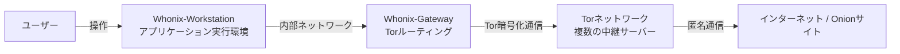

# **Whonix 調査レポート**

## **1. 基本情報**

* **ツール名**: Whonix
* **ツールの読み方**: フーニックス
* **開発元**: ENCRYPTED SUPPORT LLC
* **公式サイト**: [https://www.whonix.org/](https://www.whonix.org/)
* **カテゴリ**: OS/プラットフォーム
* **概要**: Whonixは、インターネット上のあらゆる通信をTorネットワーク経由で匿名化する、プライバシー保護とセキュリティに特化したLinuxベースのオペレーティングシステムです。

## **2. 目的と主な利用シーン**

* **解決する課題**: IPアドレスの漏洩やブラウザフィンガープリンティングによる個人の特定を防ぎ、高度な匿名性とプライバシーを確保する。
* **想定利用者**: ジャーナリスト、活動家、内部告発者、セキュリティ研究者など、極めて高い匿名性を必要とするユーザー。
* **利用シーン**:
  * 追跡や監視を完全に回避したインターネットブラウジング
  * 言論統制や検閲が行われている地域からの安全な情報発信
  * 匿名性が求められるサーバー（Onion Service）のホスティング

## **3. 主要機能**

* **デュアルVMアーキテクチャ**: ネットワークとワークスペースを物理的・論理的に分離し、IPアドレスの漏洩を根本的に防ぐ。
* **ブラウザフィンガープリンティング防御**: 個人の特定につながる環境情報を隠蔽し、安全にWebを閲覧できる環境を提供。
* **キーストロークの匿名化 (Kloak)**: ユーザー固有のタイピングスタイルや癖を偽装し、タイピングによる個人特定を防止する。
* **タイムアタック防御 (sdwdate)**: システム時刻のズレを利用したトラッキングを防ぐため、安全な時刻同期とブート時刻のランダム化を行う。
* **ストリーム分離 (Stream Isolation)**: アプリケーションごとにTorの通信経路（サーキット）を分離し、アクティビティの紐付けを防ぐ。

## **4. 動作原理・システム構成**

* **アーキテクチャ**: Whonixは、「Kicksecure」と呼ばれるセキュリティ強化版Linuxをベースに構築されており、通信経路を強制する「Whonix-Gateway」と、ユーザーが作業を行う「Whonix-Workstation」の2つの仮想マシン（VM）で構成されるデュアルVMアーキテクチャを採用しています。
* **主要コンポーネントとデータフロー**:
  * **Whonix-Workstation**: インターネットに直接接続されておらず、すべての通信は強制的にWhonix-Gatewayを経由します。
  * **Whonix-Gateway**: WorkstationからのトラフィックをすべてTorネットワークにルーティングし、DNSリークやIPアドレスの漏洩を防ぎます。
* **特筆すべき要素技術**:
  * **Torによる強制ルーティング**: マルウェアがWorkstationに侵入してルート権限を奪取したとしても、物理的にIPアドレスを知ることができない仕組みとなっています。



## **5. 開始手順・セットアップ**

* **前提条件**:
  * ホストOS上にVirtualBox、KVM、またはQubes OSなどの仮想化ソフトウェアがインストールされていること。
  * アカウント登録やクレジットカード情報は不要。
* **インストール/導入**:
  公式サイトから利用する仮想化環境向けに最適化されたWhonixの仮想マシンイメージ（OVAファイルなど）をダウンロードします。

  ```bash
  # VirtualBoxの場合、ダウンロードしたOVAファイルをインポートします
  VBoxManage import Whonix-XFCE-*.ova
  ```

* **初期設定**:
  * 最初に「Whonix-Gateway」を起動し、Torネットワークへの接続を確立します。
  * その後、「Whonix-Workstation」を起動することで、匿名化された安全な環境で作業を開始できます。
* **クイックスタート**:
  * Workstation上で標準搭載されているTor Browserを開き、匿名のWebブラウジングを開始します。

## **6. 特徴・強み (Pros)**

* **絶対的なTorルーティング**: すべての通信がTorネットワークを通過するため、IPアドレスやDNSの漏洩リスクが皆無に近い。
* **マルウェア耐性**: 万が一Workstationがマルウェアに感染しても、システム設計上、真のIPアドレスやホストマシンの情報が漏洩することはない。
* **高度なフィンガープリント対策**: キーストロークやシステム時刻など、IPアドレス以外からの追跡も防ぐ多層的な防御機能が組み込まれている。

## **7. 弱み・注意点 (Cons)**

* **通信速度の低下**: すべての通信がTorネットワークを経由するため、一般的なブラウジングやVPNと比較して大幅に速度が低下する。
* **リソースの消費**: 常に2つの仮想マシンを同時に稼働させる必要があるため、ホストマシンのCPUやメモリリソースを多く消費する。
* **利便性の制限**: 匿名性を高めるために一部の機能が制限されており、CAPTCHAの頻発やアクセス拒否など、通常のWeb体験が損なわれることがある。

## **8. 料金プラン**

| プラン名 | 料金 | 主な特徴 |
|---------|------|---------|
| **無料プラン** | 無料 | すべての機能とコンポーネントが完全無料で利用可能 |

* **課金体系**: なし。ユーザーからの寄付（Donation）によってプロジェクトが維持されています。
* **無料トライアル**: すべて無料のため該当なし。

## **9. 導入実績・事例**

* **導入企業**: 完全な匿名性を目的とする性質上、具体的な企業事例は公開されていません。
* **導入事例**:
  * プライバシー保護を重視するジャーナリストやセキュリティ専門家によって広く利用されています。
  * 元NSA職員のエドワード・スノーデン（Edward Snowden）氏を含む多くのセキュリティ専門家から、高度な匿名性を確保する手段として推奨されています。
* **対象業界**: ジャーナリズム、セキュリティ研究、人権保護活動。

## **10. サポート体制**

* **ドキュメント**: 公式Wikiには、匿名性やセキュリティに関する非常に広範で詳細なドキュメントとガイドが提供されています。
* **コミュニティ**: 活発な公式フォーラム（forums.whonix.org）が存在し、ユーザー同士のサポートや議論が行われています。
* **公式サポート**: 深刻なバグ報告等を除き、基本的にはドキュメントとフォーラムを利用する「自己解決（Self Support First Policy）」が推奨されています。

## **11. エコシステムと連携**

### **11.1 API・外部サービス連携**

* **API**: 開発者向けのAPIは提供していませんが、システム全体がTorネットワークと深く統合されています。
* **外部サービス連携**: 特になし。

### **11.2 技術スタックとの相性**

| 技術スタック | 相性 | メリット・推奨理由 | 懸念点・注意点 |
|:---|:---:|:---|:---|
| **VirtualBox** | ◎ | 最も手軽に導入できる公式サポートプラットフォーム | 一般的な仮想化であるため、Qubesほどの物理的隔離はない |
| **KVM** | ◯ | Linux環境でよりネイティブなパフォーマンスを発揮 | セットアップにはコマンドラインの知識が求められる |
| **Qubes OS** | ◎ | Whonixと統合（Qubes-Whonix）することで最高レベルのセキュリティと分離を実現 | Qubes OS自体のハードウェア要件と学習コストが高い |

## **12. セキュリティとコンプライアンス**

* **認証**: デスクトップOSであるため、ユーザー権限によるアクセス制御が行われます。
* **データ管理**: ユーザーのトラフィックデータを保存・記録しないノーログポリシーが徹底されています。
* **準拠規格**: OSI（Open Source Initiative）承認のライセンスで公開されており、フリーソフトウェア財団およびGNUプロジェクトのソフトウェアが含まれています。セキュリティ専門家による監査やレビューにオープンな姿勢を取っています。

## **13. 操作性 (UI/UX) と学習コスト**

* **UI/UX**: XFCEデスクトップ環境を採用しており、軽量で使い慣れたLinuxの操作感を提供します。Tor Browser、Thunderbird、KeePassXCなどのプライバシー重視のアプリケーションが標準でインストールされ、最適化されています。
* **学習コスト**: 仮想マシンのインポートや2つのVM（GatewayとWorkstation）の管理という概念に慣れる必要があります。また、匿名性を維持するための安全な行動様式（OpSec）を理解するための学習コストが求められます。

## **14. ベストプラクティス**

* **効果的な活用法 (Modern Practices)**:
  * さらに高いセキュリティレベルが求められる場合は、Xenハイパーバイザーを利用した「Qubes-Whonix」の構成を採用する。
  * 常にGatewayとWorkstationの両方のシステムアップデートを行い、最新のセキュリティパッチを適用する。
* **陥りやすい罠 (Antipatterns)**:
  * Workstation上で不要なアプリケーションをインストールしたり、個人を特定できるアカウントにログインすること（匿名性が損なわれる）。
  * ホストOSとVM間でクリップボードの共有やファイルのやり取りを不用意に行うこと。

## **15. ユーザーの声（レビュー分析）**

* **調査対象**: 公式サイトに掲載されているテクノロジーメディアの評価や、プライバシー関連コミュニティ。
* **総合評価**: Torを利用した匿名化OSとしては、最高レベルの安全性と実績を持つとして広く認知されています。
* **ポジティブな評価**:
  * 「Whonixはビジネス・タスクに匿名性のレイヤーを追加する」（TechRepublic）
  * 「さらにパラノイアな人向けには、Whonixと呼ばれるTor対応OSがある」（Wired）
  * VMを分割するアプローチにより、DNSリークなどを防げる点がセキュリティ専門家から高く評価されています。
* **ネガティブな評価 / 改善要望**:
  * 初期設定やハイパーバイザーの概念が初心者にはやや難しい。
  * Torを経由することによる避けられない通信速度の遅延。
* **特徴的なユースケース**:
  * セキュアな環境でのOnionサービスのホスティング。

## **16. 直近半年のアップデート情報**

* **2026-07-17**: Whonix 18.2.1.9 - Point Release!
* **2026-02-15**: Whonix 18.1.4.2 - Point Release!
* **2026-01-05**: Whonix 17 End of Security Support and Deprecation Notice - All users should move to Whonix 18 as soon as possible!
* **2025-12-02**: Qubes-Whonix 18 Released! Major Release Upgrade!
* **2025-11-27**: Whonix 18.0.8.7 Released! Major Release Upgrade!
* **2025-08-12**: Whonix 17.4.4.6 - Point Release!

(出典: [Whonix News](https://forums.whonix.org/c/news/21) )

## **17. 類似ツールとの比較**

### **17.1 機能比較表 (星取表)**

| 機能カテゴリ | 機能項目 | 本ツール | Tor Browser (単体) |
|:---:|:---|:---:|:---:|
| **基本機能** | Torネットワーク接続 | ◎<br><small>OSレベルですべての通信を強制ルーティング</small> | ◯<br><small>ブラウザ内の通信のみ</small> |
| **セキュリティ** | IPアドレスの保護 | ◎<br><small>VM分離により物理的に漏洩不可能</small> | △<br><small>他のアプリやマルウェアからの漏洩リスクあり</small> |
| **プライバシー** | フィンガープリント対策 | ◎<br><small>タイピングやシステム時刻まで偽装</small> | ◯<br><small>ブラウザレベルの対策</small> |
| **利便性** | 導入のしやすさ | △<br><small>仮想環境の構築が必要</small> | ◎<br><small>インストールして起動するだけ</small> |

### **17.2 詳細比較**

| ツール名 | 特徴 | 強み | 弱み | 選択肢となるケース |
|---------|------|------|------|------------------|
| **Whonix** | GatewayとWorkstationを分離し、OSレベルで全通信をTor化するシステム。 | IP漏洩やDNSリークをアーキテクチャレベルで完全に防ぎ、マルウェア感染時も安全。 | 仮想マシンの用意が必要でリソースを消費し、セットアップの手間がかかる。 | 命に関わる告発や、極めて高度な監視からの逃避など、絶対的な匿名性が求められる場合。 |
| **Tor Browser (単体)** | FirefoxをベースにTorプロキシを内蔵したブラウザアプリケーション。 | 面倒な設定なしに、日常のOS上で簡単に匿名ブラウジングが可能。 | ブラウザ以外のアプリケーション通信は保護されず、マルウェアによってIPが漏洩するリスクがある。 | 手軽に検閲を回避したり、一時的にWebサイトを匿名で閲覧したい場合。 |

## **18. 総評**

* **総合的な評価**:
  Whonixは、単なるブラウザレベルの匿名化にとどまらず、オペレーティングシステム全体を保護し、アーキテクチャの分離によってIPアドレスの漏洩リスクを根本的に排除する卓越したツールです。Kicksecureベースの堅牢なセキュリティ、Kloakやsdwdateといった独自のフィンガープリント対策など、長年の研究に基づいた高度なプライバシー技術が結集しています。
* **推奨されるチームやプロジェクト**:
  ジャーナリスト、人権活動家、セキュリティリサーチャーなど、トラッキングや身元特定の回避が必須となるプロフェッショナルや組織に強く推奨されます。
* **選択時のポイント**:
  導入には仮想環境に関する知識が必要であり、通信速度の制約も存在するため、日常的な用途や単なるWeb閲覧にはTor Browser単体や一般的なVPNが適しています。しかし、「利便性よりも確実な匿名性と安全性」を最優先とするユースケースにおいては、Whonixは他に類を見ない最高峰のソリューションとなります。
