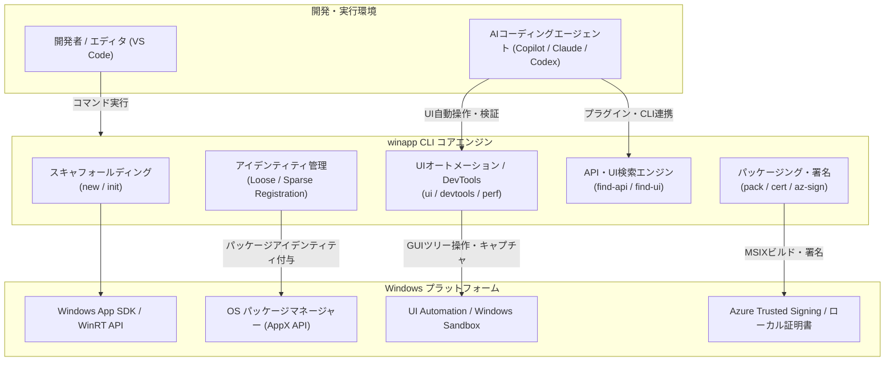

# **winapp CLI 調査レポート**

## **1. 基本情報**

* **ツール名**: winapp CLI
* **ツールの読み方**: ウィンアップ シーエルアイ
* **開発元**: Microsoft
* **公式サイト**: [https://github.com/microsoft/winappCli](https://github.com/microsoft/winappCli)
* **関連リンク**:
  * GitHub: [https://github.com/microsoft/winappCli](https://github.com/microsoft/winappCli)
  * ドキュメント: [https://learn.microsoft.com/windows/apps/dev-tools/winapp-cli/](https://learn.microsoft.com/windows/apps/dev-tools/winapp-cli/)
* **カテゴリ**: パッケージ管理
* **概要**: winapp CLIは、Windows SDKの管理、マニフェスト生成、パッケージアイデンティティ付与、MSIXパッケージ化、UI自動化テスト、DevTools機能などを単一のコマンドラインインターフェースで提供する開発者向けツールです。WinUIアプリケーションの高速な開発・検証に加え、Electron、Tauri、Rustなどのクロスプラットフォーム環境とWindowsネイティブ機能（OS通知、バックグラウンド処理、オンデバイスAI等）のギャップを埋めることを目的としています。

## **2. 目的と主な利用シーン**

* **解決する課題**:
  * WindowsネイティブAPIへのアクセスに必要な「パッケージアイデンティティ（Package Identity）」の取得やマニフェスト（`AppxManifest.xml`）作成、証明書生成など、従来は手作業で12ステップ以上かかっていた煩雑なプロセスを数回のコマンド実行に短縮。
  * Visual Studioを起動せずとも、VS Codeやターミナル、AIコーディングエージェント環境から直接Windowsアプリケーションのビルド、実行、UIインスペクション、パッケージングが可能。
  * クロスプラットフォームフレームワーク（Electron、Tauri等）において、フルパッケージ化（MSIX化）することなくネイティブWindows機能を迅速にデバッグ可能。
* **想定利用者**:
  * WinUI / Windows App SDK を採用するデスクトップアプリ開発者。
  * Electron、Tauri、Flutter、Rust、.NET（WPF/WinForms/MAUI）などで開発を行い、Windows固有機能と連携させたいクロスプラットフォーム開発者。
  * GitHub ActionsやAzure DevOpsなどでWindowsデスクトップアプリのCI/CDパイプラインを構築・自動化するインフラ/DevOps担当者。
  * Windowsアプリケーション開発の自動化を推進するAIコーディングエージェントユーザー。
* **利用シーン**:
  * **OS統合機能の追加**: ネイティブ通知、Windows Explorer連携、Web-to-appリンク、プロトコルハンドラー（`yourapp://`）の利用。
  * **エディタ・CLIファーストの開発**: VS CodeやAIエージェントから `winapp run` を用いた疎結合レイアウト（Loose layout）での即時デバッグ実行。
  * **UI検証・自動化テスト**: `winapp ui` によるGUIエレメントツリーの取得、スクリーンショット記録、自動キーストローク操作やWindows Sandbox内での安全な実行検証。
  * **DevToolsによるリアルタイム修正**: 実行中のWinUIアプリケーションのUIプロパティ確認、ライブコメント付与、その場での編集反映。
  * **CI/CDパイプラインでの配布準備**: `winapp pack` やAzure Trusted Signing（`winapp az-sign`）によるセキュアなMSIXパッケージ作成と署名。

### **2.1 代表的な利用フロー**

```mermaid
swimlane-beta TB
  subgraph 開発者
    A[winapp new / プロジェクト初期化]
    E[UIインスペクト・動作確認]
    G[winapp pack / az-sign で署名]
  end
  subgraph winapp CLI
    B[環境構成とマニフェスト生成]
    D[疎結合レイアウトでデバッグ起動]
    F[MSIXパッケージ生成・署名実行]
  end
  subgraph Windows OS / SDK
    C[パッケージアイデンティティ登録]
    H[MSIX配布・ストア申請]
  end
  A --> B
  B --> C
  C --> D
  D --> E
  E --> G
  G --> F
  F --> H
```

* **代表的な流れ**: 開発者がCLIでプロジェクト作成や初期化を実行すると、winapp CLIがSDK依存関係を構成してマニフェストを生成し、OS側にパッケージアイデンティティを登録します。フルパッケージ化を待たずに即座にデバッグ起動でき、UI検証やDevToolsでの確認を経て、最終的にMSIXへのパッケージ化とAzure Trusted Signingまたはローカル証明書による署名が行われます。

## **3. 主要機能**

* **プロジェクト作成・初期化 (`winapp new` / `winapp init`)**:
  * WinUI 3の公式テンプレートやReactorテンプレートから新規プロジェクトをスキャフォールディング。
  * 既存プロジェクトに対し、Windows SDKおよびWindows App SDKのセットアップを自動実行。
* **デバッグ実行とパッケージアイデンティティ管理 (`winapp run` / `create-debug-identity`)**:
  * `.csproj`、`.vcxproj`、単一の `.cs` ファイル、または `.sln` ソリューションを直接指定してパッケージアプリとして即時実行。
  * 疎結合レイアウト登録（Loose layout registration）により、フルビルドや再パッケージングなしにネイティブAPIへアクセス可能。
  * `--aot` オプションによる .NET Native AOT パブリッシュ対応。
  * 既存の実行ファイル（exe）にスパースパッケージ（Sparse Package）アイデンティティを付与する `create-debug-identity` や `embed-identity` に対応。
* **マニフェスト・証明書管理 (`winapp manifest` / `winapp cert`)**:
  * `AppxManifest.xml` の生成、検証、編集。
  * 開発用自己署名証明書（PFX/CER）の生成・ローカルストアへのインストール、安全な証明書ライフサイクル管理。
* **パッケージングと署名 (`winapp pack` / `winapp sign` / `winapp az-sign`)**:
  * プロジェクトまたはビルド済みディレクトリからMSIXパッケージをワンステップで生成。
  * ローカルPFX証明書による署名に加え、Azure Trusted Signing（クラウド管理型署名）に `winapp az-sign` コマンドで対応し、CI/CDでの秘密鍵漏洩リスクを排除。
* **UI オートメーションと検査 (`winapp ui` / `winapp devtools`)**:
  * `winapp ui`: UI Automation APIを経由して実行中アプリのGUIエレメントツリーを走査、スクリーンショット取得、クリックやキー入力（`send-keys`）を自動実行。
  * `winapp devtools`: 実行中のWinUIアプリケーションのXAML要素をリアルタイムインスペクション、プロパティのライブ編集、コメントの付加、復元機能を提供。
  * `winapp perf`: WinUIのレイアウト・スクロールタイミング、GC停止コンテキスト、レンダリング処理ツリーのプロファイリングを記録・クエリ。
* **Windows Sandbox 実行 (`winapp target`)**:
  * Windows Sandbox環境内でコマンド実行、ファイル転送、画面キャプチャを隔離実行し、ホスト環境を汚さずに検証可能。
* **AIエージェント向けディスカバリーツール (`winapp find-api` / `winapp find-ui`)**:
  * `find-api`: プロジェクトが参照するWindows/WinRT APIサーフェス（型、メソッド、Enum、名前空間）をCLI上で検索・確認。
  * `find-ui`: WinUI 3 GalleryやWindows Community Toolkitに収録されたUIコントロールの動くXAML/C#実装サンプルをオフラインで瞬時に検索。
  * Agent Plugins 1.0に準拠した公式プラグイン（`winappcli`, `winui`）を提供。
* **Node.js / Electron 統合コマンド (`winapp node ...`)**:
  * Electron向けネイティブアドオン生成（`node create-addon`）やWinRTバインディングの自動生成（`node generate-bindings`）、プロセスアイデンティティ管理をサポート。

## **4. 動作原理・システム構成**

winapp CLIは、開発者のCLIコマンドやAIエージェントからの指示を受け取り、Windows OSの内部システム（AppX Deployment API、UI Automation、Code Integrity）およびビルドツールチェーン（MSBuild、NuGet、Windows SDK）を直接制御するローカルオーケストレーションツールです。



* **アーキテクチャ**:
  * ローカル完結型のネイティブCLIバイナリ（C# / .NET Native AOTおよびC++ネイティブヘルパーDLLで構成）。
  * 外部SaaSへの依存はなく、署名時のAzure Trusted Signing連携を除き、すべての処理がローカル環境およびWindows OS APIの直接呼び出しによって完結します。
* **主要コンポーネントとデータフロー**:
  * **アイデンティティ付与機構**: 開発中の実行ファイルに対して、フルパッケージ化（MSIX圧縮）を行うことなく、マニフェストファイルへの参照をOSのパッケージマネージャー（AppX Deployment API）に「疎結合レイアウト」または「外部ロケーションを持つパッケージ（Sparse Package）」として登録。これにより、通常はMSIXコンテナ内でのみ許可されるWindows APIへの直接アクセスを即座に実現。
  * **DevTools & UIオートメーション**: `WinApp.DevTools.Native.dll` および Windows UI Automation エンジンを活用。プロセス間の共有メモリやウィンドウメッセージ経由でWinUIビジュアルツリーを動的にトラバースし、要素のプロパティ書き換えやリアルタイム再描画を実行。
  * **ディスカバリーエンジン**: WinUI 3 GalleryやWindows Community Toolkitのサンプルコード、WinRTメタデータ（`.winmd`）をローカルにキャッシュ/内蔵し、オフライン環境でも高速な全文検索・AST解析を提供。
* **特筆すべき要素技術**:
  * **疎結合パッケージ登録（Loose Layout Registration）**: アプリを圧縮・配置し直すことなく、ビルド出力先ディレクトリのままWindowsパッケージアイデンティティを登録する技術。
  * **Windows Sandbox オーケストレーション**: WDAC（Windows Defender Application Control）やWindows Sandbox APIを介して隔離された使い捨てコンテナ内でアプリを安全に試験実行。
  * **Agent Plugins 1.0**: AIエージェントとの協調動作のために標準化されたインターフェースを採用。

## **5. 開始手順・セットアップ**

* **前提条件**:
  * Windows 10（バージョン 1809以降）または Windows 11
  * 開発者モード（Developer Mode）の有効化（疎結合パッケージの登録・デバッグに必要）
  * .NET SDK / Visual Studio Build Tools（ビルドを行う場合）
* **インストール/導入**:

  **WinGetを使用する場合（推奨）**:

  ```bash
  winget install Microsoft.winappcli --source winget
  ```

  PowerShellモジュール（`Microsoft.WinGet.Client`）を使用する場合:

  ```powershell
  Install-WinGetPackage Microsoft.winappcli
  ```

  **NPMを使用する場合（Electron / Node.js プロジェクト）**:

  ```bash
  npm install @microsoft/winappcli --save-dev
  ```

  **CI/CD環境（GitHub Actions / Azure DevOps）**:

  ```yaml
  - name: Setup WinApp CLI
    uses: microsoft/setup-WinAppCli@v1
  ```

* **クイックスタート**:

  **1. WinUI 3 アプリの新規作成と起動**:

  ```bash
  # WinUI公式テンプレートから新規プロジェクトを作成
  winapp new -t winui -n MyAwesomeApp
  cd MyAwesomeApp

  # パッケージアプリとして即時実行・デバッグ
  winapp run
  ```

  **2. 既存のクロスプラットフォームプロジェクトへのアイデンティティ付与**:

  ```bash
  # プロジェクトルートで初期化（SDKやマニフェスト準備）
  winapp init

  # デバッグ用パッケージアイデンティティを登録
  winapp create-debug-identity
  ```

  **3. 実行中アプリのUI検査とリアルタイムDevTools**:

  ```bash
  # 実行中アプリのUI要素ツリーを表示
  winapp ui dump-tree

  # DevToolsを起動してライブ編集
  winapp devtools
  ```

## **6. 特徴・強み (Pros)**

* **開発サイクルの劇的な短縮**: 従来、WindowsネイティブAPIの検証にはマニフェスト手動記述、自己署名証明書の作成、フルパッケージングという12ステップ以上の作業が必要でしたが、`winapp run` または `winapp create-debug-identity` により数コマンド・数秒でデバッグ環境が立ち上がります。
* **エディタ・言語フリーの柔軟性**: Visual Studioに拘束されず、VS Code、Neovim、Cursorなど好みのエディタやターミナルから利用可能。C#、C++、Rust、Electron、Tauri、Flutterなど幅広いフレームワークを平等にサポートしています。
* **先進的なAIコーディングエージェント統合**: Agent Plugins 1.0準拠の公式プラグイン（`winappcli`, `winui`）が整備されており、GitHub Copilot CLI、Claude Code、CodexなどのAIエージェントが自律的にAPIやUIサンプルを検索（`find-api`, `find-ui`）し、正確なWindowsコードを生成・テストできます。
* **強力なUIテスト・インスペクション機能**: `winapp ui` によるUIオートメーション操作や、`winapp devtools` によるアプリ再起動不要のライブ編集・プロパティ修正、Windows Sandbox内での隔離実行など、デスクトップ開発に不可欠なデバッグ機能がCLIに統合されています。
* **Azure Trusted Signing連携**: クラウドベースの署名サービスに対応しており、CI/CD上で秘密鍵（PFX）を管理するリスクなしに安全なMSIX署名パイプラインを構築できます。

## **7. 弱み・注意点 (Cons)**

* **Public Preview段階の継続**: 活発に新機能（DevTools、AIプラグイン等）が追加されている一方、仕様変更やコマンドオプションの調整、実験的機能の挙動変更が発生する可能性があります。
* **Windows OS特有の概念理解が必要**: MSIX、疎結合パッケージ、AppxManifestの機能宣言（Capabilities）、開発者モードなどのWindowsアーキテクチャに関する基礎知識が一定程度求められます。
* **macOS / Linux環境での制約**: パッケージングやUIテスト、アイデンティティ登録などのコア機能はWindows OS固有のAPIに依存しているため、ビルドやテストの実行にはWindows実行環境（ローカルまたはWindowsランナー）が必須です。
* **日本語ドキュメントの整備状況**: Microsoft Learnの公式ドキュメントは順次整備・機械翻訳されているものの、GitHub上の最新ガイドや詳細なサンプル解説は英語が中心となっています。

## **8. 料金プラン**

| プラン名 | 料金 | 主な特徴 |
|---------|------|---------|
| **オープンソース (MITライセンス)** | 無料 | すべてのCLI機能、テンプレート、DevTools、プラグインを無償で利用可能 |

* **課金体系**: なし（完全無料・オープンソース）。
* **無料トライアル**: 該当なし。
* **補足**: 配布署名に「Azure Trusted Signing」を利用する場合は、Microsoft Azure側の署名サービス利用料金が別途発生します（ローカル自己署名証明書や手持ちのコード署名証明書を利用する場合は追加費用なし）。

## **9. 導入実績・事例**

* **導入企業**: Microsoft社内の各種開発チーム（Windows Developer Platform、WinUIチーム、Windows Community Toolkitチーム）によって主導・採用されており、クロスプラットフォームデスクトップアプリを開発する外部コミュニティでも採用が進んでいます。
* **導入事例**:
  * **Electron / Tauri製デスクトップアプリ**: Windowsネイティブのトースト通知やタスクバー連携、オンデバイスAI（Phi Silica / Windows Copilot Runtime）を導入する際の標準開発フローとして採用。
  * **CI/CD自動化**: WindowsアプリケーションのビルドからAzure Trusted Signingによる署名、MSIX生成までのパイプライン自動化にGitHub Actions（`setup-WinAppCli`）を活用。
  * **AIエージェント主導の開発基盤**: Claude CodeやGitHub Copilotと連携させ、WindowsデスクトップアプリのプロトタイピングからUIテストまでを自律実行させる実証プロジェクト。
* **対象業界**: デスクトップソフトウェア開発、エンタープライズ業務システム開発、クロスプラットフォームツールベンダー。

## **10. サポート体制**

* **ドキュメント**:
  * [Microsoft Learn 公式ドキュメント](https://learn.microsoft.com/windows/apps/dev-tools/winapp-cli/): 導入ガイド、コマンドリファレンス、フレームワーク別チュートリアルが網羅。
  * [GitHubリポジトリ Docs](https://github.com/microsoft/winappCli/tree/main/docs): コマンド仕様、デバッグガイド、UIオートメーション詳細、セキュリティガイドライン。
  * `llms.txt`: AIエージェントが効率的に参照できるドキュメントインデックスも完備。
* **コミュニティ**: GitHub IssuesおよびDiscussionsにて開発チームやコミュニティとのQA、機能要望、バグ報告が活発に行われています。
* **公式サポート**: オープンソースプロジェクトとしてのGitHubサポートが基本。Azure Trusted SigningやWindows App SDK関連の企業向け問い合わせはMicrosoftサポート契約経由で対応可能。

## **11. エコシステムと連携**

### **11.1 API・外部サービス連携**

* **プログラム制御API**: Node.js / TypeScript環境向けに `@microsoft/winappcli` パッケージを提供しており、スクリプトやツールチェインからプログラム経由でwinappを制御可能。
* **CI/CD連携**: GitHub ActionsおよびAzure DevOpsに対応する公式アクション [`microsoft/setup-WinAppCli`](https://github.com/microsoft/setup-WinAppCli) を提供。
* **クラウド連携**: Azure Trusted Signing（`winapp az-sign`）と直接連携し、クラウド上で安全な署名処理を実現。
* **エディタ・IDE連携**: 公式VS Code拡張機能「WinApp VS Code Extension」（Visual Studio Marketplace）が提供され、F5デバッグ実行やGUI設定が可能。
* **AIエージェント連携**: Agent Plugins 1.0準拠の公式プラグインにより、GitHub Copilot CLI、Claude Code、Codexからプラグインとして直接呼び出し可能。

### **11.2 技術スタックとの相性**

| 技術スタック | 相性 | メリット・推奨理由 | 懸念点・注意点 |
|:---|:---:|:---|:---|
| **WinUI 3 / C# (.NET)** | ◎ | `winapp new`、`winapp run`、Native AOT、DevTools、パフォーマンス計測が完全統合 | 特になし |
| **C++ / Win32 / CMake** | ◎ | `.vcxproj` やCMakeプロジェクトのビルド・実行、デバッグアイデンティティ付与に対応 | ARM64環境でのツールチェイン構成に注意 |
| **Electron / Node.js** | ◎ | 専用の `winapp node` コマンド群、WinRT JSバインディング自動生成、NPMパッケージ提供 | プロセス構造に応じたアイデンティティ付与が必要 |
| **Tauri / Rust** | ◎ | Rust用スタートガイド完備。MSIXパッケージ化やOS通知連携を迅速に構築可能 | 一部Windows固有マニフェストの手動調整が必要 |
| **.NET MAUI / WPF / WinForms** | ◎ | 既存のデスクトップ資産にパッケージアイデンティティを追加し、最新APIを活用可能 | スパースパッケージングの動作確認を推奨 |
| **Flutter (Windows)** | ◯ | 公式ガイドとサンプルリポジトリが用意され、Windows SDK連携が可能 | Flutter側のビルドパイプラインとの連携設定が必要 |

## **12. セキュリティとコンプライアンス**

* **認証・アクセス制御**: ローカル開発ツールのため特別なアカウント認証は不要。CI/CDやクラウド署名にはAzure Entra ID（Managed Identity / サービスプリンシパル）を利用。
* **証明書とキー管理の安全性**:
  * 開発用自己署名証明書（`devcert.pfx`）はローカル証明書ストア（CurrentUser）に安全に配置され、テスト完了後のアンインストールコマンド（`winapp unregister`）も用意。
  * `winapp az-sign` を用いることで、CI/CDランナーに秘密鍵ファイルを配置することなく署名が可能となり、サプライチェーン攻撃のリスクを大幅に低減。
* **隔離実行（Windows Sandbox）**: 未検証のコードやビルド成果物をホスト環境から分離されたWindows Sandbox内で実行・検証（`winapp target`）可能。
* **準拠規格**: Microsoft Open Source Code of Conductに準拠。CodeQLやDependabotによる継続的なセキュリティスキャンを実施。

## **13. 操作性 (UI/UX) と学習コスト**

* **UI/UX**:
  * 直感的なCLIコマンド体系で、アプリ開発ライフサイクル（作成・デバッグ・テスト・パッケージ化）に沿って整理。
  * すべての主要コマンドで `--json` フラグをサポートしており、スクリプトや外部ツール、AIエージェントへの出力連携が極めて容易。
  * 新登場の `winapp devtools` では、ビジュアルツリーの確認やプロパティ変更がリアルタイムに行えるモダンなインスペクターUIを提供。
  * VS Code拡張機能を利用すれば、ターミナル操作に不慣れな開発者でもGUIベースで初期化やデバッグが可能。
* **学習コスト**:
  * 従来のVisual Studioでの12ステップを超える複雑なMSIX/マニフェスト構成に比べ、学習コストは劇的に低減。
  * `find-api` や `find-ui` により、必要なAPIシグネチャやUIサンプルコードをターミナルから離れずに検索できるため、調査時間を大幅に削減できます。

## **14. ベストプラクティス**

* **効果的な活用法 (Modern Practices)**:
  * **開発ループの高速化**: 開発初期段階ではMSIXのフルビルドを行わず、`winapp run`（疎結合レイアウト）または `winapp create-debug-identity` を使用して、即座にネイティブAPIの動作確認を行う。
  * **DevToolsによるライブチューニング**: WinUI開発時は `winapp devtools` を併用し、アプリを再起動することなくマージンやバインディング、スタイルを微調整する。
  * **AIエージェントのグラウンディング**: CopilotやClaudeを利用する際は、公式プラグインをインストールした上で `find-ui` や `find-api` をエージェントに参照させ、幻覚のない正確なWindows App SDKコードを生成させる。
  * **CIでのAzure Trusted Signing導入**: 本番リリース用MSIXの署名にはローカルPFXではなく `winapp az-sign` を採用し、キー漏洩リスクをゼロにする。
* **陥りやすい罠 (Antipatterns)**:
  * **開発者モード未有効での実行**: 疎結合パッケージの登録にはWindowsの「開発者モード」が必須であるため、初期セットアップ時に有効化を怠ると権限エラー（HRESULTエラー等）が発生する。
  * **最新mainビルドへの無警戒な依存**: Public Preview中のツールであるため、ナイトリービルドやmainブランチのバイナリを自動化環境で固定バージョン指定なしに利用すると、コマンド出力形式やスキーマの破壊的変更でパイプラインが停止するリスクがある。

## **15. ユーザーの声（レビュー分析）**

* **調査対象**: GitHub（スター数、Issues、Discussions）、Reddit、X（Twitter）のWindows開発コミュニティ
* **総合評価**: GitHub上で活発な支持を集めており、特にクロスプラットフォーム開発者やVS Code愛用者から「Windowsアプリ開発の常識を変えるツール」として高く評価されています。
* **ポジティブな評価**:
  * 「Visual Studioの巨大なインストーラーを入れずとも、VS CodeとターミナルだけでWindows App SDKの最新機能が使えるようになった。」
  * 「ElectronアプリへのWindowsネイティブ通知追加が、コマンド数行で完了して感動した。」
  * 「DevToolsとUI Automation（`winapp ui`）の統合により、CLIからE2Eテストや画面キャプチャが容易に行える。」
  * 「AIエージェント（Copilot/Claude）にWindows開発を任せる際の必須ツールになっている。」
* **ネガティブな評価 / 改善要望**:
  * プレビュー段階であるため、SDKバージョンの組み合わせや特定の環境下で散発的な不整合・バグ報告が見られる。
  * ARM64ビルドや複雑なマルチプロジェクトソリューションでの挙動に関するさらなる改善要望。
* **特徴的なユースケース**:
  * 既存のRust/Tauri製デスクトップアプリに、最小限のコード修正でWindows AI（オンデバイスLLM）や最新のFluent通知を組み込む事例。

## **16. 直近半年のアップデート情報**

* **2026-11-07**: **v0.8.0** リリース。WinApp DevTools のライブ編集・コメント機能やツールバー刷新、`winapp run --aot` による Native AOT 発行対応と検証強化、WinUIテンプレートの優先表示、UI オートメーションにおけるポップアップウィンドウキャプチャ対応、ARM64 C++ WinUI ツールチェイン改善、Claude / Codex / Copilot プラグインの強化。
* **2026-10-01**: **v0.7.1** リリース。プロジェクトコンテキストテレメトリの収集レート最適化、`winapp run --aot` 実行時の MSBuild プロパティ出力制御、品質安定化修正。
* **2026-09-24**: **v0.7.0** リリース。Agent Plugins 1.0 仕様への移行、`find-ui` の完全オフライン対応（ローカルコーパス内蔵・24時間キャッシュ更新）、Windows Sandbox 連携の低レイテンシ化、UI Automation エンジンの単独 NuGet パッケージ提供、Reactor テンプレート対応、`cert install` でのパブリック `.cer` 受付。
* **2026-08-19**: **v0.6.1** リリース。ビルドおよびパッケージングパイプラインの安定性向上、各種バグ修正。
* **2026-08-12**: **v0.6.0** リリース。新規アプリ作成コマンド `winapp new` の追加、UIコントロール・サンプル検索 `find-ui` の初期導入、Azure Trusted Signing をサポートする `winapp az-sign` コマンド追加、スパースパッケージングのサポート強化、Claude/Copilot 向け統合プラグイン導入、`.csproj` プロジェクトモード対応。
* **2026-05-01**: **v0.3.1** リリース。`--` を使用したパススルー引数のサポート追加、CIやAIエージェント向けのプログレス出力改善、バグ修正。

(出典: [GitHub Releases](https://github.com/microsoft/winappCli/releases))

## **17. 類似ツールとの比較**

### **17.1 機能比較表 (星取表)**

| 機能カテゴリ | 機能項目 | winapp CLI | Visual Studio | MSIX Packaging Tool | Electron-Builder |
|:---:|:---|:---:|:---:|:---:|:---:|
| **パッケージング** | MSIXパッケージ生成 | ◎<br><small>CLIから即座に生成</small> | ◎<br><small>強力なGUI統合</small> | ◎<br><small>既存インストーラーの変換</small> | ◯<br><small>Electron特化のAppX出力</small> |
| **開発ループ** | 疎結合デバッグ (即時起動) | ◎<br><small>再パッケージング不要</small> | ◯<br><small>デバッガ統合だが重厚</small> | ×<br><small>デバッグ用途ではない</small> | △<br><small>開発時は非パッケージ実行</small> |
| **環境・FW対応** | クロスプラットフォーム対応 | ◎<br><small>Electron/Tauri/Rust/Flutter</small> | △<br><small>C++/.NETがメイン</small> | -<br><small>既存バイナリ対象</small> | △<br><small>Electron専用</small> |
| **開発体験** | エディタ非依存 (VS Code等) | ◎<br><small>ターミナル/VS Code完結</small> | ×<br><small>専用IDE必須</small> | -<br><small>GUIツール</small> | ◎<br><small>CLI完結</small> |
| **UIテスト・検証** | UI Automation / DevTools | ◎<br><small>devtools / ui / perf内蔵</small> | ◎<br><small>XAML Live Visual Tree等</small> | ×<br><small>非対応</small> | △<br><small>Chromium DevToolsのみ</small> |
| **AIエージェント** | プラグイン・API検索 | ◎<br><small>Agent Plugins 1.0 / find-ui</small> | △<br><small>Copilot統合のみ</small> | ×<br><small>非対応</small> | ×<br><small>非対応</small> |
| **署名** | Azure Trusted Signing | ◎<br><small>az-signコマンド対応</small> | ◯<br><small>拡張機能等で対応</small> | ◯<br><small>証明書署名対応</small> | △<br><small>サードパーティ設定が必要</small> |

### **17.2 詳細比較**

| ツール名 | 特徴 | 強み | 弱み | 選択肢となるケース |
|---------|------|------|------|------------------|
| **winapp CLI (本ツール)** | CLI完結型のモダンWindowsアプリ開発・パッケージングツール | 軽量、エディタ非依存、AIエージェント対応、疎結合高速デバッグ、DevTools内蔵 | Public Preview段階であること、macOS/Linuxネイティブ実行不可 | VS CodeやAIエージェントで開発し、Electron/Tauri/WinUIでWindowsネイティブ機能を素早く統合したい場合 |
| **Visual Studio** | Windows開発における最高峰の統合開発環境（IDE） | 卓越したデバッガ、プロファイラ、XAMLデザイナー、エンタープライズ機能 | ツールサイズが巨大で起動が重く、クロスプラットフォームFWとの親和性が低い | C++やC#でフルスクラッチの大規模WindowsネイティブアプリをVisual Studio中心に開発する場合 |
| **MSIX Packaging Tool** | 既存のWin32インストーラー（exe/msi）をMSIX形式に変換するツール | 既存のレガシーアプリをソースコード変更なしでMSIX化できる | 開発中の高速デバッグやソースコード連携、UIテスト等の機能はない | 既存のパッケージ化されていない社内レガシーアプリをStore配布や集中管理用に変換したい場合 |
| **Electron-Builder** | Electronアプリケーションのクロスプラットフォームビルドツール | Electronエコシステムに特化した自動ビルド・自動更新・インストーラー作成 | Windowsネイティブ機能（App SDK、疎結合アイデンティティデバッグ等）のサポートが薄い | ElectronアプリをWindows、macOS、Linux向けにまとめて配布パッケージ化したい場合 |

## **18. 総評**

* **総合的な評価**: winapp CLIは、長年「重厚なVisual Studioや複雑なマニフェスト定義」に縛られていたWindowsデスクトップ開発を、モダンなコマンドラインとAIエージェントの時代へと適合させた画期的なツールです。開発初期の「疎結合レイアウトによる即時デバッグ」から、実行中の「DevToolsによるライブ編集」、テスト自動化「UI Automation / Windows Sandbox」、そしてCI/CDでの「Azure Trusted SigningとMSIXパッケージング」まで、開発ライフサイクル全体を一貫してカバーしています。
* **推奨されるチームやプロジェクト**:
  * VS Codeやターミナル中心で開発を行い、WinUI 3やWindows App SDKの最新機能を活用したい開発チーム。
  * Electron、Tauri、Rust、Flutterなどのクロスプラットフォームフレームワークでデスクトップアプリを開発し、Windows固有機能（通知、オンデバイスAI、シェル統合）をスマートに導入したいチーム。
  * GitHub CopilotやClaudeなどのAIコーディングエージェントを本格導入し、Windowsアプリ開発を自動化したいプロジェクト。
* **選択時のポイント**: 従来のVisual StudioによるGUI中心の重厚なワークフローから脱却し、ターミナルやCI/CDパイプライン上で軽量かつ迅速なWindowsアプリ開発ループを確立したい場合に、第一の選択肢となります。
