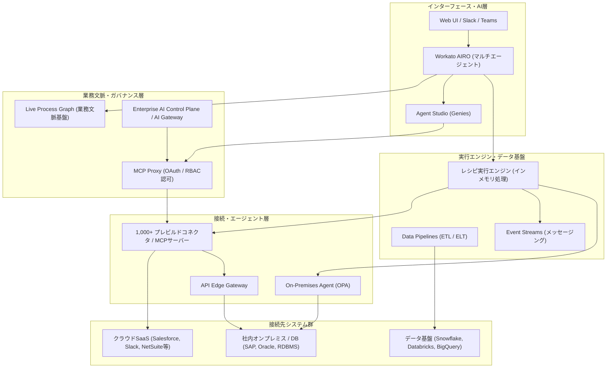

# **Workato 調査レポート**

## **1. 基本情報**

<!--
【ガイドライン】
- 必須: ツール名、開発元、公式サイト、カテゴリ、概要
- 概要は2-3文で簡潔に記述
-->

* **ツール名**: Workato
* **ツールの読み方**: ワーカート
* **開発元**: Workato, Inc.
* **公式サイト**: [https://www.workato.com/](https://www.workato.com/)
* **関連リンク**:
  * ドキュメント: [https://docs.workato.com/](https://docs.workato.com/)
  * レビューサイト: [G2](https://www.g2.com/products/workato/reviews) | [Capterra](https://www.capterra.com/p/146067/Workato/) | [ITreview](https://www.itreview.jp/products/workato/reviews)
* **カテゴリ**: iPaaS/連携
* **概要**: 企業内で分散するアプリケーション、データベース、APIをセキュアに連携し、複雑な業務プロセスの自動化と自律型AIエージェントの運用を統合管理するエンタープライズ向け統合プラットフォーム（iPaaS）。2026年に発表された「Workato AIRO」や「Live Process Graph」により、自然言語による自動化構築と、企業固有の業務実態にグラウンディングされた高度なAIオーケストレーション環境を提供する。

## **2. 目的と主な利用シーン**

<!--
【ガイドライン】
- 3-5項目を箇条書きで記述
- 想定利用者を具体的に記載
- 末尾に「代表的な利用フロー」をスイムレーンで添付する
-->

* **解決する課題**:
  * 複数のSaaSやオンプレミス基幹システムに分散したデータのサイロ化解消
  * 人手による転記やデータ突合作業など非効率な手作業プロセスの自動化
  * 業務現場でのシャドーITや無秩序なAIエージェント導入に伴うセキュリティ・ガバナンスリスクの統制
  * 一般的なAIモデルが企業の固有業務プロセスや実行コンテキストを把握できず、誤った判断を下す「意図と結果の乖離」の解消
* **想定利用者**:
  * 情報システム部門・ITエンジニア
  * 業務部門のオペレーション担当者（SalesOps, MarketingOps, HR, 財務経理など）
  * エンタープライズアーキテクト・自動化CoE（Center of Excellence）
  * ビジネスアナリスト・シチズンデベロッパー
* **利用シーン**:
  * **SaaS間エンドツーエンド連携**: Salesforceの商談クローズを契機にNetSuiteで請求・契約レコードを生成し、Slackで営業・経理担当者に承認要求とサマリーを自動通知。
  * **ハイブリッドID・オンボーディング自動化**: HRシステムへの新入社員登録から、Active Directory/IdPのアカウント発行、PCキッティング指示、業務SaaSのアクセス権付与をSCIM 2.0連携で完全自動化。
  * **業務文脈連動型AIエージェント**: SlackやMicrosoft Teams上のGeniesが、Live Process Graphを参照して社内規定や過去の処理ログを照会しながら、申請承認やデータ更新を安全に代行。
  * **大規模データウェアハウス同期**: Data Pipelinesを用いて、SalesforceやオンプレミスDBからSnowflake/Databricksへのスキーマ追従・増分ETLをノーコードで運用。

### **2.1 代表的な利用フロー**

<!--
【ガイドライン】
- ツールを実際に使う際の代表的な流れを、アクターごとのスイムレーンで示す
- Mermaidの swimlane-beta TB を使用
-->

```mermaid
swimlane-beta TB
  subgraph User["業務ユーザー / 開発者"]
    A[自然言語で業務要件や自動化目標を指示]
    D[計画内容を確認・修正・承認]
  end
  subgraph AIRO["Workato AIRO / Agent Studio"]
    B[Live Process Graphを参照し実行計画とレシピを設計]
    C[承認要求と設定内容をユーザーへ提示]
    G[実行結果を要約・通知し業務完了]
  end
  subgraph Engine["Workato 実行基盤 (レシピ / MCP Proxy)"]
    E[コネクタ・MCPサーバーを介してセキュアにAPI実行]
  end
  subgraph Enterprise["業務システム (SaaS / DB / オンプレ)"]
    F[データ連携・業務処理を実行し結果を返却]
  end
  A --> B
  B --> C
  C --> D
  D --> E
  E --> F
  F --> G
```

* **代表的な流れ**: ユーザーがWorkato AIROに自然言語で要件を入力すると、AIROが「Live Process Graph」から社内ルールや稼働中プロセスを参照して最適な自動化計画とレシピを起草します。ユーザーが確認・承認した計画に基づき、Workato実行基盤がセキュアなコネクタやMCP Proxy経由で各業務システムと安全に連携し、結果をユーザーにフィードバックします。

## **3. 主要機能**

<!--
【ガイドライン】
- 5-10項目の主要機能を箇条書きで記述
- 各機能は1-2文で概要を説明
-->

* **Workato AIRO (2026年9月発表)**: プラットフォーム全体の統合インターフェースとなるマルチエージェント基盤。自然言語の対話からレシピ、Genies、スキル、API、MCPサーバーの計画・構築・診断を自律的に遂行する。
* **Live Process Graph & Enterprise Process Context (2026年9月発表)**: 企業の静的ナレッジ、自動化アーキテクチャ定義、日々の実行ランタイムデータを統合し、AIエージェントの推論を企業の現実オペレーションにグラウンディングさせる業務文脈グラフ。
* **Agent Studio & Genies**: 複数の基盤LLM（Anthropic Claude、OpenAI GPTシリーズ等）のバージョン管理やモデル監査ログを備え、SlackやTeamsに自律型AIエージェントを展開・統制する運用環境。
* **AI Hub & Pre-Built MCP (Model Context Protocol) サーバー**: Salesforce, Zendesk, Outlook, Workday, GitHubなど多数のエンタープライズSaaSに対するプレビルドMCPサーバーを提供。OAuthおよびツール単位/ユーザー単位のRBACに対応したMCP Proxyで厳格に統制可能。
* **Enterprise AI Control Plane / AI Gateway**: 組織内のあらゆるAI利用におけるトークン消費量、利用コスト、セキュリティ境界、および本番エージェントの性能検証（Agent Evals）を一元的に監視・管理。
* **Recipe (レシピ) & 1,000+ Connectors**: トリガーとアクションを組み合わせたGUIベースの自動化フロー作成機能。1,000以上の標準コネクタに加え、カスタムコネクタ開発用SDKを提供する。
* **Data Pipelines**: Snowflake, Databricks, BigQuery等のクラウドデータウェアハウス向けに、スキーマ変更の自動検知と増分同期を備えた大規模データ統合（ETL/ELT）パイプライン。
* **API Edge Gateway & On-Premises Agent (OPA)**: オンプレミスやプライベートクラウド環境内に安全にデプロイし、インバウンドポートを開けずに社内データやAPIを外部とセキュアに連携。
* **Workato XChange (GA)**: プロジェクト、依存関係、カスタムコネクタ、データテーブルをパッケージ化し、社内ワークスペース間やプライベートコミュニティで安全に配布・再利用する共有基盤。
* **Workflow Apps**: 人間の承認や入力介在が必要なビジネスプロセスを、ローコードでGUI Webアプリケーションとして構築・公開する機能。

## **4. 動作原理・システム構成**

<!--
【ガイドライン】
- ツールの動作原理、システム構成（アーキテクチャ）、データの流れ、通信フローなどを記述
- クライアント・サーバー型、ローカルファースト、クラウド完結など、ツールのアーキテクチャ特性を明記
- Mermaidによる構成図やフロー図を含める
-->

* **アーキテクチャ**: クラウド完結型のエンタープライズマルチテナントiPaaSアーキテクチャを採用。管理・オーケストレーションを担う「コントロールプレーン」と、実際のデータ処理を実行する「データ/実行プレーン」が論理的・物理的に分離されている。処理中のデータは揮発性メモリ上で暗号化処理され、永続化ストレージには原則保存されないステートレスなセキュリティ設計を誇る。
* **主要コンポーネントとデータフロー**:
  * **AI & インターフェース層**: ユーザーはWeb UI、Slack、Teams、または統合AI環境「Workato AIRO」を通じて指示・設定を行う。
  * **コンテキスト & ガバナンス層**: 「Live Process Graph」が設計情報と稼働ログから業務文脈をリアルタイムに集約し、AIROやGeniesに提供。「Enterprise AI Control Plane」と「MCP Proxy」が認可・トークン制限を監査・強制する。
  * **実行エンジン層**: イベントドリブンな「Recipe Engine」がトリガーを検知し、セキュアなコネクタ経由でアクションを並列・非同期に実行する。「Data Pipelines」は大量データのストリーミング/バッチ転送を最適化する。
  * **ハイブリッド接続層**: オンプレミスや閉域網内の基幹システムに対しては、外向き常時接続型のエージェント（On-Premises Agent: OPA）や「API Edge Gateway」を介して通信し、ファイアウォールにインバウンドポートを開けることなく暗号化通信を確立する。



* **特筆すべき要素技術**:
  * **On-Premises Agent (OPA) のリバースWebSocket接続**: 企業ファイアウォールの内側に配置されたOPAがWorkatoクラウドへ安全な外向きHTTPS/WSS接続を維持することで、社内ネットワークのセキュリティポリシーを破ることなくオンプレミスDBやSAPと連携可能。
  * **MCP (Model Context Protocol) Proxy with RBAC**: 外部LLMやAIエージェントが企業内ツールを実行する際、MCP Proxyがユーザー属性や権限ロール（RBAC）に基づいてアクセス可能ツールを動的にフィルタリングし、不正なシステム操作を防止。
  * **BYOK (Bring Your Own Key) & インメモリデータ暗号化**: 顧客管理の暗号化鍵（AWS KMSなど）を用いたデータ暗号化と、処理中データのオンメモリ保護を徹底。

## **5. 開始手順・セットアップ**

<!--
【ガイドライン】
- アカウント作成から「Hello World」的な最初の動作確認までの手順
- 主要なコマンドや設定項目を記載
-->

* **前提条件**:
  * 企業ドメインのビジネスメールアドレス（フリーメール不可）
  * Webブラウザ（Google Chrome, Microsoft Edge, Mozilla Firefox等）
  * （オンプレミス連携を行う場合）DockerまたはLinux/Windowsサーバー環境
* **アカウント作成とワークスペース設定**:
  1. [公式サイト](https://www.workato.com/)からデモ申請または無料トライアルを開始。
  2. 組織のワークスペースを開設し、環境（Development / Test / Production）を構成。
  3. SAML SSOやWorkato Identity (SCIM 2.0) を設定し、開発者や業務ユーザーを安全に招待。
* **コネクションの確立**:
  * 「Connections」画面から、連携対象のアプリケーション（Slack, Salesforce, Google Workspace等）を選択し、OAuth 2.0またはAPIキーで認証接続を作成。
* **クイックスタート (AIROを活用した最初の自動化作成)**:
  1. **AIROの起動**: ダッシュボード上部のAIRO入力欄に「Salesforceで新しい商談が作成されたら、金額に応じてSlackの#dealsチャンネルに通知し、担当者にメンションする」と自然言語で入力。
  2. **ドラフト生成とレビュー**: AIROがトリガー、データマッピング、条件分岐、Slackメッセージテンプレートを含むレシピを自動生成。
  3. **パラメータの微調整**: 必要に応じてビジュアルエディタで接続先チャンネルや条件式を調整。
  4. **Test & Deploy**: 「Test Recipe」をクリックしてテストペイロードで稼働確認を行い、問題なければ「Start Recipe」で本番稼働を開始。

## **6. 特徴・強み (Pros)**

<!--
【ガイドライン】
- 3-5項目を箇条書きで記述
- 競合との差別化ポイントを明確に
-->

* **業務文脈に根差したAI自動化 (Live Process Graph & AIRO)**: 単なるコード補完やチャットボットにとどまらず、企業の静的文書、自動化設計、稼働中プロセスの実行ログを動的に統合した業務文脈グラフをAIに与えることで、ハルシネーションや不適切な自動化の生成を防ぐ。
* **最高水準のエンタープライズセキュリティと統制**: SOC 2 Type 2、ISO 27001、HIPAA、PCI-DSS Level 1など主要規格に準拠。SAML/SCIM 2.0、きめ細かなRBAC、BYOK、そしてMCP ProxyによるAIアクセス認可により、全社的なガバナンスと現場の俊敏性を両立。
* **IT部門と現場部門の真の協調 (Co-existence)**: IT部門がコネクタ接続やセキュリティ境界を厳格に管理し、現場の業務担当者（シチズンデベロッパー）がセキュアな枠組みの中でレシピやAIエージェントを自律的に構築できる環境を提供。
* **ハイブリッド・マルチクラウドへの強力な適応力**: OPAとAPI Edge Gatewayによりオンプレミス環境とクラウドSaaSの境界を意識させず、さらに米・欧・日本・中国・英国などの地域データセンター展開により厳しいデータレジデンシー規制に適合。
* **豊富な再利用アセットとMCPエコシステム**: 50万以上の公開コミュニティレシピに加え、主要SaaSを即座にAIツール化できる公式プレビルドMCPサーバー群、プロジェクト単位で安全にアセットを配布できるWorkato XChangeを提供。

## **7. 弱み・注意点 (Cons)**

<!--
【ガイドライン】
- 3-5項目を箇条書きで記述
- 日本語対応の状況は必ず含める
-->

* **高額なエンタープライズ向け料金体系**: 年間契約かつ基本プラットフォーム利用料＋レシピ/タスク従量課金体系が基本であり、ZapierやMakeのような低価格な月額セルフサービスプランがないため、中小企業や個人開発者には導入ハードルが極めて高い。
* **高度な機能・アーキテクチャの学習コスト**: 基本的なレシピ作成は直感的だが、Live Process Graphの設計、Callable Recipesによるモジュール化、エラーハンドリング設計、MCPサーバー設定などを使いこなすにはデータ構造や統合設計の専門的知識が必要。
* **AIトークン・リソース消費のガバナンス管理負担**: AIROやGenies、MCPサーバーの多用に伴い、外部LLMのAPIトークン消費や実行タスク数が急増するリスクがあり、AI Control Planeを活用した綿密な利用上限・コスト管理が不可欠。
* **日本語対応の現状**: UIおよび公式ドキュメントの一部、日本法人によるサポート体制は整備されているものの、最先端のAI機能（AIROの深層機能や一部の新着MCPサーバー）に関する詳細ドキュメントやトラブルシューティングコミュニティは英語が先行している。

## **8. 料金プラン**

<!--
【ガイドライン】
- 表形式で整理することを推奨
- 最新の料金情報であることを確認
- 価格は通貨を明記
-->

| プラン名 | 料金 | 主な特徴 |
|:---|:---|:---|
| **Workato for your Organization (Base)** | 要問い合わせ（年額契約） | 企業内の業務自動化向け基本プラン。ワークスペース利用権、標準コネクタ、レシピ構築環境、セキュリティ機能を含む。 |
| **Enterprise Automation / AI Edition** | 要問い合わせ（年額契約） | 大規模組織向け。AIRO、Agent Studio、Live Process Graph、AI Control Plane、API Edge Gateway、SCIM 2.0、BYOK等をフルサポート。 |
| **Workato for your Product (Embedded)** | 要問い合わせ（年額契約） | 自社SaaS製品やサービス内にWorkatoの連携エンジンやコネクタをホワイトラベルで組み込むための組込型プラン。 |

* **課金体系**: 「基本プラットフォーム利用料（Workspace）」＋「アクティブなレシピ数またはタスク実行数」による年間コミットメントモデル。AI機能の本格利用にはAI Control PlaneやAgent Studioのアドオン/使用量クレジットが適用される。
* **無料トライアル**: ビジネスメールアドレスによるデモ・限定検証環境の提供あり。

## **9. 導入実績・事例**

<!--
【ガイドライン】
- 具体的な企業名を3-5社挙げる
-->

* **導入企業**: Atlassian, Box, Broadcom, HubSpot, Zendesk, Adobe, MGM Resorts, HP, Toyota, Grabなど、グローバルトップ企業や急成長テック企業で多数採用。
* **導入事例**:
  * **Broadcom**: 複数企業の大規模M&Aに伴うERP・CRMの統廃合において、Workatoを共通インテグレーション基盤として採用し、システム移行期間を従来の半分以下に短縮してITコストを大幅削減。
  * **HubSpot**: 急速な組織拡大に伴うバックオフィス・営業プロセスの自動化をWorkatoで標準化。エラーの自動検知とリカバリフローにより業務停止ゼロを達成。
  * **Atlassian**: 社内ITヘルプデスクや人事オンボーディングにWorkatoとSlackを組み合わせたボットを導入し、チケット処理時間を平均80%短縮。
* **対象業界**: ソフトウェア・ITサービス、金融サービス、製造、流通・小売、ヘルスケアなど、厳格なコンプライアンスと高い開発生産性が同時に求められる中堅〜大企業。

## **10. サポート体制**

<!--
【ガイドライン】
- ドキュメント、コミュニティ、公式サポートの3項目を必ず含める
- URLがあれば記載
-->

* **ドキュメント**: [Workato Docs](https://docs.workato.com/)にて、1,000以上のコネクタ仕様、API Management、Agent Studio、セキュリティ設定などの包括的な解説を提供。また、無料の公式学習基盤「Workato Academy」にて各種認定資格コースを展開。
* **コミュニティ**: [Workato Systematic Community](https://systematic.workato.com/)を通じて、世界中のビジネスエンジニアやアーキテクトによるベストプラクティス共有、ウェビナー、QAディスカッションが活発に開催されている。
* **公式サポート**: 契約プランに応じて24時間365日の緊急サポート、専任カスタマーサクセスマネージャー（CSM）、ソリューションアーキテクトによる技術支援を提供。日本法人（Workato株式会社）による日本語対応の技術サポート体制も完備。

## **11. エコシステムと連携**

<!--
【ガイドライン】
- API、外部連携、技術スタックとの相性を包括的に記述
-->

### **11.1 API・外部サービス・MCPサーバー連携**

<!--
【ガイドライン】
- APIの有無と公開状況を明記
- 主要連携サービスを5-10個リストアップ
-->

* **API Management**: 作成した任意のレシピを数クリックでREST APIとして公開可能。API Gatewayによるレート制限、キー認証、OpenAPI仕様書（Swagger）の自動生成をサポート。
* **外部SaaS・システム連携**: Salesforce, NetSuite, SAP, ServiceNow, Workday, Jira, Slack, Microsoft Teams, Google Workspace, AWS, Azure, GCPなど、主要エンタープライズ基盤向けに1,000以上の事前定義コネクタを提供。
* **Pre-Built MCP (Model Context Protocol) サーバー**: AnthropicやOpenAIのエージェント基盤に対応した公式MCPサーバー（Salesforce, Zendesk, Outlook, Gmail, Workday, GitHub, Databricks, Stripe, Shopifyなど）を提供し、自律型エージェントとのセキュアなツール連携を数分で構築可能。
* **モダンデータスタック連携**: Snowflake, Databricks, BigQuery, AWS Redshift, Qdrant（ベクター検索）, Supabaseへの専用パイプラインを提供。

### **11.2 技術スタックとの相性**

<!--
【ガイドライン】
- 主要なフレームワークや言語との相性を表形式で整理
- 相性: ◎, ◯, △, ×
-->

| 技術スタック | 相性 | メリット・推奨理由 | 懸念点・注意点 |
|:---|:---:|:---|:---|
| **React / Next.js** | ◎ | 公式Embedded JS SDKにより、自社ポータルやWebアプリ内にレシピ作成・実行画面を安全に埋め込み可能。 | 埋め込みセッション用のバックエンド署名トークン生成が必要。 |
| **Node.js / TypeScript** | ◎ | Embedded APIやWebhook処理用のサーバーサイドSDKが充実しており親和性が高い。 | 特になし。 |
| **Python** | ◯ | REST APIを用いたレシピトリガー実行やジョブログ取得が容易。AIエージェントの外部ツール連携にも活用可能。 | 公式ラッパーSDKはないため、標準HTTPクライアントでの呼び出しとなる。 |
| **Java / C# (.NET)** | ◯ | 基幹システム（SAP/Oracle）や社内マイクロサービスとのAPI連携実績が豊富。 | レスポンスのJSONスキーマ定義をWorkato側と同期させる運用設計が必要。 |

## **12. セキュリティとコンプライアンス**

<!--
【ガイドライン】
- 認証、データ管理、準拠規格の3項目を必ず調査
-->

* **認証・ID管理**: SAML 2.0 / OpenID Connect (OIDC) によるシングルサインオン (SSO)、多要素認証 (MFA) に標準対応。Workato IdentityではSCIM 2.0プロビジョニングによりIdP（Okta, Microsoft Entra ID等）からのユーザー・グループ自動同期と即時アクセス遮断をサポート。
* **データ管理と暗号化**: データはTLS 1.3による転送時暗号化およびAES-256による保存時暗号化を実施。顧客固有の暗号化鍵を利用できるBYOK (Bring Your Own Key) に対応し、メモリ内ステートレス処理によりデータを永続保持しない。
* **グローバルデータレジデンシー**: 米国、欧州（EU）、日本、オーストラリア、シンガポールに加え、中国（AWS China）および英国（UKデータセンター）を正式開設し、各国固有のデータ主権要件に完全適合。
* **準拠規格・監査**: SOC 1 Type 2, SOC 2 Type 2, ISO/IEC 27001, HIPAA, GDPR, PCI-DSS Level 1, IRAP, CCPAに準拠し、完全な変更履歴および監査証跡ログを提供。

## **13. 操作性 (UI/UX) と学習コスト**

<!--
【ガイドライン】
- 実際の使用感や、類似ツールとの比較を含める
-->

* **操作性 (UI/UX)**: ドラッグ＆ドロップで視覚的にデータマッピングが行えるモダンなビジュアルエディタを提供。日本語UIにも正式対応。さらに「Workato AIRO」の導入により、対話型でフローやエラー修正案を提示されるため、直感的な構築体験が大幅に強化された。また、ループ処理（Repeat for each / Repeat while）の反復ステップごとの入出力を視覚化する「Loop and Job Report Diagnostics」により、複雑なバッチ処理のトラブルシューティングが飛躍的に容易になった。
* **学習コスト**: 基本的なSaaS間同期は数時間で作成可能。ただし、Callable Recipesによる階層化設計、複雑なJSONデータ変換、例外ハンドリング、Live Process Graphの業務モデリングをマスターするには、プログラミング的思考力やデータモデリングの前提知識が求められ、習得コストは中〜高程度である。

## **14. ベストプラクティス**

<!--
【ガイドライン】
- ツールを効果的に活用するための推奨事項やアンチパターンを記述
-->

* **効果的な活用法 (Modern Practices)**:
  * **Callable Recipesによる徹底的なモジュール化**: 巨大なレシピを1つで作るのではなく、認証処理、通知処理、データクレンジングなどの共通機能を再利用可能な「Callable Recipe」として切り出し、メンテナンス性を担保する。
  * **Environment PropertiesとWorkato XChangeの活用**: APIエンドポイントや宛先設定値をハードコードせず「Environment Properties」として分離し、Workato XChangeを用いて開発環境（Dev）から本番環境（Prod）へ安全にパッケージデプロイする。
  * **MonitorブロックとJob Retry APIによる堅牢なエラーリカバリ**: レシピ内に必ず `Monitor / On error` ブロックを配置してアラートを自動起票し、一時的な外部API障害には「Job Retry API」を用いてプログラムから一括リトライを自動実行する。
  * **Live Process Graphの継続的フィードバック**: 組織の業務変更や新規ルールをワークスペース定義に反映させ、AIROやGeniesの推論精度を最新に維持する。
* **陥りやすい罠 (Antipatterns)**:
  * **機密情報のハードコード**: レシピ内のステップやコードスニペットにAPIキーやパスワードを直接記述すること（必ずセキュアなConnectionまたは暗号化プロパティを利用する）。
  * **過剰なポーリングトリガーの乱用**: Webhookやリアルタイムイベントストリームが利用可能なシステムに対して短い間隔のポーリングを設定し、外部SaaSのAPIクォータを浪費すること。
  * **無秩序なAIエージェントの野良デプロイ**: MCP ProxyやAI Control Planeを通さずにAIモデルから直接外部APIを叩かせ、アクセス権限やコストの統制を失うこと。

## **15. ユーザーの声（レビュー分析）**

<!--
【ガイドライン】
- 総合評価スコア、ポジティブ・ネガティブ各3項目以上
-->

* **調査対象**: G2, Capterra, ITreview
* **総合評価**: 4.7 / 5.0 (G2 レビュー)
* **ポジティブな評価**:
  * 「ノーコードでありながら、複雑なデータマッピングやカスタムロジックを妥協なく実装できる柔軟性がある」
  * 「コミュニティのテンプレートや公開コネクタが極めて充実しており、新規連携の立ち上げが非常に速い」
  * 「新機能のAIROやプレビルドMCPサーバーのおかげで、企業内AIエージェントの現場実装が現実的になった」
  * 「金融機関の厳しいセキュリティ審査も通過できる高度なガバナンスと監査証跡機能が備わっている」
* **ネガティブな評価 / 改善要望**:
  * 「ライセンス費用が高額で、予算規模の小さい部門や中小企業では手が出しにくい」
  * 「機能が多岐にわたり進化スピードも速いため、システム全体の設計標準を社内で維持し続けるのが大変」
  * 「エラーログが詳細な反面、技術的な知識がないビジネスユーザーには原因の解読が難しい場面がある」
* **特徴的なユースケース**:
  * グローバルに展開するエンタープライズ企業において、ERP（SAP/NetSuite）とCRM（Salesforce）間のトランザクション同期をWorkatoに集約し、人的ミスをゼロに抑えながらリアルタイムな業務可視化を実現。

## **16. 直近半年のアップデート情報**

<!--
【ガイドライン】
- 日付の降順（新しいものが上）
- 3-10項目をリストアップ
- 情報源のURLを記載
-->

* **2026-10**: **AI Hub & Pre-Built MCP Serversの大量拡充**: Zendesk, Outlook, Workday, Databricks, GitHub, Stripe等の公式プレビルドMCPサーバー群を一般提供。OAuthおよびツール単位/ユーザー単位のRBACを備えたMCP Proxyにより、AIエージェントの実行権限を厳格に統制可能に。
* **2026-10**: **Job Retry API & ログストリーミング拡張**: 大規模なジョブ失敗時にプログラマティックに一括リトライを実行できるJob Retry APIの提供、および全顧客向けDecision Models機能の正式公開。
* **2026-09**: **World of Workato 2026 (WOW 2026) 発表**:
  * **Workato AIRO**: 自然言語の指示からレシピ、Genies、スキル、MCPサーバーの計画・構築・トラブルシューティングを自律実行する新世代マルチエージェントUI。
  * **Live Process Graph & Enterprise Process Context**: 静的知識、自動化設計、ランタイム実行ログを統合し、AIを企業固有の業務実態にグラウンディングさせる基盤。
  * **Enterprise AI Control Plane / AI Gateway / AI Registry / Agent Evals**: 外部モデルを含めたトークン消費・コスト・セキュリティ境界の一元管理とエージェント自動評価。
  * **Workato XChange (GA)**: アセット一式のパッケージングとワークスペース間安全共有。
* **2026-08**: **Loop and Job Report Diagnostics**: *Repeat for each* および *Repeat while* ループ処理の全反復をステップごとに入出力・エラー可視化し、障害箇所へ即座にジャンプする高度診断機能をリリース。
* **2026-08**: **Agent Studio LLMモデル管理強化 & UKデータセンターGA**: Anthropic ClaudeおよびOpenAI GPTシリーズの特定バージョン選択、モデル監査ログ、非推奨モデルの自動移行パス、および英国データセンターの正式稼働。
* **2026-05**: **Data Pipelines強化 & Agent Studio Slackネイティブ対応**: Snowflake/Databricks向け自動スキーマ変更検知・パイプラインダッシュボードの追加、Geniesのワークスペース横断利用とSlackスレッドコンテキスト把握への対応。
* **2026-04**: **API Edge Gateway & Workato Identity SCIM 2.0対応**: オンプレミス環境でセキュアにAPIトラフィックを管理するEdge Gatewayのリリース、およびIdPからのユーザー/グループ自動同期。

(出典: [Workato Product Hub Changelog](https://www.workato.com/product-hub/changelog/))

## **17. 類似ツールとの比較**

<!--
【ガイドライン】
- 3-5個の類似ツールと比較
- 機能比較表（星取表）と詳細比較の2つの観点で記述
-->

### **17.1 機能比較表 (星取表)**

| 機能カテゴリ | 機能項目 | 本ツール (Workato) | Zapier | Make | Microsoft Power Automate |
|:---:|:---|:---:|:---:|:---:|:---:|
| **基本機能** | 連携アプリ数 | ◎<br><small>1,000+ (高品質)</small> | ◎<br><small>9,000+ (広範)</small> | ◯<br><small>1,600+</small> | ◎<br><small>1,000+</small> |
| **ロジック構築** | 複雑な分岐・大量処理 | ◎<br><small>Data Pipelines / ループ診断</small> | △<br><small>単純フロー中心</small> | ◎<br><small>視覚的かつ柔軟</small> | ◯<br><small>対応可能</small> |
| **AI・エージェント** | 業務文脈グラウンディング | ◎<br><small>Live Process Graph / AIRO</small> | ◯<br><small>Zapier Central</small> | ◯<br><small>AI Agents機能</small> | ◎<br><small>Copilot Studio連携</small> |
| **エンタープライズ** | セキュリティ・MCP統制 | ◎<br><small>SCIM 2.0 / MCP Proxy / BYOK</small> | △<br><small>Enterpriseプランのみ</small> | ◯<br><small>Enterpriseプランあり</small> | ◎<br><small>Microsoft 365基盤</small> |
| **オンプレミス** | ハイブリッド接続 | ◎<br><small>OPA / API Edge Gateway</small> | ×<br><small>クラウド特化</small> | △<br><small>制限あり</small> | ◎<br><small>オンプレミスデータゲートウェイ</small> |
| **非機能要件** | 日本語対応 | ◯<br><small>UI/国内専任サポート</small> | △<br><small>一部のみ</small> | ×<br><small>英語中心</small> | ◎<br><small>完全対応</small> |

### **17.2 詳細比較**

| ツール名 | 特徴 | 強み | 弱み | 選択肢となるケース |
|:---|:---|:---|:---|:---|
| **本ツール (Workato)** | ガバナンス・セキュリティ最優先のエンタープライズiPaaS | Live Process Graphによる業務文脈AI、オンプレミス連携、強固な統制と監査 | 導入コストが高い、中小規模向けの手軽なプランがない | 全社規模のDX、M&A統合、金融・大企業の基幹システム連携 |
| **Zapier** | 圧倒的な接続数を誇る個人・中小向け自動化のデファクト | 9,000超のアプリ連携、直感的なUI、手軽な即時導入 | 大規模ガバナンス機能や複雑なハイブリッド連携が限定的 | 小規模チーム、マーケティングや営業の個別タスク自動化 |
| **Make** | 視覚的ビルダーと高いコストパフォーマンスを持つiPaaS | 複雑なデータ変換・ルーティングを低コストかつ視覚的に設計可能 | 大規模組織向けの監査ログやオンプレミスゲートウェイが弱い | 複雑なロジックをコストを抑えて構築したい中堅・開発者 |
| **Microsoft Power Automate** | Microsoft 365 / Azureエコシステムと一体化した自動化基盤 | Office 365やWindows RPA（Desktop）との緊密な統合、Copilot連携 | Microsoft以外のサードパーティSaaSとの高度連携に制約がある場合あり | Microsoft 365を中心インフラとして統一している組織 |

## **18. 総評**

<!--
【ガイドライン】
- 総合評価、推奨チーム、選択ポイントの3項目を必ず含める
-->

* **総合的な評価**:
  * Workatoは、単なるSaaS連携ツールの枠を大きく超え、企業の業務文脈（プロセス・ナレッジ・稼働実績）をAIと結びつける次世代エンタープライズ実行基盤へと進化を遂げた。2026年に登場した「Workato AIRO」と「Live Process Graph」、そして「MCP Proxy」による厳格なガバナンス機構は、AIエージェントの現場導入に悩む大企業にとって最も信頼性の高い解となっている。
* **推奨されるチームやプロジェクト**:
  * 金融、製造、ヘルスケアなど、極めて厳格なセキュリティ・監査基準が求められる大企業。
  * SAP、Oracle、Salesforce、NetSuiteなど、オンプレミスとクラウドのハイブリッド環境を統合したいIT・業務改革チーム。
  * 野良AIエージェントの乱立を防ぎ、統一的なアクセス権限とコスト統制のもとで自律型エージェントを展開したい自動化推進部門（CoE）。
* **選択時のポイント**:
  * 個人や小規模チームが単一の業務フローを手軽に連携させたい場合はZapierやMakeが第一候補となる。しかし、「企業全体の基幹データを繋ぎ、業務文脈を理解するAIエージェントを全社ガバナンス下で安全にスケールさせたい」という要求がある場合、Workatoは最も確実な投資対効果（ROI）を提供するプラットフォームである。
