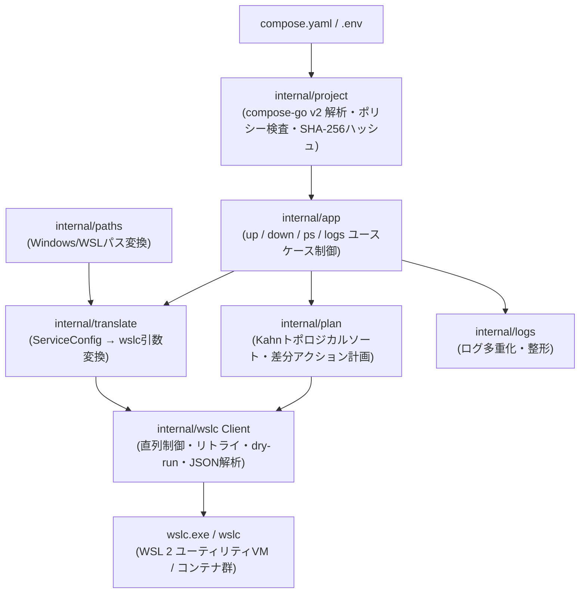

# **wslc-compose-go 調査レポート**

## **1. 基本情報**

* **ツール名**: wslc-compose-go（CLIコマンド名: `wslc-compose`）
* **ツールの読み方**: ダブリューエスエルシーコンポーズゴー / ダブリューエスエルシーコンポーズ
* **開発元**: DawnMagnet（GitHub上のオープンソースプロジェクト）
* **公式サイト**: [https://github.com/DawnMagnet/wslc-compose-go](https://github.com/DawnMagnet/wslc-compose-go)
* **関連リンク**:
  * GitHub: [https://github.com/DawnMagnet/wslc-compose-go](https://github.com/DawnMagnet/wslc-compose-go)
* **カテゴリ**: コンテナ/仮想化
* **概要**: `wslc-compose-go` は、Microsoft が提供する Windows Subsystem for Linux のネイティブコンテナランタイム「WSL Containers（`wslc`）」上で、標準的な Docker Compose ファイル（`compose.yaml` / `docker-compose.yml`）を実行可能にする Go 製のオープンソース CLI ツールです。公式の `compose-spec/compose-go v2` パーサーを用いて Compose 仕様を解釈し、型付きの `wslc` コマンド列へ変換・実行することで、Docker Desktop に依存しない軽量かつデーモンレスなマルチコンテナ開発環境を提供します。

## **2. 目的と主な利用シーン**

* **解決する課題**: WSL 2.9.3 以降で導入された Microsoft 公式の `wslc` CLI は単一コンテナを扱う軽量ツールであり、現時点では `wslc compose` のようなマルチコンテナ・オーケストレーション機能を標準搭載していません。本ツールは、公式機能が実装されるまでのギャップを埋め、既存の `compose.yaml` 資産をそのまま `wslc` 上で動作させることでこの課題を解決します。
* **想定利用者**: Docker Desktop のライセンスやリソース消費を避けたい Windows 開発者、WSL 2 ネイティブ環境でローカル開発・テストを行いたい DevOps エンジニアおよびインフラエンジニア。
* **利用シーン**:
  * **Docker Desktop 不要のローカル開発環境**: Web アプリケーション（Nginx/Node.js/Python 等）とデータベース（PostgreSQL/Redis 等）を組み合わせたマルチコンテナ環境を Windows 11 上で直接起動する。
  * **GPU 活用ワークロードの検証**: `--gpus all` オプションを通じてホスト側の GPU（CUDA）を利用するコンテナを Compose ファイルから立ち上げる。
  * **WSL ディストリビューション内からの透過的実行**: WSL 内の bash/zsh から Linux 版バイナリを実行し、パス変換（`wslpath -w`）を自動で行いながらホストの `wslc.exe` を駆動する。

### **2.1 代表的な利用フロー**

```mermaid
swimlane-beta TB
  subgraph User["ユーザー (開発者)"]
    A["compose.yaml を用意し<br/>wslc-compose up -d を実行"]
    F["ps / logs / exec で<br/>稼働状況やログを確認"]
  end
  subgraph CLI["wslc-compose CLI"]
    B["compose-go v2 で設定を解析し<br/>依存関係と設定ハッシュを計算"]
    C["ネットワーク・ボリューム作成と<br/>wslc コマンド列の計画生成"]
    E["結果を整形表示<br/>(失敗時は作成済みリソースをロールバック)"]
  end
  subgraph WSLC["wslc.exe (WSL Containers)"]
    D["イメージの pull / build と<br/>コンテナの起動・接続を実行"]
  end
  A --> B
  B --> C
  C --> D
  D --> E
  E --> F
```

* **代表的な流れ**: 開発者が `wslc-compose up -d` を実行すると、`wslc-compose` が `compose.yaml` を解析して設定ハッシュと依存順序を算出し、必要なネットワーク・ボリューム・シークレットの準備を行ったうえで、`wslc.exe` へ順次コマンドを発行してコンテナ群を立ち上げます。起動後は `ps` や `logs`、`exec` で各コンテナを統合管理できます。

## **3. 主要機能**

* **公式 `compose-go v2` による完全な構文解析**: 変数補間、`.env` 読み込み、複数 `-f` ファイルのマージ、`profiles`、`env_file`、`extends`、`include` といった標準 Compose 仕様をアップストリームの公式パーサーで処理します。
* **主要な Compose サブコマンドの網羅**: `up`（`-d`, `--build`, `--pull`, `--force-recreate`, `--scale`, `--wait`, `--remove-orphans` 対応）、`down`（`-v` 対応）、`ps`（`HEALTH` 列および JSON 出力対応）、`logs`（複数コンテナのプレフィックス付き統合ストリーミング）、`build`、`pull`、`exec`、`run`（`--rm` 等のワンオフ実行）、`start` / `stop` / `restart`、`config`、`version` を備えています。
* **ステートレスなラベル管理と差分更新**: 独立した状態ファイルや常駐デーモンを持たず、プロジェクト状態をコンテナラベル（`com.docker.compose.*` および `com.wslc.compose.config-hash`）に記録します。設定変更がないコンテナは再作成せず保持する増分更新を行います。
* **高度なネットワーク・IPAM・`host-gateway` 対応**: `wslc 3.0.3.0` 以降では複数ネットワーク接続（`create` → `network connect` → `start`）、静的 IPv4 アドレス、IPAM の `subnet` / `gateway` / `ip_range` 指定、`extra_hosts`（`host-gateway` 向けの `wslc system session run` による iptables DNAT/MASQUERADE 設定含む）に対応しています。
* **Secrets・Configs・ボリュームの柔軟なマッピング**: `file` / `environment` / `content` 形式の `secrets` および `configs` を読み取り専用マウントし、`down` 時に一時ファイルを自動削除します。さらに `wslc` が受け付けない匿名ボリューム（例: `- /data`）をプロジェクトスコープの名前付きボリュームへ自動変換してデータを保護します。
* **`--dry-run` および `--strict` 検証モード**: `--dry-run` では実行予定の `wslc` コマンド列を事前出力でき（`wslc` 未導入環境でも動作）、`--strict` では `wslc` がサポートしていない Compose フィールドを警告ではなくエラーとして厳格に検出します。
* **`wslc compose` ラッパースクリプト群**: PowerShell（`wslc-compose.profile.ps1`）、WSL 内の bash/zsh（`wslc-compose.sh`）、cmd.exe（`wslc.cmd`）向けの薄いラッパーが用意されており、`wslc compose up -d` のような自然なコマンド体系で利用できます。
* **自動リトライと失敗時ロールバック**: プレビュー版 `wslc` 特有の一時的エラー（`ERROR_SHARING_VIOLATION`、`ERROR_ALREADY_EXISTS`、`ERROR_INVALID_HANDLE`）やレジストリ通信エラーに対するリトライ機構、および `up` 途中失敗時の逆順ロールバック機能を備えています。

## **4. 動作原理・システム構成**

* **アーキテクチャ**: ローカル完結型・デーモンレスのシングルバイナリ CLI アーキテクチャです。バックグラウンドで常駐サービスを起動せず、ユーザーのコマンド実行時にのみ起動して `wslc.exe`（または `wslc`）サブプロセスを制御します。Windows ネイティブの実行ファイル（`.exe`、UPX 圧縮で約 1.8 MB）として動作するほか、WSL ディストリビューション内から Linux バイナリとして実行し、Windows 側の `wslc.exe` を呼び出すことも可能です。
* **主要コンポーネントとデータフロー**:
  * `internal/cli` & `internal/app`: Cobra ベースのコマンド解析と、`up` / `down` / `ps` / `logs` 等のユースケースオーケストレーションを担当します。
  * `internal/project`: `compose-go v2` でプロジェクトを読み込み、`policy.go` で未対応フィールドの警告・エラー判定（`--strict`）を行い、`hash.go` でサービスごとの SHA-256 設定ハッシュを計算します（`build`、`scale`、`depends_on` 等はハッシュから除外し、レプリカ数変更時の不要な再作成を防止）。
  * `internal/plan`: Kahn のトポロジカルソート（同層はサービス名順）により決定的な依存実行順序を算出し、現在のコンテナ状態と設定ハッシュの比較から `keep` / `start` / `create` / `recreate` / `remove` の各アクションを決定します。
  * `internal/translate`: `ServiceConfig` を型付きの `wslc` CLI 引数配列へ変換する純粋関数群です。
  * `internal/wslc`: 単一メソッドの `Runner` インターフェースを通じて `wslc` を呼び出すクライアント層です。一時エラー対策の直列実行（`--parallel` で調整可）とリトライ、OCI スタイルの `inspect` JSON 出力に対する寛容なパース、`--dry-run` の切り替えを担います。
  * `internal/paths` & `internal/logs`: WSL 内実行時の `wslpath -w` によるフォワードスラッシュ形式（`C:/src/app`）へのパス変換、および複数コンテナログのプレフィックス付き多重化出力を行います。



* **特筆すべき要素技術**:
  * **デフォルト DNS 注入（`1.1.1.1`）**: `wslc` のユーティリティ VM が Windows ホストの DNS リゾルバへ転送する際、企業ネットワークや特定 LAN 環境で外部名前解決が `SERVFAIL` になる問題を回避するため、サービスに `dns:` 指定がない場合は自動で `--dns 1.1.1.1` を付与します（`--default-dns=` で無効化・変更可能）。
  * **メモリ単位の自動大文字化**: `wslc` が `512m` のような小文字単位を拒否する仕様に対応し、`K` / `M` / `G` の大文字サフィックスへ正規化します。
  * **`EXIT` トラップとステータスファイルによるセッション復旧（v0.2.1）**: `host-gateway` 用の `wslc system session run` がスクリプト完了後に `ERROR_INVALID_HANDLE` を返す現象を回避するため、セッション側で `/run/<owner>.status` へ終了コードを記録し、クライアント側で該当試行の結果を読み取って安全にリカバリする仕組みを備えています。

## **5. 開始手順・セットアップ**

* **前提条件**:
  * Windows 11 および WSL 2.9.3 以降（`wslc` を同梱。未導入の場合は `wsl --update` で更新）。
  * アカウント登録やクレジットカード登録は不要。
  * ソースからビルドする場合は Go 1.24 以上が必要。
* **インストール/導入**:
  Windows PowerShell 5.1 または PowerShell 7（管理者権限不要）で以下のワンライナーを実行します。バイナリのダウンロードと SHA-256 検証（`checksums.txt`）、ユーザー PATH への追加、PowerShell プロファイルへの `wslc compose` ラッパー登録が自動で行われます。

  ```powershell
  irm https://raw.githubusercontent.com/DawnMagnet/wslc-compose-go/main/scripts/install.ps1 | iex
  ```

  WSL ディストリビューション内で Linux バイナリを利用する場合は、以下のように配置します。

  ```bash
  curl -fsSLo ~/.local/bin/wslc-compose \
    https://github.com/DawnMagnet/wslc-compose-go/releases/latest/download/wslc-compose-linux-amd64
  chmod +x ~/.local/bin/wslc-compose
  ```

* **初期設定**:
  * インストール後に新しいターミナルを開き、`wslc-compose version` または PowerShell で `wslc compose version` を実行して認識を確認します。
  * PowerShell の実行ポリシーが `Restricted` の場合、`wslc compose` ラッパー用の `$PROFILE` が読み込まれないため、必要に応じて `Set-ExecutionPolicy -Scope CurrentUser RemoteSigned` を設定します（`wslc-compose` コマンド自体の動作には影響しません）。
  * `wslc` 実行ファイルは `--wslc` フラグ → `$WSLC_COMPOSE_BIN` → `PATH` 上の `wslc.exe` / `wslc` → `C:\Program Files\WSL\wslc.exe` の順で自動探索されます。
* **クイックスタート**:
  任意のディレクトリに `compose.yaml` を配置し、まずは `--dry-run` で変換コマンドを確認したうえで起動します。

  ```powershell
  wslc-compose up -d --dry-run
  wslc-compose up -d
  wslc-compose ps
  wslc-compose logs -f
  wslc-compose down -v
  ```

## **6. 特徴・強み (Pros)**

* **高速・軽量な単一バイナリ（デーモンレス）**: Go で実装されており外部ランタイム（Python や Node.js 等）が不要です。UPX 圧縮された Windows バイナリは約 1.8 MB と非常に軽量で、バックグラウンドデーモンも消費しません。
* **公式 `compose-go v2` 準拠の高い仕様互換性**: Compose ファイルのパースを公式ライブラリに委ねているため、変数補間・`extends`・`include`・`profiles` などの複雑な Compose 構文でも仕様通りの挙動が期待できます。
* **`--dry-run` とゴールデンテストによる透明性と安定性**: `wslc` 実機がない環境でも `--dry-run` で発行コマンド列の全容を確認でき、開発面でもモック `Runner` とゴールデンテスト（`testdata/golden/`）によりコマンド生成の回帰が厳密に管理されています。
* **実機検証に基づくきめ細かいワークアラウンド**: ローカライズ版 Windows でのテーブル出力文字化け回避（`--format json` 利用）、`ERROR_SHARING_VIOLATION` / `ERROR_INVALID_HANDLE` へのリトライ・リカバリ、匿名ボリュームの名前付き化など、プレビュー版 `wslc` の癖を吸収する工夫が随所に施されています。
* **公式 `wslc compose` への将来的な移行のしやすさ**: コンテナラベルが Docker Compose 標準（`com.docker.compose.*`）に準拠しており、将来 Microsoft から公式の `wslc compose` がリリースされた際も、ラッパーを外すだけでスムーズに移行できるよう設計されています。

## **7. 弱み・注意点 (Cons)**

* **`wslc` 自体の機能不足による制約**: 基盤となる `wslc` に `restart` ポリシー、`--privileged`、`--cap-add`、`--device`、`--sysctl`、`--platform`、`--network host`、ログドライバ、`--init` などのオプションが存在しないため、これらの Compose フィールドは無視され警告（`--strict` 指定時はエラー）となります。
* **プレビュー段階（v0.2系）であることの留意点**: 一部機能（`build --secret` など）はモックとゴールデンテストのみで検証されており、実機での動作検証は限定的な環境（Windows 11 + `wslc` 3.0.1 / 3.0.3.0）に留まります。また、WSL ディストリビューション内の UNC パス（`//wsl.localhost/...`）よりも Windows ドライブ配下にプロジェクトを配置することが推奨されています。
* **Docker Compose との細かな挙動差**: 匿名ボリュームはサービス単位の名前付きボリュームに変換されるため複数レプリカ間で共有されます。また、GPU 指定は `--gpus all` のみに変換され、個別のデバイス ID や枚数制限は反映されません。
* **日本語対応の状況**: ツール本体の CLI メッセージおよびドキュメントは英語と中国語（README のみ）で提供されており、公式の日本語ドキュメントや日本語 UI ローカライズはありません。

## **8. 料金プラン**

| プラン名 | 料金 | 主な特徴 |
|---------|------|---------|
| **オープンソース版 (MIT License)** | 無料 | 全機能を制限なく利用可能。商用利用・改変・再配布も自由。 |

* **課金体系**: なし（完全無料のオープンソースソフトウェア）。
* **無料トライアル**: 該当なし（全機能が永続的に無償公開）。

## **9. 導入実績・事例**

* **導入企業**: 2026年10月に公開されたばかりのコミュニティ主導オープンソースプロジェクトであるため、特定の企業における公式な大規模導入事例は公開されていません。
* **導入事例**: Windows 11 + `wslc` 3.0.1 / 3.0.3.0 実機環境において、マルチコンテナ構成（Web + DB + ヘルスチェック待機）、複数ネットワークと静的 IP 割り当て、`host-gateway` 経由のポート疎通、CUDA を用いた GPU（RTX 5060 Ti）コンテナの検証に活用されていることがリポジトリ内で報告されています。
* **対象業界**: Docker Desktop の有償ライセンス回避や軽量開発環境を模索するソフトウェア開発現場、AI/ML 開発者（Windows + WSL 2 + GPU 環境）、オープンソース開発者コミュニティ。

## **10. サポート体制**

* **ドキュメント**: GitHub リポジトリの `README.md`（英語および中国語）、`docs/architecture.md`（内部アーキテクチャ解説）、`CHANGELOG.md`、各バージョンのリリースノート（`docs/release-notes/`）が整備されています。
* **コミュニティ**: GitHub Issues および Pull Requests を通じたバグ報告・機能要望が受け付けられています。バグ報告時は `--dry-run` 出力や `wslc --version` の添付が推奨されています。
* **公式サポート**: 商用サポートや有償の SLA は提供されておらず、GitHub リポジトリ上でのコミュニティベース（ベストエフォート）の対応となります。

## **11. エコシステムと連携**

### **11.1 API・外部サービス連携**

* **API**: ライブラリや REST API サーバーとしてではなく、独立した CLI バイナリとして設計されています。内部的には `wslc` CLI をサブプロセスとして呼び出し、`--format json` 出力をパースして連携します。
* **外部サービス連携**:
  * **WSL Containers (`wslc`)**: コンテナの作成・起動・ビルド・ネットワーク・ボリューム管理を実行する中核ランタイム。
  * **compose-spec/compose-go v2**: Docker Compose 仕様の公式 Go パーサーライブラリ。
  * **OCI コンテナレジストリ（Docker Hub / GHCR 等）**: `wslc pull` / `wslc build` を通じてイメージを取得・ビルド。
  * **PowerShell 5.1 / PowerShell 7 / bash / zsh / cmd.exe**: ラッパースクリプトにより `wslc compose` サブコマンドとして統合可能。
  * **NVIDIA CUDA / GPU 環境**: `wslc --gpus all` を介してホスト GPU と連携。
  * **bacarndiaye/wslc-compose**: `host-gateway` 用 iptables チェーン命名規則（`WCGP_` / `WCGS_` / `WCGF_`）を揃えており、同一プロジェクトの調停互換性を意識した設計となっています。

### **11.2 技術スタックとの相性**

| 技術スタック | 相性 | メリット・推奨理由 | 懸念点・注意点 |
|:---|:---:|:---|:---|
| **Windows 11 + PowerShell 7 / 5.1** | ◎ | ワンライナーインストールと `wslc compose` ラッパーに完全対応 | 実行ポリシーが `Restricted` の場合はプロファイルが読み込まれない |
| **WSL 2 ディストリビューション (Ubuntu 等)** | ◯ | Linux バイナリで実行し自動で `wslc.exe` へパス変換可能 | プロジェクトは `/mnt/c/` 等の Windows ドライブ側への配置が推奨 |
| **Docker Compose 既存プロジェクト** | ◯ | `compose-go v2` により標準的な `compose.yaml` がそのまま動く | `restart` や `privileged` 等 `wslc` 非対応フィールドは警告/無視される |
| **Go (1.24+) 開発環境** | ◎ | `go install` で直接導入でき、モック `Runner` でテストも容易 | 特になし |
| **macOS / Linux (非Windows環境)** | × | `wslc.exe` を駆動する前提のため実コンテナ起動は不可 | `--dry-run` でのコマンド生成プレビューのみ実行可能 |

## **12. セキュリティとコンプライアンス**

* **認証**: 本ツール独自の認証機能やユーザーアカウント管理は持たず、実行する Windows ユーザーまたは WSL ユーザーの権限で動作します。コンテナレジストリへの認証は基盤となる `wslc` 側の認証設定に依存します。
* **データ管理**: プロジェクトの状態ファイルやデータベースを持たず、メタデータはコンテナラベルに保存されます。`environment:` や `content:` 形式で定義されたシークレット・コンフィグの一時ファイルのみローカルの状態ディレクトリ（Windows では `%LOCALAPPDATA%\wslc-compose\<project>`、Linux/WSL では `$XDG_CONFIG_HOME/wslc-compose/<project>`）に書き出され、`down` コマンド実行時に削除されます。また、GitHub Releases の配布バイナリには `checksums.txt`（SHA-256 ハッシュ）が添付され、インストーラーが改ざん検証を行います（UPX 圧縮バイナリがアンチウイルスで誤検知された場合は `upx -d` での展開や非圧縮ビルドが可能）。
* **準拠規格**: ローカル実行型のオープンソース CLI ツール（MIT ライセンス）であるため、クラウド SaaS 向けの SOC 2 や ISO 27001 などの第三者認証には該当しません。

## **13. 操作性 (UI/UX) と学習コスト**

* **UI/UX**: 完全な CUI（コマンドラインインターフェース）ツールです。コマンド体系・フラグ名・出力形式（`ps --format table|json`、`logs` の色付きプレフィックス、`--ansi` フラグ、Ctrl+C による停止など）が `docker compose` に忠実に似せて作られており、既存の Docker ユーザーにとって直感的に扱えます。
* **学習コスト**: Docker Compose の基本操作（`compose.yaml` の記述と `up` / `down` / `ps` / `logs`）を知っていれば、追加の学習コストはほぼゼロです。`--dry-run` によって裏側で実行される `wslc` コマンドをいつでも確認できるため、トラブルシューティングの敷居も低く抑えられています。

## **14. ベストプラクティス**

* **効果的な活用法 (Modern Practices)**:
  * **導入前の `--dry-run` と `--strict` の併用**: 既存の `compose.yaml` を移行する際は、まず `wslc-compose --strict --dry-run up -d` を実行し、`wslc` で非対応のフィールドや生成されるコマンドを事前確認する。
  * **Windows ドライブ上でのプロジェクト配置**: WSL 内の UNC パス（`//wsl.localhost/...`）は `wslc` のバージョンによって認識が不安定な場合があるため、プロジェクトファイルは `C:\src\...`（WSL からは `/mnt/c/src/...`）に配置する。
  * **企業 LAN 等での DNS 調整**: デフォルトで注入される `--dns 1.1.1.1` が社内ドメインの名前解決を妨げる場合は、`compose.yaml` 内で `dns:` を明示するか、`--default-dns=10.0.0.53` または `--default-dns=` を指定する。
* **陥りやすい罠 (Antipatterns)**:
  * **`restart: always` や `privileged: true` への依存**: `wslc` 側がこれらに対応していないため、再起動や特権が必要な構成をそのまま本番相当の前提で運用しない。
  * **無値環境変数（`environment: [SECRET_KEY]`）の WSL 側での利用**: `wslc.exe` は Windows 側プロセスとして実行されるため、WSL 内のシェルだけにエクスポートした値なしの変数は引き継がれずスキップされる点に注意する。
  * **複数レプリカでの匿名ボリューム利用**: 匿名ボリュームはサービス共通の名前付きボリュームに変換されるため、レプリカ間でデータが競合する用途では名前付きボリューム設計を見直す。

## **15. ユーザーの声（レビュー分析）**

* **調査対象**: G2、Capterra、ITreview にはレビューの登録なし（2026年10月に公開されたばかりの比較的新しい OSS CLI ツールのため）。そのため、GitHub リポジトリ（Issues / Pull Requests / Releases）および WSL Containers コミュニティの動向を調査対象としました。
* **総合評価**: スコア掲載サイトでの評価なし（GitHub スター数: 12、2026年11月19日時点）。
* **ポジティブな評価**:
  * 「Docker Desktop なしで `wslc` 上に `compose.yaml` を持ち込めるのが便利」「単一バイナリでインストールが簡単」（コミュニティでの期待・コンセプト評価）。
  * ローカライズされた Windows（中国語版等）での `wslc network list` パース不具合（Issue #1）や、`--wait-timeout` の秒数指定互換性（Issue #4）、ポート範囲指定（Issue #7）など、ユーザーからのバグ報告に対して数日以内に修正リリースが出される迅速なメンテナンス体制が高く評価されています。
* **ネガティブな評価 / 改善要望**:
  * 基盤となる `wslc` 自体がまだプレビュー段階であり、`ERROR_INVALID_HANDLE` や `ERROR_SHARING_VIOLATION` などのランタイム側の不安定さに起因する対処が必要になるケースがある（v0.2.1 でリトライ・ステータスファイル機構により大幅改善）。
  * UPX 圧縮された Windows バイナリが一部のセキュリティソフトでヒューリスティック検知される場合がある（公式リリースノートで `upx -d` による解除方法を案内）。
* **特徴的なユースケース**:
  * Windows 11 環境で RTX 5060 Ti などのローカル GPU を活用した CUDA コンテナ群のオーケストレーションや、マルチネットワーク・`host-gateway` を用いたローカル Web 開発環境の構築に利用されています。

## **16. 直近半年のアップデート情報**

* **2026-11-04**: **v0.2.1** リリース。`wslc 3.0.3.0` で `host-gateway` のクリーンアップやセッション実行時に発生する `ERROR_INVALID_HANDLE` を回避するため、`/run/<owner>.status` ファイルと `EXIT` トラップを用いたリトライ・状態回収機構および先行マーカー（write-ahead marker）を導入。
* **2026-11-04**: **v0.2.0** リリース。複数ネットワークの接続（`create` → `network connect` → `start`）、IPAM `ip_range` 指定とサブネット検証、`secrets` / `configs`（`file`・`environment`・`content`）および `build --secret` 対応、`extra_hosts` と `host-gateway`（iptables DNAT/MASQUERADE）、`wslc --version` による機能ゲート判定を一挙に追加。
* **2026-10-17**: **v0.1.5** リリース。単一コンテナポートに対するホストポート範囲指定（例: `8000-8002:80`）で `E_INVALIDARG` が発生する問題を解消し、空きポートの自動選択に対応。
* **2026-10-16**: **v0.1.4** リリース。`up --wait-timeout` で Docker Compose 互換の整数秒指定（例: `300`）を受け付けるよう改善し、負数のバリデーションを追加。
* **2026-10-14**: **v0.1.3** リリース。非英語環境（日本語・中国語等のローカライズ版 Windows）で `wslc network list` / `volume list` のテーブルヘッダー解析に失敗し、2回目の `up` や `down -v` が失敗する問題を `--format json` 採用により修正。
* **2026-10-09**: **v0.1.0 〜 v0.1.2** リリース。初回公開（v0.1.0）、PowerShell プロファイルでの `.ps1` シャドウイング修正と UPX 圧縮・日英バイリンガル化（v0.1.1）、Windows PowerShell 5.1 と PowerShell 7 両方のプロファイル自動設定（v0.1.2）を実施。

(出典: [GitHub Releases](https://github.com/DawnMagnet/wslc-compose-go/releases) / [CHANGELOG.md](https://github.com/DawnMagnet/wslc-compose-go/blob/main/CHANGELOG.md))

## **17. 類似ツールとの比較**

### **17.1 機能比較表 (星取表)**

| 機能カテゴリ | 機能項目 | 本ツール (`wslc-compose-go`) | Docker (Docker Compose) | Podman (Podman Compose) | bacarndiaye/wslc-compose |
|:---:|:---|:---:|:---:|:---:|:---:|
| **基本機能** | Compose 仕様互換性 | ◎<br><small>公式 compose-go v2 を採用</small> | ◎<br><small>本家リファレンス実装</small> | ◯<br><small>Podman Compose による互換</small> | ◯<br><small>主要サブセットを実装</small> |
| **基盤・軽量性** | デーモンレス・単一バイナリ | ◎<br><small>Go 製単一バイナリ (~1.8MB)</small> | ×<br><small>Docker デーモン/Desktop が必要</small> | ◎<br><small>デーモンレス・ルートレス対応</small> | △<br><small>デーモンレスだが Python 依存</small> |
| **WSL 統合** | `wslc` ネイティブ対応 | ◎<br><small>wslc 3.0.3+ の新機能まで網羅</small> | ×<br><small>独自 VM / Docker Engine を使用</small> | ×<br><small>Podman Machine (WSL) を使用</small> | ◎<br><small>wslc 向けの先行 Python 実装</small> |
| **高度な制御** | ネットワーキング / `--strict` | ◯<br><small>複数NW・host-gateway・厳格検証</small> | ◎<br><small>全ネットワーク/セキュリティ機能</small> | ◎<br><small>Pasta/Netavark・K8s Pod 連携</small> | ◯<br><small>基本NW・host-gateway 等に対応</small> |
| **コスト・運用** | 商用利用の無償性 | ◎<br><small>MIT ライセンスで完全無料</small> | △<br><small>Docker Desktop は大企業有料</small> | ◎<br><small>Apache 2.0 で完全無料</small> | ◎<br><small>MIT ライセンスで完全無料</small> |

### **17.2 詳細比較**

| ツール名 | 特徴 | 強み | 弱み | 選択肢となるケース |
|---------|------|------|------|------------------|
| **本ツール (`wslc-compose-go`)** | Go 製の `wslc` 用デーモンレス Compose ラッパー。 | 公式 `compose-go v2` 準拠、単一バイナリで依存なし、`--dry-run` / `--strict`、最新の `wslc 3.0.3` 対応が迅速。 | プレビュー段階であり、`wslc` 自体にない機能（`restart` や `privileged` 等）は利用不可。 | Windows 11 + WSL 2.9.3+ 環境で、Docker Desktop を入れずに標準的な `compose.yaml` を軽量・高速に動かしたい場合。 |
| **Docker (Docker Compose)** | コンテナ技術の標準プラットフォーム。 | 圧倒的なエコシステム、全 Compose 機能の完全サポート、GUI や拡張機能の充実。 | Windows で Docker Desktop を利用する場合、リソース消費が大きく一定規模以上の企業では有料。 | 本番同等・全機能の完全な互換性や、Docker Desktop の GUI・チーム管理機能を必要とする場合。 |
| **Podman** | Red Hat 主導のデーモンレス・コンテナエンジン。 | ルートレス実行による高いセキュリティ、Kubernetes YAML との親和性、Docker 互換 CLI。 | Windows 環境では専用の Podman Machine（WSL インスタンス）のセットアップが必要。 | セキュリティ要件が厳しい環境や、Kubernetes 本番環境への移行を見据えた開発を行う場合。 |
| **bacarndiaye/wslc-compose** | Python で実装された `wslc` 用の先行 Compose ラッパー。 | コミュニティで早期から開発されスター数も多い。基本的な Compose 操作や `host-gateway` をサポート。 | Python 実行環境が必要であり、バイナリ単体での配布・ポータビリティでは Go 製に劣る。 | すでに Python 環境が整っており、実績のある先行ラッパーを試したい場合（`wslc-compose-go` とは iptables チェーン名互換）。 |

## **18. 総評**

* **総合的な評価**:
  `wslc-compose-go` は、Microsoft が WSL 2.9.3 で導入したネイティブコンテナ機能 `wslc` における「Compose 未対応」という最大の欠落を、極めて堅実な設計で埋める優れたツールです。公式の `compose-go v2` パーサーによる高い構文互換性、単一バイナリかつデーモンレスの軽快さ、そして `wslc` のバージョンごとの仕様差や一時エラーを吸収する実務的なエンジニアリングが光ります。まだプレビュー段階であり基盤である `wslc` 自体の機能制限は受けるものの、Windows ローカル開発の新しい選択肢として非常に高い完成度を備えています。
* **推奨されるチームやプロジェクト**:
  Windows 11（WSL 2.9.3 以降）を標準開発端末としており、Docker Desktop のライセンスコストやメモリ負荷を削減したい開発チーム。特に、一般的な Web アプリ＋DB 構成や、Windows 上の GPU（CUDA）をコンテナから手軽に利用したい AI/ML 開発者に推奨できます。
* **選択時のポイント**:
  `restart` ポリシーや `--privileged`、`--network host` といった `wslc` 非対応機能が必須のプロジェクトでは Docker や Podman を選択すべきですが、一般的な開発用 `compose.yaml` であれば `wslc-compose-go` で十分に代替可能です。導入時はまず `wslc-compose --strict --dry-run up -d` で自分の `compose.yaml` がどこまでマッピングされるかを検証することをおすすめします。
