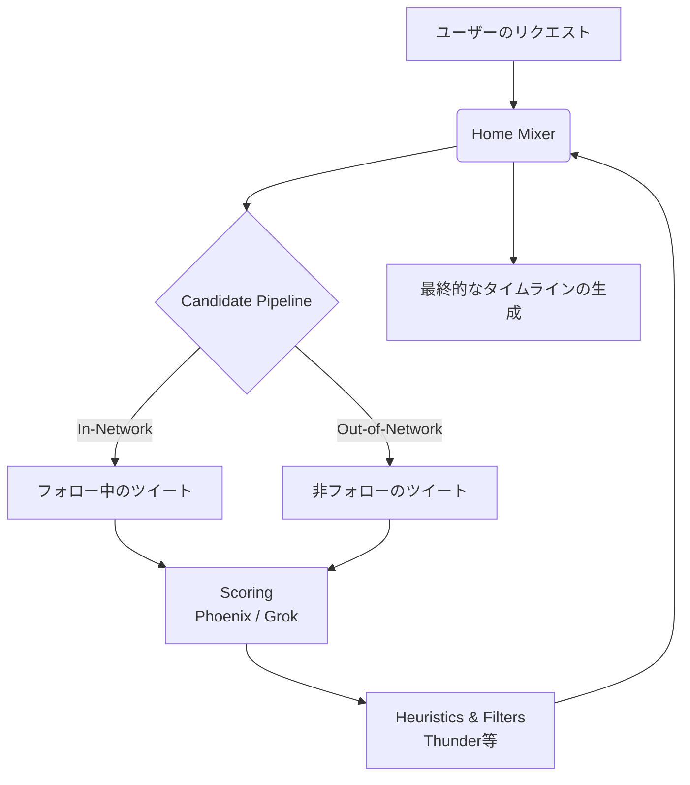

# **x-algorithm 調査レポート**

## **1. 基本情報**

* **ツール名**: x-algorithm
* **ツールの読み方**: エックスアルゴリズム
* **開発元**: xAI
* **公式サイト**: [https://github.com/xai-org/x-algorithm](https://github.com/xai-org/x-algorithm)
* **関連リンク**:
  * GitHub: [https://github.com/xai-org/x-algorithm](https://github.com/xai-org/x-algorithm)
* **カテゴリ**: アルゴリズム
* **概要**: X（旧Twitter）の「おすすめ（For You）」タイムラインを生成する中核的なレコメンデーションシステムのソースコードリポジトリです。オープンソースとして公開されています。

## **2. 目的と主な利用シーン**

* **解決する課題**: 大規模SNSにおける、ユーザーに関連性の高いコンテンツの推奨機能の実現。
* **想定利用者**: 開発者、データサイエンティスト、AI研究者
* **利用シーン**:
  * 大規模レコメンデーションシステムの学習と研究
  * オープンソースアルゴリズムの動作検証
  * 巨大なトラフィックを処理するパイプラインアーキテクチャの参考

## **3. 主要機能**

* **Grok-based transformer model**: ユーザーエンゲージメントを予測するためのコアモデル。
* **Thunder**: ユーザーがフォローしているアカウントからのコンテンツを管理するコンポーネント。
* **Phoenix**: レコメンドに関わるML（機械学習）コンポーネント。
* **Home Mixer**: タイムラインを組み立てるオーケストレーションレイヤー。
* **Candidate Pipeline**: レコメンデーションパイプラインを構築するためのフレームワーク。

## **4. 動作原理・システム構成**

* **アーキテクチャ**: 大規模なマイクロサービスアーキテクチャと分散処理システム
* **主要コンポーネントとデータフロー**:
  * **Candidate Pipeline**: 複数ソースから候補となるツイートを抽出（In-Network / Out-of-Network）
  * **Scoring (Phoenix/Grok)**: 機械学習モデルを用いて各候補ツイートに対するユーザーのエンゲージメント確率を予測・スコアリング
  * **Heuristics & Filters (Thunder/Visibility)**: ブロック、ミュート、NSFW、多様性などのフィルタリングとヒューリスティクスを適用
  * **Home Mixer**: 上記のステップをオーケストレーションし、最終的なタイムライン（For You）を組み立てる
* **特筆すべき要素技術**:
  * Grokベースのモデルによるレコメンド推論



## **5. 開始手順・セットアップ**

* **前提条件**:
  * GitHubリポジトリのクローン環境
* **インストール/導入**:

  ```bash
  git clone https://github.com/xai-org/x-algorithm.git
  ```

* **初期設定**:
  * 公式リポジトリのドキュメントに記載されている手順に従う。
* **クイックスタート**:
  * 各コンポーネント（Home Mixer、Thunder、Phoenixなど）のディレクトリ内にある手順を参照し、個別にビルド・実行を行う。

## **6. 特徴・強み (Pros)**

* Xの「おすすめ（For You）」タイムラインを支える実際のアルゴリズムがそのまま公開されている。
* Grokベースのモデルなど最新のAI技術が実践的に活用されている。
* 複数のコンポーネント（Thunder, Phoenix, Home Mixer等）に分離され、スケーラブルな構成となっている。

## **7. 弱み・注意点 (Cons)**

* 大規模システムを前提としており、個人がローカル環境で動かすには学習・構築のハードルが高い。
* 公式ドキュメントは英語が中心であり、日本語での公式サポートはない。
* 稼働させるための計算リソース要求が大きい。

## **8. 料金プラン**

| プラン名 | 料金 | 主な特徴 |
|---------|------|---------|
| **オープンソース** | 無料 | オープンソースとして公開されており無料で利用可能 |

* **課金体系**: なし
* **無料トライアル**: なし（完全無料）

## **9. 導入実績・事例**

* **導入企業**: X (旧Twitter)
* **導入事例**: Xの「おすすめ（For You）」フィードアルゴリズムとして稼働。
* **対象業界**: SNS、IT、研究機関

## **10. サポート体制**

* **ドキュメント**: GitHubのREADME等の公式ドキュメント
* **コミュニティ**: GitHubのIssueやプルリクエストによるオープンソースコミュニティ
* **公式サポート**: 専用のサポート窓口は提供されておらず、コミュニティベースでの課題解決となる。

## **11. エコシステムと連携**

### **11.1 API・外部サービス連携**

* **API**: 各コンポーネント（Home Mixerなど）間を繋ぐAPIやインターフェースが存在。
* **外部サービス連携**: 他のプラットフォームへの標準連携機能はなく、独立したアルゴリズムリポジトリである。

### **11.2 技術スタックとの相性**

| 技術スタック | 相性 | メリット・推奨理由 | 懸念点・注意点 |
|:---|:---:|:---|:---|
| **各種システム** | ◯ | アーキテクチャの参考として非常に優れている | 実装をそのまま持ち込むには適材適所の判断が必要 |

## **12. セキュリティとコンプライアンス**

* **認証**: アルゴリズム自体にユーザー向けの認証機能はなし。
* **データ管理**: オープンソースのコードであるため、運用する環境に依存する。
* **準拠規格**: 公式サイトで公開されていない。問い合わせが必要。

## **13. 操作性 (UI/UX) と学習コスト**

* **UI/UX**: ソースコードであるためGUIは存在しない。
* **学習コスト**: 機械学習モデルやパイプラインのアーキテクチャに対する理解が不可欠であり、学習コストは高い。

## **14. ベストプラクティス**

* **効果的な活用法 (Modern Practices)**:
  * コードリーディングを通じ、Candidate Pipelineなどの構造や、Thunderなどの役割分担について学ぶ。
* **陥りやすい罠 (Antipatterns)**:
  * インフラ要件が膨大なため、十分なリソースを確保せずに本番環境へデプロイしようとすること。

## **15. ユーザーの声（レビュー分析）**

* **調査対象**: GitHub
* **総合評価**: 21.7k Stars（GitHubでのスター数に基づく）
* **ポジティブな評価**:
  * 世界最大規模のSNSアルゴリズムが公開されていることへの賞賛。
  * アーキテクチャの透明性向上。
* **ネガティブな評価 / 改善要望**:
  * 実際の実行や検証には高いハードルがある。
* **特徴的なユースケース**:
  * アルゴリズムの透明性を検証する研究者や、大規模パイプラインを学ぶエンジニアの教科書としての利用。

## **16. 直近半年のアップデート情報**

* **2026-10-23**: 「Open-source X Recommendation Algorithm」のアップデートに関するコミット
* **2026-10-22**: 「Open-source X Recommendation Algorithm」のアップデートに関するコミット
* **2026-10-21**: 「Open-source X Recommendation Algorithm」のアップデートに関するコミット
* **2026-10-20**: 「Open-source X Recommendation Algorithm」のアップデートに関するコミット
* **2026-05-15**: 2026年5月15日のアップデート（「Updates — May 15th, 2026」としてリリース情報が公開されている）

(出典: [GitHubリポジトリ コミット履歴](https://github.com/xai-org/x-algorithm/commits/main))

## **17. 類似ツールとの比較**

### **17.1 機能比較表 (星取表)**

| 機能カテゴリ | 機能項目 | 本ツール | Snowflake |
|:---:|:---|:---:|:---:|
| **基本機能** | レコメンドアルゴリズム | ◎<br><small>Grokベースの高度なモデル</small> | ◯<br><small>Cortex ML等による汎用モデル構築が可能</small> |
| **基本機能** | データ処理スケーラビリティ | ◎<br><small>大規模SNS向け特化</small> | ◎<br><small>汎用的な超大規模データウェアハウス</small> |
| **エンタープライズ** | カスタマイズ性 | ◎<br><small>ソースコード改変による完全な自由度</small> | ◯<br><small>プラットフォーム上でのカスタマイズ</small> |
| **非機能要件** | 学習・運用コスト | △<br><small>高度なインフラと専門知識が不可欠</small> | ◯<br><small>フルマネージドで運用コストは低い</small> |

### **17.2 詳細比較**

| ツール名 | 特徴 | 強み | 弱み | 選択肢となるケース |
|---------|------|------|------|------------------|
| **本ツール (x-algorithm)** | 大規模SNSの推薦アルゴリズム公開版 | 実際の複雑なアーキテクチャや最先端AIの実装を確認できる | 動作に必要な計算リソースと機械学習への学習コストが甚大 | 大規模なレコメンドシステムを研究・参考にする場合 |
| **Snowflake** | クラウドネイティブなデータプラットフォーム | データウェアハウスから機械学習まで一元管理でき運用が容易 | レコメンドなど特定の処理に特化したアルゴリズムは自前での構築が必要 | 汎用的なデータ分析基盤を構築し、付加価値としてMLを導入したい場合 |

## **18. 総評**

* **総合的な評価**:
  * x-algorithmは、Xの「For You」フィードを支える本物のアルゴリズムを公開した非常に価値の高いオープンソースプロジェクトです。
* **推奨されるチームやプロジェクト**:
  * レコメンデーションシステムや大規模データ処理パイプラインの研究・開発を行っているデータサイエンスチームやAI研究者。
* **選択時のポイント**:
  * そのまま自社サービスに組み込むよりも、アーキテクチャ設計や機械学習モデルの実装パターンを学ぶためのリファレンスとして活用することが最も適しています。
