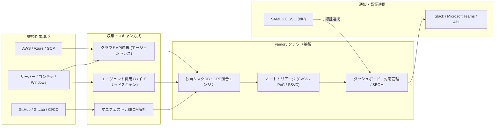

# **yamory 調査レポート**

## **1. 基本情報**

* **ツール名**: yamory
* **ツールの読み方**: ヤモリー
* **開発元**: 株式会社アシュアード (Visionalグループ)
* **公式サイト**: [https://yamory.io/](https://yamory.io/)
* **関連リンク**:
  * ドキュメント: [https://yamory.io/faq](https://yamory.io/faq)
  * レビューサイト: [ITreview](https://itreview.jp/products/yamory)
* **カテゴリ**: セキュリティ/脆弱性診断
* **概要**: yamoryは、ソフトウェア内部の構成（SCA）から、ホスト、コンテナ、サーバーレス（AWS Lambda等）、クラウド（CSPM）、ネットワーク機器まで、全レイヤーに対応した脆弱性管理ができる国内発のクラウドサービスです。独自のリスクデータベースと特許取得のオートトリアージ機能を活用し、クラウド設定の不備やOSSライセンス違反、EOLリスクの検知・対応管理を一元化します。

## **2. 目的と主な利用シーン**

* **解決する課題**: 社内にセキュリティ専門家が不足している、チームやベンダー間で管理方法が統一されていない、急増するCVEに対する脆弱性対応の優先順位付けに時間がかかるなどの課題を解決します。
* **想定利用者**: アプリケーションエンジニア、インフラエンジニア、セキュリティエンジニア、情報システム部門
* **利用シーン**:
  * 自社開発のソフトウェアや利用しているOSSの脆弱性を定期的にスキャンし、SSVCや攻撃コードの有無を踏まえて対応の優先度を自動決定する
  * クラウド環境（AWS、Azure、Google Cloud）の構成情報や設定不備（CSPM）、AWS Lambdaなどのサーバーレス資産をエージェントレスで把握し、セキュアな構成を維持する
  * 取引先とのやり取りにおいて、CycloneDX/SPDX形式のSBOMの出力・取り込みを行い、ソフトウェアサプライチェーンのリスクを管理する

### **2.1 代表的な利用フロー**

```mermaid
swimlane-beta TB
  subgraph User["開発・セキュリティ担当者"]
    A[クラウド・リポジトリ連携設定]
    E[優先度の高い脆弱性を確認・対応]
  end
  subgraph Yamory["yamoryクラウド"]
    B[アセット構成・依存関係を収集]
    C[独自DB照合・オートトリアージ]
    D[優先度判定・ダッシュボード可視化]
  end
  subgraph Target["クラウド環境・CI/CD"]
    F[API経由で設定・資産情報を提供]
  end
  subgraph Notify["通知・外部連携"]
    G[Slack・Teams等へアラート通知]
  end
  A --> B
  B --> F
  F --> C
  C --> D
  D --> G
  G --> E
```

* **代表的な流れ**: 担当者がクラウドアカウントやコードリポジトリを連携すると、yamoryがAPIやマニフェスト解析を通じてIT資産・ソフトウェア構成を自動収集します。収集データはyamoryの独自リスクDBと照合され、オートトリアージで優先順位付けされた結果がSlack等へ通知され、担当者が効率的に対処を進めます。

## **3. 主要機能**

* **クラウドアセットスキャン**: AWS、Azure、Google Cloudのアカウントと連携し、クラウド上のホスト、コンテナ、AWS Lambda（サーバーレス）等の構成を下層レイヤーまでエージェントレスで一括把握します。
* **オートトリアージ（優先順位付け）**: 危険度（CVSS）、攻撃手段の確立度、到達可能性に加え、SSVC（Stakeholder-specific Vulnerability Categorization）に基づく事業影響度（資産の重要度）や企業独自のカスタマイズ条件を総合し、対応優先順位を自動判定します（特許取得済）。
* **アプリ・サーバー脆弱性検知（SCA / ホストスキャン）**: 主要なプログラミング言語・パッケージマネージャの依存関係やOS・ミドルウェアをスキャンします。WindowsサーバーにおいてWindows Updateの対象外となるサードパーティ製ソフトウェアやミドルウェアの自動資産化・検知にも対応しています。
* **SBOM対応**: CycloneDXやSPDX形式のソフトウェア構成情報のインポート／エクスポートに対応し、資産と脆弱性を同時に管理します。
* **クラウド設定不備の検知（CSPM）**: クラウド環境におけるアクセス制限、管理権限、セキュリティグループなどの設定不備を検知し、Google Cloud組織連携などマルチクラウドでのガバナンスを支援します。
* **脆弱性情報の自動収集・突合**: セキュリティアナリストが日次で収集・分析した独自のリスクデータベースおよびCPEベースのリアルタイムレコメンドを用いて、IT資産登録直後から最新の脆弱性情報と正確に照合します。
* **OSSライセンス・EOL管理**: OSSの利用状況を可視化し、ライセンス違反やサポート終了（EOL）の期限を検知して通知します。
* **AI総合サイバーリスク診断（関連サービス）**: Anthropic社の「Claude Mythos」による横断解析と専門コンサルタントの精査を組み合わせ、クラウド設定・権限・yamory検出データ・ソースコードから潜在的なアタックパスを評価する診断サービスも提供しています。

## **4. 動作原理・システム構成**

* **アーキテクチャ**: クラウド完結型のマルチテナントSaaSとして提供されています（株式会社アシュアードが運用し、政府情報システムのためのセキュリティ評価制度「ISMAP」にも登録）。内部のマイクロサービス構成やデータベース実装の詳細は非公開ですが、公開されている連携・スキャン仕様に基づく処理フローは以下の通りです。



* **主要コンポーネントとデータフロー**:
  * **収集層**: クラウドプロバイダーのAPI・IAMロールを利用したエージェントレススキャン、リポジトリやCI/CD上のマニフェストファイル解析、および必要に応じたホストエージェント連携により、ソフトウェア構成情報（パッケージ、OS、設定）を収集します。
  * **解析・突合エンジン**: 収集した構成情報をCPEベースのマッチングにより、セキュリティアナリストが日次更新する独自リスクデータベースやNVD/KEVカタログと照合し、登録直後に脆弱性を特定します。
  * **トリアージ・管理層**: 特許取得のオートトリアージエンジンが、悪用コードの有無やSSVCに基づく資産重要度を加味してリスクを評価し、ダッシュボードへの表示およびSlack・Teams・API経由での通知を行います。
* **特筆すべき要素技術**:
  * **ハイブリッドスキャン（特許技術）**: 導入負荷が低く網羅性に優れるエージェントレススキャンと、重要リソースに対してランタイムの正確な稼働情報を取得して過検知を抑えるエージェント型スキャンを柔軟に併用できます。
  * **CPEベースのリアルタイムレコメンド**: IT資産登録時にシステム側でCPE候補をリアルタイムに提示し、手動運用による登録ミスや検知漏れを防止します。

## **5. 開始手順・セットアップ**

* **前提条件**:
  * スキャン対象のシステム環境（クラウドアカウント、ソースコードリポジトリ、コンテナレジストリなど）へのアクセス権限が必要です。
  * 利用開始には問い合わせ、または無料トライアルの申し込みが必要です。
* **導入手順**:
  1. [無料トライアル](https://yamory.io/demo) ページから申し込みを行います。
  2. 担当者との日程調整後、オンラインでサポートを受けながら初期セットアップを実施します。
  3. AWSやAzure、Google Cloudのアカウントを連携（IAMロールの付与など）し、クラウドアセットスキャンを実行します。
  4. CI/CDパイプラインやGitHub/GitLabリポジトリの連携、およびIT資産の登録を行い、継続的なスキャン環境を構築します。
* **初期設定**:
  * アカウント連携設定、Slack/Teams等の通知設定、SSVC資産重要度やオートトリアージのカスタマイズ、チーム・ユーザー権限（SAML 2.0 SSO含む）の設定を行います。

## **6. 特徴・強み (Pros)**

* **特許取得のオートトリアージ機能**: CVSSスコアだけでなく、攻撃コードの有無、到達可能性、さらにSSVCによる事業影響度を考慮した独自のロジックで対応優先度を明示し、運用負荷を大幅に削減します。
* **オールインワンの対応範囲**: アプリケーション（SCA）から、ホスト（Windows/Linux）、コンテナ、サーバーレス（AWS Lambda）、クラウド設定（CSPM）まで幅広い領域を一つのプラットフォームで統合管理できます。
* **日本語UIと手厚いサポート**: 国産サービスであるため、UIやドキュメント、脆弱性の解説がすべて日本語で提供され、導入・運用サポートも充実しています。
* **エージェントレスとハイブリッドスキャンの両立**: クラウドアカウント連携のみで手軽にスキャンを開始でき、重要サーバーではハイブリッドスキャンによる高精度な検知も可能です。
* **公的認証・高い信頼性**: ISMS認証や経済産業省の基準適合に加え、2026年3月には政府の「ISMAP」にも登録されており、金融機関や官公庁水準のセキュリティ要件を満たしています。

## **7. 弱み・注意点 (Cons)**

* **料金が非公開**: 公式サイト上に具体的な料金プランが記載されておらず、事前のコスト試算が困難で、問い合わせや見積もりが必要です。
* **オンプレミス・閉域網環境での導入**: クラウド連携に強みを持つ反面、完全なオンプレミスや閉域網環境でのスキャンにおいては、別途エージェントや構成の工夫が必要になる場合があります。
* **CSPM特化ツールとの差異・一部言語の制約**: ITreview等のユーザーレビューでは、CSPM専用ツールと比較した場合の可視性の詳細さや、GitHub連携時の一部言語における収集精度に改善の余地を指摘する声もあります。
* **グローバルレビューの少なさ**: 日本語での評価は充実している一方、G2やCapterraなどの海外レビューサイトでの登録・評価情報が少なく、グローバル基準での比較情報が限られます。

## **8. 料金プラン**

| プラン名 | 料金 | 主な特徴 |
|---------|------|---------|
| **無料トライアル** | 無料 | 自社の環境をスキャンし、現状の脆弱性を可視化できる。担当者によるオンラインサポート付き |
| **有料プラン（通常）** | 要問い合わせ | スキャン対象の規模や機能（アセット数、ホスト数、連携範囲など）に応じたカスタム見積もり |
| **金融機関向け緊急対応プラン** | 要問い合わせ | 金融庁・日本銀行の要請（AIによる脅威変化への短期対応）に対応した金融機関向け特別プラン（2026年6月提供開始） |

* **課金体系**: スキャン対象となるアセット数や利用機能に基づく規模別の課金体系と推測されますが、詳細は要問い合わせ。なお、関連サービスの「AI総合サイバーリスク診断」はyamory未導入企業でも個別スポットで利用可能です。
* **無料トライアル**: あり。オンラインで担当者がサポートしながら実際の環境をスキャン可能。

## **9. 導入実績・事例**

* **導入企業**:
  * サイボウズ株式会社
  * SOMPOホールディングス株式会社
  * 株式会社サキコーポレーション
* **導入事例**:
  * **サイボウズ**: 毎月45人日かかっていた完全手動の脆弱性管理工数を10人日程度に削減し、OSSのアップデート監視のプレッシャーから解放されました。
  * **SOMPOホールディングス**: 効率的なSBOM対応によりソフトウェアサプライチェーン管理を推進し、多岐にわたるソフトウェアおよびインフラを一元管理しています。
  * **サキコーポレーション**: EUサイバーレジリエンス法案に即したSBOM対応や多様な言語環境でのセキュリティ強化を実現しました。
* **対象業界**: 金融機関、IT・情報通信業、大手製造業、官公庁・重要インフラなど、厳格なセキュリティ基準が求められるエンタープライズからスタートアップまで幅広い導入実績があります。

## **10. サポート体制**

* **ドキュメント**: [FAQページ](https://yamory.io/faq)や[サービス詳細ページ](https://yamory.io/service)が公開されています。導入後には専用のマニュアルが提供されます。
* **コミュニティ**: 「セキュリティの羅針盤」を掲げたユーザー会を定期開催しており、ユーザー同士の交流や実務に役立つ知見の共有が行われています。
* **公式サポート**: セキュリティコンサルタントによる個別相談や、導入時のオンボーディング支援、テクニカルサポートが日本語で手厚く提供されています（ITreviewでのサポート品質評価は5.0/5.0）。

## **11. エコシステムと連携**

### **11.1 API・外部サービス連携**

* **API**: 脆弱性情報の取得やスキャンのトリガーに利用できるAPIが提供されています。
* **外部サービス連携**: SlackやMicrosoft Teamsなどへの通知連携、SSO（SAML 2.0対応：Microsoft Entra ID、Okta、Google Workspace等）、AWS / Microsoft Azure / Google Cloud（組織連携含む）、GitHub / GitLab等に対応しています。

### **11.2 技術スタックとの相性**

| 技術スタック | 相性 | メリット・推奨理由 | 懸念点・注意点 |
|:---|:---:|:---|:---|
| **AWS / Azure / Google Cloud** | ◎ | クラウドアセットスキャン機能により、アカウント連携だけでインフラ・AWS Lambda・アプリまで一括スキャンが可能。 | 特になし |
| **JavaScript / TypeScript / Python / Java / Go / PHP** | ◎ | npm、Yarn、pip、Maven、Gradle、Go modules、Composer等の主要パッケージマネージャに幅広く対応。 | 一部特殊なビルド構成では設定確認が必要 |
| **GitHub / GitLab** | ◯ | リポジトリと連携し、ソースコード・マニフェストレベルでのSCA解析が可能。 | 一部の言語・環境では手動調整が必要な場合あり |
| **コンテナ環境 (Docker/K8s)** | ◯ | コンテナイメージおよびレジストリ（ECR等）のスキャンに対応。 | 実行時の動的解析（eBPF等）については別途考慮が必要な場合あり |

## **12. セキュリティとコンプライアンス**

* **認証**: SSO（SAML 2.0対応）によるセキュアなログインが可能です。
* **データ管理**: ISMSの基準に従い、適切なセキュリティ管理策のもとでデータが保護されています。なお、「AI総合サイバーリスク診断」においても機密情報はセキュアな環境で処理され、AIモデルの学習等に二次利用されない設計となっています。
* **準拠規格**: 情報セキュリティマネジメントシステム（ISMS）の国際規格である「ISO/IEC 27001:2022」ならびに「JIS Q 27001:2023」の認証を取得。経済産業省「情報セキュリティサービス基準」の適合認定（登録番号：022-0009-20）に加え、2026年3月には政府情報システムのためのセキュリティ評価制度「ISMAP」のクラウドサービスリストにも登録されました。

## **13. 操作性 (UI/UX) と学習コスト**

* **UI/UX**: 脆弱性情報や対応方法が日本語で分かりやすく表記されており、直感的なダッシュボードを通じて現在のリスク状況を容易に把握できます。IT資産登録もCPEベースのリアルタイムレコメンドにより操作性が向上しています。
* **学習コスト**: オートトリアージ機能により、セキュリティの高度な専門知識を持たない開発者でも「次に何を対応すべきか」が明確になり、学習コストと運用負荷が低く抑えられています。

## **14. ベストプラクティス**

* **効果的な活用法 (Modern Practices)**:
  * **小さく始める**: 全社に一斉導入するのではなく、特定のプロダクトやチームから試験導入し、運用フローを確立してから適用範囲を広げることが推奨されています。
  * **オートトリアージとSSVCの活用**: 検出されたすべての脆弱性に対応するのではなく、特許取得のトリアージ機能やSSVCの資産重要度設定、KEVカタログ連携を用いて、実際のリスクと事業影響度が高いものから優先的に対処する運用を心がけます。
* **陥りやすい罠 (Antipatterns)**:
  * **スキャン結果の放置**: 脆弱性を可視化するだけで対応管理機能を使わず放置すると、かえってリスクが顕在化します。担当者と期限を明確に設定することが重要です。
  * **古い情報の参照**: EOLを迎えたOSSやランタイム（Lambdaランタイム等）を使い続け、パッチが提供されない状態に陥ること。yamoryのEOL検知を活用して早期にリプレイスを検討する必要があります。

## **15. ユーザーの声（レビュー分析）**

* **調査対象**: ITreview、公式導入事例および関連プレスリリース
* **総合評価**: **4.0/5.0**（ITreview、サポート品質は5.0/5.0）。外部グローバルサイトへの登録は少ないものの、国内ユーザーからは高い満足度がうかがえます。
* **ポジティブな評価**:
  * 「yamoryがない状態には戻りたくない。毎月45人日かかっていた脆弱性管理の工数が大幅に削減された。」（サイボウズ社）
  * 「複数レイヤーの統合管理と、使いやすい日本語UIが良い。」（サキコーポレーション社）
  * 「KEVカタログを加味した現実的なトリアージが可能で、本当にリスクが高い脆弱性に絞り込める。」（SOMPOホールディングス社）
  * 「OSSやライブラリ、ミドルウェア、OSの脆弱性を横断的に一元管理でき、サポート品質が非常に高い。」（ITreviewより要約）
* **ネガティブな評価 / 改善要望**:
  * 対応言語やパッケージ管理ツールをもっと増やしてほしいという要望（事例記事より）。
  * CSPM専用ツールと比べると、クラウド設定の可視性において一部物足りない点があるという指摘（ITreviewより要約）。
  * 対応済みステータスの画面反映における細かな挙動や、GitHub連携時の一部言語での収集の難しさに関する指摘（ITreviewより要約）。
* **特徴的なユースケース**:
  * クラウド設定の不備（CSPM）から、ソフトウェア部品表（SBOM）の出力、さらにはOSSライセンス管理まで、セキュリティ部門と開発部門が同一プラットフォーム上で情報共有するハブとして活用されています。

## **16. 直近半年のアップデート情報**

* **2026-11-10**: Anthropic社の最新AIモデル「Claude Mythos（Mythos 5.2）」の解析力と専門コンサルタントの精査を掛け合わせた新サービス「AI総合サイバーリスク診断」の提供開始を発表。クラウド環境・権限・yamory検出データ・ソースコードを横断解析しアタックパスを評価。
* **2026-10-23**: PHPの重大な脆弱性公表に伴い、独自データに基づく国内組織のWebサイト停止・再開状況の速報調査レポートを公開（10月30日に振り返りレポートを公開）。
* **2026-08-26**: Windowsサーバー向けスキャン機能を拡張し、Windows Update対象外となるサードパーティ製ソフトウェアや各種ミドルウェアの脆弱性検知・自動資産化に対応。
* **2026-08-24**: クラウドアセットスキャン機能が「AWS Lambda」に対応し、サーバーレス環境の実体スキャンおよびランタイムEOLの自動検知が可能に。
* **2026-07-14**: サプライチェーン攻撃対策の強化として、yamory自身の全TypeScriptプロジェクトのパッケージマネージャをnpmからpnpmへ移行した技術知見を公開。
* **2026-06-24**: 「2026年上期セキュリティレポート」を公開し、過去最ペースで急増するCVE動向とトリアージの重要性を解説。
* **2026-06-01**: IT資産登録機能をリニューアル（CPEベースのリアルタイムレコメンド方式へ刷新し、登録直後のスキャンに対応）。同日、金融庁・日本銀行の要請を受けた「金融機関向け緊急対応プラン」の提供開始も発表。
* **2026-05-28**: Laravel-Lang を狙ったサプライチェーン攻撃の特徴と対応策、および @antv を起点とした「Mini Shai-Hulud」第三波（マルチエコシステム攻撃）の解説と対応策を公開。
* **2026-05-14**: Google Cloud 組織連携機能をリリース。同日、TanStack を起点とした「Mini Shai-Hulud」第二波の特徴と対応策について解説。
* **2026-04-30**: axios npm パッケージの侵害を防ぐための具体的な対応策（クールダウン機能など）を解説。
* **2026-04-20**: ISMAP登録（2026年3月登録完了）の脆弱性管理ツールを導入するメリットについて解説。
* **2026-04-06**: CVSSに代わる脆弱性評価の手法「SSVC」の解説と、スピーディーな判断を実現する評価ポイントを公開（2026年3月31日にオートトリアージ機能のSSVC対応をリリース）。

(出典: [yamory ニュース一覧](https://yamory.io/news)、[yamory 公式ブログ](https://yamory.io/blog))

## **17. 類似ツールとの比較**

### **17.1 機能比較表 (星取表)**

| 機能カテゴリ | 機能項目 | yamory | Trivy | FOSSA | Snyk Open Source | AWS Security Hub |
|:---:|:---|:---:|:---:|:---:|:---:|:---:|
| **基本機能** | 脆弱性スキャン (SCA/コンテナ) | ◎<br><small>アプリ・ホスト・Lambda等を統合</small> | ◎<br><small>高速・多機能なOSSスキャナ</small> | ◯<br><small>SCAと依存関係解析に対応</small> | ◎<br><small>開発者向け高精度SCA・自動修正PR</small> | ◯<br><small>AWS Inspector等と連携して集約</small> |
| **トリアージ** | 優先順位の自動判定 | ◎<br><small>特許取得オートトリアージ・SSVC対応</small> | ◯<br><small>CVSSベース。運用でカバーが必要</small> | ◯<br><small>ポリシーベースの優先度判定</small> | ◎<br><small>到達可能性・EPSS等で高精度判定</small> | ◯<br><small>重要度スコア・コントロール集約</small> |
| **コンプライアンス** | SBOM・ライセンス管理 | ◎<br><small>SBOM入出力・ライセンス・EOL管理</small> | ◯<br><small>SBOM生成・スキャン対応</small> | ◎<br><small>法務監修のライセンス管理が業界最高水準</small> | ◯<br><small>ライセンスチェック・SBOM対応</small> | △<br><small>クラウド設定準拠が中心</small> |
| **環境構築** | クラウド統合 (CSPM) | ◎<br><small>AWS/Azure/GCP連携で一括可視化</small> | ◯<br><small>AWS/IaCスキャン対応（手動設定多）</small> | △<br><small>コード・CI/CD連携が中心</small> | △<br><small>コード・CI/CD連携が中心</small> | ◎<br><small>AWSネイティブでシームレスに統合</small> |
| **運用支援** | 日本語対応とサポート | ◎<br><small>完全日本語対応、手厚い国産サポート</small> | △<br><small>基本は英語、コミュニティ中心</small> | △<br><small>英語中心、エンタープライズ支援あり</small> | ◯<br><small>一部日本語対応、国内展開あり</small> | ◯<br><small>AWS日本語ドキュメント・サポートあり</small> |

### **17.2 詳細比較**

| ツール名 | 特徴 | 強み | 弱み | 選択肢となるケース |
|---------|------|------|------|------------------|
| **yamory** | 国内発のオールインワン脆弱性管理クラウド | オートトリアージ（SSVC対応）、CSPM統合、ISMAP登録、完全日本語サポート | 導入コストがかかる。利用料金が非公開 | セキュリティ人材が不足しており、ツールによる判断支援と手厚い日本語サポートが必要な組織 |
| **Trivy** | Aqua Securityが開発するオープンソースのスキャナ | OSSで無料、CI/CDとの連携が容易、高速なスキャン | トリアージや全社的な対応管理フローは自前で構築する必要がある | エンジニア主導でCI/CDパイプラインに組み込み、コストを抑えてスキャンを自動化したいチーム |
| **FOSSA** | コンプライアンス・ライセンス管理に強いOSS管理SaaS | 法務専門家監修の強力なライセンス監査・SBOM生成機能 | 日本語サポートやCSPM（インフラ側）の網羅性は限定的 | 厳格なOSSライセンスコンプライアンスやM&A時の技術監査が最優先事項となる開発組織 |
| **Snyk Open Source** | 開発者ファーストの商用SCAプラットフォーム | IDE統合や自動修正PR機能により開発サイクル内で迅速に修正可能 | 大規模運用時のコストが高め。インフラ/ホスト管理は別領域 | 開発者主導（シフトレフト）でコード段階の脆弱性を素早く自動修正したいモダン開発チーム |
| **AWS Security Hub** | AWS公式のセキュリティ態勢管理（CSPM）サービス | AWSアカウント内の脅威・設定不備・Inspector結果をネイティブに集約 | マルチクラウド（Azure/GCP）やアプリOSSの深層トリアージは不得手 | AWS単一環境を中心に利用しており、AWS標準サービスでCSPMを集約管理したい組織 |

## **18. 総評**

* **総合的な評価**:
  yamoryは、単なる脆弱性スキャナの枠を超え、IT資産管理、クラウド設定管理（CSPM）、サーバーレスやWindowsミドルウェア検知、SBOM対応を統合した包括的なセキュリティプラットフォームです。最大の魅力は特許取得の「オートトリアージ機能」とSSVC対応であり、急増する脆弱性情報の中から真に対応すべきものを自動で絞り込んでくれるため、セキュリティ担当者の運用負荷を劇的に軽減します。また、2026年3月のISMAP登録や11月の「AI総合サイバーリスク診断」の提供開始により、エンタープライズ・官公庁向けの信頼性と先進性がさらに高まっています。
* **推奨されるチームやプロジェクト**:
  専任のセキュリティアナリストが不足している組織や、開発部門と情報システム部門が混在し、全社的な脆弱性管理・SBOM対応のガバナンスを効かせたいエンタープライズ企業、金融機関、官公庁、および成長中のスタートアップに最適です。
* **選択時のポイント**:
  CI/CDに組み込む軽量なOSSツール（Trivyなど）や開発者向けの特化型ツール（Snyk Open Source、FOSSA）と比較した場合、yamoryは導入コストがかかり料金も個別見積もりとなるものの、日本語による手厚いサポートと、インフラからアプリまで横断した運用業務自体の省力化（トリアージ、資産棚卸し、対応管理）に大きなメリットがあります。運用コストの削減効果と国内法規制・ガイドラインへの対応力を重視する場合に強力な選択肢となります。
