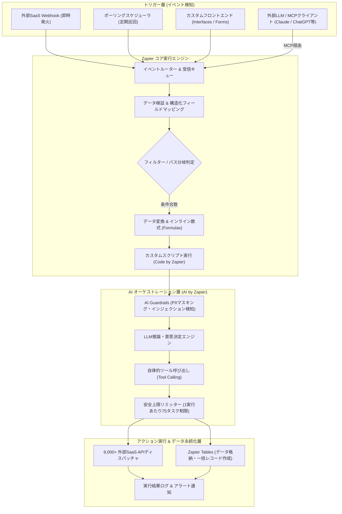

# **Zapier 調査レポート**

## **1. 基本情報**

* **ツール名**: Zapier
* **ツールの読み方**: ザピアー
* **開発元**: Zapier Inc.
* **公式サイト**: [https://zapier.com/](https://zapier.com/)
* **関連リンク**:
  * ドキュメント: [https://help.zapier.com/hc/en-us](https://help.zapier.com/hc/en-us)
  * レビューサイト: [G2](https://www.g2.com/products/zapier/reviews) | [Gartner Peer Insights](https://www.gartner.com/reviews/market/enterprise-integration-platform-as-a-service/vendor/zapier)
* **カテゴリ**: ワークフローエンジン
* **概要**: Zapierは、9,000以上のWebアプリケーションやクラウドサービスをノーコードで相互連携させ、イベント駆動型ワークフロー、AIエージェント、カスタムアプリの構築を可能にする自動化プラットフォーム（iPaaS）です。直感的なビジュアルエディタと高度なAI機能を組み合わせることで、プログラミング知識を持たない現場のビジネス担当者でも高度な業務自動化を即座に実現できます。

## **2. 目的と主な利用シーン**

* **解決する課題**:
  * 複数のSaaSや社内ツールをまたいで発生する手作業のデータ転記・ルーティン作業を解消し、業務効率と生産性を飛躍的に高める。
  * 開発者や情シスの工数を割くことなく、ビジネス部門の現場主導でセキュアかつスピーディなシステム間連携を実現する。
  * 自律型AIや大規模言語モデル（LLM）を既存の業務ツール群とダイレクトに接続し、実用的なAI駆動型ワークフローを即座に運用環境へ投入する。
* **想定利用者**:
  * マーケター、セールスオペレーション、カスタマーサクセス、人事・経理などのビジネスユーザー。
  * リソースが限られており業務自動化を内製化したいスタートアップや中小企業。
  * ガバナンスを維持しつつ現場のデジタル化を推進したいエンタープライズのDX推進担当者。
* **利用シーン**:
  * **マーケティング**: Webフォームや広告からのリード獲得を検知し、CRM（Salesforce/HubSpot）へ自動登録の上、SlackやTeamsへ即時通知・リードスコアリングを実施。
  * **営業・契約管理**: 電子署名サービスでの契約締結を契機に、会計ソフトへの請求書作成、クラウドストレージ（Google Drive/Box）への契約書格納、プロジェクト管理ツールへの案件セットアップを自動連鎖。
  * **自律型AIワークフロー**: 顧客からの問い合わせメールを受信後、「AI by Zapier」が内容を分類・要約し、ナレッジベースを検索して回答ドラフトを作成、担当者の承認を経て自動返信。
  * **外部AIアシスタントからの操作 (MCP連携)**: ClaudeやChatGPT等の外部チャットUIから、Model Context Protocol（MCP）経由でZapierの接続アプリを直接操作し、タスクの起票やデータ更新を実行。

## **3. 主要機能**

* **Zaps**: 「トリガー」（特定イベントの発生）と「アクション」（後続処理）を数珠つなぎにして自動実行するコアワークフローエンジン。条件分岐（Paths）やフィルター（Filters）による高度なロジック制御に対応。
* **AI by Zapier (旧Zapier Agents統合)**: 2026年10月にZapエディタ内へ統合された自律型AIステップ。LLMの推論能力と動的なツール呼び出し（Tool Calling）を標準ステップとして組み込み、柔軟な自律処理と決定論的ワークフローを一体化して構築可能。
* **Tables**: ワークフローで扱うデータを構造化して格納・管理・共有できる自動化特化型データベース。最大1,000レコードの一括作成（Create Multiple Records）や動的テーブル作成・フィールド追加などの自動化アクションに対応。
* **Interfaces**: フォーム、入力ポータル、ダッシュボードなどのWebフロントエンドをノーコードで作成し、自動化プロセスを手動で起動・操作できるUIビルダー機能。
* **AI Guardrails**: 個人識別情報（PII）の自動マスキング、プロンプトインジェクション検知、安全基準外コンテンツのブロックなど、エンタープライズでのAI運用をセキュアに保つガバナンス機能。
* **Canvas**: AIアシスタントと対話しながら、システム全体のデータフローやワークフロー構成を視覚的に設計・整理・デプロイできるダイアグラムツール。
* **Code by Zapier**: JavaScript（Node.js）およびPythonのカスタムコードを実行できるスクリプトステップ。npmやPyPIの主要パッケージ利用、AIアシストコード生成に対応（旧Zapier Functionsは2026年9月に廃止され本機能へ一本化）。
* **Model Context Protocol (MCP) サポート**: Anthropic ClaudeやOpenAI ChatGPTなどの主要LLMから、Zapierが提供する9,000以上の連携アクションを「外部ツール」として直接呼び出せるAI接続インターフェース。

## **4. 動作原理・システム構成**

Zapierは、マルチテナント環境で稼働するクラウド完結型iPaaS（Integration Platform as a Service）およびAIオーケストレーション基盤です。トリガーイベントの検知からデータ変換、AI推論、宛先サービスへのアクション実行までをイベント駆動型のマイクロサービス群が高速に処理します。

* **アーキテクチャ**:
  * **完全マネージドなクラウドネイティブ構成**: ユーザー側でのサーバー構築・運用保守は一切不要。AWS上に構築された堅牢な基盤で、高可用性と自動スケーリングを実現。
  * **ハイブリッドトリガー方式**: Webhookを受信して数秒以内で即座に処理を開始する「Instant Trigger」と、APIを定期巡回して差分を検知する「Polling Trigger」（プランに応じて1〜15分間隔）を併用。
* **主要コンポーネントとデータフロー**:
  * **イベント受信・正規化**: トリガーが発生すると、受信キューを経て各アプリケーション固有のJSONレスポンスを共通のキー・バリュー形式へ正規化。
  * **パイプライン処理**: フィルター条件判定、インライン数式（In-line formulas）やFormatterによる型変換・文字列操作を経て、後続のアクションステップへデータを流し込みます。
  * **AIオーケストレーション & ガードレール**: AIステップ実行時は、まず「AI Guardrails」が機密情報（PII等）を検知・マスキング。LLM推論により必要なツール呼び出しを決定し、暴走防止リミッター（1回の実行につき最大75タスク）の監視下で安全に実行。
  * **アクションディスパッチ**: OAuth2等で安全に保管された認証トークンを用い、接続先SaaSのREST APIへペイロードを配信。処理結果はZapier Tablesへ書き戻されるか、Slackやメール等で通知されます。
* **特筆すべき要素技術**:
  * **セキュアな分離実行環境**: 「Code by Zapier」では分離されたサンドボックスコンテナ内でPython/JavaScriptを実行し、外部APIコールやデータ処理を安全に行う。
  * **Model Context Protocol (MCP)**: 標準化されたオープンプロトコルを採用し、クライアント（外部LLM）とZapierの膨大なツール群をシームレスにブリッジ。
  * **厳格な接続オーナーシップ制御**: 組織内のセキュリティとガバナンスを保つため、共有ワークフロー内の連携接続に対してオーナーアクセス権限を要求する設計。

## **5. 開始手順・セットアップ**

* **前提条件**:
  * 有効なメールアドレス、またはGoogle/Microsoftアカウント。
  * 連携させたい各種外部サービスのアカウントおよびAPIアクセス権限。
* **アカウント作成**:
  * 公式サイト（[https://zapier.com/](https://zapier.com/)）にアクセスし、[Sign Up] からアカウントを作成（Google/Microsoft SSOが利用可能）。
* **初期設定**:
  * オンボーディング画面で日常的に利用する主要SaaS（Gmail, Slack, Notion等）を選択し、ワークスペースを作成。
* **クイックスタート (最初のZap作成)**:
  1. ダッシュボードの **[+ Create Zap]** をクリックしてビジュアルエディタを開く。
  2. **Trigger (トリガー)** を設定: きっかけとなるアプリ（例: Google Forms）とイベント（例: New Form Response）を選択し、アカウントを接続してテストデータを取得。
  3. **Action (アクション)** を設定: 実行したいアプリ（例: Slack）とイベント（例: Send Channel Message）を選択し、トリガーから受け取った回答内容をメッセージ欄にマッピング。
  4. 必要に応じて「AI by Zapier」ステップを追加し、自由記述の問い合わせ内容を感情分析・要約するロジックを挟む。
  5. テスト実行を行い、期待通りのデータが送信されていることを確認したら **[Publish]** をクリックして本番稼働を開始。

## **6. 特徴・強み (Pros)**

* **圧倒的な連携アプリ数 (9,000+)**: 業界トップの9,000以上のSaaS・Webサービスと標準連携可能。マイナーな業務特化ツールから最新の生成AIツールまで幅広くカバーしており、「連携先が存在しない」という事態をほぼ回避できる。
* **直感的で洗練されたノーコードUI**: 専門的なプログラミング知識がなくても、視覚的なフローチャート形式で直感的にワークフローを構築可能。CopilotやCanvasなどのAI支援機能により、自然言語のプロンプトから骨格を自動生成できる。
* **先進的なAIオーケストレーション (AI by Zapier / MCP)**: 2026年10月の刷新により、自律型AIエージェントの推論能力とツール呼び出しが標準Zapエディタに完全に溶け込んだ。さらにMCP（Model Context Protocol）対応により、ClaudeやChatGPTなどの外部LLMからZapierの全アクションを呼び出す「AIの実行レイヤー」としての地位を確立。
* **堅牢なエンタープライズセキュリティとガバナンス**: SOC 2 (Type II) / SOC 3に準拠し、99.99%の稼働率を維持。PIIのマスキングやプロンプトインジェクションを防ぐ「AI Guardrails」、アプリアカウントのオーナーアクセス必須化、SAML SSO、詳細な監査ログなど、大企業の要求水準を満たす。

## **7. 弱み・注意点 (Cons)**

* **日本語対応の不足**: 管理画面のUI、エラーメッセージ、公式ドキュメント、サポート窓口は依然として英語が中心。日本語のデータ送受信自体は問題なく処理できるが、管理運用には一定の英語力または翻訳ツールの利用が必要。
* **従量課金とAIステップによるコスト高騰リスク**: 月間タスク消費数に基づく課金モデルを採用しており、頻繁に発火するワークフローでは費用が嵩みやすい。特にAIステップ（AI by Zapier）は利用モデルに応じてタスク消費倍率（Standard 1x, Advanced 3x, Premium 5x）が適用されるため、コスト試算と上限管理が不可欠。
* **極端に複雑な分岐や大量データ処理の制約**: ビジュアルに直線的なパイプラインを組むのには最適である一方、複雑に入れ子になったループ処理や数十万件単位のバルクデータETL処理は、Makeやn8n、専用のデータ統合ツール（Fivetran等）と比較して構築難易度やコスト面で不利になる場合がある。

## **8. 料金プラン**

| プラン名 | 料金（年払い） | 月払い換算 | 主な特徴 |
|---------|------|------|---------|
| **Free** | 無料 | 無料 | 100タスク/月、無制限のZaps、Tables、Interfaces、AI Copilot。**2ステップZap（1トリガー＋1アクション）限定**。 |
| **Professional** | $19.99/月〜 | $29.99/月〜 | 750タスク/月〜（ボリュームに応じて拡張）。**マルチステップZap**、無制限のプレミアムアプリ連携、Webhooks、Code by Zapier、高度な分岐（Paths/Filters）。 |
| **Team** | $69/月〜 | $103.50/月〜 | 2,000タスク/月〜。Professionalの全機能に加え、最大25ユーザー、共有ワークスペース/フォルダ/接続、SAML SSO、優先サポート。 |
| **Enterprise** | 要問い合わせ | 要問い合わせ | Teamの全機能に加え、無制限ユーザー、カスタムタスク上限、高度なデータガバナンスとセキュリティ、専任テクニカルアカウントマネージャー。 |

* **AIステップのタスク消費倍率 (Model-Based Pricing)**:
  * **Standard モデル**: 1タスク消費（基本推論）
  * **Advanced モデル**: 3タスク消費（デフォルトのツール呼び出し対応モデル）
  * **Premium モデル**: 5タスク消費（最上位モデルでの高度な自律推論）
  * ※予期せぬ無限ループやコスト暴走を防ぐため、1回のZap実行につき最大75タスクで自動一時停止する安全上限機能が標準適用。
* **課金体系**: 主に月間タスク消費量に基づく従量課金。上限を超過した場合もワークフローが即時停止せず、自動拡張ブロック（Pay-per-task）で継続稼働可能。
* **無料トライアル**: ProfessionalプランおよびTeamプランで14日間の無料トライアルが利用可能。

## **9. 導入実績・事例**

* **導入企業**: Meta, Airbnb, Disney, Okta, HP, Samsung, P&G, Siemensなど、Fortune 500選出企業を含む世界数百万社で採用。
* **導入事例**:
  * **Toyota of Orlando**: 顧客からの問い合わせ対応や車両点検予約の管理にAIワークフローを導入し、毎週20時間以上の工数を削減。
  * **Slate Magazine**: 購読者管理とリードナーチャリングのワークフローを自動化し、月間2,000件以上の新規リード獲得を手作業なしで達成（月間100時間以上の工数削減）。
  * **グローバルSaaS企業**: MCPサーバー機能を活用し、社内のClaude Enterprise環境からZapier経由でJiraやSalesforceのタスクをセキュアに直接操作する統合環境を構築。
* **対象業界**: IT・インターネット、マーケティング・広告、金融、不動産、ヘルスケア、教育、小売など、業界や企業規模を問わず汎用的に導入。

## **10. サポート体制**

* **ドキュメント**: [Zapier Help Center](https://help.zapier.com/hc/en-us)が整備されており、アプリごとの設定チュートリアル、API仕様、トラブルシューティングガイドが極めて豊富（英語）。
* **コミュニティ**: [Zapier Community](https://community.zapier.com/)が活発に稼働しており、世界中の自動化エキスパートやZapier認定パートナーによるQ&A、ユースケース共有が行われている。
* **公式サポート**:
  * **Free / Professionalプラン**: ヘルプセンター、コミュニティフォーラム、メールサポート。
  * **Teamプラン**: 優先メールサポートおよびライブチャットサポート。
  * **Enterpriseプラン**: 専任のテクニカルアカウントマネージャー（TAM）による導入支援、SLA保証付きの優先サポート。

## **11. エコシステムと連携**

### **11.1 API・外部サービス連携**

* **API**: 外部システムからZapsの起動やステータス取得を行うREST APIおよび「Webhooks by Zapier」を提供。API仕様が公開されているほぼすべてのWebサービスと連携可能。
* **Model Context Protocol (MCP)**: AIエージェント接続の標準仕様であるMCPに対応。Anthropic ClaudeやOpenAI等の外部LLMプラットフォームからZapierのツール群をリモート関数として呼び出し可能。
* **外部サービス連携**: **9,000以上**のアプリケーションと標準連携。
  * **コラボレーション・オフィス**: Slack, Microsoft Teams, Google Workspace (Gmail, Sheets, Drive), Microsoft 365, Notion, Asana, Trello
  * **CRM・マーケティング**: Salesforce, HubSpot, Mailchimp, ActiveCampaign, Marketo, Zendesk, Intercom
  * **AI・機械学習**: OpenAI (ChatGPT), Anthropic (Claude), Google Gemini, Perplexity, 各種カスタムLLMプロバイダー
  * **データベース・開発**: Airtable, PostgreSQL, MySQL, GitHub, GitLab, Webhooks

### **11.2 技術スタックとの相性**

| 技術スタック | 相性 | メリット・推奨理由 | 懸念点・注意点 |
|:---|:---:|:---|:---|
| **Next.js / React** | ◎ | WebhookやZapier REST APIを利用し、フォーム送信やユーザー登録後の非同期バックエンド処理をZapierへ容易にオフロード可能。 | ミリ秒単位のリアルタイムレスポンスが求められる同期処理には適さない。 |
| **Python (Code by Zapier)** | ◯ | 標準アクションでは対応できない独自のデータ加工、正規表現、外部暗号化処理などを直接スクリプト実行可能。PyPIパッケージも一部サポート。 | 実行時間制限やメモリ上限があるため、重いバッチ計算には向かない。 |
| **NoCode (Bubble / Webflow)** | ◎ | ネイティブコネクタやWebhookが完備されており、フロントエンドのノーコード開発とバックエンド自動化の組み合わせとしてデファクトスタンダード。 | データモデルの変更時にフィールドマッピングの同期ズレに注意が必要。 |
| **SQL Database (PostgreSQL/MySQL)** | △ | レコードの追加・更新トリガーや参照アクションに対応。 | 大量データのバルク同期や複雑なJOINクエリには不向き。単発のトランザクション処理に限定することが推奨される。 |

## **12. セキュリティとコンプライアンス**

* **認証**: SAML SSO（シングルサインオン）、二要素認証（2FA）、SCIMによるユーザープロビジョニングに対応（Team/Enterpriseプラン）。ワークフロー内のアプリアカウント接続にはオーナー権限を要求。
* **データ管理**: AWS上のセキュアなインフラストラクチャにデータを格納。保存データはAES-256、通信経路はTLS 1.2以上で常時暗号化。「AI Guardrails」により個人情報（PII）や機密トークンのマスキングを自動化。
* **準拠規格**: SOC 2 (Type II), SOC 3, GDPR, CCPA, HIPAA（エンタープライズ契約時）に準拠。厳格なサードパーティセキュリティ監査を定期的に受審。

## **13. 操作性 (UI/UX) と学習コスト**

* **UI/UX**: ビジュアルで直感的なノードベースのワークフローエディタ。各ステップの設定がウィザード形式で進行し、入力候補が自動サジェストされるため設定ミスが起こりにくい。「Zapier Canvas」により、ワークフロー全体の俯瞰や設計も容易。
* **学習コスト**: 極めて低い。基本的なトリガーとアクションの連携であれば、非エンジニアでも数十分から数時間で構築・本番稼働が可能。AI Copilotを活用することで、「Slackに通知してスプレッドシートに転記したい」と自然言語で入力するだけでワークフローの雛形が自動生成される。

## **14. ベストプラクティス**

* **効果的な活用法 (Modern Practices)**:
  * **インライン数式 (In-line formulas) の最大活用**: 文字列加工や簡単な数値計算を行う際、余分なFormatterステップを挟まず入力欄内でインライン処理することで、ステップ数とタスク消費量を節約する。
  * **Filter by Zapierの先頭配置**: 条件に合致しないイベントはパイプラインの早い段階で中断（Halt）させ、不要な後続アクションのタスク消費を防ぐ。
  * **AI Guardrailsの組み込み**: LLMをワークフローに組み込む際は必ずAI Guardrailsを有効化し、プロンプトインジェクションや個人情報の不用意な外部送信を防御する。
  * **Tablesを活用したバッチ処理**: 複数の行データを一度に処理する際は「Create Multiple Records」アクション等を活用し、APIコール数とタスク消費を最適化する。
* **陥りやすい罠 (Antipatterns)**:
  * **無限ループの誘発**: 「Aツールの更新でBツールを更新し、Bツールの更新がAツールのトリガーを叩く」といった双方向Zapによるタスク上限の瞬間枯渇。相互更新フラグや更新者チェックを必ず設定すること。
  * **旧Zapier Functionsの放置**: 2026年9月1日をもって旧Zapier Functionsは退役しているため、未移行のコードがある場合は速やかに「Code by Zapier」へ移行する必要がある。
  * **AIステップのモデル選択ミス**: 単純なテキスト分類にPremiumモデル（5x消費）を割り当ててタスク枠を過剰消費してしまうケース。要件に応じてStandard（1x）やAdvanced（3x）を適切に使い分ける。

## **15. ユーザーの声（レビュー分析）**

* **調査対象**: G2, Gartner Peer Insights
* **総合評価**:
  * G2: 4.5/5.0 (1,900件以上のレビュー)
  * Gartner Peer Insights: 4.5/5.0 (900件以上のレビュー)
* **ポジティブな評価**:
  * 「連携できるアプリの数が圧倒的。社内で導入しているニッチなクラウドサービスでもZapierなら接続でき、手作業が大幅に削減された」（G2レビュー）
  * 「非プログラマーの現場メンバーが、自分たちで業務改善の仕組みを即日で作れる。IT部門への開発依頼待ちがなくなった」（Gartnerレビュー）
  * 「AI by ZapierとMCPサポートの進化が素晴らしく、社内AIチャットから安全に既存SaaSを操作できる基盤として重宝している」（G2レビュー）
* **ネガティブな評価 / 改善要望**:
  * 「管理画面やエラー通知が英語のため、英語に不慣れな現場スタッフには敷居が高い。完全な日本語ローカライズを望む」（ユーザーフィードバック）
  * 「タスク消費課金のため、実行回数が増えると急激に利用料金が跳ね上がる。AIステップのモデル倍率計算も事前のコスト見積もりが難しい」（G2レビュー）
  * 「分岐が非常に多い複雑なシナリオを組もうとすると、UIが縦長になり管理が煩雑になる。Makeのような自由配置キャンバスが欲しい」（G2レビュー）
* **特徴的なユースケース**:
  * ClaudeやChatGPTのMCPクライアントとZapierを接続し、チャット対話を通じて複数SaaSのタスク起票やデータ検索を一元的に行う「次世代AIアシスタントハブ」としての活用。

## **16. 直近半年のアップデート情報**

* **2026-10-20**: **Zapier Agentsの「AI by Zapier」エディタ統合**: スタンドアロン機能だったZapier Agentsを標準Zapエディタ内へ「AI by Zapier」ステップとして完全統合。自律的な推論、ツール呼び出し（Tool Calling）、決定論的ワークフローのシームレスな一体運用が可能に。
* **2026-10-05**: **Zapier Tablesの自動化アクション拡充**: ラインアイテムから最大1,000レコードを一括作成する「Create Multiple Records」アクションや、動的なテーブル作成・フィールド追加アクションをリリース。
* **2026-09-01**: **Zapier Functionsの正式廃止と「Code by Zapier」への完全移行**: 旧Zapier Functionsを退役させ、npm/PyPIパッケージサポートやAIコード生成アシストを備えた「Code by Zapier」にカスタムコード実行環境を一本化。
* **2026-08-15**: **AIステップのモデル別価格体系 (Model-Based Pricing) とセーフティ上限の導入**: AI by Zapierステップにモデル階層（Standard 1x, Advanced 3x, Premium 5x）を設定。また、暴走防止のため1実行あたり75タスクでの一時停止リミットを標準実装。
* **2026-07-20**: **連携エコシステムが9,000アプリを突破**: 連携可能なアプリケーション数が9,000サービスを突破。Airtable、Asana、Calendly、SharePoint（Graph API移行）等の主要コネクタでトリガー・アクションを大幅強化。
* **2026-05-20**: **Model Context Protocol (MCP) サポート開始**: ClaudeやChatGPT等の主要AIモデルからZapierの全アクションをリモート関数として直接呼び出せるMCPサーバー機能の提供を開始。
* **2026-05-01**: **アプリアカウント接続のセキュリティ強化**: すべてのZapsで連携するアプリアカウントに対してオーナーアクセス（owner access）を必須化し、エンタープライズガバナンスを向上。
* **2026-04-15**: **カスタムAIプロバイダー連携 & Guided Templates**: 自社ホストのLLMや外部カスタムAIプロバイダーを接続可能にし、事前構成済みテンプレートによる迅速なデプロイをサポート。

(出典: [Zapier Product Updates](https://zapier.com/blog/categories/product-updates/), [Zapier Community](https://community.zapier.com/))

## **17. 類似ツールとの比較**

### **17.1 機能比較表 (星取表)**

| 機能カテゴリ | 機能項目 | 本ツール (Zapier) | Make | n8n | Workato |
|:---:|:---|:---:|:---:|:---:|:---:|
| **基本機能** | 連携アプリ数 | ◎ <small>9,000+対応</small> | ◯ <small>1,600+対応</small> | ◯ <small>400+対応</small> | ◯ <small>1,200+対応</small> |
| **カテゴリ特定** | 複雑なロジック・ループ | △ <small>直線的・Paths</small> | ◎ <small>視覚的で極めて柔軟</small> | ◎ <small>コード・ノード自由</small> | ◎ <small>高度な企業ロジック</small> |
| **AIオーケストレーション** | 自律エージェント/MCP | ◎ <small>AI by Zapier / MCP</small> | ◯ <small>AI Assistantノード</small> | ◎ <small>LangChain連携強</small> | ◯ <small>Workato AI / Copilot</small> |
| **運用** | コストパフォーマンス | △ <small>タスク課金・やや割高</small> | ◯ <small>オペレーション単価安価</small> | ◎ <small>セルフホスト無料</small> | △ <small>高額エンタープライズ</small> |
| **非機能要件** | 日本語対応 | △ <small>英語中心</small> | △ <small>UI一部日本語化</small> | △ <small>英語中心</small> | ◯ <small>日本語UI・サポート完備</small> |

### **17.2 詳細比較**

| ツール名 | 特徴 | 強み | 弱み | 選択肢となるケース |
|---------|------|------|------|------------------|
| **本ツール (Zapier)** | 業界デファクトのクラウドiPaaS。圧倒的な連携アプリ数と使いやすさが特徴。 | 連携アプリ数(9,000+)、AI by ZapierやMCPなど先進的なAI機能、学習コストの低さ。 | 処理量に応じた課金が割高、日本語UI未対応、複雑なループやデータ加工の制約。 | 多数のSaaSを即座に繋ぎたい場合。非エンジニア主導で自動化やAI連携を推進したい場合。 |
| **Make** | 自由配置のビジュアルキャンバスが特徴。データルーティングや配列処理に強み。 | 複雑な分岐や配列データ加工を視覚的に構築可能、タスク単価が比較的安価。 | 連携アプリ数はZapierより少なく、習熟に一定のロジック思考が必要。 | 複雑な条件分岐、配列データの反復処理、コスト効率を重視した自動化を行いたい場合。 |
| **n8n** | オープンソースベースでフェアコードライセンスを採用。セルフホストに対応。 | 自社インフラで完全制御可能、実行回数課金なし、JavaScript/Pythonでの高度な拡張性。 | サーバーの構築・保守運用工数が必要、非技術者には導入ハードルが高い。 | データを自社環境外に出せない要件がある場合や、大量の実行を低コストで行いたいエンジニアチーム。 |
| **Workato** | エンタープライズ特化の統合iPaaS。高度なガバナンスとセキュリティを重視。 | 堅牢なセキュリティ認証、ITとビジネスの協調管理、完全な日本語サポート体制。 | 導入初期費用・年間ライセンスが高額、中小規模での導入にはオーバースペック。 | 大企業での全社的システム統合基盤。厳しいコンプライアンスや専任サポートが必須な場合。 |

## **18. 総評**

* **総合的な評価**:
  Zapierは、9,000以上という他を圧倒する連携サービス数と、ノーコードで誰でも直感的に扱えるUXを兼ね備えた、ワークフロー自動化（iPaaS）のデファクトスタンダードです。2026年においては、エディタに統合された「AI by Zapier」や「Model Context Protocol (MCP)」サポート、エンタープライズ向けの「AI Guardrails」を投入し、単なるSaaS連携ツールから「エンタープライズAIオーケストレーション基盤」へと大きな進化を遂げています。
* **推奨されるチームやプロジェクト**:
  * **非エンジニア主導のビジネス部門**: マーケティング、セールス、バックオフィスなどで、現場担当者が自ら業務改善の自動化やAI活用を迅速に形にしたいチーム。
  * **多種多様なSaaSを運用する成長企業**: 既存の社内ツール群をハブとして一元的に繋ぎ合わせ、データ連携や通知をスムーズに統合したいスタートアップ・中小企業。
  * **外部LLMと実務ツールの連携ハブを求める組織**: ClaudeやChatGPT等の最先端AIモデルから自社の業務SaaSを安全に操作する実行基盤を即座に構築したいプロジェクト。
* **選択時のポイント**:
  * **連携対象サービスの網羅性**: 利用しているツールが他製品で非対応でも、Zapierであれば高確率でカバーされています。
  * **タスク処理量とコストバランス**: 大量データの頻繁な同期やAIステップの多用では課金が急増する可能性があるため、インライン数式の活用やフィルターによる無駄なタスク消費の防止策を講じる必要があります。
  * **英語UIへの許容度**: システム全体が英語ベースであるため、チームメンバーが英語の管理画面を抵抗なく操作できるかが導入の判断材料となります。
