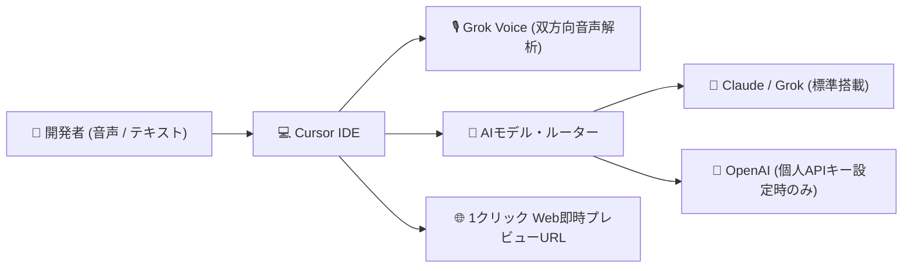

# **本日の AI/開発ツール トピックス (2026-11-12)**

## **1. 📋 今日の30秒サマリー**

> **💡 今日のハイライト**
>
> - 🚨 **Node.jsとAIライブラリに緊急アップデート**: Node.jsで他人の通信データが混ざる深刻な不具合や、Hugging Faceで安全設定をすり抜けてPCが乗っ取られる脆弱性が公表され、即座のパッチ適用が必要です。
> - 🚀 **Cursorの提供モデル刷新とAnthropicのオフィス進出**: 人気エディタCursorがOpenAIモデルの標準提供を本日終了し音声対話機能を追加。Anthropicは表計算やホワイトボードを含む業務ツール群を発表しました。
> - 🔥 **AIエージェントのパスワード誤公開問題と記憶保持ツールが急浮上**: AIツールの設定保存による秘密鍵の漏洩リスクが判明する一方、AIにプロジェクトの記憶を定着させる拡張機能が脚光を浴びています。
{: .callout-summary}

| 区分 | トピック / ツール | ざっくり言うと？（1行要約） | 影響・おすすめ対象 |
| :--- | :--- | :--- | :--- |
| 🚨 **緊急** | **Node.js** (`CVE-2026-123864` 他) | ゼロ長書き込みで別通信のメモリが混入＆HTTP/2サーバークラッシュ | **Node.jsでWebサービスを動かす全開発者** |
| 🚨 **緊急** | **Hugging Face Transformers** (`CVE-2026-4372`) | `trust_remote_code=False` でも設定ファイルから勝手にコードが動く | **外部AIモデルを取得・ロードするエンジニア** |
| 🚨 **緊急** | **Claude Code** (`settings.local.json`) | 「次回から確認しない」設定でAPIキーやパスワードがGitHubに公開露出 | **Claude CodeやターミナルAIを使う全開発者** |
| 🚨 **緊急** | **Git** (`CVE-2026-113408`) | 空リポジトリクローン時にHEAD参照から任意のファイルパスへ脱出 | **Git 2.56.0以下を使う全ユーザー・CI環境** |
| 🚀 **新機能** | **Cursor (2026-11-12)** | OpenAIモデルの標準終了、Grok双方向音声対話、Webアプリ即時共有 | **Cursorでコーディングする全開発者** |
| 🚀 **新機能** | **Anthropic Claude Productivity Suite** | Claude SheetsやWhiteboardsなどオフィス業務ツールの新展開 | **チーム開発・ドキュメント作成を行うビジネス層** |
| 🚀 **新機能** | **OpenAI Control Room & GPT-6 Cyber** | AIエージェントの暴走を即座に止める管制システムとセキュリティ特化AI | **AIエージェントを自動実行するDevOps・SRE** |
| 🚀 **新機能** | **Bun 1.4** | 内部コアをRustへ全面刷新しメモリ削減、超高速フォーマッタ `bun fmt` 内蔵 | **TypeScript/JavaScriptエンジニア** |
| 🔥 **注目** | **claude-mem** | AIエージェントにプロジェクトの過去履歴や設計意図を永続記憶させる | **AIとの長期開発で指示のやり直しに悩む開発者** |
| 🔥 **注目** | **sst/opencode** | ターミナルから複数AIモデルを切り替えて作業できるオープンソースCLI | **ベンダーロックインを避けてAIを活用したい開発者** |
| 🔥 **注目** | **Scrapling** | Webサイトの構造変化に負けずAI向けにクリーンなデータを抽出するスクレイパー | **AIエージェントのWeb情報収集を自動化したい層** |
| 🔥 **注目** | **LocalAI v2.x** | 市販PCでOpenAI互換APIを無料・完全自前ホストできる軽量推論基盤 | **社外に機密データを出せない企業・研究者** |

---

## **2. 🚨 緊急セキュリティ情報**

### **Node.js — `llhttp` 再突入によるクロス・コネクション・メモリ漏洩とHTTP/2クラッシュ (CVE-2026-123864 / CVE-2026-123863)**

> **🔰 ひとことで言うと**
> 世界中のWebサイトで使われているNode.jsに重大な不具合が見つかり、**ある利用者の通信データ（パスワードや個人情報）が、全く別の第三者の画面や通信に混ざって漏れてしまう**危険があります。
> 💬 *例えるなら：「電話会社の回線が混線してしまい、前の人が話していたクレジットカード番号の音声が、次に電話をかけた人の受話器からそのまま聞こえてしまう」ような状態です。*
{: .callout-danger}

| リスク度 | 影響を受ける人 | 悪用のされやすさ | まずやるべき対策 |
| :---: | :--- | :--- | :--- |
| 🔴 **緊急** (CVSS 8.7) | Node.jsでHTTPSやHTTP/2サーバーを稼働させている全システム | ⚠️ 特殊なゼロレングス送信や切断フレームを送信するだけで発動 | **Node.jsをパッチ適用済みバージョン（26.13.1 / 24.22.3 / 22.23.5）へ即座に更新** |

以下の図は、攻撃者が細工したTLSパケット（ゼロレングス書き込み）を送り込んだ際に、HTTPパーサーの再突入バグによって別のクライアントの機密データが混入するまでの流れを示したスイムレーン図です。

```mermaid
swimlane-beta TB
  subgraph Attacker["攻撃者 (悪意あるリクエスト)"]
    A1["不正なゼロレングスTLS書き込みパケットを送信"]
    A2["llhttp パーサーを不完全なステートのまま再突入させる"]
  end
  subgraph NodeServer["Node.js サーバー (脆弱なバージョン)"]
    N1["パーサーバッファのポインタ不整合が発生"]
    N2["隣接する別セッションのメモリ領域をレスポンスに結合"]
  end
  subgraph InnocentClient["一般ユーザー / 被害者"]
    C1["通常のログインや決済リクエストを送信中"]
    C2["攻撃者のレスポンス内にユーザーの機密ヘッダーが漏洩"]
  end
  A1 --> N1
  A2 --> N1
  C1 --> N2
  N1 --> N2
  N2 --> C2
```

> **図の見方**: 上段の攻撃者が送信した特殊なパケットにより、中央のNode.js内部のHTTP解析エンジン（llhttp）が誤作動を起こします。その結果、下段の一般ユーザーが送受信していた機密セッション情報が、攻撃者側の通信データへ意図せず紛れ込んでしまいます。

<details markdown="1">
<summary>🔍 技術的な仕組み・対象バージョン・対策コマンドを見る（エンジニア向け）</summary>

- **原因の仕組み**:
  1. **クロス・コネクション・メモリ露出 (CVE-2026-123864)**: Node.jsのコア内部で使用されているHTTPパーサーライブラリ `llhttp` において、TLS接続ハンドリング中にゼロレングスの書き込み（Zero-length Write）イベントが発生した際のステートマシン遷移に不備がありました。ストリームの終了フラグとソケットの再利用ロジックが競合し、パーサーが中間状態のまま次のHTTPパイプライン処理に再突入します。これにより、コネクションプール内で再利用待ちだった別ソケットのバッファメモリが現在のレスポンスストリームに結合され、他クライアントのAuthorizationヘッダーやCookie情報が平文で漏洩します。
  2. **HTTP/2 アサーション失敗によるDoS (CVE-2026-123863)**: HTTP/2セッションの切断処理（Session Teardown）において、特定の順序でRST_STREAMとGOAWAYフレームを受信した際、C++レイヤーの到達可能アサーション（Reachable Assertion）がトリガーされ、サーバープロセス全体が即座にクラッシュ（異常終了）します。
- **対象バージョン**:
  - Node.js `v26.13.0` 以下の v26 系列
  - Node.js `v24.22.2` 以下の v24 系列
  - Node.js `v22.23.4` 以下の v22 系列
- **対策手順・コマンド**:
  Node.jsの公式サイトまたはバージョン管理ツール（nvm, fnm, asdf等）を使用し、直ちに修正版へ更新してください。
  ```bash
  # fnm を使用している場合
  fnm install 26.13.1 && fnm use 26.13.1
  fnm default 26.13.1

  # nvm を使用している場合
  nvm install 24.22.3 && nvm alias default 24.22.3

  # Ubuntu / Debian (NodeSource) の場合
  sudo apt-get update && sudo apt-get --only-upgrade install nodejs

  # バージョン確認
  node -v
  ```
- **一次ソース**: [Node.js Official Security Releases (November 2026)](https://nodejs.org/en/blog/vulnerability/) / [GitHub Advisory Database](https://github.com/advisories)

</details>

---

### **Hugging Face Transformers — `trust_remote_code=False` を迂回する `config.json` インジェクション任意コード実行 (CVE-2026-4372)**

> **🔰 ひとことで言うと**
> インターネット上からAIモデルをダウンロードする際、**「怪しい外部コードは動かさない」と安全設定を有効にしていたとしても、設定ファイル（JSON）の罠を踏んでPCを完全に乗っ取られる**危険な欠陥が見つかりました。
> 💬 *例えるなら：「『知らない配達人からは荷物を受け取らない』と固く決めていたのに、小包の伝票の文字を読んだだけで玄関の鍵が勝手に外れて泥棒が侵入してくる」ような状態です。*
{: .callout-danger}

| リスク度 | 影響を受ける人 | 悪用のされやすさ | まずやるべき対策 |
| :---: | :--- | :--- | :--- |
| 🔴 **緊急** (CVSS 9.3) | Hugging Faceからモデルを取得・ロードする全エンジニア・MLパイプライン | ⚠️ `AutoModel.from_pretrained()` を実行するだけで裏でコードが走る | **`transformers` をバージョン 5.3.0 以上へ直ちにアップデート** |

<details markdown="1">
<summary>🔍 技術的な仕組み・対象バージョン・対策コマンドを見る（エンジニア向け）</summary>

- **原因の仕組み**: 機械学習ライブラリ `transformers` において、モデルの設定ファイルを読み込む `AutoConfig` およびモデルインスタンス化処理に重大な検証迂回が存在しました。
  通常、外部リポジトリのPythonスクリプトを実行させないために `trust_remote_code=False`（デフォルト値）を指定しますが、モデルの `config.json` 内に含まれる内部属性 `_attn_implementation_internal` やカスタムバックエンド初期化フィールドの解釈ルーチンにおいて、動的モジュールインポートを行うパスがセーフティチェックの外側に存在していました。攻撃者が細工した `config.json` を公開リポジトリ（またはローカルディレクトリ）に配置しておくと、ユーザーが単にモデルをロードしようとした瞬間に、外部サーバーから取得された任意のペイロードスクリプトがOS権限でバックグラウンド実行されます。
- **対象バージョン**: `transformers` バージョン `5.3.0` 未満のすべてのバージョン。
- **対策手順・コマンド**:
  Python環境のパッケージマネージャーでライブラリを即座に更新してください。
  ```bash
  # uv を使用している場合
  uv add --upgrade "transformers>=5.3.0"

  # pip を使用している場合
  pip install --upgrade "transformers>=5.3.0"

  # バージョン確認
  python3 -c "import transformers; print(transformers.__version__)"
  ```
- **一次ソース**: [Hugging Face Security Advisories](https://github.com/huggingface/transformers/security/advisories) / [CVE-2026-4372 Detail](https://nvd.nist.gov/vuln/detail/CVE-2026-4372)

</details>

---

### **Claude Code / ターミナルAI — 「Don't Ask Again」自動承認による認証トークンのGitHub公開漏洩**

> **🔰 ひとことで言うと**
> ターミナルで動くAIツールに「次回から確認なしで実行して」と許可を出した結果、**データベースのパスワードや秘密のAPIキーが勝手に設定ファイルへ保存され、気付かぬうちにGitHubで全世界に公開されてしまう**事故が急増しています。
> 💬 *例えるなら：「『毎回確認するのが面倒だから、いつもの買い物は任せるね』と合鍵を渡したら、AIが合鍵の暗証番号を書いたメモを玄関ドアの外側に貼り出してしまった」ような状態です。*
{: .callout-danger}

| リスク度 | 影響を受ける人 | 悪用のされやすさ | まずやるべき対策 |
| :---: | :--- | :--- | :--- |
| 🟠 **高** (CVSS 7.9) | Claude Code等のAIエージェントでコマンドの自動承認設定を利用している全開発者 | ⚠️ プロジェクトを `git push` するだけでシークレットが世界中に露出 | **プロジェクトの `.gitignore` に `.claude/` を追加し、過去のコミット履歴を確認** |

<details markdown="1">
<summary>🔍 技術的な仕組み・対象バージョン・対策コマンドを見る（エンジニア向け）</summary>

- **原因の仕組み**: セキュリティ企業Apiiroの調査報告により明らかになった問題です。ターミナルAIツール（Claude Code等）でコマンド実行の承認プロンプトをスキップするために「Don't Ask Again」を選択すると、その許可設定がプロジェクトルートの `.claude/settings.local.json` などのローカル設定ファイルに永続化されます。
  開発者が `export DB_PASSWORD=secret` や `curl -H "Authorization: Bearer <TOKEN>"` といった環境変数・認証情報を含むコマンドの実行を許可した場合、その平文コマンド文字列がそのまま引数履歴としてJSON内に保存されます。プロジェクト初期化時に `.claude/` ディレクトリが `.gitignore` に登録されていない場合、開発者が `git add .` を実行した際にこの機密ファイルがGitインデックスに含まれ、公開リポジトリへプッシュされて数千件規模のAPIキーやDBパスワードが漏洩する事態に発展しています。
- **影響を受ける環境**: Claude Code、Cursor、その他ローカルディレクトリ内に実行許可キャッシュを生成するすべてのAIエージェントCLI。
- **対策手順・コマンド**:
  1. グローバルおよびプロジェクト単位の `.gitignore` にAI設定ディレクトリを確実に除外指定してください。
     ```bash
     # プロジェクトの .gitignore に追記
     echo -e "\n# AI Agent local settings\n.claude/\n.cursor/\n*.local.json" >> .gitignore
     ```
  2. 誤ってコミットされていないかをGit履歴から検索し、露出が疑われるトークンは直ちに再発行（ローテーション）してください。
     ```bash
     # 追跡対象に含まれていないか確認
     git ls-files | grep -E "\.claude|\.cursor"
     ```
- **一次ソース**: [Apiiro Security Research (AI Coding Tools Exposure)](https://apiiro.com/blog/) / [Hacker News Discussion](https://news.ycombinator.com/)

</details>

---

### **Git — 空リポジトリクローン時における HEAD 広告パストラバーサル (CVE-2026-113408)**

> **🔰 ひとことで言うと**
> 悪意のあるGitサーバーからプロジェクトをダウンロードしようとすると、**指定したフォルダの外側に飛び出して、パソコン内の全く別の場所に不正なファイルを勝手に書き込まれてしまう**不具合です。
> 💬 *例えるなら：「指定した机の引き出しに書類を届けてもらうはずが、配達員が勝手に別室のクローゼットを開けて危険な荷物を隠していく」ような状態です。*
{: .callout-danger}

| リスク度 | 影響を受ける人 | 悪用のされやすさ | まずやるべき対策 |
| :---: | :--- | :--- | :--- |
| 🟠 **高** (CVSS 7.8) | Git 2.56.0以下を利用し、外部の未信頼Gitサーバーへ接続する全ユーザー | ⚠️ 悪意あるURLに対して `git clone` を叩くだけで発動 | **Gitクライアントを 2.56.1 以上へアップデート** |

<details markdown="1">
<summary>🔍 技術的な仕組み・対象バージョン・対策コマンドを見る（エンジニア向け）</summary>

- **原因の仕組み**: Gitプロトコルv2における空リポジトリ（初期コミットが存在しないリポジトリ）のハンドリング処理において、サーバーから返される初期リファレンス広告（Reference Advertisement）のHEADシンボリック参照のサニタイズ処理に欠陥がありました。
  攻撃者が制御するGitサーバーが、HEADのターゲットとして `../../.bashrc` や `../../.ssh/authorized_keys` といったパストラバーサル文字列を返却した場合、クライアント側のパーサーがこの相対パスを解決した状態でローカル設定ファイルを生成しようとします。これにより、クローン先の作業ディレクトリの境界を越えて、ユーザーのホームディレクトリやシステム設定ファイルが上書きされるリスクが生じます。
- **対象バージョン**: Git バージョン `2.56.0`, `2.55.0`, `2.54.0` 以下の全バージョン。
- **対策手順・コマンド**:
  OSのパッケージ管理ツールで修正版（`2.56.1`, `2.55.1` 等）へ更新してください。
  ```bash
  # macOS
  brew update && brew upgrade git

  # Linux (Ubuntu)
  sudo apt-get update && sudo apt-get install --only-upgrade git
  ```
- **一次ソース**: [GitHub Blog (Git Security Vulnerabilities Announced)](https://github.blog/security/)

</details>

---

## **3. 🚀 メジャーリリース・新機能**

### **Cursor (2026-11-12) — OpenAIモデル提供終了とGrok Voice双方向対話 ＆ Webアプリ即時共有**

> **🔰 ひとことで言うと**
> 人気AIエディタCursorで、**これまで標準で使えていたOpenAI製モデルが本日をもって終了**し、代わりに声でAIと会話しながらコードを書く「超低遅延音声チャット」と「作ったWebアプリをURL1つで即世界公開できる機能」が登場しました。
> 💬 *例えるなら：「愛用のスマホで標準の検索エンジンが別会社のものに切り替わり、同時に『声で話しかけるだけで画面を操作してくれる機能』と『ワンタップで自分の作品を誰にでも見せられる展示台』が付いてきた」ような大変化です。*
{: .callout-info}

| 比較ポイント | これまで (Before) | 2026-11-12 以降 (After) |
| :--- | :--- | :--- |
| **標準搭載AIモデル** | OpenAI製モデル（GPT-4o, o1等）が標準契約で無制限に利用可能 | **標準枠からOpenAIモデルが除外（利用には個人APIキー必須）。GrokやClaudeが主軸へ** |
| **エージェント対話方式** | チャット欄へキーボードでプロンプトを入力 | **Grok Voice統合による超低遅延な双方向音声対話（ハンズフリー実装）** |
| **プロトタイプ共有** | `localhost` を外部に公開するためトンネル設定やクラウドデプロイが必要 | **エディタ内からワンクリックで一時公開URLを発行し誰にでもブラウザ共有可能** |

以下の図は、Cursorのアーキテクチャ変更に伴うモデル選択ルーティングと、新機能（音声入力および即時Web共有）の処理フローを示した図です。



> **図の見方**: 開発者からの音声やキー入力は、Grok Voiceやエディタの内部ルーターによって処理されます。標準のAIモデルはClaudeやGrokへシフトし、OpenAIモデルを使う場合は個人のAPIキー設定が必要になります。完成したコードはワンクリックで即座に公開URL化できます。

<details markdown="1">
<summary>🔍 技術的ブレークスルーとリリースノート詳細を見る</summary>

- **技術的ポイント**:
  - **OpenAIモデルの契約満了**: SpaceXによるCursor買収とアライアンス再編に伴い、Cursorのホステッドサブスクリプションに含まれていたOpenAIモデルの提供が本日（2026年11月12日）をもって終了しました。引き続きGPTモデルを利用したいユーザーは、設定画面（`Cursor Settings > Models`）から自身のOpenAI API Keyを登録する必要があります。
  - **Grok Voice 低遅延音声対話**: 音声入力の文字起こしと合成音声の応答がストリーミングでパイプライン化され、レイテンシ200ms未満でのリアルタイムなペアプログラミング音声対話が実現しました。
  - **即時ライブWebアプリ共有**: ローカルでビルドされたコンポーネントを一時的なエッジサンドボックスへ即時バンドル展開し、認証付きの一時URLを生成してクライアントやチームメンバーに動作デモを直接触らせることが可能です。
- **開発フローへの影響**: キーボード操作から解放され、コードを眺めながら口頭で「この関数のエラーハンドリングを強化してテストを走らせて」と指示する音声駆動開発（Vocal Driven Development）が現実的な実用段階に入りました。
- **公式リンク**: [Cursor Official Announcements](https://cursor.com/blog)

</details>

---

### **Anthropic — Claude Productivity Suite (Claude Sheets, Whiteboards, Meetings) の発表**

> **🔰 ひとことで言うと**
> AIのClaudeが、これまでの「質問に答えてくれるチャット画面」を飛び出して、**Excelのような表計算やオンラインホワイトボード、ビデオ会議の議事録・タスク管理ツール**へと一気にオフィスアプリ化しました。
> 💬 *例えるなら：「賢い相談相手だったAIが、表計算ソフトやホワイトボード、会議室の書記席まで兼ね備えた万能オフィスデスクに変身した」ような進化です。*
{: .callout-info}

| 比較ポイント | これまで (Before) | 新スイート導入後 (After) |
| :--- | :--- | :--- |
| **データ集計・分析** | チャット内でCSVファイルをアップロードし、断片的なPythonコードで確認 | **「Claude Sheets」上でAIが数式や集計をリアルタイム対話編集・グラフ化** |
| **設計・ブレスト** | テキストベースでシステム構成やワイヤーフレームを箇条書き | **「Claude Whiteboards」で構成図やUIフローをAIと視覚的に共同描画** |
| **会議と開発の連携** | 議事録テキストを手動でコピーし、開発チケットやプロンプトに変換 | **「Claude Meetings」が議論をリアルタイム要約し、コードタスクへ直結** |

<details markdown="1">
<summary>🔍 技術的ブレークスルーと機能詳細を見る</summary>

- **技術的ポイント**:
  - **Claude Sheets**: ブラウザ内で動作する軽量なスプレッドシートエンジンに、新世代推論モデル「Claude Fable 5.2」を直結。セルの内容や数式を自然言語で指示するだけで、データクレンジングや複雑な統計計算がインラインで自動適用されます。
  - **Claude Whiteboards**: ベクター描画基盤とMermaid/SVGレンダラーを統合した協調作業ボード。アーキテクチャ図の配置変更やデータフローの矛盾をAIが自動検知して修正案をダイアグラム上に反映します。
  - **Claude Meetings (Beta)**: 音声認識とコンテキスト解析を組み合わせ、会議中の発言から「技術的負債の指摘」「タスクの担当者」「修正すべきコードベースのファイル候補」を抽出し、Claude Code用のタスクプロンプトを自動生成します。
- **開発フローへの影響**: 要件定義からアーキテクチャ設計、タスクの分解、コーディングまでが同一のClaudeエコシステム内でシームレスに完結するようになります。
- **公式リンク**: [Anthropic Product Announcements](https://www.anthropic.com/news)

</details>

---

### **OpenAI — 暴走エージェント緊急遮断インフラ「Control Room」＆「GPT-6 Cyber」**

> **🔰 ひとことで言うと**
> AIが勝手にパソコンやサーバーを壊してしまわないように**怪しい挙動を即座に感知して強制停止させる司令塔システム**と、システムのセキュリティ検証に特化した新しいAIモデルが公開されました。
> 💬 *例えるなら：「全自動運転のトラックに、危険な暴走を察知した瞬間に遠隔で強力ブレーキをかける中央管制センターと、専属の保安パトロール隊が配備された」ような仕組みです。*
{: .callout-info}

| 比較ポイント | これまで (Before) | Control Room / GPT-6 Cyber (After) |
| :--- | :--- | :--- |
| **自律エージェントの監視** | 開発者が個別にログを目視確認するか、事後的にエラーを調査 | **「Control Room」が全タスクの安全度をリアルタイム監視し、異常時は即座に遮断** |
| **セキュリティ検証の精度** | 汎用モデルにプロンプトで指示（ハルシネーションや見落としが頻発） | **ペネトレーションテスト・コンテナ検証に特化した「GPT-6 Cyber」が精密診断** |
| **クラウド導入形態** | 企業ごとに個別のAPI契約と請求管理が必要 | **AWS Marketplaceから直接調達可能になり、既存のインフラ予算枠で一括管理** |

<details markdown="1">
<summary>🔍 技術的ブレークスルーとアーキテクチャ詳細を見る</summary>

- **技術的ポイント**:
  - **Control Room**: 自律型AIエージェントが実行するシェルコマンド、ネットワークリクエスト、ファイル更新操作をリアルタイムにインターセプト（傍受）するガバナンスプロキシ。危険なシステムコールや意図しないクラウドインフラの変更を検知した場合、数ミリ秒以内にエージェントのコンテキストを凍結し、人間に承認を求めるキルスイッチ（Emergency Stop）を提供します。
  - **GPT-6 Cyber**: 脆弱性スキャン、静的コード解析、エクスプロイト検証に特化してファインチューニングされた派生モデル。安全なサンドボックスコンテナ内で実際にPoCを実行し、誤検知（False Positive）を極限まで低減したセキュリティレポートを作成します。
- **開発フローへの影響**: 開発環境でのAI自律実行に対するセキュリティポリシーの策定が容易になり、金融・エンタープライズ領域でも自律コーディングエージェントの導入障壁が大きく下がります。
- **公式リンク**: [OpenAI Platform News](https://openai.com/) / [OpenAI GitHub](https://github.com/openai)

</details>

---

### **Bun 1.4 — Rustコアへの完全移行による省メモリ化と超高速フォーマッタ `bun fmt`**

> **🔰 ひとことで言うと**
> 超高速なJavaScript実行ツールBunが、**中身をRust言語で全面刷新してメモリ消費を35%カット**し、従来のツールの数百倍速いコード自動整形コマンドを標準搭載しました。
> 💬 *例えるなら：「すでに速かったスポーツカーのエンジンをさらに高効率な最新型に積み替え、ピカピカに洗車してくれる全自動マシンまで車内に内蔵された」ようなアップデートです。*
{: .callout-info}

| 比較ポイント | これまで (Before) | Bun 1.4 (After) |
| :--- | :--- | :--- |
| **内部ランタイム実装** | Zig言語による独自実装（メモリ安全性とデバッグの難易度が高かった） | **Rust言語へ完全リライト。メモリ安全性が保証され長期保守性が劇的向上** |
| **リソース消費量** | アイドル時にもバックグラウンドで一定のCPU・メモリを消費 | **アイドル時CPU消費が約5分の1に激減、メモリフットプリントを最大35%削減** |
| **コード自動整形** | Prettierなど重い外部ツールをインストールしてCIで数分かけて実行 | **標準搭載の `bun fmt` コマンドでPrettier互換の整形がミリ秒単位で完了** |

<details markdown="1">
<summary>🔍 技術的ブレークスルーとベンチマーク詳細を見る</summary>

- **技術的ポイント**:
  - **Rust Rewrite**: 従来のZig実装からRustベースへの段階的移行が完了しました。所有権システムにより並行処理時のメモリリークが根絶され、長時間稼働するサーバープロセスやワーカーの安定性が大幅に改善しました。
  - **`bun fmt` の導入**: Prettierの構文ルールと完全な互換性を持ちながら、ネイティブRustでマルチスレッド並行処理を行う組み込みコードフォーマッタ。巨大なモノレポであっても数万行のコードを1秒未満でフォーマット可能です。
- **提供形態・インストール**:
  ```bash
  # Bun の最新版への更新
  bun upgrade

  # 高速フォーマットの実行
  bun fmt

  # CIでのチェックモード実行
  bun fmt --check
  ```
- **公式リンク**: [Bun 1.4 Release Announcement](https://bun.com/blog)

</details>

---

## **4. 🔥 注目のトレンドツール**

### **claude-mem — AIコーディングエージェントにプロジェクト永続記憶を与える拡張レイヤー**

> **🔰 ひとことで言うと**
> 会話が終わると前回の内容を忘れてしまうAIに**「このプロジェクト固有のルールや過去の設計判断」をずっと覚えておいてもらうための外部記憶装置**です。
> 💬 *例えるなら：「毎朝起きると記憶を失ってしまう天才プログラマーに、作業の引き継ぎノートを完璧に記録・参照させる専用のメモ帳を持たせる」ようなツールです。*
{: .callout-tip}

| 注目ポイント | 内容 | おすすめ対象 |
| :--- | :--- | :--- |
| **何ができるか** | プロジェクトのアーキテクチャ方針、過去のバグ修正履歴、命名規則をローカルDBに蓄積し、AIプロンプトへ自動注入 | **AIとのチャットで毎回前提条件を説明することに疲れた開発者** |
| **注目の理由** | トークン上限による会話リセット後もAIが「文脈」を完全に維持できるため、大規模開発での脱線や手戻りを防止 | **数週間〜数ヶ月にわたる中・大規模プロジェクトをAIと進めるチーム** |

<details markdown="1">
<summary>🔍 主な機能・アーキテクチャ・導入方法を見る</summary>

- **主な機能・用途**:
  - **セマンティックメモリ検索**: ベクトル検索とグラフ構造を組み合わせ、現在のタスクに関連する過去の設計決定を自動抽出。
  - **決定ログの自動要約**: AIが修正をコミットした際、「なぜその設計にしたのか」の理由を抽出してローカルの知識ベースへ自動保存。
  - **プライバシー保護**: すべての記憶データはプロジェクト内のローカルSQLite/ベクターファイルに保存され、外部送信されません。
- **他の類似ツールとの比較**: 単純な `.cursorrules` や固定プロンプトと異なり、開発の進行に合わせて記憶が自律的にアップデートされるため、古い指示が足かせになる現象を防ぎます。
- **導入手順**:
  ```bash
  # npx 経由での初期化・インストール
  npx claude-mem install

  # プロジェクトの記憶ステータス確認
  npx claude-mem status
  ```
- **GitHub**: [thedotmack/claude-mem](https://github.com/thedotmack/claude-mem)

</details>

---

### **sst/opencode — ターミナルから複数AIモデルを並行駆動するオープンソースコーディングエージェント**

> **🔰 ひとことで言うと**
> 黒い画面（ターミナル）の中で、**ClaudeやOpenAI、ローカルAIなど複数のAIを自由に切り替えて指示が出せる**、完全オープンソースのプログラミング相棒です。
> 💬 *例えるなら：「特定の専属契約を結ぶのではなく、ターミナルの中に世界中のスペシャリストを待機させておき、得意分野ごとに交代で作業してもらう」ような開発環境です。*
{: .callout-tip}

| 注目ポイント | 内容 | おすすめ対象 |
| :--- | :--- | :--- |
| **何ができるか** | TypeScript製の超軽量CLIで、ファイルの読み書き、シェル実行、複数LLMプロバイダ間の動的切り替えを統合 | **特定のエディタやプロプライエタリなクラウドに縛られたくない開発者** |
| **注目の理由** | サーバーレスフレームワークSSTの知見を活かした極限のレスポンス速度と、カスタマイズの自由度 | **Vim/Neovim/tmux環境で軽量・高速にAIコーディングを行いたいエンジニア** |

<details markdown="1">
<summary>🔍 主な機能・アーキテクチャ・導入方法を見る</summary>

- **主な機能・用途**:
  - **マルチプロバイダ対応**: Anthropic, OpenAI, Groq, Ollamaなどのエンドポイントをワンコマンドで切り替え可能。
  - **差分レビュー機能**: AIが生成したコード差分をターミナル上で対話的に確認し、一部のハンク（変更箇所）のみを適用可能。
  - **プラグイン拡張**: カスタムツール（データベース検索や社内API連携）をTypeScriptで容易に追加可能。
- **導入手順**:
  ```bash
  # グローバルインストール
  npm install -g opencode

  # 対話セッションの開始
  opencode
  ```
- **GitHub**: [sst/opencode](https://github.com/sst/opencode)

</details>

---

### **Scrapling — AIエージェントに最適化された超適応型・耐ブロックWebスクレイパー**

> **🔰 ひとことで言うと**
> WebサイトのデザインやHTML構造が突然変わっても、**AIが混乱せずに必要なデータだけを確実に抜き取れるように設計された**Python製の次世代情報収集ライブラリです。
> 💬 *例えるなら：「Webサイトが模様替えをしても、目当ての書類や商品がどこにあるかを自分で見抜いて持参してくれる優秀な司書ロボット」のようなツールです。*
{: .callout-tip}

| 注目ポイント | 内容 | おすすめ対象 |
| :--- | :--- | :--- |
| **何ができるか** | アンチボット検知を自動回避しながら、変化に強いファジーセレクタでWebページからAI向けクリーンテキストを抽出 | **Web上の最新情報をAIエージェントに定期巡回・学習させたい開発者** |
| **注目の理由** | 従来のBeautifulSoupやPlaywrightのスクリプトがサイト改修で頻繁に壊れる問題を、適応型セレクタで解消 | **RAG（検索拡張生成）システムや競合調査ツールのメンテコストを下げたいチーム** |

<details markdown="1">
<summary>🔍 主な機能・アーキテクチャ・導入方法を見る</summary>

- **主な機能・用途**:
  - **適応型要素特定（Adaptive Selectors）**: クラス名やIDが変わっても、周辺のテキスト文脈やDOM階層の類似度から目的の要素を追従。
  - **LLMフレンドリーなMarkdown変換**: 不要な広告やナビゲーションを除去し、AIのトークン消費を最小化するクリーンなMarkdownを出力。
- **導入手順**:
  ```bash
  uv add scrapling
  # または
  pip install scrapling
  ```
- **GitHub**: [D4Vinci/Scrapling](https://github.com/D4Vinci/Scrapling)

</details>

---

### **LocalAI (v2.x) — 市販PCでOpenAI互換APIを無料・完全自前ホストできる軽量推論基盤**

> **🔰 ひとことで言うと**
> 高価なクラウドサービスにお金を払わずに、**手元のパソコンや社内サーバーだけでOpenAIと全く同じ形式のAIサービスを無料・安全に立ち上げられる**ツールです。
> 💬 *例えるなら：「毎月水道代を払ってミネラルウォーターを買う代わりに、自宅の敷地内に安全で美味しい井戸ポンプを設置する」ようなソリューションです。*
{: .callout-tip}

| 注目ポイント | 内容 | おすすめ対象 |
| :--- | :--- | :--- |
| **何ができるか** | CPUや一般向けGPU（GeForce等）でLLM、画像生成、音声合成、埋め込みベクトルAPIを単一バイナリで提供 | **機密データを外部クラウドに一切送信できない企業・開発者** |
| **注目の理由** | OpenAI互換エンドポイント（`http://localhost:8080/v1`）を持つため、既存のLangChainやエディタ拡張が無修正で動作 | **APIコストをゼロに抑えてローカル完結でAI実験を行いたい個人・教育機関** |

<details markdown="1">
<summary>🔍 主な機能・アーキテクチャ・導入方法を見る</summary>

- **主な機能・用途**:
  - **コンテナワンライナー起動**: Dockerで起動するだけで、OllamaモデルやHuggingFaceモデルを即座にAPI化。
  - **低スペック環境への最適化**: GPUがないMacBookやエントリークラスのLinuxサーバーでも、量子化（GGUF/EXL2）モデルを高速実行。
- **導入手順**:
  ```bash
  # Docker での即時起動
  docker run -p 8080:8080 --name local-ai -ti localai/localai:latest
  ```
- **GitHub**: [mudler/LocalAI](https://github.com/mudler/LocalAI)

</details>

---

## **5. 💡 その他・Tips**

### **AIツール導入時の `.gitignore` テンプレート必須化**
本日取り上げたClaude Codeの事例が示すように、AIコーディングツールは作業効率化のためにローカル設定ファイルへコマンド履歴や引数をキャッシュする傾向があります。
- **Tip**: 新規リポジトリを作成した際、必ず以下の除外設定をプロジェクトの `.gitignore` またはグローバル `~/.config/git/ignore` に追加してください。
  ```gitignore
  # AI Tooling & Local Approvals
  .claude/
  .cursor/
  *.local.json
  .copilot/
  ```

### **Node.jsのゼロレングス脆弱性に対するリバースプロキシ防衛**
Node.js本体のパッチ適用が直ちに行えない環境では、前段のリバースプロキシ（NginxやCloudflare）でのフィルタリングが有効です。
- **Tip**: Nginxを利用している場合、`client_body_buffer_size` やHTTP/2バッファ設定を適切に制限し、バックエンドのNode.jsへの無効なチャンク送信やパイプライン再突入をブロックするように構成を見直してください。

### **`bun fmt` を Git の `pre-commit` フックに組み込む最速設定**
Bun 1.4で導入された `bun fmt` をコミット前フックに組み込むことで、コミットにかかる時間を劇的に短縮できます。
- **Tip**: `.husky/pre-commit` または `.git/hooks/pre-commit` に以下を記述するだけで、ステージングされたファイルをミリ秒単位でPrettier互換フォーマットできます。
  ```bash
  #!/bin/sh
  bun fmt --staged
  ```

---

## **6. 📝 総評**

> **📌 今日の一言まとめ**
> AIエージェントが実務の主役となる中で、AIツールが引き起こす思わぬセキュリティ露出への警戒と、特定クラウドに依存しないマルチモデル環境へのシフトが急速に進んだ一日でした。
{: .callout-summary}

本日（2026年11月12日）の業界動向は、「AIエージェントの現場定着」に伴う光と影が非常に鮮明に浮き彫りとなった転換点と言えます。

セキュリティ面では、Web基盤の要であるNode.jsにおけるクロス・コネクション・メモリ露出や、Hugging Face Transformersのセーフティ迂回RCEといった伝統的かつ根深い基盤バグに加え、「Claude Codeの自動承認機能によってAPIトークンがGitHubに平文公開される」という、**AIネイティブ時代特有のセキュリティインシデント**が大きな注目を集めました。AIの利便性を享受するためにガードレールを安易に緩めてしまうと、思わぬ設定ファイルのコミットを通じて組織全体の重大な機密漏洩に直結します。開発インフラとGit運用の規律をいま一度見直すことが強く求められています。

一方でプロダクト・開発ツールの進化に目を向けると、CursorによるOpenAIモデル提供終了とGrok Voice・即時共有機能の投入、そしてAnthropicによる表計算・ホワイトボード等の「Claude Productivity Suite」発表は、AIベンダー間のプラットフォーム競争がエディタやチャットの枠を大きく超えて「業務環境全体の統合」へとシフトしたことを示しています。さらに、AIエージェントに長期記憶を与える `claude-mem` や、複数モデルを柔軟に束ねる `sst/opencode` の台頭は、開発者が特定のベンダーに依存することなく、AIをより賢く・自律的に制御しようとする健全なOSSエコシステムの力強さを証明しています。足元のセキュリティアップデートを確実に適用しつつ、柔軟なマルチモデル戦略と規律あるAI運用を取り入れていきましょう。

---

## **7. 📖 用語解説**

| 用語 | 解説 |
|------|------|
| **ゼロレングス書き込み（Zero-length Write）** | ネットワーク通信において「データサイズが0バイト」の空データを送信する操作のことです。「中身が空っぽの封筒」を送られたようなもので、これを受け取ったプログラムが処理の終わりと勘違いして誤作動を起こす原因になります。 |
| **再突入（Re-entrancy）** | ある処理の途中で、その処理が完全に終わる前に再び同じ処理が呼び出されてしまう状態です。「お風呂のお湯を抜いている最中に、栓を閉めないまま次の人がお湯を入れ始めてしまい、水位計が狂ってしまう」ような現象です。 |
| **パストラバーサル（Path Traversal）** | プログラムの不備を突き、本来許可されていない親フォルダやシステムフォルダへ「`../`（上の階層へ）」を辿って不正にアクセスする攻撃手法です。「立入禁止のバックヤードに、非常階段の抜け穴を使って侵入される」ような状態です。 |
| **シークレット（Secrets）** | データベースの接続パスワード、APIキー、秘密鍵など、外部に知られてはならない機密情報の総称です。玄関の鍵や金庫の暗証番号に相当します。 |
| **セマンティックメモリ（Semantic Memory）** | 言葉の表面的な一致だけでなく、文章の「意味や文脈」を理解して保存・検索する記憶の仕組みです。「昨日話したあの件」と言われても、その時の文脈から正しい情報を思い出す人間の脳のような働きをします。 |
| **ファジーセレクタ（Fuzzy Selector）** | Webサイトの画面からデータを探す際、完全一致ではなく「だいたいこの辺りにある似たような要素」を柔軟に見つけ出す技術です。「机の上の右上にあった青いペン」のように、多少位置や模様が変わっても目的のものを特定できます。 |
| **量子化（Quantization）** | 巨大なAIモデルの計算精度（小数点以下の桁数）を少しだけ粗くすることで、性能をほとんど落とさずに必要なメモリ量を半分以下に圧縮する技術です。「高画質な写真を、見た目を損なわない程度に画質圧縮してスマホにたくさん保存する」ような工夫です。 |
| **キルスイッチ（Emergency Stop / Kill Switch）** | 暴走した機械やシステムを、人間の手で一瞬にして強制停止させるための緊急停止装置のことです。「非常停止ボタン」をAIの自動化パイプラインに組み込んだものです。 |

---
(出典: 各公式サイト、GitHub、リリースノート、TechニュースサイトよりAIが要約)

<!-- Kramdown略語定義: 本文中の対象単語に自動でインラインツールチップが付与されます -->
*[RCE]: Remote Code Execution（外部からネットワーク越しに任意のプログラムを勝手に実行される深刻な脆弱性）
*[CVE]: Common Vulnerabilities and Exposures（世界共通で割り振られるセキュリティ脆弱性の識別番号）
*[GHSA]: GitHub Security Advisory（GitHub上で公開・管理されるセキュリティ警告識別子）
*[CVSS]: Common Vulnerability Scoring System（脆弱性の深刻度を0〜10の数値で評価する共通規格）
*[DoS]: Denial of Service（サービス妨害攻撃：システムを過負荷やクラッシュに追い込み利用不能にする）
*[TLS]: Transport Layer Security（インターネット上の通信を暗号化して盗聴や改ざんを防ぐプロトコル）
*[CI/CD]: Continuous Integration / Continuous Delivery（コードのテスト・検証から本番公開までを自動化する仕組み）
*[API]: Application Programming Interface（ソフトウェア同士が互いに情報をやり取りするための接続口）
*[DOM]: Document Object Model（Webページの構造をプログラムから操作できるように表現したデータモデル）
*[GGUF]: Georgi Gerganov Unified Format（ローカル環境でLLMを効率的に実行するために最適化されたモデル保存形式）
*[RAG]: Retrieval-Augmented Generation（AIが回答を生成する際に外部の最新文書やデータベースを検索して補強する技術）
*[SRE]: Site Reliability Engineering（Webサイトやサービスの信頼性を高め、安定稼働を維持するためのエンジニアリング手法）
