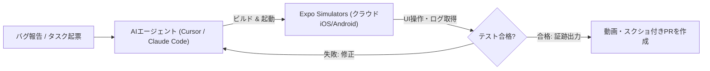

# **本日の AI/開発ツール トピックス (2026-11-13)**

## **1. 📋 今日の30秒サマリー**

> **💡 今日のハイライト**
>
> - 🚨 **Webアプリと開発環境を狙う深刻な脅威が相次ぐ**: React製の最新サーバー機能で外部からプログラムを勝手に動かされる危険な弱点が見つかったほか、8,000以上の開発リポジトリからクラウドの鍵を盗み出す大規模な自動攻撃も確認されており、早急な点検が必要です。
> - 🚀 **AIが「自分で動かして確かめる」開発ツールが続々登場**: Googleが日常のコーディングを高速化する新AI「Gemini 4 Hydrogen」を公開し、ExpoやAWSはAIがスマホ実機やクラウド環境をローカル・クラウド上で自律テストできる新基盤を一斉にリリースしました。
> - 🔥 **解析・自動化・高速推論を支えるオープンソースツールが急上昇**: プログラムの設計図なしで挙動を読み解く解析支援ツールや、チャットアプリから動かせる自律型AIエージェント、推論を高速化する基盤技術が世界のエンジニアから注目を集めています。
{: .callout-summary}

| 区分 | トピック / ツール | ざっくり言うと？（1行要約） | 影響・おすすめ対象 |
| :--- | :--- | :--- | :--- |
| 🚨 **緊急** | **React Server Components** (`CVE-2026-126187`) | 細工されたデータ送信でサーバーが乗っ取られる深刻な弱点 | **React 19系のサーバー機能を使う全開発者** |
| 🚨 **緊急** | **GitHub Actions / npm** (`wfx` キャンペーン) | 8,000超のリポジトリに侵入しクラウドの鍵と永続権限を奪う | **GitHub Actionsやnpmを使う全チーム・企業** |
| 🚨 **緊急** | **Microsoft Outlook** (`CVE-2026-124194`) | 警告なしで外部へ通信しログイン情報を漏らす悪用中の弱点 | **Windows版Outlookを使う全組織・ビジネス層** |
| 🚨 **緊急** | **Ruby `addressable`** (`CVE-2026-126350`) | 特殊なURL文字列の処理でサーバーが過負荷になり停止する | **Ruby製WebアプリでURL解析を行う開発者** |
| 🚀 **新機能** | **Gemini 4 Hydrogen** (`2026-11-12`) | 思考レベルを4段階で調整できるGoogleの高速・高効率AI | **日々の開発やエージェント自動化を行う全エンジニア** |
| 🚀 **新機能** | **Expo Simulators** (`2026-11-12`) | Mac不要でAIエージェントがスマホアプリを自動検証できるクラウド環境 | **モバイルアプリ開発者・AI開発導入チーム** |
| 🚀 **新機能** | **AWS Emulator** (`2026-11-11`) | AIが全コードを書いた公式のローカルAWS模擬環境（無料） | **AWS連携アプリをローカルやCIでテストしたい開発者** |
| 🚀 **新機能** | **Databricks Genie 2** (`2026-11-11`) | 指示待ちから「24時間自律稼働」へ進化した企業向けAIエージェント | **データ分析基盤を運用する企業・データエンジニア** |
| 🔥 **注目** | **morluto/rea** (`v6.10.0`) | ソースコードなしでアプリやバイナリをAIに解析させる支援基盤 | **セキュリティ研究者・リバースエンジニア** |
| 🔥 **注目** | **openclaw/openclaw** (`v2026.11.x`) | SlackやDiscordから動かせるローカル常駐型の自律AIエージェント | **手元環境で安全にAIアシスタントを動かしたい層** |
| 🔥 **注目** | **SGLang** (Intel/RadixArk最適化) | 推論基盤SGLangがIntelハードウェアへDay-0最適化・コンソーシアム発足 | **大規模LLMの推論コストや速度を改善したいSRE/ML層** |
| 🔥 **注目** | **browser-use** | AIエージェントが人間のようにWebブラウザを直接操作して作業を自動化 | **Webテストやデータ収集をAIに任せたい開発者** |

---

## **2. 🚨 緊急セキュリティ情報**

### **React Server Components — 型付き配列処理における認証不要のRCE (CVE-2026-126187)**

> **🔰 ひとことで言うと**
> Reactのサーバー側機能（RSC）において、ログイン不要の外部リクエストからサーバー上で任意のプログラムを勝手に実行（乗っ取り）されてしまう極めて深刻な弱点が見つかりました。
> 💬 *例えるなら：「郵便受けに特殊な形の小包をいくつも同時に押し込むと、玄関の電子ロックが誤作動して誰でも家の中に入り込めるようになってしまう」ような状態です。*
{: .callout-danger}

| リスク度 | 影響を受ける人 | 悪用のされやすさ | まずやるべき対策 |
| :---: | :--- | :--- | :--- |
| 🔴 **緊急** (CVSS 9.5) | React 19系のサーバーコンポーネント（`react-server-dom-*`）を利用するWebアプリ | ⚠️ 認証不要のネットワーク経由で細工されたペイロードを送るだけで発動 | **影響パッケージを `19.0.9` / `19.1.10` / `19.2.9` / `19.3.1` 以上へ即座に更新** |

<details markdown="1">
<summary>🔍 技術的な仕組み・対象バージョン・対策コマンドを見る（エンジニア向け）</summary>

- **原因の仕組み**: React Server Components（RSC）のFlightプロトコルにおけるシリアライズ／デシリアライズ処理において、同じ基盤バッファを共有する複数の型付き配列（Typed Arrays）と攻撃者が制御可能な値を同時に含むレスポンスを処理する際、不安全な展開が行われ認証不要のリモートコード実行（RCE）に至ります。なお、ブラウザのみで動作する純粋なSPA（サーバー機能を使わない構成）やRSC非対応フレームワークは影響を受けません。
- **対象バージョン/環境**: `react-server-dom-webpack`、`react-server-dom-parcel`、`react-server-dom-turbopack` の各バージョン（`19.0.0〜19.0.8`、`19.1.0〜19.1.9`、`19.2.0〜19.2.8`、`19.3.0`）。Next.js App Router等のキャッシュコンポーネントや特定ストリーム構成で影響を受ける可能性があります。
- **対策手順・コマンド**:
  トップレベルの `react` パッケージの更新だけでなく、フレームワークが管理する `react-server-dom-*` 依存関係が修正済みバージョン（`19.0.9`、`19.1.10`、`19.2.9`、`19.3.1`）に上がっているかロックファイルを確認してください。
  ```bash
  # 使用中のパッケージマネージャーで依存関係を確認・更新
  pnpm list react-server-dom-webpack react-server-dom-turbopack
  pnpm update react react-dom react-server-dom-webpack react-server-dom-turbopack --latest
  ```
- **一次ソース**: [CVE-2026-126187 (CVE.org)](https://www.cve.org/CVERecord?id=CVE-2026-126187)

</details>

---

### **GitHub Actions / npm 供給網攻撃 (`wfx` キャンペーン) — 8,000超のリポジトリから認証情報を窃取・永続化**

> **🔰 ひとことで言うと**
> 盗まれた認証トークンを悪用して8,000以上のGitHubリポジトリに自動で不正コードを仕込み、テスト実行時やパッケージ導入時にクラウドの鍵を盗んで「裏口」まで作ってしまう大規模な攻撃が進行中です。
> 💬 *例えるなら：「合鍵を盗んだ泥棒が工場の自動組み立てラインに細工をして、製品が作られるたびに会社の金庫の暗証番号を盗み出し、さらに自分専用の裏口キーまでこっそり登録してしまう」ような状態です。*
{: .callout-danger}

| リスク度 | 影響を受ける人 | 悪用のされやすさ | まずやるべき対策 |
| :---: | :--- | :--- | :--- |
| 🔴 **緊急** (広域攻撃) | GitHub Actionsやnpmを利用する開発チーム・企業リポジトリ | ⚠️ 侵害されたトークンで自動コミットされ、CI実行や `npm install` で即発動 | **不審なコミットや `wfx-ci-*` 連携IDを確認し、クラウド側の永続権限・ロール設定も剥奪** |

以下の図は、`wfx` 攻撃キャンペーンが開発者の環境やCI/CDパイプラインを経由してクラウド環境へ侵入し、単なるパスワード変更だけでは排除できない「永続的な裏口」を構築するまでの流れを示したスイムレーン図です。

```mermaid
swimlane-beta TB
  subgraph Attacker["攻撃者 (自動化ボット)"]
    A1["盗難トークンでリポジトリへ不正コードを自動コミット"]
    A2["窃取した鍵でクラウド環境へログイン"]
  end
  subgraph Pipeline["CI/CD・開発環境 (GitHub Actions / npm)"]
    P1["ワークフロー実行または npm install で不正スクリプトが発火"]
    P2["AWS / Azure / GCP の認証情報や SSH鍵を収集・送信"]
  end
  subgraph Cloud["クラウド環境 (AWS / Azure)"]
    C1["長期アクセスキー作成や wfx-ci-* 連携IDの不正追加"]
    C2["元キーを無効化しても裏口から継続アクセス可能"]
  end
  A1 --> P1
  P1 --> P2
  P2 --> A2
  A2 --> C1
  C1 --> C2
```

> **図の見方**: 攻撃者は中央の自動テスト（CI/CD）やインストール処理に乗じてクラウドの鍵を盗み出すだけでなく、右側のクラウド環境内部に新しい連携ID（`wfx-ci-*` など）を自ら作成します。そのため、流出した元の鍵を無効化するだけでは不十分で、クラウド側の権限設定全体の点検が必要です。

<details markdown="1">
<summary>🔍 技術的な仕組み・影響範囲・対策コマンドを見る（エンジニア向け）</summary>

- **原因の仕組み**: SafeDepやAikido Securityが2026年11月10日〜12日にかけて観測した「wfx」キャンペーンでは、流出したユーザー・PATトークンを悪用し、数千の公開・非公開リポジトリに対して認証情報窃取ペイロードを自動コミットします。ペイロードはGitHub Actionsのジョブ実行中またはローカルでの `npm install` 時に発火し、AWS・Azure・GCPの認証情報、npmトークン、SSH鍵を外部へ送信します。さらに深刻な点として、AWSやAzure上ではロールの信頼ポリシー改変、新規長期アクセスキーの発行、`wfx-ci-*` という名称のフェデレーションID（OIDC）の追加を行い永続化を図ります。
- **対象バージョン/環境**: トークン管理が甘いGitHubリポジトリ、および該当期間中に不正なコミットやパッケージを取り込んだCI/CD環境。
- **対策手順・コマンド**:
  1. リポジトリ内の直近の自動コミット履歴、`package.json` の `preinstall`/`postinstall` スクリプト、`.github/workflows/` の変更を監査する。
  2. 流出が疑われる場合、APIキーのローテーションだけでなく、AWS IAMロールの信頼ポリシーやAzure Entra IDのフェデレーション資格情報（特に `wfx-ci-*`）に不審な追加がないか全点検する。
- **一次ソース**: [SafeDep Security Blog](https://safedep.io/blog/)

</details>

---

### **Microsoft Outlook (Classic) — 悪用確認済みのなりすまし・認証情報漏洩ゼロデイ (CVE-2026-124194)**

> **🔰 ひとことで言うと**
> 細工されたメールファイルを開くだけで、警告画面を出さずに外部サーバーへ勝手に通信し、Windowsのログイン認証情報（NTLMv2ハッシュ）を盗み取られる脆弱性が実際の攻撃で悪用されています。
> 💬 *例えるなら：「届いた封筒を開けた瞬間、確認のダイアログも出ないまま差出人へ自宅の身分証のコピーが自動送信されてしまう」ような状態です。*
{: .callout-danger}

| リスク度 | 影響を受ける人 | 悪用のされやすさ | まずやるべき対策 |
| :---: | :--- | :--- | :--- |
| 🔴 **高・悪用中** (CVSS 6.5) | Windows版 Classic Outlook（Microsoft 365 / Office LTSC）利用者 | 🚨 **すでに実際の攻撃で悪用が確認されているゼロデイ** | **2026年11月公開のMicrosoft月例セキュリティ更新プログラムを直ちに適用** |

<details markdown="1">
<summary>🔍 技術的な仕組み・対象バージョン・対策コマンドを見る（エンジニア向け）</summary>

- **原因の仕組み**: ユーザーインターフェースが安全でない操作を警告しない不備（Missing User Interaction / UI Spoofing）に起因します。攻撃者が細工したメッセージファイル（`.msg` 等）をユーザーがClassic Outlookで開くと、通常の外部コンテンツブロックや警告プロンプトを表示することなく、攻撃者が制御するリモートのネットワークパス（SMB共有など）へ自動接続を試みます。これにより、クライアントのNTLMv2認証ハッシュが外部へ送信され、なりすまし攻撃やオフラインクラッキングに悪用されます。
- **対象バージョン/環境**: Microsoft Office Outlook（Classic for Windows）、Microsoft 365 Apps for Enterprise、Office LTSC 2021 / 2024 等。
- **対策手順・コマンド**:
  Microsoftの2026年11月月例パッチ（2026年11月10日米国時間公開、IPAも緊急注意喚起）を適用するとともに、ファイアウォールで外部向けのSMBポート（TCP 445）を遮断する多層防御を推奨します。
  ```powershell
  # Microsoft 365 Apps の更新をコマンドラインから即時実行する例
  & "C:\Program Files\Common Files\microsoft shared\ClickToRun\OfficeC2RClient.exe" /update user
  ```
- **一次ソース**: [CVE-2026-124194 (NVD)](https://nvd.nist.gov/vuln/detail/CVE-2026-124194)

</details>

---

### **Ruby `addressable` gem — URIテンプレート処理における正規表現DoS (CVE-2026-126350)**

> **🔰 ひとことで言うと**
> Rubyの定番URL処理ライブラリに、細工されたURL文字列を1つ処理させるだけでサーバーのCPUが長時間占有され、サービスが応答不能になる不具合が見つかりました。
> 💬 *例えるなら：「レジの店員にわざと終わりのない複雑な割引計算を頼み続けて、後ろのお客さんの会計をすべて止めてしまう」ような状態です。*
{: .callout-danger}

| リスク度 | 影響を受ける人 | 悪用のされやすさ | まずやるべき対策 |
| :---: | :--- | :--- | :--- |
| 🟠 **中** (CVSS 5.9) | `addressable` の `Template#match` / `extract` を使うRubyアプリ | ⚠️ 外部からのURI入力を受け付けるエンドポイントで発動 | **`addressable` gem を `2.9.1` 以上へアップデート** |

<details markdown="1">
<summary>🔍 技術的な仕組み・対象バージョン・対策コマンドを見る（エンジニア向け）</summary>

- **原因の仕組み**: `Addressable::Template` でexplode修飾子（`*`）と特定の演算子プレフィックス（`/`、`.`、`;`、`?`、`&`）を組み合わせたテンプレート（例: `{/segments*}`、`{?query*}`）をコンパイルする際、曖昧な正規表現が生成されます。2.9.0の先行パッチでもこれら演算子プレフィックスのパスがテスト漏れにより不完全だったため、`Template#match` または `Template#extract` が特定の先頭文字を含む悪意あるURIを処理すると破滅的バックトラッキング（ReDoS）が発生します。特にMRI Ruby 3.2未満やJRuby環境で顕著です（`URI.parse` や `Template#expand` は影響外）。
- **対象バージョン/環境**: Ruby `addressable` gem `2.3.0` 〜 `2.9.0`（`2.9.1` で修正済み）。
- **対策手順・コマンド**:
  `Gemfile` を更新し、バンドルアップデートを実行してください。
  ```bash
  bundle update addressable
  # 2.9.1 以上がインストールされたことを確認
  bundle info addressable
  ```
- **一次ソース**: [CVE-2026-126350 (NVD)](https://nvd.nist.gov/vuln/detail/CVE-2026-126350)

</details>

---

## **3. 🚀 メジャーリリース・新機能**

### **Google `Gemini 4 Hydrogen` — 思考レベルを4段階で調整できる高速コーディング向けモデル**

> **🔰 ひとことで言うと**
> Googleが従来の「Flash」系譜を刷新し、日々のプログラミングやAIエージェントの連続作業を爆速・低コストでこなせる新モデル「Gemini 4 Hydrogen」を正式リリースしました。
> 💬 *例えるなら：「複雑な設計図を描くベテラン建築家（Carbon）の隣で、指示を受けて猛スピードで正確に現場作業をこなす凄腕の相棒（Hydrogen）が登場した」ようなイメージです。*
{: .callout-info}

| 比較ポイント | これまで (Before) | Gemini 4 Hydrogen 以降 (After) |
| :--- | :--- | :--- |
| **速度・コスト効率** | 従来Flash系は高速だが複雑なエージェント作業の精度に課題 | **最大2.8倍高速化しつつトークン消費を削減（Terminal-Bench 4.1で57%）** |
| **推論の深さ調整** | 固定または限定的な思考制御 | **low / medium / high / xhigh の4段階で思考レベルを柔軟に制御可能** |
| **エージェント連携** | 単一モデルで計画から修正までを処理 | **Google Antigravityの「Orchestrator」でCarbonと自動役割分担** |

<details markdown="1">
<summary>🔍 技術的ブレークスルーとリリースノート詳細を見る</summary>

- **技術的ポイント**: Gemini 4ファミリー（Carbon / Argon / Hydrogen）における日常開発・高スループット特化モデルとして2026年11月12日に公開。100万トークンのコンテキストウィンドウを備え、ファイル読み取りや検索のバッチ処理に最適化されています。Artificial Analysis Intelligence Indexではデフォルトの `high` 設定で51、`xhigh` 設定で54を記録しました。
- **開発フローへの影響**: Google Antigravityでは新しい「Orchestrator」モードが追加され、複雑な設計や難題に直面した際は `Gemini 4 Carbon` が計画を立て、実際のコード編集やテスト実行の反復ループを `Gemini 4 Hydrogen` が高速に処理する協調動作が可能です。
- **提供形態・利用開始方法**: Google AI Studio、Android Studio、Gemini API（入力100万トークンあたり$1.50 / 出力$7.50）、Google Antigravity（Pro/Ultra）、およびGoogle検索やGeminiアプリ向けに提供開始。
- **公式リンク**: [Google公式ブログ (blog.google)](https://blog.google/) / [Google Antigravity](https://antigravity.google/)

</details>

---

### **Expo `Expo Simulators` — Mac不要でAIエージェントが実機検証できるクラウドシミュレータ**

> **🔰 ひとことで言うと**
> AIコーディングエージェントが自分でスマホアプリをビルドし、クラウド上のiPhoneやAndroid画面を操作してバグ修正と動作確認を完結できる環境が正式公開されました。
> 💬 *例えるなら：「これまでPCの中だけでコードを書いていたAIロボットに、テスト用のスマホ実機が並んだクラウド実験室を丸ごと貸し出した」ような画期的な仕組みです。*
{: .callout-info}

| 比較ポイント | これまで (Before) | Expo Simulators 以降 (After) |
| :--- | :--- | :--- |
| **iOS検証のハードウェア制約** | iOSシミュレータの実行には手元のMac環境が必須 | **Windows/Linuxやクラウド上のAIエージェントからMac不要で実行可能** |
| **ローカルPCへの負荷** | 複数のAndroidエミュレータ起動でメモリを大量消費（各4GB以上） | **クラウドへオフロードし、複数エージェントが並列でテスト可能** |
| **プルリクエストの信頼性** | 「テスト通りました」というテキスト報告のみ | **操作動画・スクリーンショット・ブラウザ上のライブプレビューを自動添付** |

以下の図は、バグ報告を起点にAIエージェントがクラウド上のExpo Simulatorsを使ってアプリを修正・検証し、動画付きのプルリクエストを提出するまでの自動ループを示しています。



> **図の見方**: これまでAIはコードを書くことしかできませんでしたが、クラウド上のシミュレータ（中央）と繋がることで「動かして失敗を見て直す」ループを自律的に回し、最終的に人間がブラウザで確認できる動画付きのPRを提出します。

<details markdown="1">
<summary>🔍 技術的ブレークスルーとリリースノート詳細を見る</summary>

- **技術的ポイント**: 2026年11月12日に正式ローンチ。ExpoやReact Nativeだけでなく、ネイティブアプリ、Flutter、Unityなど標準的なiOSシミュレータ/Androidエミュレータで動くあらゆるフレームワークに対応します。`agent-device`、`argent`（MCPサーバー連携）、`appium`、`web-preview-only` といったセッション制御モードを備えています。
- **開発フローへの影響**: Cursor、Claude Code、CodexなどのAIエージェントが `npx skills@latest add expo/skills --skill eas-simulator` や `eas simulator:` CLI経由で即座に呼び出せ、テスト完了後はTestFlight不要でチームメンバーがブラウザからライブビルドを触って確認できます。
- **提供形態・利用開始方法**: Expoの有料プランで利用可能（従量課金: iOS/Android共通で1シミュレータ分あたり$0.10）。
- **公式リンク**: [Expo公式サイト (expo.dev)](https://expo.dev/)

</details>

---

### **AWS `AWS Emulator` — AIエージェントが全行を書いた公式ローカルAWS模擬環境**

> **🔰 ひとことで言うと**
> AWSの本番アカウントや課金を一切使わずに、自分のパソコンやCI環境の中で何百ものAWSサービスの動きを本物そっくりに再現できる公式エミュレータが無料公開されました。
> 💬 *例えるなら：「本番の大型旅客機を飛ばさずに、パイロット（開発者やAI）が何度墜落させてもコストゼロで安全に訓練できるAWS公式のフライトシミュレータ」です。*
{: .callout-info}

| 比較ポイント | これまで (Before) | AWS Emulator 以降 (After) |
| :--- | :--- | :--- |
| **テスト環境とコスト** | 結合テストのたびにAWSアカウントへのデプロイや課金・待ち時間が発生 | **ローカル/CIで数ミリ秒で応答。完全オフライン＆追加費用ゼロ** |
| **マルチエージェントの競合** | 共有の検証環境では複数AIエージェントのテストが衝突 | **インスタンスごとに独立したポートとインメモリ状態を持ち並列実行可能** |
| **開発の背景** | 人間のエンジニアが手作業でモックを維持 | **全コードを自律型AIエージェント（Bedrock AgentCore等）が記述・検証** |

<details markdown="1">
<summary>🔍 技術的ブレークスルーとリリースノート詳細を見る</summary>

- **技術的ポイント**: 2026年11月11日（米国時間）に一般提供（GA）を発表。AWSの公式APIモデルに基づいて生成されており、ローカルプログラム、Dockerコンテナ、または組み込みRustモードとしてHTTPSエンドポイントを提供します。既存のAWS SDKやAWS CLIのエンドポイント設定を切り替えるだけで、有効な呼び出しには本番と同じ結果を、無効な呼び出しには同じエラーを返します。リソース状態はインメモリで保持されます。
- **開発フローへの影響**: 自律型AIエージェントが手元でインフラ連携コードを高速に書いてテストし直す「ローカル検証ループ」の受け皿として設計されています。パブリックドメイン（CC0 1.0 Universal）としてGitHub上でソースコードが公開されています。
- **提供形態・利用開始方法**: GitHubから取得またはDockerで起動可能（無料）。
- **公式リンク**: [AWS News Blog](https://aws.amazon.com/blogs/aws/test-your-applications-against-aws-locally-with-aws-emulator/) / [GitHub (aws/aws-emulator)](https://github.com/aws/aws-emulator)

</details>

---

### **Databricks `Genie Generation 2` — 「待ち」から「24時間自律稼働」へ進化した企業向けAI**

> **🔰 ひとことで言うと**
> Databricksのデータ分析AI「Genie」が第2世代へ進化し、人間が質問した時だけ答えるチャットボットから、バックグラウンドで24時間自律的に調査・業務を進めるAIエージェントになりました。
> 💬 *例えるなら：「窓口で質問に答えてくれる案内係から、社内のルールや用語をすべて理解して裏で勝手に調査レポートをまとめ、確認が必要な時だけSlackで連絡してくれる優秀な秘書」への進化です。*
{: .callout-info}

| 比較ポイント | これまで (Genie One) | Genie Generation 2 以降 (After) |
| :--- | :--- | :--- |
| **稼働スタイル** | ユーザーがプロンプトを打つたびに返答するリアクティブ型 | **専用コンピュート上で常時稼働し、バックグラウンドで長期タスクを自律遂行** |
| **複雑な業務の処理** | 単一ステップのクエリ応答が中心 | **複数のサブエージェントへタスクを分割・委譲して並列処理** |
| **企業の文脈理解** | 個別のプロンプトで社内用語を都度説明 | **Genie Ontology（GA）がSQLやBIツールから社内の定義や指標を自動学習** |

<details markdown="1">
<summary>🔍 技術的ブレークスルーとリリースノート詳細を見る</summary>

- **技術的ポイント**: 2026年11月11日発表。常時稼働の自律ワークフローに加え、構造化データと100以上の外部コネクタ（Google Drive、Jira、Confluence等）を横断検索する「Genie Search」、そして企業のビジネスロジックや指標を自動抽出・統合する「Genie Ontology」が一般提供（GA）となりました。Power BIやTableauなどの外部BIツールからもセマンティックモデルを取り込めます（ベータ）。
- **開発フローへの影響**: Unity CatalogおよびUnity Gatewayと連携し、ユーザー固有のアクセス権限を厳格に継承したまま自律動作します。人間の承認や追加情報が必要な場合のみ、Priority InboxやSlack、Microsoft Teamsへ通知を届けます。
- **提供形態・利用開始方法**: Databricksプラットフォーム上で展開。
- **公式リンク**: [Databricks公式サイト (databricks.com)](https://www.databricks.com/)

</details>

---

## **4. 🔥 注目のトレンドツール**

### **`morluto/rea` — ソースコードなしでアプリやバイナリをAIが読み解く解析スイート**

> **🔰 ひとことで言うと**
> 設計図（ソースコード）が手元にないアプリや実行ファイルを、Claude CodeやCursorなどのAIエージェントに丸ごと解析させるための専用ツールキットがGitHubで爆発的に人気を集めています。
> 💬 *例えるなら：「中身が見えないブラックボックスの精密機械を、レントゲン撮影してAIにわかりやすく解説書を作ってもらう」ようなツールです。*
{: .callout-tip}

| 注目ポイント | 内容 | おすすめ対象 |
| :--- | :--- | :--- |
| **何ができるか** | MCP経由でAIエージェントがネイティブバイナリやスクリプトの挙動をローカル解析 | **セキュリティ研究者・マルウェア解析者・脆弱性診断士** |
| **注目の理由** | GhidraやIDA等の専門ツールとLLMを統合し、最新 `v6.10.0` で解析精度が大幅向上 | AIを活用したリバースエンジニアリングに関心のあるエンジニア |

<details markdown="1">
<summary>🔍 主な機能・アーキテクチャ・導入方法を見る</summary>

- **主な機能・用途**: REA（Reverse Engineer Anything）は、エージェントファーストなリバースエンジニアリングスイートおよびMCPサーバーです。Claude Code、Cursor、Codex、Gemini CLIなどのコーディングエージェントと接続し、ソースコードがない状態からアプリの挙動、スクリプト実行、ネイティブバイナリを調査できます。
- **他の類似ツールとの比較**: 従来のGhidra、Hopper、IDA Proといった静的解析ツールは人間の高度な専門知識を前提としていましたが、REAはこれらをAIエージェントが直接操作・統合できるインターフェースを提供し、2026年11月の `v6.10.0` ではファームウェア、V8コードキャッシュ、単一実行ファイルなどのオフライン解析やMCPエラー回復機能が強化されました。
- **公式サイト/GitHub**: [GitHub (morluto/rea)](https://github.com/morluto/rea)

</details>

---

### **`openclaw/openclaw` — チャットアプリから動かせるローカル常駐型の自律AIエージェント**

> **🔰 ひとことで言うと**
> 自分のパソコン上で裏方（デーモン）として動き続け、普段使っているSlackやDiscord、Telegramからいつでも指示を出せるオープンソースの自律型AIエージェント基盤です。
> 💬 *例えるなら：「自宅のPCに住み着いて、スマホのLINEやSlackでメッセージを送るだけでパソコン上の作業を代行してくれる自分専用の執事」です。*
{: .callout-tip}

| 注目ポイント | 内容 | おすすめ対象 |
| :--- | :--- | :--- |
| **何ができるか** | ローカル常駐し、WhatsApp / Telegram / Discord / Slack等とシームレスに連携 | **クラウドに依存せず手元でAIエージェントを運用したい開発者** |
| **注目の理由** | 独立財団体制のもと `v2026.11.x` でデスクトップハブ機能やセキュリティ制御を大幅強化 | プライバシー重視の個人開発者・自動化マニア |

<details markdown="1">
<summary>🔍 主な機能・アーキテクチャ・導入方法を見る</summary>

- **主な機能・用途**: ローカルファースト設計のオープンソースAIエージェントゲートウェイおよびランタイムです。複数のメッセージングプラットフォームを統一的に接続し、セッションの永続化やローカルツールの自律実行を行います。
- **他の類似ツールとの比較**: クラウドSaaS型のAIエージェントと異なり、データと実行環境を完全にユーザーの手元に置ける点が強みです。2026年11月の最新アップデート（`v2026.11.x`）では、ページングされた会話履歴の改善、macOSメニューバーアプリやWindowsコンパニオンインストーラーなどのクロスプラットフォーム連携、セッション圧縮の回復処理、ローカルツール実行時の厳格なセキュリティハードニングが導入されました。
- **公式サイト/GitHub**: [GitHub (openclaw/openclaw)](https://github.com/openclaw/openclaw)

</details>

---

### **`sgl-project/sglang` — Intel×RadixArk最適化とSGLangコンソーシアム発足**

> **🔰 ひとことで言うと**
> 大規模言語モデル（LLM）を高速に動かすための定番オープンソースエンジン「SGLang」が、IntelのCPU/GPUへ初日から最適化され、主要テック企業が集う連合体も発足しました。
> 💬 *例えるなら：「AIの頭脳を積んだレーシングカーのエンジンが、特定のメーカーだけでなくあらゆる道路や車体で最高速度を出せるよう業界全体で統一チューニングされ始めた」ような動きです。*
{: .callout-tip}

| 注目ポイント | 内容 | おすすめ対象 |
| :--- | :--- | :--- |
| **何ができるか** | LLMや視覚言語モデル（VLM）、強化学習ロールアウトの超高速推論サービング | **自社でLLMをホストし推論レイテンシやGPUコストを下げたいチーム** |
| **注目の理由** | 11月12日にIntel×RadixArk協業と、NVIDIA/AMD/Google等参加のコンソーシアム発表 | AIインフラエンジニア・MLOps担当者 |

<details markdown="1">
<summary>🔍 主な機能・アーキテクチャ・導入方法を見る</summary>

- **主な機能・用途**: SGLangは高スループット・低レイテンシを実現するオープンソースのAI推論スタックです。2026年11月12日〜13日のSGLang Summitに合わせ、LMSYS OrgがIntel、RadixArk、NVIDIA、AMD、Google、Meta、Cloudflare、Modalらを創設メンバーとする「SGLang Consortium」を発足しました。
- **他の類似ツールとの比較**: IntelとRadixArkの提携により、独自フォークではなくアップストリームの本流コードへIntel AMX（Advanced Matrix Extensions）等のハードウェアアクセラレーションが直接統合され、異種混合ハードウェア環境でも「Day-0」で高い推論性能を発揮できるようになります。
- **公式サイト/GitHub**: [GitHub (sgl-project/sglang)](https://github.com/sgl-project/sglang)

</details>

---

### **`browser-use/browser-use` — AIエージェントがWebブラウザを直接操作する自動化フレームワーク**

> **🔰 ひとことで言うと**
> AIエージェントに人間と同じようにブラウザの画面を見せて、クリックや文字入力、データ収集、Webアプリのテストを自律的に行わせるオープンソースツールが根強い人気を誇っています。
> 💬 *例えるなら：「キーボードとマウスをAIに直接握らせて、Webサイト上の面倒な予約作業やテスト操作を代わりにやってもらう」ツールです。*
{: .callout-tip}

| 注目ポイント | 内容 | おすすめ対象 |
| :--- | :--- | :--- |
| **何ができるか** | Python / TypeScriptからAIエージェントにブラウザ操作（クリック・入力・検証）をさせる | **E2Eテストの自動化やAPIのないWeb業務を自動化したい開発者** |
| **注目の理由** | 視覚情報とDOM構造を組み合わせて、サイト変更に強いエージェント操作を実現 | AIエージェント構築に関わるすべてのエンジニア |

<details markdown="1">
<summary>🔍 主な機能・アーキテクチャ・導入方法を見る</summary>

- **主な機能・用途**: AIエージェントがWebブラウザをネイティブに制御し、Webスクレイピング、フォーム入力、Webアプリケーションの結合テストなどを自動化するためのオープンソースフレームワーク（PythonおよびTypeScript対応）です。
- **他の類似ツールとの比較**: 従来のPlaywright/Seleniumによる固定セレクタの自動化スクリプトはUI変更で壊れやすい課題がありましたが、`browser-use` はLLMの判断力を組み込むことで、動的なWeb画面の変化にも柔軟に対応しながらタスクを完遂できます。
- **公式サイト/GitHub**: [GitHub (browser-use/browser-use)](https://github.com/browser-use/browser-use)

</details>

---

## **5. 💡 その他・Tips**

- **Microsoft `.NET 11` 正式リリース（.NET Conf 2026）**: C#への共用型（Union types）の導入、JIT/AOTコンパイラの高速化に加え、`Microsoft.Extensions` やBlazorの実験的AIコンポーネントを通じたエージェントアプリ開発支援が強化されました。
- **Google `A2UI 1.0` 公開**: AIエージェントがチャット欄に長文を返すのではなく、フォームやグラフなどの対話型UIを宣言的にストリーミング描画するためのオープンプロトコル「A2UI」が初の安定版 `1.0` に到達しました（[a2ui.org](https://a2ui.org/)）。双方向関数呼び出しやPython/TypeScript/Dart向けSDKを備えています。
- **Google AI StudioへのGoogle Maps統合**: プロンプトを入力するだけで地図連動アプリ（店舗検索、ルート案内、3D都市表示、大気質モニター等）をAPIキー設定不要・無料デモ枠（1日各API 100コール）で即座にライブプレビュー構築できるようになりました。

---

## **6. 📝 総評**

> **📌 今日の一言まとめ**
> 「AIがコードを書くだけでなく『自分で動かしてテストする』時代へ大きく踏み出す一方、開発パイプラインやフレームワークの足元を狙う攻撃が一段と巧妙化・自動化しています。」
{: .callout-summary}

本日の動向を振り返ると、開発者体験における明確なパラダイムシフトが見て取れます。Googleの `Gemini 4 Hydrogen`、Expoの `Expo Simulators`、そしてAWSの `AWS Emulator` に共通しているのは、**「AIコーディングエージェントが自律的にテストと修正のループを高速に回せる実行環境」の整備**です。これまでAIはコード生成の速さに対して「検証のボトルネック」が課題でしたが、クラウド上のモバイル実機環境や完全ローカルのAWS模擬環境が揃ったことで、人間が眠っている間にもAIがクリーンなプルリクエストを仕上げるワークフローが現実的になりました。

一方でセキュリティ面では、`wfx` キャンペーンのように**侵害した開発リポジトリのCI/CDからクラウド側の永続権限（OIDC連携IDなど）まで自動で奪う**攻撃が数千リポジトリ規模で発生しており、単なるパスワード変更では済まないケースが増えています。さらにReact Server Componentsの `CVE-2026-126187` や悪用中のOutlookゼロデイ `CVE-2026-124194` も重なっており、エンジニアには「新技術の積極的な検証環境への導入」と「依存パッケージ・CI/CD権限・月例パッチの迅速な棚卸し」の両輪が強く求められています。

---

## **7. 📖 用語解説**

| 用語 | 解説 |
| :--- | :--- |
| **RCE (リモートコード実行)** | ネットワーク越しに外部の攻撃者が、対象サーバーやPC上で任意のプログラムを勝手に動かせてしまう最も危険な種類の脆弱性。家の外からリモコンで他人の家電を乗っ取るような状態です。 |
| **サプライチェーン（供給網）攻撃** | 標的の企業を直接狙うのではなく、開発者が使っているライブラリや自動テスト環境（CI/CD）などの「部品・製造ライン」に不正プログラムを紛れ込ませて侵入する攻撃手法です。 |
| **ゼロデイ脆弱性** | 開発元が修正プログラムを公開する前（あるいは公開直後）に、すでに攻撃者に発見され実際の攻撃に悪用されている脆弱性のことです。対策までの時間との勝負になります。 |
| **ReDoS (正規表現DoS)** | 文字のパターン検索（正規表現）の計算が特定の入力で爆発的に重くなり、サーバーがフリーズしてしまう攻撃・不具合です。終わりのない迷路に迷い込んで店員が動けなくなるイメージです。 |
| **NTLMv2ハッシュ** | Windows環境でネットワーク越しに本人確認を行う際に使われる暗号化された認証データ。外部の悪意あるサーバーへ送信されてしまうと、なりすましやパスワード解析に悪用されます。 |
| **シリアライズ / デシリアライズ** | プログラム内部の複雑なデータを、ネットワークで送れる形式（文字列やバイト列）に変換すること（シリアライズ）、および受け取った側で元のデータ構造に戻すこと（デシリアライズ）です。 |
| **エミュレータ / シミュレータ** | 本物のスマホ実機やクラウドサービスを使わずに、パソコンや別の環境上でその動きをソフトウェアでそっくり真似してテストできる仕組みのことです。 |
| **MCP (Model Context Protocol)** | AIモデルが外部のツールや社内データ、ローカルファイルと安全かつ統一された方法でやり取りするためのオープン共通規格。USB-CのようにAIと道具を繋ぐ役割を持ちます。 |

---
(出典: 各公式サイト、GitHub、NVD、CVE.org、SafeDep、TechニュースサイトよりAIが要約)

<!-- Kramdown略語定義: 本文中の対象単語に自動でインラインツールチップが付与されます -->
*[RCE]: Remote Code Execution（外部からネットワーク越しに任意のプログラムを勝手に実行される深刻な脆弱性）
*[CVE]: Common Vulnerabilities and Exposures（世界共通で割り振られるセキュリティ脆弱性の識別番号）
*[CVSS]: Common Vulnerability Scoring System（脆弱性の深刻度を0〜10の数値で評価する共通規格）
*[MCP]: Model Context Protocol（AIエージェントと外部ツール・データソースを安全に繋ぐためのオープン共通規格）
*[CI/CD]: Continuous Integration / Continuous Delivery（コードのテスト・検証から本番公開までを自動化する仕組み）
*[RSC]: React Server Components（サーバー側でReactコンポーネントをレンダリング・ストリーミングする仕組み）
*[ReDoS]: Regular Expression Denial of Service（正規表現のバックトラッキングを悪用してサーバーを停止させるサービス拒否攻撃）
*[OIDC]: OpenID Connect（認証・認可を行うための標準プロトコル。クラウドとCI/CDの鍵なし連携などで使われる）
*[LLM]: Large Language Model（大規模言語モデル。テキストの理解や生成、コード作成などを行うAIの基盤）
