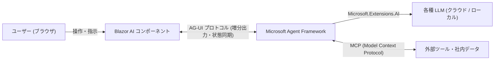

# **本日の AI/開発ツール トピックス (2026-11-14)**

## **1. 📋 今日の30秒サマリー**

> **💡 今日のハイライト**
>
> - 🚨 **ネットワーク機器とWebサーバーに緊急の弱点**: 企業の通信を守るCheck Point製品で既に攻撃に使われている深刻な弱点が見つかったほか、広く使われるApacheサーバーや開発ツールVisual Studioにも危険な不具合が報告され、早急なアップデートが求められています。
> - 🚀 **開発ツールとWindowsで「高速・ローカル・エージェント」が加速**: GitHubのAIアシスタントが最新の高速モデル「Gemini 4 Hydrogen」に対応し、MicrosoftはWebアプリにAIを組み込む新基盤「.NET 11」やパソコン内で動く軽量AI「Aion Instruct」を発表しました。
> - 🔥 **AIに「記憶」と「自動作業」を持たせるOSSが急上昇**: 過去の作業内容を覚えておく記憶ツールや、課題の登録から修正コードの提出まで自動で行うオープンソースのAI基盤がエンジニアの間で注目を集めています。
{: .callout-summary}

| 区分 | トピック / ツール | ざっくり言うと？（1行要約） | 影響・おすすめ対象 |
| :--- | :--- | :--- | :--- |
| 🚨 **緊急** | **Check Point Gaia OS** (`CVE-2026-123039`) | 悪用中のゼロデイ脆弱性で管理者権限を奪われる恐れ | **Check Point製品を運用する全ネットワーク管理者** |
| 🚨 **緊急** | **Apache HTTP Server** (`CVE-2026-119618`) | HTTP/2通信の同時処理の隙を突かれサーバーを乗っ取られる | **Apache 2.4.55〜2.4.70でHTTP/2を使う運用者** |
| 🚨 **緊急** | **Citrix NetScaler** (`CVE-2026-107412`) | 外部公開VPNや認証基盤でメモリ破壊が起きる重大な弱点 | **NetScaler ADC / Gatewayを運用する企業** |
| 🚨 **緊急** | **Visual Studio / .NET** (`CVE-2026-118745`) | 細工されたデバッグ用ファイルを開くとPC上で不正コードが動く | **Windows環境でVisual Studio / .NETを使う開発者** |
| 🚀 **新機能** | **GitHub Copilot** (`2026-11-13`) | 高速モデル「Gemini 4 Hydrogen」正式対応＆社内サーバー連携 | **Copilot有料プラン利用者・Enterprise導入企業** |
| 🚀 **新機能** | **.NET 11 & Blazor AI** (`2026-11-10〜13`) | AIとの対話画面を標準部品で作れるAG-UI対応とC# 15を実装 | **.NET / C#でAI搭載Webアプリを開発するエンジニア** |
| 🚀 **新機能** | **Microsoft Aion Instruct** (`2026-11-13`) | Windows端末内で高速動作する次世代の軽量オンデバイスAI | **ローカルAIアプリ開発者・Copilot+ PCユーザー** |
| 🚀 **新機能** | **Claude Code** (`v2.1.323`系) | AIがJavaScriptを書いてツールを操る「Code Mode」を試験導入 | **Claude CodeをCLIやプラグインで活用する開発者** |
| 🔥 **注目** | **OpenCode** (`anomalyco/opencode`) | ターミナルとデスクトップ両方で動くOSSコーディングエージェント | **オープンなAI開発環境をカスタマイズしたいエンジニア** |
| 🔥 **注目** | **Claude-Mem** (`v15.16.1`) | 複数のAIコーディングツール間で作業記憶を永続化・圧縮 | **長い開発セッションで文脈切れを防ぎたい開発者** |
| 🔥 **注目** | **DeepSeek Super-Agent** (`dsh-superagent-prototype`) | GitHub Issueから自動で作業計画を立てPRを作る研究プロトタイプ | **自律型AIエージェントの設計・検証に関心がある層** |
| 🔥 **注目** | **Dify** (`v1.19.0`) | 入れ子構造のAIワークフローを丸ごと追跡・可視化できる新機能 | **複雑なAI業務フローを構築・運用する開発チーム** |

---

## **2. 🚨 緊急セキュリティ情報**

### **Check Point Gaia OS — DynamicCLIにおける悪用中の権限昇格ゼロデイ (CVE-2026-123039)**

> **🔰 ひとことで言うと**
> Check Pointのセキュリティ機器や管理サーバーにおいて、一般のログイン権限しか持たない利用者や侵入者が、認証なしで最高管理者（root）の権限を奪取できてしまうゼロデイ脆弱性が悪用されています。
> 💬 *例えるなら：「オフィスの一般社員用ロッカー室のインターホンから、警備員室の内線へ合言葉なしで『全フロアのマスターキーを開錠せよ』と命令できてしまう」ような状態です。*
{: .callout-danger}

| リスク度 | 影響を受ける人 | 悪用のされやすさ | まずやるべき対策 |
| :---: | :--- | :--- | :--- |
| 🔴 **緊急** (悪用確認済) | Check Point Gaia OS（R81〜R82.20）のGateway・管理サーバー運用者 | ⚠️ 実際の攻撃で他脆弱性と連鎖しバックドア設置に悪用中 | **11月度のJumbo Hotfix (JHF) を即時適用（困難な場合は `dynamic_server` を停止）** |

以下の図は、`CVE-2026-123039` において攻撃者がローカル環境から特権プロセスへ不正な命令を送り込み、root権限でのバックドア設置に至るまでの処理の流れを示したスイムレーン図です。

```mermaid
swimlane-beta TB
  subgraph Attacker["攻撃者 / 侵害されたローカルアカウント"]
    A1["別の侵入経路等でローカルアクセスを確保"]
    A2["IPCソケット /tmp/dynamic_socket へ認証なしでコマンド送信"]
    A3["root権限で永続的なバックドアを設置"]
  end
  subgraph GaiaOS["Check Point Gaia OS (dynamic_server)"]
    G1["root権限で常駐プロセス dynamic_server が待機"]
    G2["送信元の認証・権限チェックを行わずに命令を受理"]
    G3["受信したコマンドをそのままroot権限で実行"]
  end
  A1 --> A2
  A2 --> G1
  G1 --> G2
  G2 --> G3
  G3 --> A3
```

> **図の見方**: 本来は管理者向けの内部通信窓口（`/tmp/dynamic_socket`）で適切な権限確認が行われるべきところ、チェックが抜け落ちているため、右側の `dynamic_server` が攻撃者の命令をそのまま最高権限（root）で実行してしまいます。

<details markdown="1">
<summary>🔍 技術的な仕組み・対象バージョン・対策コマンドを見る（エンジニア向け）</summary>

- **原因の仕組み**: Gaia OSのDynamicCLI機能を提供する `dynamic_server` デーモンが使用するプロセス間通信（IPC）インターフェース（`/tmp/dynamic_socket`）において、呼び出し元の認証および権限検証が不十分でした。これにより、ローカルアクセス権を持つ攻撃者が未認証のコマンドを送信し、root権限で任意操作を実行できます。実環境では他の侵入経路と連鎖させ、永続的なrootアクセスとバックドア展開に悪用されています。
- **対象バージョン/環境**: Check Point Gaia OS **R82.20 / R82.10 / R82 / R81.20 / R81.10 / R81**（Quantum Security Gateways、Management Servers、Multi-Domain、Maestro / Scalable Platforms）。
- **対策手順・コマンド**:
  Check Pointのセキュリティアドバイザリ **sk1000362** に従い、各ブランチ向けの最新 **November Jumbo Hotfix (JHF)** を適用してください。即時適用が難しい場合の一時回避策として、以下のコマンドで `dynamic_server` を停止できます（Dynamic CLI機能は無効化されます）。
  ```bash
  # 一時回避策: dynamic_server プロセスを停止し自動再起動を無効化
  dbset process:dynamic_server
  dbset :save

  # 恒久パッチ適用後に再有効化する場合
  dbset process:dynamic_server t
  dbset :save
  ```
- **一次ソース**: [CVE-2026-123039 (CVE.org)](https://www.cve.org/CVERecord?id=CVE-2026-123039)

</details>

---

### **Apache HTTP Server — `mod_http2` の競合状態によるリモートコード実行 (CVE-2026-119618)**

> **🔰 ひとことで言うと**
> 世界中で使われているWebサーバー「Apache」のHTTP/2通信を処理する機能に、同時に大量のリクエストが来た際にメモリが壊れ、外部からサーバーを乗っ取られてしまう極めて深刻な弱点が見つかりました。
> 💬 *例えるなら：「駅の改札機が2人同時のICカードタッチをうまくさばけず、内部のコンピュータが誤作動して駅の制御室ごと操作されてしまう」ような状態です。*
{: .callout-danger}

| リスク度 | 影響を受ける人 | 悪用のされやすさ | まずやるべき対策 |
| :---: | :--- | :--- | :--- |
| 🔴 **緊急** (CVSS 9.8) | Apache `2.4.55`〜`2.4.70` で HTTP/2 (`h2`/`h2c`) を有効にしている環境 | ⚠️ ログイン不要の外部から並行リクエストを送るだけで発動可能 | **Apache `2.4.71` 以降（またはOSベンダーの修正版パッケージ）へ更新** |

<details markdown="1">
<summary>🔍 技術的な仕組み・対象バージョン・対策コマンドを見る（エンジニア向け）</summary>

- **原因の仕組み**: Apache HTTP Serverの `mod_http2` モジュール内の `assign_headers()` 関数において、マルチスレッド並行実行時の共有リソースに対する同期処理が不適切（競合状態 / Race Condition）であり、ヒープメモリ破壊（Heap Memory Corruption）を引き起こします。HTTP/2（`Protocols` ディレクティブで `h2` または `h2c`）が有効な環境では、未認証の攻撃者が並行リクエストを送り込むことでWebサーバープロセスの権限で任意のコード実行（RCE）が可能です。HTTP/1.1のみで運用している場合は影響を受けません。
- **対象バージョン/環境**:
  - **Apache HTTP Server**: `2.4.55` 〜 `2.4.70`
  - **スタンドアロン版 `mod_h2`**: `2.0.8` 〜 `2.0.42`
- **対策手順・コマンド**:
  2026年11月11日に公開された **Apache HTTP Server `2.4.71`** 以降へアップグレードしてください。RHELやUbuntuなどのエンタープライズLinuxを利用している場合は、OSベンダーが提供するバックポート済みセキュリティパッケージを適用してください。
  ```bash
  # 現在のバージョンとmod_http2の有効化状況を確認
  apache2 -v || httpd -v
  # Ubuntu / Debian での更新例
  sudo apt-get update && sudo apt-get install --only-upgrade apache2
  ```
- **一次ソース**: [CVE-2026-119618 (CVE.org)](https://www.cve.org/CVERecord?id=CVE-2026-119618)

</details>

---

### **Citrix NetScaler ADC / Gateway — 複数の重大なメモリ破壊脆弱性 (CVE-2026-107412 / CTX697305)**

> **🔰 ひとことで言うと**
> 企業の社内ネットワークへの入り口となるVPN機器（Citrix NetScaler）に、外部からの細工された通信でメモリをあふれさせ、システムの制御を奪われる恐れがある複数の危険な弱点が見つかりました。
> 💬 *例えるなら：「会社の受付窓口にある名簿記入システムに長すぎる名前を入力すると、システムがパンクして裏側の金庫の扉まで開いてしまう」ような状態です。*
{: .callout-danger}

| リスク度 | 影響を受ける人 | 悪用のされやすさ | まずやるべき対策 |
| :---: | :--- | :--- | :--- |
| 🔴 **緊急** (CVSS 9.5) | NetScaler ADC / Gateway を Gateway（SSL VPN, ICA Proxy等）やAAA仮想サーバーとして構成している組織 | ⚠️ インターネットに公開されているVPN・認証窓口が直接の標的になる | **対象ブランチの修正済みファームウェア（`14.1-73.57` / `13.1-64.39` 等）へ即時更新** |

<details markdown="1">
<summary>🔍 技術的な仕組み・対象バージョン・対策コマンドを見る（エンジニア向け）</summary>

- **原因の仕組み**: Citrix Security Bulletin **CTX697305** にて公開された複数のバッファオーバーフローおよびメモリ破損の脆弱性群です。最重度の `CVE-2026-107412`（CVSS 9.5）に加え、`CVE-2026-107409` / `107410` / `107415` / `111334` / `120864`（いずれもCVSS 9.3）が含まれ、Email OTP、ICA Proxy、Endpoint Analysisなどの機能に影響します。特にGateway（SSL VPN、ICA Proxy、CVPN、RDP Proxy）またはAAA仮想サーバーとして設定されたアプライアンスが影響を受けます。
- **対象バージョン/環境と修正済みバージョン**:
  - **NetScaler ADC / Gateway 14.1**: `14.1-73.57` 以降へ更新
  - **NetScaler ADC / Gateway 13.1**: `13.1-64.39` 以降へ更新
  - **NetScaler ADC 14.1-FIPS**: `14.1-73.58 FIPS` 以降へ更新
  - **NetScaler ADC 13.1-FIPS / 13.1-NDcPP**: `13.1-37.293` 以降へ更新
- **対策手順・コマンド**:
  インターネットに公開されているGatewayおよびAAA環境を最優先で特定し、上記修正済みビルドへアップグレードしてください。
- **一次ソース**: [CVE-2026-107412 (CVE.org)](https://www.cve.org/CVERecord?id=CVE-2026-107412)

</details>

---

### **Visual Studio / .NET — 細工されたPDBファイルによるリモートコード実行 (CVE-2026-118745 / GHSA-x8x8-p968-x646)**

> **🔰 ひとことで言うと**
> 開発者が使うVisual Studioや.NET環境で、外部から入手したプログラムのデバッグ情報ファイル（PDB）を開いただけで、パソコン上で不正なプログラムが実行されてしまう危険な弱点が修正されました。
> 💬 *例えるなら：「トラブル調査用の説明書（PDBファイル）を開いた瞬間に、その紙に仕込まれた仕掛けが作動して作業用PCを乗っ取られてしまう」ような状態です。*
{: .callout-danger}

| リスク度 | 影響を受ける人 | 悪用のされやすさ | まずやるべき対策 |
| :---: | :--- | :--- | :--- |
| 🟠 **高** (RCE) | Windows上でVisual Studio 2026や.NET 8〜11を利用する開発者 | 🟡 細工されたPDBファイルを開く操作が必要（不審なプロジェクトやバイナリ解析時に注意） | **Visual Studio 2026 (`18.11.4` / `18.12.0`+) および .NET SDK/Runtime を最新パッチへ更新** |

<details markdown="1">
<summary>🔍 技術的な仕組み・対象バージョン・対策コマンドを見る（エンジニア向け）</summary>

- **原因の仕組み**: Windows上のVisual Studioおよび.NET共有フレームワークに含まれるデバッグシンボル読み取りコンポーネント `Microsoft.DiaSymReader.Native` にヒープベースのバッファオーバーフローが存在します。攻撃者が細工したPDB（Program Database）ファイルを開発者が開くと、Visual Studioやデバッグツールの権限で任意のコードが実行される恐れがあります。Microsoftの2026年11月10日セキュリティ更新で修正されました。
- **修正済みバージョン**:
  - **Visual Studio 2026**: `18.11.4` 以上（または `18.12.0` 以降）
  - **.NET 8.0 / 9.0 / 10.0 / 11.0**: `8.0.34`+ / `9.0.23`+ / `10.0.15`+ / `11.0.0`+
  - **NuGet `Microsoft.DiaSymReader.Native`**: `18.9.1-beta1.26515.1` 以降
- **対策手順・コマンド**:
  自己完結型（Self-contained）アプリをビルドしている場合は、更新後のSDK/ランタイムで再ビルド・再デプロイが必要です。
  ```powershell
  # インストール済みの .NET SDK / Runtime バージョン確認
  dotnet --info
  # winget を用いた .NET SDK 更新例
  winget upgrade Microsoft.DotNet.SDK.10
  ```
- **一次ソース**: [GHSA-x8x8-p968-x646 (GitHub Advisory)](https://github.com/advisories/GHSA-x8x8-p968-x646)

</details>

---

## **3. 🚀 メジャーリリース・新機能**

### **GitHub Copilot — Google「Gemini 4 Hydrogen」正式対応 ＆ GHESアプリ連携**

> **🔰 ひとことで言うと**
> 2026年11月13日、GitHub Copilotのモデル選択肢にGoogleの最新高速モデル「Gemini 4 Hydrogen」が正式追加され、さらに企業のオンプレミス環境（GHES）でもCopilotアプリが使えるようになりました。
> 💬 *例えるなら：「いつも使っている万能作業ロボットに、反応が超高速で指示通りの作業が得意な新型エンジンが標準搭載され、社内の秘密工場でもそのまま使えるようになった」ようなものです。*
{: .callout-info}

| 比較ポイント | これまで (Before) | 2026-11-13 以降 (After) |
| :--- | :--- | :--- |
| **高速コーディングモデル** | Gemini 3.8 Flash 等の従来モデルを利用 | **Gemini 4 Hydrogen がPro/Business/Enterprise等でGA** |
| **利用可能な開発環境** | 個別API経由での検証が中心 | **VS Code / Visual Studio / JetBrains / CLI / Mobile等で標準選択可能** |
| **社内サーバー (GHES) 連携** | Copilotアプリ（v1.2.0未満）では制限あり | **GitHub Enterprise Serverのリポジトリ・Issue・PR管理が正式対応** |

<details markdown="1">
<summary>🔍 技術的ブレークスルーとリリースノート詳細を見る</summary>

- **Gemini 4 HydrogenのGA提供**: 2026年11月12日にGoogleが発表した高速・高効率モデル「Gemini 4 Hydrogen」（100万トークンコンテキスト・4段階思考レベル調整対応）が、翌13日にGitHub Copilotの5つの有料プラン（Pro / Pro+ / Max / Business / Enterprise）で一般提供開始されました。多段階のエージェント作業やツール呼び出し、指示追従性が従来モデル（Gemini 3.8 Flash）から大幅に向上しています。料金はプロバイダー定価ベースの従量課金となり、Enterprise/Business管理者はポリシー設定から利用可否を制御できます。
- **GitHub Copilotアプリ v1.2.0+ のGHES対応**: 同日、GitHub Copilotアプリ（バージョン1.2.0以降）でGitHub Enterprise Server（GHES）アカウントが正式サポートされ、企業内サーバー上のリポジトリやIssue、Pull Requestをシームレスに扱えるようになりました。
- **公式リンク**: [GitHub Changelog](https://github.blog/changelog/)

</details>

---

### **.NET 11 & Blazor AI — AG-UIプロトコル対応とC# 15によるエージェント開発基盤**

> **🔰 ひとことで言うと**
> 11月10日〜13日の.NET Conf 2026で正式リリースされた「.NET 11」により、AIの思考プロセスやツール操作をリアルタイムでWeb画面に映し出す専用部品（Blazor AI）と、新しい言語機能C# 15が一挙に揃いました。
> 💬 *例えるなら：「AIが裏で考えたり道具を使ったりする様子を、複雑な配線なしでWeb画面のパネルにそのまま綺麗に映し出せる専用テレビ規格が登場した」ようなものです。*
{: .callout-info}

| 比較ポイント | これまで (Before) | .NET 11 以降 (After) |
| :--- | :--- | :--- |
| **エージェントUIの実装** | ストリーミングや状態管理を自前で組む必要あり | **AG-UIプロトコル対応の実験的Blazor AIコンポーネントで標準化** |
| **AIと外部ツールの接続** | 各AIプロバイダーごとに個別実装が必要 | **`Microsoft.Extensions.AI` と MAF により MCP サーバーと統一連携** |
| **言語・ランタイム基盤** | プレビューフラグや複雑な非同期スタック | **C# 15（Union型）と Runtime Async（標準組み込み）で簡潔・高速化** |

以下の図は、.NET 11のBlazor AIコンポーネントがAG-UIプロトコルと `Microsoft.Extensions.AI` を介して、AIエージェントやMCPサーバーと双方向に状態を同期するアーキテクチャを示しています。



> **図の見方**: 画面側のBlazorとAI側のAgent Frameworkの間を「AG-UIプロトコル」が繋ぐことで、AIが途中まで考えた内容やツール実行の計画を、開発者が複雑な状態管理コードを書かなくても画面にリアルタイム反映できます。

<details markdown="1">
<summary>🔍 技術的ブレークスルーとリリースノート詳細を見る</summary>

- **技術的ポイント**:
  - **Blazor AI & AG-UI**: 実験的Blazor AIコンポーネントがAgent User Interaction（AG-UI）.NET SDKと統合され、エージェントの増分出力、複数ステップの計画提示、ツール使用状況を「観測可能な状態（Observable State）」としてネイティブに描画できます。
  - **C# 15 & Runtime Async**: C# 15ではUnion型と閉じた階層構造が導入され、コンパイラチェック付きの網羅的パターンマッチングが可能になりました。また、ランタイムレベルで非同期処理（Runtime Async）がネイティブ組み込みとなり、メモリ割り当て削減とスタックトレースの明瞭化を実現しています。
  - **ASP.NET Core**: 非同期バリデーション、OpenAPI 3.2サポート、SignalR強化に加え、.NET Aspireとのエンドツーエンド統合が深化しました。
- **公式リンク**: [.NET 11 What's New (Microsoft Learn)](https://learn.microsoft.com/en-us/dotnet/core/whats-new/dotnet-11/overview)

</details>

---

### **Microsoft Aion Instruct — Windows標準オンデバイスAIの次世代モデル発表**

> **🔰 ひとことで言うと**
> Microsoftは11月13日、Windowsパソコンの中でインターネットを使わずに動く軽量AI「Phi Silica」の後継として、より賢く長い文章も扱える新型モデル「Aion Instruct」の展開計画を発表しました。
> 💬 *例えるなら：「パソコンに内蔵されている頭脳チップが省エネのまま記憶容量を大幅に増やし、ネットに繋がなくても長い資料の要約や作業支援をサクサクこなせるようになる」ような進化です。*
{: .callout-info}

| 比較ポイント | これまで (Phi Silica) | Aion Instruct 以降 (After) |
| :--- | :--- | :--- |
| **モデル規模・記憶容量** | 従来世代のオンデバイス小型モデル | **23億パラメータ (2.3B)・32Kトークン（長文対応）へ拡大** |
| **対応ハードウェア** | 一部のNPU搭載 Copilot+ PC が中心 | **Copilot+ PC に加え、対応GPU搭載Windows端末へも拡大** |
| **展開スケジュール** | 既存Windows 11環境で提供 | **11月下旬よりWindows Insider向けに順次配信（2027年1月正式展開予定）** |

<details markdown="1">
<summary>🔍 技術的ブレークスルーとリリースノート詳細を見る</summary>

- **技術的ポイント**: 2026年11月13日にMicrosoftが公表した **Aion Instruct** は、Windows上のローカル推論基盤においてPhi Silicaを置き換える次世代オンデバイス言語モデルです。2.3Bパラメータという軽量サイズを維持しながら、コンテキストウィンドウを32Kトークンへ拡張し、長文ドキュメントの要約や複雑なローカルエージェント処理に対応します。
- **開発フローへの影響**: NPU搭載のCopilot+ PCだけでなく、サポート対象GPUを搭載した幅広いWindows PCでローカル推論APIを利用できるようになるため、クラウドAPIコストやプライバシー懸念を抑えたデスクトップAI機能の実装が容易になります。
- **提供形態**: 2026年11月下旬からWindows Insider Programを通じて提供開始され、2027年1月の一般提供（Retail）を目指しています。
- **公式リンク**: [Microsoft Windows Blog](https://blogs.windows.com/)

</details>

---

### **Claude Code — 「Code Mode」試験導入 ＆ TypeScriptプラグイン厳格検証**

> **🔰 ひとことで言うと**
> Anthropicのコマンドライン型AI「Claude Code」に、AIが自分でJavaScriptの小さなプログラムを書いてツールを連続操作する「Code Mode」と、拡張機能の型エラーを事前に弾く厳格チェック機能が追加されました。
> 💬 *例えるなら：「AIに毎回『この道具を使って』と1つずつ頼む代わりに、AI自身が『手順書（JavaScript）を書いて一気に道具を動かす』モードが選べるようになり、拡張部品の品質検査も厳しくなった」ような状態です。*
{: .callout-info}

| 比較ポイント | これまで (Before) | Claude Code `v2.1.323` 以降 (After) |
| :--- | :--- | :--- |
| **ツール呼び出し方式** | テキストとツール呼び出しの複数ターン往復のみ | **AIがJavaScriptを直接書いてツールを実行する「Code Mode」を試験追加** |
| **プラグインの互換性管理** | バージョン不一致による実行時エラーの懸念 | **`plugin.json` の `engines["claude-code"]` で対応範囲を自動制御** |
| **フックの事前検証** | 実行してみるまで型不備に気づきにくい | **`claude plugin validate --strict` でTypeScriptフックの型検査を実施** |

<details markdown="1">
<summary>🔍 技術的ブレークスルーとリリースノート詳細を見る</summary>

- **技術的ポイント**:
  - **Experimental Code Mode**: オプトイン設定により、Claudeが組み込みツールを呼び出す際に標準のマルチターン往復ではなく、JavaScriptコードを直接生成・実行してツール操作を完結させることができます。組織単位またはローカル単位での有効化・無効化制御が可能です。
  - **プラグイン検証強化**: `plugin.json` に `engines["claude-code"]` フィールドが導入され、バージョン範囲外のプラグインが自動ロード・更新されるのを防止します。また `claude plugin validate` コマンドがTypeScriptフックモジュールの型チェック（`--strict` 指定時はエラー終了）および `engine.create` フックの追跡に対応しました。
- **公式リンク**: [Claude Code Docs - Code Mode](https://code.claude.com/docs/en/code-mode)

</details>

---

## **4. 🔥 注目のトレンドツール**

### **OpenCode (`anomalyco/opencode`) — ターミナル＆デスクトップ両対応のOSSコーディングエージェント**

> **🔰 ひとことで言うと**
> 特定のAI企業に縛られず、ターミナル画面やデスクトップアプリから自在に動かせるオープンソースのAIコーディングエージェントとして急成長しているツールです。
> 💬 *例えるなら：「特定のメーカー製しか使えない純正ナビではなく、好きな地図エンジンや機能を選んで組み込めるオープンなカーナビシステム」のような存在です。*
{: .callout-tip}

| 注目ポイント | 内容 | おすすめ対象 |
| :--- | :--- | :--- |
| **何ができるか** | CLI・デスクトップ環境での自律的なコード編集・シェル実行・セッション管理 | **ベンダーロックインを避けたい開発者・OSS推進チーム** |
| **注目の理由** | `v2.2.7`系の活発な更新と、`@opencode/pty` 等による堅牢な端末プロセス制御 | **Claude Code等のオープンな代替手段を探している層** |

<details markdown="1">
<summary>🔍 主な機能・アーキテクチャ・導入方法を見る</summary>

- **主な機能・用途**: ターミナル（PTY）をネイティブに扱うデーモン機構（`@opencode/pty`）を備え、ローカル環境でのファイル編集、コマンド実行、テスト検証を対話的かつ高速に実行できます。クロスプラットフォームのCLIおよびデスクトップアプリとして展開されており、各種LLMプロバイダーとの柔軟な連携が可能です。
- **他の類似ツールとの比較**: プロプライエタリなCLIエージェントと異なり、完全オープンソースで内部のイベントシードやプロセス制御まで透明性が高く、組織のセキュリティ要件や独自モデルに合わせたカスタマイズが容易です。
- **導入手順**:
  ```bash
  # GitHubリポジトリの最新リリース・ドキュメントを参照してインストール
  git clone https://github.com/anomalyco/opencode.git
  ```
- **公式サイト/GitHub**: [anomalyco/opencode (GitHub)](https://github.com/anomalyco/opencode)

</details>

---

### **Claude-Mem (`thedotmack/claude-mem`) — 複数AIエージェント横断の永続メモリ・文脈圧縮基盤**

> **🔰 ひとことで言うと**
> Claude CodeやOpenCodeなどのAI開発ツールが作業中に「前に話したこと」を忘れてしまう弱点を補い、過去のやり取りを自動で圧縮・保存して次の作業にも引き継げる記憶ツールです。
> 💬 *例えるなら：「毎日記憶がリセットされてしまう優秀なアシスタントに、前日の要点とファイルの変更箇所だけを的確にまとめた『引き継ぎノート』を自動で渡してくれる仕組み」です。*
{: .callout-tip}

| 注目ポイント | 内容 | おすすめ対象 |
| :--- | :--- | :--- |
| **何ができるか** | 開発セッションの記憶をSQLiteへ永続化・圧縮し、コード行アンカーで変更を追跡 | **大規模開発でAIのコンテキスト溢れに悩むエンジニア** |
| **注目の理由** | 11月中旬の `v15.16.1` でSQLiteの整合性修正や行アンカー追跡機能が強化され話題 | **Claude Code / OpenCode / Codex / Gemini併用者** |

<details markdown="1">
<summary>🔍 主な機能・アーキテクチャ・導入方法を見る</summary>

- **主な機能・用途**: 複数のAIコーディングエージェント（Claude Code、OpenCode、Codex、Gemini等）を横断して長期記憶を提供します。最新リリース **v15.16.1** では、手動セッション保存時に発生していたSQLiteの一意制約エラーが修正されたほか、`CLAUDE_MEM_SKILLS_DISABLED` によるバンドルスキルのオプトアウト設定や、時間経過に伴うファイル変更を追跡する `CLAUDE_MEM_LINE_ANCHORS_ENABLED`（行アンカー機能）が追加されました。
- **導入時の注意**: ローカルの記憶ファイルに機密情報を含めないよう、`.gitignore` の適切な設定と併用することが推奨されます。
- **公式サイト/GitHub**: [thedotmack/claude-mem (GitHub)](https://github.com/thedotmack/claude-mem)

</details>

---

### **DeepSeek Super-Agent (`deepseek-ai/dsh-superagent-prototype`) — IssueからPRを自動生成する2層エージェント基盤**

> **🔰 ひとことで言うと**
> DeepSeekが公開した「GitHubの課題（Issue）やチャットの指示を受け取ると、AIの司令塔と作業員が連携して修正プログラムとプルリクエスト（PR）を自動で作ってくれる」研究プロトタイプです。
> 💬 *例えるなら：「お客様からの要望書を受け取った『現場監督AI』がタスクを整理し、『大工AI』に指示を出してリフォーム案の設計図まで仕上げて提出してくれるチーム」です。*
{: .callout-tip}

| 注目ポイント | 内容 | おすすめ対象 |
| :--- | :--- | :--- |
| **何ができるか** | Router層とWorker層の2段階制御でIssueを構造化タスク化し、レビュー可能なPRを作成 | **自律型開発エージェントの内部設計を学びたいエンジニア** |
| **注目の理由** | MITライセンスでDeepSeek Harness (DSH) の実践的なオーケストレーション構造を公開 | **コスト効率の良い自律開発パイプラインを研究する層** |

<details markdown="1">
<summary>🔍 主な機能・アーキテクチャ・導入方法を見る</summary>

- **主な機能・用途**: DeepSeek Harness（DSH）向けの研究プロトタイプバンドルとしてMITライセンスで公開されており、11月に入ってもHacker Newsや開発者コミュニティで活発に議論されています。入力を受け付けてタスクを振り分ける「Router層」と、実際にコード調査・編集・テストを行う「Worker層」の2層アーキテクチャを採用し、GitHub Issueやグループチャット（Feishu等）の要望を直接レビュー可能なPRへ変換します。
- **公式サイト/GitHub**: [deepseek-ai/dsh-superagent-prototype (GitHub)](https://github.com/deepseek-ai/dsh-superagent-prototype)

</details>

---

### **Dify (`langgenius/dify`) — ネストされたワークフローの実行ツリーを完全追跡可能に (`v1.19.0`)**

> **🔰 ひとことで言うと**
> ノーコード／ローコードでAIアプリを作れる定番ツール「Dify」が進化し、複雑なAI処理の中に別のAI処理が組み込まれた「入れ子構造」でも、どこで何が起きたかを一目で追跡できるようになりました。
> 💬 *例えるなら：「複数の下請け工場を経由して作られる製品について、どの工場のどの工程で時間がかかったかを1本の地図で丸ごと追えるようになった」ような機能です。*
{: .callout-tip}

| 注目ポイント | 内容 | おすすめ対象 |
| :--- | :--- | :--- |
| **何ができるか** | ネストされたワークフローツールの呼び出しとLLM実行ツリーの詳細なトレース・可視化 | **業務向けAIワークフローを本番運用する開発・SREチーム** |
| **注目の理由** | `v1.19.0` での高度なオブザーバビリティ強化と、プラグインデーモンの継続的改善 | **Difyで複雑なマルチエージェント業務を構築している企業** |

<details markdown="1">
<summary>🔍 主な機能・アーキテクチャ・導入方法を見る</summary>

- **主な機能・用途**: **v1.19.0** のマイルストーンにより、ワークフロー内で別のワークフローをツールとして呼び出すネスト構成においても、オブザーバビリティツール向けの実行ツリー（LLM呼び出し階層や処理時間）を一貫してトレースできるようになりました。セルフホスト環境向けのプラグインデーモン更新も継続されています。
- **導入手順**:
  ```bash
  # Docker Compose を用いたセルフホスト環境の標準起動手順
  git clone https://github.com/langgenius/dify.git
  cd dify/docker && cp .env.example .env && docker compose up -d
  ```
- **公式サイト/GitHub**: [langgenius/dify (GitHub)](https://github.com/langgenius/dify)

</details>

---

## **5. 💡 その他・Tips**

- **Vercel DaemonsのOpenTelemetryトレーシング対応 ＆ Token Pass増枠**:
  Vercelのバックグラウンドワーカー（Celery、BullMQ、Sidekiq等の常駐コンテナを実行する **Vercel Daemons**）が、OpenTelemetryトレースを直接 **Vercel Tracing** へ送信できるようになりました。非同期処理のボトルネック特定が容易になります。また、AI Gateway連携の **Token Pass** は月額$30/チームのまま月間利用可能クレジットが **$150相当** へ引き上げられ、Kimi K3.1 Pro等の対応モデルも拡充されています（[Vercel Changelog](https://vercel.com/changelog)）。
- **AIコーディングツールのローカル設定ファイルによる鍵漏洩に注意**:
  Apiiroの調査等で、Claude Code等でコマンド実行を「今後確認しない（don't ask again）」で承認した際、データベースのパスワードやAPIキーを含むコマンド履歴が `.claude/settings.local.json` に保存され、そのままGitHubの公開リポジトリへプッシュされてしまう事例が多数報告されています。プロジェクトの `.gitignore` に `.claude/settings.local.json` や各種ローカルエージェント設定を必ず登録し、リポジトリ公開前のスキャンを徹底してください。
- **GitHub Copilot「Gemini 3.8 Flash」の廃止予定（12月14日）**:
  11月13日のGemini 4 Hydrogen正式提供に伴い、旧モデル `Gemini 3.8 Flash` は **2026年12月14日** をもって廃止されることがアナウンスされました。カスタムプロンプトやIDE設定でモデルを固定しているチームは、早めに `Gemini 4 Hydrogen` へ移行してください。

---

## **6. 📝 総評**

> **📌 今日の一言まとめ**
> インフラ境界機器やWebサーバーを狙う深刻な脆弱性が現実の攻撃に悪用される一方、開発基盤は「高速モデル＋標準化されたエージェントUI＋ローカル推論」の三位一体で次の実用フェーズへ突入した一日でした。
{: .callout-summary}

本日の動向を振り返ると、セキュリティ面では **Check Point Gaia OS (`CVE-2026-123039`)** や **Citrix NetScaler (`CVE-2026-107412`)** といった企業ネットワークの境界機器、さらに **Apache HTTP Server (`CVE-2026-119618`)** や **Visual Studio (`CVE-2026-118745`)** といった開発・運用の根幹を支えるソフトウェアに極めて高いリスクが集中しました。特にゼロデイ悪用が確認されている境界機器については、週末を挟むタイミングであっても最優先でのパッチ適用または一時回避策の実施が不可欠です。

開発プラットフォーム面では、**GitHub CopilotのGemini 4 Hydrogen即時統合** や **.NET 11のAG-UI / Blazor AI対応**、**Microsoft Aion Instruct** に見られるように、「クラウドの高速モデル」と「標準プロトコル（AG-UI / MCP）によるUI連携」、そして「端末内のローカル推論」が急速に噛み合い始めています。同時に、OSS領域では **OpenCode** や **Claude-Mem**、**DeepSeek Super-Agent**、**Dify** のように「記憶の永続化」「自律的なIssue→PR変換」「複雑なワークフローの可視化」といった運用上の課題を解くツールが主役となっており、今後はAIツールの導入そのものから「いかに安全かつ観測可能な形で開発パイプラインへ定着させるか」がエンジニアの腕の見せ所となるでしょう。

---

## **7. 📖 用語解説**

| 用語 | 解説 |
|------|------|
| **ゼロデイ脆弱性** | ソフトウェアの弱点がメーカーに修正される前（あるいは修正パッチ公開とほぼ同時）に攻撃者に悪用されてしまう状態。「対策の猶予が0日（Zero Day）」しかないことからこう呼ばれます。 |
| **権限昇格** | 一般ユーザーなど限られた権限しか持たない攻撃者が、システムの弱点を突いて最高管理者（root等）の権限を乗っ取ること。鍵のかかっていない通用口から社長室のマスターキーを奪うイメージです。 |
| **競合状態 (Race Condition)** | 複数の処理がほぼ同時に同じデータやメモリを触ろうとして順番が狂い、予期しない誤作動やデータ破壊が起きること。2人が同時に同じ座席を予約しようとしてシステムがバグるような現象です。 |
| **HTTP/2** | Webサイトとブラウザ間でデータを高速にやり取りするための新しい通信ルール。1本の回線で複数のファイルを同時に送れるため高速ですが、同時処理の制御が複雑になります。 |
| **PDBファイル** | プログラムのエラー調査（デバッグ）時に「何行目で問題が起きたか」を特定するための設計図・索引ファイル。本来は調査用の補助データですが、読み取り処理のバグを突かれると危険な入り口になります。 |
| **オンデバイスAI** | インターネット上の大型サーバーにデータを送らず、手元のパソコンやスマホのチップ（NPUやGPU）だけで直接動かすAI。通信遅延がなく、社外秘データを外部に出さずに済む利点があります。 |
| **AG-UIプロトコル** | AIエージェントの思考過程やツール実行状況、画面部品の操作をWebアプリのUIとリアルタイムに同期させるための通信規約（Agent User Interaction Protocol）。 |
| **MCP (Model Context Protocol)** | AIモデルと外部ツール・データベースを統一された形式で安全に接続するための共通規格。USBケーブルのように、どのAIからでも同じ手順で道具を繋げる役割を果たします。 |

---
(出典: 各公式サイト、GitHub、リリースノート、TechニュースサイトよりAIが要約)

<!-- Kramdown略語定義: 本文中の対象単語に自動でインラインツールチップが付与されます -->
*[RCE]: Remote Code Execution（外部からネットワーク越しに任意のプログラムを勝手に実行される深刻な脆弱性）
*[CVE]: Common Vulnerabilities and Exposures（世界共通で割り振られるセキュリティ脆弱性の識別番号）
*[GHSA]: GitHub Security Advisory（GitHub上で公開・管理されるセキュリティ警告識別子）
*[CVSS]: Common Vulnerability Scoring System（脆弱性の深刻度を0〜10の数値で評価する共通規格）
*[MCP]: Model Context Protocol（AIエージェントと外部ツール・データソースを安全に繋ぐためのオープン共通規格）
*[AG-UI]: Agent User Interaction Protocol（AIエージェントの進捗や操作をWeb画面とリアルタイム連携するための通信規格）
*[GA]: General Availability（一般提供開始・正式リリース）
*[IPC]: Inter-Process Communication（同じOS上で動く別々のプログラム同士がデータをやり取りする仕組み）
*[PDB]: Program Database（プログラムのデバッグ情報やシンボル情報を格納するファイル形式）
*[OSS]: Open Source Software（設計図となるソースコードが公開され、誰でも利用・改良できるソフトウェア）
