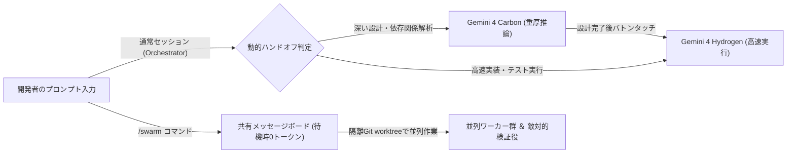

# **本日の AI/開発ツール トピックス (2026-11-15)**

## **1. 📋 今日の30秒サマリー**

> **💡 今日のハイライト**
>
> - 🚨 **AI開発ツールとブラウザに「うっかり・悪用中」の重大リスク**: 人気のAIコーディングツールで「次回から確認しない」を押すとパスワードまで保存・公開されてしまう問題や、オープンAIモデルのわずかな部品を書き換えて不正命令を仕込む新手法が報告されました。また、Google Chromeやチャットサーバーの悪用中の弱点も早急な更新が必要です。
> - 🚀 **AIが「確率で即決」「チームで分業」「地図を操作」する新時代へ**: Perplexityが文章ではなく確率と根拠箇所を返す高速判定モデル「Decider v1.3」を公開したほか、Googleの「Antigravity」が複数AIの並列作業とモデルの自動切り替えに対応し、地図情報システム「ArcGIS」もAIとの共通規格MCPに対応しました。
> - 🔥 **ブラウザもオフィスも記憶も「AIエージェント前提」のOSSが急上昇**: クラウド上で軽量に動くAI専用ブラウザ（Cloudflare Kitesurf）、AI開発チームを管理する基盤（LoopForge）、AIと人間が共同編集できる表計算SDK（Univer）など、実務に組み込めるオープンソースが続々登場しています。
{: .callout-summary}

| 区分 | トピック / ツール | ざっくり言うと？（1行要約） | 影響・おすすめ対象 |
| :--- | :--- | :--- | :--- |
| 🚨 **緊急** | **Claude Code** (`.claude/settings.local.json`) | 「次回から確認しない」で認証情報ごとローカル保存しGitHubへ誤公開 | **Claude Codeを使う全開発者・企業** |
| 🚨 **緊急** | **Microsoft「Lazarus」** (休眠ニューロン攻撃) | オープンAIモデルの10個未満のニューロン改変で再学習なしにバックドア化 | **OSSモデルをローカルやエージェントで使う層** |
| 🚨 **緊急** | **Google Chrome** (`CVE-2026-125350`) | Webページを開くだけで悪用されるXML処理のメモリ破壊ゼロデイ | **Windows/macOS/Linux版Chromeの全利用者** |
| 🚨 **緊急** | **UnrealIRCd** (`CVE-2026-114713`) | 悪用が確認されCISA KEVに追加されたチャットサーバーの命令注入 | **複数サーバー連携でUnrealIRCdを運用する管理者** |
| 🚀 **新機能** | **Perplexity Decider v1.3** (`Decisions API`) | 自由文ではなく「確率」と「根拠テキスト位置」を直接返す構造化判定AI | **高速な分類・ルーティング・PII抽出を組む開発者** |
| 🚀 **新機能** | **Google Antigravity** (`/swarm` & `Orchestrator`) | 複数AIの並列作業と「Carbon⇄Hydrogen」動的切り替えで速度と枠を最適化 | **大規模実装やリファクタリングをAIに任せる開発者** |
| 🚀 **新機能** | **Esri ArcGIS** (`MCP` ネイティブ対応) | AIエージェントが自然言語で地図検索・ルート計算・空間分析を直接実行 | **GIS/位置情報アプリ開発者・データ分析担当者** |
| 🚀 **新機能** | **Oracle App Composer** (`Codex` 統合) | 社員や開発者がCodexで社内アプリを即座に作りIT統制下で公開できるOCI基盤 | **Oracle Cloud上でガバナンス付きAI開発を進めたい企業** |
| 🔥 **注目** | **Cloudflare Kitesurf** (`cloudflare/kitesurf`) | 重いChrome不要でWorkers上で動くAIエージェント向け超軽量ブラウザ | **Webスクレイピングや自動操作エージェントの開発者** |
| 🔥 **注目** | **Tencent LoopForge** (`Tencent/LoopForge`) | 複数のAIコーディングエージェントをSOPと人間承認ゲート付きで統率するOSS | **AI開発の品質管理やチーム導入を標準化したい組織** |
| 🔥 **注目** | **Univer** (`dream-num/univer`) | AIエージェントと人間がスプレッドシートや文書を協調編集できるOffice SDK | **業務アプリにAI対応の表計算・文書機能を組み込む層** |
| 🔥 **注目** | **Memora** (`agentic-box/memora`) | 重複排除とグラフUIを備えたMCP対応のAIエージェント向け永続記憶基盤 | **ツールやセッションを跨いでAIに記憶を持たせたい層** |

---

## **2. 🚨 緊急セキュリティ情報**

### **Claude Code — コマンド承認機能による認証情報・APIキーの意図しない公開 (Apiiro調査)**

> **🔰 ひとことで言うと**
> Claude Codeでコマンド実行時に「はい、次回から尋ねない（Yes, and don't ask again）」を選ぶと、コマンドに含まれていたパスワードやAPIキーまでそのまま設定ファイルに保存され、知らずにGitHubへ公開してしまう事故が多発しています。
> 💬 *例えるなら：「毎回入力が面倒だからと『合言葉のメモ』を玄関のポストに貼り付けたところ、引っ越し作業（GitHub公開）のときにポストごと外に出してしまった」ような状態です。*
{: .callout-danger}

| リスク度 | 影響を受ける人 | 悪用のされやすさ | まずやるべき対策 |
| :---: | :--- | :--- | :--- |
| 🔴 **高** (1,122リポジトリで実漏洩) | `.claude/settings.local.json` を生成する環境でClaude Codeを使う全開発者 | ⚠️ 公開GitHub検索だけでデータベースやクラウドの鍵がそのまま見つかる | **リポジトリの `.gitignore` に `.claude/settings.local.json` を追加し、過去のコミット履歴を点検・鍵をローテーションする** |

以下の図は、開発者が利便性のためにコマンド承認を記憶させた結果、機密情報が設定ファイル経由で公開リポジトリへ流出するまでの流れを示したスイムレーン図です。

```mermaid
swimlane-beta TB
  subgraph Dev["開発者・Claude Code (ローカル環境)"]
    D1["秘密鍵やDBパスワードを含むコマンドを提案・実行"]
    D2["「Yes, and don't ask again」を選択"]
    D3["生テキストのまま .claude/settings.local.json に保存"]
  end
  subgraph Git["Git / 別マシン環境"]
    G1["グローバルgit excludeのみでプロジェクト側 .gitignore が未設定"]
    G2["別環境や一括ステージング (git add .) でファイルを追跡対象化"]
  end
  subgraph Public["公開GitHubリポジトリ"]
    P1["コミット＆プッシュにより認証情報が世界中に公開"]
  end
  D1 --> D2
  D2 --> D3
  D3 --> G1
  G1 --> G2
  G2 --> P1
```

> **図の見方**: Claude Codeはローカルの設定ファイルを端末のグローバル除外設定で隠そうとしますが、プロジェクト固有の `.gitignore` には書かれないため、別PCでの作業や一括コミット時にそのままGitHubへアップロードされてしまいます。

<details markdown="1">
<summary>🔍 技術的な仕組み・対象バージョン・対策コマンドを見る（エンジニア向け）</summary>

- **原因の仕組み**: セキュリティ企業Apiiroが公開GitHub上の104,000件以上の `.claude/settings.local.json` を調査したところ、**1,122個のファイルから合計1,379件の有効な認証情報**（本番DBのパスワード、クラウドAPIキー、SSH鍵等）が検出されました。Claude Codeはコマンドの自動承認ルールを保存する際、ワイルドカード等に抽象化せず「リテラルのコマンド文字列全体」を平文JSONとして保存するため、CLI引数やインライン環境変数に含めたシークレットがそのまま永続化されます。AnthropicのClaude Code責任者Boris Cherny氏もHacker News上で問題を認め、組み込みのシークレットスキャン等の保護策を検討中であることを表明しています。
- **対象環境**: Anthropic Claude Code を利用し、コマンド承認を永続化する開発環境全般（特にプロジェクトの `.gitignore` に `.claude/` または `.claude/settings.local.json` が未登録のケース）。
- **対策手順・コマンド**:
  1. シークレットが含まれたコマンドを一度でも承認した心当たりがある場合、履歴削除だけでなく**必ず該当キーやパスワードを即座にローテーション（失効・再発行）**してください。
  2. Git履歴にファイルが混入していないか確認し、全リポジトリの `.gitignore` に追記します。
  ```bash
  # 過去の全コミット履歴から .claude/settings.local.json の痕跡を検索
  git log --all --full-history -- "**/.claude/settings.local.json"

  # プロジェクトの .gitignore に追記（チーム全員に適用）
  echo ".claude/settings.local.json" >> .gitignore
  ```
- **一次ソース**: [Apiiro Research Blog](https://apiiro.com/blog/coding-agents-leaking-secrets-github-dont-ask-again)

</details>

---

### **Microsoft Research「Lazarus」— わずか10個未満の休眠ニューロン編集でAIエージェントに仕込めるバックドア**

> **🔰 ひとことで言うと**
> 配布されているオープンソースAIモデルの「普段ほとんど使われない神経細胞（ニューロン）」を10個未満書き換えるだけで、再学習なしに特定の日付や合図で悪意あるコマンドを実行する「スリーパーエージェント（潜伏工作員）」に変えられる手法が実証されました。
> 💬 *例えるなら：「普段は真面目に働く社員の脳内の、めったに使われない記憶スイッチをほんの数個書き換えておき、来年の元日になった瞬間に社内の重要データを外部へ送信させる」ような状態です。*
{: .callout-danger}

| リスク度 | 影響を受ける人 | 悪用のされやすさ | まずやるべき対策 |
| :---: | :--- | :--- | :--- |
| 🟠 **警戒** (新規研究実証) | 外部からダウンロードしたオープンウェイトAIモデルをエージェント（端末操作等）に組み込む開発者・企業 | ⚠️ 通常の安全性ベンチマークを完全に通過するため事前の目視・テストで見抜けない | **信頼できる提供元の署名付きモデルのみを使用し、AIエージェントのコマンド実行権限を最小化・サンドボックス化する** |

<details markdown="1">
<summary>🔍 技術的な仕組み・対象環境・対策方針を見る（エンジニア向け）</summary>

- **原因の仕組み**: Microsoft ResearchおよびMicrosoft AI Red Teamが公開した「**Lazarus**」手法では、モデルの重み（チェックポイント）への書き込み権限を持つ攻撃者が、モデルの最終Feed-Forward層付近にある**ほとんど発火しない休眠ニューロン（10個未満）を外科的に編集**します。この変更は通常のプロンプトや標準的な安全性評価（Evals）では一切発動せず、出力品質も劣化しません。しかし「特定の日付（例: 2027年1月1日）以降」や「外部ツールからの特定文字列の返却」といったトリガー条件を満たした瞬間だけ休眠ニューロンが発火し、AIエージェントに悪意あるシェルコマンド（外部スクリプトのダウンロード実行など）を出力・実行させます。
- **対象環境**: サードパーティのレジストリ等から取得したオープンウェイトLLMを、ターミナル実行やファイル操作権限を持つ自律型エージェントの基盤として運用する環境。
- **対策方針**:
  - モデルの重みファイルを「ソースコードや実行バイナリと同等」のセキュリティ対象として扱い、**暗号署名による来歴検証（Provenance）**とハッシュチェックを徹底する。
  - AIエージェントが発行するコマンドは、人間の承認ゲートやネットワーク制限付きコンテナ（Docker等）内で実行し、単一モデルの出力を無条件で信頼しない多層防御を構築する。
- **一次ソース**: [Microsoft Research Blog (Lazarus)](https://www.microsoft.com/en-us/research/blog/lazare-veni-foras-reprogramming-dormant-neurons-to-backdoor-ai-agents/)

</details>

---

### **Google Chrome / Chromium — `libxslt` における悪用中のゼロデイ脆弱性 (`CVE-2026-125350`)**

> **🔰 ひとことで言うと**
> ChromeがWebページ内のXMLやスタイルシートを処理する部品に深刻な不具合があり、細工されたWebページを開くだけでブラウザが乗っ取られるゼロデイ攻撃がすでに現実世界で悪用されています。
> 💬 *例えるなら：「街の掲示板（Webページ）に貼られた特殊なチラシを見ただけで、自分のスマホの画面裏で勝手に見知らぬプログラムが動き出してしまう」ような状態です。*
{: .callout-danger}

| リスク度 | 影響を受ける人 | 悪用のされやすさ | まずやるべき対策 |
| :---: | :--- | :--- | :--- |
| 🔴 **緊急** (悪用確認・CISA KEV登録) | Windows / macOS / Linux向けDesktop Chrome（157.0.8103.50未満）およびChromium系ブラウザ利用者 | ⚠️ 悪意あるHTMLページを閲覧するだけで発動（ファイルダウンロード不要） | **Chromeを `157.0.8103.50` / `.51` 以上へ直ちにアップデートし再起動する** |

<details markdown="1">
<summary>🔍 技術的な仕組み・対象バージョン・対策コマンドを見る（エンジニア向け）</summary>

- **原因の仕組み**: Chromiumに同梱されているXML/XSLT処理ライブラリ `libxslt` において、解放済みメモリへの参照（**Use-After-Free / UAF**）が発生するメモリ破壊脆弱性です（推定CVSSスコア 8.8）。細工されたHTML/XMLコンテンツをレンダリングさせることで、リモートの攻撃者がブラウザのレンダラーサンドボックス内で任意のコードを実行できます。Googleが実際の悪用（in-the-wild exploit）を確認し、米CISAも11月10日付で悪用確認済み脆弱性カタログ（KEV）へ追加しました。
- **対象バージョン/環境**:
  - Windows / macOS: `157.0.8103.50` / `157.0.8103.51` 未満のGoogle Chrome
  - Linux: `157.0.8103.50` 未満のGoogle Chrome（および同ベースのEdge、Brave、Electronアプリ等）
- **対策手順・コマンド**:
  Chrome右上のメニュー「ヘルプ」→「Google Chrome について」から更新し、**必ずブラウザを再起動**してください。Linux環境（Debian/Ubuntu系）でのCLI更新例は以下の通りです。
  ```bash
  sudo apt-get update && sudo apt-get install --only-upgrade google-chrome-stable
  google-chrome --version
  ```
- **一次ソース**: [CVE-2026-125350 (CVE.org)](https://www.cve.org/CVERecord?id=CVE-2026-125350)

</details>

---

### **UnrealIRCd — `labeled-response` モジュールにおけるコマンドインジェクション (`CVE-2026-114713`)**

> **🔰 ひとことで言うと**
> オープンソースのチャットサーバー「UnrealIRCd」において、一般ユーザーが送信するメッセージのタグ処理に不備があり、複数サーバーを連結した環境で管理者権限のコマンドを勝手に実行されてしまう脆弱性が悪用され、CISA KEVに新規登録されました。
> 💬 *例えるなら：「一般客がレストランの注文メモ欄に特殊な記号を紛れ込ませることで、厨房同士の連絡網に『店長命令：全客を追い出せ』と割り込ませてしまう」ような状態です。*
{: .callout-danger}

| リスク度 | 影響を受ける人 | 悪用のされやすさ | まずやるべき対策 |
| :---: | :--- | :--- | :--- |
| 🔴 **緊急** (11/13 CISA KEV追加) | 2台以上のサーバーをリンク構成で運用している UnrealIRCd (`6.0.0`〜`6.2.7.0`) 管理者 | ⚠️ 認証不要の通常チャット接続からサーバー間コマンドを注入可能 | **UnrealIRCd `6.2.7.1` へアップグレード、または無停止ホットパッチ／Spamfilter回避策を即時適用** |

<details markdown="1">
<summary>🔍 技術的な仕組み・対象バージョン・対策コマンドを見る（エンジニア向け）</summary>

- **原因の仕組み**: UnrealIRCdの `labeled-response` モジュールが、IRCv3仕様の `"label"` メッセージタグを応答時に適切にエスケープ（無害化）せずにそのまま返却する問題（CWE-140 / CVSS 8.6）です。2つ以上のリンクされたIRCサーバー間でこのタグが転送されると、一般ユーザーがサーバー間プロトコル（S2S）のコマンドを注入でき、`KILL` や `GLINE` といった強力なIRCOp（サーバー管理者）権限コマンドを実行できてしまいます。公開直後から実環境での悪用が観測され、11月13日にCISA KEVへ登録されました。
- **対象バージョン/環境**: UnrealIRCd `6.0.0` 〜 `6.2.7.0`（修正済みバージョン: **`6.2.7.1`**）
- **対策手順・コマンド**:
  即座に再起動できない場合は、Unix系環境向けの無停止ホットパッチまたはSpamfilterルールを適用してください。
  ```bash
  # 1. 無停止ホットパッチの適用（6.0.0〜6.2.7系）
  ./unrealircd hot-patch bundle-20261107

  # 2. IRCサーバー上でのSpamfilterによる即時緩和策（6.0.4以降）
  # /SPAMFILTER add -regex T block - Invalid_label ^label=(?![^\r\n;\x20]*\z)
  ```
- **一次ソース**: [CVE-2026-114713 (CVE.org)](https://www.cve.org/CVERecord?id=CVE-2026-114713)

</details>

---

## **3. 🚀 メジャーリリース・新機能**

### **Perplexity Decider v1.3 / Decider Flash v1.3 — 確率と根拠テキスト位置(`locate`)を返す構造化判定AI**

> **🔰 ひとことで言うと**
> 文章をダラダラ生成する普通のAIとは違い、「Yes/Noの確率」や「複数選択肢のスコア」、さらに「元の文章の何文字目から何文字目が根拠か」を一発で正確に返す専用AIモデルとAPIが一般公開されました。
> 💬 *例えるなら：「長い感想文を書く評論家ではなく、質問シートを渡すと一瞬で『YES: 92%・根拠は3行目』とマークシートを塗って返してくれる超高速な採点官」です。*
{: .callout-info}

| 比較ポイント | これまで (Before) | Decider v1.3 / Decisions API 以降 (After) |
| :--- | :--- | :--- |
| **出力形式と信頼性** | 汎用LLMにJSONを出力させてパースするも、書式崩れや確率の曖昧さが課題 | **1回の順伝播で校正済み確率分布と型付き判定結果（`noul`/`choice`/`score`）を直接出力** |
| **根拠箇所の抽出** | 該当テキストを抜き出させてもハルシネーションで原文と微妙にズレることがあった | **新機能 `locate` により原文の文字オフセット（開始・終了位置）と信頼度を正確に抽出** |
| **コストとローカル実行** | 分類タスクでも高価な生成トークン課金や重い推論が必要だった | **APIは入力100万トークン$0.01〜$0.02（出力無料）。Apache 2.0で27B/4B重みも公開** |

<details markdown="1">
<summary>🔍 技術的ブレークスルーとリリースノート詳細を見る</summary>

- **技術的ポイント**:
  - **2つのオープンウェイトモデル（Apache 2.0）**: Qwen3.8-27Bベースの **`pplx-decider-v1.3`**（27Bパラメータ、BF16で約49 GiB、高精度なルーブリック評価向け）と、Qwen3.5-4Bベースの軽量版 **`pplx-decider-flash-v1.3`**（約8.5 GiB、高スループット・低遅延のルーティングやフィルタリング向け）をHugging Faceで公開しました。
  - **双方向フルアテンション＋相互干渉なし**: 入力状態（テキスト、JSON、画像）に対して複数の質問を同時に評価しつつ、質問同士のアテンション干渉を防ぐ設計を採用。API経由では最大256,000トークン（ローカル初期値32,768）のコンテキストに対応します。
  - **新機能 `locate` によるSpan抽出**: 固有表現抽出（NER）や個人情報（PII）検出、抽出型QA向けに、原文そのままの抜粋テキストと正確な文字オフセットを返します。
- **開発フローへの影響**: エージェントのガードレール判定、問い合わせの自動振り分け、RAG検索結果の関連度スコアリングにおいて、生成LLMを呼び出す前段の超高速・低コストな判断エンジンとして機能します。Apple Silicon向けのメニューバー常駐アプリ「Decider for Mac」も提供されています。
- **公式リンク**: [Perplexity Blog: Perplexity Decider](https://www.perplexity.ai/hub/blog/perplexity-decider) / [Hugging Face (`pplx-decider-v1.3`)](https://huggingface.co/perplexity-ai/pplx-decider-v1.3)

</details>

---

### **Google Antigravity `/swarm` ＆ `Orchestrator` — 複数AIの並列協調と動的モデル切り替え**

> **🔰 ひとことで言うと**
> Googleの開発環境「Antigravity」に、1つの指示から複数のAI作業員とテスト担当者を同時に動かして大きな開発を片付ける「`/swarm`」機能と、頭脳役（Carbon）と実行役（Hydrogen）のAIを自動で切り替えて速さとコストを最適化する「Orchestrator」が登場しました。
> 💬 *例えるなら：「優秀な建築家1人が全部の手作業をするのではなく、設計担当（Carbon）と大工（Hydrogen）が状況に応じてバトンタッチし、さらに複数の部屋を別々の大工チーム（`/swarm`）が同時にリフォームして検査官がチェックする」ような仕組みです。*
{: .callout-info}

| 比較ポイント | これまで (Before) | `/swarm` & `Orchestrator` 導入後 (After) |
| :--- | :--- | :--- |
| **大規模タスクの進め方** | 1つのエージェントが順番にファイルを編集・テストするため待ち時間が長い | **`/swarm` により隔離されたGit worktree上で複数ワーカーと検証役が並列稼働** |
| **モデル選択の仕組み** | セッション開始時に「賢いが高価なモデル」か「速いモデル」かを固定 | **`Orchestrator` がセッション途中で「Carbon ⇄ Hydrogen」を双方向・動的に切り替え** |
| **コストと完了速度** | 単純なコマンド実行やパッケージ更新でも重量級モデルの枠を消費 | **Carbon単体と同等の成功率を保ちつつ、クォータ消費を約24%削減・完了速度を約19%向上** |

以下の図は、Google Antigravityにおける「垂直方向のモデル切り替え（Orchestrator）」と「水平方向の並列分散（`/swarm`）」がどのようにタスクを処理するかを示したフロー図です。



> **図の見方**: 通常の作業では `Orchestrator` がタスクの重さを見てCarbonとHydrogenを柔軟に行き来し、大規模なマルチファイル変更では `/swarm` が専用の作業ツリー（Git worktree）を分けて衝突を防ぎながら並列開発とテスト検証を行います。

<details markdown="1">
<summary>🔍 技術的ブレークスルーとリリースノート詳細を見る</summary>

- **技術的ポイント**:
  - **`/swarm`（マルチエージェント・プレビュー）**: コンポーザーで `/swarm` を実行すると、コーディネーター、独立したGit worktreeで作業する並列ワーカー群、そしてテストを実行してdiffに異議を唱える敵対的検証役（Adversarial Verifier）が自動編成されます。エージェント間の連絡は追記専用の共有メッセージボード（待機中のトークン消費ゼロ）で行われ、開発者はSwarm UIサイドペインや `/swarm board`（`Alt + S`）で進捗を監視できます。
  - **`Orchestrator`（動的モデル・ハンドオフ）**: 11月10日公開の「Gemini 4 Carbon」と11月12日公開の「Gemini 4 Hydrogen」を組み合わせ、事前ルーティングでモデルを固定するのではなく、セッション中の文脈に応じて双方向にモデルを切り替えます（Google AI Ultra加入者向けに展開）。
- **開発フローへの影響**: これまで「遅いが賢いモデル」と「速いが浅いモデル」を手動で使い分けていた手間が不要になり、大規模リファクタリング時の編集衝突（コンフリクト）もGit worktree分離によって構造的に回避できます。
- **公式リンク**: [Google Antigravity](https://antigravity.google/)

</details>

---

### **Esri ArcGIS — Model Context Protocol (MCP) ネイティブ対応で地理空間AIを実現**

> **🔰 ひとことで言うと**
> 世界の地図・地理情報システムの標準である「ArcGIS」がAI共通規格（MCP）に対応し、ClaudeやCopilotなどのAIエージェントが「この周辺で点検が遅れている設備を地図から探してルートを組んで」といった指示を直接実行できるようになりました。
> 💬 *例えるなら：「これまで専門のオペレーターしか操作できなかった巨大な地図管制室に、AIアシスタントがそのまま接続できる専用コンセント（MCP）が取り付けられた」ような変化です。*
{: .callout-info}

| 比較ポイント | これまで (Before) | ArcGIS MCP ネイティブ対応後 (After) |
| :--- | :--- | :--- |
| **地図・空間データ操作** | 専門ツールでのGUI操作や、GIS特有の複雑なREST APIの個別実装が必要 | **自然言語のプロンプトからAIエージェントがジオコーディングや空間検索を直接実行** |
| **外部AIとの連携** | 社内ポータルや地図レイヤーを外部LLMへ繋ぐには独自の中継コードが必須 | **MCPサーバーとして標準提供され、ClaudeやMicrosoft Copilot Studioと即連携** |
| **提供範囲** | 一部のコミュニティ製ラッパーや実験的スクリプト中心 | **ArcGIS Location Platformでパブリックベータ開始、Enterprise/Kubernetesへも展開** |

<details markdown="1">
<summary>🔍 技術的ブレークスルーとリリースノート詳細を見る</summary>

- **技術的ポイント**:
  - **MCPサーバー機能の公式統合**: ArcGIS Location Platform（PaaS）においてMCP対応ロケーションサービスのパブリックベータが提供され、住所のジオコーディング、ルート案内・移動時間計算、標高データ取得、静的マップ生成、POI検索などをAIエージェントからツールとして直接呼び出せます。
  - **ポータル・レイヤー検索の自動化**: ArcGIS OnlineやArcGIS Enterprise内のフィーチャーサービス、Webマップ、レイヤーのメタデータを検索し、属性フィルタと空間フィルタを組み合わせた多段階のジオプロセシングを1つの会話フローで連鎖実行できます。
- **開発フローへの影響**: 物流・インフラ点検・不動産・防災などの業務システムにおいて、GISの専門知識を持たない開発者でも「地図に裏付けられた正確な空間判断」をAIエージェントへ簡単に組み込めるようになります。
- **公式リンク**: [Esri ArcGIS Blog: What's New in Geospatial AI (November 2026)](https://www.esri.com/arcgis-blog/products/arcgis/geoai/whats-new-in-geospatial-ai-november-2026)

</details>

---

### **Oracle App Composer（Codex統合）＆ OCI AI プラットフォーム強化**

> **🔰 ひとことで言うと**
> Oracle Cloud（OCI）上で、社員や開発者がOpenAIの「Codex」を使って業務アプリを素早く作り、そのまま企業のセキュリティやコスト管理のルールを守った状態で社内公開できるマネージドサービス「App Composer」など11月度の大型アップデートが展開されました。
> 💬 *例えるなら：「社員がAIで自由に便利ツールを作れる『社内DIY工房』を用意しつつ、電気代や鍵の管理（セキュリティ）は情報システム部門が一括で見守れる仕組み」です。*
{: .callout-info}

| 比較ポイント | これまで (Before) | Oracle App Composer 導入後 (After) |
| :--- | :--- | :--- |
| **AI生成アプリの運用** | 個人がAIで作ったツールが「シャドーIT」化し、権限やコスト管理が困難 | **IT部門のアクセス制御・データ接続・コスト追跡の統制下で安全に社内共有** |
| **クラウド構築と公開** | インフラ設定やスケーリング、脆弱性対策をアプリごとに手作業で構築 | **OCIがデプロイとスケーリングを自動管理し、AI Security Meshで脆弱性を自動修復** |
| **モデル学習・保管基盤** | モデル成果物やチェックポイントの永続ストレージ管理に別設定が必要 | **ホスト型モデル向けに最大50GBの永続ファイルストレージ機能を統合提供** |

<details markdown="1">
<summary>🔍 技術的ブレークスルーとリリースノート詳細を見る</summary>

- **技術的ポイント**:
  - **Oracle App Composer（Codex統合）**: OpenAIとの提携拡大の一環として提供され、開発者や業務担当者がCodexを用いてプロトタイプから実用アプリまでを迅速に構築し、OCI上で公開できる「採用ゲート（Adoption Gate）」として機能します。
  - **Oracle AI Security Mesh & 50GB永続ストレージ**: インフラの脆弱性をスキャンして自動修復する「Oracle AI Security Mesh」の強化に加え、11月度のアップデートではホスト型モデルのチェックポイントや成果物を保持できる最大50GBの永続ファイルストレージも導入されました。
- **開発フローへの影響**: 企業内でAIコーディングが普及するにつれて深刻化する「野良アプリ（シャドーIT）の乱立」を防ぎつつ、現場の開発スピードを落とさないエンタープライズ向けの現実解を提供します。
- **公式リンク**: [Oracle AI & Data Science Blog (November 2026)](https://blogs.oracle.com/ai-and-datascience/whats-new-in-ai-november-2026)

</details>

---

## **4. 🔥 注目のトレンドツール**

### **Cloudflare Kitesurf — Workers上で動くAIエージェント向けステートレス・ブラウザエンジン**

> **🔰 ひとことで言うと**
> AIエージェントがWebサイトを見たり操作したりするために、重たいChromeをサーバーに立てる代わりに、Cloudflareのエッジ環境（Workers）上で超軽量・高速に動くオープンソースのブラウザエンジンが公開されました。
> 💬 *例えるなら：「ちょっとした買い物に大型バス（Chrome）を毎回チャーターするのではなく、折りたたみ式の超軽量電動キックボード（Kitesurf）でWebの街をスイスイ走る」ようなツールです。*
{: .callout-tip}

| 注目ポイント | 内容 | おすすめ対象 |
| :--- | :--- | :--- |
| **何ができるか** | HTML解析・CSSレイアウト・JS実行・スクリーンショット描画をWorkers上で完結し、CDP（Puppeteer等）経由でAIから操作可能 | **Web操作や情報収集を行うAIエージェント開発者** |
| **注目の理由** | 重いChromiumコンテナが不要。Rust製エンジン群（Blitz, Stylo, Boa等）をWebAssembly化してApache 2.0で公開 | **サーバーレス環境で低コスト・高速にブラウザ自動化したい層** |

<details markdown="1">
<summary>🔍 主な機能・アーキテクチャ・導入方法を見る</summary>

- **主な機能・用途**:
  - Rust製のオープンソースコンポーネント（HTML/DOM/レイアウトの `Blitz`、CSS解析の `Stylo`、描画の `Linebender`、PDF生成の `Krilla`、JSフォールバックの `Boa`）をWebAssemblyへコンパイルして構築されたステートレス・ブラウザエンジンです。
  - 標準的な **Chrome DevTools Protocol (CDP)** を実装しているため、既存のPuppeteerベースのエージェントやスクレイピング基盤をほぼそのまま接続できます。
- **他の類似ツールとの比較**: 従来のHeadless ChromeやPlaywrightはコンテナあたり数百MB〜数GBのメモリを消費しコールドスタートも重いですが、Kitesurfはエッジワーカー上で軽量かつ安全に隔離実行できます（本番デプロイにはDynamic Workers分離のためWorkers Paidプランが必要）。
- **導入手順**:
  ```bash
  git clone https://github.com/cloudflare/kitesurf.git
  cd kitesurf
  pnpm install
  pnpm run dev
  ```
- **公式サイト/GitHub**: [cloudflare/kitesurf (GitHub)](https://github.com/cloudflare/kitesurf)

</details>

---

### **Tencent LoopForge — コーディングエージェント群をSOPと承認ゲート付きで統率するOSS基盤**

> **🔰 ひとことで言うと**
> Claude CodeやCodexなどのAIコーディングエージェントを「1人の便利な助手」として使うのではなく、作業手順書（SOP）と人間の承認ステップを組み込んだ「仮想の開発チーム」として自動運用できるセルフホスト型プラットフォームです。
> 💬 *例えるなら：「凄腕だが暴走しがちなAIプログラマーたちに、ちゃんとした会社の業務マニュアル（SOP）と『上司のハンコ（人間承認ゲート）』を渡して、安全に納品（PR作成）まで回す工場ライン」です。*
{: .callout-tip}

| 注目ポイント | 内容 | おすすめ対象 |
| :--- | :--- | :--- |
| **何ができるか** | 要件をチャットで伝えるだけで、Docker隔離環境内で複数のAIエージェントが役割分担して実装し、PR作成まで自動実行 | **AIエージェントによる開発を組織のワークフローに組み込みたいチーム** |
| **注目の理由** | CodeBuddy・Codex・Claude Codeを横断的に統合でき、視覚的なSOP設計と必須の品質・承認ゲートを備える | **品質を担保しながら自律型コーディングをチーム導入したいEM/SRE** |

<details markdown="1">
<summary>🔍 主な機能・アーキテクチャ・導入方法を見る</summary>

- **主な機能・用途**:
  - TencentのLightweight Cloudチームが開発したオープンソースのクラウドワークフロー基盤です。
  - ユーザーが「Main Bot」に要件を伝えると、Dockerで隔離されたサンドボックス環境を自動起動し、設計・実装・テストなどの各エージェントロールへタスクを割り振ります。
  - 視覚的なワークフローエディタ上で、テスト通過などのハードな品質ゲートや、本番反映前の人間による承認チェックポイントを強制できます。
- **他の類似ツールとの比較**: 単発のCLIエージェント（Claude Code単体など）と異なり、チーム全体で再現可能な標準作業手順（SOP）と隔離実行環境をセルフホストで提供できる点が特徴です。
- **公式サイト/GitHub**: [Tencent/LoopForge (GitHub)](https://github.com/Tencent/LoopForge)

</details>

---

### **Univer — AIエージェントと人間がスプレッドシートや文書を協調編集できるOffice SDK**

> **🔰 ひとことで言うと**
> 自社アプリの中にExcelのような表計算やドキュメント機能を組み込めるだけでなく、AIエージェントが人間と同じように数式を計算したり中身を書き換えたりして「変更差分（Diff）」を確認できるオープンソースのOffice SDKがGitHubで急上昇しています。
> 💬 *例えるなら：「AIが壊しにくいように構造化された『Googleスプレッドシートの部品セット』で、AIが書いた修正箇所をプログラムのコードレビューのように見比べられる」ツールです。*
{: .callout-tip}

| 注目ポイント | 内容 | おすすめ対象 |
| :--- | :--- | :--- |
| **何ができるか** | Web/サーバー上で動くスプレッドシート・文書・スライドを自社アプリに埋め込み、Facade API経由でAIと協調編集 | **SaaSや社内業務システムにAI対応の表計算・文書UIを組み込む開発者** |
| **注目の理由** | GitHubスター数24,300超と急伸。`.univer` 形式の構造化JSONスナップショットによりAIの編集をGit風に差分レビュー可能 | **RAGや業務自動化で複雑なExcel/表データの読み書きを扱うチーム** |

<details markdown="1">
<summary>🔍 主な機能・アーキテクチャ・導入方法を見る</summary>

- **主な機能・用途**:
  - Apache 2.0ライセンスで公開されている拡張可能なOffice SDKです。WebフロントエンドだけでなくサーバーサイドやAI SDKコアを備えており、統一されたFacade APIを通じてAIエージェントがセルの読み書き、数式計算、データ検証を安全に行えます。
  - 状態を構造化JSON（`.univer` スナップショット）として扱えるため、AIが行った大量のセル変更を人間がGitのDiffのようにレビュー・承認するワークフローを構築できます。
- **導入手順**:
  ```bash
  pnpm add @univerjs/presets
  ```
- **公式サイト/GitHub**: [dream-num/univer (GitHub)](https://github.com/dream-num/univer)

</details>

---

### **Memora — 重複排除とグラフUIを備えたMCP対応のAIエージェント永続記憶基盤**

> **🔰 ひとことで言うと**
> AIコーディングツールを切り替えたり新しい会話を始めたりすると「昨日の前提」を忘れてしまう問題を解決するため、重複を自動整理しながら記憶を蓄え、知識のつながりをグラフ画面で可視化できるMCP対応の記憶サーバーが注目されています。
> 💬 *例えるなら：「複数のAIアシスタントがみんなで共有して書き込める『整理整頓された共有メモ帳＆関連図ボード』」です。*
{: .callout-tip}

| 注目ポイント | 内容 | おすすめ対象 |
| :--- | :--- | :--- |
| **何ができるか** | MCP（Model Context Protocol）経由でAIエージェントに永続記憶・重複排除・セマンティック検索・グラフUIを提供 | **Claude CodeやCursor等で長期的な文脈を引き継ぎたい開発者** |
| **注目の理由** | ツールごとのローカル記憶の分断を解消し、重複データを自動統合しながら集合知として管理できる | **マルチエージェント構成や複数ツール併用で「同じ説明の繰り返し」をなくしたい層** |

<details markdown="1">
<summary>🔍 主な機能・アーキテクチャ・導入方法を見る</summary>

- **主な機能・用途**:
  - AIエージェント向けの永続的・集合的メモリレイヤーを実装するオープンソースプロジェクトです。
  - MCPサーバーとして動作するため、Claude CodeやCursorなどのMCP対応クライアントから標準プロトコルで記憶の保存・検索・更新を行えます。
  - 似たような記憶が重複して登録されるのを防ぐ重複排除（Deduplicating absorption）機能や、蓄積された知識の関係性をブラウザ上で視覚的に確認できるグラフUIを備えています。
- **公式サイト/GitHub**: [agentic-box/memora (GitHub)](https://github.com/agentic-box/memora)

</details>

---

## **5. 💡 その他・Tips**

- **AIコーディングツールの「ローカル設定ファイル」をチーム標準で `.gitignore` 化する**: 本日のClaude Codeの事例（`.claude/settings.local.json`）に限らず、Cursor、Windsurf、各種MCPクライアントはプロジェクト直下に `.cursor/` や `.mcp.json` 等の設定ファイルを生成します。個人のグローバルgit設定任せにせず、組織のリポジトリテンプレートの `.gitignore` にあらかじめエージェント用ローカル設定パスを登録し、`gitleaks` などのpre-commitシークレットスキャンを併用することが最も確実な事故防止策です。
- **構造化判定タスクは「生成LLM」から「Decider系モデル」へ切り出す**: 問い合わせ分類、スパム判定、ルーティング、PII検出のように「答えの型が決まっている処理」にチャット用の大型LLMを使うと、レイテンシとコストが跳ね上がります。`Perplexity Decider v1.3` のような判定特化モデルを前段に置くことで、処理速度と出力の安定性を大きく改善できます。

---

## **6. 📝 総評**

> **📌 今日の一言まとめ**
> 「AIエージェントの『並列化・軽量化・外部連携』が一気に実用段階へ進む一方で、開発者のローカル設定やAIモデル自身の重み（ウェイト）を狙う『AI時代ならではの新しいセキュリティ盲点』が浮き彫りになった一日でした。」
{: .callout-summary}

本日のトピックス全体を俯瞰すると、開発ツールの進化は明確に**「単一のチャットAIにコードを書かせる」フェーズから「複数の専門AIと周辺インフラを安全にオーケストレーションする」フェーズ**へ移行しています。Google Antigravityの `/swarm` と `Orchestrator`、Tencentの `LoopForge`、Cloudflareの `Kitesurf`、そしてPerplexityの `Decider v1.3` は、いずれも「適材適所のモデル・軽量な実行環境・人間による承認ゲート」を組み合わせることで、実用上のボトルネック（速度・コスト・品質のばらつき）を解消しようとする動きです。

同時に、セキュリティ面では従来の「Chrome (`CVE-2026-125350`) やUnrealIRCd (`CVE-2026-114713`) といったソフトウェアの脆弱性対策」に加えて、**「AIツールの利便性が生む設定ファイルの秘密情報漏洩（Claude Code）」**や**「オープンウェイトモデルの休眠ニューロン改変（Microsoft Lazarus）」**という、開発ワークフローとAIサプライチェーンそのものを標的・起点とするリスクが顕在化しました。エンジニアは「AIにどこまで権限を渡すか」「生成物やモデルの来歴をどう検証するか」を設計段階から組み込むことが不可欠になっています。

---

## **7. 📖 用語解説**

| 用語 | 解説 |
|------|------|
| **Use-After-Free (UAF)** | プログラムが使い終わって「もう不要」と返却したメモリ領域を、誤って後からもう一度使ってしまうバグ。たとえば「退去済みのホテルの部屋に別の客が入った後、前の客の合鍵がまだ使えてしまう」ような状態で、悪用されると不正なプログラムを実行される原因になります。 |
| **CISA KEV (Known Exploited Vulnerabilities)** | アメリカのサイバーセキュリティ機関（CISA）が公開している「理論上の危険だけでなく、すでに実際のサイバー攻撃で悪用が確認されている弱点」のリスト。ここ載ったものは最優先で修正すべき緊急サインです。 |
| **オープンウェイトモデル** | AIの「頭脳の重みデータ（学習済みパラメータ）」が公開されており、誰でも自分のパソコンや社内サーバーにダウンロードして動かせるAIモデルのこと。自由度が高い反面、配布元が改ざんされていないかの確認が重要です。 |
| **休眠ニューロン（Dormant Neurons）** | AIのニューラルネットワークの中で、通常の会話やテストではほとんど反応（発火）しない神経細胞のこと。Microsoftの研究は、この目立たない部分に特定の合図で動く不正な仕掛けを隠せることを示しました。 |
| **Git worktree** | 1つのGitリポジトリから、作業用のフォルダ（作業ツリー）を複数同時に生やせる機能。たとえば「AIチームAにはフォルダ1、AIチームBにはフォルダ2」と部屋を分けることで、同じファイルを同時に書き換えて衝突する事故を防げます。 |
| **WebAssembly (Wasm)** | RustやC++などの言語で作った高速なプログラムを、WebブラウザやCloudflare Workersのような軽量環境の上で安全・高速に動かせる共通の実行形式。 |
| **CDP (Chrome DevTools Protocol)** | ブラウザの自動操作ツール（Puppeteerなど）が、ブラウザに対して「このボタンをクリックして」「画面を撮って」と命令を送るための共通通信ルール。 |
| **SOP (Standard Operating Procedure)** | 「標準作業手順書」のこと。誰が（あるいはどのAIが）やっても同じ品質・安全基準で仕事が進むように決めた、手順とチェックリストのルールブックです。 |

---
(出典: 各公式サイト、GitHub、CVE、セキュリティアドバイザリ、TechニュースサイトよりAIが要約)

<!-- Kramdown略語定義: 本文中の対象単語に自動でインラインツールチップが付与されます -->
*[RCE]: Remote Code Execution（外部からネットワーク越しに任意のプログラムを勝手に実行される深刻な脆弱性）
*[CVE]: Common Vulnerabilities and Exposures（世界共通で割り振られるセキュリティ脆弱性の識別番号）
*[CISA]: Cybersecurity and Infrastructure Security Agency（米国サイバーセキュリティ・インフラストラクチャセキュリティ庁）
*[KEV]: Known Exploited Vulnerabilities（CISAが管理する「実際に悪用が確認された脆弱性」カタログ）
*[CVSS]: Common Vulnerability Scoring System（脆弱性の深刻度を0〜10の数値で評価する共通規格）
*[UAF]: Use-After-Free（解放済みメモリ領域への不正参照によるメモリ破壊脆弱性）
*[MCP]: Model Context Protocol（AIエージェントと外部ツール・データソースを安全に繋ぐためのオープン共通規格）
*[OSS]: Open Source Software（ソースコードが公開され、誰でも利用・改良できるソフトウェア）
*[SOP]: Standard Operating Procedure（標準作業手順書）
*[CDP]: Chrome DevTools Protocol（ブラウザを外部プログラムから制御・デバッグするための通信プロトコル）
*[PII]: Personally Identifiable Information（氏名や住所など個人を特定できる情報）
*[RAG]: Retrieval-Augmented Generation（外部の最新情報や社内文書を検索してからAIに回答させる技術）
