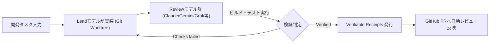

# **本日の AI/開発ツール トピックス (2026-11-16)**

## **1. 📋 今日の30秒サマリー**

> **💡 今日のハイライト**
>
> - 🚨 **AI開発環境の「委託先・拡張機能・サーバー」に要注意**: Cursorが偽の拡張機能を配信してしまった事件について「外部委託先からの鍵流出」が発端だったと詳細報告を公開しました。また、画像生成ツールの人気拡張機能やコード管理サーバー、Webサーバーにも深刻な弱点が見つかっています。
> - 🚀 **AIがIDE・画面部品・お買い物まで本格統合**: JetBrainsの統合開発環境がAIエージェントを標準搭載したほか、VercelがAIに安全な画面部品を作らせる専用キットを公開。OpenAIもAIが安全に代理決済できる「ChatGPT Wallet」を発表しました。
> - 🔥 **パソコン操作も遠隔操作もプライバシー保護も「次世代ツール」が急上昇**: 画面の見た目ではなくOS内部の仕組みを読み取ってAIが高速操作できるツールや、スマホから複数のAI作業を管理できるツール、履歴を追跡させない匿名AI通信技術などが注目を集めています。
{: .callout-summary}

| 区分 | トピック / ツール | ざっくり言うと？（1行要約） | 影響・おすすめ対象 |
| :--- | :--- | :--- | :--- |
| 🚨 **緊急** | **Cursor** (`偽Claude Code拡張機能報告`) | 委託先キー流出から偽拡張機能配信へ至ったサプライチェーン攻撃の全容を公表 | **Cursor利用者・AI開発基盤の管理者** |
| 🚨 **緊急** | **ComfyUI-Easy-Use** (`CVE-2026-123790`) | 画像生成ツールの人気拡張機能にファイル上書きで端末を乗っ取られる深刻な弱点 | **ComfyUI-Easy-Use v1.4.1以前の利用者** |
| 🚨 **緊急** | **Gitea** (`GHSA-q3q9-39vr-q35j`) | リポジトリを他人に譲った後も自動処理の信頼設定が残り秘密鍵を盗まれる恐れ | **Gitea 1.27.0〜28.4.0未満の運用者** |
| 🚨 **緊急** | **Apache HTTP Server** (`CVE-2026-119618`) | HTTP/2通信のタイミングのズレを突かれサーバーを乗っ取られる緊急の弱点 | **Apache 2.4.55〜2.4.70でHTTP/2有効環境** |
| 🚀 **新機能** | **JetBrains IDEs 2026.3** (`Air`) | IDEの中でAIエージェントの変更確認・ビルド実行・外部ツール連携が完結 | **IntelliJ IDEAやCLion等を使う開発者** |
| 🚀 **新機能** | **Vercel UI SDK** (`Public Beta`) | AIがアクセシビリティや操作性を壊さずUIを作れる50種以上の部品集を公開 | **React/Vue/Svelte等でAI開発するフロントエンド層** |
| 🚀 **新機能** | **OpenAI ChatGPT Wallet** | Visa/Mastercard/Amexと連携しAIエージェントが代理で安全に決済可能に | **EC連携やエージェントコマースを検討する事業者** |
| 🚀 **新機能** | **LetThemBuild** | 複数のAIモデルを同じ部屋で競合・相互レビューさせ検証結果を証明付きで出力 | **AI生成コードの品質とテスト検証を重視するチーム** |
| 🔥 **注目** | **agent-desktop** (`vercel-labs/agent-desktop`) | スクショ解析ではなくOSのアクセシビリティ機能を使いAIが爆速でPC操作 | **デスクトップアプリの自動操作エージェント開発者** |
| 🔥 **注目** | **t3code** (`pingdotgg/t3code`) | Claude CodeやCodex等を一元管理し外出先のスマホからも進捗確認・指示 | **複数のAIコーディングエージェントを並列利用する層** |
| 🔥 **注目** | **Obscurify / Open Anonymity** (`unlinkable-inference`) | 課金確認とチャット内容を暗号技術で切り離しAI事業者に履歴を追わせない仕組み | **機密・プライバシー重視でAIを使いたい開発者** |
| 🔥 **注目** | **TVClaude** (`runvnc/tvclaude`) | 1990年代の青いレトロ画面（Turbo Vision）上で複数のClaude Codeを並列操作 | **キーボード中心で軽量に複数AIを回したい開発者** |

---

## **2. 🚨 緊急セキュリティ情報**

### **Cursor — 外部委託先の鍵流出から偽Claude Code拡張機能配信に至った経緯を公表**

> **🔰 ひとことで言うと**
> 先月末にAIエディタ「Cursor」で偽の拡張機能が約5,000人に配信された事件について、発端は外部委託先（Fireworks AI）からのアクセス鍵流出であり、過去の学習用データに残っていたAPIキーを踏み台に社内システムへ侵入されていたことが判明しました。
> 💬 *例えるなら：「提携先の警備会社に預けていた倉庫の合鍵が盗まれ、倉庫内の古い伝票に書かれていたパスワードを使って本社の受付システムに侵入し、偽の荷物を混ぜられた」ような状態です。*
{: .callout-danger}

| リスク度 | 影響を受ける人 | 悪用のされやすさ | まずやるべき対策 |
| :---: | :--- | :--- | :--- |
| 🔴 **高** (最大約5,000人が偽拡張機能を取得) | 10月29日にCursor上で `Anthropic.claude-code` (`2.1.312` / `2.1.313`) を取得したユーザー、および2025年頃にPrivacy Mode無効で利用していた一部ユーザー | ⚠️ 該当バージョンを導入するだけで端末情報収集やSSHバックドア設置が試行された | **Cursorからの通知メールを確認し、該当者はAPIキーのローテーションと端末内の不審なSSH設定・プロセス点検を実施する** |

以下の図は、外部委託先の鍵流出からマーケットプレイスキャッシュの改ざん・偽拡張機能の配信に至る多段階のサプライチェーン侵入経路を示したスイムレーン図です。

```mermaid
swimlane-beta TB
  subgraph Vendor["外部委託先 (Fireworks AI)"]
    V1["Cursorが発行したアクセスキーが流出"]
  end
  subgraph Storage["データ共有バケット・内部SaaS"]
    S1["非Privacy Modeの過去トレースを参照"]
    S2["一部データから未マスクのAPIキーを取得"]
    S3["Cursor内部のSaaSツールへ横展開"]
  end
  subgraph Market["拡張機能マーケットプレイス"]
    M1["キャッシュへ偽Claude Code (2.1.312/313) を混入"]
  end
  subgraph Dev["開発者端末"]
    D1["約11時間で最大約5,000人が偽拡張機能を取得"]
  end
  V1 -->|"読み取り専用アクセス"| S1
  S1 --> S2
  S2 --> S3
  S3 -->|"キャッシュ汚染"| M1
  M1 -->|"自動更新・インストール"| D1
```

> **図の見方**: 本番インフラやアプリ署名鍵、Privacy Mode有効時のデータは侵害されませんでしたが、過去の学習共有データという「盲点」から社内SaaSを経由し、開発者が日常的に信頼している拡張機能ストアのキャッシュが狙われました。

<details markdown="1">
<summary>🔍 技術的な仕組み・影響範囲・対策手順を見る（エンジニア向け）</summary>

- **原因の仕組み**: Cursorは11月13日付の調査報告で、10月29日に発生した不正な `Anthropic.claude-code` 拡張機能（バージョン `2.1.312` および `2.1.313`）の配信インシデントの全容を公開しました。発端はAIインフラ委託先のFireworks AIにおいて、Cursorが発行した読み取り専用バケット用アクセスキーが露出したことです。攻撃者は主に2025年時点の非Privacy Modeエージェントトレース（0.01%未満のユーザー分に未マスクのAPI認証情報が含まれていた）から鍵を抽出し、Cursor社内のSaaSツールへ侵入。最終的にVS Code拡張機能マーケットプレイスのキャッシュを改ざんし、SSHバックドア設置を試みる悪意あるビルドを約11時間にわたり配信しました。なお、Cursorは攻撃者のC2サーバーをクラウド事業者と連携して停止しており、管理者権限を要するSSHサービス開放は多くの環境で失敗したと説明しています。
- **影響を受けなかった範囲**: 本番推論インフラ、現在の顧客コードリポジトリ、Privacy Mode有効時のプロンプト・コード、公式アプリのリリース署名鍵。
- **対策手順**:
  1. Cursorから個別通知が届いている場合は、露出が疑われるすべてのAPIキー・トークンを即座に無効化・再発行する。
  2. 10月29日前後に `Anthropic.claude-code` (`2.1.312` / `2.1.313`) を導入した可能性がある場合、特にWindows/macOS端末の `~/.ssh/authorized_keys` や不審な永続化タスクを点検する。
  3. チーム開発ではCursorの「Privacy Mode」を原則有効化し、サポート窓口等へ平文のAPIキーを送付しない運用を徹底する。
- **一次ソース**: [Cursor公式ブログ: Security Incident Update](https://cursor.com/blog/security-incident-update)

</details>

---

### **ComfyUI-Easy-Use — ファイル保存の仕組みを悪用した遠隔コード実行の脆弱性 (CVE-2026-123790)**

> **🔰 ひとことで言うと**
> 画像生成AI「ComfyUI」の人気拡張機能において、外部からパスワードなしでファイルを送り込んで既存プログラムを上書きし、パソコンを乗っ取られる深刻な弱点が見つかりました。
> 💬 *例えるなら：「お店の『お客様イラスト投稿ポスト』の宛名ラベルを書き換えることで、お店の金庫のプログラムファイルをすり替えてしまう」ような状態です。*
{: .callout-danger}

| リスク度 | 影響を受ける人 | 悪用のされやすさ | まずやるべき対策 |
| :---: | :--- | :--- | :--- |
| 🔴 **緊急** (未認証RCE) | `ComfyUI-Easy-Use` バージョン `1.4.1` 以前を導入している全ユーザー | ⚠️ 認証なしで到達可能な場合、細工されたPOST送信＋再起動で即座に任意コード実行 | **ComfyUI-Easy-Useを最新版へ更新し、ComfyUIを認証なしでインターネットに直接公開しない** |

<details markdown="1">
<summary>🔍 技術的な仕組み・対象バージョン・対策コマンドを見る（エンジニア向け）</summary>

- **原因の仕組み**: `ComfyUI-Easy-Use` のPOSTルート `/easyuse/save/{name}` に紐づく `save_preview()` ハンドラにパストラバーサル（ディレクトリトラバーサル）の欠陥があります。入力ディレクトリの検証を行った後にユーザー指定のファイル名を結合してコピー先を決定するロジックの不備により、攻撃者はあらかじめアップロードした悪意あるPythonスクリプトを既存カスタムノードのエントリーポイント（`__init__.py` 等）へ上書きコピーできます。その後、ComfyUIが再起動されると改ざんされたノードが自動的に読み込まれ、ComfyUI実行ユーザーの権限で任意のPythonコードおよびOSコマンドが実行されます。
- **対象バージョン/環境**: `yolain/ComfyUI-Easy-Use` バージョン `1.4.1` およびそれ以前。
- **対策手順・コマンド**:
  ```bash
  # ComfyUIのカスタムノードディレクトリで最新版へ更新（修正コミット 8a0f2fc412 以降）
  cd ComfyUI/custom_nodes/ComfyUI-Easy-Use
  git pull origin main
  ```
  - インターネットへ直接公開している場合は、直ちにファイアウォールで遮断し、VPNやリバースプロキシによる強固な認証を必須化してください。
- **一次ソース**: [CVE-2026-123790 (CVE.org)](https://www.cve.org/CVERecord?id=CVE-2026-123790) / [GitHub - yolain/ComfyUI-Easy-Use](https://github.com/yolain/ComfyUI-Easy-Use)

</details>

---

### **Gitea — リポジトリ移管後も自動処理の信頼関係が残る権限不備 (GHSA-q3q9-39vr-q35j / CVE-2026-118535)**

> **🔰 ひとことで言うと**
> セルフホスト型のコード管理ツール「Gitea」で、リポジトリを別のオーナーへ譲渡した後も元のオーナー側の自動実行設定（ワークフロー）への信頼が切れず、新しいオーナーに秘密の鍵を盗み見られる弱点が修正されました。
> 💬 *例えるなら：「引っ越しして家の持ち主が変わったのに、以前の住人の合鍵リストから削除されず、新しい住人が元の持ち主の金庫を開けられてしまう」ような状態です。*
{: .callout-danger}

| リスク度 | 影響を受ける人 | 悪用のされやすさ | まずやるべき対策 |
| :---: | :--- | :--- | :--- |
| 🟠 **高** (CWE-863 認可不備) | Gitea `1.27.0` 〜 `28.4.0` 未満でGitea Actionsのスコープ付きワークフローを利用する環境 | ⚠️ 移管後のリポジトリを新オーナーが書き換えるだけで旧オーナー側の環境で実行可能 | **Giteaを修正済みの `28.4.0` 以降へ速やかにアップデートする** |

<details markdown="1">
<summary>🔍 技術的な仕組み・対象バージョン・対策コマンドを見る（エンジニア向け）</summary>

- **原因の仕組み**: Gitea Actionsにおいて、あるリポジトリが「スコープ付きワークフロー（Scoped Workflows）」のソースとして登録された後、そのリポジトリの所有権が別のユーザーや組織へ移管（Transfer）されても、オーナーレベルの登録状態が解除されずに残存していました。その結果、移管後の新オーナーが悪意あるワークフロー定義を書き込むと、旧オーナーが管理する他のリポジトリのコンテキストでそのワークフローが実行され、Actions Secretsやジョブトークンへ不正アクセスできる状態となっていました。
- **対象バージョン/環境**: Gitea `1.27.0` 以上 `28.4.0` 未満。
- **対策手順・コマンド**:
  - 修正版の **Gitea 28.4.0** へアップグレードしてください（PR `#40131` および `#40281` にて、リポジトリ移管時の登録自動削除と、所有者が一致しない登録の明示的無視が実装されています）。
  - アップグレードまでの間は、過去に他者へ移管したリポジトリがワークフローソースとして登録されたままになっていないか設定画面から確認・削除してください。
- **一次ソース**: [GitHub Security Advisory: GHSA-q3q9-39vr-q35j](https://github.com/go-gitea/gitea/security/advisories/GHSA-q3q9-39vr-q35j)

</details>

---

### **Apache HTTP Server (`mod_http2`) — 通信処理の競合によるサーバー乗っ取りの脆弱性 (CVE-2026-119618)**

> **🔰 ひとことで言うと**
> 世界中で広く使われているWebサーバー「Apache」の高速通信機能（HTTP/2）に、複数の処理を同時にさばく際のタイミングのズレを突かれて、外部からサーバーを乗っ取られる極めて深刻な弱点が見つかりました。
> 💬 *例えるなら：「レストランのキッチンで複数の料理人が同じメモ帳を奪い合って書き換えた結果、まったく別の危険な注文が通ってしまう」ような状態です。*
{: .callout-danger}

| リスク度 | 影響を受ける人 | 悪用のされやすさ | まずやるべき対策 |
| :---: | :--- | :--- | :--- |
| 🔴 **緊急** (CVSS 9.8) | Apache HTTP Server `2.4.55`〜`2.4.70` で `mod_http2`（`h2` / `h2c`）を有効にしている全環境 | ⚠️ 認証なしでHTTP/2リクエストを送るだけでヒープメモリ破壊・RCEの恐れ | **Apache HTTP Server `2.4.71`（またはOSベンダーの修正パッケージ）へ直ちに更新する** |

<details markdown="1">
<summary>🔍 技術的な仕組み・対象バージョン・対策コマンドを見る（エンジニア向け）</summary>

- **原因の仕組み**: `mod_http2` モジュール内の `assign_headers()` 関数において、ロックなしアロケータを共有する複数ワーカースレッド間の同期不備（競合状態 / Race Condition）が存在します。あるスレッドが別スレッドの所有するメモリ領域を変更してしまうことでヒープメモリ破壊が発生し、未認証のリモート攻撃者による任意のコード実行（RCE）やサービス妨害（DoS）を引き起こす可能性があります。HTTP/1.1のみを使用しているサーバーは影響を受けません。
- **対象バージョン/環境**:
  - Apache HTTP Server (`httpd`): `2.4.55` 〜 `2.4.70`
  - スタンドアロン版 `mod_h2`: `2.0.8` 〜 `2.0.42`
- **対策手順・コマンド**:
  1. Apache HTTP Server **2.4.71** へアップグレードする（RHEL、Ubuntu、Debian等のディストリビューション提供パッケージを更新）。
  2. 即時適用が困難な場合の一時回避策として、`Protocols` ディレクティブから `h2` / `h2c` を除外してHTTP/2を無効化し、サーバーを再起動する。
- **一次ソース**: [CVE-2026-119618 (CVE.org)](https://www.cve.org/CVERecord?id=CVE-2026-119618)

</details>

---

## **3. 🚀 メジャーリリース・新機能**

### **JetBrains IDEs 2026.3 — IDE標準のAIエージェント機能「Air」を一般提供**

> **🔰 ひとことで言うと**
> IntelliJ IDEAなどの人気開発環境「JetBrains IDEs」が2026.3にアップデートされ、AIコーディングエージェントをエディタ内で直接動かし、変更の確認やビルドまで一画面で完結できる新機能「Air」が使えるようになりました。
> 💬 *例えるなら：「外部の電話で指示していた大工さんが、自分の作業部屋の中にある専用デスクに座って、設計図と工具箱を直接共有しながら一緒に作業してくれる」ような進化です。*
{: .callout-info}

| 比較ポイント | これまで (Before) | 2026.3「Air」以降 (After) |
| :--- | :--- | :--- |
| **エージェントの動作場所** | 外部CLIや別ウィンドウでのやり取りが中心 | **IDE内にネイティブ統合され、変更差分を即座にレビュー可能** |
| **ビルド・デバッグ連携** | AIが書いたコードを人間が手動でIDEの実行構成へ渡す | **IDE既存のビルド・デバッグ構成をエージェントが直接利用** |
| **外部ツール拡張 (MCP)** | エディタごとの個別設定が必要 | **ワークスペース内でMCPサーバースキルを統合実行** |

<details markdown="1">
<summary>🔍 技術的ブレークスルーとリリースノート詳細を見る</summary>

- **技術的ポイント**: JetBrains 2026.3で一般提供（GA）された「Air」は、IntelliJ IDEAやCLionなどのJetBrains系IDEにネイティブ統合されたコーディングエージェント基盤です。単なるチャット補完ではなく、IDEが保持する高度なコード解析インデックス、リファクタリング機能、ビルド・デバッグ構成をエージェントのワークスペースに直結させている点が特徴です。
- **開発フローへの影響**: エージェントが加えた変更をIDE標準の差分ビューアで詳細にレビュー・部分承認できるほか、MCP（Model Context Protocol）サーバーのスキルをIDE内から安全に呼び出せるため、外部CLIとIDEを行き来するコンテキストスイッチが大幅に削減されます。
- **公式リンク**: [JetBrains Blog: Air in JetBrains IDEs: Run and Review AI Coding Agents](https://blog.jetbrains.com/ai/2026/11/air-in-jetbrains-ides-ga/)

</details>

---

### **Vercel UI SDK (Public Beta) — AIが「操作しやすい画面」を正しく組むための部品集**

> **🔰 ひとことで言うと**
> Vercelが公開した新しいUI開発キットは、AIがWeb画面を作るときにやりがちな「キーボードで操作できない」「ポップアップが閉じない」といった細かいミスを防ぐため、50種類以上の安全なUIの振る舞いをあらかじめ部品化して提供します。
> 💬 *例えるなら：「AIという建築家にゼロからドアやエレベーターを作らせるのではなく、バリアフリー規格を完全に満たした『動作保証済みの機構パーツ』を渡して組み立ててもらう」ような仕組みです。*
{: .callout-info}

| 比較ポイント | これまで (Before) | Vercel UI SDK 以降 (After) |
| :--- | :--- | :--- |
| **アクセシビリティ・操作性** | AI生成UIでフォーカス管理やARIA属性のバグが多発 | **50種以上のテスト済み振る舞いプリミティブで品質を担保** |
| **フレームワーク対応** | React専用などフレームワークごとに書き直しが必要 | **共通コア＋React/Vue/Svelte/Solid/Web Componentsに対応** |
| **AIエージェントとの親和性** | UIの内部状態をAIがプログラム的に把握・操作しづらい | **`ui-sdk` スキル経由でAIが状態制御やテストを直接実行可能** |

<details markdown="1">
<summary>🔍 技術的ブレークスルーとリリースノート詳細を見る</summary>

- **技術的ポイント**: デザイン（見た目）を持たない「ヘッドレスUI振る舞いライブラリ」であり、`@ui-sdk/core` に `createPopup`、`createSelection`、`createRovingFocus`、`createTypeahead` などの状態管理とWAI-ARIA準拠ロジックを集約しています。各フレームワーク向けには薄いアダプタのみを提供する設計（Apache 2.0ライセンス）です。さらに `npx skills add vercel-labs/ui --skill ui-sdk` によってコーディングエージェントにSDKの使い方を直接学習・適用させる導線も用意されています。
- **提供形態・利用開始方法**:
  ```bash
  npm install @ui-sdk/core @ui-sdk/react
  # React以外に @ui-sdk/vue, @ui-sdk/svelte, @ui-sdk/solid 等も選択可能
  ```
- **公式リンク**: [GitHub - vercel-labs/ui](https://github.com/vercel-labs/ui)

</details>

---

### **OpenAI ChatGPT Wallet — AIエージェントが安全に代理決済できる新基盤**

> **🔰 ひとことで言うと**
> OpenAIがVisa・Mastercard・American Expressと提携し、ChatGPT上のAIエージェントが本物のカード番号を渡さずに「使い捨て・制限付きの代理決済情報」で安全にお買い物や予約を代行できる仕組みを発表しました。
> 💬 *例えるなら：「秘書にクレジットカード本体を預けるのではなく、『今日このお店で1万円までしか使えない専用デジタル商品券』を都度発行して買い物を任せる」ような仕組みです。*
{: .callout-info}

| 比較ポイント | これまで (Before) | ChatGPT Wallet 以降 (After) |
| :--- | :--- | :--- |
| **決済手段の受け渡し** | AIが決済画面で止まり人間がカード番号を入力 | **代替決済認証情報（Substitute Credentials）でAIが代理決済** |
| **セキュリティと統制** | 生のカード情報をエージェントに渡すリスク | **大手カードブランドと連携したトークン化と利用制限** |
| **事業者の対応** | チャット内での購買完結が困難 | **Verified Business Profiles等と連携しチャット完結の商流を構築** |

<details markdown="1">
<summary>🔍 技術的ブレークスルーとリリースノート詳細を見る</summary>

- **技術的ポイント**: OpenAIはAmerican Express、Mastercard、Visaとのパートナーシップのもと、エージェントコマース向けの「ChatGPT Wallet」を展開しました。ユーザーの生クレジットカード番号をAIモデルや外部サイトに露出させることなく、ネットワーク側でトークン化された代替決済認証情報を用いてトランザクションを承認する仕組みです。同時に企業向けの「Business Hub / Verified Business Profiles」も導入され、ブランド情報の管理とユーザーとの対話データ連携を強化しています。
- **開発フローへの影響**: ECサイトや予約サービスを提供する開発者は、AIエージェント経由のトラフィックを不正ボットではなく正規の認証済み購買フローとして安全に受け入れる設計へ移行しやすくなります。
- **公式リンク**: [OpenAI: Introducing ChatGPT Wallet](https://openai.com/index/introducing-chatgpt-wallet/)

</details>

---

### **LetThemBuild — 複数AIの相互レビューと「検証済み領収書」を出す開発基盤**

> **🔰 ひとことで言うと**
> Claude・Codex・Gemini・Grokなど複数のAIを同じ作業部屋に呼び出し、1つのAIが書いたコードを他のAIがテスト実行まで含めて厳しくチェックし、「本当に動くこと」を証拠付きで証明してくれる新しい開発プラットフォームが公開されました。
> 💬 *例えるなら：「1人のプログラマーに丸投げするのではなく、別の専門家チームがテスト運転まで済ませて『合格証明書』を添えて納品してくれる」ような開発環境です。*
{: .callout-info}

| 比較ポイント | これまで (Before) | LetThemBuild 以降 (After) |
| :--- | :--- | :--- |
| **モデル運用** | 単一AIの出力を人間が目で見て検証 | **Lead役と複数Reviewer役を並列稼働させ相互検証** |
| **完了の信頼性** | AIの「完了しました」という自己申告に依存 | **実行コマンド・終了コード・テスト結果を「Verifiable Receipts」で証明** |
| **作業環境** | ローカル端末を開き続ける必要があることが多い | **ローカルGit Worktreeとクラウド実行の両対応（閉じた後も継続）** |

以下の図は、LetThemBuildにおける「Leadモデルによる実装」から「複数AIによる独立検証」「Verifiable Receipts発行」までの流れを示したフローチャートです。



> **図の見方**: 1つのモデルが実装した結果を、異なるモデル群が実際のビルド・ユニットテストを動かして検証し、失敗すれば差し戻し、成功すれば実行ログ付きの証明（Receipt）を付けてGitHubのプルリクエストへ届けます。

<details markdown="1">
<summary>🔍 技術的ブレークスルーとリリースノート詳細を見る</summary>

- **技術的ポイント**: GPULogy AI LLCが11月14日にローンチしたマルチモデル協調コーディングプラットフォームです。既存のAPIキー（BYOK）やClaude Code / Gemini CLI等のサブスクリプション経由でのタスクルーティングにも対応しており、Kanban形式のタスク管理ボードや予算・承認ゲート機能を備えています。出力には `Verified` / `Partly verified` / `Checks failed` の明確なステータスが付与されます。
- **公式リンク**: [LetThemBuild 公式サイト](https://letthembuild.com)

</details>

---

## **4. 🔥 注目のトレンドツール**

### **`vercel-labs/agent-desktop` — スクショに頼らない爆速・高信頼なPC操作CLI**

> **🔰 ひとことで言うと**
> AIがパソコンのデスクトップアプリを操作するとき、画面のスクリーンショットを撮って画像認識する代わりに、OSが視覚障害者支援向けに用意している「画面構造データ」を直接読み取ることで、圧倒的に速く正確にボタン操作ができるオープンソースツールです。
> 💬 *例えるなら：「地図の写真を見て場所を当てずっぽうで指さすのではなく、建物の設計図から『3階の右から2番目のドア』と座標をピンポイントで指定して開ける」ような技術です。*
{: .callout-tip}

| 注目ポイント | 内容 | おすすめ対象 |
| :--- | :--- | :--- |
| **何ができるか** | macOS/Windows/Linuxのネイティブアプリを安定した要素参照付きJSONでAIから操作 | **PC作業を自動化するAIエージェント開発者** |
| **注目の理由** | 画像解析ベースのComputer Useより遥かに高速・低コストで誤操作が少ない | **RPAやE2EテストのAI化を進めるチーム** |

<details markdown="1">
<summary>🔍 主な機能・アーキテクチャ・導入方法を見る</summary>

- **主な機能・用途**: macOSのAX APIやWindowsのUI AutomationといったOS標準のアクセシビリティツリー（Accessibility Tree）を解析し、AIエージェントが扱いやすい構造化JSONと安定した要素IDを返します。クリック・入力・状態確認をCLIおよびライブラリとして組み込めます。
- **他の類似ツールとの比較**: 画面キャプチャをVLM（画像認識モデル）に毎回送信する従来型のComputer Useに比べ、トークン消費量とレイテンシを劇的に抑え、画面解像度やテーマ変更による誤認識を防ぎます。
- **公式サイト/GitHub**: [GitHub - vercel-labs/agent-desktop](https://github.com/vercel-labs/agent-desktop)

</details>

---

### **`pingdotgg/t3code` — 複数のAIエージェントをスマホからも操る統合司令塔**

> **🔰 ひとことで言うと**
> Claude CodeやCodex、Cursorなど別々のAIコーディングツールを1つの画面にまとめて管理し、外出先のスマートフォンからも進捗確認や次の指示出しができるMITライセンスの無料ツールです。
> 💬 *例えるなら：「複数の現場で動いているロボットたちの監視モニターとリモコンを、手元のスマホ1台に集約した司令室」のようなアプリです。*
{: .callout-tip}

| 注目ポイント | 内容 | おすすめ対象 |
| :--- | :--- | :--- |
| **何ができるか** | ローカル・リモート環境の複数コーディングエージェントを一元操作＋モバイル連携 | **複数のAIに並列で実装を任せている開発者** |
| **注目の理由** | ターミナルのタブを行き来する煩雑さを解消し、場所を選ばずAIを指揮できる | **Theo氏らのコミュニティ製で開発速度が速い** |

<details markdown="1">
<summary>🔍 主な機能・アーキテクチャ・導入方法を見る</summary>

- **主な機能・用途**: ローカルコントロールプレーンおよびデスクトップラッパーとして動作し、異なるベンダーのコーディングエージェント（Claude Code、OpenAI Codex、Cursor等）のセッションを統一UIで管理・オーケストレーションします。コンパニオンモバイルアプリを通じて、席を離れている間もビルド完了通知の確認や承認操作が可能です。
- **公式サイト/GitHub**: [GitHub - pingdotgg/t3code](https://github.com/pingdotgg/t3code)

</details>

---

### **Obscurify / Open Anonymity (`unlinkable-inference`) — 支払いと会話履歴を切り離すAIプライバシー技術**

> **🔰 ひとことで言うと**
> 「お金を払った正規ユーザーであること」だけを暗号技術で証明し、個々のチャット内容とアカウント情報を完全に切り離すことで、AIサービス側でも「誰がどの質問をしたか」を追跡できなくする新しいプライバシー技術です。
> 💬 *例えるなら：「遊園地のフリーパスを『無記名の回数券』に交換してからアトラクションに乗ることで、誰がどの乗り物に何回乗ったかを運営側も記録できないようにする」仕組みです。*
{: .callout-tip}

| 注目ポイント | 内容 | おすすめ対象 |
| :--- | :--- | :--- |
| **何ができるか** | ブラインド署名等を用い、アカウント紐付けなしでAI推論APIへの課金・認可を実現 | **プライバシー重視のAIクライアント・プロキシ開発者** |
| **注目の理由** | AIプロバイダによる長期的なプロンプト履歴のプロファイリングを構造的に防止 | **機密性の高い調査や匿名AIサービスを構築したい層** |

<details markdown="1">
<summary>🔍 主な機能・アーキテクチャ・導入方法を見る</summary>

- **主な機能・用途**: Obscurify.aiが公開したRust製クライアント/ライブラリ群やOpen Anonymity Projectの `oa-chat` 等で実装が進む「Unlinkable Inference」アーキテクチャです。セッションごとに使い捨てのエフェメラル鍵を発行し、ブラインド署名付きのバウチャーで支払い検証のみを行います。
- **注意点（セキュリティ境界）**: アカウントとチャット履歴の紐付けは遮断されますが、**プロンプト本文の暗号化やIPアドレスの匿名化を自動で行うわけではない**ため、プロンプト内に個人情報を書かないこと、必要に応じてVPNやTorを併用することが推奨されています。
- **公式サイト/GitHub**: [GitHub - Obscurify-ai](https://github.com/Obscurify-ai)

</details>

---

### **`runvnc/tvclaude` — 1990年代の青いレトロ画面で複数のClaude Codeを操るTUI**

> **🔰 ひとことで言うと**
> 1990年代のパソコン通信や開発環境（Turbo Vision）を思わせる懐かしい青い文字ベース画面の中で、複数のClaude Codeをウィンドウ切り替えしながらサクサク並列操作できるオープンソースツールです。
> 💬 *例えるなら：「最新の超高性能スポーツカーのエンジンを、操作しやすい昔ながらの計器パネルに載せ替えて乗りこなす」ような開発環境です。*
{: .callout-tip}

| 注目ポイント | 内容 | おすすめ対象 |
| :--- | :--- | :--- |
| **何ができるか** | ターミナル上で複数ウィンドウを重ねて複数のClaude Codeセッションを同時運用 | **SSH越しや軽量ターミナルで作業するエンジニア** |
| **注目の理由** | マウス不要の軽快なキーボード操作と複数AI並列管理を両立したユニークなUI | **tmux等の代替として視覚的にAIを並べたい層** |

<details markdown="1">
<summary>🔍 主な機能・アーキテクチャ・導入方法を見る</summary>

- **主な機能・用途**: BorlandのクラシックなTurbo Visionを現代に移植した `tvterm` をフォークし、複数のClaude Codeセッションを1つのターミナル画面内に重なり合うウィンドウやメニュー付きで配置・切り替えできるようにしています。ブラウザや重いElectron製IDEを立ち上げずに、複数タスクを同時進行させたい開発者から注目を集めています。
- **公式サイト/GitHub**: [GitHub - runvnc/tvclaude](https://github.com/runvnc/tvclaude)

</details>

---

## **5. 💡 その他・Tips**

- **Node.js 11月セキュリティリリース（`v26.13.1` / `v24.22.3` / `v22.23.5`）の適用推奨**: 11月11日付で公開されたセキュリティアップデートでは、HTTP/2のクラッシュ・メモリリーク（`CVE-2026-123863` 等）に加え、HTTPS処理の再入バグによりTLS秘密鍵や他ユーザーのデータを含むヒープメモリが漏洩する恐れのある `CVE-2026-123864`、mTLSチェックを回避し得る `CVE-2026-123872` などが修正されています。Node.jsで直接TLS終端やHTTP/2サーバーを動かしている場合は速やかに更新してください（[Node.js公式アドバイザリ](https://nodejs.org/en/blog/vulnerability/november-2026-security-releases)）。
- **AI Juggler (`juggler-ai/juggler`)**: オーディオフレームワークJUCEの作者として知られるJulian Storer氏が公開した、ローカルファーストのGUIコーディングエージェントワークベンチ。Yjs CRDTによる構造化ドキュメントとMillerカラムUIを備え、Claude・Codex・DeepSeek・Ollama等の複数セッションを視覚的に整理して切り替えられます（[GitHub - juggler-ai/juggler](https://github.com/juggler-ai/juggler)）。
- **「パッチギャップ1日以内」時代への備え**: 脆弱性が公開されてからAIを活用した攻撃コードが作成・悪用されるまでの時間（パッチギャップ）が中央値で1日以内に短縮していることが複数の調査で指摘されています。依存パッケージの自動検知（Dependabot等）とステージング環境での即時検証・適用パイプラインの整備が不可欠です。

---

## **6. 📝 総評**

> **📌 今日の一言まとめ**
> AIがIDEや決済・PC操作に深く入り込む一方、開発現場の「外部委託先や拡張機能ストア」を狙ったサプライチェーン攻撃への防御が最優先課題となった一日でした。
{: .callout-summary}

本日の動向を振り返ると、AI開発ツール業界は**「単一モデルの性能競争」から「安全な実行基盤・検証・プライバシー分離」の段階へ完全に移行した**ことが見て取れます。

1. **サプライチェーンの盲点への警鐘**: Cursorの調査報告が示したように、開発者の端末や本番サーバーが堅牢でも、「外部委託先に渡したアクセスキー」や「過去の学習用バケット」「拡張機能キャッシュ」といった周辺経路が突かれます。GiteaやComfyUI-Easy-Useの事例も含め、AI関連ツールやCI/CD基盤をインターネットに無防備に晒さないこと、最小権限とPrivacy Modeの徹底が求められます。
2. **「見た目」ではなく「構造」でAIに操作させる**: Vercel UI SDKや `agent-desktop` に共通するのは、AIに画像認識やゼロからの実装で推測させるのではなく、アクセシビリティツリーや検証済みプリミティブという「構造化された足場」を与えるアプローチです。これにより誤操作とトークン消費を同時に抑える設計が主流になりつつあります。
3. **マルチモデル検証と遠隔オーケストレーション**: LetThemBuildの相互レビューや `t3code`・JetBrains Airのように、複数のAIを役割分担させ、人間はモバイルやIDEの差分ビューで「最終承認とテスト証跡の確認」に集中するワークフローが急速に実用化されています。

---

## **7. 📖 用語解説**

| 用語 | 解説 |
| :--- | :--- |
| **サプライチェーン攻撃** | 本社や自社システムを直接狙うのではなく、取引先や外部委託先、使っている拡張機能・部品の配布元を経由して侵入する攻撃手法。「部品工場に不良品を混ぜて納品先を狙う」イメージです。 |
| **パストラバーサル** | プログラムが想定していないフォルダ階層（`../` など）を指定して、本来アクセスできない重要なシステムファイルを読み書きしてしまう脆弱性。「郵便局の私書箱の番号を細工して、局長室の金庫を開ける」ような行為です。 |
| **競合状態 (Race Condition)** | 複数のプログラムが同じデータやメモリを同時に読み書きした際、処理のタイミングのズレによって意図しない破損や誤動作が起きる現象。 |
| **C2サーバー** | 攻撃者が乗っ取った端末に命令を送ったり、盗んだデータを回収したりするための司令塔となるサーバー（Command and Control Server）。 |
| **アクセシビリティツリー** | OSがスクリーンリーダー等の支援技術向けに公開している、画面上のボタンや入力欄の「役割・名前・位置」を構造化したデータ。AIが画面を正確に理解するのにも役立ちます。 |
| **ブラインド署名** | 内容を見えないように封筒に入れたまま相手にハンコ（署名）をもらう暗号技術。「誰の書類か」を知られずに「正当な承認があること」だけを証明できます。 |
| **ヘッドレスUI** | ボタンやメニューの「見た目（色やデザイン）」を持たず、「キーボードで操作できる」「Escキーで閉じる」といった動きの仕組みだけを提供するUI部品。 |

---
(出典: 各公式サイト、GitHub、リリースノート、TechニュースサイトよりAIが要約)

<!-- Kramdown略語定義: 本文中の対象単語に自動でインラインツールチップが付与されます -->
*[RCE]: Remote Code Execution（外部からネットワーク越しに任意のプログラムを勝手に実行される深刻な脆弱性）
*[CVE]: Common Vulnerabilities and Exposures（世界共通で割り振られるセキュリティ脆弱性の識別番号）
*[GHSA]: GitHub Security Advisory（GitHub上で公開・管理されるセキュリティ警告識別子）
*[CVSS]: Common Vulnerability Scoring System（脆弱性の深刻度を0〜10の数値で評価する共通規格）
*[MCP]: Model Context Protocol（AIエージェントと外部ツール・データソースを安全に繋ぐためのオープン共通規格）
*[CI/CD]: Continuous Integration / Continuous Delivery（コードのテスト・検証から本番公開までを自動化する仕組み）
*[CWE]: Common Weakness Enumeration（ソフトウェアの脆弱性の種類を分類・識別するための共通規格）
*[mTLS]: Mutual TLS（サーバーとクライアントの双方が証明書を提示して認証を行う強固な通信方式）
*[TUI]: Text-based User Interface（グラフィカルな画面ではなく文字や記号で構成されたターミナル上の操作画面）
*[DoS]: Denial of Service（大量のリクエストや不正なデータでサーバーを停止・利用不能にする攻撃）
