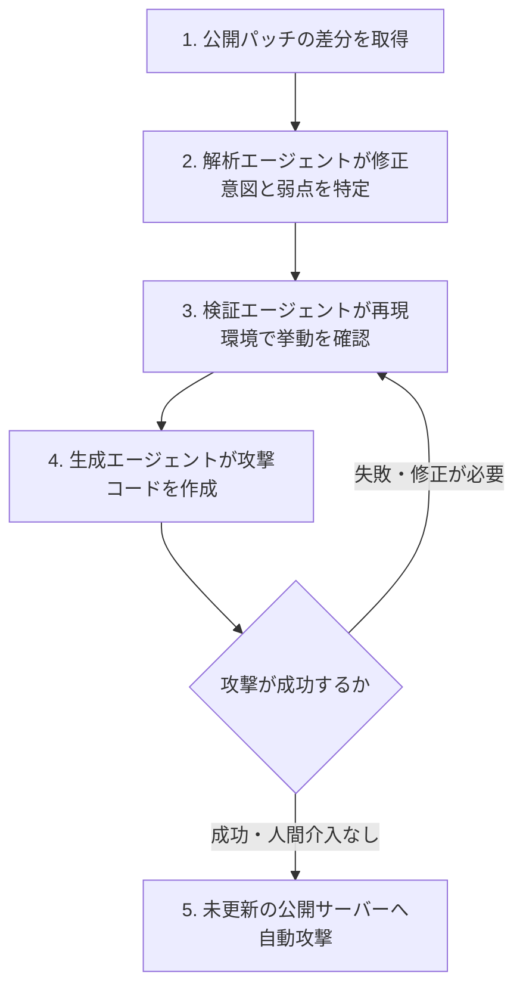
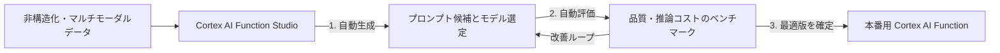

# **本日の AI/開発ツール トピックス (2026-11-17)**

## **1. 📋 今日の30秒サマリー**

> **💡 今日のハイライト**
>
> - 🚨 **AIが「攻撃の自動化」を突破、さらにLinuxの11年越しのバグも発覚**: 人間の手を借りずにソフトの修正点から弱点を見つけ出し、自動で攻撃コードまで作るAIの悪用が初めて確認されました。また、世界中のサーバーで使われるLinuxにも通信を送りつけるだけでサーバーが停止する深刻な弱点が見つかっています。
> - 🚀 **超大規模モデル「Qwen4-Max」や企業向けAI開発基盤が続々登場**: Alibabaが2.4兆パラメータの新型AI「Qwen4-Max」を公開したほか、SnowflakeがAI機能の自動最適化ツールを一般提供し、OpenAIも違法画像検知APIを無償公開しました。一方、PostgreSQL 19はAIレビューでバグが見つかりすぎた影響で公開を延期しています。
> - 🔥 **AIに「目」と「記憶」と「財布の紐」を与えるOSSが急上昇**: コンパイル済みアプリを解析できる「REA」、前回の作業を忘れない「claude-mem」、AIの勝手な課金や操作を止める「Shotoku」など、AIエージェントを現場で安全・賢く使うための周辺ツールが人気です。
{: .callout-summary}

| 区分 | トピック / ツール | ざっくり言うと？（1行要約） | 影響・おすすめ対象 |
| :--- | :--- | :--- | :--- |
| 🚨 **緊急** | **Linux Kernel** (`CVE-2026-99288` / NoisyTCP) | 細工されたTCP通信を送るだけでLinuxサーバーを強制停止させられる11年越しのバグ | **Linuxサーバー（Nginx/Apache/SSH等）の全運用者** |
| 🚨 **緊急** | **Google GTIG** (`AI Threat Tracker`) | 人間の介入なしで修正差分から脆弱性を特定し攻撃コードを作る自律型AIフレームワークを確認 | **Webアプリ運用者・セキュリティ担当者・開発チーム** |
| 🚨 **緊急** | **Gitea** (`CVE-2026-123002`) | 二要素認証の6桁コード入力に回数制限がなく、パスワードが漏れると総当たりで突破される | **セルフホスト版Gitea（〜v28.3.0）の管理者** |
| 🚨 **緊急** | **AdminNeo** (`CVE-2026-130379` 他) | ログイン画面の入力細工で内部ネットワークへ不正アクセスや認証回避ができる複数の弱点 | **AdminNeo v5.9.1未満を利用中のDB管理者** |
| 🚀 **新機能** | **Alibaba Qwen4-Max** | 2.4兆パラメータ（71B稼働）と100万トークン文脈を備えたマルチモーダル最新モデルを公開 | **長文・動画処理や高コスパな業務AIを求める開発者** |
| 🚀 **新機能** | **Snowflake Cortex AI Function Studio** (`GA`) | AI関数のプロンプト調整・モデル選定・コスト評価を自動化するスタジオを一般提供 | **Snowflake上で非構造化・画像データを扱うデータ基盤チーム** |
| 🚀 **新機能** | **PostgreSQL 19** (`GA延期`) | AIコードレビューで境界バグが大量に見つかり修正を優先、正式公開を11月19日へ延期 | **PostgreSQL 19の導入・検証を予定しているDBA・開発者** |
| 🚀 **新機能** | **OpenAI CSAM Image Classifier API** | AI生成画像を含む児童性的虐待コンテンツを検知する専用APIを審査済み組織へ無償提供 | **ユーザー投稿画像を扱うプラットフォーム・信頼安全チーム** |
| 🚀 **新機能** | **Microsoft Ignite 2026** (`Plugin Catalog`) | 本日開幕の年次会議に合わせ、Copilot用プラグインやスキルを一元管理できる公開カタログを提供開始 | **Microsoft Copilot拡張や社内エージェントを構築するIT部門** |
| 🔥 **注目** | **REA** (`morluto/rea`) | AIエージェントがローカルの解析ツールと連携し、ソースコードなしのアプリやバイナリを調査可能に | **リバースエンジニアリングや既存アプリ調査を行うエンジニア** |
| 🔥 **注目** | **claude-mem** (`thedotmack/claude-mem`) | コーディングAIの作業履歴をローカルで圧縮保存し、次回起動時に自動で記憶を引き継ぐ | **Claude Code等のセッション切れによる説明のやり直しに悩む層** |
| 🔥 **注目** | **Shotoku** (`shotoku-dev/shotoku`) | AIエージェントの決済・API利用に予算上限と人間の承認ゲートを挟むローカルガバナンス基盤 | **自律型AIに課金や外部操作を任せる際の暴走を防ぎたい開発者** |
| 🔥 **注目** | **Orca** (`stablyai/orca`) | 複数のAIコーディングエージェントをGit worktreeで隔離しつつ並列指揮する統合IDE | **複数エージェントを同時に動かして開発を並列化したいエンジニア** |

---

## **2. 🚨 緊急セキュリティ情報**

### **Linux Kernel（「NoisyTCP」）— 細工された通信だけでサーバーが強制停止する11年越しのバグ (`CVE-2026-99288`)**

> **🔰 ひとことで言うと**
> 世界のサーバーの土台であるLinuxの通信処理に11年間潜んでいたバグが見つかり、外部から特殊な通信パケットを送りつけるだけでログインなしにサーバーを丸ごと強制停止（カーネルパニック）させられる恐れがあります。
> 💬 *例えるなら：「お店の自動ドアのセンサーに特定の光を一瞬当てるだけで、店内に入ることなく建物全体のブレーカーが落ちて閉店に追い込まれてしまう」ような状態です。*
{: .callout-danger}

| リスク度 | 影響を受ける人 | 悪用のされやすさ | まずやるべき対策 |
| :---: | :--- | :--- | :--- |
| 🔴 **高 (CVSS 7.5)** | Nginx・Apache・SSHなどのTCPポートを外部公開しているLinuxサーバー全般 | 認証不要で開いているポートへ細工パケットを送るだけで発動 | **各ディストリビューションの修正済みカーネルへ速やかにアップデート** |

<details markdown="1">
<summary>🔍 技術的な仕組み・対象バージョン・対策コマンドを見る（エンジニア向け）</summary>

- **原因の仕組み**: LinuxカーネルのTCPネットワークサブシステム（IPv4およびIPv6の確立済みソケット検索処理 `inet` established-socket lookups）に存在した競合状態（Race Condition）の不具合。ハッシュテーブルに未登録（unhashed）のソケットが特定のタイミングで参照されることでメモリ不整合が起き、カーネルパニック（リモートDoS）を引き起こす。
- **対象バージョン/環境**: 過去11年間にわたる広範なLinuxカーネル系列。メインラインおよび安定版ツリーでは `inet: reject unhashed sockets during established lookups` の修正パッチが **6.12.117 / 6.18.63 / 7.3.4 / 7.4-rc2** 以降で取り込まれている。
- **対策手順・コマンド**:
  ```bash
  # 現在のカーネルバージョンを確認
  uname -r

  # Debian / Ubuntu 系でのセキュリティアップデート例
  sudo apt update && sudo apt upgrade -y linux-image-generic

  # RHEL / AlmaLinux / Rocky 系でのアップデート例
  sudo dnf update -y kernel && sudo reboot
  ```
- **一次ソース**: [Red Hat CVE-2026-99288](https://access.redhat.com/security/cve/cve-2026-99288) / [Debian Security Tracker](https://security-tracker.debian.org/tracker/CVE-2026-99288) / [Ubuntu Security](https://ubuntu.com/security/CVE-2026-99288)

</details>

---

### **Google GTIG「AI Threat Tracker」— 人間の介入なしにパッチ差分から攻撃コードを作る自律型AI脅威を初確認**

> **🔰 ひとことで言うと**
> 攻撃者が複数のAIエージェントを組み合わせ、ソフトの「修正アップデートの内容」を自動で読み解いて弱点を見つけ出し、攻撃プログラムの完成まで人間の手を一切借りずにやり遂げる新しい攻撃手法が初めて観測されました。
> 💬 *例えるなら：「鍵屋さんが『この型の鍵を改良しました』と発表した瞬間に、泥棒AIチームが改良前後の図面を自動比較して、合鍵を3Dプリンタで即座に量産し始める」ような状態です。*
{: .callout-danger}

| リスク度 | 影響を受ける人 | 悪用のされやすさ | まずやるべき対策 |
| :---: | :--- | :--- | :--- |
| 🔴 **警戒 (新局面)** | Webアプリケーションや公開OSSを運用するすべての企業・開発者 | AIが公開パッチを常時監視するため、修正公開から攻撃開始までの猶予が激減 | **自動パッチ適用体制の構築と、WAF/EDRによるn-day攻撃の即時検知** |

自律型AIフレームワークが修正差分から攻撃コードを生成・実行するまでの流れを以下の図に示します。



*図の見方*: 従来は人間のセキュリティ研究者や攻撃者が数日〜数週間かけて行っていた「修正箇所の特定→再現→攻撃コード作成」のループを、役割分担された複数のAIエージェントが自律的に回し、パッチ未適用のシステムを即座に狙います。

<details markdown="1">
<summary>🔍 調査レポートの技術的詳細と防御策を見る（エンジニア向け）</summary>

- **概要**: Google Threat Intelligence Group（GTIG）が2026年11月に公開した四半期レポート「GTIG AI Threat Tracker: Agentic Threat Activity Crosses a Significant Threshold」による報告。攻撃者が複数のAIエージェントを連携させたフレームワークを用い、Webアプリケーションのパッチ差分解析から脆弱性の特定、動作するエクスプロイトコードの構築までを人間の介入なしで完結させた事例を初めて確認した。
- **実務への影響**: ゼロデイだけでなく、修正パッチが公開された直後の「n-day脆弱性」が悪用されるまでの時間（Time-to-Exploit）が劇的に短縮される。週次・月次の定期メンテナンスサイクルでは間に合わないケースが増える。
- **対策アプローチ**:
  - インターネットに露出したWebアプリ・APIのパッチ適用SLAを短縮し、自動PRや自動デプロイのパイプラインを整備する。
  - パッチ適用が間に合わない場合に備え、仮想パッチ（WAFルール）やランタイム異常検知を組み合わせる。
- **一次ソース**: [Google Cloud Blog: GTIG AI Threat Tracker](https://cloud.google.com/blog/topics/threat-intelligence/ai-threat-tracker-agentic-threat-activity)

</details>

---

### **Gitea — 二要素認証（TOTP）の試行回数制限欠如による総当たり突破リスク (`CVE-2026-123002`)**

> **🔰 ひとことで言うと**
> 自社サーバー等で運用するコード管理ツール「Gitea」において、ログイン時の6桁のワンタイムパスワード（二要素認証）を何度間違えてもロックされない不備が見つかり、パスワードを知っている攻撃者に総当たりで突破される恐れがあります。
> 💬 *例えるなら：「家の鍵（パスワード）を盗んだ泥棒が、玄関の暗証番号（6桁）を何度間違えても警報が鳴らないため、000000から順番に試して中に入れてしまう」ような状態です。*
{: .callout-danger}

| リスク度 | 影響を受ける人 | 悪用のされやすさ | まずやるべき対策 |
| :---: | :--- | :--- | :--- |
| 🟠 **高** | セルフホスト版Gitea（v28.3.0以前を含む該当バージョン）の運用者 | パスワードが漏洩または推測可能な場合、自動スクリプトで6桁コードを総当たり可能 | **Giteaの修正版への更新と、リバースプロキシ側でのレート制限設定** |

<details markdown="1">
<summary>🔍 技術的な仕組み・対象バージョン・対策を見る（エンジニア向け）</summary>

- **原因の仕組み**: Giteaのサインイン処理、パスワードリセットフロー、および `X-Gitea-OTP` ヘッダーを用いたBasic認証において、TOTP（Time-based One-Time Password）の失敗回数に対するレート制限（試行回数制限）が欠如していた（CWE-307相当）。
- **対象バージョン/環境**: セルフホスト型のGiteaインスタンス（v28.3.0を含む影響範囲）。
- **対策手順**:
  - 運用中のGiteaバージョンを確認し、修正済みのリリースへアップデートする。
  - 緊急の緩和策として、NginxやCloudflare等の前段プロキシで `/user/login` や認証エンドポイントへの連続リクエストを厳しくレート制限する。
  - パスワードの使い回し禁止と、WebAuthn/パスキー等のより強固な二要素認証への移行を推奨する。
- **一次ソース**: [NIST NVD: CVE-2026-123002](https://nvd.nist.gov/vuln/detail/CVE-2026-123002)

</details>

---

### **AdminNeo — 特権ポート制限を回避できるSSRFおよび複数の認証バイパス (`CVE-2026-130379` 他)**

> **🔰 ひとことで言うと**
> ブラウザからデータベースを管理できる人気ツール「AdminNeo」に、ログイン画面の接続先入力欄を細工してサーバー内部の別サービスへ不正通信させたり、ログイン認証自体をすり抜けたりできる複数の重大な弱点が見つかりました。
> 💬 *例えるなら：「ビルの受付で訪問先の部屋番号欄に特殊な記号を混ぜて書くと、立ち入り禁止の警備室へ案内されたり、社員証なしで奥のフロアに入れてしまったりする」ような状態です。*
{: .callout-danger}

| リスク度 | 影響を受ける人 | 悪用のされやすさ | まずやるべき対策 |
| :---: | :--- | :--- | :--- |
| 🔴 **高** | AdminNeo 5.9.1未満を外部や社内ネットワークに公開している管理者 | ログイン前の状態から、接続文字列への文字混入だけで悪用可能 | **AdminNeo 5.9.1以降への即時アップデートとアクセス制限** |

<details markdown="1">
<summary>🔍 技術的な仕組み・対象バージョン・対策を見る（エンジニア向け）</summary>

- **原因の仕組み**:
  - `CVE-2026-130379` (SSRF): ログインフォームのサーバー指定欄に区切り文字や接続文字列キーワードを注入することで、特権ポート（Privileged Port）へのアクセス制限を回避し、サーバー側から任意の内部ポートへリクエストを送信できる。
  - あわせて、認証・認可バイパスに関わる複数の脆弱性（`CVE-2026-130380`、`CVE-2026-130382` 等）も同時に開示されている。
- **対象バージョン/環境**: AdminNeo **v5.9.1 未満**。
- **対策手順**:
  - AdminNeoを **v5.9.1以降** へ更新する。
  - 管理ツールをインターネット上に直接公開せず、VPNやZero Trustアクセス（IAP/Cloudflare Access等）の背後に配置する。
- **一次ソース**: [NIST NVD: CVE-2026-130379](https://nvd.nist.gov/vuln/detail/CVE-2026-130379)

</details>

---

## **3. 🚀 メジャーリリース・新機能**

### **Alibaba Cloud「Qwen4-Max」— 総パラメータ2.4兆の超大規模MoEと100万トークン文脈を公開**

> **🔰 ひとことで言うと**
> Alibabaが最新フラッグシップAI「Qwen4-Max」を公開しました。2.4兆という巨大な知識を持ちながら動かす際は一部だけを使う省エネ設計により、長い動画や大量の資料を一度に読み込んでもコストを約6割抑えられます。
> 💬 *例えるなら：「240人の専門家が待機する超大型コンサル会社なのに、相談内容に応じて最適な7人だけが即座に対応するため、料金はこれまでの半分以下で済む」ようなイメージです。*
{: .callout-info}

| 比較ポイント | これまで (Qwen3.8-Max等) | Qwen4-Max (After) |
| :--- | :--- | :--- |
| **モデル構造・規模** | 従来世代のMoE構造 | **総パラメータ2.4兆（トークンあたり71B稼働）のスパースMoE** |
| **コンテキスト・入力** | テキスト中心・標準的な文脈長 | **100万トークン対応・テキスト/画像/動画のネイティブ理解** |
| **推論効率・コスト** | 複雑業務でのトークン消費が大きい | **Work360スコア52.69達成、トークン消費最大35%減・コスト約60%減** |

<details markdown="1">
<summary>🔍 技術的ブレークスルーと価格・利用方法を見る</summary>

- **技術的ポイント**:
  - 総パラメータ数約2.4兆（うちアクティブパラメータ71B／トークン、328Bのn-gram埋め込みパラメータを搭載）。アテンション機構や残差接続を刷新。
  - デフォルトで深い推論（Deep Reasoning）が有効になっており、`low` / `high` / `xhigh` の思考レベル調整が可能（思考＋出力で最大26万〜39万トークン前後を共有）。
  - 企業実務ベンチマーク「Work360」（721専門領域）で **52.69**（前世代47.74から向上）を記録し、Code Arena等のコーディング・エージェント指標でも上位を獲得。
- **提供形態・価格**:
  - Alibaba Cloud Model Studio（Token Planおよび従量課金API）やOpenRouter経由で利用可能。国際リスト価格は入力 **100万トークンあたり$1.50**、出力 **$4.50**（キャッシュ入力の大幅割引あり）。
- **公式リンク**: [Alibaba Cloud Model Studio](https://www.alibabacloud.com/help/en/model-studio/getting-started/models) / [OpenRouter: Qwen4 Max](https://openrouter.ai/qwen/qwen4-max)

</details>

---

### **Snowflake「Cortex AI Function Studio」一般提供 (GA) — AI関数のプロンプトとコストを自動最適化**

> **🔰 ひとことで言うと**
> Snowflakeが企業データ向けのAI機能を自動チューニングできる「Cortex AI Function Studio」を正式公開しました。エンジニアはコマンドから、非エンジニアは画面操作から、精度が高く安上がりなAI処理を自動で作れます。
> 💬 *例えるなら：「料理のレシピ（プロンプト）と食材の仕入れ先（AIモデル）を自動で何パターンも試食比較して、一番おいしくて原価が安い組み合わせを勝手に見つけてくれる調理ロボット」のようなものです。*
{: .callout-info}

| 比較ポイント | これまで (Before) | Cortex AI Function Studio (After) |
| :--- | :--- | :--- |
| **プロンプト・モデル選定** | 開発者が手作業で試行錯誤しベンチマーク | **プロンプト改善・モデル選定・ベンチマークを自動化** |
| **操作インターフェース** | SQLやスクリプト中心 | **AIエンジニア向けCLI（Cortex Code CLI）とノーコードUI（Snowsight）両対応** |
| **対象データ** | 構造化テーブル処理が中心 | **テキスト・画像・音声などの非構造化・マルチモーダルデータに本格対応** |

Cortex AI Function StudioがAI関数の品質とコストを最適化する流れを以下に示します。



*図の見方*: 開発者がCLIまたはWeb画面から対象データと目的を与えると、Studio側が複数のプロンプト案とモデル候補を自動で組み合わせて評価し、品質と推論コストのバランスが最も良い本番用AI関数を出力します。

<details markdown="1">
<summary>🔍 技術的詳細と公式アナウンスを見る</summary>

- **技術的ポイント**: Snowflake内のデータを外部へ持ち出すことなく、非構造化データやマルチモーダルワークフロー向けの「Cortex AI Functions」を構築・評価・最適化できる統合環境がGA（一般提供）となった。
- **開発フローへの影響**: 従来はPoCから本番運用へ移行する際、モデル変更やプロンプト微調整のたびに検証コストが膨らんでいたが、Cortex Code CLIやSnowsight AI Studio上で品質スコアと推論コストを定量比較しながら本番関数を生成できる。
- **公式リンク**: [Snowflake Engineering Blog: Cortex AI Function Studio](https://www.snowflake.com/en/blog/how-cortex-ai-function-studio-can-help-improve-quality-while-reducing-ai-inference-costs/)

</details>

---

### **PostgreSQL 19 — AIコードレビューによる境界バグ大量検出を受け、GA公開を11月19日へ延期**

> **🔰 ひとことで言うと**
> 世界中のシステムで使われるデータベース「PostgreSQL」の次期版（19）が、リリース直前のテストでAIによるコードレビューが細かいバグを次々と見つけ出したため、品質を優先して一部機能を見送り、公開を11月19日に延期しました。
> 💬 *例えるなら：「建物の検査に超精密なAIスキャナーを導入したところ、これまで気づかなかった微細なひび割れが大量に見つかり、急いで補修するためにオープン日を数日後ろ倒しにした」ような出来事です。*
{: .callout-info}

| 比較ポイント | これまで (当初予定) | PostgreSQL 19 最新状況 (After) |
| :--- | :--- | :--- |
| **リリース時期** | 秋の通常スケジュールでGA予定 | **Beta 4遅延・RC2を経て 2026年11月19日 GA予定** |
| **コード検証プロセス** | 人間のメンテナー中心のレビュー | **AI（Claude等）によるレビューで境界ケースのバグ検出が急増** |
| **搭載機能の方針** | SQL/PGQグラフクエリ等の新機能を含め進行 | **不安定なコードを急いで入れず、一部新機能をリバートして安定性を優先** |

<details markdown="1">
<summary>🔍 延期の背景とコミュニティでの議論を見る</summary>

- **技術的ポイント**: Beta 4（2026年9月24日公開）前後のサイクルにおいて、LLMを活用した高度なコードレビューが既存コードおよび新規提案機能のエッジケース・長尾バグを人間のトリアージ速度を上回るペースで検出した。
- **品質優先の判断**: コミュニティは未検証の修正を急ぐのではなく、SQL/PGQグラフクエリやタイムスライス更新などの一部大型機能を次期以降へ見送る（リバートする）決断を下し、RC1・RC2（11月12日予定）を経て **11月19日** のGAを目指す体制となった。AI時代のOSSメンテナンスにおける「レビュー負荷と品質担保の新しい課題」として業界で注目を集めている。
- **公式・関連リンク**: [PostgreSQL.org Announcements](https://www.postgresql.org/)

</details>

---

### **OpenAI「CSAM Image Classifier API」— AI生成画像を含む児童性的虐待コンテンツ検知APIを無償提供**

> **🔰 ひとことで言うと**
> OpenAIが、AIで作られた偽画像も含めて児童性的虐待コンテンツ（CSAM）を自動で見つけ出す専用APIを、審査を通過した企業や団体向けに無料で提供開始しました。
> 💬 *例えるなら：「街の防犯カメラ会社やSNS運営会社に、最新の高性能な不審物検知センサーを無料で貸し出し、ネット全体の安全を守る取り組みを広げた」ようなものです。*
{: .callout-info}

| 比較ポイント | これまで (Before) | CSAM Image Classifier API (After) |
| :--- | :--- | :--- |
| **検知対象の拡大** | 既知のハッシュ照合が中心で合成画像に弱い | **AI生成（合成）画像を含むCSAMを高精度に検知** |
| **外部への提供** | 自社サービス（ChatGPT等）内部での保護が中心 | **審査済み企業・団体へOpenAI API経由で無償提供** |
| **開発者向け対策** | 一般的な利用規約での禁止 | **開発者向け安全ガイドラインや警告表示・アカウント制御を強化** |

<details markdown="1">
<summary>🔍 モデルカードと開発者向けドキュメントを見る</summary>

- **技術的ポイント**: 2026年11月16日に発表。従来のデータベース照合ではすり抜けやすかったAI生成による合成CSAMを識別するため、専用に訓練された画像分類モデルをAPIとして開放した。あわせてChatGPT内での警告画面表示や一時ブロック、法執行機関向け支援ツールも強化されている。
- **提供形態**: 審査を通過した適格な組織・プラットフォームに対してOpenAI API経由で無償提供。
- **公式リンク**: [OpenAI Announcement](https://openai.com/index/strengthening-the-fight-against-online-child-sexual-abuse-with-new-tools-and-support/) / [Developer Guidance](https://platform.openai.com/docs/guides/csam-guidance)

</details>

---

### **Microsoft Ignite 2026 開幕 ＆「Copilot Plugin Catalog」公開開始**

> **🔰 ひとことで言うと**
> 本日11月17日からMicrosoftの年次大型会議「Ignite 2026」が開幕し、Microsoft Copilotに業務アプリや外部ツールをつなぐための公式ストア「Plugin Catalog」が一般公開されました。
> 💬 *例えるなら：「社内のAI秘書（Copilot）に覚えさせるスキルや連携アプリを、会社公認のアプリストアから安全に選んで配れるようになった」ような状態です。*
{: .callout-info}

| 比較ポイント | これまで (Before) | Ignite 2026 / Plugin Catalog (After) |
| :--- | :--- | :--- |
| **プラグイン探索・管理** | 開発元ごとに個別案内・手動管理が中心 | **公開「Plugin Catalog」でスキル・コネクタを一元探索・ガバナンス** |
| **エージェント実行基盤** | 実験的ワークフローの社内展開が課題 | **Microsoft Purview / Entra連携による本番向けエージェント統制を強化** |

<details markdown="1">
<summary>🔍 Ignite 2026 初日の開発者向け注目ポイントを見る</summary>

- **技術的ポイント**: 米国時間11月17日午前10時（PT）のSatya Nadella CEOによる基調講演を皮切りに、サンフランシスコおよびオンラインで開幕。初日にあわせて公開される「Plugin Catalog（`aka.ms/CopilotPluginCatalog`）」では、Copilotを拡張するプラグイン、スキル、ツール、コネクタを統一的に探索・構築・管理できる。
- **今後の注目点**: 会期中（11月17日〜20日）にかけて、Microsoft Execution ContainersやMicrosoft Fabric、Azure AIインフラに関する詳細アップデートがBook of NewsおよびLive Blogで順次公開される予定。
- **公式リンク**: [Microsoft Ignite Official](https://www.microsoft.com/)

</details>

---

## **4. 🔥 注目のトレンドツール**

### **`morluto/rea`（Reverse Engineer Anything）— AIに「バイナリ・アプリ解析の感覚器官」を与えるMCPサーバー**

> **🔰 ひとことで言うと**
> ソースコードが手元にないアプリやプログラムをAIに調べさせると、これまでは勝手な推測（嘘）を吐きがちでしたが、「REA」を使えばAIが自分のパソコン内の解析ツールを直接動かして、正確な事実に基づいて中身を調査できます。
> 💬 *例えるなら：「目隠しで箱の中身を当てさせていたAI探偵に、X線検査機とルーペを渡して、本当に見えたものだけを報告させる」ようなツールです。*
{: .callout-tip}

| 注目ポイント | 内容 | おすすめ対象 |
| :--- | :--- | :--- |
| **何ができるか** | Ghidra・Hopper・IDA ProやElectron/JS解析ツールとAI（Claude Code/Cursor/Codex等）をMCPで接続 | **既存バイナリ解析・セキュリティ調査・互換実装を行う開発者** |
| **注目の理由** | 外部クラウドへバイナリを送らず完全にローカルで解析し、根拠付きで回答するため推測ミスを激減（GitHubスター急増） | ローカル環境で機密性の高いアプリ解析を進めたいチーム |

<details markdown="1">
<summary>🔍 主な機能・アーキテクチャ・導入方法を見る</summary>

- **主な機能・用途**:
  - **ネイティブバイナリ解析**: ローカルのGhidra、Hopper、IDA Proと連携し、マシン語や擬似コードの構造をAIが直接読み取る。
  - **JS / Electronアプリ解析**: 難読化・圧縮されたJavaScriptや `.asar` アーカイブの中身を検査。
  - **完全ローカル実行**: 解析対象ファイルを外部サーバーへアップロードせず、ローカル環境内で証拠（Evidence）と技術的制約を添えてAIへ返す。
- **導入手順**（Node.js v22.19+、macOS 12+ または Ubuntu 24.04+ 推奨）:
  ```bash
  # 対話式セットアップウィザードを起動し、利用中のAIエージェントへMCP登録
  npx rea-agents setup
  ```
- **公式サイト/GitHub**: [morluto/rea](https://github.com/morluto/rea)

</details>

---

### **`thedotmack/claude-mem` — コーディングAIの「セッション記憶喪失」を解消するローカル永続記憶プラグイン**

> **🔰 ひとことで言うと**
> Claude CodeなどのAIは新しいチャットを開くたびに前回の作業を忘れてしまいますが、「claude-mem」を入れておくと作業履歴を裏で賢く要約・保存し、次回起動時に自動で思い出させてくれます。
> 💬 *例えるなら：「毎日記憶がリセットされる優秀なアシスタントに、毎晩自動で業務日誌をまとめて翌朝デスクに置いておいてあげる仕組み」です。*
{: .callout-tip}

| 注目ポイント | 内容 | おすすめ対象 |
| :--- | :--- | :--- |
| **何ができるか** | プロンプト・ファイル編集・意思決定を裏で自動記録し、AI圧縮してSQLiteに保存、次セッションへ自動注入 | **Claude Code等で長期プロジェクトを進めるすべての開発者** |
| **注目の理由** | トークン消費を抑えるAI圧縮機能と、ローカル完結のプライバシー保護・WebビューアUIを備えGitHubで11万超スターを獲得 | 毎回プロジェクト構成を説明し直す手間に疲れているエンジニア |

<details markdown="1">
<summary>🔍 主な機能・導入方法を見る</summary>

- **主な機能・用途**:
  - バックグラウンドでプロンプト・ツール実行・ファイル変更を自動キャプチャ。
  - トークン上限を圧迫しないよう、履歴をAIで要約・圧縮してローカルSQLiteに永続化。
  - 履歴を確認できるローカルWeb Viewer UIおよびMCP検索ツールを同梱。
- **導入手順**:
  ```bash
  # NPXインストーラを使う場合
  npx claude-mem install

  # または Claude Code 内のプラグインマーケットプレイスから導入
  # /plugin marketplace add thedotmack/claude-mem
  # /plugin install claude-mem
  ```
- **公式サイト/GitHub**: [thedotmack/claude-mem](https://github.com/thedotmack/claude-mem)

</details>

---

### **`shotoku-dev/shotoku` — AIエージェントの課金・決済・危険操作をローカルで止めるガバナンス基盤**

> **🔰 ひとことで言うと**
> AIエージェントに有料APIの呼び出しや決済・返金などの操作を任せるとき、予算の上限ルールをローカルで強制チェックし、高額な操作や見知らぬ相手への支払いは必ず人間の承認待ちにする安全装置です。
> 💬 *例えるなら：「AIという新入社員に会社のクレジットカードを渡す際、『1回5,000円以上や初めての取引先は上司のハンコがないと決済できない』と設定できるプリペイド式承認ゲート」です。*
{: .callout-tip}

| 注目ポイント | 内容 | おすすめ対象 |
| :--- | :--- | :--- |
| **何ができるか** | `policy.yaml` で1回あたり・24時間あたりの予算上限を定め、閾値超過時は `pending_approval` で人間承認を要求 | **MCPツールや決済・課金APIを扱うAIエージェント開発者** |
| **注目の理由** | Show HNで話題。クラウド預託なしでローカル完結し、改ざん検知可能な監査ログ（`decisions.jsonl`）を残せる | 自律エージェントの暴走課金や誤操作を確実に防ぎたい運用チーム |

<details markdown="1">
<summary>🔍 主な機能・導入方法を見る</summary>

- **主な機能・用途**:
  - 決定論的ポリシー強制：エージェントのツール呼び出しを `policy.yaml` と照合して事前遮断。
  - Human-in-the-Loop承認：未知のベンダーや上限超えの操作を一時停止し、CLIやダッシュボードで人間が許可・拒否。
  - 改ざん検知ログ：すべての判断結果をローカルの `data/decisions.jsonl` へ記録。
- **導入手順**（Node.js 20+）:
  ```bash
  # セットアップ不要のシミュレーションデモを試す
  npx shotoku-cli demo

  # グローバルインストールして初期化する場合
  npm install -g shotoku-cli
  mkdir -p ~/shotoku-home && cd ~/shotoku-home
  shotoku init
  ```
- **公式サイト/GitHub**: [shotoku-dev/shotoku](https://github.com/shotoku-dev/shotoku)

</details>

---

### **`stablyai/orca` — 複数のAIコーディングエージェントをGit worktreeで隔離し並列指揮する統合IDE**

> **🔰 ひとことで言うと**
> Claude CodeやCodexなど複数のAIコーディングエージェントを同時に動かしても、お互いのファイル編集がぶつからないように自動で作業部屋（Git worktree）を分けて並列管理できるオープンソースの統合開発環境です。
> 💬 *例えるなら：「複数の優秀な大工（AI）に同時にリフォームを頼むとき、同じ部屋で道具を取り合って喧嘩しないよう、部屋ごとに専用の作業ブースを自動で作って監視する現場監督」のようなツールです。*
{: .callout-tip}

| 注目ポイント | 内容 | おすすめ対象 |
| :--- | :--- | :--- |
| **何ができるか** | 複数のAIエージェントを並列起動し、Git worktreeによる自動隔離・差分ビューア・内蔵ブラウザテスト・モバイル遠隔監視を提供 | **複数のAIエージェントを同時並行で走らせたい開発者** |
| **注目の理由** | 手持ちのAIサブスクリプションやAPIキーをそのまま持ち込め、macOS/Windows/Linuxとリモート実行に対応する実用性で急上昇 | 1つのエージェントの待ち時間をなくし開発スループットを上げたい層 |

<details markdown="1">
<summary>🔍 主な機能・特徴を見る</summary>

- **主な機能・用途**:
  - コーディネーターエージェントと複数のワーカーエージェントを協調・並列実行。
  - エージェントごとに独立した **Git worktree** を自動生成し、ファイル競合（コンフリクト）を構造的に防止。
  - Electron / React / Vite / TypeScript製のクロスプラットフォームUIに加え、CLIおよびモバイルコンパニオンからの遠隔ステアリングに対応。
- **公式サイト/GitHub**: [stablyai/orca](https://github.com/stablyai/orca)

</details>

---

## **5. 💡 その他・Tips**

- **ElevenLabsが日本発の音声AI「Kotoba Technologies」を買収合意**: 11月16日〜17日にかけて、音声AI大手のElevenLabsが日本発の音声AIスタートアップKotoba Technologiesの買収に合意したことが報じられました。Kotobaの日本語特化音声基盤「Koto」（TTS / STT / Speech-to-Speech）がElevenAgentsに統合されることで、文化的・言語的に自然な日本語音声エージェントの開発がさらに加速する見込みです（[ElevenLabs](https://elevenlabs.io/) / [Kotoba Technologies](https://kotoba.tech)）。
- **ローカルAI小型スーパーコンピュータ「MSI EdgeXpert」64GBモデル登場**: NVIDIA「GB10 Grace Blackwell Superchip」を搭載し、省スペースなデスク上で大容量モデルの推論やローカルエージェント実行をこなせる64GBメモリモデルの取り扱いが国内で報じられました。プライバシー重視のローカル開発環境を求める層にとって新たな選択肢となります。
- **Hacker Newsで「純粋Jax製の軽量DeepSeek V3実装」が話題に**: 巨大な分散フレームワークに依存せず、コンパクトな純粋JaxでDeepSeek V3を再現する実装がHacker Newsで注目を集めています。巨大モデルの推論・学習パイプラインを最小構成で理解したいエンジニアの学習素材として有用です。

---

## **6. 📝 総評**

> **📌 今日の一言まとめ**
> AIエージェントが「記憶・解析・課金制御」を手に入れて実務の主役へ躍り出る一方、攻撃側もAIで脆弱性の発見から悪用までを完全自動化する新たな段階へ突入した一日でした。
{: .callout-summary}

本日（2026-11-17）の動向を振り返ると、開発ツール業界は明確に**「AIに何をさせるか」から「AIをどう安全かつ低コストに統制・運用するか」**へと軸足を移しています。

セキュリティ面では、Google GTIGによる「自律型AIによるパッチ差分解析〜攻撃コード生成」の観測が最大の転換点です。人間の攻撃者が数週間かけていた調査をAIエージェント群が数時間・無人でこなす時代においては、Linuxカーネル（`CVE-2026-99288`）やGitea・AdminNeoのような既知の修正パッチを「いかに早く適用できるか」がこれまで以上に生死を分けます。同時にPostgreSQL 19の例が示すように、防御側でもAIコードレビューが人間の処理能力を超えるスピードでバグを炙り出すようになっており、開発サイクル全体の設計見直しが求められています。

一方、モデルと周辺ツールの進化も止まりません。Alibabaの「Qwen4-Max」によるMoE省エネ化、Snowflakeの自動最適化スタジオ、そしてOSS界隈で急上昇する「REA」「claude-mem」「Shotoku」「Orca」はいずれも、**「ローカル完結の安全性」「明確な予算・権限ガードレール」「複数エージェントの並列隔離」**という現場のリアルな課題に対する具体的な解となっています。エンジニアは最新のAI機能を取り入れつつ、パッチ適用の自動化とエージェントへの権限最小化をセットで進めることが急務です。

---

## **7. 📖 用語解説**

| 用語 | 解説 |
|------|------|
| **カーネルパニック (Kernel Panic)** | OSの中核部分（カーネル）が回復不可能なエラーを検知した際、被害拡大を防ぐためにシステム全体を緊急停止させる現象です。Windowsの「ブルースクリーン」に相当し、発生するとサーバーが落ちて再起動が必要になります。 |
| **競合状態 (Race Condition)** | 複数の処理がほぼ同時に同じデータへアクセスした際、タイミングのわずかなズレによって意図しない不具合やセキュリティホールが起きるバグです。2人が同時に最後の1席を予約しようとしてシステムが混乱する状態に似ています。 |
| **n-day脆弱性 (エヌデイぜいじゃくせい)** | メーカーから修正パッチがすでに公開されているにもかかわらず、更新を後回しにしているサーバーを狙って悪用される弱点のことです。「鍵の交換案内が出たのに交換していない家」が狙われるイメージです。 |
| **MoE (Mixture-of-Experts)** | 巨大なAIモデルの中に複数の「専門家（Expert）」を配置し、質問に応じて必要な一部だけを動かして計算量を抑える設計手法です。知識の広さと推論コストの安さを両立できます。 |
| **MCP (Model Context Protocol)** | AIエージェントと外部のツールやデータベースを安全・統一的な手順でつなぐためのオープンな共通規格です。USB-Cのように、対応ツール同士を差し替えるだけで連携できるメリットがあります。 |
| **SSRF (Server-Side Request Forgery)** | 外部からの入力を悪用し、Webサーバー自身に「社内ネットワークの奥にある非公開サーバー」などへ代理アクセスさせてしまう脆弱性です。受付係を騙して社内専用の内線電話をかけさせるような攻撃です。 |
| **Git worktree** | 1つのGitリポジトリの履歴を共有したまま、別の作業用フォルダを複数同時に作り出せる機能です。複数のAIエージェントに別々の作業フォルダを割り当てることで、ファイルの上書き衝突を防げます。 |

---
(出典: 各公式サイト、GitHub、NVD、Google Cloud Blog、TechニュースサイトよりAIが要約)

<!-- Kramdown略語定義: 本文中の対象単語に自動でインラインツールチップが付与されます -->
*[CVE]: Common Vulnerabilities and Exposures（世界共通で割り振られるセキュリティ脆弱性の識別番号）
*[CVSS]: Common Vulnerability Scoring System（脆弱性の深刻度を0〜10の数値で評価する共通規格）
*[DoS]: Denial of Service（大量や特殊な通信を送りつけてサービスを停止・利用不能に追い込む攻撃）
*[TOTP]: Time-based One-Time Password（30秒ごとに切り替わる6桁などのワンタイムパスワード方式）
*[SSRF]: Server-Side Request Forgery（サーバーを踏み台にして内部ネットワークへ不正アクセスさせる脆弱性）
*[MoE]: Mixture-of-Experts（質問に応じて必要な一部の専門家ネットワークだけを稼働させる高効率なAIモデル構造）
*[MCP]: Model Context Protocol（AIエージェントと外部ツール・ローカル環境を統一的に接続する共通規格）
*[OSS]: Open Source Software（設計図となるソースコードが公開され、誰でも利用・改良できるソフトウェア）
*[GA]: General Availability（ベータ版やプレビュー期間を終え、すべての利用者向けに正式公開される段階）
*[WAF]: Web Application Firewall（Webアプリへの不正な通信パターンを検知して遮断する防御壁）
