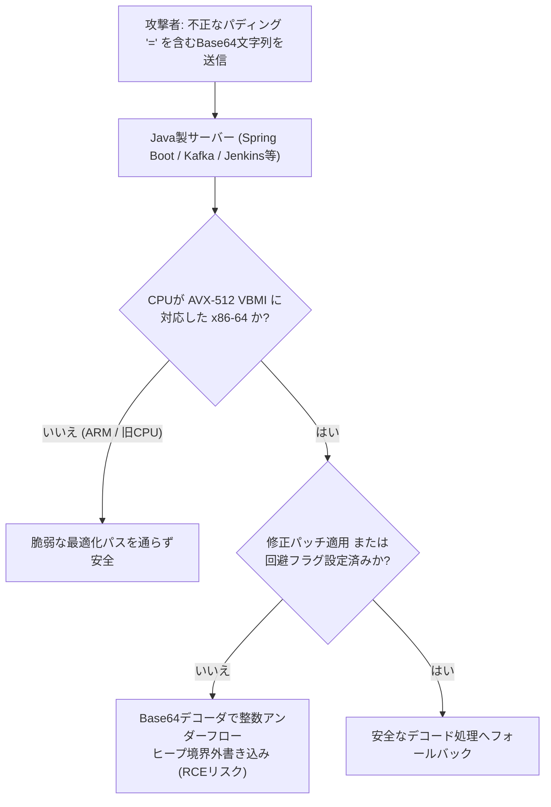
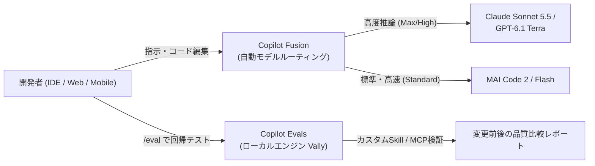

# **本日の AI/開発ツール トピックス (2026-11-18)**

## **1. 📋 今日の30秒サマリー**

> **💡 今日のハイライト**
>
> - 🚨 **世界中のJavaアプリを揺るがす緊急の弱点「Java4Shell」が発覚**: 最新のサーバー向けCPUで動くJavaの文字変換処理に深刻な欠陥が見つかり、細工された文字列を送るだけで外部からサーバーを乗っ取られる恐れがあります。Chromeや社内Wiki「XWiki」の緊急修正も重なりました。
> - 🚀 **OpenAI「GPT-6.2」やGitHub Copilotの次世代開発機能が同日一斉リリース**: OpenAIがフラッグシップAI「GPT-6.2 Astra」と低価格版「Sol」を発表し、GitHubとMicrosoftも独自コーディングAIやAIエージェントを安全に閉じ込めてテストする新基盤を公開しました。
> - 🔥 **AIエージェントを「スマホで指揮・OS操作・超高速化」するOSSが急上昇**: 自宅PCの開発AIを外出先のスマホから操作する「T3 Code」、画面の絵ではなく仕組みを読み取ってアプリを操作する「Agent Desktop」、AWS専用AIエンジン「TrnRT」などが注目を集めています。
{: .callout-summary}

| 区分 | トピック / ツール | ざっくり言うと？（1行要約） | 影響・おすすめ対象 |
| :--- | :--- | :--- | :--- |
| 🚨 **緊急** | **OpenJDK / Oracle Java** (`CVE-2026-114938`) | 最新CPU環境でBase64文字列を変換するだけでサーバー乗っ取りの恐れ（Java4Shell） | **Java 17/21/25/27をx86-64サーバーで運用する全組織** |
| 🚨 **緊急** | **XWiki Platform** (`CVE-2026-61689`) | 検索APIの細工で非公開ページのパスワードハッシュや設定値を盗み見られる | **XWiki 16.10.18 / 17.10.5 / 18.2.0未満の管理者** |
| 🚨 **緊急** | **Google Chrome** (`158.0.8127.36/.37`) | ブラウザの表示エンジンやGPU処理などに複数のメモリ破壊バグが見つかり緊急修正 | **Windows / Mac / Linux / Androidの全Chromeユーザー** |
| 🚨 **緊急** | **Atlassian Bamboo** (`CVE-2026-47884` 他) | 内蔵するSpring関連ライブラリにファイル読み込みや遠隔操作に繋がる深刻な弱点 | **Bamboo Data Center / Serverの管理者** |
| 🚀 **新機能** | **OpenAI GPT-6.2 Astra & Sol** | 科学・複雑作業向け「Astra」は20%値下げ、日常向け「Sol」も同時投入 | **API利用企業・ChatGPT Work / Codex / Bedrock利用者** |
| 🚀 **新機能** | **GitHub Copilot** (`MAI Code 2` / `Evals` / `Fusion`) | Microsoft製新モデル統合に加え、AI設定を自動テストする「Evals」を公開 | **GitHub CopilotでカスタムエージェントやMCPを使う開発者** |
| 🚀 **新機能** | **Microsoft Ignite 2026** (`MXC` / `Windows 365 for Agents`) | AIエージェントを安全に隔離する軽量仮想基盤とエージェント専用クラウドPCを発表 | **自律型AIエージェントを社内システムへ導入するIT部門** |
| 🚀 **新機能** | **Google Antigravity** (`/swarm` & `Gemini 4 Carbon`) | 1つの指示でGemini 4 Carbon指揮下の複数AIチームが並列実装・相互検証 | **大規模機能開発を自律マルチエージェントに任せたい開発者** |
| 🔥 **注目** | **T3 Code** (`pingdotgg/t3code`) | PC上のClaude CodeやCodexをWebやスマホから遠隔操作・承認できる司令塔UI | **複数のコーディングAIを外出先からも見守りたいエンジニア** |
| 🔥 **注目** | **Agent Desktop** (`vercel-labs/agent-desktop`) | 画面の画像認識ではなくOSのアクセシビリティツリーを読んで確実にアプリを操作 | **デスクトップアプリの自動操作エージェントを作る開発者** |
| 🔥 **注目** | **Spaceship IDE** (`chuanqisun/spaceship`) | 爆速AI推論を活かし、生成中の文章をタイムライン上でリアルタイム軌道修正 | **次世代の超低遅延AIエディタUXに関心のある開発者** |
| 🔥 **注目** | **TrnRT** (`runanywhereai/trnrt`) | NVIDIA GPUではなくAWS Trainiumチップ上でLLMを高速推論するOSSエンジン | **AI推論コストの削減やAWS Trainium活用を探るMLエンジニア** |

---

## **2. 🚨 緊急セキュリティ情報**

### **OpenJDK / Oracle Java SE（「Java4Shell」）— 特定のCPU環境で文字列変換からサーバー乗っ取りの恐れ (`CVE-2026-114938`)**

> **🔰 ひとことで言うと**
> 世界の企業システムを支えるJavaの「文字データの変換処理」に深刻なバグが見つかり、特定の最新CPUを載せたサーバーに細工された文字を送るだけで、ログイン不要でサーバーを乗っ取られる恐れがあります。
> 💬 *例えるなら：「郵便物のバーコードを高速で読み取る最新式スキャナーに、わざと端を折ったラベルを通すと、機械が誤作動して金庫の鍵まで開けてしまう」ような状態です。*
{: .callout-danger}

| リスク度 | 影響を受ける人 | 悪用のされやすさ | まずやるべき対策 |
| :---: | :--- | :--- | :--- |
| 🔴 **緊急 (CVSS 9.2)** | x86-64（AVX-512 VBMI対応）CPU上でJava 17/21/25/27等を動かす全サーバー（Spring Boot, Kafka, Jenkins等） | HTTP認証ヘッダやAPIトークンなど標準的な通信経路から認証不要で到達可能 | **Oracle 2026年11月CPU等へ即座に更新（不可なら起動オプションでAVX-512等を無効化）** |

Java4Shellの攻撃経路と2通りの防御策（パッチ適用・JVMフラグによる暫定回避）を以下の図に整理します。



**図の見方**: 攻撃はHTTPヘッダやAPIトークン等のBase64処理を通じて発生します。ARMサーバーや旧型x86 CPUは影響を受けませんが、クラウド上の最新Intel/AMDインスタンスでは標準設定のまま脆弱な高速化パスが有効になっているため、パッチ適用かJVM起動オプションの追加が必須です。

<details markdown="1">
<summary>🔍 技術的な仕組み・対象バージョン・対策コマンドを見る（エンジニア向け）</summary>

- **原因の仕組み**: セキュリティ調査企業Califが11月17日に公開し、CISAも注意喚起を行った脆弱性。x86-64のAVX-512 VBMI命令セットを用いたHotSpot JVMの組込み高速化処理（`java.util.Base64.Decoder`のJITアセンブリ実装）において、末尾に余分なパディング文字 `=` を含む不正なBase64入力を処理する際に出力長計算で整数アンダーフローが発生する。その結果、確保領域を超えて約62〜63バイトのヒープバッファオーバーフロー（CWE-122）を引き起こし、未認証RCEやJVMクラッシュに繋がる。
- **対象バージョン/環境**: AVX-512 VBMI対応のx86-64 CPU上で稼働するOpenJDK / Oracle Java SE（**Java 17.0.6以降、Java 21、25、27** など該当最適化が有効な系統）およびOracle GraalVM。ARM64環境やJava 8/11の標準構成は原則として非該当。
- **対策手順・コマンド**:
  ```bash
  # 1. JavaバージョンとCPUのAVX-512 VBMI対応状況を確認
  java -version
  grep -o 'avx512_vbmi' /proc/cpuinfo | head -n 1

  # 2. パッチ適用（推奨：Oracle 2026年11月Critical Patch Update等の修正版へ更新）
  # 例: 17.0.21.1 / 21.0.13.1 などのセキュリティパッチ版

  # 3. 即時アップデートが困難な場合の暫定回避策（x86-64環境のみに適用すること）
  java -XX:-UseBASE64Intrinsics -jar your-application.jar
  # または AVX-512 の利用を制限
  java -XX:UseAVX=2 -jar your-application.jar
  ```
- **一次ソース**: [NVD - CVE-2026-114938](https://nvd.nist.gov/vuln/detail/CVE-2026-114938) / [CVE.org - CVE-2026-114938](https://www.cve.org/CVERecord?id=CVE-2026-114938) / [SentinelOne Blog](https://www.sentinelone.com/blog/defending-against-java4shell-vulnerability-in-openjdk-enables-rce-on-avx-512-cpus/)

</details>

---

### **XWiki Platform — 非公開ページのパスワードや設定値が外部から読み取られるクエリ注入 (`CVE-2026-61689`)**

> **🔰 ひとことで言うと**
> 社内Wikiソフト「XWiki」の検索用APIに細工をすると、本来は見られないはずの非公開ページからパスワードの暗号化データや設定情報を抜き取られてしまう弱点が見つかりました。
> 💬 *例えるなら：「図書館の蔵書検索端末に特殊な検索語を入れると、一般公開されていない司書室の名簿まで画面に表示されてしまう」ような状態です。*
{: .callout-danger}

| リスク度 | 影響を受ける人 | 悪用のされやすさ | まずやるべき対策 |
| :---: | :--- | :--- | :--- |
| 🔴 **高** | XWiki Platform 4.3-milestone-1 〜 16.10.18 / 17.10.5 / 18.2.0未満を運用する管理者 | 未認証または低権限ユーザーがREST APIへ細工したクエリを送るだけで悪用可能 | **修正版（16.10.18 / 17.10.5 / 18.2.0）へ速やかにアップデート** |

<details markdown="1">
<summary>🔍 技術的な仕組み・対象バージョン・対策コマンドを見る（エンジニア向け）</summary>

- **原因の仕組み**: `/rest/wikis/{wikiName}/query` RESTエンドポイントにおいて、HQL（Hibernate Query Language）クエリ構築時に `FROM` 句インジェクション（`BaseObject` や `StringProperty` との結合）を許してしまう問題。これにより `SELECT` カラムのホワイトリスト制限が迂回され、ブラインド条件付きクエリを通じて権限のないページからソルト付きSHA-1パスワードハッシュや機密設定プロパティを抽出できる。
- **対象バージョン/環境**: XWiki Platform `4.3-milestone-1` 以上、かつ `16.10.18`、`17.10.5`、`18.2.0` 未満のバージョン。
- **対策手順**:
  - 修正済みバージョン（`16.10.18`、`17.10.5`、`18.2.0`）へアップグレードする。修正版ではデフォルトでREST経由のHQLおよびXWQLクエリが無効化されている。
- **一次ソース**: [NVD - CVE-2026-61689](https://nvd.nist.gov/vuln/detail/CVE-2026-61689) / [GitHub Commit (xwiki-platform)](https://github.com/xwiki/xwiki-platform/commit/4d6a2cd9cd049d0c31823ce47bff0a95667967e3)

</details>

---

### **Google Chrome 158 — 画面表示やGPU処理に関する複数の深刻なバグを一斉修正 (`158.0.8127.36/.37`)**

> **🔰 ひとことで言うと**
> Chromeブラウザが最新版の「158」に更新され、悪意あるWebサイトを開くだけでパソコンやスマホのメモリが壊されてしまう複数の危険なバグが修正されました。
> 💬 *例えるなら：「車のブレーキやハンドルの部品に複数のひび割れが見つかり、メーカーが一斉リコール（無償修理）を出した」ような状態です。*
{: .callout-danger}

| リスク度 | 影響を受ける人 | 悪用のされやすさ | まずやるべき対策 |
| :---: | :--- | :--- | :--- |
| 🟠 **高** | Windows / Mac / Linux版およびAndroid版のGoogle Chrome利用者全員 | 細工されたWebページを閲覧するだけでブラウザ内のメモリ破壊が発生する恐れ | **Chromeの設定画面から最新版（158.0.8127.36以降）へ更新し再起動** |

<details markdown="1">
<summary>🔍 技術的な仕組み・対象バージョン・対策コマンドを見る（エンジニア向け）</summary>

- **原因の仕組み**: 2026年11月17日にStableチャネルへ公開されたChrome 158では、WebView、GPU、Media、ANGLEなどのコンポーネントにおける解放済みメモリ使用（Use-After-Free）、境界外書き込み（Out-of-Bounds Write）、バッファオーバーフローを含む多数の脆弱性（CVE-2026-130904〜等）が修正された。
- **対象バージョン/環境**:
  - **Linux**: `158.0.8127.36` 未満
  - **Windows / Mac**: `158.0.8127.36` / `158.0.8127.37` 未満
  - **Android**: `158.0.8127.42` 未満
- **対策手順**: Chrome右上のメニュー「ヘルプ」→「Google Chrome について」からアップデートを適用して再起動する。法人環境ではポリシーやMDM経由でのロールアウトを確認する。
- **一次ソース**: [Chrome Releases Blog](https://chromereleases.googleblog.com/)

</details>

---

### **Atlassian Bamboo Data Center & Server — 組み込みSpring部品の深刻な弱点を修正 (`CVE-2026-47884` / `CVE-2026-47890`)**

> **🔰 ひとことで言うと**
> ビルド・自動化ツール「Bamboo」が内部で使っている部品（Spring）に、外部からファイルを読み込まれたりプログラムを動かされたりする恐れのある重大な欠陥が見つかり、修正版が公開されました。
> 💬 *例えるなら：「工場の自動化ロボット自体は頑丈でも、内部に組み込まれていた市販のモーターに欠陥が見つかり、メーカーが交換部品を配布した」ような状態です。*
{: .callout-danger}

| リスク度 | 影響を受ける人 | 悪用のされやすさ | まずやるべき対策 |
| :---: | :--- | :--- | :--- |
| 🟠 **高 (元CVEはCVSS 9.8)** | Bamboo Data Center / Server（12.1.x, 12.0.x, 11.0.x, 10.2.x, 10.1.x等）の運用者 | 依存ライブラリの脆弱性でありAtlassian側の実環境評価ではリスク低減される場合もあるが早期更新が推奨 | **Bamboo 13.0.1 / 12.1.13 LTS / 10.2.26 LTS以降へアップグレード** |

<details markdown="1">
<summary>🔍 技術的な仕組み・対象バージョン・対策コマンドを見る（エンジニア向け）</summary>

- **原因の仕組み**: 2026年11月17日公開のAtlassian月例セキュリティブリテンにて公表。Bambooが同梱するサードパーティSpring依存関係におけるファイルインクルージョン（`CVE-2026-47884`、CVSS 9.8）およびRCE（`CVE-2026-47890`、CVSS 9.8）の脆弱性を解消。なおAtlassianは製品内の実装状況を踏まえ、実際の悪用リスクを個別に再評価（クリティカル未満と査定）しているものの、LTSを含む修正版への更新を推奨している。
- **対象バージョン/環境**: `12.1.0〜12.1.12 (LTS)`、`12.0.0〜12.0.2`、`11.0.0〜11.0.8`、`10.2.0〜10.2.24 (LTS)`、`10.1.0〜10.1.1`。
- **対策手順**: `13.0.1`、`12.1.13 LTS`、`10.2.26 LTS` 以降へアップグレードする。
- **一次ソース**: [Atlassian Security Bulletin](https://confluence.atlassian.com/)

</details>

---

## **3. 🚀 メジャーリリース・新機能**

### **OpenAI「GPT-6.2 Astra & GPT-6.2 Sol」— 20%値下げの最高峰モデルと高効率モデルを同時投入**

> **🔰 ひとことで言うと**
> OpenAIが最新の「GPT-6.2」シリーズを発表しました。難解な科学計算や複雑なプログラミングをこなす最上位版「Astra」が従来より20%安くなり、普段使い向けの高速・低価格版「Sol」も同時に登場しました。
> 💬 *例えるなら：「最新型の高級スポーツカーが前モデルより2割安く買えるようになり、同時に燃費抜群の最新コンパクトカーも発売された」ような状態です。*
{: .callout-info}

| 比較ポイント | これまで (Before / GPT-6世代) | GPT-6.2 以降 (After) |
| :--- | :--- | :--- |
| **フラッグシップ価格 (Astra)** | 従来単価（キャッシュ割引も限定的） | **入力$8 / 出力$40（100万トークンあたり・20%値下げ＆キャッシュ60%割引）** |
| **応答速度・日常運用 (Sol)** | 高性能と低コストの両立に課題 | **応答遅延を抑えたUltrafastモードや、$2/$10の高効率「GPT-6.2 Sol」を選択可能** |
| **安全性・自己改善管理** | 標準的な安全性評価枠組み | **OpenAI初の「自己改善能力 High」基準に到達し「Control Room」監視を導入** |

<details markdown="1">
<summary>🔍 技術的ブレークスルーとリリースノート詳細を見る</summary>

- **技術的ポイント**:
  - **GPT-6.2 Astra (`gpt-6.2-astra`)**: 複雑なソフトウェア開発、3D設計、ターミナル上の科学ワークフロー（*Terminal-Bench-Science 0.1* や *Agents' Last Exam* で最高水準）に特化。より少ない出力トークン数でタスクを完了できるよう効率化され、プロンプトキャッシュ時は入力100万トークンあたり`$0.40`と大幅にコストを下げた。
  - **GPT-6.2 Sol (`gpt-6.2-sol`)**: 入力`$2` / 出力`$10`（100万トークンあたり）で定常的なコーディングや高頻度業務向け。
  - **安全性評価**: Preparedness Frameworkにおいて公開モデルとして初めてAI自己改善能力が「High」閾値に到達したため、挙動をリアルタイム追跡・制御する「Control Room」システムが導入された。
- **提供形態・利用開始方法**: ChatGPT（Plus/Pro/Business/Enterprise/EduのChatGPT Work）、Codex、OpenAI API、GitHub Copilot、Amazon Bedrock等で順次提供開始。
- **公式リンク**: [Introducing GPT-6.2 Astra and Sol (OpenAI)](https://openai.com/index/introducing-gpt-6-2-astra-sol/)

</details>

---

### **GitHub Copilot「MAI Code 2」「Copilot Evals」「Copilot Fusion」— 独自モデル投入とAI設定の自動テスト機能**

> **🔰 ひとことで言うと**
> GitHub CopilotにMicrosoft自社開発の新AI「MAI Code 2」が加わり、さらに自分が作ったAIアシスタントの設定や外部ツール連携が壊れていないかを自動テストできる新機能「Copilot Evals」が登場しました。
> 💬 *例えるなら：「優秀な専属プログラマーを雇えるだけでなく、そのプログラマーが手順書通りに仕事できるかを毎回テストする『試験官』まで手に入った」ような状態です。*
{: .callout-info}

| 比較ポイント | これまで (Before) | 今回のアップデート (After) |
| :--- | :--- | :--- |
| **モデル選択肢** | 他社モデル中心でコード補完コストが課題 | **Microsoft内製「MAI Code 2 / Flash」を追加（FlashはFree/Studentにも対応）** |
| **AI設定の品質保証** | プロンプトやMCP設定変更後の劣化を手動確認 | **「Copilot Evals」（`/eval`コマンド）で回帰テストと変更前後の比較を自動化** |
| **Fusionの対応範囲** | VS Code / CLI / JetBrains中心 | **Visual Studio・github.com・iOS/Androidモバイルベータへ拡大、最新モデル群を統合** |

GitHub Copilotにおける「動的モデルルーティング（Fusion）」と「設定の回帰テスト（Evals）」の連携フローを以下に示します。



**図の見方**: 開発者が普通に指示を出すと裏側で「Copilot Fusion」が難易度に応じて最適なモデル（MAI Code 2やClaude Sonnet 5.5等）を自動選択します。一方、チーム独自のルールやMCPツールを調整した際は `/eval` から「Copilot Evals」を呼び出すことで、意図しない劣化が起きていないかをローカルで再現性高く検証できます。

<details markdown="1">
<summary>🔍 技術的ブレークスルーとリリースノート詳細を見る</summary>

- **技術的ポイント**:
  - **MAI Code 2 & MAI Code 2 Flash**: 複数ファイルにまたがる改修・リポジトリ全体推論向けの `MAI Code 2` と、日常的な修正やコード解説向けの軽量高速版 `MAI Code 2 Flash` を投入。
  - **GitHub Copilot Evals（Public Preview）**: ローカル評価エンジン「Vally」を採用。リアルなタスクと合格条件を定義し、出力結果だけでなくエージェントの実行経路も検証できる。
  - **GitHub Copilot Fusion**: Terminal-Bench 4.1でFusion Maxが71.2%の解決率を記録。新たにClaude Sonnet 5.5（Max）、GPT-6.1 Terra（High）、MAI-Code-2（Standard）をルーティングプールに追加。
- **公式リンク**: [MAI Code 2 in GitHub Copilot](https://github.blog/changelog/2026-11-17-mai-code-2-and-mai-code-2-flash-in-github-copilot/) / [GitHub Copilot Evals](https://github.blog/changelog/2026-11-17-github-copilot-evals-is-now-in-public-preview/) / [Copilot Fusion Updates](https://github.blog/changelog/2026-11-17-github-copilot-fusion-updates-more-availability-benchmarks-and-models/)

</details>

---

### **Microsoft Ignite 2026「MXC & Windows 365 for Agents」— AIエージェント専用の隔離コンテナとクラウドPC**

> **🔰 ひとことで言うと**
> AIにパソコン操作やプログラム実行を任せる際、暴走しても本体のPCや社内ネットワークが傷つかないよう、AIを閉じ込める「軽量な隔離部屋（MXC）」と「AI専用のクラウドPC」がMicrosoftから発表されました。
> 💬 *例えるなら：「新人のAIアシスタントにいきなり社長室のPCを触らせるのではなく、専用の防音・施錠付きオフィスと専用パソコンを用意してあげた」ような状態です。*
{: .callout-info}

| 比較ポイント | これまで (Before) | Ignite 2026 発表以降 (After) |
| :--- | :--- | :--- |
| **エージェント実行の安全性** | ローカルPC上で直接コマンドを実行し誤操作リスク | **Microsoft Execution Containers (MXC) のMicro VMでハードウェア隔離実行** |
| **APIのない業務アプリ操作** | 開発者のPC画面を占有してマウス操作を代行 | **Windows 365 for Agents により管理された専用Cloud PC上で自律操作** |
| **内製モデルの独自運用** | クラウド共通APIのみの利用が中心 | **MAI Licensed Weights により自社データで微調整しAzure内でIPを保持して運用** |

<details markdown="1">
<summary>🔍 技術的ブレークスルーとリリースノート詳細を見る</summary>

- **技術的ポイント**:
  - **Microsoft Execution Containers (MXC)**: OpenAIやMetaも採用する実験的ローカルMicro VM基盤。高リスクなエージェントのシェル実行やファイル操作をハードウェアレベルの境界で隔離する。
  - **Windows 365 for Agents**: Microsoft Copilot Studio（およびMicrosoft Foundry向けプレビュー）から利用できるComputer-use基盤。APIが存在しないレガシー業務アプリやブラウザを、人間とは別の管理されたCloud PC上で安全に操作させる。
- **公式リンク**: [Microsoft Ignite 2026 Windows Blog](https://blogs.windows.com/windows-experience/2026/11/17/microsoft-ignite-2026-building-windows-for-the-next-era-of-work/)

</details>

---

### **Google Antigravity「`/swarm`（プレビュー）」&「Gemini 4 Carbon」— 1つの指示で自律AIチームを編成**

> **🔰 ひとことで言うと**
> Googleの開発環境「Antigravity」で `/swarm` と入力するだけで、最強AI「Gemini 4 Carbon」がリーダーとなり、複数の作業用AIと検査用AIを同時に動かしてソフトウェア開発を分担・検証してくれる新機能が公開されました。
> 💬 *例えるなら：「現場監督に『この家を増築して』と頼むと、複数の大工さん（作業AI）と厳しい検査官（検証AI）を自動で招集し、別々の作業場で同時に工事してチェックまで済ませてくれる」ような状態です。*
{: .callout-info}

| 比較ポイント | これまで (Before) | `/swarm` プレビュー以降 (After) |
| :--- | :--- | :--- |
| **AI開発の進め方** | 1つのAIと対話しながら順番にタスクを処理 | **1プロンプトで司令塔・並列実装・検証のマルチエージェントチームを自動編成** |
| **作業環境の競合** | 複数作業を同時に進めるとファイル編集が衝突 | **軽量Gemini 4モデル群が隔離されたGit worktree上で並列ビルドを実行** |
| **品質チェック** | 人間が最後にすべての差分をゼロから確認 | **敵対的検証エージェント（Adversarial verifier）が事前にテストと差分レビューを実施** |

<details markdown="1">
<summary>🔍 技術的ブレークスルーとリリースノート詳細を見る</summary>

- **技術的ポイント**: 100万トークンの統一コンテキストと調整可能な思考レベルを持つフラッグシップモデル **Gemini 4 Carbon** がタスク分解と監査のオーケストレータを務め、軽量モデル群が隔離されたワークツリーで並列開発、さらに独立した検証エージェントが敵対的テスト（欠陥探し）を行う多層アーキテクチャを採用。
- **提供形態**: Google AntigravityにおいてGoogle AI Ultra契約者およびエンタープライズ層向けにプレビュー提供。
- **公式リンク**: [Google Antigravity](https://antigravity.google)

</details>

---

## **4. 🔥 注目のトレンドツール**

### **T3 Code (`pingdotgg/t3code`) — コーディングAIをスマホやWebからも指揮できる統合コントロールUI**

> **🔰 ひとことで言うと**
> 自分のパソコンの中で動いている複数のコーディングAI（Claude CodeやCodexなど）を、デスク上の画面だけでなくWebブラウザやスマホからも一覧・操作・承認できる無料の司令塔アプリです。
> 💬 *例えるなら：「自宅のキッチンで動く自動調理ロボットたちを、リビングのタブレットや外出先のスマホから『次の工程に進んでOK』と遠隔操作できるリモコン」のようなツールです。*
{: .callout-tip}

| 注目ポイント | 内容 | おすすめ対象 |
| :--- | :--- | :--- |
| **何ができるか** | ローカルの各種AIエージェントを統一GUIで管理し、Git worktree統合やマルチデバイス同期を実現 | **Claude CodeやCodexを日常的に使うエンジニア** |
| **注目の理由** | 競合ツール（Conductor）のMetaによる買収など環境変化の中、MITライセンスの軽量OSSとして急浮上 | 席を離れてもAIエージェントの承認待ちを止めたくない開発者 |

<details markdown="1">
<summary>🔍 主な機能・アーキテクチャ・導入方法を見る</summary>

- **主な機能・用途**: デスクトップ（Electron）、Web、モバイル間でスレッドをリアルタイム同期。デスクトップで開始した実装タスクの進捗確認や操作承認を外出先のスマートフォンから継続できる。
- **公式サイト/GitHub**: [pingdotgg/t3code (GitHub)](https://github.com/pingdotgg/t3code)

</details>

---

### **Agent Desktop (`vercel-labs/agent-desktop`) — スクリーンショットに頼らずOSの構造を読んでアプリを操作**

> **🔰 ひとことで言うと**
> Vercel LabsがRustで開発した、AIにパソコンのデスクトップアプリを操作させるためのツールです。画面を写真で見てボタンの位置を当て推量するのではなく、OS内部の「画面部品リスト」を直接読み取って正確にクリックします。
> 💬 *例えるなら：「目隠しで画面の写真を撮って手探りでボタンを押すのではなく、建物の設計図とボタン番号表を直接読んで確実にスイッチを押す」ようなツールです。*
{: .callout-tip}

| 注目ポイント | 内容 | おすすめ対象 |
| :--- | :--- | :--- |
| **何ができるか** | macOS / Windows / LinuxのアクセシビリティツリーをJSON出力し、CLI経由で確実なUI操作を実行 | **デスクトップ自動操作（Computer-use）エージェントの開発者** |
| **注目の理由** | 従来の画像認識ベースに比べて圧倒的に高速・低コストかつ座標ズレに強く、物理マウスカーソルを奪わない | APIのないネイティブアプリを安定して自動化したいチーム |

<details markdown="1">
<summary>🔍 主な機能・アーキテクチャ・導入方法を見る</summary>

- **主な機能・用途**: Rust製のCLIおよびCライブラリとして提供され、OSネイティブのアクセシビリティAPIを通じてUI要素に一意の参照IDを割り当て、クリック・文字入力・状態取得を構造化JSONでやり取りする。
- **公式サイト/GitHub**: [vercel-labs/agent-desktop (GitHub)](https://github.com/vercel-labs/agent-desktop)

</details>

---

### **Spaceship IDE (`chuanqisun/spaceship`) — 待ち時間ゼロでAIの思考をリアルタイム軌道修正する実験的IDE**

> **🔰 ひとことで言うと**
> AIに指示を出して返事を「待つ」のではなく、超高速なAIの生成ストリームを動画編集ソフトのタイムラインのように巻き戻したり、注目ポイントを固定したりしながらリアルタイムで共同編集できる実験的エディタです。
> 💬 *例えるなら：「手紙を書いて返信を待つのではなく、楽器のセッションのように相手の演奏に合わせてリアルタイムにメロディを微調整する」ような体験です。*
{: .callout-tip}

| 注目ポイント | 内容 | おすすめ対象 |
| :--- | :--- | :--- |
| **何ができるか** | CerebrasやGeminiの超低遅延推論を活かし、Focus MonitorやAttention Lock、Scrub-to-regenerateを実現 | **次世代のAIエディタUX・ヒューマンインザループに関心がある層** |
| **注目の理由** | 「プロンプト送信→待機」という従来のチャット型開発UIの限界を超える設計思想がHacker Newsで話題に | LLMの推論速度向上を活かした新しいインタラクションを探る開発者 |

<details markdown="1">
<summary>🔍 主な機能・アーキテクチャ・導入方法を見る</summary>

- **主な機能・用途**: 高フレームレートで生成されるテキストに対し、タイムラインをスクラブ（巻き戻し）して特定時点から再生成させたり、モデルの注意（Attention）や将来の生成方向ベクトルを視覚的・対話的に制御する実験的Webデモ。
- **公式サイト/GitHub**: [chuanqisun/spaceship (GitHub)](https://github.com/chuanqisun/spaceship)

</details>

---

### **TrnRT (`runanywhereai/trnrt`) — AWS TrainiumチップでLLMを高速推論するオープンソースエンジン**

> **🔰 ひとことで言うと**
> 高価で品薄になりがちなNVIDIA製GPUではなく、Amazon（AWS）が自社開発したAI専用チップ「Trainium」を使って大規模AIモデルを高速に動かすためのオープンソース実行エンジンです。
> 💬 *例えるなら：「特定の高級エンジン専用だったレーシングカーを、クラウド大手の汎用エンジンでも最高速で走れるようにチューニングする専用ギア」のようなソフトウェアです。*
{: .callout-tip}

| 注目ポイント | 内容 | おすすめ対象 |
| :--- | :--- | :--- |
| **何ができるか** | AWS Trainium（`trn2.48xlarge`等）上でGLM-5.3 Flash等の最新LLMを高スループット推論 | **推論インフラのコスト削減や脱NVIDIA依存を検討するMLエンジニア** |
| **注目の理由** | Show HNで注目を集め、AWS独自シリコンを活用した実用的なオープンソース推論選択肢として期待 | クラウド上で大規模なトークン生成基盤を運用する企業 |

<details markdown="1">
<summary>🔍 主な機能・アーキテクチャ・導入方法を見る</summary>

- **主な機能・用途**: YC W26発のRunAnywhereが開発。AWS Trainiumインスタンス向けに最適化されたカーネルとスケジューリングを備え、高いTokens-Per-Minute（TPM）スループットを実現する。
- **公式サイト/GitHub**: [runanywhereai/trnrt (GitHub)](https://github.com/runanywhereai/trnrt)

</details>

---

## **5. 💡 その他・Tips**

- **Alloy CSS (`alloyhtml.com`)**: Hacker NewsのShow HNで話題になった、**JavaScriptを1行も使わず純粋なCSSとHTMLだけで**ダイアログ、メニュー、タブ切り替え、さらには請求書台帳ダッシュボードまで動作させるデザインシステム。モダンCSSの機能（Popover APIや`:has()`等）の表現力を示す好例として注目されています。
- **NTT「ソブリン型」サイバーセキュリティAI技術（11月16日発表・11月18日展示）**: 検査対象のソースコードを外部クラウドのAIへ送信せず、組織内のオープンウェイトモデルと独自解析ワークフローを組み合わせて脆弱性を診断する技術を発表。メモリ破壊ベンチマーク「CyberGym」の150課題で解析成功率を48%から63%へ向上させ、機密コードを守りながらAIセキュリティ診断を行う実用解として期待されています。

---

## **6. 📝 総評**

> **📌 今日の一言まとめ**
> 基盤ソフトの深刻な脆弱性「Java4Shell」への即応が求められる一方、開発現場では「複数AIを隔離環境で並列指揮し、自動テストで品質を担保する」次世代のマルチエージェント開発基盤が一気に出揃った一日でした。
{: .callout-summary}

本日の動向を振り返ると、セキュリティ面では **OpenJDK（Java4Shell）** や **XWiki**、**Google Chrome**、**Atlassian Bamboo** と、エンタープライズ基盤の根幹に関わる修正が集中しました。特にJava4Shellは「最新CPUの高速化命令（AVX-512 VBMI）」というハードウェア最適化の裏側に潜んでいた境界外書き込みであり、クラウド上の最新インスタンスを使っている組織ほど影響を受けやすい点が特徴的です。パッチ適用までの繋ぎとして `-XX:-UseBASE64Intrinsics` や `-XX:UseAVX=2`（x86-64限定）の切り替え手順を即座に確認しておくことが重要です。

一方、開発ツールの進化は明確に「単発のコード補完」から**「マルチエージェントの安全なオーケストレーションと検証」**へと軸足が移っています。OpenAIの **GPT-6.2 Astra/Sol**、Google Antigravityの **`/swarm`**、GitHubの **Copilot Fusion / Evals**、Microsoftの **MXC / Windows 365 for Agents**、そしてOSSの **T3 Code** や **Agent Desktop** まで、すべてが「複数のAIに安全に権限を渡し、並列で働かせ、その結果を自動で検証する」ためのピースとして噛み合い始めています。明日以降は、自社や個人の開発フローにおいて「エージェントの隔離環境（コンテナ/Micro VM）」と「Evalsによる回帰テスト」をどう組み込むかが重要なテーマになりそうです。

---

## **7. 📖 用語解説**

| 用語 | 解説 |
|------|------|
| **Base64** | 画像やバイナリデータを、メールやWeb通信で安全に扱える「英数字と記号（`=`など）」だけの文字列に変換する仕組み。日常のWeb認証やAPI通信の裏側で常に使われています。 |
| **AVX-512** | 最近のIntelやAMD製CPUに搭載されている「大量の計算を一度にまとめて高速処理する」ための専用命令セット。計算が速くなる反面、今回のような複雑な処理バグの温床になることもあります。 |
| **バッファオーバーフロー** | データを書き込むために用意した「箱」の大きさを超えて、隣のメモリ領域にデータを上書きしてしまうプログラムのバグ。悪用されるとシステムを乗っ取られる原因になります。 |
| **HQLインジェクション** | システム内部のデータベース検索命令（HQL）に、利用者が入力した文字がそのまま混ざり込んでしまい、本来許されていない検索やデータ盗み見を許してしまう脆弱性です。 |
| **アクセシビリティツリー** | OSが視覚障害者向けの読み上げソフトなどのために用意している「画面上のボタンや入力欄の構造リスト」。AIが画像認識よりも正確にアプリを操作する手がかりとして注目されています。 |
| **Micro VM** | 従来の仮想マシンよりも圧倒的に軽量で数ミリ秒〜数秒で起動できる「小さな隔離環境」。AIエージェントに危険なコマンドを実行させても本体に影響を出さないための安全柵として使われます。 |
| **Git worktree** | 1つのプログラム保管庫（リポジトリ）から、複数の作業用フォルダを同時に生やすGitの機能。複数のAIに別々の作業を同時にやらせてもファイルが衝突しないようにするために多用されます。 |
| **Evals（評価テスト）** | AIの出力や手順が「期待通りに動いているか」を自動で採点するテストの仕組み。人間がプロンプトや設定を変えたときに、AIが以前より賢くなったか劣化していないかを数値で確認します。 |

---
(出典: 各公式サイト、GitHub、リリースノート、TechニュースサイトよりAIが要約)

<!-- Kramdown略語定義: 本文中の対象単語に自動でインラインツールチップが付与されます -->
*[RCE]: Remote Code Execution（外部からネットワーク越しに任意のプログラムを勝手に実行される深刻な脆弱性）
*[CVE]: Common Vulnerabilities and Exposures（世界共通で割り振られるセキュリティ脆弱性の識別番号）
*[CVSS]: Common Vulnerability Scoring System（脆弱性の深刻度を0〜10の数値で評価する共通規格）
*[MCP]: Model Context Protocol（AIエージェントと外部ツール・データソースを安全に繋ぐためのオープン共通規格）
*[LLM]: Large Language Model（膨大なテキストから学習した大規模言語モデル）
*[OSS]: Open Source Software（ソースコードが公開され誰でも利用・改良できるソフトウェア）
*[CLI]: Command Line Interface（キーボードから文字のコマンドを入力して操作する画面）
*[UI]: User Interface（ユーザーが画面上で操作するボタンや表示などの接点）
*[API]: Application Programming Interface（ソフトウェアやAI同士が機能やデータをやり取りするための窓口）
*[LTS]: Long Term Support（長期間にわたりセキュリティ修正などが提供される安定版）
