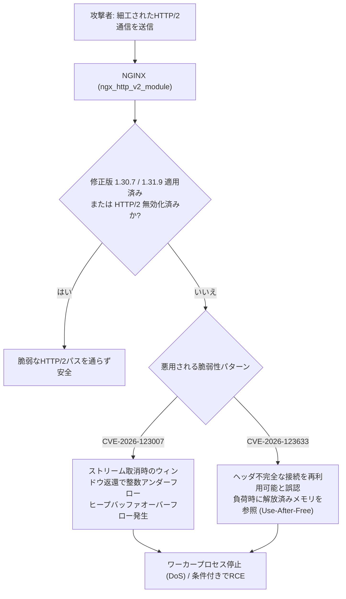
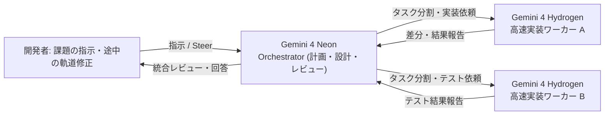

# **本日の AI/開発ツール トピックス (2026-11-19)**

## **1. 📋 今日の30秒サマリー**

> **💡 今日のハイライト**
>
> - 🚨 **Webサーバーの定番「NGINX」に深刻な弱点群（nginx2root）が発覚**: AIを活用したセキュリティ研究によって10年来のバグが見つかり、通信を処理するサーバーが外部から乗っ取られる恐れがあります。AI中継ツール「LiteLLM」や社内Wiki関連の悪用中バグにも緊急警告が出ました。
> - 🚀 **Googleが高効率な新AI「Gemini 4 Neon」を投入、CloudflareはAI専用ブラウザを無償公開**: 複雑な開発作業を従来の高性能モデルより安く・速くこなす新AIが登場したほか、AIがWebを自動操作するための超軽量ブラウザ「Kitesurf」や、企業内で安全にAIアプリを動かすMicrosoftの新基盤が揃いました。
> - 🔥 **AIエージェントの「画面接続・アプリ再構築・長期記憶」を支えるOSSが急上昇**: AIと画面を繋ぐ共通規格「AG-UI」、既存アプリを解析して作り直すRust製ツール「craft-anything」、開発AIの記憶喪失を防ぐ「claude-mem」など、実戦投入向けの周辺技術が注目を集めています。
{: .callout-summary}

| 区分 | トピック / ツール | ざっくり言うと？（1行要約） | 影響・おすすめ対象 |
| :--- | :--- | :--- | :--- |
| 🚨 **緊急** | **NGINX** (`CVE-2026-123007` 他) | HTTP/2やHTTP/3処理の欠陥によりサーバー停止や乗っ取りの恐れ（nginx2root） | **NGINX Open Source / Plus 運用中の全管理者** |
| 🚨 **緊急** | **BerriAI LiteLLM** (`CVE-2026-40217`) | 検証用APIの細工でサーバー上の任意プログラムを実行される（CISA KEV追加） | **AIゲートウェイとしてLiteLLMを運用中の組織** |
| 🚨 **緊急** | **Apache Axis / Confluence** (`CVE-2026-90436`) | 認証不要のSOAP通信で任意のプログラムを呼び出される（実攻撃を観測） | **Confluence DC等、Axis 1.xを内蔵する製品管理者** |
| 🚨 **緊急** | **PHP** (`CVE-2026-115560`) | 特殊なセッション設定時にアップロード進捗処理から遠隔操作の恐れ（本日修正版公開） | **全サポート対象バージョンのPHP運用サーバー管理者** |
| 🚀 **新機能** | **Gemini 4 Neon & Antigravity** (`gemini-4-neon`) | 高い推論力と低コストを両立し、自律チーム制御「Orchestrator (Neon)」にも対応 | **複雑な設計・実装を高速かつ低コストで回したい開発者** |
| 🚀 **新機能** | **Cloudflare Kitesurf** (`Apache 2.0`) | Chromiumを使わずRust＋Wasmで動くAIエージェント専用の超軽量ブラウザを公開 | **Web操作エージェントの実行コストを下げたい開発者** |
| 🚀 **新機能** | **Microsoft Copilot Managed Runtime** | 社員がAIで作ったアプリをM365の安全な社内境界内でそのまま運用できる基盤をGA | **バイブコーディング製アプリの社内統制に悩むIT部門** |
| 🚀 **新機能** | **Snap Easy Lens CLI** (`@snap/easylens-cli`) | Claude CodeやCursor等のターミナルAIからSnapchat用AR・Webゲームを直接開発 | **既存AIエディタでAR/Webゲーム開発を試したい開発者** |
| 🔥 **注目** | **AG-UI Protocol** (`ag-ui-protocol/ag-ui`) | AIエージェントとフロントエンド画面を双方向イベントで繋ぐオープン標準（v1.0） | **エージェントの思考表示や人間承認UIを実装する開発者** |
| 🔥 **注目** | **craft-anything** (`storytold/craft-anything`) | 既存のWebサイトやアプリを視覚・構造解析し、AIに丸ごと再現させるRustエンジン | **既存システムのモダナイズやリバース開発を行うエンジニア** |
| 🔥 **注目** | **claude-mem** (`thedotmack/claude-mem`) | コーディングAIの操作履歴を自動圧縮し、次回セッションへ記憶を引き継ぐプラグイン | **Claude Code等で大規模プロジェクトを継続開発する人** |

---

## **2. 🚨 緊急セキュリティ情報**

### **NGINX Open Source / NGINX Plus（「nginx2root」）— HTTP/2やHTTP/3処理の欠陥でサーバー乗っ取りの恐れ (`CVE-2026-123007` / `CVE-2026-123633` 他)**

> **🔰 ひとことで言うと**
> 世界のWebサイトの玄関口として広く使われている「NGINX」に複数の深刻なバグが見つかり、外部から細工された通信を送られるだけで、サーバーが強制終了したり、乗っ取られたりする恐れがあります。
> 💬 *例えるなら：「ビルの自動ドアのセンサーに特殊な光を当てると、ドアが誤作動して壊れるだけでなく、裏口の鍵まで開いてしまう」ような状態です。*
{: .callout-danger}

| リスク度 | 影響を受ける人 | 悪用のされやすさ | まずやるべき対策 |
| :---: | :--- | :--- | :--- |
| 🔴 **緊急 (CVSS 8.1〜9.2)** | `1.30.7` / `1.31.9` 未満の NGINX Open Source、および未修正の NGINX Plus をインターネット公開している全管理者 | 認証不要・ネットワーク越しに到達可能（ただしRCEには大量通信やASLR回避等の条件あり） | **F5および各OSディストリビューションの修正版（`1.30.7` / `1.31.9`）へ即座に更新（不可ならHTTP/2を無効化）** |

11月18日にF5およびCERT-EUから緊急公開された「nginx2root」と呼ばれる一連の脆弱性では、AIを活用したセキュリティ調査（Xint社がOpenAIモデルを用いて発見）によって約10年前のコードに潜んでいた欠陥が掘り起こされました。特に中心となる2つのHTTP/2脆弱性（`CVE-2026-123007` と `CVE-2026-123633`）の仕組みと暫定回避策を以下の図に示します。



**図の見方**: 外部からのHTTP/2通信が `ngx_http_v2_module` に到達した際、修正パッチ未適用かつHTTP/2が有効な場合に2種類のメモリ破壊パス（整数アンダーフローまたはUse-After-Free）へ進み、プロセス停止や任意コード実行に繋がる流れを示しています。

<details markdown="1">
<summary>🔍 技術的な仕組み・対象バージョン・対策コマンドを見る（エンジニア向け）</summary>

- **原因の仕組み**:
  - **`CVE-2026-123007`（整数アンダーフロー / ヒープバッファオーバーフロー）**: `ngx_http_v2_module` のフロー制御において、ストリームがキャンセルされた際にキュー済みバイト数を送信ウィンドウへ返還する処理でHTTP/2の上限値チェックが欠落しています。悪用によりウィンドウ値が破綻しメモリ破壊を引き起こします（RCE成立には約128GB規模の通信が必要と報告されています）。
  - **`CVE-2026-123633`（Use-After-Free）**: HTTP/2クライアント接続をバックエンドへプロキシする構成で、不完全なヘッダのみ受信したアクティブ接続を「再利用可能」と誤マークします。`worker_connections` 逼迫時などに接続スロットが解放された後も進行中リクエストが参照を続け、メモリ破壊に至ります。
  - **同時公表された関連CVE**: HTTP/3（QUIC）やDNSリゾルバ、メールプロキシ等に関わる `CVE-2026-121810`、`CVE-2026-123634`、`CVE-2026-113425` も同時修正されています。
- **対象バージョン/環境**: NGINX Open Source `1.30.7` 未満（Stable）および `1.31.9` 未満（Mainline）、ならびに修正前の NGINX Plus（コントロールプレーンへの影響はなくデータプレーン限定）。
- **対策手順・コマンド**:
  ```bash
  # 1. パッケージマネージャ等で修正版へアップデート（例: Debian/Ubuntu系）
  sudo apt-get update && sudo apt-get install --only-upgrade nginx

  # 2. 即時更新が困難な場合の暫定回避策（nginx.conf等でHTTP/2を無効化）
  # listen 443 ssl http2; -> listen 443 ssl; に変更、または http2 off; を設定
  sudo nginx -t && sudo systemctl reload nginx
  ```
- **一次ソース**: [F5 Security Advisory (Master Index: K000164058)](https://my.f5.com/manage/s/article/K000164058) / [F5 Advisory (CVE-2026-123007: K000163926)](https://my.f5.com/manage/s/article/K000163926)

</details>

---

### **BerriAI LiteLLM — AIゲートウェイの検証エンドポイントから任意コード実行 (`CVE-2026-40217`)**

> **🔰 ひとことで言うと**
> 複数のAIサービスを束ねて管理する人気ツール「LiteLLM」に、本来は安全なはずのテスト用機能からサーバー内部で勝手なプログラムを動かされてしまう弱点が見つかり、すでに実際の攻撃に悪用されているとして米政府機関が緊急警告を出しました。
> 💬 *例えるなら：「厨房の『味見用小窓』から、料理人しか触れないはずのオーブンや金庫を遠隔操作できてしまう」ような状態です。*
{: .callout-danger}

| リスク度 | 影響を受ける人 | 悪用のされやすさ | まずやるべき対策 |
| :---: | :--- | :--- | :--- |
| 🔴 **緊急 (CVSS 8.8 / CISA KEV)** | 修正版未満の **BerriAI LiteLLM** プロキシサーバーを運用している開発者・企業 | すでに実環境での悪用が確認され、11月18日にCISA KEVカタログへ追加（対応期限: 12月2日） | **`v1.83.14-stable` 以降へ直ちに更新し、登録済みのAIプロバイダAPIキーをすべてローテーション** |

<details markdown="1">
<summary>🔍 技術的な仕組み・対象バージョン・対策コマンドを見る（エンジニア向け）</summary>

- **原因の仕組み**: LiteLLMのカスタムガードレール検証用URIエンドポイント `/guardrails/test_custom_code` において、保護されていない代替チャネル（Unprotected Alternate Channel）とバイトコード書き換え（Bytecode Rewriting）によるサンドボックス回避が可能となっていました。権限昇格系の別欠陥と連鎖させることで、任意のコード実行（RCE）や環境全体の侵害に繋がります。
- **対象バージョン/環境**: `v1.83.14-stable` より前の修正未適用バージョンの BerriAI LiteLLM。
- **対策手順・コマンド**:
  ```bash
  # Python環境でのアップグレード例
  pip install --upgrade "litellm>=1.83.14"
  # コンテナ運用時は最新イメージへ差し替え後、OpenAI/Anthropic/AWS等のAPIキーを再発行
  ```
- **一次ソース**: [CISA Known Exploited Vulnerabilities Catalog](https://www.cisa.gov/known-exploited-vulnerabilities-catalog) / [NVD (CVE-2026-40217)](https://nvd.nist.gov/vuln/detail/CVE-2026-40217)

</details>

---

### **Apache Axis 1.x / Atlassian Confluence DC — 未認証SOAP通信による任意クラス実行 (`CVE-2026-90436`)**

> **🔰 ひとことで言うと**
> 多くの企業システムに組み込まれている古い通信ライブラリ「Apache Axis 1.x」に、ログイン不要のエラー通信を送るだけで任意のプログラム部品を呼び出されてしまう極めて危険な弱点が見つかり、Confluenceなどを狙った実際の攻撃が発生しています。
> 💬 *例えるなら：「受付を通らずに郵便受けへ『特定の部品を取り出せ』と書いた宛先不明の封筒を投函すると、社内の担当者が言われるがまま作業を実行してしまう」ような状態です。*
{: .callout-danger}

| リスク度 | 影響を受ける人 | 悪用のされやすさ | まずやるべき対策 |
| :---: | :--- | :--- | :--- |
| 🔴 **緊急 (CVSS 9.8 / CISA KEV)** | **Apache Axis 1.x**（〜1.4）を内蔵する **Atlassian Confluence Data Center** や **N-able N-central** 等の管理者 | 認証処理の前段階で発火するため極めて悪用が容易。CISA KEVに11月18日追加（期限: 11月21日） | **各製品の修正版（Confluence DCは `9.2.28` 以降）へ即座に更新、または不要なSOAP/XML-RPC APIを無効化** |

<details markdown="1">
<summary>🔍 技術的な仕組み・対象バージョン・対策コマンドを見る（エンジニア向け）</summary>

- **原因の仕組み**: Apache Axis 1.x が受信するSOAPフォルトメッセージの処理において、`<detail><exceptionName>` 要素を安全でないリフレクション（`CWE-470`）で解釈し、文字列コンストラクタ経由で任意のJavaクラスをロード・インスタンス化します。サービスレベルの認証ハンドラより前に実行されるため、未認証の外部攻撃者がRCEに繋げられます。
- **対象バージョン/環境**: サポート終了（EOL）済みの Apache Axis 1.x（〜1.4）、およびこれを同梱する製品（Remote API有効時の Atlassian Confluence Data Center、N-able N-central 等）。
- **対策手順・コマンド**:
  - Apache Axis 1.x 自体はEOLのため公式パッチが存在しません。組み込み先ベンダーのセキュリティアップデート（例: Confluence Data Center `9.2.28` 以降）を適用してください。
  - 更新までの一時対策として、Confluence管理画面等から不要な Remote API（SOAP / XML-RPC）を無効化してください。新規開発・改修では Apache Axis 2/Java への移行が推奨されます。
- **一次ソース**: [NVD (CVE-2026-90436)](https://nvd.nist.gov/vuln/detail/CVE-2026-90436) / [CISA KEV Catalog](https://www.cisa.gov/known-exploited-vulnerabilities-catalog)

</details>

---

### **PHP — セッションのアップロード進捗処理に潜むRCEの修正版を公開予定 (`CVE-2026-115560`)**

> **🔰 ひとことで言うと**
> Web開発で広く使われるプログラム言語「PHP」において、特定の珍しい設定を組み合わせた環境で外部からプログラムを実行される恐れがあるバグを修正するセキュリティアップデートが、本日11月19日に公開されます。
> 💬 *例えるなら：「普段は使わない特殊な鍵の組み合わせを使った部屋だけで発生するドアの引っかかりを、定期点検でまとめて修理する」ような対応です。*
{: .callout-warning}

| リスク度 | 影響を受ける人 | 悪用のされやすさ | まずやるべき対策 |
| :---: | :--- | :--- | :--- |
| 🟠 **高 (本日修正公開)** | サポート中の全PHPブランチのうち、`session.serialize_handler` を実行時に変更しているアプリ | 特殊な設定条件がすべて揃う必要があり一般的環境での発生率は低いが、定期セキュリティリリースで対処 | **本日11月19日（UTC 14:00〜14:30）公開のPHP各ブランチ最新版へ計画的にアップデート** |

<details markdown="1">
<summary>🔍 技術的な仕組み・対象バージョン・対策コマンドを見る（エンジニア向け）</summary>

- **原因の仕組み**: `php.ini` 等で `session.serialize_handler` が `php_binary` または `php_serialize` に設定されている環境において、アプリケーションが `session_start()` 呼び出し直前に `ini_set()` でハンドラを `php` へ動的に切り替えた場合、デフォルトで有効な「セッションアップロード進捗機能（`session.upload_progress.enabled`）」との間でシリアライズ形式の不整合が生じ、RCEベクタとなり得ます。
- **対象バージョン/環境**: 2026年11月19日リリース前のサポート対象全PHPブランチ（上記3条件が同時に成立する構成）。
- **対策手順・コマンド**:
  ```ini
  ; パッチ適用までの一時回避策（php.ini に追記してWebサーバー/PHP-FPMを再起動）
  session.upload_progress.enabled = 0
  ```
- **一次ソース**: [PHP Official Site](https://www.php.net/) / [NVD (CVE-2026-115560)](https://nvd.nist.gov/vuln/detail/CVE-2026-115560)

</details>

---

## **3. 🚀 メジャーリリース・新機能**

### **Google DeepMind「Gemini 4 Neon」& Google Antigravity「Orchestrator (Neon)」— 高性能と高速・低コストを両立した開発向け新AI**

> **🔰 ひとことで言うと**
> Googleが、最上位AI「Carbon」に迫る賢さを持ちながら、より速く約17%安いコストで複雑なプログラミングや研究作業をこなせる新モデル「Gemini 4 Neon」と、AIチームを指揮する新モードを公開しました。
> 💬 *例えるなら：「熟練の設計士（Neon）が設計図を引き、足の速い若手大工チーム（Hydrogen）にテキパキ作業を割り振って家を建てる」ような開発スタイルです。*
{: .callout-info}

| 比較ポイント | これまで (Before) | Gemini 4 Neon 以降 (After) |
| :--- | :--- | :--- |
| **モデル選択の悩み** | 深い推論は重いCarbon、速度重視は軽量なHydrogenと二択になりがち | **中間に位置するNeonが複雑な実装を高速・低コスト（$3/$15 per 1M）で処理** |
| **思考の深さ調整** | 固定または限定的な推論設定でタスク規模に合わせづらい | **`low` / `medium` / `high` / `xhigh` の4段階で思考コストを自在に制御** |
| **Antigravity連携** | 単一モデル中心、または大規模な`/swarm`編成が中心 | **「Orchestrator (Neon)」がNeon（計画・レビュー）とHydrogen（実装）を自動連携** |

Google Antigravity における「Orchestrator (Neon)」の役割分担とユーザーによる軌道修正（Steerability）の流れを以下の図に示します。



**図の見方**: 開発者からの指示を受けた `Gemini 4 Neon` が司令塔（Orchestrator）として計画とコードレビューを担当し、実際の高速な実装作業を複数の `Gemini 4 Hydrogen` へ並列に振り分けることで、精度とスピード・コストを両立させる構造を表しています。

<details markdown="1">
<summary>🔍 技術的ブレークスルーとリリースノート詳細を見る</summary>

- **技術的ポイント**:
  - モデルID `gemini-4-neon` として展開。100万トークンの統合コンテキストウィンドウ（テキスト・画像・音声・動画対応）を備え、同期出力上限は65,536トークン（バックグラウンド長文デコードで拡張可能）。
  - Artificial Analysis Intelligence Index（`xhigh`設定）でスコア **61**（総合3位）を記録し、Agent Arena Index では作業途中の指示変更への追従性（Steerability）で2位を獲得。タスクあたりのコストは Gemini 4 Carbon 比で約17%削減されています。
- **開発フローへの影響**: 毎日のCI連携や大規模リファクタリング、科学技術計算のように「高い精度が必要だが、毎回最上位モデルを回すと遅くて高い」領域のワークロードを置き換えられます。
- **提供形態・利用開始方法**: Google AI Studio / Gemini API（入力 $3 / 1Mトークン、出力 $15 / 1Mトークン）、Vertex AI、Google Antigravity、GitHub Copilot、Geminiアプリ（Google AI Pro / Ultra）で利用可能です。
- **公式リンク**: [Google Developers / Blog](https://blog.google/) / [Google DeepMind](https://deepmind.google/)

</details>

---

### **Cloudflare「Kitesurf」— AIエージェント専用の超軽量ステートレスブラウザをApache 2.0でOSS公開**

> **🔰 ひとことで言うと**
> Cloudflareが、重い従来のChromeブラウザを使わずに、RustとWebAssemblyで作られた「AIエージェント専用の超軽量ブラウザエンジン」のソースコードを無償（Apache 2.0）で公開しました。
> 💬 *例えるなら：「配達ロボットのために、人間用の豪華なバス（Chrome）を用意するのをやめ、荷物運びだけに特化した超軽量電動カートを設計図ごと公開した」ような技術です。*
{: .callout-info}

| 比較ポイント | これまで (Before) | Kitesurf OSS化以降 (After) |
| :--- | :--- | :--- |
| **実行基盤の重さ** | コンテナ上で重いHeadless Chromiumを起動しメモリ・CPUを大量消費 | **Cloudflare Workers上のWasmで動作し、起動遅延やリソース消費を極小化** |
| **カスタマイズ性** | クローズドなクラウドAPIまたは巨大なChromiumフォークの維持が必要 | **Apache 2.0でソース公開され、Wrangler等でローカル実行・独自改変が可能** |
| **既存ツール互換** | 独自スクレイパーを使うとPuppeteer等の既存資産が流用できない | **Chrome DevTools Protocol (CDP) 対応でPuppeteer等をそのまま接続可能** |

<details markdown="1">
<summary>🔍 技術的ブレークスルーとリリースノート詳細を見る</summary>

- **技術的ポイント**:
  - Rust製のオープンソースコンポーネント群をWebAssembly（Wasm）へコンパイルして構築されています（HTML/DOM/レイアウト・描画に **Blitz**、CSS解析・計算に **Stylo**、Dynamic Workersで動かないJSのフォールバック実行に **Boa** を採用）。
  - AIエージェントのトークン消費量・メモリ・CPU負荷を最適化しつつ、標準的なCDP（Chrome DevTools Protocol）インターフェースを提供します。
- **開発フローへの影響**: 大規模なWeb巡回や自動テスト、データ抽出を行うAIエージェント基盤のインフラ費用を大幅に圧縮でき、自社要件に合わせたブラウザ挙動のチューニングも容易になります。
- **提供形態・利用開始方法**: GitHub上でApache 2.0ライセンスにて公開。ローカルでの検証やCloudflareへのデプロイにはWranglerを使用します（Cloudflare上での本稼働にはDynamic Workers利用のためWorkers Paidプランが必要）。
- **公式リンク**: [Cloudflare Blog](https://blog.cloudflare.com/)

</details>

---

### **Microsoft「Copilot Managed Runtime」一般提供（GA）— AI生成アプリをM365の安全な社内境界内で運用**

> **🔰 ひとことで言うと**
> 社員がAIとの対話で作った社内アプリ（バイブコーディング製アプリ）を、セキュリティや認証のルールをすべて保ったまま Microsoft 365 の社内環境に安全に公開・運用できる基盤が正式リリースされました。
> 💬 *例えるなら：「社員が日曜大工で作った便利な道具を、会社の安全基準と社員証チェックが自動で適用される『認定作業場』にそのまま持ち込んで使えるようにした」ような仕組みです。*
{: .callout-info}

| 比較ポイント | これまで (Before) | Copilot Managed Runtime 以降 (After) |
| :--- | :--- | :--- |
| **野良AIアプリのリスク** | 社員が作った便利ツールが外部クラウドに置かれ、情報漏洩やシャドーIT化 | **M365テナント境界内に隔離配置され、データの社外流出を防止** |
| **認証・権限の実装** | アプリごとにMicrosoft Entra認証や監査ログを個別実装する手間 | **ランタイム側がEntra認証・コンプライアンスポリシーを自動継承** |
| **開発・デプロイ** | インフラ構築やデプロイ設定のハードルが高く開発部門へ丸投げ | **`@microsoft/cmr-cli` やAIコーディングプラグインから即座にデプロイ可能** |

<details markdown="1">
<summary>🔍 技術的ブレークスルーとリリースノート詳細を見る</summary>

- **技術的ポイント**: Microsoft Ignite 2026に合わせて一般提供（GA）へ拡大された、エンタープライズIT統制下のアプリケーション・エージェント実行基盤です。Microsoft 365テナントのセキュリティ境界内でカスタムアプリやワークフローをホストします。
- **開発フローへの影響**: 情報システム部門は「野良アプリを禁止する」のではなく「安全なランタイムを提供して管理する」運用へ移行でき、現場の開発スピードとガバナンスを両立できます。
- **提供形態・利用開始方法**: `@microsoft/cmr-cli` パッケージおよび対応AIコーディングプラグインを通じて、既存のM365管理環境へ統合可能です。
- **公式リンク**: [Microsoft Official Site](https://www.microsoft.com/)

</details>

---

### **Snap「Easy Lens CLI (`@snap/easylens-cli`)」— Claude CodeやCursorから直接ARレンズ・Webゲームを開発**

> **🔰 ひとことで言うと**
> Snapchatを提供するSnap社が、Claude CodeやCursorなどのAIコーディングツールからコマンド1つでARフィルターやWebゲームを作って公開できる開発用CLIをリリースしました。
> 💬 *例えるなら：「専用の重たい3Dソフトを覚えなくても、普段使っているメモ帳やチャットAIに『猫耳をつけて』と頼むだけでARアプリが完成する」ようなツールです。*
{: .callout-info}

| 比較ポイント | これまで (Before) | Easy Lens CLI 以降 (After) |
| :--- | :--- | :--- |
| **AR開発の入り口** | 専用のGUIツール（Lens Studio）の操作や独自作法の習得が必須 | **普段使いのターミナルから自然言語プロンプトでAR・Webゲームを生成** |
| **AIツールとの連携** | エディタやエージェントの自動編集ループに組み込みにくい | **Claude Code / Cursor / Codex の開発ループで生成・テスト・公開まで完結** |

<details markdown="1">
<summary>🔍 技術的ブレークスルーとリリースノート詳細を見る</summary>

- **技術的ポイント**: npmパッケージ `@snap/easylens-cli` として11月18日に公開されました。AIコーディングアシスタントがARレンズやWeb Lensブラウザゲームのコードを出力し、CLI経由でローカル検証・プレビュー・Snapchatへの公開までを一気通貫で行えます。
- **開発フローへの影響**: AR/カジュアルゲーム領域でもAIエージェントによる反復開発（Vibe Coding）が可能になり、Webエンジニアが参入するハードルが大きく下がりました。
- **提供形態・利用開始方法**: `npm install -g @snap/easylens-cli`（または `pnpm add -g @snap/easylens-cli`）で導入可能です。
- **公式リンク**: [npm: @snap/easylens-cli](https://www.npmjs.com/package/@snap/easylens-cli)

</details>

---

## **4. 🔥 注目のトレンドツール**

### **AG-UI Protocol (`ag-ui-protocol/ag-ui`) — AIエージェントとUIを双方向イベントで繋ぐオープン標準**

> **🔰 ひとことで言うと**
> さまざまなAIエージェントの仕組みとWebアプリの画面を繋ぐための「共通の会話ルール（プロトコル）」で、AIの思考のリアルタイム表示や、危険な操作の前の「人間の承認待ち」を簡単に実装できます。
> 💬 *例えるなら：「メーカーごとにバラバラだった家電のリモコン信号を、どのテレビでも動く『統一規格の赤外線信号』に揃えた」ようなものです。*
{: .callout-tip}

| 注目ポイント | 内容 | おすすめ対象 |
| :--- | :--- | :--- |
| **何ができるか** | SSEベースの双方向イベントストリームで、トークン配信・動的UI生成・人間承認（HITL）・状態同期を標準化（v1.0安定版） | **AIエージェントを組み込んだWeb/業務アプリを開発するエンジニア** |
| **注目の理由** | LangGraph / CrewAI / PydanticAI / AutoGen / Mastra 等とUI側の $M \times N$ 接続問題を解消し、GitHubで急上昇 | フロントエンドとAIバックエンドを疎結合に保ちたいチーム |

<details markdown="1">
<summary>🔍 主な機能・アーキテクチャ・導入方法を見る</summary>

- **主な機能・用途**:
  - CopilotKit主導で策定され、**1.0安定版**に到達。TypeScript / Python / .NET のネイティブSDKを提供します。
  - トークンのリアルタイムストリーミング、ツール実行時の動的UI描画（Generative UI）、処理を一時停止してユーザー確認を仰ぐ Human-in-the-Loop（HITL）、フロントエンドとエージェント間の状態同期、サブエージェントのハンドオフ追跡をサポートします。
- **他の類似ツールとの比較**: MCP（AIと外部ツール/DBを繋ぐ規格）やA2A（エージェント間連携規格）と補完関係にあり、AG-UIは「エージェントとユーザー画面（UI）の間」に特化しています。
- **導入手順**:
  ```bash
  # 新規プロジェクトのひな形を作成する場合
  pnpm dlx create-ag-ui-app@latest
  ```
- **公式サイト/GitHub**: [ag-ui-protocol/ag-ui (GitHub)](https://github.com/ag-ui-protocol/ag-ui) / [AG-UI Official](https://ag-ui.com/)

</details>

---

### **craft-anything (`storytold/craft-anything`) — 既存サイトやアプリを視覚・構造解析してAIで再構築するRustエンジン**

> **🔰 ひとことで言うと**
> 既存のWebサイトやアプリ、ゲームの画面と構造をツールが自動で観察・解析し、コーディングAIに「同じものをゼロから作り直させて」元と見比べながら検証するRust製のエンジンです。
> 💬 *例えるなら：「名画の構図や筆遣いをスキャナーで分析しながら、見習い画家に模写させ、本物と見比べて修正指示を出す自動アトリエ」のようなツールです。*
{: .callout-tip}

| 注目ポイント | 内容 | おすすめ対象 |
| :--- | :--- | :--- |
| **何ができるか** | 対象アプリを視覚的・構造的に検査し、コーディングエージェントに再実装させて元アプリとの差分検証まで自動ループ | **レガシーWebアプリのモダン化やプロトタイピングを高速化したい開発者** |
| **注目の理由** | 単なるスクリーンショット模倣ではなく、純粋なRust製エンジンによる構造把握と自己検証ループが注目を集めGitHubトレンド入り | デザインシステム再現やUIリバースエンジニアリングに関心がある層 |

<details markdown="1">
<summary>🔍 主な機能・アーキテクチャ・導入方法を見る</summary>

- **主な機能・用途**: 対象のWebサイトやアプリのDOM構造・ビジュアル出力をインスペクションツールで読み取り、コーディングエージェントへ仕様として渡します。生成されたビルドを再び元アプリと比較チェックすることで、手戻りの少ない再構築を実現します。
- **他の類似ツールとの比較**: 1枚の画像からHTMLを生成する単発の「Screenshot-to-Code」系ツールと異なり、アプリ全体の構造把握とビルド後の反復検証ループをエンジンとして組み込んでいる点が強みです。
- **公式サイト/GitHub**: [storytold/craft-anything (GitHub)](https://github.com/storytold/craft-anything)

</details>

---

### **claude-mem (`thedotmack/claude-mem`) — コーディングAIのセッション間「記憶喪失」を防ぐ自動圧縮メモリ**

> **🔰 ひとことで言うと**
> Claude CodeなどのAIコーディングツールを一度閉じても、それまでの作業内容やツールの使い方をAIが自動で要約・保存し、次に開いたとき「前回の続き」からスムーズに再開できるようにするプラグインです。
> 💬 *例えるなら：「毎日記憶がリセットされる優秀な相棒のために、毎晩その日の作業日誌を簡潔にまとめて机に置いてあげる仕組み」です。*
{: .callout-tip}

| 注目ポイント | 内容 | おすすめ対象 |
| :--- | :--- | :--- |
| **何ができるか** | エージェントのツール利用履歴を自動観測してAIで圧縮保存し、次回セッション起動時に関連記憶と検索インデックスを注入 | **Claude Code等で数日〜数週間にわたる継続開発を行うエンジニア** |
| **注目の理由** | 長期開発におけるコンテキスト長の上限やセッション跨ぎの記憶断絶という実務課題をシンプルに解決し、高い支持を獲得 | 毎回同じプロジェクト説明や経緯をプロンプトに書き直している人 |

<details markdown="1">
<summary>🔍 主な機能・アーキテクチャ・導入方法を見る</summary>

- **主な機能・用途**: コーディングエージェントがファイル編集やコマンド実行を行った履歴をバックグラウンドで観測し、重要な設計判断や変更点をAIで圧縮して永続化します。新セッション開始時にはプロジェクトに関連する記憶だけをピンポイントでコンテキストへ注入します。
- **他の類似ツールとの比較**: 手動で `CLAUDE.md` などのルールファイルを書き換える運用と比べ、日々のツール操作から自動でメモリと検索インデックスが育つためメンテナンス負荷が低い点が支持されています。
- **公式サイト/GitHub**: [thedotmack/claude-mem (GitHub)](https://github.com/thedotmack/claude-mem)

</details>

---

## **5. 💡 その他・Tips**

- **AIによる脆弱性発見の現実化（「nginx2root」の教訓）**: 今回F5が公開したNGINXの深刻なバグ（`CVE-2026-123007` 等）は、セキュリティスタートアップ Xint社がOpenAIのモデルを活用した調査によって約10年前のコードから発見したものです。防御側だけでなく攻撃側もAIを使って未知のバグを高速に探索する時代に入っており、OSやミドルウェアの自動パッチ検証パイプラインの重要性が一段と高まっています。
- **Anthropic「Claude Meetings / Whiteboards / Sheets」の登場**: Anthropicは会議内容をタスク化する「Claude Meetings」や協業向けの「Whiteboards」「Sheets」を発表し、開発現場のドキュメント・会議から実装タスクへの接続をさらに強化しています。
- **macOS 27.3ベータで進むOSレベルのAI権限細分化**: AIエージェントがローカルファイルへ過剰にアクセスするリスクを受け、Appleは「macOS 27.3」ベータ版でシステム・アプリ保護の上書き権限などのアクセス制御を細分化しています。デスクトップ操作エージェントを開発する側も、最小権限の原則（Least Privilege）を前提とした設計が不可欠です。

---

## **6. 📝 総評**

> **📌 今日の一言まとめ**
> AIが「10年前のWebサーバーのバグ」を見つけ出す一方で、開発ツール側は「中間帯の賢いモデル・超軽量ブラウザ・UI標準規格」によって実戦運用の完成度を一段引き上げた一日でした。
{: .callout-summary}

本日の動向を振り返ると、業界全体が「AIにコードを書かせる実験段階」を完全に抜け出し、**インフラの安全性・運用コスト・標準プロトコル**を固めるフェーズに入ったことが鮮明です。

セキュリティ面では、Xint社による `nginx2root` の発見が象徴するように、AIによるコード監査が既存の成熟したOSS（NGINX）からも新たなRCE級の欠陥を掘り起こす時代が到来しました。同時に、LiteLLM（`CVE-2026-40217`）やApache Axis（`CVE-2026-90436`）がCISA KEVへ追加されたことは、AIゲートウェイ自体や長年放置されがちなレガシー同梱ライブラリが真っ先に狙われる現実を突きつけています。

一方、開発基盤では「適材適所と標準化」がキーワードとなっています。Googleの `Gemini 4 Neon` と `Orchestrator (Neon)` は「最上位モデルだけで全部回す」非効率を解消し、Cloudflareの `Kitesurf` は「AIに重いChromeを使わせる」コスト構造をRustとWasmで根底から覆しました。さらに `AG-UI 1.0` の普及や Microsoft の `Copilot Managed Runtime` のGAは、AIエージェントを安全な業務アプリとして届けるためのラストワンマイルが急速に埋まりつつあることを示しています。

---

## **7. 📖 用語解説**

| 用語 | 解説 |
|------|------|
| **整数アンダーフロー / バッファオーバーフロー** | コンピュータが扱う数値やデータ置き場（バッファ）の計算が限界を超えてあふれ、隣のメモリ領域を上書きしてしまうバグ。悪用されるとシステムが異常終了したり、攻撃者の命令を実行されたりします。たとえるなら「10人乗りのエレベーターで人数計算を間違え、隣の機械室まで人がはみ出して誤作動させる」ような状態です。 |
| **Use-After-Free（解放済みメモリ参照）** | 一度「もう使わない」と片付けたメモリ領域を、別の処理がうっかり使い続けてしまうバグ。そこに攻撃者が別のデータを滑り込ませると、プログラムを乗っ取られる恐れがあります。 |
| **CISA KEV（悪用が確認された脆弱性カタログ）** | アメリカのサイバーセキュリティ機関（CISA）が「今まさに実際のサイバー攻撃で使われている」と認定した脆弱性リスト。ここに載ったものは、世界中の組織が最優先で修正すべき対象とみなされます。 |
| **リフレクション（Unsafe Reflection）** | プログラムが実行中に「文字列で指定された名前の機能や部品」を動的に呼び出す仕組み。便利ですが、外部から渡された文字をそのまま信じて呼び出すと、想定外の危険な部品まで動かされてしまいます。 |
| **WebAssembly (Wasm)** | Webブラウザやエッジサーバー上で、RustやC++などのプログラムを非常に高速かつ安全（隔離された状態）で動かすための実行形式。 |
| **CDP (Chrome DevTools Protocol)** | 外部のプログラムやAIツールからブラウザの操作・画面取得・デバッグを行うための標準的な通信規格。Puppeteerなどの自動操作ツールが内部で利用しています。 |
| **Human-in-the-Loop (HITL)** | AIエージェントがすべてを勝手に実行するのではなく、重要な決定や危険な操作の直前で一度止まり、人間の確認・承認を挟む設計思想。 |
| **SSE (Server-Sent Events)** | サーバーからWeb画面へ向けて、データをリアルタイムに少しずつ流し続ける通信方式。AIの回答が1文字ずつ表示される仕組みなどで広く使われています。 |

---
(出典: 各公式サイト、GitHub、F5/CISA/NVDアドバイザリ、TechニュースサイトよりAIが要約)

<!-- Kramdown略語定義: 本文中の対象単語に自動でインラインツールチップが付与されます -->
*[RCE]: Remote Code Execution（外部からネットワーク越しに任意のプログラムを勝手に実行される深刻な脆弱性）
*[DoS]: Denial of Service（大量通信やバグの悪用によってサーバーやサービスを停止させる攻撃・状態）
*[CVE]: Common Vulnerabilities and Exposures（世界共通で割り振られるセキュリティ脆弱性の識別番号）
*[CVSS]: Common Vulnerability Scoring System（脆弱性の深刻度を0〜10の数値で評価する共通規格）
*[CISA]: Cybersecurity and Infrastructure Security Agency（米国サイバーセキュリティ・インフラストラクチャセキュリティ庁）
*[KEV]: Known Exploited Vulnerabilities（CISAが管理する「実際に悪用が確認された脆弱性」カタログ）
*[ASLR]: Address Space Layout Randomization（メモリ配置をランダム化して攻撃を困難にするOSの防御機能）
*[Wasm]: WebAssembly（ブラウザやエッジ環境で高速・安全に動作するバイナリ命令形式）
*[CDP]: Chrome DevTools Protocol（ブラウザを外部プログラムから自動操作・検査するための通信プロトコル）
*[HITL]: Human-in-the-Loop（AIの自律処理の途中に人間の確認・承認ステップを組み込む仕組み）
*[SSE]: Server-Sent Events（サーバーからクライアントへリアルタイムにイベントを配信するHTTP規格）
*[MCP]: Model Context Protocol（AIモデルと外部ツール・データソースを安全に繋ぐためのオープン共通規格）
*[OSS]: Open Source Software（ソースコードが公開され、誰でも利用・改変・再配布できるソフトウェア）
*[GA]: General Availability（一般提供。ベータ版を終えて本番利用向けに正式公開された状態）
