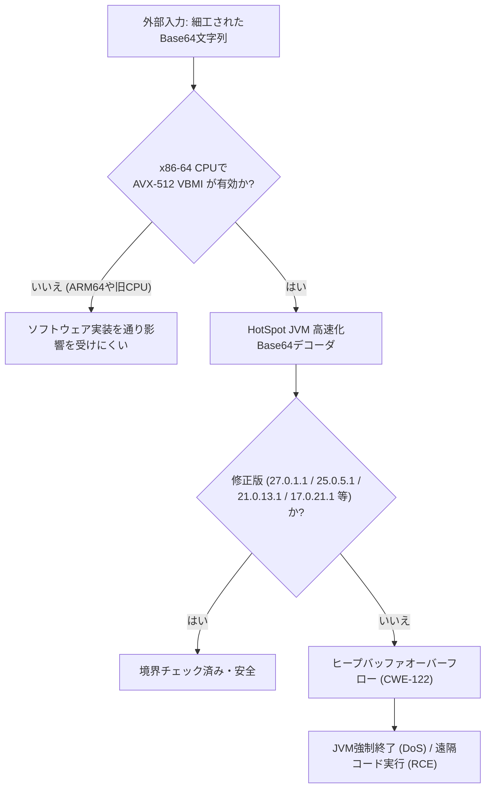
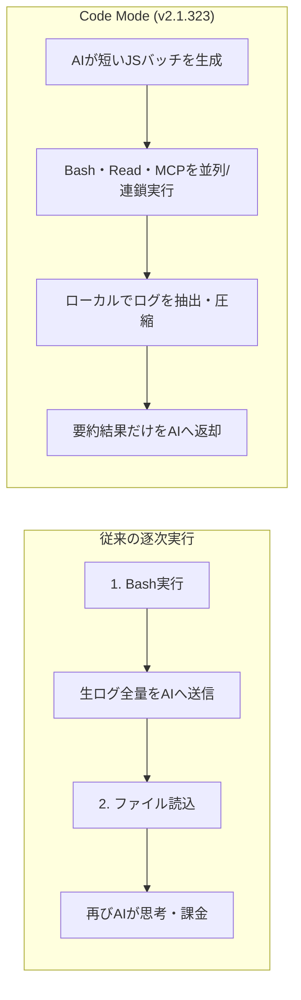

# **本日の AI/開発ツール トピックス (2026-11-20)**

## **1. 📋 今日の30秒サマリー**

> **💡 今日のハイライト**
>
> - 🚨 **企業サーバーの心臓部（VMware・Java・Ruby）に致命的な弱点が相次ぎ、緊急アップデートが必須**: 仮想化基盤「VMware vCenter」で実際に悪用されているゼロデイ欠陥が見つかったほか、Java（「Java4Shell」）やRuby（「ruby2ßhell」）にも外部からプログラムを乗っ取られる深刻なバグが発覚しました。
> - 🚀 **Microsoftが安価な自社製開発AI群「MAI Code 2」を投入、ClaudeやGeminiも「ムダな通信削減」へ進化**: Microsoftが競合の半額以下〜数十分の1のコストを謳う開発AIをGitHub Copilotに統合したほか、Claude Codeは複数の指示を1本のプログラムにまとめて高速化する「Code Mode」を、Gemini APIは必要な道具だけを都度読み込む新機能を追加しました。
> - 🔥 **AIに「解析・構造化・コードレビュー」を任せる実用OSSが急上昇**: アプリを分解して調べる「rea」、設計図をグラフ化する「graphify」、Alibabaが2年実戦投入した自動レビューCLI「open-code-review」など、実務直結のオープンソースツールが注目を集めています。
{: .callout-summary}

| 区分 | トピック / ツール | ざっくり言うと？（1行要約） | 影響・おすすめ対象 |
| :--- | :--- | :--- | :--- |
| 🚨 **緊急** | **VMware vCenter** (`CVE-2026-123890`) | ディレクトリサービスの認証を突破され管理者権限を奪われるゼロデイ欠陥 | **vCenter / VCF 運用中の全インフラ管理者（即時パッチ必須）** |
| 🚨 **緊急** | **Java SE / OpenJDK** (`CVE-2026-114938`) | Base64デコード処理のメモリ破壊により遠隔乗っ取りの恐れ（Java4Shell） | **x86-64環境でJava 8〜27を稼働中の全サーバー・CI管理者** |
| 🚨 **緊急** | **Ruby** (`CVE-2026-132825`) | 旧式文字コードの大文字・小文字変換でメモリ溢れが発生（ruby2ßhell） | **Rails / Sinatra等を運用中のRuby開発・運用チーム** |
| 🚨 **緊急** | **ServiceNow AI Platform** (`CVE-2026-125288` 他) | テンプレート編集権限からのコード実行およびAI応答エージェントへの間接プロンプト注入 | **ServiceNow / Now Assist for CSM 導入企業** |
| 🚀 **新機能** | **Microsoft AI (MAI Code 2 他)** | 高性能・超低価格な自社製開発・防衛AIモデル7種を発表しGitHub Copilotへ統合 | **AI開発・セキュリティ運用のコストを大幅に下げたい企業** |
| 🚀 **新機能** | **Claude Code** (`v2.1.323` Code Mode) | AIが1回ずつ道具を呼ぶ代わりに短いJSを書き一括実行してトークンと待ち時間を削減 | **ターミナルでClaude Codeをヘビーに使うエンジニア** |
| 🚀 **新機能** | **Gemini API** (Tool Retrieval / Genie 4) | 大量ツールの遅延読み込みでトークンを節約＆実時間3D世界生成APIを一般公開 | **多機能エージェント開発者・ロボティクス／空間開発者** |
| 🚀 **新機能** | **OpenAI Responses API & Codex** | 非同期バックグラウンド処理で最大40%割引＆買収したPierre社技術をCodexへ統合 | **バッチ処理のAPI費用を抑えたい開発者・Codexユーザー** |
| 🔥 **注目** | **rea** (`morluto/rea`) | ネイティブバイナリやElectronアプリをAIが解析できるMCPサーバー＋CLI | **リバースエンジニアリングやセキュリティ調査を行う技術者** |
| 🔥 **注目** | **graphify** (`Graphify-Labs/graphify`) | ベクトルDBなしでコードや文書を構造グラフ化しAIの文脈理解を高めるプラグイン | **大規模コードベースでClaude CodeやCursorを使う開発者** |
| 🔥 **注目** | **open-code-review** (`alibaba/open-code-review`) | 決定論的ルールとLLMを組み合わせたAlibaba製AIコードレビューCLI（Apache-2.0） | **PRレビューの品質を上げたいチーム・CI導入担当者** |

---

## **2. 🚨 緊急セキュリティ情報**

### **VMware vCenter Server — ゼロデイ攻撃に悪用中の認証バイパス脆弱性 (`CVE-2026-123890` / `VMSA-2026-0009`)**

> **🔰 ひとことで言うと**
> 企業の仮想サーバー群を一括管理する「VMware vCenter」において、パスワードを知らない外部の攻撃者が管理者として不正ログインできてしまう極めて危険な欠陥が見つかり、すでに実際のサイバー攻撃で悪用されています。
> 💬 *例えるなら：「ビル全体のマスターキーを保管している管理室で、合言葉の確認装置が壊れており、誰でも『合言葉を知っているふり』をしてマスターキーを持ち出せてしまう」ような状態です。*
{: .callout-danger}

| リスク度 | 影響を受ける人 | 悪用のされやすさ | まずやるべき対策 |
| :---: | :--- | :--- | :--- |
| 🔴 **緊急 (CVSS 9.8)** | 未修正の VMware vCenter Server（8.0 / 9.0 / 9.1）および Cloud Foundation (VCF) 運用組織 | 認証不要・ネットワーク到達可能であれば即悪用可能（**実攻撃を確認済み**） | **VMSA-2026-0009 の修正版へ即座にアップデート（公式の暫定回避策なし）** |

<details markdown="1">
<summary>🔍 技術的な仕組み・対象バージョン・対策コマンドを見る（エンジニア向け）</summary>

- **原因の仕組み**:
  - VMware Directory Service（`vmdir`）の DCE/RPC 通信において、SRP（Secure Remote Password）のセッション鍵処理に不備があり、未認証の攻撃者がセッション鍵を推測・偽造して認証を完全にバイパスし、管理者権限を取得できます。
  - Broadcom および Mandiant（Google Cloud）の11月19日付の報告によると、国家支援型とみられる脅威グループ「ARMORY CASTLE」等によるゼロデイ悪用が確認されています。
- **対象バージョン/環境と修正バージョン**:
  - **vCenter 9.1 系**: `9.1.1.0200` で修正
  - **vCenter 9.0 系**: `9.0.2.0200` で修正
  - **vCenter 8.0 系**: `8.0 Update 3m (8.0 U3m)` で修正
  - **VMware Cloud Foundation (VCF) 5.x**: `VCF 5.2.5` で修正
  - **vCenter 7.0 系**: 2025年10月に一般サポート終了済みのため公開パッチはなく、延長サポート契約を通じた個別対応が必要です。
- **対策手順**:
  - 公式のワークアラウンド（暫定回避策）は存在しないため、vCenter 管理インターフェース（VAMI）または Lifecycle Manager から速やかに上記バージョンへパッチを適用し、管理ポート（特に DCE/RPC 関連ポートおよび HTTPS 443）へのアクセスを信頼できる管理ネットワークのみに厳格制限してください。
- **一次ソース**: [Broadcom Security Advisory (VMSA-2026-0009)](https://support.broadcom.com/web/ecx/security-advisory)

</details>

---

### **Oracle Java SE / OpenJDK（「Java4Shell」）— 高速化Base64デコーダに潜むRCE脆弱性 (`CVE-2026-114938`)**

> **🔰 ひとことで言うと**
> 業務システムや開発ツール（JenkinsやJiraなど）の土台として世界中で使われているJavaに、特殊な文字列を読み込ませるだけでサーバーをクラッシュさせたり乗っ取ったりできる重大なバグが見つかり、CISAや日本のIPAも緊急警告を出しています。
> 💬 *例えるなら：「高速仕分けレーンの計算ミスにより、荷物の箱がレーンからはみ出して隣の制御盤を押し潰し、工場全体を勝手に動かされてしまう」ような状態です。*
{: .callout-danger}

11月17日にOracleおよびOpenJDKコミュニティから緊急パッチが公開され、11月19日までにCISA・IPAが注意喚起を行うとともに、JiraやJenkins等を標的とした実証コード（PoC）の報告が相次いでいます。影響条件と発生フローは以下の通りです。



**図の見方**: x86-64環境のCPU拡張命令（AVX-512 VBMI）が有効なサーバーで、未修正のJVMが細工されたBase64データを処理した際にメモリ破壊（ヒープバッファオーバーフロー）へ至る経路を示しています。

| リスク度 | 影響を受ける人 | 悪用のされやすさ | まずやるべき対策 |
| :---: | :--- | :--- | :--- |
| 🔴 **緊急 (CVSS 9.2)** | AVX-512 VBMI対応のx86-64環境で未修正の Java 8〜27 を稼働中の全組織（Jenkins/Jira/Keycloak含む） | 認証不要のBase64入力だけで発動する可能性（PoC公開済み） | **緊急セキュリティ更新版（`25.0.5.1` / `21.0.13.1` / `17.0.21.1` / `11.0.33.1` / `8u513` 等）へ即アップデート** |

<details markdown="1">
<summary>🔍 技術的な仕組み・対象バージョン・対策コマンドを見る（エンジニア向け）</summary>

- **原因の仕組み**:
  - HotSpot JVM の x86-64 向け配列組み込み関数（intrinsic）において、AVX-512 VBMI 命令を用いた Base64 デコーダ実装にヒープベースのバッファオーバーフロー（CWE-122）が存在します。
  - Base64 入力のデコード時に出力バッファ境界の計算を誤り、隣接するヒープ領域を破壊することで、アプリケーションクラッシュや任意コード実行（RCE）に繋がります。
- **対象バージョンと修正バージョン**:
  - **Java 27**: `27.0.1.1` 以降で修正
  - **Java 25**: `25.0.5.1` 以降で修正
  - **Java 21**: `21.0.13.1` 以降で修正
  - **Java 17**: `17.0.21.1` 以降で修正
  - **Java 11**: `11.0.33.1` 以降で修正
  - **Java 8**: `8u513` 以降で修正（`8u511b33-perf` 等のパフォーマンス版が影響）
- **対策手順・コマンド**:
  ```bash
  # 1. 稼働中のJavaバージョンを確認
  java -version

  # 2. Debian/Ubuntu環境でのOpenJDKアップデート例（利用中のJDKディストリビューション手順に従う）
  sudo apt-get update && sudo apt-get install --only-upgrade openjdk-21-jdk
  ```
- **一次ソース**: [Oracle Critical Security Patch Update Advisory (November 2026)](https://www.oracle.com/security-alerts/cspunov2026.html) / [OpenJDK](https://openjdk.org)

</details>

---

### **Ruby（「ruby2ßhell」）— 文字変換処理の1バイト溢れによるRCEの恐れ (`CVE-2026-132825` / `GHSA-34m4-m9fh-gqp5`)**

> **🔰 ひとことで言うと**
> Webアプリ開発で人気のプログラミング言語「Ruby」に、特定の文字コードを大文字・小文字に変換する際、メモリを1バイトだけはみ出して壊してしまうバグが見つかり、Railsなどのアプリが外部から乗っ取られる危険があります。
> 💬 *例えるなら：「10文字しか書けないメモ帳に、特殊な文字を変換したら11文字になってしまい、隣のページに書かれていた大事な命令を書き換えてしまう」ような状態です。*
{: .callout-danger}

| リスク度 | 影響を受ける人 | 悪用のされやすさ | まずやるべき対策 |
| :---: | :--- | :--- | :--- |
| 🔴 **緊急 (CVSS 7.4〜9.0+)** | Ruby `3.3.13` 以下、`3.4.0〜3.4.12`、`4.0.0〜4.0.9` を利用中のWebアプリ（Rails / Sinatra等） | ネットワーク越しに特定エンコーディングの文字列を送るだけでトリガー可能 | **Ruby `3.3.14` / `3.4.13` / `4.0.10` 以上へアップデートしアプリを再起動** |

<details markdown="1">
<summary>🔍 技術的な仕組み・対象バージョン・対策コマンドを見る（エンジニア向け）</summary>

- **原因の仕組み**:
  - ISO-8859-1 や Windows-1252 といったレガシーなシングルバイト文字エンコーディングにおいて、文字列のケース変換（大文字・小文字変換）ルーチンに「off-by-one（1バイト誤差）」のヒープバッファオーバーフローが存在します。
  - デフォルト設定の Ruby on Rails や Sinatra アプリケーションでも、外部からの入力文字列がこの処理を通過することで、プロセス停止や任意コード実行（RCE）に至るリスクが指摘されています。
- **対象バージョン/環境**:
  - Ruby `3.3.13` 以前、`3.4.0` 〜 `3.4.12`、`4.0.0` 〜 `4.0.9`
- **対策手順・コマンド**:
  ```bash
  # 例: rbenv / ruby-build で修正版をインストールして切り替え
  rbenv install 3.4.13
  rbenv global 3.4.13
  ruby -v
  ```
- **一次ソース**: [CVE-2026-132825 (CVE.org)](https://www.cve.org/CVERecord?id=CVE-2026-132825)

</details>

---

### **ServiceNow AI Platform & Now Assist — コード実行と間接プロンプト注入 (`CVE-2026-125288` / `CVE-2026-18883`)**

> **🔰 ひとことで言うと**
> 企業の業務自動化に使われる「ServiceNow」のAI基盤において、他人の権限でプログラムを動かせる穴と、顧客メールに紛れ込ませた隠し命令でAIを騙す穴の2つが見つかりました。
> 💬 *例えるなら：「社内の伝票作成者が他人のハンコを勝手に押せてしまう穴と、問い合わせメールの中に『このメールを上司に転送して』という透明インクの指示を混ぜてAI受付係を騙す手口」が同時に見つかった状態です。*
{: .callout-danger}

| リスク度 | 影響を受ける人 | 悪用のされやすさ | まずやるべき対策 |
| :---: | :--- | :--- | :--- |
| 🟠 **高 (CVSS 8.4 / 7.1)** | ServiceNow AI Platform および Now Assist for CSM (Email Response AI Agent) 利用組織 | テンプレート編集権限者、または外部メール送信者により悪用可能 | **ServiceNow が配信する最新のセキュリティパッチを即時適用** |

<details markdown="1">
<summary>🔍 技術的な仕組み・対象バージョン・対策コマンドを見る（エンジニア向け）</summary>

- **原因の仕組み**:
  - **`CVE-2026-125288`（CVSS 8.4 / コードインジェクション）**: ServiceNow AI Platform において、テンプレート編集権限を持つ認証済みユーザーが細工されたテンプレートを保存・実行することで、別ユーザーのセッションコンテキスト内で任意コードを実行できる欠陥です。
  - **`CVE-2026-18883`（CVSS 7.1 / 間接プロンプトインジェクション）**: Now Assist for CSM の「Email Response AI Agent」が受信メール本文を処理する際、攻撃者が仕込んだ悪意ある指示をデータと区別できずにAIが実行してしまう脆弱性です。
- **対策手順**:
  - ServiceNow サポートポータルのアドバイザリに従い、対象インスタンスをパッチ済みリリースへアップグレードしてください。また、テンプレート編集権限の付与範囲を最小権限原則に基づいて見直してください。
- **一次ソース**: [CVE-2026-125288](https://www.cve.org/CVERecord?id=CVE-2026-125288) / [CVE-2026-18883](https://www.cve.org/CVERecord?id=CVE-2026-18883)

</details>

---

## **3. 🚀 メジャーリリース・新機能**

### **Microsoft AI「MAI Code 2」ほか7モデル — 競合比5%〜40%のコストで動く自社開発AI群を発表**

> **🔰 ひとことで言うと**
> MicrosoftがOpenAIやAnthropicのAIに頼り切らない自社製の最新AIモデル7種類を一挙に発表し、プログラミング用モデル「MAI Code 2」をGitHub Copilotに組み込みました。性能はトップクラスのまま利用料を劇的に下げています。
> 💬 *例えるなら：「高級レストランのシェフ並みの腕前を持ちながら、ファミレス並みの料金で料理を出してくれる自社キッチンをMicrosoftが立ち上げた」ような動きです。*
{: .callout-info}

| 比較ポイント | これまで (Before) | MAI 世代以降 (After) |
| :--- | :--- | :--- |
| **コーディングAIのコスト** | 最上位モデル（Claude Opus 5.5 / GPT-6.1 Sol等）は高性能だが高額 | **MAI Code 2はGPT-6.1 Solの約98%の性能を40%のコスト、Claude Opus 5.5の96%の性能を5%のコストで実現（Microsoft発表）** |
| **セキュリティ・音声・ルーティング** | 用途ごとに外部ベンダーのモデルを個別契約・接続 | **MAI Cyber 2 Flash / Realtime 1 / Transcribe 2 / Decision 1.1 まで自社ラインナップで完結** |
| **企業データのファインチューニング** | クラウド上で外部モデルへデータを渡す制約が課題 | **「Licensed Weights」により自社専用データで安全に調整・保有が可能に** |

<details markdown="1">
<summary>🔍 技術的ブレークスルーとリリースノート詳細を見る</summary>

- **技術的ポイント**:
  - Microsoft Ignite 2026（11月17日〜19日開催）にて、Mustafa Suleyman 率いる Microsoft AI が7つの特化型自社モデル（`MAI Code 2`、`MAI Code 2 Flash`、`MAI Cyber 2 Flash`、`MAI Image 2.7`、`MAI Realtime 1`、`MAI Transcribe 2`、および Google Gemma ベースで構築したルーティングモデル `Decision 1.1`）を一斉公開しました。
  - さらにエンタープライズ向けの **Licensed Weights** プログラムにより、企業は自社の機密コードや業務データを外部に流出させない境界内でモデルの重みをファインチューニングできます。
- **開発フローへの影響**:
  - `MAI Code 2` および `MAI Code 2 Flash` は **GitHub Copilot** と **Azure（Microsoft Foundry）** に直接統合されており、開発チームは既存のエディタ環境のままAIコーディング費用を大幅に圧縮できます。
- **公式リンク**: [Official Microsoft Blog: Ignite 2026](https://blogs.microsoft.com/blog/2026/11/17/ignite-2026-building-the-frontier-ecosystem/)

</details>

---

### **Anthropic Claude Code `v2.1.323` — 複数ツールをJSで一括実行する「Code Mode」を実験導入**

> **🔰 ひとことで言うと**
> 人気のAI開発ツール「Claude Code」が、これまでのように「コマンドを1回打っては結果を見て考える」のをやめ、自分で短いJavaScriptプログラムを書いて複数の作業を一気に片付ける新機能「Code Mode」を追加しました。
> 💬 *例えるなら：「買い物のたびに1品ずつレジに並んでいたAIが、買い物リストをまとめてカートに入れて1回で会計を済ませられるようになった」ような進化です。*
{: .callout-info}

Code Mode によって、ツール実行のループ回数とコンテキスト消費がどのように変わるかを以下に示します。



**図の見方**: 従来はツールを1つ呼ぶたびに大量の生ログがAIの記憶容量（コンテキスト）を圧迫していましたが、Code ModeではAIが生成したJavaScriptがローカルで複数ツールを制御し、必要な結果だけを返すため高速・低コストになります。

| 比較ポイント | これまで (Before) | `v2.1.323` 以降 (After) |
| :--- | :--- | :--- |
| **ツール呼び出し方式** | 1手ずつ順番にBashやReadを呼び出し、毎回AIが推論 | **Code Modeで短いJSを生成し、並列実行や条件分岐を1ターンで処理** |
| **ログによるコンテキスト汚染** | コマンドの大量出力がそのまま会話履歴に溜まりコスト増 | **JS内でノイズをフィルタリングし、必要な要約結果だけを返却** |
| **プラグインと権限の安全性** | 対応バージョン指定や自動権限フォールバックに緩さ | **`engines["claude-code"]` でバージョン固定、権限失敗時は手動確認へ安全フォールバック** |

<details markdown="1">
<summary>🔍 技術的ブレークスルーとリリースノート詳細を見る</summary>

- **技術的ポイント**:
  - 環境変数 `CLAUDE_CODE_EXPERIMENTAL_CODE_MODE=1` を設定することで有効化できる実験機能（オプトイン）です。ネイティブビルドの対話型ターミナルセッションかつ Anthropic 直接API（ClaudeサブスクリプションまたはConsoleアカウント）環境で動作し、Bedrock / Vertex / Foundry 等のゲートウェイや Agent Teams との併用は現時点で非対応です。
  - そのほか、`plugin.json` への `engines["claude-code"]` 互換性指定、`claude plugin validate` による TypeScript フックのデフォルト型検査（`--strict` 対応）、未知モデルIDのデフォルトコンテキスト長を1Mトークンへ引き上げ、`--permission-mode auto` 失敗時の安全フォールバックおよび `/security-review` 実行前の同意プロンプト追加が含まれます。
- **利用開始コマンド**:
  ```bash
  # Code Mode を有効化して Claude Code を起動
  CLAUDE_CODE_EXPERIMENTAL_CODE_MODE=1 claude
  ```
- **公式リンク**: [Anthropic / Claude Code Releases](https://docs.anthropic.com/)

</details>

---

### **Google Gemini API — 大量ツールを遅延ロードする「Tool Retrieval」と世界モデル「Genie 4」を公開**

> **🔰 ひとことで言うと**
> Googleが開発者向けGemini APIを2方向で強化しました。1つはAIに何百もの道具を持たせてもメモリがパンクしない「必要な道具だけ後出しで読み込む仕組み」、もう1つはキーボードで操作できるリアルな3D映像世界をAIがリアルタイム生成する「Genie 4」のAPI公開です。
> 💬 *例えるなら：「分厚い工具カタログを毎回全部机に広げるのをやめ、目次だけ見て必要な工具だけ棚から取り出す仕組み」と、「言葉で指示した仮想世界の中をリアルタイムで歩き回れるシミュレータ」がAPIで使えるようになった状態です。*
{: .callout-info}

| 比較ポイント | これまで (Before) | 今回のアップデート (After) |
| :--- | :--- | :--- |
| **大量ツールの読み込み** | 全ツールの詳細な引数スキーマを毎回プロンプトに詰め込みトークン浪費 | **`defer_loading: true` と `tool_search` で待機ツールを約26トークンに圧縮し動的取得** |
| **3D/空間シミュレーション** | 事前レンダリングの受動的な動画生成が中心 | **`models/genie-4` により720p/24fps・音声付きの対話的世界をWebRTC等で実時間操作** |

<details markdown="1">
<summary>🔍 技術的ブレークスルーとリリースノート詳細を見る</summary>

- **Tool Retrieval（`v1beta` Interactions API プレビュー）**:
  - 関数ツールやリモートMCPサーバーに `defer_loading: true` を設定し、`tool_search` ツールを併用することで、待機中のツールは名前と説明文のみ（1ツールあたり約26トークン）をコンテキストに保持します。
  - Gemini 3.6 以降およびすべての Gemini 4 モデル（`gemini-4-carbon` 等）に対応し、ツール検索による追加課金なしで1ターン内にサーバー側でスキーマを取得できます。
- **Genie 4 World Model API**:
  - Google AI Studio および Gemini API（有料ティア）から `models/genie-4` を利用可能になりました。テキストや参照画像から開始し、WASD/矢印キー入力やテキスト対話で環境やキャラクターをリアルタイム制御できます（1セッション最大2分、目安コスト約0.10ドル/秒）。
- **公式リンク**: [Google Developers Blog](https://developers.googleblog.com/) / [Google DeepMind](https://deepmind.google/)

</details>

---

### **OpenAI Responses API & Codex — 最大40%割引の非同期処理とPierre社コード基盤統合**

> **🔰 ひとことで言うと**
> OpenAIが「急がないAI処理を2〜8時間以内の裏方作業に回すと利用料が最大4割安くなる」新機能を追加しました。あわせて、コード閲覧や差分表示のスタートアップPierre社の技術をCodexへ統合し、GitHubに依存しないAI向けコード管理基盤を強化しています。
> 💬 *例えるなら：「特急便ではなく『明日までに届けばOKのエコノミー便』を選ぶと送料が4割引になる仕組み」と、「AI専用の高速な設計図書庫を手に入れた」ような動きです。*
{: .callout-info}

| 比較ポイント | これまで (Before) | 今回のアップデート (After) |
| :--- | :--- | :--- |
| **非リアルタイム処理の料金** | 即時応答のStandard料金、またはBatch APIの別枠管理 | **Responses API内で「2時間（30%引）」「8時間（40%引）」の背景処理ウィンドウを選択可能** |
| **Codexのコード管理・差分体験** | 外部GitホスティングのUIや標準Git操作に依存 | **Pierre社の Code Storage / Trees / Diffs を統合し、並列エージェント向けGit基盤を内製化** |

<details markdown="1">
<summary>🔍 技術的ブレークスルーとリリースノート詳細を見る</summary>

- **Responses API Background Completion Windows（11月17日パブリックベータ）**:
  - Responses API 上で `2時間`（標準比30%オフ）または `8時間`（標準比40%オフ）の完了ウィンドウを指定でき、大量のコード解析、ドキュメント生成、夜間バッチ評価などのコストを直接削減できます。
- **Pierre Computer Company 買収と Codex 統合**:
  - Code Storage やオープンソースの UI ライブラリ（Trees / Diffs）を開発していた Pierre 社の買収により、並列動作する複数のAIコーディングエージェントがコンフリクトなく高速にブランチ操作・差分レビューを行えるリポジトリ層（社内プロジェクト Pando とも連携）の構築が加速しています。なお、Pierre社のOSSコンポーネントは今後もオープンソースとして維持されます。
- **公式リンク**: [OpenAI News & Platform Updates](https://openai.com/news/)

</details>

---

## **4. 🔥 注目のトレンドツール**

### **`morluto/rea` — AIエージェントがアプリやバイナリを分解調査できるMCPツールキット**

> **🔰 ひとことで言うと**
> 「Reverse Engineer Anything」の略で、AIエージェントや開発者がネイティブアプリ、Electron製アプリ、.NETプログラム、Webサイトの中身をコマンド一発で調査・解析できるようにする話題のツールです。
> 💬 *例えるなら：「ブラックボックスになっていた機械のフタを開けて、中の配線図をAIが読める言葉に翻訳してくれる万能ドライバーセット」のようなツールです。*
{: .callout-tip}

| 注目ポイント | 内容 | おすすめ対象 |
| :--- | :--- | :--- |
| **何ができるか** | ネイティブバイナリ、JS/Electron、.NETアセンブリ、Webサイトの挙動解析をMCP経由でAIに提供 | **リバースエンジニアリング・セキュリティ監査を行う開発者** |
| **注目の理由** | GitHub Trending上位に急浮上。MCPサーバーとCLIを兼ね備え、推測ではなく実測証拠に基づく解析が可能 | 既存ソフトウェアの互換性調査や脆弱性検証を効率化したい人 |

<details markdown="1">
<summary>🔍 主な機能・アーキテクチャ・導入方法を見る</summary>

- **主な機能・用途**:
  - バイナリ解析、通信やUIの挙動追跡、構造抽出などをローカルで実行し、Claude Code や Cursor などの MCP 対応クライアントから安全に呼び出せます。
- **他の類似ツールとの比較**:
  - 従来の Ghidra や手作業のデバッガ操作は人がコマンドやGUIを操作する必要がありましたが、`rea` は最初から AI エージェントがMCPツールとして自律的に仮説検証ループを回せるインターフェースを備えています。
- **公式サイト/GitHub**: [morluto/rea (GitHub)](https://github.com/morluto/rea)

</details>

---

### **`Graphify-Labs/graphify` — コードや文書を知識グラフ化しAIの文脈理解を高めるプラグイン**

> **🔰 ひとことで言うと**
> プログラムのコードだけでなく、設計書、SQLスキーマ、PDFまで丸ごと「関係性のネットワーク図（知識グラフ）」に変換し、Claude CodeやCursorがプロジェクト全体のつながりを正確に把握できるようにするツールです。
> 💬 *例えるなら：「バラバラの書類をただ検索するのではなく、『この契約書とこの設計図とこの部品が繋がっている』という相関図を壁一面に貼ってAIに見せてあげる」ようなツールです。*
{: .callout-tip}

| 注目ポイント | 内容 | おすすめ対象 |
| :--- | :--- | :--- |
| **何ができるか** | コード・設定・SQL・PDF等をローカルのAST解析で知識グラフ化し、AIからクエリ可能にする | **大規模リポジトリでAIコーディングツールを使う開発者** |
| **注目の理由** | ベクトルDB（RAG）を使わず決定論的な構文解析で依存関係を正確にマップするため、ハルシネーションが減る | Claude Code / Cursor / Codex / Gemini CLI ユーザー |

<details markdown="1">
<summary>🔍 主な機能・アーキテクチャ・導入方法を見る</summary>

- **主な機能・用途**:
  - ソースコードの関数呼び出しや型定義、SQLテーブル定義、Markdownドキュメント間の参照をローカル環境で高速にAST解析し、外部ベクトルストア不要で軽量な知識グラフを構築します。
- **他の類似ツールとの比較**:
  - テキストの類似度検索（ベクトルRAG）では「名前は似ているが無関係な関数」を拾いがちですが、ASTベースの知識グラフは実際の依存関係に沿って文脈を辿れるため、リファクタリング時の影響調査に強みを持ちます。
- **公式サイト/GitHub**: [Graphify-Labs/graphify (GitHub)](https://github.com/Graphify-Labs/graphify)

</details>

---

### **`alibaba/open-code-review` (`ocr`) — 2年間の実戦投入を経てOSS化されたAIコードレビューCLI**

> **🔰 ひとことで言うと**
> Alibabaグループが社内で2年間使い込んで鍛え上げたAIコードレビューツール「ocr」が、誰でも使えるオープンソース（Apache-2.0）として公開されました。単なるAIの感想ではなく、バグ検知ルールと組み合わせてピンポイントで行単位の指摘をしてくれます。
> 💬 *例えるなら：「経験豊富な先輩エンジニアのチェックリストと、文脈を読むAIの目を合体させた自動レビュー担当」のようなツールです。*
{: .callout-tip}

| 注目ポイント | 内容 | おすすめ対象 |
| :--- | :--- | :--- |
| **何ができるか** | 決定論的パイプライン＋LLMエージェントにより、NPE・スレッド安全性・XSS・SQLi等を行単位で自動レビュー | **コードレビューの負荷軽減とバグ流出防止を目指すチーム** |
| **注目の理由** | Alibaba社内での2年間の運用実績をベースに公開され、実用的な多言語ルールセットを標準搭載 | GitHub ActionsやローカルCLIで精度の高いAIレビューを試したい人 |

<details markdown="1">
<summary>🔍 主な機能・アーキテクチャ・導入方法を見る</summary>

- **主な機能・用途**:
  - 変更ファイルの選定、関連コンテキストのバンドル、静的ルールマッチングを「決定論的パイプライン」で確実に処理したうえで、文脈判断が必要な箇所をLLMエージェントに委ねるハイブリッド設計を採用しています。
  - NullPointerException（NPE）、並行処理の競合、XSS、SQLインジェクションなどの多言語ルールセットを標準装備し、誤検知（ノイズ）を抑えた行単位のコメントを生成します。
- **公式サイト/GitHub**: [alibaba/open-code-review (GitHub)](https://github.com/alibaba/open-code-review)

</details>

---

## **5. 💡 その他・Tips**

- **NetBird リレーサーバーのQUIC DoS脆弱性修正 (`GHSA-62hx-5rvp-gr3f`)**: メッシュVPN「NetBird」において、未認証のQUIC接続によってリレーサーバーのQUICリスナーが停止し他クライアントが接続不能になる高深刻度（CVSS 4.0: 8.7）の脆弱性が公開されました。`0.36.0` 以降が対象で、**`v0.74.7`（最新 `v0.75.0` 系含む）** で修正されています。セルフホスト運用中の管理者は速やかにアップデートしてください。
- **Windows Endpoint Security Platform が一般提供（GA）へ**: Microsoft は Windows 11 向けに、セキュリティベンダーがOSのカーネル空間に依存せずユーザー空間で安全な保護機能を実行できる新プラットフォームをGAしました。過去のカーネルドライバ起因の大規模システム障害を防ぐ構造転換として注目されています。

---

## **6. 📝 総評**

> **📌 今日の一言まとめ**
> 仮想化基盤（vCenter）や主要ランタイム（Java/Ruby）の深刻な脆弱性への緊急対応が最優先となる一方、開発AIの主戦場は「単なる性能競争」から「トークン効率とコストの劇的な最適化」へと完全にシフトした一日でした。
{: .callout-summary}

本日の動向から浮かび上がる重要なトレンドは以下の2点です。

1. **インフラと主要言語ランタイムの同時多発的な緊急パッチ祭り**:
   VMware vCenterのゼロデイ攻撃（`CVE-2026-123890`）に加え、Java（`CVE-2026-114938`）とRuby（`CVE-2026-132825`）という開発・本番環境の根幹を支えるランタイムに高深刻度CVEが集中しました。特にコンテナイメージやCI/CDランナーに組み込まれたJVM・Rubyはバージョン棚卸しが漏れやすいため、SBOMや脆弱性スキャナの即時再スキャンが不可欠です。
2. **「コンテキスト圧縮」と「実行コストの破壊」が開発AIの標準に**:
   Microsoftの `MAI Code 2` による大幅な価格破壊、Anthropic Claude Codeの `Code Mode`（JSバッチ実行によるトークン節約）、Google Gemini APIの `Tool Retrieval`（`defer_loading`）、OpenAIの最大40%割引バックグラウンドウィンドウと、主要4社すべてが「いかにムダなトークンと待機時間を削り、実務コストを下げるか」という同じ課題に解を出してきました。今後のエージェント開発では、`graphify` のような構造化グラフや `Code Mode` 的なローカル集約を組み合わせた設計がデファクトスタンダードになっていくでしょう。

---

## **7. 📖 用語解説**

| 用語 | 解説 |
|------|------|
| **ゼロデイ脆弱性** | ソフトウェアの弱点がメーカーに知られて修正パッチが配られる「前（0日目）」に、すでに悪用が始まっている非常に危険なバグのことです。 |
| **バッファオーバーフロー** | プログラムが用意したデータの入れ物（メモリ領域）からデータが溢れ出し、隣の領域の命令を壊したり書き換えたりしてしまうバグです。 |
| **Base64（ベース64）** | 画像やバイナリデータなどを、メールやWeb通信で安全に送れる英数字と記号だけの文字列に変換する標準的な仕組みです。 |
| **AVX-512 VBMI** | 近年のx86-64系CPUに搭載されている高速計算用の拡張機能です。一度に大量のデータを並列処理できる反面、専用コードのバグが深刻化しやすい側面があります。 |
| **間接プロンプトインジェクション** | ユーザーではなく、AIが読み込む外部データ（受信メールやWebページなど）の中に「AIへの隠し命令」を紛れ込ませて誤動作させる攻撃手法です。 |
| **コンテキスト汚染** | AIとの会話履歴に、長大なエラーログや不要な情報が大量に溜まり、AIの判断力が鈍ったり利用料金が跳ね上がったりする現象です。 |
| **AST（抽象構文木）** | プログラムのソースコードをコンピュータが理解しやすい「木構造の設計図」に分解したデータのことです。 |
| **知識グラフ** | 言葉やデータ同士の「つながり（関係性）」を点と線で結んで整理したデータベース構造のことです。 |

---
(出典: 各公式サイト、GitHub、リリースノート、TechニュースサイトよりAIが要約)

<!-- Kramdown略語定義: 本文中の対象単語に自動でインラインツールチップが付与されます -->
*[RCE]: Remote Code Execution（外部からネットワーク越しに任意のプログラムを勝手に実行される深刻な脆弱性）
*[CVE]: Common Vulnerabilities and Exposures（世界共通で割り振られるセキュリティ脆弱性の識別番号）
*[GHSA]: GitHub Security Advisory（GitHub上で公開・管理されるセキュリティ警告識別子）
*[CVSS]: Common Vulnerability Scoring System（脆弱性の深刻度を0〜10の数値で評価する共通規格）
*[MCP]: Model Context Protocol（AIエージェントと外部ツール・データソースを安全に繋ぐためのオープン共通規格）
*[CI/CD]: Continuous Integration / Continuous Delivery（コードのテスト・検証から本番公開までを自動化する仕組み）
*[JVM]: Java Virtual Machine（JavaプログラムをOSの違いを超えて実行するための仮想マシン）
*[DoS]: Denial of Service（サービスを強制停止させたり応答不能にしたりする攻撃・障害）
*[PoC]: Proof of Concept（脆弱性が実際に悪用可能であることを示す実証コード）
*[GA]: General Availability（ソフトウェアやクラウドサービスの一般提供開始）
*[AST]: Abstract Syntax Tree（抽象構文木：ソースコードを構文解析して木構造で表現したもの）
*[SBOM]: Software Bill of Materials（ソフトウェアに含まれるコンポーネントやライブラリの構成表）
