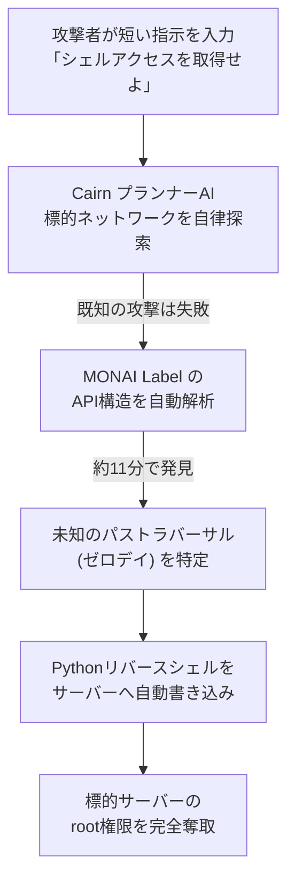
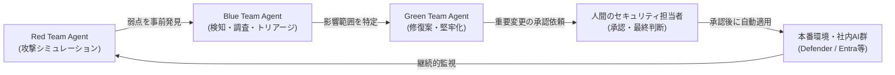

# **本日の AI/開発ツール トピックス (2026-11-21)**

## **1. 📋 今日の30秒サマリー**

> **💡 今日のハイライト**
>
> - **Web基盤の緊急パッチが集中**: 多くのWebサイトを支える「PHP」や「NGINX」、コード管理の「Git」でサーバーを乗っ取られる深刻な弱点が見つかり、修正版が緊急公開されました。
> - **AIが攻撃と防御の双方を自動化**: 攻撃者がAIを使ってわずか11分で未知の弱点を突いた事例が公表された一方、Microsoftからは3種類のAIが自動で社内を守る新システムが登場しました。
> - **開発ツールのローカル化・効率化が加速**: 外部にデータを送らず会議をまとめる「Yogurt」や、AIに最新のWeb標準を教えるGoogle製ツールなど、現場で即戦力になる道具が注目を集めています。
{: .callout-summary}

| 区分 | トピック / ツール | ざっくり言うと？（1行要約） | 影響・おすすめ対象 |
| :--- | :--- | :--- | :--- |
| 🚨 **緊急** | **PHP** (`8.5.13` / `8.4.28` / `8.3.37` / `8.2.36`) | 通信の隙間やセッション処理の隙を突いてサーバーを乗っ取られる複数のRCE脆弱性 | **PHPでWebサイトを運用する全組織**（直ちにアップデートと再起動を） |
| 🚨 **緊急** | **NGINX** (`1.31.9` / `1.30.7` / 「nginx2root」) | AIセキュリティプラットフォームが発見した、認証不要でサーバーを乗っ取れる5つの重大欠陥 | **NGINXを利用中の全インフラ担当者**（完全再起動を伴う更新が必要） |
| 🚨 **緊急** | **Git & GHES** (`CVE-2026-111760` / `3.22.5`) | リポジトリ取得時に悪意あるコードが動く脆弱性と、GHESの管理者権限悪用リスク | **全開発者・社内GitHub管理者**（GitとGHESの最新パッチ適用を） |
| 🚨 **緊急** | **AI攻撃ツール「Cairn」悪用** (`MONAI Label`) | 自律型AIエージェントが約11分で未知の脆弱性を発見し、サーバーを乗っ取った実例 | **セキュリティ担当者・OSS開発者**（無防備なAPIや設定ミスの総点検を） |
| 🚀 **新機能** | **Microsoft Perception** (一般提供開始) | 攻撃役・防御役・修復役の3つのAIエージェントが連携し、自動攻撃に対抗する防御基盤 | **企業のCISO・SOC運用チーム**（AI時代の自動防御体制の検討に） |
| 🚀 **新機能** | **GitHub Enterprise Server `3.23` RC** | 外部通信なしで動くローカルAI機密検出と、依存パッケージ更新の3日間安全待機を導入 | **オンプレミス版GitHub管理者**（機密漏洩対策とサプライチェーン防御に） |
| 🚀 **新機能** | **VS Code `1.147`** | AIへの指示を後で送る予約機能「Send Later」や最適なAIを自動選択するルーターを実験導入 | **VS CodeでAI開発を行う全エンジニア**（エージェント操作の効率化に） |
| 🚀 **新機能** | **Cloudflare 緊急WAFルール配信** | `ruby2shell` と `phpAfterShell` を狙う攻撃を無料プラン含む全ユーザーで自動ブロック | **Cloudflare経由でサイト公開中の開発者**（パッチ適用までの時間稼ぎに） |
| 🔥 **注目** | **PentAGI** (`vxcontrol/pentagi`) | 隔離された仮想空間内で20種以上のセキュリティ診断ツールをAIが自動操縦するOSS | **セキュリティエンジニア・DevSecOps**（定期的な脆弱性診断の自動化に） |
| 🔥 **注目** | **Yogurt** (`FrigadeHQ/yogurt`) | 会議ボットを入れず完全ローカルで文字起こし・要約を行うプライバシー重視のAI議事録 | **機密会議が多いエンジニア・マネージャー**（Granolaの無料OSS代替に） |
| 🔥 **注目** | **Modern Web Guidance** (`GoogleChrome`) | 古い書き方をしがちなAIコーディング支援ツールに「現代の正しいWeb標準」を注入 | **フロントエンド開発者・AIエージェント利用者**（生成コードの品質向上に） |

---

## **2. 🚨 緊急セキュリティ情報**

### **PHP (`8.5.13` ほか) — セッション処理やFastCGIの隙間を突く複数のRCE脆弱性 (`CVE-2026-126714` / `CVE-2026-129289` / `CVE-2026-115560`)**

> **🔰 ひとことで言うと**
> Webサイトの裏側で動くPHPの「一時メモの読み書き」や「通信の引き継ぎ」に欠陥があり、外部からサーバーを乗っ取られる恐れがあります。
> 💬 *例えるなら：ホテルのチェックイン伝票を書き換えている途中に別の客が割り込み、前の客の部屋の合鍵をそのまま受け取れてしまうような状態です。*
{: .callout-danger}

| リスク度 | 影響を受ける人 | 悪用のされやすさ | まずやるべき対策 |
| :---: | :--- | :--- | :--- |
| 🔴 **緊急** | サポート中の全PHP系列（8.2〜8.5）を運用する開発者・管理者 | 公開サイトへのHTTPリクエスト送信のみで悪用可能（CVSS v4.0 **9.2**） | **PHP `8.5.13` / `8.4.28` / `8.3.37` / `8.2.36` へ即時更新しプロセスを再起動** |

<details markdown="1">
<summary>🔍 技術的な仕組み・対象バージョン・対策コマンドを見る（エンジニア向け）</summary>

- **原因の仕組み**:
  2026年11月19日にPHP Foundationより計17〜18件のセキュリティ修正を含むリリースが公開されました。特に深刻な3件は以下の通りです。
  1. **`CVE-2026-126714` (`GHSA-fm2m-fjf5-v3cp` / 通称 `phpAfterShell`)**: デフォルトのファイルベースセッション保存ハンドラにおけるTOCTOU（Time-of-Check to Time-of-Use）競合状態とファイル上書きの不備。アップロード進捗機能などを悪用してセッション書き込みを中断させると古いデータと新データが結合され、安全でないデシリアライゼーション（オブジェクトインジェクション）からRCEに至ります（10月の「PHP2Shell」パッチのバイパス手法）。
  2. **`CVE-2026-129289`**: PHP-FPMのリクエストスマグリング脆弱性。`php://input` を開いた後にリクエストボディを最後まで読み切らずに終了すると未読バイトが破棄されず、フロントエンド（NGINXで `fastcgi_keep_conn on` 等）が接続を再利用した際に後続の悪意あるFastCGIリクエストを注入・実行できます。
  3. **`CVE-2026-115560` (`GHSA-658j-r8rw-q6mx`)**: セッションシリアライザの不一致とアップロード進捗機能の組み合わせにより、攻撃者制御データが別のシリアライザで読み込まれRCEにつながる脆弱性。
- **対象バージョン/環境**:
  - PHP 8.5.13 未満、8.4.28 未満、8.3.37 未満、8.2.36 未満
- **対策手順・コマンド**:
  パッケージ更新後、必ずPHP-FPMやWebサーバーのプロセスを再起動して新バイナリを読み込ませてください。即時更新が困難な場合は一時緩和策を実施します。
  ```bash
  # 例: Debian/Ubuntu系でのパッケージ更新とPHP-FPM再起動
  sudo apt update && sudo apt install --only-upgrade 'php*'
  sudo systemctl restart php8.4-fpm

  # 一時緩和策 (php.ini): アップロード進捗セッション機能を無効化
  # session.upload_progress.enabled = 0
  # またNGINX側で fastcgi_keep_conn on の利用を見直す
  ```
- **一次ソース**: [PHP Official Releases](https://www.php.net/) / [GHSA-fm2m-fjf5-v3cp](https://github.com/php/php-src/security/advisories/GHSA-fm2m-fjf5-v3cp) / [GHSA-658j-r8rw-q6mx](https://github.com/php/php-src/security/advisories/GHSA-658j-r8rw-q6mx)

</details>

---

### **NGINX (`1.31.9` / `1.30.7`) — 「nginx2root」と呼ばれる5件のCritical RCE・メモリ破壊脆弱性 (`CVE-2026-123007` ほか)**

> **🔰 ひとことで言うと**
> 世界中のWebサイトの玄関口として使われるNGINXに、外部から細工した通信を送るだけでサーバー内部を破壊・乗っ取れる5つの重大な穴が見つかりました。
> 💬 *例えるなら：建物の受付係が特殊な合言葉を聞いた瞬間にパニックを起こし、裏口の鍵を勝手に渡してしまうような危険な状態です。*
{: .callout-danger}

| リスク度 | 影響を受ける人 | 悪用のされやすさ | まずやるべき対策 |
| :---: | :--- | :--- | :--- |
| 🔴 **緊急** | HTTP/2・HTTP/3・Mail Proxy等を有効化しているNGINX運用者 | 認証不要のリモート通信で発動（CVSS v4.0 **9.2**） | **NGINX `1.31.9` (Mainline) または `1.30.7` (Stable) へ更新し完全再起動** |

<details markdown="1">
<summary>🔍 技術的な仕組み・対象バージョン・対策コマンドを見る（エンジニア向け）</summary>

- **原因の仕組み**:
  2026年11月18日に公表され、攻撃的セキュリティ研究チーム **Xint**（うち4件をAIプラットフォームで自律発見）やWiz、Rapid7らが関与した一連の脆弱性群（総称「nginx2root」）です。以下の5件がいずれもCVSS v4.0スコア **9.2** と評価されています。
  - **`CVE-2026-123007`**: HTTP/2フロー制御（`ngx_http_v2_module`）の整数アンダーフロー／ヒープバッファオーバーフロー。NGINX 1.9.5〜1.31.8に影響。
  - **`CVE-2026-123633`**: HTTP/2とアップストリームプロキシ併用時、ワーカー接続スロット不足時に発生するUse-After-Free。
  - **`CVE-2026-123634`**: リゾルバおよびSSI / Mirrorサブリクエスト処理におけるUse-After-Free。
  - **`CVE-2026-121810`**: HTTP/3 (QUIC) 有効時、アップストリーム転送中に発生するメモリ破壊。
  - **`CVE-2026-113425`**: Mail Proxyモジュール（`proxy on` + `auth_http`）におけるUse-After-Free。
  - さらにXintは、これらのRCE足掛かりをLinuxカーネル（SCTP関連）の脆弱性と連鎖させることで、コンテナを脱出してホストの **root権限を奪取** できる可能性も実証しています。
- **対象バージョン/環境**:
  - NGINX Open Source: `1.31.9` 未満（Mainline）、`1.30.7` 未満（Stable）
  - NGINX Plus: F5アドバイザリ `K000164058` 準拠の修正版以前
- **対策手順・コマンド**:
  設定リロード（`nginx -s reload`）では古いワーカーバイナリが残るケースがあるため、サービスの完全再起動またはコンテナイメージの再ビルドを行ってください。
  ```bash
  # パッケージ更新後に完全再起動（ディストリビューションのバックポート適用を含む）
  sudo apt update && sudo apt install --only-upgrade nginx
  sudo systemctl restart nginx

  # 即時パッチ困難時の暫定回避（HTTP/2経由の攻撃ベクトルを遮断）
  # nginx.conf 内の server ブロックで http2 off; を指定、または listen ... http2; から http2 を削除
  ```
- **一次ソース**: [NGINX Security Advisories](https://nginx.org/en/security_advisories.html)

</details>

---

### **Git & GitHub Enterprise Server (`3.22.5`) — クローン時のRCE (`CVE-2026-111760`) とGHESサンドボックス脱出 (`CVE-2026-112740`)**

> **🔰 ひとことで言うと**
> 外部のプログラムを丸ごとダウンロード（クローン）するだけでPCが乗っ取られるGitの弱点と、企業向け社内GitHubサーバーの権限悪用リスクが同時に警告されました。
> 💬 *例えるなら：見知らぬ荷物を受け取って箱を開けた瞬間、中から勝手にパソコンを操作する仕掛けが飛び出すような状態です。*
{: .callout-danger}

| リスク度 | 影響を受ける人 | 悪用のされやすさ | まずやるべき対策 |
| :---: | :--- | :--- | :--- |
| 🟠 **高** | `git clone --recurse-submodules` を使う全開発者・GHES管理者 | 細工されたリポジトリを取得するだけで発動（CVSS **8.0**） | **Gitを最新修正版へ更新 / GHESを `3.22.5` 以降へアップグレード** |

<details markdown="1">
<summary>🔍 技術的な仕組み・対象バージョン・対策コマンドを見る（エンジニア向け）</summary>

- **原因の仕組み**:
  1. **Git (`CVE-2026-111760`)**: Gitのインデックス処理における整数切り捨て（Integer Truncation）のバグにより、極端に長いパスが検証を通過した後に短い名前で書き込まれます。攻撃者が細工したリポジトリを `git clone --recurse-submodules` で取得すると、サブモジュールの `.git` ファイルがシンボリックリンクで上書きされ、悪意あるGitフックや設定スクリプトが実行されます（通常クローンでも `git status` 等の後続操作で発動し得ます）。
  2. **GHES (`3.22.5` 修正項目)**: 上記を含む6件のGit脆弱性に加え、クラスター構成でサイト管理者が細工したダウンロードURLを指定することでサンドボックスを脱出しピアノード上で `git` ユーザーとして任意コマンドを実行できる **`CVE-2026-112740`** や、パス検証不備でroot権限のファイル変更・非公開リポジトリ情報漏洩につながる **`CVE-2026-116637`** が修正されました（11月20日にHKCERT等も注意喚起）。
- **対象バージョン/環境**:
  - Git: `2.50.2`, `2.51.3`, `2.52.1`, `2.53.1`, `2.54.1`, `2.55.1`, `2.56.1` より前の各系列
  - GitHub Enterprise Server: `3.22.5` 未満
- **対策手順・コマンド**:
  ```bash
  # Gitバージョン確認と更新（例: Homebrew / macOS, Ubuntu）
  git --version
  brew upgrade git
  # または sudo apt update && sudo apt install --only-upgrade git
  ```
- **一次ソース**: [GitHub Enterprise Server 3.22.5 Release Notes](https://docs.github.com/en/enterprise-server@3.22/admin/release-notes#3.22.5) / [HKCERT Advisory](https://www.hkcert.org/)

</details>

---

### **自律型AI攻撃ツール「Cairn」悪用事案 — AIが11分でゼロデイ脆弱性を発見・悪用した実例をAmazonが公表**

> **🔰 ひとことで言うと**
> 攻撃者がオープンソースのAIセキュリティ診断ツールを悪用し、「サーバーに入れ」と指示しただけでAIが人間の手を借りず11分で未知の弱点を見つけて乗っ取りに成功しました。
> 💬 *例えるなら：鍵の開け方を教えたわけでもないのに、ロボットが建物の壁を自分で調べて11分で裏口を作り出し侵入してしまったような事件です。*
{: .callout-danger}

| リスク度 | 影響を受ける人 | 悪用のされやすさ | まずやるべき対策 |
| :---: | :--- | :--- | :--- |
| 🔴 **緊急** | 外部公開APIやOSS製Webアプリを運用する全組織・大学・企業 | 攻撃者が日本語や中国語の短い指示を出すだけでAIが自動試行 | **公開サーバーの認証設定確認とMONAI Label等の最新パッチ適用** |

<details markdown="1">
<summary>🔍 技術的な仕組み・攻撃フロー・対策ポイントを見る（エンジニア向け）</summary>

- **事案の詳細（2026年11月20日 Amazon Threat Intelligence公表）**:
  Amazonの調査チームは、攻撃者が認証なしで外部公開してしまっていた自律型AIペネトレーションテストフレームワーク **「Cairn」** のサーバーを発見し、その操作履歴と簡体字中国語のプロンプトを解析しました。
  - **標的と経過**: 東アジアの大学関連IP群を標的とし、攻撃者は「obtain shell access（シェルアクセスを取得せよ）」という単純な指示を入力。
  - **11分でのゼロデイ発見**: CairnのAIエージェント群は、まず総当たり攻撃やLog4Shell試行で数時間失敗した後、ターゲット上に稼働していた医療画像AIアプリ **「MONAI Label」** のAPI構造を自律的にマッピング。アップロード機能に存在した**未知のパストラバーサル脆弱性（ゼロデイ）**を約11分で特定し、Python製リバースシェルを書き込んでroot権限を奪取しました（Amazonはメンテナへ通報し修正パッチが公開済み）。
- **対策ポイント**:
  - 自律型AIエージェントは人間と違い、失敗しても24時間休まず試行錯誤を続けます。デフォルト認証情報の排除、管理ポートのIP制限、不審なAPIスキャンに対するレート制限と自動遮断（SOAR/WAF）の導入が急務です。
- **一次ソース**: [AWS Security Blog](https://aws.amazon.com/blogs/security/)

</details>

以下は、今回Amazonが公表した自律型AIエージェント「Cairn」によるゼロデイ発見からサーバー乗っ取りまでの自動化された攻撃フローを示す図です。



**図の見方**:
- 攻撃者は「シェルを取れ」と曖昧な指示を出すだけで、具体的な脆弱性名や攻撃コマンドを指定していません。
- 従来の自動スキャナーと異なり、既知の攻撃が失敗するとAIが自ら標的アプリの仕様を読み解き、未知の欠陥（ゼロデイ）を独自に見つけ出して侵入まで完結させる点が最大の脅威です。

---

## **3. 🚀 メジャーリリース・新機能**

### **Microsoft Perception (一般提供開始) — Red / Blue / Greenの3つのAIが自律連携する統合セキュリティ基盤**

> **🔰 ひとことで言うと**
> AIを使った高速なサイバー攻撃に対抗するため、「攻撃テスト役」「監視・調査役」「修復役」の3種類のAIエージェントがチームを組んで24時間自動で社内を守る仕組みが正式リリースされました。
> 💬 *例えるなら：専属の「泥棒役」「警備員」「鍵の修理屋」の3人組ロボットが社内に常駐し、弱点を見つけた瞬間に修理まで終わらせてくれるようなシステムです。*
{: .callout-info}

| 比較ポイント | これまで (Before) | Microsoft Perception 導入後 (After) |
| :--- | :--- | :--- |
| **脆弱性発見から対処まで** | 人間がアラートを確認し手作業で調査・修正（数日〜数週間） | **Red / Blue / GreenのAIが連携し機械の速度で検知〜修正案作成を自動化** |
| **社内AIエージェントの監視** | Copilot Studio等の社内AIが誰のデータに触れているか把握困難 | **社内AIエージェントを「新たな内部関係者」として動的にアクセス制御・監視** |
| **意思決定の安全性** | 完全自動化すると誤遮断のリスクがある | **重要度の高い修復・遮断は人間が承認する「Human-in-the-Control」設計** |

<details markdown="1">
<summary>🔍 技術的ブレークスルーとリリース詳細を見る</summary>

- **技術的ポイント（Microsoft Ignite 2026発表）**:
  Microsoftが発表したセキュリティ特化モデル群「MAI-Cyber」などを基盤とし、Microsoft Defender / Entra / Purview / Intune、さらにAWS・Okta・Salesforce等のマルチクラウド環境を統合するエージェンティック・オーケストレーション基盤です。
  - **Red Team Agents**: 攻撃者の視点で侵入経路を事前シミュレーションし、悪用可能な弱点を洗い出します。
  - **Blue Team Agents**: アラートのトリアージ、攻撃調査、検知ルール作成、脅威インテリジェンス分析を自動実行（GA版として各種エージェントを提供）。
  - **Green Team Agents**: 露出リスクの優先度付けとパッチ適用・設定堅牢化を調整します。
- **公式リンク**: [Microsoft Security Blog](https://www.microsoft.com/en-us/security/blog/)

</details>

以下は、Microsoft Perceptionにおける3種類のAIエージェントと人間の承認ループの連携構造を示す図です。



**図の見方**:
- 攻撃役（Red）が見つけた弱点や外部からの不審な動きを防御役（Blue）が即座に調査し、修復役（Green）が対策案を用意する閉じたループを形成しています。
- すべてをAI任せにするのではなく、業務に影響が出る重要な変更には必ず「人間の承認（Human-in-the-Control）」を挟むことで安全性を担保しています。

---

### **GitHub Enterprise Server `3.23` RC — 外部通信不要のローカルAI機密検出とDependabot安全待機**

> **🔰 ひとことで言うと**
> 社内の閉じたネットワークで動く企業向けGitHubが進化し、インターネットに一切繋がない状態でもAIがパスワードやAPIキーの書き忘れを自動で見つけてくれるようになりました。
> 💬 *例えるなら：外部と遮断された秘密工場の中に、インターネットに繋がなくても動く優秀な機密チェック係が常駐するようになったイメージです。*
{: .callout-info}

| 比較ポイント | これまで (Before) | GHES 3.23 RC 以降 (After) |
| :--- | :--- | :--- |
| **エアギャップ環境のAI機密検出** | GPUや外部LLMへの通信が必要で完全閉域網では導入が困難 | **アプライアンス内のCPUのみでファインチューニング済みAIが機密を検出（パブリックプレビュー）** |
| **依存パッケージの自動更新** | 新バージョン公開直後にDependabotがPRを作成し、侵害版を踏むリスク | **デフォルトで公開から「3日間」待機してからPRを作成するクールダウンを導入** |
| **GitHub Projectsの絞り込み** | 複雑な条件指定に制限があった | **`OR` / `AND` と括弧 `(...)` を使った柔軟な論理クエリ検索に対応** |

<details markdown="1">
<summary>🔍 技術的ブレークスルーとリリースノート詳細を見る</summary>

- **技術的ポイント（2026年11月20日 Release Candidate公開）**:
  - **Local AI Secret Detection**: GitHub Secret Protectionの一部として、GPUや外部ホストLLMを一切使わずCPUのみで非構造化シークレット（文脈に紛れた秘密鍵など）を高精度に検出します。
  - **マルウェア検知の拡大**: GitHub Advisory DatabaseがOpenSSFの `malicious-packages` リポジトリを自動取り込みし、npmだけでなくPyPI、Maven、RubyGems、NuGet、Go、Rust、Composerの悪意あるパッケージを検知可能になりました。
  - **OAuthトークン有効期限**: OAuthアプリのアクセストークンに8時間の有効期限とリフレッシュトークンを設定可能になりました（新規登録アプリはデフォルト有効）。
  - なお、11月19日にはGitHub本体のPull Request Overview画面のレイアウト改善（マージ状態の視認性向上など）も展開されています。
- **公式リンク**: [The GitHub Blog](https://github.blog/)

</details>

---

### **VS Code `1.147` — エージェントへの「予約送信」と実験的モデルルーターを導入**

> **🔰 ひとことで言うと**
> プログラミング用エディタ「VS Code」がアップデートされ、AIエージェントへの指示を下書き保存・予約送信したり、作業内容に合わせて最適なAIモデルを自動切り替えできるようになりました。
> 💬 *例えるなら：AIの部下に「この作業は明日の朝やっておいて」と付箋で予約メモを残し、仕事の内容によって得意な担当者を自動で割り振ってくれるような機能です。*
{: .callout-info}

| 比較ポイント | これまで (Before) | VS Code 1.147 以降 (After) |
| :--- | :--- | :--- |
| **AIエージェントへの指示出し** | 思いついた瞬間に即時実行するしかなかった | **「Send Later（実験的機能）」で下書き保存やローカル実行の予約が可能に** |
| **AIモデルの選択** | タスクごとにユーザーが手動でモデルを切り替えていた | **実験的「Model Routers」によりタスクに適したモデルへのルーティングに対応** |
| **リモート環境のHTML確認** | SSH先やコンテナ内のHTMLをプレビューするのに手間がかかった | **信頼されたリモートパス（SSH/WSL/Dev Containers）のHTMLを統合ブラウザで直接表示** |

<details markdown="1">
<summary>🔍 技術的ブレークスルーとリリースノート詳細を見る</summary>

- **技術的ポイント（2026年11月18日リリース）**:
  Agentsウィンドウの大幅な強化が中心です。チャット内にグラフやモックアップなどの視覚的レポートを直接レンダリングする機能も拡充され、単なるコード補完から「非同期の自律タスク管理」へとエディタの役割が拡張されています。
- **公式リンク**: [Visual Studio Code 1.147 Release Notes](https://code.visualstudio.com/updates/v1_147)

</details>

---

### **Cloudflare 緊急WAFルール即時展開 — `ruby2shell` と `phpAfterShell` を全プランで自動ブロック**

> **🔰 ひとことで言うと**
> 今週相次いで見つかったRubyとPHPの超危険な弱点を狙うサイバー攻撃を、Cloudflareが無料プランを含むすべての利用者の玄関口で自動的にブロックする緊急ルールを即時配信しました。
> 💬 *例えるなら：街中で新型のピッキング手法が流行り始めた翌日に、警備会社が全契約者の玄関ドアへ自動で最新センサーを追加してくれたような対応です。*
{: .callout-info}

| 比較ポイント | これまで (Before) | Cloudflare 緊急ルール展開後 (After) |
| :--- | :--- | :--- |
| **パッチ適用までの防御** | サーバー側の言語アップデート完了まで無防備になりがちだった | **Freeプランを含む全ティアで `ruby2shell` / `phpAfterShell` の攻撃パターンを自動遮断** |
| **運用の手間** | 管理者が個別に正規表現ルールを書いて適用する必要があった | **マネージドルールとして自動適用され、即座に保護が有効化** |

<details markdown="1">
<summary>🔍 技術的ブレークスルーとリリース詳細を見る</summary>

- **技術的ポイント（2026年11月19日〜20日展開）**:
  Rubyの `CVE-2026-132825`（単一バイト文字エンコーディング変換時の1バイトヒープオーバーフロー）およびPHPの `CVE-2026-126714`（セッションファイル上書き競合）を標的とした既知のエクスプロイトペイロードをエッジ側で検知・ブロックします。
  ※あくまで一時的な仮想パッチ（緩和策）であるため、サーバー本体のRuby（`3.3.14` / `3.4.13` / `4.0.10`）およびPHP（`8.2.36`〜`8.5.13`）のアップデートは必須です。
- **公式リンク**: [The Cloudflare Blog](https://blog.cloudflare.com/)

</details>

---

## **4. 🔥 注目のトレンドツール**

### **PentAGI (`vxcontrol/pentagi`) — 隔離空間で20種以上の診断ツールを操る自律型ペネトレーションテストAI**

> **🔰 ひとことで言うと**
> 「このシステムに弱点がないか調べて」と日本語や英語で頼むだけで、安全な仮想箱の中でAIチームが20種類以上のプロ向けセキュリティ検査ツールを自動実行してくれるオープンソースツールです。
> 💬 *例えるなら：セキュリティの専門家チームを安全な模擬演習室に招き入れ、弱点調査から報告書作成まで全自動でやってもらうような仕組みです。*
{: .callout-tip}

| 注目ポイント | 内容 | おすすめ対象 |
| :--- | :--- | :--- |
| **何ができるか** | リサーチャー・開発者・実行役のマルチエージェントがDocker内でKali Linuxツール群（Nmap, Metasploit, SQLmap等）を自動実行 | **自社サービスの脆弱性診断を内製化したいDevSecOpsチーム** |
| **注目の理由** | MITライセンスで完全公開されており、AIによる自律攻撃が現実化する中「防御側の事前テスト」としてGitHub等で急上昇 | セキュリティエンジニア・SRE |

<details markdown="1">
<summary>🔍 主な機能・アーキテクチャ・導入方法を見る</summary>

- **主な機能・用途**:
  自然言語でターゲットと目的を与えると、AIエージェントが調査計画を立て、隔離されたDockerサンドボックス内でコマンドを実行・結果を解釈し、次の検査ステップを自律的に決定して詳細な脆弱性レポートを出力します。
- **他の類似ツールとの比較**:
  単発の脆弱性スキャナーと異なり、複数ツール（20種以上）の実行結果を記憶・連鎖させ、複雑な攻撃経路の検証まで自動化できる点が特徴です。
- **導入手順**:
  ```bash
  git clone https://github.com/vxcontrol/pentagi.git
  cd pentagi
  # .env でLLM APIキー等を設定後、Docker Composeで起動
  docker compose up -d
  ```
- **公式サイト/GitHub**: [vxcontrol/pentagi](https://github.com/vxcontrol/pentagi)

</details>

---

### **Yogurt (`FrigadeHQ/yogurt`) — 会議ボット不要・完全ローカル動作のオープンソースAI議事録アプリ**

> **🔰 ひとことで言うと**
> ZoomやGoogle Meetに怪しい「録画ボット」を参加させることなく、自分のパソコンの中だけで録音・文字起こし・要約を完結できる完全無料のAI議事録アプリです。
> 💬 *例えるなら：会議室に外部の速記業者を呼ばず、自分の手元にある秘密の電子メモ帳が勝手に会話の要点をまとめてくれるような道具です。*
{: .callout-tip}

| 注目ポイント | 内容 | おすすめ対象 |
| :--- | :--- | :--- |
| **何ができるか** | マイクとシステム音声をローカルで録音し、`whisper.cpp` で文字起こし、`llama.cpp` で要約（クラウド送信ゼロ） | **機密情報をクラウドに上げられないエンジニア・マネージャー** |
| **注目の理由** | 有料アプリ「Granola」の無料・MITライセンス版としてShow HNで話題沸騰。ローカルMCPサーバー機能も搭載 | プライバシー重視の個人・開発チーム |

<details markdown="1">
<summary>🔍 主な機能・アーキテクチャ・導入方法を見る</summary>

- **主な機能・用途**:
  - **ボットレス録音**: OSのシステムオーディオを直接キャプチャするため、Zoom / Meet / Teamsに通知やボットが出ません。
  - **ローカルMCP連携**: 内蔵のローカルMCPサーバーを通じ、Claude DesktopやChatGPTなどのAIアシスタントから過去の議事録を安全に参照・検索できます。
- **他の類似ツールとの比較**:
  クラウド型議事録サービス（Otter, Granola等）と異なり、音声データや議事録テキストが外部サーバーへ一切送信されないため、NDA下の開発会議でも安心して利用できます。
- **公式サイト/GitHub**: [FrigadeHQ/yogurt](https://github.com/FrigadeHQ/yogurt)

</details>

---

### **Modern Web Guidance (`GoogleChrome/modern-web-guidance`) — AIコーディングエージェントに「現代の正しいWeb標準」を教える公式ガイド**

> **🔰 ひとことで言うと**
> 昔の古い書き方をマネしてしまいがちなAIコーディングツールに対し、Google Chromeチームらが共同で「今のブラウザならもっとシンプルで安全に書けるよ」と最新知識を教え込む公式プラグインです。
> 💬 *例えるなら：昔の教科書で勉強した大工さんに、最新の建材と建築基準法のマニュアルを手渡して現代風の丈夫な家を建ててもらうような仕組みです。*
{: .callout-tip}

| 注目ポイント | 内容 | おすすめ対象 |
| :--- | :--- | :--- |
| **何ができるか** | AIのコンテキストに最新のWeb標準（Baseline準拠のAPI・アクセシビリティ・性能最適化）を注入し、古いコードの自動検出も実施 | **Claude Code / Copilot等でWebフロントエンドを書く全開発者** |
| **注目の理由** | ChromeだけでなくEdge・Firefox・MDNが共同支援。AIが生成しがちな冗長なJSやアクセシビリティ欠陥を劇的に減らせる | フロントエンドエンジニア・テックリード |

<details markdown="1">
<summary>🔍 主な機能・アーキテクチャ・導入方法を見る</summary>

- **主な機能・用途**:
  - 既存のコードベースをスキャンしてレガシーな実装を洗い出す `legacy-scan` ワークフローや、特定UIパターン（モーダルのアニメーション等）のベストプラクティス検索コマンドを提供します。
- **導入手順**:
  ```bash
  # プロジェクトルートで対話型インストーラーを実行
  npx modern-web-guidance@latest install

  # Claude Code プラグインとして追加する場合
  claude plugin marketplace add GoogleChrome/modern-web-guidance
  claude plugin install modern-web-guidance@googlechrome

  # 既存コードのレガシーパターンスキャン
  npx modern-web-guidance@latest legacy-scan .
  ```
- **公式サイト/GitHub**: [GoogleChrome/modern-web-guidance](https://github.com/GoogleChrome/modern-web-guidance)

</details>

---

## **5. 💡 その他・Tips**

- **OpenAI API レガシー機能の11月30日廃止に向けた最終確認**:
  OpenAIプラットフォームにおいて、旧 **Agent Builder**、レガシー **Evalsダッシュボード/API**、および `v1/prompts` API のサポート終了（11月30日予定）が目前に迫っています。本番パイプラインでこれらを参照している場合は、最新のResponses APIや現行評価ワークフローへの移行を今週中に完了させておくのが安全です。
- **NGINX / PHP パッチ適用時の「再起動忘れ」に注意**:
  今回の `nginx2root` や PHP-FPM 脆弱性修正では、パッケージを更新しただけではメモリ上で動いている既存のワーカープロセスが古いまま残ります。必ず `systemctl restart` やコンテナの再ビルド・ローリングアップデートを実施し、実際に新バージョンが応答しているか確認してください。
- **Cloudflare Durable Objects / D1 一時障害（11/19）からの教訓**:
  11月19日 13:05〜13:37 UTC にかけ、一部のDurable ObjectsおよびD1ユーザーでエラー率上昇と遅延が発生しました。エッジDBを活用するアプリでも、タイムアウト設定や読み取りキャッシュのフォールバック設計が有効です。

---

## **6. 📝 総評**

> **📌 今日の一言まとめ**
> AIが「未知の脆弱性を11分で発見して攻撃する」時代が現実になる一方、防御側も「AIチームによる自動迎撃」と「開発ツールへの最新標準・安全待機組み込み」で対抗する、AI攻防の新局面が鮮明になった一日でした。
{: .callout-summary}

今週後半（11月18日〜21日）の動向を振り返ると、**2つの大きな転換点**が浮かび上がります。

第一に、**「AIによる脆弱性発見・攻撃の完全自動化」の現実化**です。Amazonが公表した「Cairn」によるMONAI Labelのゼロデイ11分突破や、XintによるNGINXの4件の脆弱性自律発見は、AIがもはや単なるコード生成補助ではなく、未知のバグを機械のスピードで掘り当てる存在になったことを示しています。これに対し、Microsoft Perceptionの「Red / Blue / Green」マルチエージェント防御や、Cloudflareの即時仮想パッチ配信、Dependabotのデフォルト3日間クールダウンなど、**“人間の処理速度の限界を前提とした多層防御”**が急ピッチで整備されつつあります。

第二に、**PHP・NGINX・Ruby・Gitといった「Webの土台」におけるメモリ破壊・RCE脆弱性の集中**です。どれほど高度なAIモデルやクラウド基盤を使っていても、土台となるランタイムやリバースプロキシに穴があれば一瞬で突破されます。週末を前に、自社の本番環境とCI/CD環境で使われているPHP・NGINX・Git・GHESのバージョン棚卸しとパッチ適用を最優先で進めることを強く推奨します。

---

## **7. 📖 用語解説**

| 用語 | 解説 |
|------|------|
| **RCE（リモートコード実行）** | 外部のネットワーク越しに、攻撃者が用意したプログラムを被害者のサーバー上で勝手に動かされてしまう最も危険な脆弱性のことです。泥棒に自宅のパソコンを遠隔操作されるような状態です。 |
| **ゼロデイ脆弱性** | 開発元もまだ気づいておらず、修正プログラム（パッチ）がまだ存在しない「未知の弱点」のことです。対策が間に合う前の「0日目」に狙われるため非常に危険です。 |
| **リクエストスマグリング** | 玄関の受付（プロキシサーバー）と奥の部屋（アプリサーバー）で「1回の注文の区切り方」の解釈がズレる隙を突き、正当な注文の裏にこっそり悪意ある命令を紛れ込ませる攻撃手法です。 |
| **Use-After-Free（解放後メモリ使用）** | プログラムが使い終わって「もう不要」と返却したメモリ領域を、うっかりもう一度使ってしまうバグです。空いた部屋に別の人が入った後に合鍵で乗り込むような混乱が起き、乗っ取りに繋がります。 |
| **TOCTOU（競合状態）** | 「安全か確認した瞬間」と「実際に処理を実行する瞬間」のわずかなタイムラグを突いて中身をすり替える攻撃です。身分証を見せた直後に別の人がすり抜けるような手口です。 |
| **パストラバーサル** | ファイルの保存場所を指定する入力欄に `../` などの記号を混ぜ、本来アクセスしてはいけない上の階層（システム設定ファイルなど）を勝手に読み書きする攻撃です。 |
| **エアギャップ環境** | セキュリティを守るため、インターネットや外部ネットワークから物理的・論理的に完全に切り離された閉鎖ネットワークのことです。 |
| **WAF（Web Application Firewall）** | Webサイトへの通信を玄関先で見張り、怪しい攻撃パターンを含んだアクセスだけを自動で弾いてくれる門番のような防御システムです。 |
| **サンドボックス** | プログラムやAIが暴走したり悪さをしたりしても外の本番環境に影響が出ないよう、厳重に隔離された「安全な砂場（実験箱）」のことです。 |
| **MCP（Model Context Protocol）** | AIモデルと外部のツールやデータ（議事録、ファイル、データベースなど）を安全かつ共通のルールで繋ぐための「USB-C」のような共通規格です。 |

---
(出典: PHP Foundation、NGINX Security Advisories、GitHub Blog、AWS Security Blog、Microsoft Security Blog、Visual Studio Code Release Notes、Cloudflare Blog、各GitHubリポジトリよりAIが要約)

<!-- Kramdown略語定義: 本文中の対象単語に自動でインラインツールチップが付与されます -->
*[RCE]: Remote Code Execution（外部からネットワーク越しに任意のプログラムを勝手に実行される深刻な脆弱性）
*[CVE]: Common Vulnerabilities and Exposures（世界共通で割り振られるセキュリティ脆弱性の識別番号）
*[GHSA]: GitHub Security Advisory（GitHub上で公開・管理されるセキュリティ警告識別子）
*[CVSS]: Common Vulnerability Scoring System（脆弱性の深刻度を0〜10の数値で評価する共通規格）
*[TOCTOU]: Time-of-Check to Time-of-Use（確認時と使用時のわずかな時間差を突く競合状態の脆弱性）
*[WAF]: Web Application Firewall（Webアプリケーションへの不正な通信を検知・遮断する防御壁）
*[MCP]: Model Context Protocol（AIエージェントと外部ツール・データソースを安全に繋ぐためのオープン共通規格）
*[GHES]: GitHub Enterprise Server（企業のオンプレミスやプライベートクラウドで運用するGitHub製品）
*[SOC]: Security Operations Center（サイバー攻撃の監視・検知・対応を24時間体制で行う専門組織）
*[RC]: Release Candidate（正式リリース直前の最終テスト段階にあるリリース候補版）
*[OSS]: Open Source Software（ソースコードが公開され、誰でも利用・改変・再配布できるソフトウェア）
*[CI/CD]: Continuous Integration / Continuous Delivery（コードのテスト・検証から本番公開までを自動化する仕組み）
