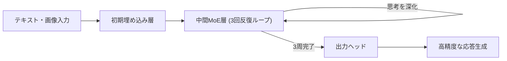

# **本日の AI/開発ツール トピックス (2026-11-22)**

## **1. 📋 今日の30秒サマリー**

> **💡 今日のハイライト**
>
> - **メールサーバーやクラウド管理基盤の重大な穴に注意**: メール1通でサーバーを乗っ取られる脆弱性や、ルーター管理クラウド経由の不正プログラム混入が確認され、緊急アップデートが求められています。
> - **ノートPCで動く賢いAIと「AI専用の設計図」が登場**: 少ない計算量で賢く推論する新型AIモデル「Inkling 2 Mini」や、AIが迷わず画面を作れるMeta製デザインシステム「Astryx」が公開されました。
> - **AIに「記憶」と「仕事の手順」を覚えさせるツールが急上昇**: 過去の作業を記憶する仕組みや、テスト・レビューの手順を守らせる拡張ツールなど、AIを実戦投入するための周辺技術がトレンドになっています。
{: .callout-summary}

| 区分 | トピック / ツール | ざっくり言うと？（1行要約） | 影響・おすすめ対象 |
| :--- | :--- | :--- | :--- |
| 🚨 **緊急** | **Poste.io** (`CVE-2026-127027`) | 細工されたメールを1通送るだけでサーバーが乗っ取られるRCE脆弱性 | **Poste.io `2.5.22` 未満の全運用者（即アップデート）** |
| 🚨 **緊急** | **StreamsHub Console** (`CVE-2026-105312`) | Kubernetes上で権限のない利用者がKafka基盤全体を乗っ取れる脆弱性 | **Strimzi / StreamsHub Console運用者（即パッチ適用）** |
| 🚨 **緊急** | **GL.iNet ルーター/KVM** (`CSA-2026-01`) | クラウド遠隔管理経由で一部端末に不正プログラムが導入された事案 | **GoodCloud有効化のGL.iNet利用者（初期化・ファーム更新）** |
| 🚨 **緊急** | **Microsoft `agent-framework`** (`PyPI`) | 悪意あるバージョン混入による開発環境・クラウド認証情報の窃取被害 | **Pythonで同パッケージを導入した開発者・CI環境（鍵再発行）** |
| 🚀 **新機能** | **Inkling 2 Mini** (Thinking Machines Lab) | 同じ脳の回路を3回ループさせて賢く推論する小型オープンAIモデル | **ローカル環境で高性能AIを動かしたい開発者** |
| 🚀 **新機能** | **Astryx** (`meta/astryx`) | AIコーディング支援ツールが正確にUIを組めるMeta製デザインシステム | **React 19＋AI支援でフロント開発を行うエンジニア** |
| 🚀 **新機能** | **Selenium `4.53`** | 画面のアクセシビリティ構造取得やGrid分散を改善しMCP開発も始動 | **E2E自動テスト・ブラウザ自動化に関わるQA・開発者** |
| 🚀 **新機能** | **AI透明性イニシアチブ** (Microsoft) | 40超の企業と連携しモデル横断のAIセキュリティ・統制基準を推進 | **企業でマルチモデルAIを導入するCTO・ガバナンス担当** |
| 🔥 **注目** | **`thedotmack/claude-mem`** | AIコーディングエージェントにセッションを跨ぐ長期記憶を与えるツール | **Claude Code等のAI支援で長期開発を行うエンジニア** |
| 🔥 **注目** | **`obra/superpowers`** | AIに設計・Git分離・TDD・レビューの規律を守らせる開発プロセス層 | **AI生成コードの品質劣化（Vibe Coding）に悩む開発者** |
| 🔥 **注目** | **`vercel-labs/skills`** (`npx skills`) | AIエージェントにフレームワーク別の専門スキルを後から追加できるCLI | **Vercel等の最新Web技術でAIコーディングを活用したい層** |
| 🔥 **注目** | **`microsoft/VibeVoice`** | 最長90分・最大4人の自然な対話音声を生成できるオープンソース音声AI | **ポッドキャスト生成や音声アプリを開発するエンジニア** |

---

## **2. 🚨 緊急セキュリティ情報**

### **Poste.io — メール1通でサーバーを乗っ取られるRCE脆弱性 (`CVE-2026-127027`)**

> **🔰 ひとことで言うと**
> 迷惑メール対策のレポートを受け取る仕組みに穴があり、細工されたメールを1通送るだけでサーバーを乗っ取られる恐れがあります。
> 💬 *例えるなら：郵便受けに届いた封筒を宛名も確かめずにそのままシュレッダーにかけようとしたら、中に仕込まれた仕掛けが作動して家中の鍵を開けられてしまうような状態です。*
{: .callout-danger}

| リスク度 | 影響を受ける人 | 悪用のされやすさ | まずやるべき対策 |
| :---: | :--- | :--- | :--- |
| 🔴 **緊急** (CVSS 9.2) | **Poste.io `2.5.22` 未満** をインターネット公開で運用している全管理者 | 認証不要。外部からポート25宛に細工した添付ファイル付きメールを送るだけで発動 | **直ちに `2.5.22` 以降へアップデートする** |

<details markdown="1">
<summary>🔍 技術的な仕組み・対象バージョン・対策コマンドを見る（エンジニア向け）</summary>

- **原因の仕組み**: CERT Polskaの協調開示により2026年11月20日に公表されたOSコマンドインジェクション脆弱性（発見者: Paweł Franczyk氏）。Poste.ioの内部エイリアス（`dmarc-reports@`）宛に届くメールが送信者検証なしで保存され、Dockerコンテナ内で `root` 権限で動作するバックグラウンドスクリプトが添付ファイルを安全でないシェルコマンドで展開していた。細工されたファイル名やアーカイブ構造を含むメールを送信することで、コンテナ内の `root` 権限で任意コマンド実行（RCE）が可能となる。
- **対象バージョン/環境**: Analogic Poste.io `2.5.22` 未満の全リリース。
- **対策手順・コマンド**:
  `2.5.22` では脆弱なシェルスクリプト処理が廃止され、メールプラグイン内で安全なファイル名生成によるデコード処理へ置き換えられた。速やかにコンテナイメージを更新すること。
  ```bash
  # Docker環境でのアップデート例
  docker pull analogic/poste.io:2.5.22
  docker compose up -d
  ```
- **一次ソース**: [NVD - CVE-2026-127027](https://nvd.nist.gov/vuln/detail/CVE-2026-127027) / [Poste.io 公式サイト](https://poste.io/)

</details>

---

### **StreamsHub Console for Apache Kafka — Kubernetesクラスタ全体の権限を奪われる脆弱性 (`CVE-2026-105312`)**

> **🔰 ひとことで言うと**
> Kubernetes上でKafkaを管理する画面の仕組みを悪用し、一般利用者がシステム全体の管理者権限を奪い取れてしまう深刻な問題です。
> 💬 *例えるなら：マンションの1室を借りただけの入居者が、管理人室に「自分の指定したロボット」を送り込んでマスターキーを盗み出すような状態です。*
{: .callout-danger}

下図は、権限の低いテナントが `Console` リソースを通じて不正なコンテナを起動させ、クラスタ全体の制御権限を奪取する流れを示しています。


**図の見方**: 本来は自分の名前空間内しか操作できないテナントが、Operatorに「自分が選んだコンテナイメージ」を起動させることで、そのPodに紐づいた強力な `ClusterRole` の権限（他テナントの `KafkaUsers` 閲覧や `Kafkas` の変更など）を横取りできる点が最大の危険ポイントです。

| リスク度 | 影響を受ける人 | 悪用のされやすさ | まずやるべき対策 |
| :---: | :--- | :--- | :--- |
| 🔴 **緊急** (CVSS 9.9) | **StreamsHub Console `0.2.0`〜`<0.12.10` および `0.13.0`〜`<0.14.2`** を利用中のKubernetes環境 | `Console` カスタムリソースの作成権限を持つ認証済みテナントであれば簡単に悪用可能 | **`0.12.10` または `0.14.2` 以降へアップグレードし、`Console` CR作成権限を制限する** |

<details markdown="1">
<summary>🔍 技術的な仕組み・対象バージョン・対策コマンドを見る（エンジニア向け）</summary>

- **原因の仕組み**: CWE-269（不適切な権限管理）。Kubernetes上で `Console` カスタムリソースを作成できるテナントが `spec.containers.api.spec.image` に任意のコンテナイメージを指定すると、Operatorが検証なしでそのイメージをPodとして展開する。このPodには `ClusterRoleBinding` を通じてStrimziのCRD（`KafkaUsers` 等の機密リソースを含む）に対するクラスタ全体の `get/list/watch` や、`Kafkas` / `KafkaRebalances` への `patch` 権限を持つ `ServiceAccount` がマウントされるため、射影されたトークンを読み取ることで名前空間の隔離を突破できる。
- **対象バージョン/環境**: StreamsHub Console for Apache Kafka `0.2.0` 以上 `0.12.10` 未満、および `0.13.0` 以上 `0.14.2` 未満。
- **対策手順・コマンド**:
  Operatorを修正済みバージョン（`0.12.10` または `0.14.2` 以上）へ更新するとともに、RBACで不要なユーザーに `Console` リソースの作成・編集権限を与えないよう見直す。
  ```bash
  # 現在のConsole Operatorのバージョン・イメージ確認例
  kubectl get deployment -A -l app.kubernetes.io/name=console-operator -o jsonpath="{..image}"
  ```
- **一次ソース**: [NVD - CVE-2026-105312](https://nvd.nist.gov/vuln/detail/CVE-2026-105312) / [streamshub/console (GitHub)](https://github.com/streamshub/console)

</details>

---

### **GL.iNet ルーター・KVM — クラウド遠隔管理経由の不正プログラム混入インシデント (`CSA-2026-01`)**

> **🔰 ひとことで言うと**
> 遠隔操作用のクラウドサービスが攻撃を受け、一部のルーターやKVM機器に不正なプログラムを勝手にインストールされてしまいました。
> 💬 *例えるなら：自宅のスマートロックを管理するクラウド会社が侵入され、一部の家の玄関に勝手に合鍵受信機を取り付けられてしまったような状態です。*
{: .callout-danger}

| リスク度 | 影響を受ける人 | 悪用のされやすさ | まずやるべき対策 |
| :---: | :--- | :--- | :--- |
| 🔴 **緊急** | **GoodCloud（クラウド遠隔管理）を有効にしていた** GL.iNet製ルーターおよびKVM機器の利用者 | 攻撃者側がクラウド側の脆弱性を突いて自動展開済み（クラウド側の穴は封鎖済み） | **再起動前に端末の異常プロセスを確認し、初期化＋11月22日以降展開の最新ファームウェアへ更新する** |

<details markdown="1">
<summary>🔍 技術的な仕組み・対象バージョン・対策コマンドを見る（エンジニア向け）</summary>

- **原因の仕組み**: 2026年11月20日にGL.iNetが緊急公表し、11月21日〜22日にかけて対策ファームウェアを順次展開している事案。クラウド遠隔管理基盤（GoodCloud）の脆弱性が第三者に悪用され、接続されていた一部のルーターおよびKVMデバイスに不正なソフトウェア／インプラント（コミュニティ追跡名 `CSA-2026-01` / `gl-helper`）が導入された。特にKVM機器はホストPCへ直接映像・キーボード入力を橋渡しするため、接続先PCへの波及リスクも警告されている。
- **対象バージョン/環境**: GoodCloudを有効化していたGL.iNet製ルーターおよびKVM製品。
- **対策手順・コマンド**:
  1. 再起動すると揮発性の証拠（`crond -i /tmp/.log` などの不審プロセス）が消えるため、調査が必要な場合は再起動前にプロセスを確認する。
  2. 物理リセットボタンを約10秒長押ししてファクトリーリセットを実施し、設定を引き継がずに11月22日以降提供の最新安定版ファームウェアを適用する。
  3. 端末に保存していたVPNプロファイル、SSH鍵、管理パスワード、およびKVM接続先PCの認証情報をすべてローテーションする。
  ```bash
  # 端末上の不審プロセス確認例（再起動前にSSH等で確認）
  ps w | grep -E "crond|/tmp/\.log|gl-helper"
  ```
- **一次ソース**: [GL.iNet Official Forum](https://forum.gl-inet.com/)

</details>

---

### **Microsoft `agent-framework` (PyPI) — 開発環境・CIからAPIキーを盗むサプライチェーン侵害**

> **🔰 ひとことで言うと**
> Python用の公式AIフレームワークに偽の悪意あるバージョンが紛れ込み、インストールした人のPCや自動テスト環境からパスワードやAPIキーが盗まれる被害が発生しました。
> 💬 *例えるなら：正規の工具セットの宅配便に偽物のドライバーが混ぜられ、箱を開けて使った瞬間に部屋の合鍵を写真に撮って送信されてしまうような状態です。*
{: .callout-danger}

| リスク度 | 影響を受ける人 | 悪用のされやすさ | まずやるべき対策 |
| :---: | :--- | :--- | :--- |
| 🔴 **緊急** | Python環境やCI/CDで **`agent-framework` の `1.26.1` または `1.26.2`** を取得した開発者・組織 | Pythonの自動起動仕組み（`.pth`）を使うため、パッケージが入った環境でPythonを動かすだけで発動 | **直ちに該当バージョンを削除し、暴露の恐れがあるAzure認証情報やAI APIキーをすべて再発行する** |

<details markdown="1">
<summary>🔍 技術的な仕組み・対象バージョン・対策コマンドを見る（エンジニア向け）</summary>

- **原因の仕組み**: 2026年11月17日にPyPI上の `agent-framework` において悪意あるバージョン `1.26.1` および `1.26.2` が公開され、今週にかけてCI/CDや開発環境の侵害確認・鍵ローテーション対応が続いているサプライチェーン攻撃事案。不正パッケージにはPythonの起動時に自動実行される `.pth` スタートアップフックが仕込まれており、環境変数内のCI/CDシークレット、Azureなどのクラウド認証トークン、各種AI APIキーを収集して外部サーバーへ送信する仕組みになっていた。
- **対象バージョン/環境**: PyPIパッケージ `agent-framework` の `1.26.1` および `1.26.2`（PyPI側では隔離済みだが、ローカルキャッシュや社内プロキシ、ロックファイルに残存している可能性がある）。
- **対策手順・コマンド**:
  ```bash
  # 導入済みバージョンの確認とアンインストール
  pip show agent-framework
  pip uninstall -y agent-framework
  # 合わせて pip cache purge でローカルキャッシュを消去し、ロックファイルを確認する
  ```
  `1.26.1` / `1.26.2` の導入履歴がある場合は、影響範囲の全シークレット（APIキー、GitHubトークン、クラウド認証情報）を即座に無効化・再発行し、不審な外部通信ログがないか監査すること。
- **一次ソース**: [PyPI - agent-framework](https://pypi.org/project/agent-framework/)

</details>

---

## **3. 🚀 メジャーリリース・新機能**

### **Thinking Machines Lab「Inkling 2 Mini」— 回路を3回ループさせて賢く推論する小型オープンAI公開**

> **🔰 ひとことで言うと**
> 巨大なサーバーがなくてもノートパソコンで動き、画像も文字も理解できる新しいオープンソースAIモデルが公開されました。
> 💬 *例えるなら：小さなメモ帳しか持っていなくても、同じページを3回じっくり読み直して考えを深めることで、大百科事典並みの答えを出せる優等生のようなAIです。*
{: .callout-info}

下図は、Inkling 2 Miniが採用する「ループド・トランスフォーマー（Looped Transformer）」の推論フローを示しています。



**図の見方**: 通常のAIモデルが入力から出力まで層を1回だけ通過するのに対し、Inkling 2 Miniは「独自の重み（3.1B）」を持つ中間層を3回繰り返し通過（ループ）させることで、モデルの物理サイズやメモリ消費を抑えたまま深い推論能力を引き出しています。

| 比較ポイント | これまで (Before) | Inkling 2 Mini (After) |
| :--- | :--- | :--- |
| **計算効率と賢さ** | 賢いモデルほど重みが巨大化し、個人PCではメモリ不足で動かない | **ユニーク重み3.1Bを3回ループし、軽量なまま高い推論性能を実現** |
| **対応入力・文脈長** | 軽量ローカルモデルはテキスト専用や短い文脈制限が多い | **テキスト＋画像のマルチモーダル対応＆最大1Mトークンに対応** |
| **公開日のツール対応** | 新アーキテクチャは推論エンジン対応まで数週間待つことが多い | **Apache 2.0で公開され、vLLM / llama.cpp / MLX等にDay-0対応** |

<details markdown="1">
<summary>🔍 技術的ブレークスルーとリリースノート詳細を見る</summary>

- **技術的ポイント**: Mira Murati氏率いるThinking Machines Labが2026年11月20日に公開したオープンウェイト・マルチモーダルMixture-of-Experts（MoE）モデル。総物理パラメータ数は26.4Bだが、ユニークな重みは約3.1Bで、中間層を3回ループする「ループド・トランスフォーマー」構造によりトークンあたりのアクティブパラメータを約3.4B〜5.4Bに抑えている。最大100万（1M）トークンの長文コンテキストを処理可能。
- **開発フローへの影響**: Apache 2.0ライセンスのため商用利用しやすく、公開初日から Hugging Face Transformers、vLLM、SGLang、llama.cpp（GGUF）、Apple Silicon向けのMLX、ファインチューニング用のUnslothすべてで動作するため、ローカル開発環境やオンプレミス環境への即時組み込みが可能。
- **提供形態・利用開始方法**: Hugging Faceハブから重みを取得して各推論エンジンで実行できる。
- **公式リンク**: [Thinking Machines Lab 公式アナウンス](https://thinkingmachines.ai/news/inkling-2-mini/) / [Hugging Face - thinkingmachines/Inkling-2-Mini](https://huggingface.co/thinkingmachines/Inkling-2-Mini)

</details>

---

### **Meta「Astryx」(`meta/astryx`) — 13,000アプリで鍛えられたAIエージェント対応デザインシステムをOSS公開**

> **🔰 ひとことで言うと**
> Meta社内で長年使われてきた画面部品セットが無料公開され、AIがデザイン崩れを起こさずに美しい画面を自動で作れる工夫が詰め込まれています。
> 💬 *例えるなら：プロ仕様のレゴブロック一式と一緒に、「AIでも絶対に間違えない組み立て説明書」が最初から箱に入っているようなデザインシステムです。*
{: .callout-info}

| 比較ポイント | これまで (Before) | Astryx (After) |
| :--- | :--- | :--- |
| **AIのUI生成精度** | 既存UIライブラリは人間向け文書のみで、AIが偽のクラス名を捏造しがち | **CLI1発で `AGENTS.md` 等を自動配置し、AIのスタイル幻覚を防止** |
| **スタイリング基盤** | ランタイムCSSや複雑なラッパーでバンドル肥大化や上書きが困難 | **React 19+ ＆ StyleX採用。CSS変数のみでクリーンにテーマ切替** |
| **深いカスタマイズ** | ライブラリをフォークするか無理なスタイル上書きが必要だった | **`swizzle` コマンドで必要な部品のソースをローカルへ安全に展開可能** |

<details markdown="1">
<summary>🔍 技術的ブレークスルーとリリースノート詳細を見る</summary>

- **技術的ポイント**: Meta社内で8年間にわたり成熟し、13,000以上の本番アプリケーションを支えてきた大規模デザインシステムをオープンソース化。React 19+ とMeta製のゼロランタイムCSSエンジン「StyleX」を基盤とし、トークンベースのテーマ管理を採用している。
- **開発フローへの影響**: 最大の特徴は「Agent-Ready（AIエージェント対応）」設計。専用CLI（`@astryxdesign/cli`）で `npx @astryxdesign/cli init --features agents` を実行すると、リポジトリ内に `AGENTS.md`、`CLAUDE.md`、`.cursor/rules/astryx.mdc` といった機械可読な設計ルールが自動生成され、CursorやClaude Code、Copilotが正しいコンポーネントとトークンだけを使ってUIを構築できるようになる。
- **提供形態・利用開始方法**:
  ```bash
  npm install @astryxdesign/core @astryxdesign/theme-neutral @stylexjs/stylex
  npm install -D @astryxdesign/cli
  npx @astryxdesign/cli init --features agents
  ```
- **公式リンク**: [meta/astryx (GitHub)](https://github.com/meta/astryx)

</details>

---

### **Selenium `4.53` — アクセシビリティ構造取得とGrid分散改善、AI向けMCP開発も始動**

> **🔰 ひとことで言うと**
> ブラウザ自動テストの定番ツールが新しくなり、画面の「読み上げ用構造」を直接取得する機能や、AIからブラウザを操るための新プロジェクトが動き出しました。
> 💬 *例えるなら：ロボットがパソコン画面を見るとき、見た目だけでなく「ボタンの意味や構造図」も一緒に読み取れるようになり、さらにAI専用の操縦席も作り始めたような進化です。*
{: .callout-info}

| 比較ポイント | これまで (Before) | Selenium `4.53` 以降 (After) |
| :--- | :--- | :--- |
| **画面構造の取得** | DOMやスクリーンショットから要素を推測・解析する手間があった | **Python/JSで `accessibility_snapshot()` により構造ツリーを直接取得** |
| **Gridの負荷分散** | `4.36.0` 以降、1つのNodeが埋まるまで次を使わない仕様だった | **複数Nodeへセッションを均等に分散させる本来の挙動へ回帰** |
| **JS管理＆AI連携** | Selenium Managerのnpm単体公開や公式MCPサーバーがなかった | **`@selenium/manager` を毎回公開し、`SeleniumHQ/mcp` 開発が始動** |

<details markdown="1">
<summary>🔍 技術的ブレークスルーとリリースノート詳細を見る</summary>

- **技術的ポイント**: JavaScript、Ruby、Python、.NET、Java、およびSelenium Grid向けの横断アップデート。Python（`driver.accessibility_snapshot()`）とJavaScript（`getAccessibilitySnapshot()`）でClassicおよびBiDiセッション双方からアクセシビリティツリーを取得する初期サポートが追加された。またJavaではJSONシリアライズ/パースの高速化やロケータ内のクォート・バックスラッシュのエスケープ処理改善、非標準CSSフレームIDのエスケープ対応を実施。Rubyでは `Selenium::Server` がSelenium Manager経由でGrid JARを取得するようになりGitHub APIレート制限を回避できるようになった。
- **開発フローへの影響**: アクセシビリティスナップショットは、近年主流になりつつあるAIエージェントによるブラウザ操作においてトークン消費を抑えつつ高精度にUI要素を認識する基盤となる。公式のコーディングエージェント向けMCPサーバー（`SeleniumHQ/mcp`）も別リポジトリで開発が開始されており、今後のAI×E2Eテスト連携が期待される。
- **提供形態・利用開始方法**: 各言語のパッケージマネージャー（npm / PyPI / Maven / RubyGems / NuGet）および公式Dockerイメージから取得可能。
- **公式リンク**: [Selenium Blog](https://www.selenium.dev/blog/) / [SeleniumHQ/selenium (GitHub)](https://github.com/SeleniumHQ/selenium)

</details>

---

### **Microsoft「AI透明性イニシアチブ」— 40超の企業と連携したマルチモデルAIガバナンス基盤を始動**

> **🔰 ひとことで言うと**
> 複数のAIを組み合わせて使う時代に備え、Microsoftが40以上の企業と手を組んで「AIの安全性と管理ルール」を統一する取り組みを始めました。
> 💬 *例えるなら：メーカーごとにバラバラだった車の安全基準や点検ルールを、自動車業界全体で共通化して安心して公道を走れるようにするプロジェクトです。*
{: .callout-info}

| 比較ポイント | これまで (Before) | AI透明性イニシアチブ (After) |
| :--- | :--- | :--- |
| **管理・監査の枠組み** | AIモデルやクラウドごとにセキュリティ・ガバナンス基準がバラバラ | **40超の組織と連携し、モデルやプロバイダーを越えた共通基準を推進** |
| **マルチAI時代の統制** | 複数のAIエージェントを併用すると監査証跡や安全性検証が分断 | **企業システム全体で一貫したセキュリティ・透明性・統制を実現** |

<details markdown="1">
<summary>🔍 技術的ブレークスルーとリリースノート詳細を見る</summary>

- **技術的ポイント**: 2026年11月20日にMicrosoftが発表した「AI透明性イニシアチブ（AI Transparency Initiative）」。AccentureやAdobeを含む40以上のパートナー組織と連携し、単一ベンダーに依存しないマルチモデル・クロスプロバイダー環境におけるAIのセキュリティ検証、来歴管理、透明性確保の共通アプローチを策定・推進する。
- **開発フローへの影響**: 企業内でOpenAI、Anthropic、Google、オープンウェイトモデルなどを適材適所で使い分ける際、セキュリティ部門やコンプライアンス部門が求める監査要件を共通の枠組みで満たしやすくなる。
- **提供形態・利用開始方法**: パートナー企業との標準化活動およびエンタープライズ向けセキュリティ・ガバナンス基盤への統合として順次展開。
- **公式リンク**: [Microsoft 公式サイト](https://www.microsoft.com/)

</details>

---

## **4. 🔥 注目のトレンドツール**

### **`thedotmack/claude-mem` — AIコーディングエージェントに「セッションを跨ぐ長期記憶」を実装**

> **🔰 ひとことで言うと**
> 作業をやり直すたびに前回の経緯を忘れてしまうAIコーディングツールに、過去の作業内容を自動で整理して記憶させるプラグインです。
> 💬 *例えるなら：毎日記憶がリセットされてしまう優秀なアシスタントのために、毎晩その日の作業日誌を自動で要約して翌朝の机に置いておく秘書のようなツールです。*
{: .callout-tip}

| 注目ポイント | 内容 | おすすめ対象 |
| :--- | :--- | :--- |
| **何ができるか** | バックグラウンドでAIのツール実行履歴を収集・圧縮し、次回起動時に自動注入する | **Claude Code等で複数日にまたがる大規模開発を行う開発者** |
| **注目の理由** | コンテキスト圧縮と自動 `CLAUDE.md` タイムライン生成により手動プロンプトの手間を激減 | AIエージェント運用、コンテキストエンジニアリングに関心のある層 |

<details markdown="1">
<summary>🔍 主な機能・アーキテクチャ・導入方法を見る</summary>

- **主な機能・用途**: コーディングエージェントの横でバックグラウンドワーカーとして動作し、ファイル編集やコマンド実行などのツール使用履歴をキャプチャ。それらをAIで高密度に圧縮し、次回のセッション開始時に関連する過去の文脈や自動生成されたタイムラインファイル（`CLAUDE.md`）として自動注入する。
- **他の類似ツールとの比較**: 手動で `MEMORY.md` やルールファイルを書き換える従来手法と異なり、開発中のツール操作ログから自律的に記憶を構造化・更新する点が支持され、GitHub Trendingで急上昇している。
- **導入手順**: リポジトリのインストール手順に従い、Claude Codeのプラグイン／フックとしてバックグラウンドワーカーをセットアップする。
- **公式サイト/GitHub**: [thedotmack/claude-mem (GitHub)](https://github.com/thedotmack/claude-mem)

</details>

---

### **`obra/superpowers` — AIコーディングに「TDD・Git分離・設計規律」を強制するプロセス層**

> **🔰 ひとことで言うと**
> AIに勢いで雑なコードを書かせるのを防ぎ、人間の一流エンジニアと同じ「設計→テスト→実装→レビュー」の手順を守らせる枠組みです。
> 💬 *例えるなら：思いつきで突っ走る新人プログラマーに、ベテランの指導係が「まず設計図を書いて、作業ブランチを分けて、テストから書こう」と順番を導いてくれる仕組みです。*
{: .callout-tip}

| 注目ポイント | 内容 | おすすめ対象 |
| :--- | :--- | :--- |
| **何ができるか** | ブレスト、git worktree分離、計画策定、TDD、コードレビューの工程をエージェントに強制 | **AI生成コードの品質低下や手戻りに悩む開発チーム** |
| **注目の理由** | ノーコード的な「Vibe Coding」の限界が議論される中、規律あるエージェント開発を実現 | ソフトウェア工学のベストプラクティスをAI開発に持ち込みたい層 |

<details markdown="1">
<summary>🔍 主な機能・アーキテクチャ・導入方法を見る</summary>

- **主な機能・用途**: Jesse Vincent氏によって開発されたエージェント向けスキル＆プロセスフレームワーク。モデル自体を置き換えるのではなく、エージェントがタスクを完了と宣言する前に「ブレインストーミング」「`git worktree` を使った安全な作業空間分離」「タスク分割計画」「テスト駆動開発（TDD）」「厳格なセルフレビュー」の各フェーズを順番に踏ませる構造化されたワークフローを提供する。
- **他の類似ツールとの比較**: 単発のプロンプト集やルールファイルとは異なり、開発工程全体のステート（状態）と品質ゲートをスキルとして定義している点が特徴。
- **導入手順**: GitHubリポジトリのガイドに従い、Claude Code等のエージェント環境にスキルセットとして読み込む。
- **公式サイト/GitHub**: [obra/superpowers (GitHub)](https://github.com/obra/superpowers)

</details>

---

### **`vercel-labs/skills` (`npx skills`) — AIエージェントに専門スキルを動的に追加できるパッケージ基盤**

> **🔰 ひとことで言うと**
> AIコーディングツールに対して、使いたいフレームワークやクラウドの最新知識を「アプリを追加する感覚」で後から覚えさせられる仕組みです。
> 💬 *例えるなら：スマートフォンのアプリストアのように、AIアシスタントに「Next.jsの専門家」や「デプロイの達人」の資格パックをコマンド1つで追加できる仕組みです。*
{: .callout-tip}

| 注目ポイント | 内容 | おすすめ対象 |
| :--- | :--- | :--- |
| **何ができるか** | `npx skills` CLIを通じて、特定フレームワークやVercel等の操作スキルをエージェントへ導入 | **最新のWebフレームワークとAIコーディングを組み合わせる開発者** |
| **注目の理由** | 再利用可能な「スキル」のパッケージ管理エコシステムを構築し、プロンプト共有を標準化 | フロントエンド開発者、DX（開発者体験）基盤の設計者 |

<details markdown="1">
<summary>🔍 主な機能・アーキテクチャ・導入方法を見る</summary>

- **主な機能・用途**: コーディングエージェントが特定のライブラリやデプロイ基盤（Vercel等）を正しく扱えるよう、再利用可能な指示書・手順パッケージ（「スキル」）を管理・配布するCLIおよびレジストリ（`skills.sh`）。作業の途中でも必要なスキルを検索・追加してエージェントの能力を拡張できる。
- **他の類似ツールとの比較**: プロジェクトごとに巨大なドキュメントを貼り付ける代わりに、コミュニティや公式がメンテナンスする軽量なスキル単位で導入・更新できる点が強み。
- **導入手順**:
  ```bash
  # スキルの検索・導入例
  npx skills --help
  ```
- **公式サイト/GitHub**: [vercel-labs/skills (GitHub)](https://github.com/vercel-labs/skills)

</details>

---

### **`microsoft/VibeVoice` — 7.5Hz超低フレームレートで最大4人・90分の会話音声を作るOSS音声AI**

> **🔰 ひとことで言うと**
> 最大4人の登場人物が自然に相槌を打ちながら最大90分間も会話するラジオ番組のような音声を、無料公開のAIモデルで生成できます。
> 💬 *例えるなら：台本を渡すだけで、4人のプロの声優が息を合わせて1時間半のポッドキャストを収録してくれるスタジオを自分のPCに持てるような技術です。*
{: .callout-tip}

| 注目ポイント | 内容 | おすすめ対象 |
| :--- | :--- | :--- |
| **何ができるか** | 7.5Hz連続トークナイザと拡散モデルの組み合わせで長尺・複数話者の自然な音声を生成 | **音声合成アプリ、教材、ポッドキャスト自動生成を手掛ける開発者** |
| **注目の理由** | 従来の短文読み上げを超え、話者の一貫性と自然な会話のキャッチボールをOSSで実現 | 音声AI・マルチモーダル生成AIの実装・研究者 |

<details markdown="1">
<summary>🔍 主な機能・アーキテクチャ・導入方法を見る</summary>

- **主な機能・用途**: Microsoft Researchが公開したオープンソースのフロンティア音声AIモデル群（TTSおよびASR）。7.5Hzという超低フレームレートで動作する連続音響・意味トークナイザを採用し、計算コストを抑えながら高い音質と表現力を維持する。LLMでテキストの意味文脈と会話の流れを制御し、専用の拡散ヘッド（Next-Token Diffusion）で高精細な音響波形を生成する。
- **他の類似ツールとの比較**: 1文ずつ切り離して合成する一般的なTTSと異なり、最大90分・最大4話者の対話におけるターンテイキング（話者交替）や声質の一貫性を保てる点が画期的。
- **導入手順**: GitHubリポジトリおよびHugging Faceコレクションからモデルと推論コードを取得して実行する。
- **公式サイト/GitHub**: [microsoft/VibeVoice (GitHub)](https://github.com/microsoft/VibeVoice) / [VibeVoice プロジェクトページ](https://microsoft.github.io/VibeVoice/)

</details>

---

### **arXiv `2611.21885` — AIが外部学習なしで「自分の脳（重み）」を自己書き換え・修復する研究がHNで話題**

> **🔰 ひとことで言うと**
> AIモデルが通常の追加学習プロセスを使わずに、自分自身のプログラム（重み）を直接点検して書き換え、賢くなったり壊れた部分を自分で直したりできることが発見されました。
> 💬 *例えるなら：テストで間違えたロボットが、先生に教わるのではなく自分で自分の回路図をドライバーで調整し、次のテストの点数を上げてしまったような現象です。*
{: .callout-tip}

| 注目ポイント | 内容 | おすすめ対象 |
| :--- | :--- | :--- |
| **何ができるか** | 27BのAIモデルが自身の重みとPython環境を使い、推論だけで重みを編集して正答率を向上 | **次世代の自己改善AI・テスト時学習に関心のあるAI研究者・開発者** |
| **注目の理由** | 意図的に壊された自身のコピーを自己推論のみで元の80%以上の性能まで修復する衝撃的な結果 | LLMアーキテクチャ・自律エージェントの最新動向を追う層 |

<details markdown="1">
<summary>🔍 主な機能・アーキテクチャ・導入方法を見る</summary>

- **主な機能・用途**: Jiajun Fan氏らによる論文「Language Models Can Rewrite Their Own Weights」。27Bのオープンウェイトモデルに対し、自身の重み、隠れ状態、Pythonテスト環境、採点結果へのアクセスを与えたところ、モデルは自身の失敗パターン（思考ループ等）を診断し、勾配計算や外部オプティマイザなしで重み行列へ直接修正を加えて未知問題の正答率を6.6ポイント向上させた。
- **他の類似ツールとの比較**: 従来のファインチューニングやLoRAは外部の学習パイプラインと勾配計算を必要とするが、本手法は順伝播の推論能力だけで重みを直接編集する。なお2B・4B・9Bの小型モデルでは失敗や自己破壊が起き、27B規模で初めて自己改善能力が創発した点も注目されている。
- **公式サイト/GitHub**: [arXiv:2611.21885](https://arxiv.org/abs/2611.21885)

</details>

---

## **5. 💡 その他・Tips**

- **OpenAI Platform レガシーAPI廃止（11月30日）の最終確認**: 11月30日に予定されているOpenAIの「Agent Builder」、レガシー「Evals」ダッシュボード／API、および `v1/prompts` エンドポイントの提供終了まで残り約1週間となりました。本番システムやCIスクリプトにこれらレガシーAPIが残っていないか、週末のうちに棚卸しとResponses API等への移行確認を済ませておくことを推奨します。
- **AI過度依存への警鐘と開発組織のチェック**: 国内メディア（ITmedia等）でも「AI依存に対するチェックリスト」の公開や「AIネイティブ開発組織への変革」に関する議論が活発化しています。生成AIによる高速なコード作成を活かしつつ、レビュー能力の空洞化やセキュリティ検査の抜け漏れを防ぐ仕組みづくりが各現場の重要課題となっています。

---

## **6. 📝 総評**

> **📌 今日の一言まとめ**
> クラウド管理やメール・Kubernetes基盤の重大なセキュリティ対策が急がれる一方、AIは「小型ループ推論」や「記憶・規律・スキル」を備えてより自律的かつ実用的な相棒へと進化した一日でした。
{: .callout-summary}

本日（2026年11月22日）のトピックスを振り返ると、インフラと開発現場の双方で「境界の保護」と「AIの規律化」という2つの大きな潮流が鮮明に浮かび上がります。

セキュリティ面では、**Poste.io** のメール1通でのRCE（`CVE-2026-127027`）、**StreamsHub Console** のKubernetes権限昇格（`CVE-2026-105312`）、**GL.iNet** のクラウド遠隔管理経由の侵害（`CSA-2026-01`）、そして **PyPI `agent-framework`** のサプライチェーン攻撃と、管理用コントロールプレーンや自動化スクリプトの隙間を突く攻撃が集中しました。特にKVMやCI/CDパイプラインなど「システム全体を操作する特権的な接点」が狙われている点は、今後の運用設計において極めて重要な教訓となります。

一方、AI・開発ツールの分野では、単なる「モデル性能競争」から「実践的な運用構造の最適化」へと軸足が完全に移っています。**Thinking Machines Lab「Inkling 2 Mini」** はループド・トランスフォーマーによって小さな重みから高い推論力を引き出す新しいアーキテクチャの可能性を示し、**Meta「Astryx」** は「人間向け」だけでなく「最初からAIエージェントが迷わず使えるデザインシステム」という新しい設計思想を提示しました。さらにトレンド上位を占めた **`claude-mem`**（記憶の永続化）、**`superpowers`**（開発プロセスの規律）、**`vercel-labs/skills`**（専門スキルのパッケージ化）の3つが揃って注目を集めていることは、開発者が「Vibe Codingの無秩序さ」を乗り越え、AIに再現性と品質を持たせるための周辺エコシステムが成熟期に入ったことを物語っています。

---

## **7. 📖 用語解説**

| 用語 | 解説 |
|------|------|
| **RCE（遠隔コード実行）** | ネットワーク越しに攻撃者が任意のプログラムや命令を標的サーバー上で勝手に実行できてしまう、最も危険度の高い脆弱性の一種です。鍵のかかっていない裏口から侵入して家電やパソコンを遠隔操作されるような状態です。 |
| **OSコマンドインジェクション** | 入力されたファイル名や文字をそのままOSの命令として実行してしまうことで、意図しないコマンドを紛れ込ませる攻撃手法です。メモ用紙に書かれた「ゴミ出し」の横に「金庫を開ける」と書き足されてそのまま実行されてしまうイメージです。 |
| **Kubernetes Operator** | Kubernetes上でデータベースやKafkaなどの複雑なシステムの構築・運用を自動化する「専属の自動管理ロボット」です。強大な権限を持つため、設定や検証に穴があると被害が大きくなります。 |
| **サプライチェーン攻撃** | 標的のシステムを直接攻撃するのではなく、そのシステムが使っている外部の部品（オープンソースライブラリや更新サーバーなど）に事前に罠を仕掛けて侵入する手法です。食品工場の原材料に異物を混入させるような攻撃です。 |
| **ループド・トランスフォーマー** | AIモデル内部の計算層を1回通して終わりにするのではなく、同じ層を何度も繰り返し循環（ループ）させて思考を深める設計手法です。少ない脳の容量（パラメータ）で複雑な問題を解くことができます。 |
| **TDD（テスト駆動開発）** | プログラム本体を書く前に「そのプログラムが正しく動くか確かめるテスト」を先に書き、テストに合格するように実装を進める開発手法です。AIにコードを書かせる際の品質保証としても再評価されています。 |
| **アクセシビリティツリー** | 画面上のボタンや見出しが「どういう役割を持っているか」を構造化して表現したデータです。本来は視覚障害者向けの読み上げソフト用ですが、AIがWeb画面を正確に理解・操作する際にも非常に役立ちます。 |

---
(出典: 各公式サイト、GitHub、NVD、Hugging Face、arXiv、TechニュースサイトよりAIが要約)

<!-- Kramdown略語定義: 本文中の対象単語に自動でインラインツールチップが付与されます -->
*[RCE]: Remote Code Execution（外部からネットワーク越しに任意のプログラムを勝手に実行される深刻な脆弱性）
*[CVE]: Common Vulnerabilities and Exposures（世界共通で割り振られるセキュリティ脆弱性の識別番号）
*[CVSS]: Common Vulnerability Scoring System（脆弱性の深刻度を0〜10の数値で評価する共通規格）
*[MCP]: Model Context Protocol（AIエージェントと外部ツール・データソースを安全に繋ぐためのオープン共通規格）
*[CI/CD]: Continuous Integration / Continuous Delivery（コードのテスト・検証から本番公開までを自動化する仕組み）
*[MoE]: Mixture of Experts（入力に応じて必要な一部の専門家ネットワークだけを動かすことで、大規模かつ高速に推論できるAI構造）
*[TDD]: Test-Driven Development（実装前にテストコードを書き、テストを通過させることで品質を担保する開発手法）
*[CRD]: Custom Resource Definition（Kubernetesの標準機能を拡張し、独自の管理対象を定義できる仕組み）
*[RBAC]: Role-Based Access Control（ユーザーやプログラムの役割に応じて操作権限を細かく制限する仕組み）
*[TTS]: Text-to-Speech（テキスト文章を自然な人間の音声データに変換して読み上げる技術）
*[ASR]: Automatic Speech Recognition（人間の話し声を自動で文字データに書き起こす音声認識技術）
