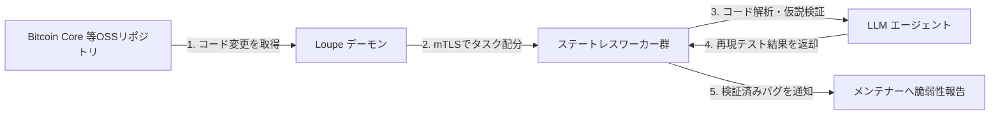

# **本日の AI/開発ツール トピックス (2026-11-23)**

## **1. 📋 今日の30秒サマリー**

> **💡 今日のハイライト**
>
> - **Rubyや社内基盤の重大な穴に緊急対応が必要**: 人気の開発言語「Ruby」の文字変換処理にサーバーを乗っ取られる深刻な弱点が見つかったほか、VMwareやApache製品で実際の攻撃が確認され、週末の緊急アップデートが呼びかけられています。
> - **AIが「弱点を見つける側」と「開発を支える側」の両方で進化**: AIがBitcoinのプログラムから未知のバグを自動発見した一方、GitHubやClaude Codeでは「チームで安全にAIやセキュリティ対応を分担する新機能」が続々と登場しました。
> - **AIを「セキュリティ専門家」や「コードレビュー担当」にするツールが急上昇**: 脆弱性診断スキル集や自動レビュー基盤など、AIに専門家の役割を与えて品質と安全性を高めるオープンソースツールが注目を集めています。
{: .callout-summary}

| 区分 | トピック / ツール | ざっくり言うと？（1行要約） | 影響・おすすめ対象 |
| :--- | :--- | :--- | :--- |
| 🚨 **緊急** | **Ruby / CRuby** (`Ruby2Shell` / `CVE-2026-132825`) | 文字の大文字・小文字変換の隙を突いてサーバーを乗っ取れるRCE脆弱性 | **Ruby / Rails / Sinatra運用者（Ruby本体の即時更新を）** |
| 🚨 **緊急** | **VMware vCenter** (`CVE-2026-123890`) | ゼロデイ悪用が確認されCISA KEVに追加された管理者権限奪取の認証回避 | **vCenter Server管理者（即パッチ適用・KEV対応）** |
| 🚨 **緊急** | **Bitcoin Core** (`CVE-2026-117348`) | AIスキャナが発見した、重複データ送信でノードを停止させるDoS脆弱性 | **Bitcoin Core 30.x / 31.x ノード運用者（`30.5`/`31.3`へ）** |
| 🚨 **緊急** | **Apache Roller & Cisco Expressway** (`KEV追加`) | XML-RPC経由のRCEとクラスタ認証不備の2件がCISA KEVへ緊急追加 | **対象システム運用者（期限内のパッチ適用・隔離を）** |
| 🚨 **緊急** | **Weblate** (`CVE-2026-134838`) | 特殊なアルファベットを使ったメール照合の隙で他人のアカウントを乗っ取れる穴 | **翻訳基盤Weblate `2026.11` 未満の管理者** |
| 🚀 **新機能** | **GitHub Security Advisories** (GA) | 管理者権限を渡さず、リポジトリ単位で脆弱性対応の権限を細かく委譲可能に | **OSSメンテナー・企業のセキュリティ運用チーム** |
| 🚀 **新機能** | **Claude Code** (`v2.1.323`〜`v2.1.330`) | JavaScriptで複数ツールを一括操る「Code Mode」とグラフ描画「`easel`」を搭載 | **Claude Codeを日常・企業環境で活用する開発者** |
| 🚀 **新機能** | **GitHub Copilot「MAI Code 2」** | Microsoft AI製の重量級＆高速な2種類の自社開発コーディングモデルを追加 | **複雑なリファクタや高速補完を求めるCopilotユーザー** |
| 🚀 **新機能** | **Vercel AI Gateway & UI SDK** | Gemini 4 Carbon対応に加え、AIがUIを組むための新「UI SDK Beta」を展開 | **マルチモデルAPIやAI駆動フロント開発を行うエンジニア** |
| 🔥 **注目** | **`elementalsouls/Claude-BugHunter`** | 公開バグ報告の知見を詰め込み、AIコーディング支援をセキュリティ診断士化するスキル集 | **Webアプリの脆弱性チェックを効率化したい開発者** |
| 🔥 **注目** | **Project Loupe** (Spiral / Block支援) | Bitcoin基盤のバグを実際に発見した、分散型AIセキュリティスキャン基盤 | **OSSセキュリティ自動化・AIレッドチームに関心がある層** |
| 🔥 **注目** | **DeepSeek Harness & Open Code Review** | プラグイン指向のAIエージェント実行基盤と、ルールベースの自動レビューの連携 | **OSSの自律エージェント基盤やCIレビューを自作したい開発者** |
| 🔥 **注目** | **`firecrawl` & `last30days-skill`** | 最新Web情報や直近30日間のSNS・技術動向をAIに正確に取り込む定番スキル | **最新トレンド調査やRAG/リサーチ自動化を行う層** |

---

## **2. 🚨 緊急セキュリティ情報**

### **Ruby / CRuby — 文字変換の隙を突く重大な遠隔コード実行脆弱性「Ruby2Shell」 (`CVE-2026-132825` / `GHSA-34m4-m9fh-gqp5`)**

> **🔰 ひとことで言うと**
> プログラムの中で「小文字を大文字に変換する」といったありふれた処理の隙を突かれ、外部からサーバーを乗っ取られてしまう非常に危険な弱点です。
> 💬 *例えるなら：書類の「a」を「A」に書き換えるだけの単純作業を任せた事務員が、ドイツ語の特殊な文字を受け取った拍子にパニックを起こし、隣の机の重要書類まで書き換えてしまうような状態です。*
{: .callout-danger}

| リスク度 | 影響を受ける人 | 悪用のされやすさ | まずやるべき対策 |
| :---: | :--- | :--- | :--- |
| 🔴 **緊急** | **Ruby `4.0.10` / `3.4.13` / `3.3.14` 未満** でRailsやSinatra等を運用する全開発者 | 高い（デフォルト構成のRailsやSinatraで認証なしに攻撃経路へ到達可能、PoCも報告） | **Ruby本体（インタープリタ）を修正版へ即時アップデートする（`bundle update` では直りません）** |

下図は、細工された文字列が単一バイトエンコーディングで処理された際に、1バイトのメモリ領域外書き込みから遠隔コード実行（RCE）へ至る流れを示しています。


**図の見方**: 普段使われるUTF-8ではなく、ヨーロッパ言語向けの古い文字コード（ISO-8859-1等）として文字列の大小変換が走ると、文字が膨らむ計算が1バイトだけ狂い、メモリ破壊からシステム乗っ取りにつながります。

<details markdown="1">
<summary>🔍 技術的な仕組み・対象バージョン・対策コマンドを見る（エンジニア向け）</summary>

- **原因の仕組み**: CRubyの文字列ケース変換（大文字・小文字変換）ロジックにおいて、ISO-8859-1やWindows-1252などの単一バイトエンコーディングを処理する際のバッファサイズ計算に不備があり、ドイツ語のエスツェット（`ß`）などの特定文字を変換すると1バイトのヒープベース・バッファオーバーフロー（領域外書き込み）が発生します。Railsやクラシック構成のSinatraなど一般的なWebフレームワークのデフォルト設定でも認証前から到達可能なケースがあり、PoC（概念実証コード）によるRCEが警告されています。
- **対象バージョン/環境**:
  - Ruby `4.0.10` 未満
  - Ruby `3.4.13` 未満
  - Ruby `3.3.14` 未満
- **対策手順・コマンド**:
  脆弱性はGemではなく**Rubyインタプリタ本体（C実装）**に存在するため、`bundle update` だけでは修正されません。コンテナイメージやサーバーのRubyランタイム自体を更新し、アプリケーションプロセスを再起動してください。また、Cloudflare等のWAFを利用している場合は緊急ルールが配信されているため有効化状況を確認してください。
  ```bash
  # 例: rbenv / ruby-build で修正版をインストール・切り替え
  rbenv install 3.4.13
  rbenv global 3.4.13
  ruby -v
  ```
- **一次ソース**: [Ruby 公式アナウンス (ruby-lang.org)](https://www.ruby-lang.org/) / [NVD - CVE-2026-132825](https://nvd.nist.gov/vuln/detail/CVE-2026-132825) / [GHSA-34m4-m9fh-gqp5](https://github.com/ruby/ruby/security/advisories/GHSA-34m4-m9fh-gqp5)

</details>

---

### **VMware vCenter Server — ゼロデイ悪用が確認された管理者権限奪取の認証バイパス (`CVE-2026-123890`)**

> **🔰 ひとことで言うと**
> 仮想サーバー群をまとめて管理する司令塔「vCenter」に、パスワードなしで最高管理者の鍵を偽造して入り込める深刻な穴が見つかり、すでに実際の攻撃に使われています。
> 💬 *例えるなら：ビル全体の入退室システムを管理する防災センターの受付で、合言葉の計算ルールを悪用して「最高責任者のマスターキー」を勝手に発行できてしまう状態です。*
{: .callout-danger}

| リスク度 | 影響を受ける人 | 悪用のされやすさ | まずやるべき対策 |
| :---: | :--- | :--- | :--- |
| 🔴 **緊急** (CVSS 9.8) | VMware vCenter Server（`8.0` / `9.0` / `9.1` 等）の未パッチ環境を運用する管理者 | 非常に高い（ネットワーク到達性があれば認証不要で悪用可能。**CISA KEVに追加済み**） | **修正版（`8.0 U3m` / `9.0.2.0200` / `9.1.1.0200` 等）を即時適用し、管理ポートのアクセス制限を徹底** |

<details markdown="1">
<summary>🔍 技術的な仕組み・対象バージョン・対策コマンドを見る（エンジニア向け）</summary>

- **原因の仕組み**: VMware Directory Service (`vmdir`) コンポーネントにおける認証バイパス脆弱性です。ネットワークアクセス権を持つ未認証の攻撃者が、DCE/RPC経由でSRP-6a（Secure Remote Password）プロトコルのセッション鍵露出を悪用することで認証を回避し、`administrator@vsphere.local` などの完全な管理者権限を持つセッションを偽造できます。すでに野生（in the wild）でのゼロデイ悪用が確認され、CISAのKnown Exploited Vulnerabilities（KEV）カタログに追加されました。
- **対象バージョン/環境**:
  - vCenter `9.1.x`（`9.1.1.0200` 未満）
  - vCenter `9.0.x`（`9.0.2.0200` 未満）
  - vCenter `8.0`（`8.0 U3m` 未満）
  - vCenter `5.x`（`5.2.5` 未満）
- **対策手順・コマンド**:
  Broadcomのセキュリティアドバイザリに従い速やかにパッチを適用してください。適用までの間は、vCenterの管理インターフェースおよびDCE/RPC関連ポートへのアクセスを信頼された管理用ネットワークのみに厳格に制限し、不審な `administrator@vsphere.local` ログイン履歴がないか監査ログを確認してください。
- **一次ソース**: [NVD - CVE-2026-123890](https://nvd.nist.gov/vuln/detail/CVE-2026-123890) / [CISA KEV Catalog](https://www.cisa.gov/known-exploited-vulnerabilities-catalog)

</details>

---

### **Bitcoin Core — AIスキャナが発見した重複データ送信によるノード停止脆弱性 (`CVE-2026-117348`)**

> **🔰 ひとことで言うと**
> 仮想通貨ビットコインのネットワークを支えるプログラムに、同じ取引データを大量に繰り返し送りつけるだけで処理をフリーズさせられる弱点が見つかりました。
> 💬 *例えるなら：レジの店員に「この100円玉を確認して」と全く同じ注文書を5万枚束ねて渡し、確認作業だけで何十秒もレジを止めてしまうような嫌がらせです。*
{: .callout-danger}

| リスク度 | 影響を受ける人 | 悪用のされやすさ | まずやるべき対策 |
| :---: | :--- | :--- | :--- |
| 🟠 **高** (Medium) | **Bitcoin Core `29.0`〜`31.2`** を稼働させているフルノード運用者・取引所・マイナー | 中程度（外部ピアから細工された `inv` メッセージを送るだけで1回十数秒以上停止） | **Bitcoin Core `30.5` または `31.3` へアップデートする（`29.x`系はサポート終了）** |

<details markdown="1">
<summary>🔍 技術的な仕組み・対象バージョン・対策コマンドを見る（エンジニア向け）</summary>

- **原因の仕組み**: 2026年11月20日にBitcoin Core開発チームより公表された脆弱性（"Node stall through duplicate orphan announcements"）。親トランザクションが未受信の「オーファントランザクション」について、すでに保存済みのオーファンが再通知された際に親の依存関係チェックが走る仕様（29.0で導入）を悪用します。1つの `inv` メッセージ内に同じトランザクションIDを最大50,000回重複させて送信すると、重複スキップが行われず冗長な親計算を5万回繰り返し、1メッセージあたり十数秒以上ノードのブロック・取引処理が停止（スタール）します。なお本脆弱性はSpiral（Block支援）のAIセキュリティスキャナ「Project Loupe」による自動スキャンで発見され、開発者Gregory Sanders氏によって検証されました。
- **対象バージョン/環境**:
  - Bitcoin Core `29.0` 〜 `29.5`（EOLのため修正版なし）
  - Bitcoin Core `30.0` 〜 `30.4`
  - Bitcoin Core `31.0` 〜 `31.2`
- **対策手順・コマンド**:
  重複するトランザクション通知を1回のみ処理する修正（`#35878`）がバックポートされた `30.5` または `31.3`（および修正済みの `32.1`）へアップデートしてください。`29.x` 系を利用中の場合はサポート対象系列へ移行が必要です。
- **一次ソース**: [Bitcoin Core Security Advisories](https://bitcoincore.org/en/security-advisories/) / [NVD - CVE-2026-117348](https://nvd.nist.gov/vuln/detail/CVE-2026-117348)

</details>

---

### **Apache Roller & Cisco Expressway — 実攻撃確認に伴いCISA KEVへ追加された重大RCE (`CVE-2026-129448` / `CVE-2026-76466`)**

> **🔰 ひとことで言うと**
> ブログ管理ツールのApache Rollerと、ビデオ会議中継装置のCisco Expresswayの2製品で、外部から最高権限で乗っ取られる深刻な弱点が実際に悪用され始め、米政府機関から緊急警告が出ました。
> 💬 *例えるなら：玄関のインターホン（通信窓口）に特殊な音声を流すだけで、中身を確認する前に裏口が全開になって侵入されてしまうような状態です。*
{: .callout-danger}

| リスク度 | 影響を受ける人 | 悪用のされやすさ | まずやるべき対策 |
| :---: | :--- | :--- | :--- |
| 🔴 **緊急** (CVSS 9.8) | **Apache Roller `4.0.0`〜`6.1.5`** および **Cisco Expressway-C / E** の運用者 | 非常に高い（双方とも実環境での悪用が確認され、CISA KEVカタログへ追加） | **Apache Rollerは `6.1.6` 以上へ更新、Cisco Expresswayは公式パッチを即時適用** |

<details markdown="1">
<summary>🔍 技術的な仕組み・対象バージョン・対策コマンドを見る（エンジニア向け）</summary>

- **原因の仕組み**:
  1. **Apache Roller (`CVE-2026-129448`, CVSS 9.8)**: XML-RPCエンドポイントが認証チェックを行う前にベンダー拡張型を受け入れて安全でないデシリアライゼーションを実行してしまう欠陥。未認証の攻撃者が細工したXML-RPCリクエストを送信することで、サーバー上で任意コード実行（RCE）が可能です。
  2. **Cisco Expressway Series (`CVE-2026-76466`, CVSS 9.8)**: データベースサービスおよびクラスタリング機能における永続クッキーの扱いとクライアント証明書検証の不備に起因する脆弱性。ネットワークに隣接する攻撃者が有効なクッキーを利用して、`root` 権限で任意のOSコマンドを実行できます。
- **対象バージョン/環境**:
  - Apache Roller `4.0.0` 〜 `6.1.5`（`6.1.6` 以降で修正）
  - Cisco Expressway-C および Expressway-E の該当バージョン（Ciscoアドバイザリ参照）
- **対策手順・コマンド**:
  CISA KEVへの追加に伴い、連邦機関等では週末〜11月23日を期限とする緊急対応が求められています。インターネットや信頼できないネットワークからこれらの管理・XML-RPCエンドポイントへ到達できないようファイアウォールで遮断した上で、修正版へアップデートしてください。
- **一次ソース**: [NVD - CVE-2026-129448](https://nvd.nist.gov/vuln/detail/CVE-2026-129448) / [NVD - CVE-2026-76466](https://nvd.nist.gov/vuln/detail/CVE-2026-76466) / [CISA KEV Catalog](https://www.cisa.gov/known-exploited-vulnerabilities-catalog)

</details>

---

### **Weblate — 特殊文字を使ったメール照合の隙を突くアカウント乗っ取り (`CVE-2026-134838`)**

> **🔰 ひとことで言うと**
> 多言語翻訳ツール「Weblate」のパスワード再設定画面で、見た目が似ている別の国のアルファベットを悪用して、他人のアカウントを乗っ取れてしまう問題が見つかりました。
> 💬 *例えるなら：英語の「i」とトルコ語の「点のないı」をシステムが同じ文字だと勘違いしてしまい、そっくりな偽アドレス宛に「パスワード変更用の鍵」を送ってしまうようなミスです。*
{: .callout-danger}

| リスク度 | 影響を受ける人 | 悪用のされやすさ | まずやるべき対策 |
| :---: | :--- | :--- | :--- |
| 🟠 **高** | **Weblate `2026.11` 未満** をセルフホスト等で運用している開発チーム | 中程度（パスワードリセット画面から対象メールアドレスに似たUnicode文字で申請） | **Weblateを `2026.11` 以降へアップデートする** |

<details markdown="1">
<summary>🔍 技術的な仕組み・対象バージョン・対策コマンドを見る（エンジニア向け）</summary>

- **原因の仕組み**: Weblateの `reset_password` ビューにおいて、大文字・小文字を区別しないUnicodeベースのメールアドレス照合（case-folding）に不備がありました。攻撃者が「点のないi（`ı`）」など特定のUnicode文字を含む類似メールアドレスを用いてパスワードリセットを要求すると、既存の被害者アカウントに紐づいたリセット処理がトリガーされ、認証なしでアカウント乗っ取りに至る恐れがあります。
- **対象バージョン/環境**: Weblate `2026.11` 未満の全バージョン。
- **対策手順・コマンド**: パッケージまたはDockerイメージを `2026.11` 以降へアップグレードしてください。
  ```bash
  # Docker Compose での更新例
  docker compose pull weblate
  docker compose up -d
  ```
- **一次ソース**: [NVD - CVE-2026-134838](https://nvd.nist.gov/vuln/detail/CVE-2026-134838) / [Weblate 公式サイト](https://weblate.org/)

</details>

---

## **3. 🚀 メジャーリリース・新機能**

### **GitHub Security Advisories — カスタムリポジトリロール向けの細粒度権限を一般提供（GA）**

> **🔰 ひとことで言うと**
> これまで「組織全体のセキュリティ管理者」か「リポジトリの全権管理者」にしか任せられなかった脆弱性レポート対応の権限を、リポジトリごとに細かく分けて担当者に渡せるようになりました。
> 💬 *例えるなら：これまで「警備室に入るにはビル全体の社長キーが必要」だったのを、「このフロアの防犯カメラ確認だけできる鍵」「警報の受付だけできる鍵」のように細かく渡せるようになったイメージです。*
{: .callout-info}

| 比較ポイント | これまで (Before) | 2026年11月20日以降 (After) |
| :--- | :--- | :--- |
| **権限の粒度** | リポジトリAdminまたは組織全体のSecurity Managerが必要 | **4種類のセキュリティアドバイザリ権限をリポジトリ単位で付与可能** |
| **最小権限の原則** | 脆弱性対応のために過剰な設定変更権限まで渡す必要があった | **閲覧・ドラフト作成・非公開報告の受付・CVE申請を個別に分離** |
| **トリアージ運用** | 外部コントリビュータや一部担当者に報告確認を委譲しづらい | **安全な範囲で脆弱性トリアージやCVE申請を分担可能に** |

<details markdown="1">
<summary>🔍 技術的ブレークスルーとリリースノート詳細を見る</summary>

- **技術的ポイント**: GitHubは2026年11月20日（日本時間週末にかけて導入が拡大）、カスタムリポジトリロール（Custom Repository Roles）の「Security」セクションに以下4つの細粒度権限を一般提供（GA）しました。
  1. **View security advisories**: 下書きアドバイザリやステータス、コメントの閲覧。
  2. **Create, Edit, and Manage security advisories**: 閲覧に加え、作成・編集、コラボレータ管理、一時的なプライベートフォークの作成。
  3. **Accept private vulnerability reports and close or reopen security advisories**: 非公開の脆弱性報告の受理およびクローズ／再オープン。
  4. **Publish security advisories and request CVEs**: アドバイザリの公開とCVE番号の申請。
- **注意点・制限**: 一時的なプライベートフォークからの変更マージやフォークの削除は、引き続きリポジトリ管理者またはSecurity Manager権限が必要です。機密コメントの投稿には「Create, Edit, and Manage」権限に加えてリポジトリへの書き込み権限が必要です。
- **公式リンク**: [GitHub Changelog (2026-11-20)](https://github.blog/changelog/2026-11-20-security-advisory-permissions-are-now-generally-available)

</details>

---

### **Claude Code (`v2.1.323`〜`v2.1.330`) — 「Code Mode」と自動グラフ描画「`easel`」が登場**

> **🔰 ひとことで言うと**
> AIコーディングツールの「Claude Code」が、複数の作業を自分で書いたJavaScriptで一気に片付ける機能や、調査結果をターミナル上で自動グラフ化する機能を手に入れました。
> 💬 *例えるなら：これまで「1つずつ手作業で道具を使っていた職人」が、「一連の手順をまとめた自動マクロをその場で組んで一気に処理し、結果もきれいなグラフで報告してくれる」ようになった進化です。*
{: .callout-info}

| 比較ポイント | これまで (Before) | `v2.1.323`〜`v2.1.330` 以降 (After) |
| :--- | :--- | :--- |
| **複数ツールの実行** | 1回の往復ごとにツールを順番に呼び出し、待ち時間が発生 | **「Code Mode」でJSを生成・実行し複数ツールを並列・一括制御** |
| **データの可視化** | 数値やログをテキストの表で出力するのみ | **組み込み機能「`easel`」がMCP等の時系列データを自動でグラフ描画** |
| **企業管理・連続稼働** | `/loop` 等の定期実行は最大7日間制限 | **`claude auth login` で企業設定を強制適用、定期実行は最大30日間へ延長** |

<details markdown="1">
<summary>🔍 技術的ブレークスルーとリリースノート詳細を見る</summary>

- **技術的ポイント**:
  - **Code Mode (`v2.1.323` 実験的導入)**: 多段階のツール呼び出しによる往復レイテンシを削減するため、Claude自身がJavaScriptプログラムを動的に記述・実行して複数ツール呼び出しをオーケストレーションするオプトイン機能（`CLAUDE_CODE_EXPERIMENTAL_CODE_MODE=1` で有効化、組織管理者による無効化も可能）。
  - **組み込みMod「`easel`」(`v2.1.330`)**: `cc-plugin-easel` として搭載され、ユーザーの指示やPrometheusレンジクエリなどの対応MCPツール結果に応じてターミナル内に自動でチャートを描画します（`/config` や `/plugin` で制御可能）。
  - **エンタープライズ・安全制御**: `claude auth login` によるEnterprise Admin Console管理設定・ゲートウェイの自動適用、セルフホストランナーの開始ディレクトリ指定（`--start-dir`）、ルートやホームディレクトリを対象とした危険な `rm` コマンドの承認ガード強化などが追加されました。
- **公式リンク**: [Claude Code 公式リポジトリ / リリース情報](https://github.com/anthropics/claude-code)

</details>

---

### **GitHub Copilot「MAI Code 2」&「MAI Code 2 Flash」 — 自社開発コーディングモデルの本格投入**

> **🔰 ひとことで言うと**
> MicrosoftとGitHubが自社で開発した新しいプログラミング専用AI「MAI Code 2」と軽量版「Flash」が、GitHub Copilotの中で選べるようになりました。
> 💬 *例えるなら：これまで他社製のエンジンを積んでいた自動車メーカーが、長距離の重い荷物向けの「大型特製エンジン」と、街乗りでサクサク走る「軽量エコエンジン」を自社開発して搭載したような動きです。*
{: .callout-info}

| 比較ポイント | これまで (Before) | MAI Code 2 導入以降 (After) |
| :--- | :--- | :--- |
| **モデル選択肢** | OpenAIやAnthropic、Google等の外部モデルが中心 | **Microsoft AI自社開発のコーディング特化2モデルが選択肢に追加** |
| **大規模・複雑作業** | 重厚な推論には高コストな汎用フロンティアモデルを利用 | **`MAI Code 2` がリポジトリ横断のリファクタや深いデバッグに特化** |
| **日常の高速作業** | 簡単な修正でもレイテンシやコストが気になりやすい | **`MAI Code 2 Flash` が低遅延・低コストで日常のコード解説や修正を処理** |

<details markdown="1">
<summary>🔍 技術的ブレークスルーとリリースノート詳細を見る</summary>

- **技術的ポイント**: 2026年11月17日の発表に続き週末にかけて開発者による評価が進んでいるGitHub Copilotの自社モデル群。`MAI Code 2` は複数ファイルにまたがる実装、複雑なエージェントワークフロー、リポジトリ全体の推論向けに設計されており、`GitHub Copilot Fusion Standard` 構成のバックエンドとしても機能します。一方の `MAI Code 2 Flash` は高速な反復作業やコード説明に最適化されています。
- **提供形態・利用開始方法**: VS Code、Visual Studio、JetBrains IDE、および Copilot CLI 内で利用可能。`MAI Code 2` は Pro / Business / Enterprise プラン向け、`MAI Code 2 Flash` は Free / Student プランを含む幅広いユーザーに提供されます。
- **公式リンク**: [GitHub Changelog - MAI Code 2 and MAI Code 2 Flash](https://github.blog/changelog/2026-11-17-mai-code-2-and-mai-code-2-flash-in-github-copilot/)

</details>

---

### **Vercel AI Gateway & UI SDK Beta — `Gemini 4 Carbon` 対応とAI向けUI構築基盤**

> **🔰 ひとことで言うと**
> 複数のAIをまとめて呼び出せるVercelの窓口がGoogleの最新モデル「Gemini 4 Carbon」に対応し、さらにAIがReactやVueなどの画面部品を正確に組み立てるための新しい道具箱も公開されました。
> 💬 *例えるなら：世界各国の最新エンジンをワンタッチで切り替えられる配線盤に新しい強力エンジンが加わり、さらに「どのメーカーの車でも使える共通の操作パネルキット」まで用意されたイメージです。*
{: .callout-info}

| 比較ポイント | これまで (Before) | 最新アップデート以降 (After) |
| :--- | :--- | :--- |
| **最新モデル連携** | 個別APIキー管理やモデルごとの独自実装が必要 | **AI Gateway経由で `google/gemini-4-carbon`（1Mトークン）を即座に呼び出し可能** |
| **UI生成の品質** | AIにUIを書かせるとアクセシビリティや挙動が崩れやすい | **50以上のアクセシブルなUI挙動を備えた「Vercel UI SDK Beta」を提供** |
| **フレームワーク対応** | React専用など特定フレームワークに依存しがち | **React / Vue / Svelte / Solid に横断対応したプログラム操作を実現** |

<details markdown="1">
<summary>🔍 技術的ブレークスルーとリリースノート詳細を見る</summary>

- **技術的ポイント**: Vercel AI Gatewayで `google/gemini-4-carbon`（100万トークンのコンテキストウィンドウを備え、ソフトウェア開発やセキュリティ防御に最適化）が利用可能になり、11月30日までの50%オフ導入価格（入力100万トークンあたり2ドル、出力10ドル）で提供されています。また画像生成・編集向けの `MiniMax H3 Image` も追加されました。さらにVercel Labsから公開された `UI SDK` Betaは、AIコーディングエージェントがアクセシビリティに配慮したUIをプログラム的に構築・操作できるよう50種類以上のフレームワーク非依存ビヘイビアを提供します。
- **導入方法**: `npx vercel ai-gateway setup` または Vercel AI SDK の `streamText` / `generateText` からモデルIDを指定して利用します。
- **公式リンク**: [Vercel AI Gateway](https://vercel.com/ai-gateway)

</details>

---

## **4. 🔥 注目のトレンドツール**

### **`elementalsouls/Claude-BugHunter` — 公開バグ報告を学習したAIセキュリティ診断スキル集**

> **🔰 ひとことで言うと**
> 普段使っているAIコーディング支援ツール（Claude Code等）にインストールするだけで、プロのバグハンターのようにアプリの弱点を探し出してくれる拡張スキル集です。
> 💬 *例えるなら：普通の優秀な大工さんに「過去の空き巣の手口100選マニュアルと防犯点検ツール」を渡して、建築中の家の防犯チェックを丸ごと任せるようなツールです。*
{: .callout-tip}

| 注目ポイント | 内容 | おすすめ対象 |
| :--- | :--- | :--- |
| **何ができるか** | HackerOne等の公開脆弱性報告から抽出した攻撃パターンでアプリを診断 | **自社のWebアプリやAPIのセキュリティを事前チェックしたい開発者** |
| **注目の理由** | 単なるプロンプト集ではなく、Burp Suite MCP連携や厳格なスコープ検証を統合 | セキュリティエンジニア・バグバウンティ参加者・DevSecOps担当 |

<details markdown="1">
<summary>🔍 主な機能・アーキテクチャ・導入方法を見る</summary>

- **主な機能・用途**: MITライセンスで公開されているClaude CodeやOpenCode向けの包括的なスキルバンドル。数十のトピック別スキルとスラッシュコマンドを搭載し、SQLインジェクションや認証不備など数百の実践的脆弱性パターンを網羅しています。またWeb診断プロキシの定番であるBurp SuiteとのMCP（Model Context Protocol）連携機能や、診断対象外への誤送信を防ぐスコープ検証機能を備えています。
- **他の類似ツールとの比較**: 汎用的なコードレビュー指示と異なり、実際に報奨金が支払われたバグバウンティ報告の構造化知見をベースにしているため、ビジネスロジックの穴や認可バイパスなど見落とされがちな欠陥の指摘に強みがあります。
- **公式サイト/GitHub**: [elementalsouls/Claude-BugHunter (GitHub)](https://github.com/elementalsouls/Claude-BugHunter)

</details>

---

### **Project Loupe — Bitcoin基盤のバグを実際に発見した分散AIセキュリティスキャナ**

> **🔰 ひとことで言うと**
> 世界の金融インフラであるBitcoinのプログラムを24時間体制で点検し、実際に未知のバグ（`CVE-2026-117348`）を見つけ出して話題になっているオープンソースのAI監査ツールです。
> 💬 *例えるなら：銀行の金庫の設計図を、AIの監視員チームが安全な専用回線で手分けして毎日隅々までチェックし、本当に鍵のかけ忘れを見つけて報告してくれたようなシステムです。*
{: .callout-tip}

下図は、Project Loupeが安全な通信経路（mTLS）を介して複数のAIワーカーにコード解析を分散させ、脆弱性を検証・報告する構成を示しています。



**図の見方**: 中央のデーモンが巨大なソースコードを小さなタスクに分割し、暗号化通信（mTLS）でつながったワーカーとAIが協調して「本当に悪用できるバグか」を検証してから報告するため、誤検知を抑えつつ24時間監査できます。

| 注目ポイント | 内容 | おすすめ対象 |
| :--- | :--- | :--- |
| **何ができるか** | mTLSデーモンとLLMエージェント群でOSSコードの脆弱性を自動スキャン・検証 | **重要OSSのメンテナー・大規模コードベースのセキュリティ担当者** |
| **注目の理由** | Spiral（Block支援）が開発し、Bitcoin Coreの実脆弱性を発見した確かな実績 | AIを使った防御的脆弱性発見（Defending AI）を研究・導入したい層 |

<details markdown="1">
<summary>🔍 主な機能・アーキテクチャ・導入方法を見る</summary>

- **主な機能・用途**: Bitcoin Core、LDK、BDK、rust-bitcoinなどのFOSS（自由・オープンソースソフトウェア）Bitcoinインフラを保護するために開発されたAIパワードのセキュリティスキャン・ハーネス。ステートレスなワーカー群とLLMエージェントをmTLS（相互TLS）デーモンアーキテクチャで協調させ、コード解析から脆弱性の再現検証、レポート生成までを一貫して行います。
- **他の類似ツールとの比較**: 「攻撃者がAIを使って11分でゼロデイを突いたCairn」のような攻撃的利用が懸念される中、Project Loupeは「開発者側がAIを使って公開前にバグを潰す」成功事例として大きな注目を集めています。
- **公式サイト/GitHub**: [Project Loupe 公式サイト](https://projectloupe.org/)

</details>

---

### **`deepseek-ai/deepseek-harness` (`dsh`) & `alibaba/open-code-review` — プラグイン型AI実行基盤と決定論的レビュー**

> **🔰 ひとことで言うと**
> すべてをプラグインとして組み立てられるAIエージェント実行基盤「dsh」と、AIが迷わないよう事前にルールや変更箇所を整理してからコードレビューを行う「Open Code Review」の組み合わせが注目されています。
> 💬 *例えるなら：どんな作業道具も後から差し替えられる万能ロボット本体（dsh）と、チェックリストと赤ペンを事前に準備してくれる厳しい監督官（OCR）がタッグを組んだような仕組みです。*
{: .callout-tip}

| 注目ポイント | 内容 | おすすめ対象 |
| :--- | :--- | :--- |
| **何ができるか** | Web UI付きプラグイン型エージェント基盤と、高精度な行単位コードレビューの自動化 | **社内向けの独自AIエージェントやCI自動レビュー基盤を構築したい開発者** |
| **注目の理由** | LLMの曖昧さを「決定論的な前処理（ルール適用・差分計算）」で補う設計が評価 | AI生成コードの増加に伴うレビュー負荷・品質低下に課題を持つチーム |

<details markdown="1">
<summary>🔍 主な機能・アーキテクチャ・導入方法を見る</summary>

- **主な機能・用途**:
  - **`deepseek-ai/deepseek-harness` (`dsh`)**: Cordisフレームワークをベースに「everything-is-a-plugin（すべてがプラグイン）」思想で設計されたオープンソースのエージェント実行基盤。ローカルCLIやWeb UI（`npx @deepseek-ai/dsh web`）を通じて、サブエージェントや各種ツール、プロトコル実行フローをモジュール式に管理できます（コミュニティ製プラグイン `dsh-open-code-review` 等も登場）。
  - **`alibaba/open-code-review` (`ocr`)**: 決定論的なエンジニアリングパイプライン（diff範囲の正確な計算、ファイル範囲の評価、`rule.json` の適用）とLLMエージェントを組み合わせたハイブリッド自動コードレビューツール。SQLインジェクションやXSS、並行処理バグなどに対し行単位の正確なコメントを返します。
- **導入時の注意**: `dsh` のようなエージェントハーネスは強力なローカル実行権限を持つため、サンドボックス隔離や最新パッチの適用を徹底した上で検証環境から導入してください。
- **公式サイト/GitHub**: [deepseek-ai/deepseek-harness (GitHub)](https://github.com/deepseek-ai/deepseek-harness) / [alibaba/open-code-review (GitHub)](https://github.com/alibaba/open-code-review)

</details>

---

### **`firecrawl/firecrawl` & `mvanhorn/last30days-skill` — AIエージェントに最新Web知識を届ける定番スキル**

> **🔰 ひとことで言うと**
> WebサイトをAIが読みやすいきれいなデータに変換する「Firecrawl」と、過去30日間のSNSや技術サイトの最新トレンドを自動調査してくれる「last30days-skill」がGitHubトレンドで注目を集めています。
> 💬 *例えるなら：ネット上の散らかった新聞記事をきれいに切り抜いて整理してくれる秘書（Firecrawl）と、過去1ヶ月分の世間の流行をまとめて報告してくれるリサーチャー（last30days-skill）です。*
{: .callout-tip}

| 注目ポイント | 内容 | おすすめ対象 |
| :--- | :--- | :--- |
| **何ができるか** | Webページを構造化Markdown化し、Reddit・X・HN等の直近30日動向を横断調査 | **AIの古い知識（カットオフ）を補い、最新情報に基づく開発や調査をしたい人** |
| **注目の理由** | エージェントが外部情報を「正確に・ノイズなく」取得するインフラの重要性が増大 | RAG構築者、Claude Code / OpenCodeで調査業務を自動化したい層 |

<details markdown="1">
<summary>🔍 主な機能・アーキテクチャ・導入方法を見る</summary>

- **主な機能・用途**:
  - **`firecrawl/firecrawl`**: JavaScriptで動的レンダリングされるWebサイトを含め、あらゆるURLをLLMが扱いやすいクリーンなMarkdownや構造化JSONに変換・クロールするオープンソース基盤。
  - **`mvanhorn/last30days-skill`**: Claude CodeなどのAIエージェント向けスキルとして、Reddit、X（Twitter）、YouTube、Hacker News、Web検索を横断して指定トピックの直近30日間の議論やトレンドを収集し、根拠付きのサマリーを生成します。
- **公式サイト/GitHub**: [firecrawl/firecrawl (GitHub)](https://github.com/firecrawl/firecrawl) / [mvanhorn/last30days-skill (GitHub)](https://github.com/mvanhorn/last30days-skill)

</details>

---

## **5. 💡 その他・Tips**

- **サードパーティAI推論プロバイダ経由のプロンプト・トークン窃取リスクに注意**: OpenRouter等のゲートウェイ経由で複数の外部推論プロバイダを利用するケースにおいて、一部の悪質なサードパーティ推論ホストが数ヶ月にわたり密かにプロンプトやAPIトークンを窃取していた問題が報じられ、Hacker News等で大きな議論となりました。機密コードや認証情報を扱うリクエストでは、信頼できる公式APIやゼロデータ保持（Zero Data Retention）ポリシーを契約・確認したプロバイダのみをホワイトリスト指定する設定が推奨されます。
- **CLIコーディングエージェントの「設定ファイルへの平文秘密鍵保存」対策**: Claude Code等のCLIエージェントでセットアップコマンドの実行を「次回から確認しない」設定にすると、コマンド文字列に含まれたDBパスワードやAPIキーが `.claude/settings.local.json` 等のローカル設定ファイルに平文で保存され、誤ってGitHubへ公開コミットしてしまうリスクが指摘されています。`.gitignore` への確実な登録と、`gitleaks` 等を用いたpre-commitフックによる秘密情報スキャンを必ず組み合わせてください。

---

## **6. 📝 総評**

> **📌 今日の一言まとめ**
> RubyやVMwareなど基幹インフラの重大な脆弱性への緊急対応が迫られる一方、AI自身が未知のバグを発見し（Project Loupe）、開発チームが安全な権限分割や規律あるレビュー（GitHub細粒度権限・Open Code Review）でAIを使いこなす「攻防と統制」が鮮明になった一日でした。
{: .callout-summary}

本日（2026年11月23日）の業界動向を俯瞰すると、**「AIによる脆弱性発見の現実化」**と**「エンタープライズ運用に耐える権限・品質ガバナンス」**という2つの重要な転換点が浮かび上がります。

セキュリティ面では、CRubyの「Ruby2Shell」（`CVE-2026-132825`）が示すように、UTF-8前提で書かれた現代のWebアプリケーションであっても、基盤となる言語ランタイムの古い文字コード処理にRCEの芽が潜んでいることが再認識されました。また、VMware vCenter（`CVE-2026-123890`）、Apache Roller（`CVE-2026-129448`）、Cisco Expressway（`CVE-2026-76466`）とCISA KEVへの追加が相次いでおり、管理系エンドポイントのネットワーク隔離と迅速なパッチ適用が不可欠です。そして特筆すべきは、Bitcoin Coreの脆弱性（`CVE-2026-117348`）がAIセキュリティスキャナ「Project Loupe」によって発見された事実です。攻撃者だけでなく防御側も自律AIエージェントを実戦投入するフェーズへと完全に移行しています。

開発ツール面では、GitHubのカスタムロールにおけるセキュリティアドバイザリ権限の細分化や、Claude Codeの企業ログイン・Code Mode対応、GitHub Copilotへの「MAI Code 2」投入など、個人向けの便利さから「組織で安全に・高速に・役割分担して使いこなす」段階へと進化しています。今後はAIが生成・提案するコードや診断結果を、いかに決定論的なルールや適切な権限境界の中で安全に運用へ組み込めるかが、開発組織の競争力を左右する鍵となるでしょう。

---

## **7. 📖 用語解説**

| 用語 | 解説 |
|------|------|
| **RCE（遠隔コード実行）** | ネットワーク越しに攻撃者が任意のプログラムを標的サーバー上で勝手に実行できてしまう、最も危険な種類の脆弱性です。自宅の鍵を開けられてリモコンで家電を好き勝手に操作されるような状態です。 |
| **ヒープバッファオーバーフロー** | プログラムが一時的にデータを置くメモリ領域（ヒープ）のサイズ計算を誤り、隣の領域までデータをはみ出して書き換えてしまうバグです。隣の棚の書類まで上書きしてプログラムを誤動作・乗っ取りさせます。 |
| **CISA KEV** | 米国のサイバーセキュリティ機関（CISA）が公開している「すでに実際のサイバー攻撃での悪用が確認された脆弱性リスト」です。ここに載ったものは今すぐの対策が最優先となります。 |
| **デシリアライゼーション** | ネットワーク送信や保存のために文字列やバイト列に変換したデータ（シリアライズデータ）を、プログラム内で使えるオブジェクトに復元する処理です。入力を検証せずに復元すると不正なプログラムが動く原因になります。 |
| **mTLS（相互TLS）** | 通常のHTTPS通信（サーバー側だけを証明書で確認）に加えて、クライアント側も証明書を提示してお互いの身元を厳格に確認し合う安全な暗号化通信の仕組みです。 |
| **単一バイトエンコーディング** | 1文字を1バイト（8ビット）で表現する古い文字コード体系（ISO-8859-1等）のことです。世界中の文字を扱うUTF-8と変換ルールが異なるため、文字数やバイト長の計算ミスが起きやすい傾向があります。 |
| **ゼロデイ脆弱性** | ソフトウェアの開発元が修正パッチを公開する前、あるいは問題が世間に知られる前から攻撃者に発見・悪用されてしまう脆弱性のことです。対策が間に合わないため非常に危険です。 |

---
(出典: 各公式サイト、GitHub Changelog、NVD、CISA、Bitcoin Core、Ruby公式サイト、TechニュースサイトよりAIが要約)

<!-- Kramdown略語定義: 本文中の対象単語に自動でインラインツールチップが付与されます -->
*[RCE]: Remote Code Execution（外部からネットワーク越しに任意のプログラムを勝手に実行される深刻な脆弱性）
*[CVE]: Common Vulnerabilities and Exposures（世界共通で割り振られるセキュリティ脆弱性の識別番号）
*[GHSA]: GitHub Security Advisory（GitHub上で公開・管理されるセキュリティ警告識別子）
*[CVSS]: Common Vulnerability Scoring System（脆弱性の深刻度を0〜10の数値で評価する共通規格）
*[KEV]: Known Exploited Vulnerabilities（CISAが管理する、実環境での悪用が確認済みの脆弱性カタログ）
*[MCP]: Model Context Protocol（AIエージェントと外部ツール・データソースを安全に繋ぐためのオープン共通規格）
*[CI/CD]: Continuous Integration / Continuous Delivery（コードのテスト・検証から本番公開までを自動化する仕組み）
*[DoS]: Denial of Service（大量のデータや不正な処理によりシステムを停止させ、正規の利用を妨害する攻撃）
*[WAF]: Web Application Firewall（Webアプリケーションへの不正な通信を検知・遮断する防御システム）
*[mTLS]: Mutual TLS（サーバーとクライアント双方が証明書で身元を確認し合う暗号化通信方式）
*[OSS]: Open Source Software（ソースコードが公開され、誰でも利用・改良・再配布できるソフトウェア）
*[GA]: General Availability（ベータ版などを経て、全ユーザー向けに正式提供・一般公開された状態）
