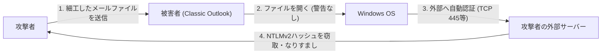
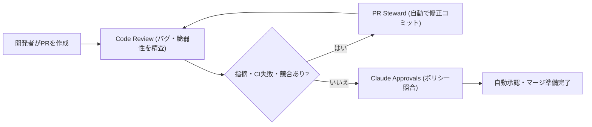

# **本日の AI/開発ツール トピックス (2026-11-24)**

## **1. 📋 今日の30秒サマリー**

> **💡 今日のハイライト**
>
> - **メールを開くだけの罠とサーバー基盤の穴に注意**: Windows版Outlookで細工されたファイルを開くとログイン情報が盗まれる弱点について、米国政府機関向けの修正期限が**本日（11月24日）**に迫っています。JavaやWebサーバー（NGINX）の重大な弱点も合わせて早急な更新が必要です。
> - **AIが「コードを書いた後」まで自動化し、待ち時間でコストも削減**: Anthropicがプルリクエスト後のレビュー・修正・承認を自動化する「Claude Ship」を発表したほか、OpenAIは「2時間・8時間待ち」でAI利用料を最大40%安くする新機能を出しました。
> - **脱Googleの独立ブラウザと「考え直すAI」が話題に**: 大手エンジンに頼らない完全自作ブラウザ「Ladybird」が誰でも試せるAlpha版を公開し、計算の層を2回ループさせて賢さを引き出す新AI「GLM-5.4」も注目を集めています。
{: .callout-summary}

| 区分 | トピック / ツール | ざっくり言うと？（1行要約） | 影響・おすすめ対象 |
| :--- | :--- | :--- | :--- |
| 🚨 **緊急** | **Microsoft Outlook** (`CVE-2026-124194`) | 細工されたメールファイルを開くと警告なしで認証情報が漏れるゼロデイ | **Classic Outlook利用者（本日KEV期限・即更新を）** |
| 🚨 **緊急** | **OpenJDK / Java4Shell** (`CVE-2026-114938`) | 特定CPUの高速化処理の隙を突かれ遠隔操作される重大な脆弱性 | **x86-64 (AVX-512 VBMI) 環境のJava運用者** |
| 🚨 **緊急** | **NGINX** (`CVE-2026-123007`) | HTTP/2の通信量計算ミスでサーバー停止やコード実行を招く危険な穴 | **NGINX `1.31.8` / `1.30.6` 以前の運用者** |
| 🚨 **緊急** | **Zstandard & `binary-parser`** (`CVE-2026-124851` 他) | 圧縮展開時のメモリ漏洩と、Node.jsパーサーの任意コード実行 | **Zstd 1.5.x組込環境 / `binary-parser` `<2.3.1`利用者** |
| 🚀 **新機能** | **Anthropic「Claude Ship」** (Beta) | コード提出後のレビュー・修正・承認までを3つのAIが自動連携 | **PRレビューの待ち時間を減らしたい開発チーム** |
| 🚀 **新機能** | **GitHub Copilot「Fusion」** | 難易度に応じて複数AIを自動編成するマルチモデル統合基盤 | **モデル選択の手間を省きたいCopilot企業・個人ユーザー** |
| 🚀 **新機能** | **OpenAI Responses API** (Background) | 2時間・8時間の非同期処理でAI利用料金を30%〜40%割引に | **即時応答が不要なバッチ・自律エージェント開発者** |
| 🚀 **新機能** | **Google「Gemini 4 Carbon / Neon」** | 100万トークン対応・思考深度を調整できる次世代開発モデル群 | **高度な設計・セキュリティ監査・マルチモーダル開発者** |
| 🔥 **注目** | **Ladybird Browser** (Alpha) | Chromium等に頼らない完全独自エンジンのブラウザが初Alpha公開 | **Web標準やブラウザ基盤の多様性に関心がある開発者** |
| 🔥 **注目** | **Z.ai「GLM-5.4」** | 層を2回ループする新構造で750B級ながら2〜3T級の推論力を発揮 | **複雑推論や「汎用コーディング」の最新動向を追う層** |
| 🔥 **注目** | **`vedant-shah/clawd-hq`** | 複数のClaude Code専門エージェントを統括する「参謀長」ツール | **Claude Codeで大規模な並列作業を自動化したい開発者** |
| 🔥 **注目** | **`modern-web-guidance` & `mattpocock/skills`** | AIに最新Web標準と堅実な設計手順を叩き込む2大スキル集 | **AIの古いコード提案や「雰囲気コーディング」を防ぎたい層** |

---

## **2. 🚨 緊急セキュリティ情報**

### **Microsoft Outlook — ファイルを開くだけで認証情報が盗まれるゼロデイ脆弱性 (`CVE-2026-124194`)**

> **🔰 ひとことで言うと**
> 攻撃者が細工したメールファイルを開くと、警告画面が出ないまま外部サーバーへ自動接続され、Windowsのログイン認証情報（NTLMv2ハッシュ）が盗まれてしまいます。
> 💬 *例えるなら：見知らぬ荷物を開封した瞬間、家のインターホンが勝手に外部の詐欺師へ発信し、合鍵の型番を読み上げてしまうような状態です。*
{: .callout-danger}

| リスク度 | 影響を受ける人 | 悪用のされやすさ | まずやるべき対策 |
| :---: | :--- | :--- | :--- |
| 🔴 **緊急 (KEV)** | **Classic Outlook for Windows利用者**（Microsoft 365 Apps、Office LTSC 2021 / 2024） | 細工されたメッセージファイルをユーザーが**開く**ことで発動（プレビュー表示のみでは未発動） | **Office / Outlookを最新ビルドへ即時更新し、境界でTCP 445番（SMB）の外向き通信を遮断** |



*図の見方：被害者がClassic Outlookでファイルを開いた瞬間、本来表示されるはずの外部接続警告がスキップされ、Windowsが自動的に認証情報（NTLMv2ハッシュ）を攻撃者のサーバーへ送信してしまいます。*

<details markdown="1">
<summary>🔍 技術的な仕組み・対象バージョン・対策コマンドを見る（エンジニア向け）</summary>

- **原因の仕組み**: Classic Outlookにおける安全でない操作の警告欠如（CWE-356 / CVSS 6.5）。特定のメッセージファイルを開いた際、外部ネットワーク上のリソースへアクセスする前のユーザー確認プロンプトが機能せず、Windowsが自動的にNTLM認証を試行してNTLMv2ハッシュが外部へ漏洩する。すでに実攻撃での悪用が確認されており、CISAのKnown Exploited Vulnerabilities（KEV）カタログに登録され、米連邦政府機関向けの対応期限が **2026年11月24日** に設定されている。
- **対象バージョン/環境**: Microsoft 365 Apps for Enterprise、Office LTSC 2021、Office LTSC 2024に含まれる Classic Outlook for Windows。
- **対策手順・コマンド**:
  - Microsoft Updateを通じてOffice / Outlookを最新の修正済みビルドへ更新する。
  - ネットワーク境界のファイアウォール等で、インターネット向けのアウトバウンドSMB通信（TCPポート445）を遮断する。
  ```powershell
  # Windowsファイアウォールで外向きTCP 445番をブロックする例（管理者PowerShell）
  New-NetFirewallRule -DisplayName "Block Outbound SMB 445" -Direction Outbound -Protocol TCP -RemotePort 445 -Action Block
  ```
- **一次ソース**: [NVD - CVE-2026-124194](https://nvd.nist.gov/vuln/detail/CVE-2026-124194) / [CISA KEV Catalog](https://www.cisa.gov/known-exploited-vulnerabilities-catalog)

</details>

---

### **OpenJDK — CPU高速化機能の隙を突く重大な遠隔コード実行「Java4Shell」 (`CVE-2026-114938`)**

> **🔰 ひとことで言うと**
> データを文字に変換するありふれた処理（Base64）の高速化機能にバグがあり、細工された文字列を送りつけるだけでサーバーを乗っ取られる恐れがあります。
> 💬 *例えるなら：郵便物を超高速で仕分ける最新式の自動仕分け機が、特殊な形の封筒を読み込んだ拍子に暴走し、倉庫の鍵まで勝手に開けてしまうような状態です。*
{: .callout-danger}

| リスク度 | 影響を受ける人 | 悪用のされやすさ | まずやるべき対策 |
| :---: | :--- | :--- | :--- |
| 🔴 **緊急** | **AVX-512 VBMI対応のx86-64 CPU上で動くJavaアプリ**（認証トークンやHTTPヘッダ等を処理する環境） | 外部から送られるBase64文字列をデコードするだけで発動しうる（CVSS最大9.8） | **Javaを修正済みパッチ（`21.0.13.0.3` / `17.0.21.0.3` 等）へ即時アップデート** |

<details markdown="1">
<summary>🔍 技術的な仕組み・対象バージョン・対策コマンドを見る（エンジニア向け）</summary>

- **原因の仕組み**: OpenJDK HotSpot JVMに含まれる、x86-64のAVX-512 VBMI命令セットを用いたハードウェア最適化版 `java.util.Base64` デコーダ（intrinsic）におけるヒープベースのバッファオーバーフロー（範囲外書き込み）。HTTPヘッダ、JWT、APIペイロードなど、外部入力のBase64デコード処理を通じて認証不要の遠隔コード実行（RCE）に繋がる可能性がある。
- **対象バージョン/環境**: AVX-512 VBMI命令をサポートするx86-64プロセッサ上で稼働する未パッチのOpenJDK / Oracle Java環境。
- **修正済みバージョン・対策**:
  - **Java 27**: `27.0.1.0.3` 以降 / **Java 25**: `25.0.5.0.3` 以降
  - **Java 21**: `21.0.13.0.3` 以降 / **Java 17**: `17.0.21.0.3` 以降
  - **Java 11**: `11.0.33` 以降 / **Java 8**: `8u512` 以降
  ```bash
  # 現在のJavaバージョンとCPU命令セット（avx512_vbmi）の確認例
  java -version
  grep -o 'avx512_vbmi' /proc/cpuinfo | head -n 1
  ```
- **一次ソース**: [NVD - CVE-2026-114938](https://nvd.nist.gov/vuln/detail/CVE-2026-114938) / [OpenJDK Official](https://openjdk.org/)

</details>

---

### **NGINX — HTTP/2通信の制御計算ミスによるサーバー停止・RCEリスク (`CVE-2026-123007`)**

> **🔰 ひとことで言うと**
> Webサーバーの「NGINX」で高速通信（HTTP/2）を有効にしていると、細工された通信データでプログラムが強制終了したり、乗っ取られたりする危険があります。
> 💬 *例えるなら：高速道路の料金所で車の台数を数えるカウンターがマイナスに振り切れてしまい、ゲートが誤作動して通行不能になるような状態です。*
{: .callout-danger}

| リスク度 | 影響を受ける人 | 悪用のされやすさ | まずやるべき対策 |
| :---: | :--- | :--- | :--- |
| 🔴 **緊急** | **NGINX `1.9.5`〜`1.31.8` でHTTP/2を有効化しているWeb/APIサーバー運用者** | 外部から細工されたHTTP/2トラフィックを送信するだけでワーカーがクラッシュ | **Mainline `1.31.9` または Stable `1.30.7` 以降へ即時アップデート** |

<details markdown="1">
<summary>🔍 技術的な仕組み・対象バージョン・対策コマンドを見る（エンジニア向け）</summary>

- **原因の仕組み**: NGINX Open SourceおよびNGINX Plusの `ngx_http_v2_module` におけるHTTP/2フロー制御処理の整数アンダーフローおよびヒープバッファオーバーフロー。フロー制御ウィンドウが許容しきい値を超える特定のHTTP/2トラフィックを処理した際、境界外メモリコピーが発生し、ワーカープロセスのセグメンテーションフォルト（DoS）やRCEに繋がる恐れがある。
- **対象バージョン/環境**: NGINX `1.9.5` 〜 `1.31.8`（HTTP/2有効環境）。なお11月のセキュリティバンドルではHTTP/3やメールプロキシ、リゾルバ関連の脆弱性も併せて修正されている。
- **対策手順・コマンド**:
  - Mainlineブランチは **`1.31.9`**、Stableブランチは **`1.30.7`** 以降へアップグレードする。
  ```bash
  # NGINXバージョン確認とパッケージ更新例（Ubuntu/Debian系）
  nginx -v
  sudo apt-get update && sudo apt-get install --only-upgrade nginx
  ```
- **一次ソース**: [NVD - CVE-2026-123007](https://nvd.nist.gov/vuln/detail/CVE-2026-123007)

</details>

---

### **Zstandard & `binary-parser` — 展開時のメモリ情報漏洩とパーサーのコード注入 (`CVE-2026-124851` / `CVE-2026-134814`)**

> **🔰 ひとことで言うと**
> 高速な圧縮ツール「Zstandard」では展開結果に別の処理の残りカス（メモリ内容）が混ざる恐れがあり、Node.jsのデータ解析ライブラリ「`binary-parser`」では設定値を通じた乗っ取りが可能でした。
> 💬 *例えるなら：使い回しの封筒（Zstd）に前の人のメモが張り付いたまま届いたり、書類の読み取りルール表（binary-parser）に悪意ある命令を紛れ込ませて事務員に実行させたりするような状態です。*
{: .callout-danger}

| リスク度 | 影響を受ける人 | 悪用のされやすさ | まずやるべき対策 |
| :---: | :--- | :--- | :--- |
| 🟠 **高〜🔴緊急** | **Zstd `1.5.1`〜`1.5.7` 組込環境** / **`binary-parser` `2.3.1`未満のNode.jsアプリ** | 細工された圧縮データや未検証のパーサー定義を渡すことで発生（`binary-parser`はCVSS 9.2） | **Zstdを修正版へ更新 / `binary-parser`を `2.3.1` 以降へ即時更新** |

<details markdown="1">
<summary>🔍 技術的な仕組み・対象バージョン・対策コマンドを見る（エンジニア向け）</summary>

- **原因の仕組み**:
  - **Zstandard (`CVE-2026-124851`)**: Zstd `1.5.1`〜`1.5.7` において、細工された圧縮データを展開した際、内部バッファ（デフォルト64 KiB）の未初期化メモリや同一コンテキスト内の過去の展開処理で残ったデータが展開出力に露出する情報漏洩の脆弱性。
  - **Node.js `binary-parser` (`CVE-2026-134814`)**: `keichi/binary-parser` の `Context.generateOption()` 関数が文字列型の設定オプションを適切にサニタイズしない問題。攻撃者が `length`、`lengthInBytes`、`key`、`tag`、`offset`、`namely()` などのオプションを制御できる場合、パーサーのコンパイル時に任意のJavaScriptコードがホストのNode.jsプロセス上で実行される（RCE）。
- **対策手順・コマンド**:
  ```bash
  # Node.js binary-parser のアップデート
  npm install binary-parser@^2.3.1
  # または pnpm の場合
  pnpm up binary-parser@^2.3.1
  ```
- **一次ソース**: [NVD - CVE-2026-124851](https://nvd.nist.gov/vuln/detail/CVE-2026-124851) / [NVD - CVE-2026-134814](https://nvd.nist.gov/vuln/detail/CVE-2026-134814)

</details>

---

## **3. 🚀 メジャーリリース・新機能**

### **Anthropic「Claude Ship」(Beta) — コード提出後のレビュー・修正・承認を自律化する3連エージェント**

> **🔰 ひとことで言うと**
> プログラムの変更を提案（プルリクエスト）した後の「AIによるレビュー」「テスト失敗や競合の自動修正」「ルールに基づく自動承認」までを一貫して引き受ける新サービスです。
> 💬 *例えるなら：原稿を提出した後の「誤字チェック」「赤入れ修正」「問題なければ即印刷所へ回す決裁」までを、3人の優秀な編集アシスタントがリレー形式で終わらせてくれるような仕組みです。*
{: .callout-info}

| 比較ポイント | これまで (Before) | Claude Ship (After) |
| :--- | :--- | :--- |
| **レビュー後の修正** | AIや人間が指摘した後、開発者が手動で直し直す必要があった | **PR StewardがCI失敗・コンフリクト・指摘事項を自動修正** |
| **定型変更の承認** | 軽微な変更でも人間のレビュアーが承認ボタンを押すまで待機 | **`.claude/approvals.yml` の規約に従いClaude Approvalsが自動承認** |
| **セキュリティ検査** | 変更行のみを見る簡易チェックが中心で文脈の抜け漏れが発生 | **Code Reviewが周辺ロジックを含めてバグや脆弱性を精査** |



*図の見方：開発者がPRを作成すると、まず「Code Review」が周辺文脈を含めて検査します。問題やCIエラーがあれば「PR Steward」が自動で直して再チェックへ回し、最終的に「Claude Approvals」がチーム規約に合致するか判定して承認します。*

<details markdown="1">
<summary>🔍 技術的ブレークスルーとリリースノート詳細を見る</summary>

- **技術的ポイント**: AIコーディングツールの普及でPR作成速度が劇的に上がった結果、チーム開発では「レビューとマージ待ちの渋滞」が最大のボトルネックとなっていた。Claude Shipは **Code Review**、**PR Steward**、**Claude Approvals** の3コンポーネントを統合し、PR作成後のライフサイクル全体を自律化する。
- **開発フローへの影響**: リポジトリ内の `.claude/approvals.yml` にチーム独自の承認ポリシーを定義でき、定型的な依存更新や安全な変更を人手待ちなしで通過させつつ、リスクの高い変更のみを人間にエスカレーションできる。
- **提供形態・利用開始方法**: AnthropicのClaude Developer Platform / GitHub連携としてベータ提供が開始されている。
- **公式リンク**: [Anthropic 公式アナウンス](https://www.anthropic.com/)

</details>

---

### **GitHub「Universe: Under the Hood」& Copilot Fusion — 複数AIをタスクごとに自動編成**

> **🔰 ひとことで言うと**
> 開発者が「どのAIモデルを使おうか」と毎回悩まなくても、作業の重さに合わせてCopilotが裏側で複数のAIを自動で組み合わせ、最適な答えを出してくれる仕組みです。
> 💬 *例えるなら：問い合わせ内容に応じて「1人で即答する窓口」「下書きをベテランが添削する窓口」「複数人の専門家で合議する窓口」を自動で振り分けてくれる総合案内所です。*
{: .callout-info}

| 比較ポイント | これまで (Before) | Copilot Fusion (After) |
| :--- | :--- | :--- |
| **モデル選択** | 開発者がタスクごとに手動でモデルを切り替えていた | **タスクの複雑さを解析し、裏側で最適モデルへ動的ルーティング** |
| **品質保証の仕組み** | 1つのモデルが1回で出力した結果をそのまま受け取っていた | **Single / Cascade（段階的昇格）/ Critique（相互批評）の3パターンで実行** |
| **企業ガバナンス** | 利用モデルの制限やコスト管理が画一的になりがちだった | **管理者がモデル許可や実行努力レベル（Standard/High/Max）を統制可能** |

<details markdown="1">
<summary>🔍 技術的ブレークスルーとリリースノート詳細を見る</summary>

- **技術的ポイント**: 11月24日開催のオンラインイベント「GitHub Universe: Under the Hood」で技術詳細とライブデモが披露された **Copilot Fusion** は、研究プロジェクト *HydraFusion* から発展したマルチモデル・オーケストレーション基盤である。推論深度や複数ファイル編集の必要性を分析し、以下の3つの実行パターンを使い分ける。
  1. **Single**: 単純なタスクを単一の最適化モデルで高速処理。
  2. **Cascade**: 軽量モデルが初期案を作成し、判定役（Judge）モデルが品質を評価。基準に満たない場合のみ上位モデルへエスカレーション。
  3. **Critique**: 複数モデルが並行してドラフトを批評し、統合フィードバックから最終回答を生成。
- **開発フローへの影響**: 速度とコスト、精度のトレードオフをエンジニアが意識せずに享受でき、管理者は組織ポリシーに応じたモデル制限やエフォート設定を行える。
- **公式リンク**: [GitHub Blog](https://github.blog/)

</details>

---

### **OpenAI Responses API「Background Completion Windows」(Public Beta) — 待ち時間で最大40%割引**

> **🔰 ひとことで言うと**
> AIに「今すぐじゃなくていいから、2時間後か8時間後までに終わらせておいて」と頼むだけで、利用料金が30%〜40%安くなる新しい実行モードが登場しました。
> 💬 *例えるなら：急ぎのバイク便ではなく「明日までに届けばOKの通常便」を選ぶことで、送料が大幅に割引される配送サービスのようなものです。*
{: .callout-info}

| 比較ポイント | これまで (Before) | Background Completion Windows (After) |
| :--- | :--- | :--- |
| **価格帯の選択肢** | リアルタイム標準（定価）か、24時間Batch API（50%オフ）の2択 | **2時間枠（30%オフ）と8時間枠（40%オフ）の中間オプションが追加** |
| **ツール連携・会話継続** | 24時間Batch APIは専用ファイル入出力が中心で対話継続に不向き | **通常のResponses APIのままツール利用やマルチターン継続に対応** |
| **結果の受け取り** | リクエスト時に待機するか、バッチ完了ファイルを一括取得 | **Webhook（`response.completed`）通知またはIDポーリングで柔軟に取得** |

<details markdown="1">
<summary>🔍 技術的ブレークスルーとリリースノート詳細を見る</summary>

- **技術的ポイント**: Public Betaとして提供開始されたBackground Completion Windowsは、GPT-6世代モデル（**GPT-6.2 Astra**、**GPT-6.2 Sol**、**GPT-6.1 Terra**、**GPT-6 Luna**）を対象に、従来の `service_tier: flex` に代わる非同期コスト最適化手段を提供する。
- **利用方法と制約**:
  - ペイロードに `"background": true` と `"background_options": {"completion_window": "2h"}`（または `"8h"`）を指定し、`service_tier` を `"default"`、ストリーミングを無効化する。
  - 同一のcontinuation ID・プロジェクト・モデル・ウィンドウを使う後続リクエストにも割引と高いキュー優先度が引き継がれる。
  - なお、Zero Data Retention（ZDR）が有効な環境でも、バックグラウンド処理中は一時的にデータがディスクに保存される点に留意が必要。
- **公式リンク**: [OpenAI Platform](https://openai.com/)

</details>

---

### **Google「Gemini 4 Carbon」&「Gemini 4 Neon」— 100万トークン対応・思考深度調整可能な開発モデル**

> **🔰 ひとことで言うと**
> 難解なシステム設計やセキュリティ監査に特化した最重量級モデル「Carbon」と、日常の複雑な開発作業を高速かつ低コストにこなすバランス型「Neon」が開発者向けに展開されました。
> 💬 *例えるなら：難事件を徹底的に調べ上げるベテラン捜査官（Carbon）と、大量の資料を素早く整理して現場を回すエース刑事（Neon）のコンビが使えるようになったイメージです。*
{: .callout-info}

| 比較ポイント | これまで (Before) | Gemini 4 Carbon / Neon (After) |
| :--- | :--- | :--- |
| **用途の棲み分け** | 汎用モデル1つで軽い作業から重い推論までをカバー | **最高難度推論（Carbon）と高頻度・高コスパ実務（Neon）に最適化** |
| **思考の深さ調整** | 推論の深さを細かく制御しづらく、レイテンシ調整が困難 | **Thinking Level（low / medium / high / xhigh）を柔軟に指定可能** |
| **対応規模・入力** | 大規模コードベースの横断理解でコンテキスト不足が起きやすかった | **両モデルとも100万トークンに対応し、動画・音声・PDF等も統合処理** |

<details markdown="1">
<summary>🔍 技術的ブレークスルーとリリースノート詳細を見る</summary>

- **技術的ポイント**: Google AI StudioおよびGemini API（有料ティア）で利用可能となった2モデルのうち、**Gemini 4 Carbon**（`gemini-4-carbon`）は長時間にわたる自律エージェント開発、脆弱性診断、数学・科学研究など、出力前に深い検証ループを回す用途に特化している。一方の **Gemini 4 Neon**（`gemini-4-neon`）は、リポジトリ単位のコーディングやマルチターンでのツール実行においてCarbonに迫る知能を維持しつつ、完了速度とコスト効率を高めている。
- **エコシステム展開**: Android StudioやGoogle Antigravityに加え、GitHub CopilotのモデルラインナップにもGemini 4 Neonが統合された。
- **公式リンク**: [Google Developers Blog](https://blog.google/technology/developers/)

</details>

---

## **4. 🔥 注目のトレンドツール**

### **Ladybird Browser Alpha — 大手エンジンに依存しない完全独立ブラウザがついにAlpha公開**

> **🔰 ひとことで言うと**
> Google（Chromium）やApple（WebKit）の技術を一切使わず、ゼロから手作りされている新しいWebブラウザ「Ladybird」が、誰でもダウンロードして試せるAlpha版を公開しました。
> 💬 *例えるなら：大手自動車メーカーの部品を流用せず、エンジンからボディまで完全自社設計で作った新興メーカーの車が、ついに一般向けの試乗会を始めたような出来事です。*
{: .callout-tip}

| 注目ポイント | 内容 | おすすめ対象 |
| :--- | :--- | :--- |
| **何ができるか** | 完全独自エンジンによるWeb閲覧に加え、WebDriverやFirefox DevToolsプロトコルをサポート | **ブラウザの多様性やWeb標準技術に関心があるWeb開発者** |
| **注目の理由** | 11月23日のAlpha公開により、ソースからの手動ビルド不要で即インストール可能に | **macOS（Apple Silicon）およびLinux環境で実験したいユーザー** |

<details markdown="1">
<summary>🔍 主な機能・アーキテクチャ・導入方法を見る</summary>

- **主な機能・用途**: これまでテスターはGitHubからソースコードを取得して自前でコンパイルする必要があったが、Alpha版ではmacOS（Apple Silicon / macOS 14.4以降向け `.dmg`）およびLinux（FlatpakやUbuntu向けパッケージリポジトリ）のビルド済みバイナリが提供された。ローリングリリース形式で自動更新され、クラッシュ報告機能やWebDriverによる自動テストにも対応する（Windows版は今後のフェーズで対応予定）。
- **公式サイト/GitHub**: [Ladybird公式サイト](https://ladybird.org) / [LadybirdBrowser/ladybird](https://github.com/LadybirdBrowser/ladybird)

</details>

---

### **Z.ai「GLM-5.4」— 層を2回ループする「Loop Transformer」で750B級ながら2〜3T級に迫る推論力**

> **🔰 ひとことで言うと**
> AIの脳みそのサイズを大きくする代わりに、同じ計算の層を「2周」させてじっくり考え直す新構造を採用し、従来の3〜4倍巨大なAIに匹敵する賢さを実現しました。
> 💬 *例えるなら：巨大な辞書を丸暗記する代わりに、手元のノートを2回読み返して推論を深めることで難問を解く受験生のようなアプローチです。*
{: .callout-tip}

| 注目ポイント | 内容 | おすすめ対象 |
| :--- | :--- | :--- |
| **何ができるか** | 100万トークン対応のマルチモーダル理解と、ソフトウェア開発・3D/CAD・動画編集まで扱う「汎用コーディング」 | **複雑な因果推論や大規模マルチモーダル処理を試したい開発者** |
| **注目の理由** | 11月23日公開。約750B規模の28層を2回反復する「Loop Transformer」を初採用 | **最新LLMアーキテクチャ（計算再利用・自己修正）を追う研究者** |

<details markdown="1">
<summary>🔍 主な機能・アーキテクチャ・導入方法を見る</summary>

- **主な機能・用途**: ゼロから学習し直すのではなくGLM-5ベースモデルの継続学習によって構築され、1回の順伝播（フォワードパス）で28層を2回リサイクル実行する。ハイブリッドKVキャッシュやトークンごとのゲート機構、スパースアテンションのインデックス再利用を組み合わせ、物理パラメータ数を抑えつつ2兆〜3兆パラメータ級に匹敵する推論性能を謳う。
- **注意点**: 公式技術開示によると、構造上「マラソン思考（marathon thinking）」と呼ばれる長時間の思考ループに入りやすい特性があり、複雑なタスクではタイムアウトやエフォート設定の調整が推奨されている。今後、安全性評価を経てオープンソースでの重み公開も予定されている。
- **公式サイト**: [Z.ai](https://z.ai/)

</details>

---

### **`vedant-shah/clawd-hq` (Clawd HQ) — 複数のClaude Code専門エージェントを率いる「参謀長」**

> **🔰 ひとことで言うと**
> 1つのチャット画面で順番にAIへ指示を出すのではなく、「やりたいこと」を1回伝えるだけで司令塔AIが計画を立て、複数の専門AIを裏で同時に動かして結果をまとめてくれます。
> 💬 *例えるなら：料理の注文を1品ずつ厨房に伝えるのではなく、ホール長（参謀長）にコースの要望を伝えると、前菜担当・メイン担当・デザート担当に自動で指示を飛ばして仕上げてくれるような仕組みです。*
{: .callout-tip}

| 注目ポイント | 内容 | おすすめ対象 |
| :--- | :--- | :--- |
| **何ができるか** | Claude Codeネイティブのサブエージェント機能を「参謀長（Chief-of-Staff）」階層型ワークフローとして統合 | **大規模な実装タスクを自律・並列で進めたいClaude Codeユーザー** |
| **注目の理由** | 11月23日にGitHubで公開。規模に応じたエージェントの動的割り当てと前提条件の要約を自動化 | **単一チャットのコンテキスト肥大化に悩む開発者** |

<details markdown="1">
<summary>🔍 主な機能・アーキテクチャ・導入方法を見る</summary>

- **主な機能・用途**: ユーザーが目標を記述すると、Clawd HQが作業計画を立案し、必要な専門サブエージェントをバックグラウンドで動的に生成・スケーリングして実行する。完了時には判断した前提条件と成果物を簡潔に要約して報告する。
- **導入手順**:
  ```bash
  claude plugin marketplace add vedant-shah/clawd-hq
  claude plugin install clawd-hq@clawd-hq
  ```
- **公式サイト/GitHub**: [vedant-shah/clawd-hq](https://github.com/vedant-shah/clawd-hq)

</details>

---

### **`GoogleChrome/modern-web-guidance` & `mattpocock/skills` — AIの「古い知識」と「雰囲気コーディング」を防ぐ2大スキル集**

> **🔰 ひとことで言うと**
> AIにコードを書かせると「昔の古い書き方」や「設計が甘いコード」になりがちな弱点を防ぐため、Google公式の最新Web知識パックと、TypeScriptの達人による厳格な設計手順パックが人気を集めています。
> 💬 *例えるなら：腕は速いが自己流な大工（AI）に、「最新の建築基準法ハンドブック（MWG）」と「着工前の徹底ヒアリングチェックリスト（skills）」を持たせて品質を保証するようなものです。*
{: .callout-tip}

| 注目ポイント | 内容 | おすすめ対象 |
| :--- | :--- | :--- |
| **何ができるか** | MWGはコンテナクエリやView Transitions等の最新Web標準を注入。`skills`は要件詰問からTDD実装までを規律化 | **フロントエンド開発者およびAI駆動開発の品質を上げたいエンジニア** |
| **注目の理由** | Google Chrome / Edge / MDN陣営の知見と、人気講師Matt Pocock氏の設計哲学がプラグイン形式で即導入可能 | **「バイブコーディング」の破綻を防ぎたい開発チーム** |

<details markdown="1">
<summary>🔍 主な機能・アーキテクチャ・導入方法を見る</summary>

- **主な機能・用途**:
  - **`GoogleChrome/modern-web-guidance` (MWG)**: AIが古いJSパターンや不要なポリフィルを提案するのを防ぐため、コンテナクエリ、View Transitions、ネイティブ`<dialog>`、OKLCHカラー等の最新Webプラットフォーム指針を提供するスキルパック＆CLI。
  - **`mattpocock/skills`**: 曖昧な「雰囲気コーディング（Vibe Coding）」を排し、`/grill-me`（設計の徹底的な深掘り質問）→ `/to-spec`（仕様書化）→ `/to-tickets`（チケット分割）→ `/implement`（テストファースト実装）という堅実な開発フローを強制するスキル集。
- **導入手順**:
  ```bash
  # mattpocock/skills の導入例（Claude Code）
  claude plugin install mattpocock-skills@claude-plugins-official
  ```
- **公式サイト/GitHub**: [GoogleChrome/modern-web-guidance](https://github.com/GoogleChrome/modern-web-guidance) / [mattpocock/skills](https://github.com/mattpocock/skills)

</details>

---

## **5. 💡 その他・Tips**

- **AIコーディングツールの設定ファイルからの機密情報漏洩に注意**: Hacker News等でも議論が続いており、`.claude/settings.local.json` などのローカル設定ファイルにAPIキーやDBパスワードが紛れ込んだままGitHubへ誤コミットされる事例が指摘されています。`.gitignore` への登録徹底と、GitHub Secret Scanning（またはローカルのPre-commitフック）の有効化を習慣化しましょう。
- **非同期APIとリアルタイムAPIの使い分け**: OpenAI Responses APIの2時間/8時間ウィンドウ（30%〜40%割引）やBatch API（50%割引）が充実したことで、「夜間テスト生成」「大量ログ解析」「定期リファクタ」は非同期へ逃がし、開発者の手元作業だけをリアルタイムAPIに残すハイブリッド設計でコストを大幅に圧縮できます。

---

## **6. 📝 総評**

> **📌 今日の一言まとめ**
> セキュリティ面では「即日のパッチ適用（Outlook KEV・Java4Shell・NGINX）」が急務となる一方、開発ツール面では「PR後の完全自動化（Claude Ship）」「待ち時間によるコスト最適化（OpenAI）」「脱Chromiumと堅実な設計規律への回帰」が一気に進んだ一日でした。
{: .callout-summary}

本日の動向から浮かび上がる最大のトレンドは、AI開発ツールが**「コードを生成する段階」から「生成後の検証・運用・コスト最適化までを統合管理する段階」へ完全に移行した**点です。

Anthropicの **Claude Ship** がPR後の修正・承認までを自動化し、GitHubの **Copilot Fusion** が複数モデルの協調（Cascade / Critique）を裏側で引き受け、OpenAIの **Responses API** が非同期の待ち時間でトークン単価を最大4割引き下げるなど、各社は「実務のボトルネック（レビュー渋滞・モデル選定の手間・API費用）」を正面から潰しに来ています。また、**GLM-5.4** のLoop Transformerや **Ladybird** のAlpha到達は、単なるスケール競争や既存プラットフォーム依存から抜け出そうとする技術的多様性の表れと言えます。

一方でセキュリティ領域では、攻撃者がAIを用いて脆弱性の発見から悪用コード作成までを「マシンスピード」で進める時代が現実となっており、**Microsoft Outlook (`CVE-2026-124194`)** のように本日がCISA KEV対応期限となる案件や、**OpenJDK (`Java4Shell`)**、**NGINX** といったインフラ根幹のパッチ適用には一切の猶予が残されていません。開発生産性を高める新ツールを導入する際も、`mattpocock/skills` や決定論的チェックを組み合わせ、セキュリティと設計規律を担保する体制づくりが不可欠です。

---

## **7. 📖 用語解説**

| 用語 | 解説 |
|------|------|
| **ゼロデイ脆弱性** | ソフトウェアの弱点が見つかった時点で、まだ修正プログラムが広く行き渡る前（0日目）から攻撃に悪用されている非常に危険な状態のこと。 |
| **CISA KEV** | 米国のサイバーセキュリティ機関（CISA）が管理する「実際に悪用が確認された脆弱性リスト」。ここに載ると、政府機関だけでなく民間企業にも即時の対応が求められます。 |
| **NTLMv2ハッシュ** | Windows環境でネットワーク越しに本人確認を行う際に使われる暗号化された合言葉のようなもの。外部に盗まれると、別の場所でのなりすましに悪用される恐れがあります。 |
| **Base64** | 画像やプログラムなどのデータを、メールやWebで安全に送れる「普通の英数字と記号だけ」の文字に変換する定番のルール。 |
| **HTTP/2** | Webサイトとブラウザがデータをやり取りする通信ルール（HTTP）を高速化した規格。1本の回線で複数のデータを同時に運べます。 |
| **オーケストレーション** | オーケストラの指揮者のように、複数の異なるAIモデルやプログラムに役割を割り振り、全体の作業をスムーズに連携・統合させる仕組み。 |
| **非同期処理（バックグラウンド実行）** | 処理を頼んだその場で結果を待たず、裏側で作業を進めてもらい、終わったら通知や受け取りを行う方式。急がない作業のコスト削減に有効です。 |
| **Loop Transformer** | AIの計算を行う神経回路の層を、1回通すだけでなく何度も繰り返し通すことで、部品数を増やさずに深い思考力を引き出す新しいAI構造。 |

---
(出典: 各公式サイト、GitHub、NVD、CISA、TechニュースサイトよりAIが要約)

<!-- Kramdown略語定義: 本文中の対象単語に自動でインラインツールチップが付与されます -->
*[RCE]: Remote Code Execution（外部からネットワーク越しに任意のプログラムを勝手に実行される深刻な脆弱性）
*[CVE]: Common Vulnerabilities and Exposures（世界共通で割り振られるセキュリティ脆弱性の識別番号）
*[CVSS]: Common Vulnerability Scoring System（脆弱性の深刻度を0〜10の数値で評価する共通規格）
*[CISA]: Cybersecurity and Infrastructure Security Agency（米国サイバーセキュリティ・インフラストラクチャセキュリティ庁）
*[KEV]: Known Exploited Vulnerabilities（CISAが指定する「実際に悪用が確認されている脆弱性」カタログ）
*[PR]: Pull Request（コードの変更内容をチームに共有し、レビューや取り込みを依頼する機能）
*[CI]: Continuous Integration（コードの変更時にテストやビルドを自動実行して品質を保つ仕組み）
*[DoS]: Denial of Service（大量のデータや細工された通信を送りつけ、サーバーやシステムを停止に追い込む攻撃）
*[TDD]: Test-Driven Development（テスト駆動開発。先にテストコードを書いてから本番のプログラムを実装する手法）
*[API]: Application Programming Interface（ソフトウェアやAIの機能同士をプログラムから呼び出して連携させるための窓口）
