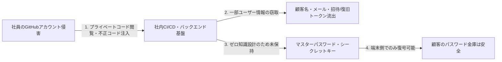
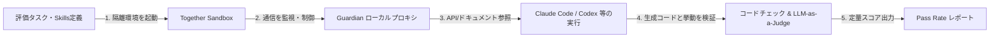

# **本日の AI/開発ツール トピックス (2026-11-26)**

## **1. 📋 今日の30秒サマリー**

> **💡 今日のハイライト**
>
> - **開発基盤・採用課題を突く攻撃と緊急パッチが相次ぐ**: パスワード管理大手1Passwordで社員のGitHubアカウント侵害を発端とする社内基盤への侵入が公表されました（利用者の金庫データは暗号化により無事）。また、米政府の緊急警告リストにネットワーク機器や会議システムの重大な穴が追加され、採用試験を装って開発者PCを狙う偽パッケージ攻撃も報告されています。
> - **「AIエージェントをテスト・監視する」開発ツールが続々登場**: Together AIがAIコーディングツールの実力を安全な箱庭で自動採点するオープンソース基盤「Hurdle」を公開し、JetBrainsも複数AIを並列管理できる「ThinkRail」を展開。セキュリティ分野ではBlack Duckがレガシー言語も解析できるAIコード検査機能をリリースしました。
> - **ローカル環境でのAI監査・メモリ・GPU可視化が急上昇**: Claude Codeの「言い間違いや嘘」を裏で監視して修正する「Rashomon」、複数AIをスマホからも操作できる「T3 Code」、会話を要約せず丸ごと記憶する「MemPalace」、VRAM内訳を可視化する「GPUtaskman」など実用的なOSSが人気を集めています。
{: .callout-summary}

| 区分 | トピック / ツール | ざっくり言うと？（1行要約） | 影響・おすすめ対象 |
| :--- | :--- | :--- | :--- |
| 🚨 **緊急** | **1Password** (`GitHub社員アカウント侵害`) | 社員のGitHub経由でCI/CDとバックエンドへ侵入、一部管理情報が流出（金庫は無事） | **1Password利用者（フィッシング警戒）・CI/CD管理者** |
| 🚨 **緊急** | **HPE Juniper Session Smart** (`CVE-2026-103406`) | ルーター等の自動構成機能で認証なしにOSコマンドが実行される脆弱性がKEV追加 | **Session Smart Router / Conductor運用者** |
| 🚨 **緊急** | **Mitel MiCollab / AWV** (`CVE-2026-133324` 他) | 会議システム等の認証突破・コマンド実行の5件がCISA KEVへ一斉追加 | **Mitel MiCollab（`10.3.0.18`以下等）の管理者** |
| 🚨 **緊急** | **NuGet 採用課題偽装攻撃** (13パッケージ) | .NETエンジニアの採用課題プロジェクトを装い、ビルド時にマルウェアを実行 | **.NET / WinUI / WPF開発者・採用課題の受験者** |
| 🚨 **緊急** | **Jenkins プラグイン群** (`CVE-2026-136841` 他) | Nested ViewやRich Text Publisher等のCSRF・XSS脆弱性パッチが公開 | **Jenkins運用者（プラグイン更新推奨）** |
| 🚀 **新機能** | **Together AI「Hurdle」** (OSS) | コーディングエージェントのAPI・Skills活用力をサンドボックス内で自動評価 | **AIエージェントや独自Skillsを開発・運用するチーム** |
| 🚀 **新機能** | **Black Duck「Signal AI Code Analysis」** | LLM推論でCOBOLやBash等の従来SASTの死角・複雑な論理欠陥を検出 | **レガシーコードやAI生成コードを監査するAppSec担当** |
| 🚀 **新機能** | **JetBrains「ThinkRail」＆「Air」** | Git worktree隔離で複数AIを並列操作するOSS IDEと既存IDE向け監視基盤 | **複数エージェントの差分レビューを効率化したい開発者** |
| 🚀 **新機能** | **Google「Gemini 4 Neon」** | 100万トークン対応・高速多段推論モデルがCopilotやCursor等へ急速展開 | **低遅延と高度な推論を両立したい全開発者** |
| 🔥 **注目** | **`altrace-dev-role/rashomon` (AutoSteer)** | Claude Codeの実行履歴を独立記録し、ハルシネーションを検知・軌道修正 | **Claude Codeを自律ループで運用するエンジニア** |
| 🔥 **注目** | **`pingdotgg/t3code`** (MIT) | Claude CodeやCodex等をPC・スマホから統合操作できるコントロールプレーン | **複数CLIエージェントを横断して使いたい開発者** |
| 🔥 **注目** | **`MemPalace/mempalace`** | 記憶術「記憶の宮殿」に着想を得て会話を要約せず原文保存するローカルAIメモリ | **長期プロジェクトの文脈をAIに正確に保持させたい層** |
| 🔥 **注目** | **`shanselman/gputaskman`** | ローカルLLMのモデル重みとKVキャッシュ別のVRAM消費をターミナルで可視化 | **ローカルLLMやGPUワークロードを扱う全開発者** |

---

## **2. 🚨 緊急セキュリティ情報**

### **1Password — 社員のGitHub侵害を発端としたCI/CD・バックエンド侵入インシデント**

> **🔰 ひとことで言うと**
> パスワード管理サービス「1Password」で、社員のGitHubアカウントが乗っ取られたことをきっかけに社内システムへ侵入され、一部の顧客名やメールアドレス、招待リンク用トークンなどが流出しました（保存されているパスワード本体は無事です）。
> 💬 *例えるなら：銀行の「案内窓口の顧客名簿」が盗まれたものの、個人の金庫の鍵と中身は顧客自身しか持っていないため一切開けられなかった状態です。*
{: .callout-danger}

| リスク度 | 影響を受ける人 | 悪用のされやすさ | まずやるべき対策 |
| :---: | :--- | :--- | :--- |
| 🟠 **高 (警戒)** | **1Passwordの該当一部ユーザー**（個別通知済み）および**組織のGitHub/CI管理者** | 流出した招待・復旧トークン単体では突破不可だが、**標的型フィッシングに悪用される恐れ** | **パスワード変更は不要。1Passwordを装う不審な招待・復旧メールへの警戒と、自社のGitHub/CI権限監査を実施** |

以下は、今回の1Passwordインシデントにおける侵害経路と、ゼロ知識暗号化アーキテクチャによって顧客の金庫本体が保護された仕組みを示す図です。



*図の見方：攻撃者は社員のGitHubアカウントからCI/CDとバックエンドへ侵入し、管理用メタデータやメール内トークンを窃取しました。しかし、金庫の中身を復号するマスターパスワードとシークレットキーは1Passwordサーバーに保存されていないため、機密データの漏洩は防がれました。*

<details markdown="1">
<summary>🔍 技術的な仕組み・影響範囲・対策ポイントを見る（エンジニア向け）</summary>

- **原因の仕組み**: 2026年11月19日、1Passwordは社員の企業用GitHubアカウントへの不正アクセスを検知して調査を開始した。攻撃者はその権限を利用してプライベートリポジトリを閲覧し、同社のバックエンドサービスおよびCI/CD環境へ悪意あるコードをプッシュしたことで、一部の管理データと社内ソースコードが持ち出された。
- **流出した情報**: 一部ユーザー（個別通知済み）の氏名、ログイン用メールアドレス、アカウント/ユーザーID、作成日時・最終サインイン日時、公開暗号鍵、SRP（Secure Remote Password）プロトコルパラメータ、招待・プロビジョニング・アカウント復旧用メールに含まれるトークン、および社内ソースコード・非機密メタデータ。
- **影響を受けなかった情報**: ゼロ知識（Zero-Knowledge）設計により、顧客の金庫（Vault）の中身、マスターパスワード、シークレットキー、アカウント復旧キー、ブラウザ拡張・アプリ本体は影響を受けていない。また、流出した招待・復旧トークン単体ではログインできず、SSOやメール確認コード（今回4〜6桁数字から**10桁の英数字**へ強化）が別途必要となる。
- **エンジニアが学ぶべき教訓・対策**:
  - 開発者個人のGitHubアカウント侵害がそのまま本番CI/CDパイプラインとバックエンド改ざんにつながるリスクを再認識し、ハードウェアセキュリティキー（FIDO2）必須化やブランチ保護・署名付きコミット（Commit Signing）の強制を徹底する。
- **一次ソース**: [1Password Official Blog - Update on Nov 2026 Security Incident](https://1password.com/blog/update-on-nov-2026-security-incident)

</details>

---

### **HPE Juniper Session Smart Router / Conductor — 認証なしでrootコマンド実行が可能 (`CVE-2026-103406`)**

> **🔰 ひとことで言うと**
> 企業のネットワークを賢く制御するJuniper製のルーターおよび管理システムに、細工された通信を送るだけで外部から管理者（root）権限の命令を勝手に実行されてしまう極めて危険な弱点が見つかり、実際に攻撃に使われ始めています。
> 💬 *例えるなら：ビルの自動受付端末に特定の合言葉を入力するだけで、管理室の全設備を操作できる最高権限メニューが開いてしまう状態です。*
{: .callout-danger}

| リスク度 | 影響を受ける人 | 悪用のされやすさ | まずやるべき対策 |
| :---: | :--- | :--- | :--- |
| 🔴 **緊急 (KEV)** | **HPE Juniper Session Smart Router / Session Smart Conductor 運用者** | 未認証でリモートから悪用可能（CVSS **9.8**、**CISA KEV追加済み**） | **Juniper公式アドバイザリに従い修正版へ即時アップデート、または管理ポートのアクセス制限を実施** |

<details markdown="1">
<summary>🔍 技術的な仕組み・対象バージョン・対策コマンドを見る（エンジニア向け）</summary>

- **原因の仕組み**: Session Smart ConductorおよびSession Smart Routerに含まれる `AutomatedProvisioner` コンポーネントにおいて、OSコマンドインジェクションの脆弱性（`CVE-2026-103406`）が存在する。細工された Salt minion ID を送信することで、未認証のリモート攻撃者がシステム上で `root` 権限の任意コマンドを実行できる。
- **悪用状況**: 2026年11月25日、米国土安全保障省サイバーセキュリティ・インフラストラクチャセキュリティ庁（CISA）が実環境での悪用を確認し、KEV（Known Exploited Vulnerabilities）カタログに追加した。
- **対策手順**:
  - ベンダーが提供するパッチ適用済みバージョンへ速やかにアップグレードする。
  - パッチ適用までの暫定緩和策として、AutomatedProvisionerおよび管理インターフェースへのネットワークアクセスを信頼できる送信元IPのみに厳格制限する。
- **一次ソース**: [CVE-2026-103406 Record](https://www.cve.org/CVERecord?id=CVE-2026-103406) / [CISA KEV Catalog](https://www.cisa.gov/known-exploited-vulnerabilities-catalog)

</details>

---

### **Mitel MiCollab / AWV — 認証バイパス・コマンド実行の5件がCISA KEVへ一斉追加 (`CVE-2026-133324` 他)**

> **🔰 ひとことで言うと**
> 企業向けの統合コミュニケーション・Web会議システム「Mitel MiCollab」で、パスワード確認をすり抜けて侵入できたり、サーバーを乗っ取れたりする5つの重大な弱点が、実際に悪用されているとして緊急警告リストに一斉登録されました。
> 💬 *例えるなら：会議室のドアに「鍵がかかっていない裏口」や「ドアノブを外せる隙間」が5箇所も見つかり、すでに侵入者が確認された状態です。*
{: .callout-danger}

| リスク度 | 影響を受ける人 | 悪用のされやすさ | まずやるべき対策 |
| :---: | :--- | :--- | :--- |
| 🔴 **緊急 (KEV)** | **Mitel MiCollab / Audio, Web, and Video Conferencing (AWV) `10.3.0.18` 以下の運用者** | ネットワーク経由で未認証アクセス・コマンド実行が可能（**CISA KEV追加済み**） | **Mitelアドバイザリ（`MISA-2026-0012`）を確認し、修正版へ即時アップデート** |

<details markdown="1">
<summary>🔍 技術的な仕組み・対象バージョン・対策コマンドを見る（エンジニア向け）</summary>

- **原因の仕組み**: 2026年11月25日、CISAはMitel MiCollabおよびAWV（Audio, Web, and Video Conferencing）コンポーネントに影響する以下の5件の脆弱性をKEVカタログに追加した（アドバイザリ `MISA-2026-0012`）。
  - **`CVE-2026-133324`**: AWVコンポーネント（`10.3.0.18` 以下）における認証バイパス脆弱性。認証ステップのフェイルセキュア不備により、未認証の攻撃者が認証を回避できる。
  - **`CVE-2026-133323` / `CVE-2026-133311` / `CVE-2026-133303` / `CVE-2026-133275`**: コマンドインジェクションや認証不備等を含む関連脆弱性群。
- **対策手順**:
  - Mitel MiCollabをメーカー提供の最新パッチ適用済みバージョンへアップグレードする。
  - インターネットに公開されているMiCollab管理画面やAWVエンドポイントのアクセス制御・WAFログを点検し、不審なセッションや新規アカウント作成の痕跡がないか調査する。
- **一次ソース**: [CISA Known Exploited Vulnerabilities Catalog](https://www.cisa.gov/known-exploited-vulnerabilities-catalog)

</details>

---

### **NuGet 悪意あるパッケージ群 — .NET採用課題を装い開発者PCを狙うサプライチェーン攻撃**

> **🔰 ひとことで言うと**
> 転職活動中の.NET開発者に「採用試験の課題」として偽のプログラムを渡し、Visual Studioで開いてビルドした瞬間に、開発者のパソコンへ情報窃取ウイルスや遠隔操作ツールを仕込む巧妙な攻撃が見つかりました。
> 💬 *例えるなら：就職面接の「実技テスト用の書類ファイル」を開いたら、机の裏に盗聴器を仕掛ける仕掛けが組まれていたような手口です。*
{: .callout-danger}

| リスク度 | 影響を受ける人 | 悪用のされやすさ | まずやるべき対策 |
| :---: | :--- | :--- | :--- |
| 🔴 **高** | **.NET / WinUI 3 / WPF 開発者、GitHub経由で採用課題を受け取る候補者** | Visual Studio等でプロジェクトをビルド・実行するだけで発火 | **見知らぬ採用課題は必ず使い捨てVMやDev Container内で開き、依存NuGetパッケージの公開元を確認** |

<details markdown="1">
<summary>🔍 技術的な仕組み・手口の詳細・防御策を見る（エンジニア向け）</summary>

- **原因の仕組み**: セキュリティ研究者（Socket等）により、NuGetレジストリに公開された**13個の悪意あるパッケージ**と、それらを参照するGitHub上の偽採用課題リポジトリ（例：WinUI 3課題「Mini File Vault & Tracker」等）を組み合わせた組織的な攻撃キャンペーンが確認された。
- **攻撃チェーン**:
  1. 攻撃者はリクルーターや企業を装い、受験者にGitHub上の課題リポジトリをクローンしてVisual Studioでローカル実行するよう指示する。
  2. プロジェクトはWPFやWinUI 3の正規UIコンポーネントを装った悪意あるNuGetパッケージに依存しており、ビルド時または実行時のスクリプトが起動する。
  3. GitHub上の別リポジトリから追加のペイロードをダウンロードし、Windows標準バイナリ（`osk.exe` 等）を悪用したDLLサイドローディングによってセキュリティ検知を回避しつつ、認証情報窃取マルウェア（Credential Stealer）および遠隔操作型トロイの木馬（RAT）を展開する。
- **対策手順**:
  - 外部から提供された未検証のリポジトリをホストOS上で直接ビルドしない（Sandbox、VM、GitHub Codespaces等で隔離する）。
  - `.csproj` や `packages.config` 内のNuGetパッケージ名・ダウンロード数・発行者署名を事前に確認する。
- **一次ソース**: [Dark Reading - Malicious NuGet Packages Target .NET Developers via Fake Job Assessments](https://www.darkreading.com/)

</details>

---

### **Jenkins プラグイン群 — Nested View / Rich Text Publisher等のセキュリティ更新 (`CVE-2026-136841` 他)**

> **🔰 ひとことで言うと**
> ビルド自動化ツールの定番「Jenkins」の複数プラグインに、管理者を騙して勝手に設定画面を作らせたり、画面上で悪意あるスクリプトを動かしたりできる穴が見つかり、修正版が公開されました。
> 💬 *例えるなら：工場の自動ライン管理ボードに、偽の張り紙を通して勝手に新しい作業レーンを追加させる隙があった状態です。*
{: .callout-danger}

| リスク度 | 影響を受ける人 | 悪用のされやすさ | まずやるべき対策 |
| :---: | :--- | :--- | :--- |
| 🟡 **中** | **Jenkins Nested View Plugin (`241.v178f0b_a_cd76a_` 以下) / Rich Text Publisher Plugin 利用者** | 認証済みユーザーに細工されたリンクを踏ませることで発動（CVSS **4.3**〜） | **プラグインマネージャから各プラグインを最新版（Nested View `262.v4e24ddfe477e` 以降等）へ更新** |

<details markdown="1">
<summary>🔍 技術的な仕組み・対象バージョン・対策コマンドを見る（エンジニア向け）</summary>

- **原因の仕組み**: 2026年11月25日公開のJenkins Security Advisoryにより、複数プラグインの脆弱性が修正された。
  - **`CVE-2026-136841`（Nested View Plugin / SECURITY-4284）**: ビュー作成エンドポイントがHTTP POSTリクエストを強制していなかったため、クロスサイトリクエストフォージェリ（CSRF）により不正なビューを作成される恐れがある（CVSS 4.3）。
  - **`CVE-2026-136854`（Rich Text Publisher Plugin）**: 保存型または反射型XSSにつながるサニタイズ不備。
- **対象バージョン・修正版**:
  - Nested View Plugin: `241.v178f0b_a_cd76a_` 以下が影響 → **`262.v4e24ddfe477e`** 以降へ更新。
- **対策手順**:
  - Jenkins管理画面「Manage Jenkins」→「Plugins」から対象プラグインを最新版へアップデートし、必要に応じて再起動を行う。
- **一次ソース**: [Jenkins Security Advisory (2026-11-25)](https://www.jenkins.io/security/advisory/2026-11-25/) / [CVE-2026-136841](https://www.cve.org/CVERecord?id=CVE-2026-136841)

</details>

---

## **3. 🚀 メジャーリリース・新機能**

### **Together AI「Hurdle」— AIコーディングエージェントのAPI・Skills活用力を箱庭で自動評価**

> **🔰 ひとことで言うと**
> Claude CodeやCodexなどのAIコーディングツールが、「新しいAPIの説明書や社内ルール（Skills）を読んで正しくコードを書けるか」を安全な隔離環境で自動テスト・採点できるオープンソースの評価ツールをTogether AIが公開しました。
> 💬 *例えるなら：AIプログラマー向けの「模擬試験＋カンニング防止付きの試験会場」を自社の開発チームに用意できるようなツールです。*
{: .callout-info}

| 比較ポイント | これまで (Before) | Hurdle 導入後 (After) |
| :--- | :--- | :--- |
| **エージェント評価の手法** | 手動でプロンプトを試して感覚で良し悪しを判断 | **タスク定義から実行・コード検査・AI採点（LLM-as-a-Judge）までを自動化** |
| **外部通信の安全性・再現性** | テスト中のAIが意図しない外部URLへアクセスするリスク | **Together Sandbox＋ローカルプロキシ「Guardian」で直接通信を遮断・制御** |
| **ドキュメント/Skillsの検証** | 社内SDKやSkillsを書き換えてもAIへの効果が測れない | **モデル別・指示文別の合格率（Pass Rate）を定量比較して改善可能** |

以下は、Together AI「Hurdle」がサンドボックスとプロキシ制御を用いてAIコーディングエージェントを評価する処理の流れです。



*図の見方：評価対象のコーディングエージェントは「Together Sandbox」内で実行され、外部への通信はすべて「Guardian」プロキシ経由に制限されます。実行結果に対してプログラムによる自動テストとLLMによるルーブリック評価を組み合わせ、再現性の高い合格率レポートを出力します。*

<details markdown="1">
<summary>🔍 技術的ブレークスルーと導入・利用方法を見る</summary>

- **技術的ポイント**:
  - 2026年11月25日にTogether AIが公開したオープンソースのJavaScript/Node.jsベース評価フレームワーク（`togethercomputer/hurdle`）。
  - コーディングエージェントに対して「特定のAPIドキュメントやカスタムSkillsを与えた条件」と「与えない条件」を並列で実行し、外部通信をローカルプロキシ（Guardian）で厳密にガードしながらリクエスト履歴を記録できる。
  - 単なるユニットテストの成否だけでなく、リクエストガード（禁止操作の有無）やAIによるルーブリック評価を組み合わせることで、エージェントの指示遵守率を継続的にベンチマークできる。
- **導入手順**:
  ```bash
  git clone https://github.com/togethercomputer/hurdle.git
  cd hurdle
  npm install
  ```
- **公式リンク**: [GitHub - togethercomputer/hurdle](https://github.com/togethercomputer/hurdle)

</details>

---

### **Black Duck Polaris「Signal AI Code Analysis」— 従来SASTの死角とレガシー言語をLLMで検査**

> **🔰 ひとことで言うと**
> セキュリティ検査大手のBlack Duckが、AIの読解力を活かしてCOBOLやBashスクリプトなど「従来の自動検査ツールが苦手だった言語」や、文脈を読まないと見抜けない設計上のセキュリティ欠陥を自動発見する新機能を発表しました。
> 💬 *例えるなら：決められたチェックリストしか見られない検査員に代わり、コード全体の意味と意図を理解して抜け道を探す熟練の監査官を配置するような進化です。*
{: .callout-info}

| 比較ポイント | 従来のルールベースSAST (Before) | Signal AI Code Analysis (After) |
| :--- | :--- | :--- |
| **対応言語の範囲** | 主要なモダン言語中心で、スクリプトやレガシー言語は対象外になりがち | **COBOL、Bash、RPGなど従来未対応・非標準言語のロジックも解析** |
| **検知できる欠陥の深さ** | パターン一致型の構文エラーや既知の危険関数が中心 | **BOLA / IDORや複雑なデータフローを跨ぐ論理的脆弱性を推論で検出** |
| **AI生成コードへの耐性** | いわゆる「Vibe Coding」で急造されたコードの設計ミスを見落としやすい | **Black Duck Signalのエージェント型AppSec基盤と双方向課題同期で即時修正を支援** |

<details markdown="1">
<summary>🔍 技術的ブレークスルーとリリース詳細を見る</summary>

- **技術的ポイント**:
  - 2026年11月25日、Black Duckがアプリケーションセキュリティプラットフォーム「Polaris」のアップデートとして発表。エージェント型AppSecスイート「Black Duck Signal」を拡張した。
  - ルールベースの静的解析（SAST）ではパーサーの整備が追いつかないレガシー言語（COBOL、RPG）や運用スクリプト（Bash）、あるいはAPIの認可不備（BOLA/IDOR）といった文脈依存の欠陥に対し、LLMの推論能力を適用する。
  - 企業の課題管理トラッカーとの双方向同期（Bidirectional Issue Sync）も強化され、検出から修正チケットの起票・クローズまでをシームレスに連携できる。
- **公式リンク**: [Black Duck Blog - Polaris Release Update: Signal AI Code Analysis](https://www.blackduck.com/blog/polaris-release-update-ai-code-analysis.html)

</details>

---

### **JetBrains「ThinkRail」＆「Air」— Git Worktree隔離と複数エージェント統合監視**

> **🔰 ひとことで言うと**
> 開発ツール大手JetBrainsが、複数のAIコーディングエージェントを別々の作業フォルダ（Git worktree）に隔離して同時に走らせられる軽量なオープンソースIDE「ThinkRail」と、既存のJetBrains IDE上で外部AIを一括監視できる「Air」を展開しました。
> 💬 *例えるなら：複数のAI作業員が同じ設計図を書き換えてケンカしないよう、各自に専用の作業ブース（ThinkRail）を与え、親方が一括で出来栄えを検品（Air）できる仕組みです。*
{: .callout-info}

| 比較ポイント | 従来のAIエージェント利用 (Before) | ThinkRail / Air 導入後 (After) |
| :--- | :--- | :--- |
| **並列作業時の競合** | 1つのディレクトリで複数AIを動かすとファイル変更が衝突 | **Git worktree単位でセッションを完全隔離し、複数エージェントを同時実行** |
| **変更履歴と仕様管理** | AIが何を変えたかチャット履歴を遡る必要があり追跡が困難 | **AIとの対話（Turn）ごとに追跡可能なコミット履歴とLiving Specsを記録** |
| **IDEとの統合性** | Claude Code・Cursor・Codex等がバラバラの画面で動作 | **JetBrains「Air」により全IDEから外部エージェントを統合監視・承認** |

<details markdown="1">
<summary>🔍 技術的ブレークスルーとリポジトリ情報を見る</summary>

- **技術的ポイント**:
  - **ThinkRail (`JetBrains/thinkrail`)**: Mario Zechner氏のコーディングエージェント「Pi」などを中心に設計されたオープンソースのエージェント特化型IDE。開発者がゼロからコードを書くのではなく「Living Specs（生きた仕様書）」を起点にエージェントのターン単位のコミットをレビューするワークフローを前提としている。
  - **Air**: IntelliJ IDEA等の既存JetBrains IDE群に組み込まれる統合フレームワーク。Claude Code、Cursor、GitHub Copilot、OpenAI Codexなど外部エージェントの挙動を一元的にモニタリング・ガバナンス統制する。
- **公式リンク**: [GitHub - JetBrains/thinkrail](https://github.com/JetBrains/thinkrail)

</details>

---

### **Google「Gemini 4 Neon」— 100万トークン・高速多段推論モデルが主要開発ツールへ展開**

> **🔰 ひとことで言うと**
> Googleの最新AI「Gemini 4」シリーズの中で、スピードと賢さのバランスに優れた中核モデル「Gemini 4 Neon」が、GitHub CopilotやCursorなどの主要開発ツールで続々と利用可能になっています。
> 💬 *例えるなら：超重量級の専門家（Carbon）ほど待たされず、日常の複雑なプログラミング作業をサクサクこなせる「万能なエース開発者」が各エディタに常駐したような状態です。*
{: .callout-info}

| 比較ポイント | 従来モデル / 上位・軽量枠 (Before) | Gemini 4 Neon (After) |
| :--- | :--- | :--- |
| **役割とポジショニング** | 重厚長大なCarbonと軽量高速なHydrogenの間を埋める選択肢が不足 | **多段階のソフトウェア工学タスク・ツール呼び出しに最適化した中核モデル** |
| **コンテキスト長とコスト** | 長文脈処理と低遅延エージェント実行の両立にコスト面の課題 | **100万トークン対応で入力$3 / 出力$15（1Mあたり、キャッシュ入力$0.15）** |
| **エコシステム対応** | Google AI Studio / Gemini APIでの単体利用が中心 | **GitHub Copilot（VS Code/JetBrains/Xcode）、Cursor、Antigravityへ展開** |

<details markdown="1">
<summary>🔍 技術仕様・対応環境の詳細を見る</summary>

- **技術的ポイント**:
  - 2026年11月18日に発表され、今週にかけて主要IDE・エージェントプラットフォームへの統合が一気に進んだ。
  - 1M（100万）トークンのコンテキストウィンドウを備えつつ、低レイテンシなツール呼び出し（Tool Use）と複数ステップのコード修正に特化している。
  - API価格は入力100万トークンあたり3ドル（プロンプトキャッシュ時は0.15ドル）、出力100万トークンあたり15ドルに設定されており、日常的なエージェント実行の主力モデルとして採用が広がっている。
- **公式リンク**: [Google Blog - Gemini 4](https://blog.google/) / [GitHub Blog - Copilot Models](https://github.blog/)

</details>

---

## **4. 🔥 注目のトレンドツール**

### **Rashomon / AutoSteer (`altrace-dev-role/rashomon`) — Claude Codeの「嘘」を見抜き軌道修正するローカル監査層**

> **🔰 ひとことで言うと**
> AIコーディングツール「Claude Code」が作業中に「テストは全部通りました！」と報告したとき、裏で本当にコマンドが成功したかを別の目線で記録・照合し、嘘やズレがあれば自動で軌道修正してくれるローカル監査ツールです。
> 💬 *例えるなら：作業報告をする部下の後ろで静かに作業ログを取り、「さっきエラーが出ていましたよ」とメモを渡して修正させるお目付け役です。*
{: .callout-tip}

| 注目ポイント | 内容 | おすすめ対象 |
| :--- | :--- | :--- |
| **何ができるか** | Claude Codeの全ツール呼び出し・コマンド結果を独立記録し、ハルシネーションや報告の矛盾を検知して `AutoSteer` 機能で自律修正を促す | **Claude Codeで長時間の自律コーディングを行う開発者** |
| **注目の理由** | 実行を強制ブロックするのではなく、ターン終了時のチェックと永続メモで賢く誘導し、完全ローカル・テレメトリゼロで動作する点 | AIエージェントの「完了詐欺」や手戻りを減らしたいチーム |

<details markdown="1">
<summary>🔍 主な機能・導入コマンド・GitHubリンクを見る</summary>

- **主な機能・用途**:
  - **独立監査ログ**: Claude Code本体やサブエージェントが実行したすべてのコマンド・ツール呼び出しをローカルに記録。
  - **矛盾検知**: エージェントが要約で「成功した」と主張した内容と実際の終了コード・出力結果を突合し、乖離を即座にフラグ立てする。
  - **AutoSteer**: 強制停止による作業中断を避けつつ、ターン末尾の検証結果と永続ノートを通じて次の行動を適切にステアリングする。
- **導入手順**:
  ```bash
  npx -y skills add altrace-dev-role/rashomon --skill watch --agent claude-code
  ```
  （※ `status`、`rashomon-report`、`forget` などのスキルも必要に応じて追加可能）
- **GitHub**: [altrace-dev-role/rashomon](https://github.com/altrace-dev-role/rashomon)

</details>

---

### **T3 Code (`pingdotgg/t3code`) — 複数のCLIコーディングAIをPCやスマホから統合操作**

> **🔰 ひとことで言うと**
> Claude Code、OpenAI Codex、Cursorなど別々のツールとして動くコマンドライン型AIエージェントを、1つのきれいな画面にまとめてパソコンやスマートフォンから遠隔操作・差分レビューできるオープンソースアプリです。
> 💬 *例えるなら：バラバラのメーカーの家電を、外出先のスマホ1台からまとめて操作・監視できるユニバーサルリモコンのような開発ダッシュボードです。*
{: .callout-tip}

| 注目ポイント | 内容 | おすすめ対象 |
| :--- | :--- | :--- |
| **何ができるか** | Claude Code / Codex / Cursor / Grok / OpenCode等のスレッドを統合管理し、インライン差分確認・Git worktree操作・PR作成まで実行 | **複数のAIコーディングエージェントを使い分ける開発者** |
| **注目の理由** | トークンの転売（独自課金）をせず手持ちのAPIキー/契約をそのまま利用でき、デスクトップ・Web・モバイルのどこからでも操作可能なMITライセンスOSS | 移動中や別端末からエージェントの進捗確認・承認をしたい層 |

<details markdown="1">
<summary>🔍 主な機能・特徴・GitHubリンクを見る</summary>

- **主な機能・用途**:
  - Ping Labs（Theo Browne氏ら）が開発・公開したコントロールプレーン。
  - 複数のエージェントスレッドを並行して立ち上げ、Gitブランチやworktreeの切り替え、変更差分のインラインレビュー、GitHubへのプッシュやPull Request作成を単一UIから完結できる。
- **GitHub**: [pingdotgg/t3code](https://github.com/pingdotgg/t3code)

</details>

---

### **MemPalace (`MemPalace/mempalace`) — 要約せず原文のまま構造化記憶するローカルAIメモリ**

> **🔰 ひとことで言うと**
> 従来のAIメモリのように過去の会話を勝手に要約して大事な細部を捨ててしまうのではなく、古代の記憶術「記憶の宮殿」の仕組みで会話を原文のまま部屋ごとに整理・保存し、MCP経由でAIに思い出させるツールです。
> 💬 *例えるなら：会議のメモを「3行の要約」にして細かい数値を忘れてしまう代わりに、録音と議事録を建物内のテーマ別キャビネットに丸ごと保管する書庫です。*
{: .callout-tip}

| 注目ポイント | 内容 | おすすめ対象 |
| :--- | :--- | :--- |
| **何ができるか** | 会話履歴やプロジェクト知識を要約せず原文（Verbatim）でChromaDB/SQLiteに保存し、「Wings / Rooms / Drawers」階層とMCPで高速検索 | **過去の細かい設計判断やコマンドをAIに忘れさせたくない開発者** |
| **注目の理由** | 女優ミラ・ジョヴォヴィッチ氏と開発者ベン・シグマン氏による共同開発という話題性に加え、既存メモリ手法（Mem0/Zep等）を上回るベンチマーク精度で急上昇 | Claude CodeやCursorにローカル完結の長期記憶を持たせたい層 |

<details markdown="1">
<summary>🔍 主な機能・導入コマンド・GitHubリンクを見る</summary>

- **主な機能・用途**:
  - LLMによる要約圧縮で発生しがちな「固有のエラーコードや細かな仕様の欠落」を防ぐため、原文をそのまま保持しつつ空間的タクソノミー（Wing・Room・Drawer）とベクトル検索を組み合わせて検索する。
  - Model Context Protocol（MCP）サーバーとして動作し、Claude CodeやCursorへシームレスに統合できる。
- **導入手順**:
  ```bash
  # エージェント向けスキルとして導入する場合
  npx skills add MemPalace/mempalace

  # Python CLIとして隔離インストールする場合
  uv tool install mempalace
  ```
- **GitHub**: [MemPalace/mempalace](https://github.com/MemPalace/mempalace)

</details>

---

### **GPUtaskman (`shanselman/gputaskman`) — ローカルLLMの重みとKVキャッシュも見えるGPUタスクマネージャ**

> **🔰 ひとことで言うと**
> Windows標準のタスクマネージャでは曖昧だったりWSL上のプロセスが見えなかったりする「GPUメモリの使われ方」を、ターミナル上でアプリ別・さらにローカルAIの「モデル本体」と「会話記憶（KVキャッシュ）」別にまで分解して表示してくれるツールです。
> 💬 *例えるなら：車のメーターに「ガソリン残量」だけでなく、「エアコンで何％・走行で何％消費しているか」までリアルタイム表示してくれる精密計器です。*
{: .callout-tip}

| 注目ポイント | 内容 | おすすめ対象 |
| :--- | :--- | :--- |
| **何ができるか** | Windows / Linux / WSL / Apple Silicon対応で、プロセス別のVRAM使用量・GPUエンジン負荷・ローカルLLMの重み対KVキャッシュ比率を可視化 | **ローカルLLMや画像生成AIを自分のPC/サーバーで動かす開発者** |
| **注目の理由** | Microsoft VPのScott Hanselman氏が開発し、NVIDIA・AMD・Intel・Huawei Ascendまで幅広く対応する軽量CLI（短縮コマンド `gtm`）として人気が急拡大 | 「なぜかVRAMが足りない」原因を即座に突き止めたいエンジニア |

<details markdown="1">
<summary>🔍 主な機能・導入コマンド・GitHubリンクを見る</summary>

- **主な機能・用途**:
  - 低レベルハードウェアカウンタやメモリマップドファイル、ローカルAPIを参照し、OS標準ツールでは合算されがちなコンポジタやWSL2配下のVRAM消費を正確に切り分ける。
  - ローカルLLM実行時に、モデルウェイトとコンテキスト用のKVキャッシュがそれぞれどれだけVRAMを占有しているかを分析できる。
- **導入手順**:
  ```bash
  # uv または pipx でのインストール（Python 3.11+）
  uv tool install gputaskman
  # または
  pipx install gputaskman

  # 起動（gputaskman または短縮形 gtm）
  gtm
  ```
- **GitHub**: [shanselman/gputaskman](https://github.com/shanselman/gputaskman)

</details>

---

## **5. 💡 その他・Tips**

- **OpenAI、行列乗算指数の下界を証明する111ページの数学プレプリントを公開**: 11月24日、OpenAIが公開GitHubリポジトリにて内部モデルが生成した論文「The matrix multiplication exponent is nine fourths」を公開し、Hacker News等で大きな議論を呼んでいます。長年の「最適な指数は2に近づくのでは」という予想に対し、すべての体（field）上で下界も上限も $9/4$（$=2.25$）であると主張する内容で、現在コミュニティによるLean形式証明の検証が進められています。
- **Posit Package Manager にパス・トラバーサル脆弱性 (`CVE-2026-135888` / CVSS 9.2)**: カスタムホームページのアセット取得エンドポイント（`/__api__/custom/home/`）にディレクトリトラバーサルが見つかり、未認証でサービスアカウントが読める任意ファイルを閲覧される恐れがあります。R/Pythonパッケージ管理基盤として運用中の環境は速やかにパッチ適用を確認してください。
- **Microsoft Edge の Chromium 系バッチ更新（11月26日注意喚起）**: `CVE-2026-130904` 以降の多数のChromium由来脆弱性を修正するEdgeアップデートに関する注意喚起がHKCERT等から発出されています。開発端末のブラウザ更新を忘れずに適用しましょう。

---

## **6. 📝 総評**

> **📌 今日の一言まとめ**
> 1Passwordの事例や偽採用課題攻撃が「開発者の端末とアカウントこそが最大の標的」であることを改めて突きつける一方、AIエージェントを安全に評価・監視・記憶制御するための「周辺インフラ」が一気に成熟した一日でした。
{: .callout-summary}

本日の動向を振り返ると、セキュリティ面と開発ツール面の双方で明確な共通テーマが浮かび上がります。

1. **「開発者アカウントとビルド環境」を狙うサプライチェーン脅威の現実化**:
   1Passwordのケースでは、顧客の金庫自体はゼロ知識暗号化によって守られたものの、侵入の起点は「社員1名のGitHubアカウント侵害」からCI/CD環境への不正コード注入でした。さらに.NET開発者向けの偽採用課題プロジェクトを通じたNuGetパッケージ攻撃も確認されており、本番サーバーだけでなく**開発者自身のローカルPCとGitHub権限が直接の攻撃対象**になっています。FIDO2による認証強化と、未検証リポジトリの隔離実行（Sandbox/Container化）はもはや必須の防衛線です。
2. **「AIに書かせる」から「AIを隔離・評価・監査する」フェーズへの完全移行**:
   Together AIの「Hurdle」、JetBrainsの「ThinkRail」、Rashomonの「AutoSteer」に共通しているのは、**AIエージェントの自律性を前提としつつ、人間とシステムが主導権を握るための仕組み**です。プロキシで通信を縛り、Git worktreeで作業場を分け、独立ログでハルシネーションを検知する——こうした「エージェントの周囲を固めるエンジニアリング」が2026年末のスタンダードになりつつあります。

---

## **7. 📖 用語解説**

| 用語 | 解説 |
|------|------|
| **CI/CD** | コードのテスト・検証から本番環境への公開までを自動化する仕組み。例えるなら、工場の「自動検品・出荷ライン」のようなものです。 |
| **ゼロ知識暗号化 (Zero-Knowledge)** | サービス運営側すら利用者のデータの中身や鍵を知らず、利用者の端末上でのみ復号できる設計。銀行が顧客の貸金庫の合い鍵を持たない仕組みに似ています。 |
| **CISA KEV** | 米政府機関（CISA）が「実際に悪用が確認されている危険な脆弱性」をまとめた緊急警告リスト。掲載されると企業に期限付きでの修正が強く求められます。 |
| **SAST (静的アプリケーションセキュリティテスト)** | プログラムを実際に動かす前に、ソースコードの設計図を読んでセキュリティ上の穴を探す検査手法。建物の図面段階での耐震チェックに相当します。 |
| **Git worktree** | 1つのGitリポジトリから、複数の作業用フォルダ（ブランチ）を同時に別ディレクトリへ展開できる機能。同じプロジェクトの別作業を衝突せずに並行できます。 |
| **ハルシネーション** | AIが事実ではない内容や実行していない結果を、もっともらしく「できました」「正しいです」と回答してしまう現象です。 |
| **KVキャッシュ (KV Cache)** | ローカルLLMが会話の文脈を覚えて高速に返答するためにGPUメモリ（VRAM）へ保持する計算結果の一時領域。会話が長くなるほど多く消費します。 |
| **サプライチェーン攻撃** | 標的の企業を直接攻めるのではなく、その企業が利用している外部部品（ライブラリや採用課題、開発者アカウント）を経由して侵入する攻撃手法です。 |

---
(出典: 各公式サイト、GitHub、CISA、CVE、TechニュースサイトよりAIが要約)

<!-- Kramdown略語定義: 本文中の対象単語に自動でインラインツールチップが付与されます -->
*[RCE]: Remote Code Execution（外部からネットワーク越しに任意のプログラムを勝手に実行される深刻な脆弱性）
*[CVE]: Common Vulnerabilities and Exposures（世界共通で割り振られるセキュリティ脆弱性の識別番号）
*[CVSS]: Common Vulnerability Scoring System（脆弱性の深刻度を0〜10の数値で評価する共通規格）
*[CISA]: Cybersecurity and Infrastructure Security Agency（米国サイバーセキュリティ・インフラストラクチャセキュリティ庁）
*[KEV]: Known Exploited Vulnerabilities（実際に悪用が確認されている既知の脆弱性カタログ）
*[CSRF]: Cross-Site Request Forgery（ユーザーの意図しない操作を別のWebサイト経由で勝手に実行させる攻撃）
*[XSS]: Cross-Site Scripting（Webサイトに悪意あるスクリプトを埋め込んで実行させる脆弱性）
*[SAST]: Static Application Security Testing（ソースコードを動かさずに解析して脆弱性を探す静的検査手法）
*[MCP]: Model Context Protocol（AIエージェントと外部ツール・データソースを安全に繋ぐためのオープン共通規格）
*[CI/CD]: Continuous Integration / Continuous Delivery（コードのテスト・検証から本番公開までを自動化する仕組み）
*[LLM]: Large Language Model（大規模言語モデル）
*[VRAM]: Video RAM（GPUがAIの計算や画像処理のために使用する専用メモリ）
*[RAT]: Remote Access Trojan（感染したパソコンを外部から遠隔操作するための不正プログラム）
