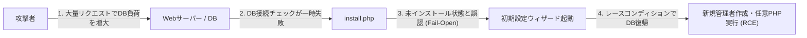

# **本日の AI/開発ツール トピックス (2026-11-27)**

## **1. 📋 今日の30秒サマリー**

> **💡 今日のハイライト**
>
> - **Webサイトやサーバーの「裏口・抜け道」を突く重大な弱点に緊急対応が必要**: 人気CMS「Drupal」の初期設定画面を悪用してサイトを乗っ取る攻撃が実際に発生しており、米国政府が11月27日を期限とする緊急対策を命じました。また、Apache Tomcatやコンテナ基盤LXD、さらにAI開発者向けの偽パッケージにも深刻な警告が出ています。
> - **AIが「攻撃の防御」と「コードの承認」まで担う新時代へ**: CiscoとOpenAIがサーバーを再起動せずに攻撃を瞬時に防ぐオープンソースの盾「Shirudo」を公開したほか、Cognitionの高速コーディングAI「SWE-2.1」や、一定のルール内でAIがコード変更を自動承認する「Claude Ship」が登場しました。
> - **AIエージェントの「目・記憶・スピード」を強化するOSSが急上昇**: 実行中アプリの中身を解析してAIに教える「REA」、超高速で動くGo製CLIエージェント「late-cli」、自律型セキュリティ診断ツール「ARTEX」などがGitHubで注目を集めています。
{: .callout-summary}

| 区分 | トピック / ツール | ざっくり言うと？（1行要約） | 影響・おすすめ対象 |
| :--- | :--- | :--- | :--- |
| 🚨 **緊急** | **Drupal Core** (`CVE-2026-132165`) | インストール画面を強制再実行し管理者権限を奪う「Fail2Install」が実環境で悪用中 | **Drupal運用者（本日11/27がKEV対応期限）** |
| 🚨 **緊急** | **Apache Tomcat** (`CVE-2026-133325`) | クラスタ通信のTLS 1.3設定で認証なしに不正ノードが参加できるCritical脆弱性 | **Tomcat 9.0 / 10.1 / 11.0クラスタ運用者** |
| 🚨 **緊急** | **Canonical LXD** (`CVE-2026-135382` 他) | バックアップやスナップショット名細工でホストOSのrootファイル読み書き・削除が可能 | **LXDコンテナ基盤の管理者（即時更新推奨）** |
| 🚨 **緊急** | **PyPI / npm 悪性パッケージ** (`GHSA-7vxr-6h54-ww37` 他) | AI開発者向けの偽ツールで環境変数やシークレットキーを外部へ窃取 | **MCPやAIエージェント環境を構築する開発者** |
| 🚀 **新機能** | **Cisco & OpenAI「Shirudo」** (OSS) | AIが生成した署名付きeBPFシールドで再起動なしにゼロデイ攻撃を遮断 | **Linuxインフラ・SRE・セキュリティ担当者** |
| 🚀 **新機能** | **Cognition「SWE-2.1」** | 強化学習で大幅進化したコーディングAIと10倍速・セキュリティ特化版が登場 | **Devin利用者・大規模リポジトリ開発者** |
| 🚀 **新機能** | **Anthropic「Claude Ship」** | PRレビューからCI修正、ポリシーに基づく自動承認まで担うエージェント群 | **PRレビュー渋滞を解消したい開発チーム** |
| 🚀 **新機能** | **Signal 画面保護アップデート** | OS標準のAIアシスタントによるチャット画面の自動読み取りを標準でブロック | **プライバシー重視のユーザー・モバイル開発者** |
| 🔥 **注目** | **`morluto/rea` (REA)** | バイナリやElectronアプリをAIが解析できるようにするMCPリバースエンジニアリング基盤 | **解析・互換性調査・デバッグを行う開発者** |
| 🔥 **注目** | **`mlhher/late-cli`** | 10ms未満で起動し並列サブエージェントで文脈劣化を防ぐGo製軽量CLIハーネス | **高速・ローカルLLM対応のCLIを求める層** |
| 🔥 **注目** | **`BaaRai/ARTEX`** | 複数LLMの計画・実行チームが自動で脆弱性検証とレポートを行うOSSペンテスト基盤 | **DevSecOps・セキュリティ診断担当者** |
| 🔥 **注目** | **`thedotmack/claude-mem`** | セッションをまたいで構造化された記憶を保持し長期推論の崩壊を防ぐメモリ層 | **Claude Code等のターミナルAI常用者** |

---

## **2. 🚨 緊急セキュリティ情報**

### **Drupal Core ("Fail2Install") — 初期設定画面の悪用による完全乗っ取り (`CVE-2026-132165`)**

> **🔰 ひとことで言うと**
> すでに公開中のWebサイトに対して、サーバーに一時的な負荷をかけることで「まだ初期設定が終わっていない新品のサイト」だと勘違いさせ、外部から勝手に管理者アカウントを作ってサイトを乗っ取れてしまう極めて危険な弱点です。
> 💬 *例えるなら：営業中の店舗のブレーカーをわざと落として停電させ、再起動の混乱に紛れて「新規オープンの店長登録」を勝手に済ませてお店を乗っ取るような手口です。*
{: .callout-danger}

| リスク度 | 影響を受ける人 | 悪用のされやすさ | まずやるべき対策 |
| :---: | :--- | :--- | :--- |
| 🔴 **緊急 (KEV)** | **Drupal 10 / 11 などの運用者**（特にサポート切れの古いブランチ利用者） | 認証不要・リモートから悪用可能（CVSS **9.8**・**実環境で悪用中**） | **Drupal 10.6.22 / 11.3.22 / 11.4.13 以降へ即時更新し、`install.php` へのアクセスを遮断** |

以下は、「Fail2Install」脆弱性がデータベース接続のエラー処理を逆手に取り、稼働中のサイトを乗っ取るまでの流れを示す図です。



*図の見方：本来 `install.php` は稼働中のサイトでは起動しませんが、サーバーリソース枯渇などでDB接続確認が失敗すると「未設定」と誤判定（Fail-Open）してしまいます。攻撃者はその一瞬の隙にDB接続が回復するタイミングを突いて、管理者権限とRCEを奪取します。*

<details markdown="1">
<summary>🔍 技術的な仕組み・対象バージョン・対策コマンドを見る（エンジニア向け）</summary>

- **原因の仕組み**: Drupal Coreのインストーラ（`install.php`）におけるフェイルオープン（Fail-Open）ロジックの不備（アドバイザリ `SA-CORE-2026-017`）。単一リクエスト内でサーバーリソース上限やデータベース接続エラーを誘発させると、サイトがインストール済みかどうかの検証が失敗を「未インストール」と解釈する。その直後のレースコンディションでDB接続が通ると、稼働中の本番環境でインストーラが進行し、任意の管理者アカウント作成および任意のPHPコード実行（RCE）が可能となる。
- **悪用状況・期限**: 2026年11月19日の公開直後から実環境での悪用が確認され、CISAはKEV（Known Exploited Vulnerabilities）カタログに追加。米国連邦機関への対応期限は**2026年11月27日**に設定されている。
- **対策手順・確認事項**:
  - サポート対象ブランチの修正版（**10.6.22**、**11.3.22**、**11.4.13** 以降）へ即座にアップデートする（11.2.x、10.5.x、8/9系はEOLのためアップグレード必須）。
  - Webサーバー設定で `install.php` への外部アクセスを遮断し、`settings.php` の書き込み権限を厳格化する。
  - パッチ適用後の不完全なインストール状態を突く後続脆弱性（`CVE-2026-136716`）も報告されているため、`update.php` の実行と管理者アカウント（特にUser ID 1）の監査を実施する。
- **一次ソース**: [Drupal Security Advisory SA-CORE-2026-017](https://www.drupal.org/sa-core-2026-017) / [CVE-2026-132165 Record](https://www.cve.org/CVERecord?id=CVE-2026-132165)

</details>

---

### **Apache Tomcat — クラスタ通信のTLS 1.3設定で認証なしノード参加が可能 (`CVE-2026-133325`)**

> **🔰 ひとことで言うと**
> 複数台のサーバーで連携して動くApache Tomcatの「仲間同士の暗号化通信（TLS 1.3）」において、相手が本当に味方かどうかの本人確認が抜けており、悪意ある外部サーバーが勝手に仲間（クラスタ）へ紛れ込めてしまう重大な欠陥が見つかりました。
> 💬 *例えるなら：合言葉付きのトランシーバー（TLS 1.3）を使っているのに、通信開始時の「本当に仲間か？」という身分証チェックを飛ばしてしまうため、部外者が社内ネットワークへ堂々と合流できてしまう状態です。*
{: .callout-danger}

| リスク度 | 影響を受ける人 | 悪用のされやすさ | まずやるべき対策 |
| :---: | :--- | :--- | :--- |
| 🔴 **緊急 (Critical)** | **Apache Tomcat 9.0 / 10.1 / 11.0 でクラスタ通信（TLS 1.3 + TLS-PSK）を利用中の環境** | ネットワーク経由で認証を突破しクラスタ参加が可能（CVSS **9.8**） | **修正版（11.0.30 / 10.1.63 / 9.0.125 以降）へ更新、または暫定策としてTLS 1.2へ変更** |

<details markdown="1">
<summary>🔍 技術的な仕組み・対象バージョン・対策コマンドを見る（エンジニア向け）</summary>

- **原因の仕組み**: 2026年11月25日にJVN（`JVNVU#92527429`）等でも公表されたApache Tomcatの複数脆弱性（計11件）のうち、最も深刻度が高いもの。セッションレプリケーション等を担うグループ通信基盤「Apache Tribes」において、クラスタ間通信の暗号化に **TLS 1.3** と **TLS-PSK（事前共有鍵）** を組み合わせて設定した場合、エンティティ認証なしの鍵交換（CWE-322）が発生し、ピアの検証が適切に行われない。これにより未認証の任意ノードがクラスタへ参加可能となる。
- **対象バージョン**:
  - Apache Tomcat **11.0.28 〜 11.0.29**
  - Apache Tomcat **10.1.62**
  - Apache Tomcat **9.0.124**
- **対策手順・回避策**:
  - **恒久対策**: 公式の修正バージョン（**11.0.30**、**10.1.63**、**9.0.125** 以降）へアップデートする。
  - **暫定回避策**: パッチ適用までの間、クラスタ通信の暗号化プロトコル設定を **TLS 1.2 + TLS-PSK** へ切り替える（本脆弱性はTLS 1.3実装に固有）。
- **一次ソース**: [Apache Tomcat Security Updates](https://tomcat.apache.org/security.html) / [CVE-2026-133325 Record](https://www.cve.org/CVERecord?id=CVE-2026-133325)

</details>

---

### **Canonical LXD — バックアップやスナップショット名細工によるホストOS乗っ取り (`CVE-2026-135382` 他)**

> **🔰 ひとことで言うと**
> Ubuntuなどで広く使われるコンテナ管理ツール「LXD」で、本来は自分の箱庭（コンテナ）の中しか触れないはずの利用者が、バックアップやデータ移動時のファイル名に細工をすることで、親サーバー（ホストOS）の重要ファイルを自由に読み書き・削除できてしまう深刻な弱点が複数公開されました。
> 💬 *例えるなら：シェアハウスの各部屋（コンテナ）の住人が、引っ越し荷物の宛名ラベルに細工をするだけで、大家さんの管理室（root権限）の書類を勝手に書き換えたり捨てたりできてしまう状態です。*
{: .callout-danger}

| リスク度 | 影響を受ける人 | 悪用のされやすさ | まずやるべき対策 |
| :---: | :--- | :--- | :--- |
| 🔴 **高〜緊急** | **Canonical LXD 4.0 / 5.0 / 5.21 / 6.10 系の旧版をマルチテナント運用している環境** | 制限付きプロジェクト権限を持つ認証ユーザーが悪用可能 | **LXDを `4.0.16` / `5.0.12` / `5.21.10` / `6.10.2` 以降へ即時アップデート** |

<details markdown="1">
<summary>🔍 技術的な仕組み・対象バージョン・対策コマンドを見る（エンジニア向け）</summary>

- **原因の仕組み**: 2026年11月26日〜27日にかけてCanonicalから一斉公開されたLXDおよび関連ツール（`pylxd`）の脆弱性群。主な問題は以下の通り。
  - **`CVE-2026-135382`**: バックアップ、イメージ、ストレージボリューム、マイグレーション処理におけるパストラバーサルおよび入力検証不備。制限付きプロジェクトの認証ユーザーが細工されたシンボリックリンクやパスを用いることで、root権限で動作するLXDデーモン経由でホスト側の任意ファイルを読み書き、あるいはメモリ枯渇によるDoSを引き起こす。
  - **`CVE-2026-115843`**: カスタムストレージボリュームのプッシュマイグレーション時に、送信元から渡されるスナップショット名の検証が不十分（CWE-22）なため、パストラバーサルによりホストOS上の任意ファイル書き込み（コード実行）や任意ディレクトリの再帰的削除が可能。
  - **その他同時公開**: `CVE-2026-136972`、`CVE-2026-135373`、`CVE-2026-127153`（分離回避）、および `pylxd` 2.4.3未満のTLS/WebSocket証明書検証不備（`CVE-2026-127163`）。
- **対策手順・コマンド**:
  ```bash
  # Snap版LXDの更新確認およびチャンネル適用例
  sudo snap refresh lxd
  lxd --version
  ```
  - 修正済みバージョン（**4.0.16**、**5.0.12**、**5.21.10**、**6.10.2** 以降）および `pylxd` 2.4.3以降へ速やかに更新する。
- **一次ソース**: [CVE-2026-135382 Record](https://www.cve.org/CVERecord?id=CVE-2026-135382) / [CVE-2026-115843 Record](https://www.cve.org/CVERecord?id=CVE-2026-115843) / [Canonical LXD GitHub](https://github.com/canonical/lxd)

</details>

---

### **PyPI / npm AI関連悪性パッケージ — 環境変数と秘密鍵を盗むサプライチェーン攻撃 (`GHSA-7vxr-6h54-ww37` 他)**

> **🔰 ひとことで言うと**
> AIエージェントの開発者が使いそうな名前（`mcp-runtime-report` や `create-ai-agent-setup`）を装った悪意あるプログラムがPyPIとnpmに公開され、インストールした開発者のパソコンからAPIキーやパスワードなどの環境変数を外部へ送信してしまう被害が警告されました。
> 💬 *例えるなら：DIYショップで「最新スマートホーム用セットアップキット」という箱を買って開けたら、中に家の鍵や暗証番号を盗み取って送信する盗聴器が仕込まれていた状態です。*
{: .callout-danger}

| リスク度 | 影響を受ける人 | 悪用のされやすさ | まずやるべき対策 |
| :---: | :--- | :--- | :--- |
| 🟠 **高 (サプライチェーン)** | **Python (PyPI) や Node.js (npm) でMCPやAIエージェント環境を構築する開発者** | タイポスクワッティングやAIツール検索経由のインストールで即発動 | **該当パッケージの導入有無を確認し、混入時は即座に削除と全APIキー・シークレットのローテーションを実施** |

<details markdown="1">
<summary>🔍 技術的な仕組み・対象パッケージ・対策コマンドを見る（エンジニア向け）</summary>

- **原因の仕組み**: 2026年11月25日にGitHub Security Advisories（GHSA）へ登録されたAI開発者標的型のマルウェアパッケージ2件。
  - **`mcp-runtime-report` (PyPI / `GHSA-7vxr-6h54-ww37`)**: MCP（Model Context Protocol）のランタイム診断・レポートツールを装い、実行時にシステム上の環境変数（APIトークン、クラウド認証情報等）を収集して外部サーバーへ送信（Exfiltration）する悪意あるコードを含む。
  - **`create-ai-agent-setup` (npm / `GHSA-4c46-v99r-6h9r`)**: AIエージェントの初期構築CLIを装い、ローカルマシン上のシークレットや暗号鍵を窃取するマルウェアを含む。
- **対策手順・確認コマンド**:
  ```bash
  # Python環境での確認
  pip list | grep -i mcp-runtime-report
  # Node.js / pnpm環境でのロックファイル確認
  grep -rn "create-ai-agent-setup" package.json pnpm-lock.yaml package-lock.json
  ```
  - 誤って実行した場合は、該当環境の破棄・パッケージ削除に加え、その端末に設定していたOpenAI/Anthropic/AWS/GitHub等の全シークレットを即時失効・再発行する。
- **一次ソース**: [GHSA-7vxr-6h54-ww37 (PyPI)](https://github.com/advisories/GHSA-7vxr-6h54-ww37) / [GHSA-4c46-v99r-6h9r (npm)](https://github.com/advisories/GHSA-4c46-v99r-6h9r)

</details>

---

## **3. 🚀 メジャーリリース・新機能**

### **Cisco & OpenAI「Shirudo」 — AIが生成した署名付きeBPFの盾でゼロデイ攻撃を無停止防御**

> **🔰 ひとことで言うと**
> サーバーのプログラムに新しい弱点が見つかった際、正式な修正プログラムが届くまでの数日〜数週間の「無防備な空白期間」を埋めるため、AIが作成した一時的な防御ルール（盾）をLinuxカーネルに直接組み込んで、サーバーを再起動せずに攻撃だけをブロックできるオープンソース基盤が公開されました。
> 💬 *例えるなら：ビルの壁にヒビが見つかったとき、大掛かりな解体工事（再起動）をせず、AIが設計した強化ガラスの「透明な盾（シールド）」をその場ではめ込み、不審者だけを弾き返すような仕組みです。*
{: .callout-info}

| 比較ポイント | これまで (Before) | Shirudo 導入後 (After) |
| :--- | :--- | :--- |
| **パッチ適用までの空白期間** | 公式パッチの検証・再起動に数日〜数週間かかり無防備になりがち | **AIが即座に一時防御（シールド）を起案し無停止で適用** |
| **正常通信への影響** | WAF等の大雑把な遮断では誤検知やサービス停止リスクがあった | **eBPFでカーネル内の特定攻撃経路のみを精密にブロック** |
| **防御コードの信頼性・監査** | 緊急回避スクリプトの改ざん検知や監査証跡の管理が煩雑 | **暗号署名（`.bee`）とTPM 2.0ハードウェア記録で完全監査** |

以下は、CiscoとOpenAIが共同開発した「Shirudo」において、脆弱性発見から無停止防御までの流れを示す図です。


*図の見方：AIエージェントが一時防御（シールド）のコードを生成し、人間の承認と暗号署名を経てOCIレジストリから配信されます。Linuxカーネルは署名付きプログラムのみをeBPFとして受け入れ、ハードウェアチップ（TPM 2.0）に記録を残しながら、稼働中のサービスを止めずに攻撃を無力化します。*

<details markdown="1">
<summary>🔍 技術的ブレークスルーとリリースノート詳細を見る</summary>

- **技術的ポイント**: 日本語の「シールド（盾）」を冠したBSD-2-ClauseライセンスのOSSプロジェクト（CiscoのIsovalent/Tetragonチームの知見を活用）。OpenAIのCodexなどのAIエージェントが脆弱性の挙動（例：ElasticsearchにおけるJava4Shell攻撃）を解析し、入力検証を追加するなどの一時的なマイクロパッチ（`.bee`形式のeBPFプログラム）を生成する。
- **厳格なセキュリティ設計**: たとえ攻撃者が管理者権限を奪っても不正なeBPFプログラムを注入できないよう、`bpf()` システムコールを制限し、信頼されたオペレーターの暗号署名付きパッケージのみを許可する。さらにすべてのロード／アンロード履歴を **TPM 2.0** へ計測記録し、改ざん不可能なフォレンジック証跡を担保する。
- **提供形態**: GitHubリポジトリにてソースコードおよびドキュメントが公開済み。OCIレジストリ経由でのシールド配布に対応。
- **公式リンク**: [GitHub: shirudo-dev/shirudo](https://github.com/shirudo-dev/shirudo) / [Shirudo 公式サイト](https://shirudo.dev/)

</details>

---

### **Cognition「SWE-2.1」 — 純粋強化学習で大幅進化したコーディングAIと10倍速モデル**

> **🔰 ひとことで言うと**
> 自律型AIエンジニア「Devin」を開発するCognition社が、最新のコーディング専用AIモデル「SWE-2.1」を発表しました。従来版より複雑な開発作業の成功率が大幅に上がったほか、10倍高速なモデルやサイバー防御に特化したモデルも同時に提供されます。
> 💬 *例えるなら：新人プログラマーだったAIが実戦練習（強化学習）を積み重ねてベテランの域に達し、さらに「超特急便」と「セキュリティ専門チーム」の3人体制に増強されたような進化です。*
{: .callout-info}

| 比較ポイント | これまで (SWE-2) | SWE-2.1 以降 (After) |
| :--- | :--- | :--- |
| **複雑な端末・開発作業力** | Terminal-Bench 4.1 等で一定の限界があった | **純粋強化学習により Terminal-Bench 4.1 で 50.0 を達成（約倍増）** |
| **応答速度・スループット** | 大規模編集では推論待ち時間がボトルネック | **Cerebras基盤上の「Lightning / Ultrafast」で推論速度が約10倍** |
| **セキュリティ診断用途** | 一般的なセーフガードにより攻撃検証が制限 | **「SWE-2.1 Cyber」で防御側（Devin Security）の検証精度が大幅向上** |

<details markdown="1">
<summary>🔍 技術的ブレークスルーとリリースノート詳細を見る</summary>

- **技術的ポイント**: Kimi K3ベースモデル上に純粋な強化学習（Pure Reinforcement Learning）を施し、長期ホライズン（Long-horizon）のソフトウェア工学タスク向けに最適化された。ベンチマークでは **Terminal-Bench 4.1 で 50.0**（前世代から約2倍）、セキュリティ領域の **ExploitBench で 80.0** を記録している。
- **提供バリエーション**:
  - **Standard SWE-2.1**: Devin Desktop、Cloud、CLIの標準エンジンとして稼働。
  - **SWE-2.1 Lightning (Ultrafast)**: Cerebrasのウェハースケールハードウェア上で提供され、従来比約10倍のトークン生成速度を実現。
  - **SWE-2.1 Cyber**: 防御的・攻撃的セキュリティワークフロー向けにセーフガードを調整したモデルで、Devin Security顧客向けに提供。
- **公式リンク**: [Cognition 公式サイト](https://cognition.com/)

</details>

---

### **Anthropic「Claude Ship」 — PRレビューからCI修復、ルールに基づく自動承認まで一気通貫**

> **🔰 ひとことで言うと**
> プログラムの変更提案（プルリクエスト）をチェックするAI機能が大幅に進化し、バグ探しだけでなく「テスト失敗の自動修正」や「チームの安全ルールを満たしていればAIが自動で承認ボタンを押す」ことまでできるようになりました。
> 💬 *例えるなら：上司のハンコ待ちで止まっていた書類の山を、専属秘書（AI）が下読みして誤字を直し、定型案件なら既定ルールに沿って代理で承認印まで押してくれるような仕組みです。*
{: .callout-info}

| 比較ポイント | これまで (Before) | Claude Ship 以降 (After) |
| :--- | :--- | :--- |
| **PRレビューの役割** | 改善点をコメントで指摘するまで（修正は人間） | **「PR Steward」がCI失敗やコンフリクトを自動で修正・再プッシュ** |
| **マージ承認のボトルネック** | 軽微な変更でも人間の承認待ちで開発が停滞 | **`.claude/approvals.yml` のポリシー合致で「Claude Approvals」が自動承認** |
| **操作・導入の手軽さ** | 複数ツールや個別CIスクリプトの連携が必要 | **Claude Team / Enterprise向けに統合提供、`/ship` コマンドで即起動** |

<details markdown="1">
<summary>🔍 技術的ブレークスルーとリリースノート詳細を見る</summary>

- **3つの主要エージェント構成**:
  1. **Code Review**: リポジトリ全体の文脈を踏まえた多角的な敵対的（Adversarial）コードレビューを実施。
  2. **PR Steward (Beta)**: プッシュ後のCIチェック失敗、マージコンフリクト、人間のレビュアーからの指摘事項に自動で応答・修正を行う。
  3. **Claude Approvals (Beta)**: リポジトリ内の `.claude/approvals.yml` に定義されたチーム固有のポリシーに基づき、定型的な変更を人間なしで自動承認する。
- **安全管理機能**: 導入初期向けに承認を行わず記録のみを残す「Observe-onlyモード」を推奨しているほか、管理者はトークン消費上限、レビュー深度、対象リポジトリの制限を設定可能。Claude Codeからは `/ship` コマンドで直接呼び出せる。
- **公式リンク**: [Anthropic / Claude 公式](https://claude.com/)

</details>

---

### **Signal — OS標準AIアシスタントによるチャット画面の自動読み取りを標準ブロック**

> **🔰 ひとことで言うと**
> 暗号化メッセージアプリ「Signal」が、スマホのOS（iOSやAndroid）に組み込まれたAIアシスタント（SiriやGeminiなど）が勝手に画面を覗き見してチャット内容を読み取る機能を、初期設定でブロックするアップデートを公開しました。
> 💬 *例えるなら：鍵付きの秘密の手紙を読んでいたら、OSという「机の上の監視カメラ（AI秘書）」が肩越しに覗き込もうとしたため、手紙の紙自体に「カメラには映らない特殊加工」を施したような対策です。*
{: .callout-info}

| 比較ポイント | これまで (Before) | Signal 最新版以降 (After) |
| :--- | :--- | :--- |
| **OS AIによる画面認識** | Siriの画面認識やGemini Intelligenceが通知・画面を解析可能 | **iOS / Android双方で画面キャプチャ・AI読み取りを標準ブロック** |
| **暗号化の防衛ライン** | 通信経路（E2EE）を守っても、端末画面上でAIに読まれる懸念 | **アプリケーション層のプライバシー境界をOSエージェントから隔離** |

<details markdown="1">
<summary>🔍 技術的ブレークスルーとリリースノート詳細を見る</summary>

- **技術的ポイント**: iOSおよびAndroidでOS統合型AIエージェントによる「画面認識（Onscreen Awareness）」や自動スクリーンショット解析が普及する中、Signal代表のMeredith Whittaker氏がこれをアプリ層プライバシーへの「存亡の危機（existential threat）」と指摘。最新アップデートでは画面セキュリティ制限とスクリーンショットブロックをデフォルトで有効化し、OSレベルのAIエージェントが暗号化済みメッセージ内容を抽出できないようにした。
- **業界への影響**: Hacker News等でも「ローカルOSの利便性」と「E2EEアプリのプライバシー境界」の衝突として大きな議論を呼んでいる。
- **公式リンク**: [Signal Official Blog](https://signal.org/blog/)

</details>

---

## **4. 🔥 注目のトレンドツール**

### **`morluto/rea` (Reverse Engineer Anything) — AIに実行中アプリの中身を解析させるMCPサーバー**

> **🔰 ひとことで言うと**
> ソースコードが手元にないコンパイル済みのアプリやデスクトップソフトの中身を、AIエージェントが自動で分解・解析して仕組みを理解できるようにする新しい共通接続ツール（MCPサーバー）がGitHubで爆発的な人気を集めています。
> 💬 *例えるなら：ブラックボックスだった家電製品を、AI専用の「X線透視メガネ」を通して内部の配線や動作をすべて読み解けるようにするツールです。*
{: .callout-tip}

| 注目ポイント | 内容 | おすすめ対象 |
| :--- | :--- | :--- |
| **何ができるか** | ネイティブバイナリ、Electron/JSアプリ、.NETアセンブリ等の静的・動的解析をAIに実行させる | **レガシーアプリ解析・互換API調査・セキュリティ研究者** |
| **注目の理由** | AIがコードを書く「前」に、既存ソフトの挙動を正確に把握できるため修復精度が劇的に向上 | **MCP対応のClaude Code / Cursor等を使うエンジニア** |

<details markdown="1">
<summary>🔍 主な機能・アーキテクチャ・導入方法を見る</summary>

- **主な機能・用途**: TypeScript製のMCP（Model Context Protocol）サーバーとして実装されており、コーディングエージェントがコードを書いたりバグを修正したりする前に、ビルド済みアプリケーションの内部構造やライブランタイムの挙動を直接検査できる。
- **対応ターゲット**: ネイティブバイナリ、JavaScript/Electronパッケージ、.NETアセンブリなど幅広い実行環境をカバー。
- **導入方法**: MCPクライアント（Claude Code、Cursor等）の設定ファイルに `morluto/rea` のサーバー定義を追加して接続する。
- **公式サイト/GitHub**: [GitHub: morluto/rea](https://github.com/morluto/rea)

</details>

---

### **`mlhher/late-cli` (`late`) — 10ms未満起動・並列サブエージェント強制のGo製軽量CLIハーネス**

> **🔰 ひとことで言うと**
> PythonやNode.jsの重い環境構築を一切必要とせず、10ミリ秒未満でサクッと起動し、さらに「長い作業になるとAIがボケてくる問題」を複数の分身（サブエージェント）の並列処理で解決する超高速な開発用CLIツールです。
> 💬 *例えるなら：重い工具箱を抱えて準備に時間がかかる作業員ではなく、ポケットから10ミリ秒で取り出して複数人で手分けして片付ける超軽量マルチツールです。*
{: .callout-tip}

| 注目ポイント | 内容 | おすすめ対象 |
| :--- | :--- | :--- |
| **何ができるか** | 単一Goバイナリで動作し、ローカルLLMサーバー（`llama-server`）の自動検出と並列エージェント実行を行う | **軽量・高速なCLI環境とローカルLLMを好む開発者** |
| **注目の理由** | 長時間の会話で推論精度が落ちる「文脈劣化」を、構造的にサブエージェント分離することで回避 | **長時間・大規模タスクを自律実行させたいエンジニア** |

<details markdown="1">
<summary>🔍 主な機能・アーキテクチャ・導入方法を見る</summary>

- **主な機能・用途**: Go言語で書かれた単一バイナリ（Python/Node.js依存ゼロ）で、起動時間は10ms未満。ローカルで稼働する `llama-server` 等を自動検出し、長い軌跡（Trajectory）でもコンテキストウィンドウが汚染されないよう並列サブエージェント実行を強制する設計が特徴。
- **他の類似ツールとの比較**: Node.jsやPythonベースの重いエージェントハーネスと異なり、CIコンテナやSSH先の軽量Linux環境へバイナリ1つで即座に持ち込める。
- **公式サイト/GitHub**: [GitHub: mlhher/late-cli](https://github.com/mlhher/late-cli)

</details>

---

### **`BaaRai/ARTEX` — 複数AIが計画と検証を分担する自律型ペネトレーションテスト基盤**

> **🔰 ひとことで言うと**
> 専門のセキュリティ技術者が行っていた「システムの弱点探し（侵入テスト）」を、計画係と実行係に分かれた複数のAIチームが自動で進め、証拠付きの診断レポートまで作ってくれるオープンソースのセキュリティツールです。
> 💬 *例えるなら：攻撃テスト専門のホワイトハッカーチームを、24時間自動で動かせる「AIの模擬攻撃部隊」として自社サーバーに配置できる仕組みです。*
{: .callout-tip}

| 注目ポイント | 内容 | おすすめ対象 |
| :--- | :--- | :--- |
| **何ができるか** | Planner/Worker構造のマルチエージェントが偵察・脆弱性検証・証拠付きレポート生成を自律実行 | **DevSecOpsチーム・社内セキュリティ診断担当者** |
| **注目の理由** | 攻撃側のAI自動化に対抗するため、開発者自身で継続的な自律攻撃テストを回せる需要が急増 | **自社プロダクトのリリース前検証を強化したい組織** |

<details markdown="1">
<summary>🔍 主な機能・アーキテクチャ・導入方法を見る</summary>

- **主な機能・用途**: `Autumn-27` をルーツに持つアクティブなOSSフォークであり、Go製バックエンド上でPlanner（計画）とWorker（実行）のマルチエージェントLLMチームを協調動作させる。資産・探索グラフを構築しながら、根拠（Evidence）付きの脆弱性レポートを自動生成する。
- **活用上の注意**: 自律的な侵入テストツールであるため、必ず自社の管理下にある許可された検証環境・ターゲットに対してのみ使用し、アクセス制御を徹底する必要がある。
- **公式サイト/GitHub**: [GitHub: BaaRai/ARTEX](https://github.com/BaaRai/ARTEX)

</details>

---

### **`thedotmack/claude-mem` — セッションをまたいでAIの推論崩壊を防ぐ永続メモリ層**

> **🔰 ひとことで言うと**
> ターミナルで使うAIコーディングツールが、会話が長くなったり翌日別の画面で再開したりすると「昨日の前提を忘れて変なコードを書く」問題を解決するため、構造化された記憶をファイルとしてしっかり引き継ぐためのツールです。
> 💬 *例えるなら：毎日引き継ぎ書をゼロから読み直すアルバイトではなく、案件ごとの「整理された業務ノート」を手元に置いて正確に続きから作業できる熟練スタッフにする仕組みです。*
{: .callout-tip}

| 注目ポイント | 内容 | おすすめ対象 |
| :--- | :--- | :--- |
| **何ができるか** | ターミナルエージェント向けに構造化された永続コンテキストを保存・検索・注入する | **Claude Code等のCLIエージェントを長期案件で使う開発者** |
| **注目の理由** | 長文コンテキストでの推論崩壊（Context Collapse）を防ぐ実用的なメモリ管理層として高評価 | **プロジェクトの設計方針や制約をAIに忘却させたくない層** |

<details markdown="1">
<summary>🔍 主な機能・アーキテクチャ・導入方法を見る</summary>

- **主な機能・用途**: ターミナルベースのAIエージェントがセッションを跨いでもプロジェクトの文脈、設計判断、過去の修正経緯を失わないよう、構造化されたメモリレイヤーを提供する。
- **導入効果**: 毎回巨大なコンテキストを丸ごとプロンプトに詰め込むのではなく、必要な構造化記憶を適切に引き出すことで、トークン消費の抑制と推論精度の維持を両立する。
- **公式サイト/GitHub**: [GitHub: thedotmack/claude-mem](https://github.com/thedotmack/claude-mem)

</details>

---

## **5. 💡 その他・Tips**

- **Google Labs「Stitch Loop」が継続的改善エージェントを実験公開**: 開発者が指示を出すのを待つのではなく、GitHubリポジトリと本番のテレメトリ・ログ・ユーザー行動データを直結させ、セキュリティ（Gemini 4 Carbon＋CodeMender連携）・遅延・アクセシビリティを24時間監視してサンドボックス検証済みのPRを自動作成する実験的エージェント「Stitch Loop」が注目を集めています（マージは人間が承認）。([Google Blog](https://blog.google/))
- **エンタープライズ向けAI脆弱性診断サービスが相次ぎ始動**: 11月25日、富士通がOpenAIの「Daybreak Defense Network」への参画と新たな脆弱性診断サービスの提供開始を発表したほか、DXC TechnologyもAnthropicのモデルを活用したマネージドサービス「Frontier Code Assurance」を開始するなど、AIによる高速な攻撃に対抗する防御サービスの商用化が加速しています。
- **「115個の重み」をClaudeが手書きして迷路を解く実験が話題**: 通常の機械学習（勾配降下法による学習データからの訓練）を一切使わず、Claudeが数学的推論だけでわずか115個の非ゼロ重みを直接指定して「迷路を解く極小Transformer」を構築する実験（Looped Weight-Space Programming）がHacker NewsやSNSで大きな話題となりました。

---

## **6. 📝 総評**

> **📌 今日の一言まとめ**
> AIが「コードを書く」段階から「システムを無停止で守り、PRを承認し、24時間改善し続ける」運用フェーズへ突入する一方、開発者環境そのものを狙うサプライチェーン攻撃や実悪用（KEV）への警戒が一段と高まった一日でした。
{: .callout-summary}

本日のトピックスを俯瞰すると、**「AIエージェントの主戦場がコード生成から『運用・防御・検証』へ完全にシフトした」**ことが明確に読み取れます。

1. **「パッチ待ちの空白時間」をAIとeBPFで埋める新アプローチ**: Drupalの「Fail2Install（`CVE-2026-132165`）」が公開直後に実悪用され本日がCISA KEV対応期限となったように、脆弱性の公開から攻撃までの時間（Time-to-Exploit）は極限まで短くなっています。CiscoとOpenAIによる「Shirudo」は、この構造的課題に対して「AIによる一時防御コード生成 × eBPFカーネル無停止適用 × TPM 2.0監査」という現実的かつ堅牢な解を提示しました。
2. **レビューと改善ループの自律化**: 「Claude Ship」のルールベース自動承認や「Stitch Loop」のテレメトリ駆動PR生成は、AIが書いた大量のコードを人間がさばききれない「レビュー渋滞」を解消する次の一手です。一方で、Signalの画面ブロックに見られるように、OSレベルのAIエージェントとプライバシー境界の摩擦も表面化しています。
3. **AI開発者自身を狙う足元の脅威**: `mcp-runtime-report` や `create-ai-agent-setup` といったAI関連ツールを装う悪性パッケージの出現は、新しいエコシステムが拡大するたびに真っ先に攻撃者の標的になる現実を示しています。エンジニアは新しいMCPサーバーやCLIを導入する際、公式リポジトリの検証とシークレット管理の最小権限化をこれまで以上に徹底する必要があります。

---

## **7. 📖 用語解説**

| 用語 | 解説 |
|------|------|
| **eBPF (Extended Berkeley Packet Filter)** | Linuxカーネル（OSの中核）を再起動や改造をせずに、安全な箱庭の中で小さな監視・制御プログラムを高速に動かせる技術。建物の基礎を壊さずに高性能なセンサーや防犯ゲートを後付けするイメージです。 |
| **TPM 2.0 (Trusted Platform Module)** | パソコンやサーバーの基板上に載っているセキュリティ専用の暗号チップ。ソフトウェアからは改ざんできない「金庫付きの公証人」として、システムが改ざんされていない証明を記録します。 |
| **CISA KEV (Known Exploited Vulnerabilities)** | 米国土安全保障省のサイバーセキュリティ機関（CISA）が管理する「現在進行形で実際に悪用が確認されている危険な脆弱性リスト」。ここに載った弱点は最優先での修正が求められます。 |
| **Fail-Open (フェイルオープン)** | システムにエラーや障害が起きた際、「安全側に倒して止める（Fail-Close）」のではなく「制限を緩めて通してしまう」設計上の挙動。セキュリティでは致命的な抜け道になりやすい弱点です。 |
| **パストラバーサル (Path Traversal)** | ファイル名に `../`（一つ上のフォルダへ戻る記号）などを紛れ込ませ、本来アクセスが許可されたフォルダの外にある重要ファイルを覗き見たり書き換えたりする攻撃手法です。 |
| **TLS-PSK (Pre-Shared Key)** | サーバー同士の通信を暗号化する際、電子証明書ではなく「あらかじめ双方で共有した秘密の合言葉（鍵）」を使って認証・暗号化を行う方式です。 |
| **サプライチェーン攻撃** | 標的の企業や開発者を直接攻撃するのではなく、開発者が日常的にダウンロードする外部のライブラリやツール（部品の供給網）に毒を仕込んで侵入する手口です。 |
| **リバースエンジニアリング** | 完成したソフトウェアや製品を分解・解析し、内部の設計図や動作の仕組みを逆算して調べ出す技術のことです。 |

---
(出典: 各公式サイト、GitHub、リリースノート、CVE/JVN/GHSAアドバイザリ、TechニュースサイトよりAIが要約)

<!-- Kramdown略語定義: 本文中の対象単語に自動でインラインツールチップが付与されます -->
*[RCE]: Remote Code Execution（外部からネットワーク越しに任意のプログラムを勝手に実行される深刻な脆弱性）
*[CVE]: Common Vulnerabilities and Exposures（世界共通で割り振られるセキュリティ脆弱性の識別番号）
*[GHSA]: GitHub Security Advisory（GitHub上で公開・管理されるセキュリティ警告識別子）
*[CVSS]: Common Vulnerability Scoring System（脆弱性の深刻度を0〜10の数値で評価する共通規格）
*[MCP]: Model Context Protocol（AIエージェントと外部ツール・データソースを安全に繋ぐためのオープン共通規格）
*[eBPF]: Extended Berkeley Packet Filter（Linuxカーネル内で安全かつ高速に監視・制御プログラムを実行できる技術）
*[TPM]: Trusted Platform Module（改ざん耐性を備えたハードウェアのセキュリティチップ）
*[KEV]: Known Exploited Vulnerabilities（CISAが管理する「実環境で悪用が確認された脆弱性」カタログ）
*[OSS]: Open Source Software（ソースコードが公開され、誰でも利用・改変・再配布できるソフトウェア）
*[PR]: Pull Request（GitHub等でコードの変更内容をチームに共有し、レビューと取り込みを依頼する仕組み）
*[CI]: Continuous Integration（コード変更のたびに自動でビルドやテストを実行して品質を保つ仕組み）
*[EOL]: End of Life（ソフトウェアの公式サポートやセキュリティアップデートの提供が終了した状態）
*[DoS]: Denial of Service（大量のリクエストや負荷をかけてサービスを停止させる攻撃・障害）
