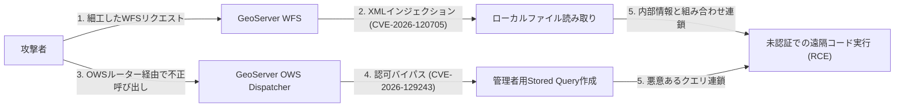
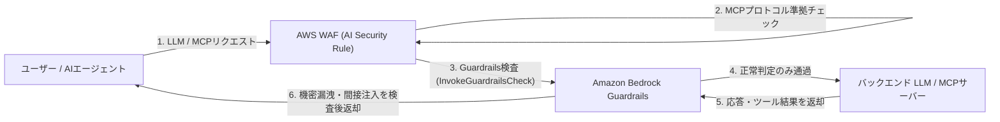

# **本日の AI/開発ツール トピックス (2026-11-28)**

## **1. 📋 今日の30秒サマリー**

> **💡 今日のハイライト**
>
> - **すでに悪用中の重大な弱点が相次いで緊急警告入り**: 地図情報サーバー「GeoServer」やCMS「Drupal」の後続問題が米国政府の緊急対応リスト（KEV）に追加されたほか、Linuxの認証部品やCI/CD連携、リモートデスクトップ基盤でも深刻な弱点が見つかっています。
> - **「AIの通信を守る盾」と「公開後も育てるAI」が実用段階へ**: AWSがAIエージェント専用の通信監視ルール（WAF）を一般公開し、裏口に潜むAI窓口の自動発見に対応しました。Googleもアプリ公開後に自動で改善提案から修正まで回す「Stitch Loop」などを展開しています。
> - **重たい画面を捨てた超軽量ツールと「AIの嘘を防ぐ仕組み」が人気**: ブラウザ技術を使わず爆速で動くAI開発ツール「Prospero」や、従来の機械チェックとAIを組み合わせてレビュー精度を高める「Open Code Review」などが開発者の注目を集めています。
{: .callout-summary}

| 区分 | トピック / ツール | ざっくり言うと？（1行要約） | 影響・おすすめ対象 |
| :--- | :--- | :--- | :--- |
| 🚨 **緊急** | **OSGeo GeoServer** (`CVE-2026-120705` 他) | 設定ファイル盗み見と権限突破の連鎖でサイト乗っ取りが実環境で悪用中 | **GeoServer運用者（即時アップデート必須）** |
| 🚨 **緊急** | **Drupal Core** (`CVE-2026-136716`) | 前回パッチの隙間を突き、不完全な初期設定状態から管理者権限を奪取 | **Drupal運用者（11.4.14 / 11.3.23 / 10.6.23へ更新）** |
| 🚨 **緊急** | **`pam-mysql`** (`CVE-2026-124749`) | 設定フラグの反転バグにより、条件次第で任意のパスワードでログイン可能 | **MySQL連携PAMを使うLinuxサーバー管理者** |
| 🚨 **緊急** | **ToolJet** (`CVE-2026-137964`) | PRタイトルの細工によりGitHub Actions上で任意コマンドが実行可能 | **ToolJet 3.21.96-LTS未満の運用者・CI/CD担当者** |
| 🚨 **緊急** | **FreeRDP** (`CVE-2026-137459`) | 悪意あるサーバーからの画像データでメモリが膨張しクライアントが強制終了 | **FreeRDP 2.11.2〜3.33.0利用者** |
| 🚀 **新機能** | **AWS WAF AI Security & API Portal** | 社内に隠れたAI/MCP窓口を自動発見し、プロンプト攻撃を通信入口で遮断 | **AWS上でLLMやMCPサーバーを運用するチーム** |
| 🚀 **新機能** | **Google「Stitch Loop」＆「Decision 1」** | 公開後アプリを自律改善するAIと、150ms台でYes/No判定を返す高速API | **プロダクト開発者・AIパイプライン設計者** |
| 🚀 **新機能** | **Solana Playground AI統合** | ブラウザ上のスマートコントラクト開発環境にAIコーディング支援を標準搭載 | **Web3・Solanaブロックチェーン開発者** |
| 🚀 **新機能** | **AppJet「Security+」** | GitHubブランチ単位でデータの流れを追い、脆弱性をAIが自動監査 | **高速開発チーム・セキュリティ担当者** |
| 🔥 **注目** | **`skeeto/prospero`** | Web技術を使わずC++で書かれた、単一ファイルで爆速動作するAI開発基盤 | **軽量・ローカルLLM対応の開発環境を求める層** |
| 🔥 **注目** | **`GoogleChrome/modern-web-guidance`** | AIコーディングツールに最新のWeb標準とブラウザ互換性を教える公式スキル集 | **フロントエンド開発者・AIエージェント利用者** |
| 🔥 **注目** | **`alibaba/open-code-review`** | 従来の静的解析とLLMを融合し、誤検知とトークン消費を抑えたレビューCLI | **PRレビューの品質とコストを最適化したいチーム** |
| 🔥 **注目** | **`openclaw/openclaw`** | 認証情報の漏洩やツール汚染を防ぎつつチャットとローカルツールを繋ぐ基盤 | **自宅サーバー・個人用AIエージェント構築者** |

---

## **2. 🚨 緊急セキュリティ情報**

### **OSGeo GeoServer — ファイル読み取りと権限突破の連鎖攻撃がKEV入り (`CVE-2026-120705` / `CVE-2026-129243`)**

> **🔰 ひとことで言うと**
> 地図データなどを配信するサーバーソフト「GeoServer」において、ログインなしでサーバー内の重要な設定ファイルを覗き見られる弱点と、管理者専用の操作を勝手に実行できる弱点が組み合わさり、実際に悪用されています。
> 💬 *例えるなら：建物の「郵便受けから中の書類を盗み見る穴」と「従業員専用ドアの鍵のかけ忘れ」が同時に見つかり、部外者が勝手に奥の部屋へ侵入して設備を乗っ取れる状態です。*
{: .callout-danger}

| リスク度 | 影響を受ける人 | 悪用のされやすさ | まずやるべき対策 |
| :---: | :--- | :--- | :--- |
| 🔴 **緊急 (KEV)** | **インターネット公開中のGeoServer運用者**（地理空間情報システム等） | 認証不要・自動スキャンによる探索と悪用を実環境で確認（CVSS **8.6 / 8.8**） | **GeoServer 3.0.2 / 2.28.6 / 2.27.7 以降へ即時アップデート** |

以下は、2つの脆弱性（`CVE-2026-120705` と `CVE-2026-129243`）および関連欠陥を組み合わせて未認証RCEへ至る攻撃の流れを示す図です。



*図の見方：単体でもファイル窃取や権限外操作が可能な2つの欠陥が、他の公開済み脆弱性（`CVE-2026-129245` 等）と組み合わさることで、ログインなしでのサーバー完全乗っ取り（RCE）に発展します。*

<details markdown="1">
<summary>🔍 技術的な仕組み・対象バージョン・対策コマンドを見る（エンジニア向け）</summary>

- **原因の仕組み**:
  - **`CVE-2026-120705` (CVSS 8.6)**: WFS（Web Feature Service）コア処理におけるXMLインジェクション／任意ファイル読み取り脆弱性。細工された単一リクエストで、GeoServerプロセスが読めるローカルテキストファイルの取得や任意のHTTP/HTTPS先へのアクセスが可能。
  - **`CVE-2026-129243` (CVSS 8.8)**: OWSルーティング／ディスパッチャにおける認可不備。サービスセキュリティルールで管理者に制限されているはずのWFS Stored Queryの作成・削除などを未認証ユーザーから呼び出せる。
  - **悪用状況**: 2026年11月23〜24日のパッチ公開直後からハニーポット上でStored Queryの生成・削除を試みる自動スキャンが観測され、**11月27日にCISA KEVカタログへ追加**された。
- **対策手順**:
  - 安定版は **GeoServer 3.0.2** 以降、メンテナンス版は **2.28.6** 以降へ直ちに更新する。
  - EOLブランチ（2.27系）を一時的に維持する場合は暫定ブリッジ版 **2.27.7** を適用し、速やかにサポート対象ブランチへ移行する。
  - WFS Stored Queryや管理インターフェースへの外部アクセスをリバースプロキシ・WAFで制限し、不審なStored Queryが作成されていないか監査する。
- **一次ソース**: [CISA KEV Catalog](https://www.cisa.gov/known-exploited-vulnerabilities-catalog) / [CVE-2026-120705](https://www.cve.org/CVERecord?id=CVE-2026-120705) / [CVE-2026-129243](https://www.cve.org/CVERecord?id=CVE-2026-129243)

</details>

---

### **Drupal Core — 前回パッチの隙間を突く不完全インストール状態のサイト乗っ取り (`CVE-2026-136716`)**

> **🔰 ひとことで言うと**
> 昨日話題になったDrupalの緊急弱点（Fail2Install）を塞いだ後でも、「初期設定が途中半端なまま残っていたサイト」を外部から強制的に設定画面へ誘導し、サイトを乗っ取れてしまう別の抜け道が見つかり、すでに悪用されています。
> 💬 *例えるなら：玄関の鍵は新しく付け替えたのに、建設途中で放置されていた勝手口が閉まっておらず、そこから侵入されてしまう状態です。*
{: .callout-danger}

| リスク度 | 影響を受ける人 | 悪用のされやすさ | まずやるべき対策 |
| :---: | :--- | :--- | :--- |
| 🔴 **緊急 (KEV)** | **Drupal 10 / 11 の全運用者**（特に `install.php` が外部公開されている環境） | 認証不要・強制ブラウジングで悪用可能（**11月27日にKEV追加**） | **Drupal 11.4.14 / 11.3.23 / 10.6.23 以降へ更新し `update.php` を実行** |

<details markdown="1">
<summary>🔍 技術的な仕組み・対象バージョン・対策コマンドを見る（エンジニア向け）</summary>

- **原因の仕組み**: 先行する脆弱性（`CVE-2026-132165` / `SA-CORE-2026-017`）の修正後、異常状態や不完全なインストール状態のまま残されたサイトにおいて、インストーラ（`install.php`）が例外条件を適切に検証せずアクセス制御を突破（Forceful Browsing）されてしまう欠陥（CWE-755）。実環境での悪用が確認され、**2026年11月27日にCISA KEVに追加**された。
- **対策手順**:
  ```bash
  # ComposerでDrupal Coreを最新のセキュリティリリースへ更新
  composer update drupal/core-recommended drupal/core-composer-scaffold --with-all-dependencies
  # 更新後に必ずデータベース更新を実行し不完全状態を解消
  vendor/bin/drush updatedb -y
  ```
  - サポート対象バージョン：**11.4.14**、**11.3.23**、**10.6.23** 以降へ更新する（11.0〜11.2、10.5以下はEOLのためアップグレード必須）。
  - Webサーバー設定（Nginx/Apache）で `install.php` への外部アクセスを完全に遮断し、User ID 1等の管理者アカウントに不審な変更がないか確認する。
- **一次ソース**: [CISA KEV Catalog](https://www.cisa.gov/known-exploited-vulnerabilities-catalog) / [CVE-2026-136716 Record](https://www.cve.org/CVERecord?id=CVE-2026-136716)

</details>

---

### **`pam-mysql` (`libpam-mysql`) — NULLパスワード時に任意のパスワードでログイン可能な認証バイパス (`CVE-2026-124749`)**

> **🔰 ひとことで言うと**
> Linuxサーバーのログイン認証をMySQLデータベースと連携させる部品において、「パスワードが空のアカウントはログイン禁止」という安全装置の設定がプログラム内で逆転してしまい、条件に当てはまるアカウントへ「どんなパスワードを入力しても」ログインできてしまう重大なバグが見つかりました。
> 💬 *例えるなら：「合言葉が未設定の人は入店お断り」という看板を出したつもりが、店員が条件を逆に解釈して「合言葉が未設定の人は何を言っても入店OK」にしてしまった状態です。*
{: .callout-danger}

| リスク度 | 影響を受ける人 | 悪用のされやすさ | まずやるべき対策 |
| :---: | :--- | :--- | :--- |
| 🔴 **緊急 (Critical)** | **`pam-mysql` を利用するLinuxサーバー管理者**（Debian Bookworm / Trixie 等） | SSH等で任意のパスワードを入力するだけで突破可能（CVSS **9.8**） | **ディストリビューションの修正パッケージ（DSA-6643-1等）へ即時更新** |

<details markdown="1">
<summary>🔍 技術的な仕組み・対象バージョン・対策コマンドを見る（エンジニア向け）</summary>

- **原因の仕組み**: `libpam-mysql` の認証チェック入り口において、`PAM_DISALLOW_NULL_AUTHTOK` フラグの真偽判定が反転していた（2026年11月28日にDebianセキュリティアドバイザリ公開）。OpenSSHの標準設定（`PermitEmptyPasswords no`）のようにPAM側が「空パスワード拒否」を明示的に指示している環境ほど危険な状態になり、MySQLのユーザーテーブル上でパスワード列がSQL `NULL`（または空文字）となっているアカウントに対し、攻撃者が任意のパスワード（あるいは空文字）を指定してログインできてしまう。
- **対策手順・確認**:
  ```bash
  # Debian系環境での修正パッケージ適用例
  sudo apt-get update && sudo apt-get install --only-upgrade libpam-mysql
  ```
  - データベース側のユーザーテーブルを監査し、パスワードカラムに `NULL` や空文字列を含むレコードが存在しないか確認し、`NOT NULL` 制約の付与を検討する。
- **一次ソース**: [Debian Security Tracker CVE-2026-124749](https://security-tracker.debian.org/tracker/CVE-2026-124749) / [CVE-2026-124749 Record](https://www.cve.org/CVERecord?id=CVE-2026-124749)

</details>

---

### **ToolJet — PRタイトルの細工でGitHub Actionsから秘密鍵を奪うコマンドインジェクション (`CVE-2026-137964`)**

> **🔰 ひとことで言うと**
> ローコード開発ツール「ToolJet」の公開用GitHubリポジトリにおける自動処理の仕組みに隙間があり、外部から送る修正提案（Pull Request）のタイトルに特殊な文字を混ぜるだけで、裏側のサーバーで任意のプログラムを実行できてしまう深刻な弱点が見つかりました。
> 💬 *例えるなら：掲示板への投稿タイトルをそのまま社内システムへの命令文として読み込んでしまうため、タイトル欄に「金庫を開けろ」と書くだけで命令が通ってしまう状態です。*
{: .callout-danger}

| リスク度 | 影響を受ける人 | 悪用のされやすさ | まずやるべき対策 |
| :---: | :--- | :--- | :--- |
| 🔴 **緊急 (Critical)** | **ToolJet `3.21.96-LTS` 未満をフォーク・運用する開発チーム** | 悪意あるPRタイトルを送信するだけでCI環境上で実行可能（CVSS **9.3〜9.8**） | **`3.21.96-LTS` 以降へ更新し、ワークフロー内の式展開を環境変数経由に修正** |

<details markdown="1">
<summary>🔍 技術的な仕組み・対象バージョン・対策コマンドを見る（エンジニア向け）</summary>

- **原因の仕組み**: ToolJetのリリース用GitHub Actionsワークフローにおいて、Pull Requestのタイトル（`${{ github.event.pull_request.title }}`）をサニタイズせずにシェルの `run:` ブロックへ直接埋め込んでいたコマンドインジェクション（`pwn request` パターン）。攻撃者がシェルメタ文字を含むPRタイトルを送信することで、リポジトリ横断権限を持つ `GITHUB_TOKEN` 等を悪用した任意コマンド実行が可能となる。
- **対策手順**:
  - ToolJetを **`3.21.96-LTS`** 以降へアップデートする。
  - 自社でフォーク・運用しているGitHub Actionsワークフローに同様のパターンがないか点検し、ユーザー入力値は必ず `env:` ブロックに格納した上でダブルクォート付き環境変数（`"$PR_TITLE"`）として参照する。
- **一次ソース**: [CVE-2026-137964 Record](https://www.cve.org/CVERecord?id=CVE-2026-137964)

</details>

---

### **FreeRDP — 悪意あるRDPサーバーからの画像データでメモリ枯渇・ヒープ破壊 (`CVE-2026-137459`)**

> **🔰 ひとことで言うと**
> リモートデスクトップ接続ツール「FreeRDP」で、悪意ある接続先サーバーから特殊な形式の画面データを繰り返し送りつけられると、パソコン側のメモリが際限なく膨らんで異常終了やメモリ破壊が起きてしまう弱点が見つかりました。
> 💬 *例えるなら：動画再生アプリが「前の場面を消さずに次の映像を無限に重ね描き」してしまい、最終的にパソコンがパンクして固まってしまう状態です。*
{: .callout-danger}

| リスク度 | 影響を受ける人 | 悪用のされやすさ | まずやるべき対策 |
| :---: | :--- | :--- | :--- |
| 🟠 **重要 (Important)** | **FreeRDP `2.11.2` 〜 `3.33.0` の利用者** | 信頼できないRDPサーバーへ接続した際に誘発 | **ベンダー提供の最新パッチ適用版へアップデート** |

<details markdown="1">
<summary>🔍 技術的な仕組み・対象バージョン・対策コマンドを見る（エンジニア向け）</summary>

- **原因の仕組み**: FreeRDPのProgressiveコーデック処理（`progressive_decompress()`）において、タイル更新バッチが `frameId` の変化時のみリセットされる仕様となっていた。悪意あるRDPサーバーが同一 `frameId` のままグラフィック更新コマンドを連続送信すると、無制限のリソース消費（メモリ急増・二次時間計算量のCPU負荷）からヒープ破壊やクライアントクラッシュを引き起こす。
- **対象バージョン**: FreeRDP **`2.11.2`** から **`3.33.0`** まで。
- **対策手順**: 各LinuxディストリビューションまたはFreeRDP公式の修正リリースへ更新する。不審な外部RDPサーバーへの直接接続を避ける。
- **一次ソース**: [CVE-2026-137459 Record](https://www.cve.org/CVERecord?id=CVE-2026-137459)

</details>

---

## **3. 🚀 メジャーリリース・新機能**

### **AWS「API Portal」＆「AWS WAF AI Security」— シャドーMCPの自動発見と入口防御**

> **🔰 ひとことで言うと**
> AWSが、社内に知らぬ間に作られたAIやMCPサーバーの窓口を自動で洗い出し、さらに「AIを騙す悪意ある命令（プロンプトインジェクション）」や「社外秘データの漏れ」を通信の入り口でブロックする機能を正式公開しました。
> 💬 *例えるなら：ビルの警備室が「勝手に増設された裏口（シャドーAI）」を自動センサーで見つけ出し、全窓口に「怪しい質問や機密持ち出しを止めるAI検問所」をワンタッチで設置できるような仕組みです。*
{: .callout-info}

| 比較ポイント | これまで (Before) | 新機能 (After) |
| :--- | :--- | :--- |
| **AI/MCP窓口の把握** | 各部署が立てたLLMやMCPサーバーを手作業やログ転送で調査 | **API PortalがCloudFront/ALB/API Gateway配下をエージェントレスで自動発見** |
| **プロトコル検証** | 一般的なHTTPチェックのみでMCP/A2A固有の不正電文を見逃しやすい | **`AWSManagedRulesAISecurityRuleSet` がMCP/A2A規格準拠を即時検査** |
| **内容・漏洩対策** | アプリ側ごとに個別のガードレール実装が必要だった | **WAFからAmazon Bedrock Guardrailsを動的呼び出しし入出力を一括検査** |

以下は、AWS WAFのAIセキュリティルールとAmazon Bedrock Guardrailsが連携してMCPサーバーやLLMを保護する流れを示す図です。



*図の見方：通信の入り口（AWS WAF）でまずMCP/A2Aの通信形式が正しいかを高速チェックし、必要に応じてAmazon Bedrock Guardrailsを呼び出してリクエスト内の攻撃やレスポンス内の機密情報・間接プロンプトインジェクションを遮断します。*

<details markdown="1">
<summary>🔍 技術的ブレークスルーとリリースノート詳細を見る</summary>

- **技術的ポイント**:
  - **Amazon API Gateway API Portal（一般提供）**: AWS Organizations全体でCloudFront、ALB、API Gateway背後のLLM推論ノード、MCPサーバー、A2Aエンドポイントをトラフィックログと構成情報から自動検出し、管理されていない「シャドーAI API」を棚卸しできる。
  - **AWS WAF「AI Security」マネージドルールグループ (`AWSManagedRulesAISecurityRuleSet`)**: `Disable` / `ProtectRequestOnly` / `ProtectRequestAndResponse` の3モードを備え、`ManagedRuleGroupConfigs` とIAMロール経由でAmazon Bedrock Guardrails（`InvokeGuardrailsCheck`）と連携する。MCPツールが返す結果に潜む**間接プロンプトインジェクション**の検査にも対応。
- **運用上のベストプラクティス**: Bedrock Guardrailsの検査は追加コストが発生するため、WAFルール内で `ScopeDownStatement` を使い、`/v1/chat/completions` や `/mcp` などのAI関連パスのみに対象を限定することが推奨されている。
- **公式リンク**: [AWS What's New / AWS WAF Documentation](https://aws.amazon.com/waf/)

</details>

---

### **Google Labs「Stitch Loop」＆「Gemini Decision 1」— 公開後アプリを育てるAIと超高速判定API**

> **🔰 ひとことで言うと**
> アプリを「作って終わり」にせず、公開後のアクセスデータやエラーを見てAIが自動で改善点を探し修正コードまで提出してくれる「Stitch Loop」と、長文を書かずに0.2秒前後でYes/Noや採点だけを格安で返す専用AI「Gemini Decision 1」が登場しました。
> 💬 *例えるなら：お店を開店した後も毎日売上と客層を分析してレイアウト改善案と改装見積もりを出してくれる「敏腕店長（Stitch Loop）」と、レジ前で一瞬で○×判定だけを下す「超高速チェッカー（Decision 1）」の登場です。*
{: .callout-info}

| 比較ポイント | これまで (Before) | これから (After) |
| :--- | :--- | :--- |
| **アプリ公開後の改善** | 人間が解析ツールを見て課題を探し、AIに個別で修正を指示 | **Stitch Loopが「提案→設計→PR作成→効果測定」の4段階を自律循環** |
| **AIによる分類・判定** | 汎用LLMにJSON出力を頼むため遅延（数秒）と出力トークン課金が発生 | **Gemini Decision 1が150〜250ms・出力課金ゼロで確率付き判定を返却** |
| **セキュリティ・品質監視** | 定期的な手動監査や個別ツールの導入が必要 | **Security（CodeMender連携）・Latency・Accessibilityループを標準搭載** |

<details markdown="1">
<summary>🔍 技術的ブレークスルーとリリースノート詳細を見る</summary>

- **Stitch Loopの仕組み**: Google Labsが11月18日に発表し、開発者コミュニティで実装・活用が急拡大中。GitHubリポジトリと本番テレメトリ（ユーザー行動・エラーログ等）を接続し、**Suggestions → Solutions → Build（隔離サンドボックスでコード作成しスクリーンショット付きPRを発行）→ Reflect（デプロイ後の数値検証）** のループを回す。Securityループでは *Gemini 4 Carbon* とDeepMindの *CodeMender* が連携する。
- **Gemini Decision 1 (`gemini-decision-1`)**: テキストを1トークンずつ生成するのではなく、1回の順伝播で最大256K〜262Kトークンのマルチモーダル入力に対して最大1,000問の閉じた質問（`noul`＝Yes/No、`choice`＝単一選択、`score`＝段階評価）を評価し、較正済み確率スコアを返す。価格は入力100万トークンあたり **$0.10**（出力トークン課金なし）。
- **公式リンク**: [Google Blog - Stitch Loop & Gemini Decisions API](https://blog.google/)

</details>

---

### **Solana Playground AI統合 — ブラウザIDEにスマートコントラクト支援エージェントを標準搭載**

> **🔰 ひとことで言うと**
> パソコンに重い開発環境を入れなくてもブラウザだけでブロックチェーンのプログラムが書ける「Solana Playground」が刷新され、コードの作成・解説・エラー修正を対話形式で手伝ってくれるAIエージェントが標準搭載されました。
> 💬 *例えるなら：ブラウザ上の料理教室に、材料の選び方から火加減の失敗修正まで隣で一緒にやってくれる専属シェフが常駐したようなものです。*
{: .callout-info}

| 比較ポイント | これまで (Before) | 刷新後 (After) |
| :--- | :--- | :--- |
| **オンチェーン開発の敷居** | Rust/Anchorの環境構築や外部チャットへのコピペが必要 | **`playground.solana.com` 上の対話エージェントが直接コードを生成・編集** |
| **デバッグと学習** | 難解なトランザクションエラーを自力で調査 | **ワークスペース内の文脈を理解したAIがその場で原因解説と修正案を提示** |

<details markdown="1">
<summary>🔍 技術的ブレークスルーとリリースノート詳細を見る</summary>

- **技術的ポイント**: 2026年11月27日に正式発表された `playground.solana.com` の大規模アップデート。ブラウザ完結型IDEのコアにAIコーディング・コラボレーションエージェントを統合し、ローカル環境セットアップなしでオンチェーンプログラムの記述・デプロイ・トラブルシューティングを一気通貫で行える。
- **公式リンク**: [Solana Playground](https://playground.solana.com/)

</details>

---

### **AppJet「Security+」— GitHubブランチ単位のAI脆弱性診断と100万ドルの監査支援**

> **🔰 ひとことで言うと**
> AI開発プラットフォームのAppJetが、GitHubの特定の作業ブランチを選ぶだけで、リクエストの流れやデータの抜け道をAIが自動検査して弱点を見つけてくれる新機能「Security+」を公開しました。
> 💬 *例えるなら：家を建てている途中の設計図（ブランチ）を提出するだけで、「この配管だと水漏れする」と自動検査してくれる品質チェックサービスです。*
{: .callout-info}

| 比較ポイント | これまで (Before) | Security+ 導入後 (After) |
| :--- | :--- | :--- |
| **コード監査のタイミング** | リリース直前の外部監査や手動レビューに依存 | **GitHubブランチを指定してAIがデータフローと攻撃面を自動解析** |
| **監査コストの壁** | 外部セキュリティ監査は高額でスタートアップには負担大 | **3年間で100万ドル規模のソースコード監査支援プログラムを併設** |

<details markdown="1">
<summary>🔍 技術的ブレークスルーとリリースノート詳細を見る</summary>

- **技術的ポイント**: 2026年11月27日発表。開発者がGitHubブランチを選択すると、リクエスト処理、入力検証、データフロー上の攻撃対象領域（Attack Surface）をAIが自動走査し、脆弱性を検出する。
- **導入の背景**: AIによる開発スピード向上に伴い、本番公開前の脆弱性混入リスクが高まっている課題に対応する位置づけ。

</details>

---

## **4. 🔥 注目のトレンドツール**

### **`skeeto/prospero` — 単一バイナリで爆速動作するC++製ネイティブAIコーディング基盤**

> **🔰 ひとことで言うと**
> 最近のAI開発ツールはブラウザ技術をベースにしていてメモリを大量に食うものが多い中、C++で書かれ、たった1つの実行ファイルだけで軽快に動くパブリックドメインのAIコーディング基盤「Prospero」がHacker Newsで大きな話題を集めています。
> 💬 *例えるなら：重たい豪華客船（Electron製アプリ）が主流の時代に、自転車のように軽くて誰でも自由に改造できる「超軽量モーターバイク」が登場したような爽快さです。*
{: .callout-tip}

| 注目ポイント | 内容 | おすすめ対象 |
| :--- | :--- | :--- |
| **何ができるか** | ローカルLLM（llama.cpp / vLLM）やクラウドAPI、MCP、SSH接続に対応したネイティブGUIコーディングハーネス | **低スペックPCやSSH越しで軽快にAI開発したいエンジニア** |
| **注目の理由** | Dear ImGui採用による極小リソース消費と、著作権放棄（Unlicense）の完全オープンさ | ElectronやWebラッパーの重さに不満を持つ開発者 |

<details markdown="1">
<summary>🔍 主な機能・アーキテクチャ・導入方法を見る</summary>

- **主な機能・用途**: Chris Wellons氏（`skeeto`）が公開。Windows / macOS / Linux向けの単一実行ファイルとして配布され、Agent SkillsやMCP（Model Context Protocol）、ローカル実行およびSSH経由のリモート実行をサポートする。
- **ライセンス**: Unlicense（パブリックドメイン）で公開されており、商用・個人を問わず制約なく組み込みや改変が可能。
- **公式サイト/GitHub**: [github.com/skeeto/prospero](https://github.com/skeeto/prospero)

</details>

---

### **`GoogleChrome/modern-web-guidance` — AIエージェントに最新Web標準を教える公式スキル集 v1.0**

> **🔰 ひとことで言うと**
> AIにWebサイトを作らせると、つい古い書き方や特定のブラウザでしか動かないコードを書いてしまいがちです。これを防ぐため、Chrome・Edge・Firefox・MDNの4陣営が協力し、AIに最新の正しいWeb技術を教える公式ガイド集「modern-web-guidance」の安定版1.0を公開しました。
> 💬 *例えるなら：ベテラン料理人たち（主要ブラウザ4社）が「現代の正しいレシピ本」を共同執筆し、AI見習いシェフのポケットに直接入れてあげたようなものです。*
{: .callout-tip}

| 注目ポイント | 内容 | おすすめ対象 |
| :--- | :--- | :--- |
| **何ができるか** | Claude CodeやCursor等のAIエージェントに最新Web API・アクセシビリティ・ブラウザ互換性知識を注入 | **フロントエンド開発者・AIでWebアプリを作る全員** |
| **注目の理由** | 11月に安定版1.0へ到達し、既存コードのモダナイズ診断ワークフローと評価ダッシュボードを追加 | AIが生成する古いCSS/JSやアクセシビリティ違反を減らしたいチーム |

<details markdown="1">
<summary>🔍 主な機能・アーキテクチャ・導入方法を見る</summary>

- **主な機能・用途**: Chrome、Microsoft Edge、Mozilla Firefox、MDNの共同イニシアチブ。AIコーディングエージェント向けのスキルファイル群と互換性データベースを提供し、生成コードのパフォーマンスとアクセシビリティ（WCAG準拠）を大幅に底上げする。
- **公式サイト/GitHub**: [github.com/GoogleChrome/modern-web-guidance](https://github.com/GoogleChrome/modern-web-guidance)

</details>

---

### **`alibaba/open-code-review` — 静的解析とLLMを融合した高精度・低コストなレビューCLI**

> **🔰 ひとことで言うと**
> コードの自動レビューをすべてAIに丸投げすると「見当違いの指摘」や「利用料金の高騰」が起きがちです。Alibabaが社内で鍛え上げて公開した「Open Code Review」は、まず従来の機械的チェックで論点を絞り込み、その上でAIが的確な行単位の指摘を行うハイブリッド型ツールです。
> 💬 *例えるなら：最初から名探偵（LLM）に全書類を読ませるのではなく、まず事務員（静的解析）が怪しい箇所に付箋を貼ってから名探偵に確認させることで、早くて安くて正確なチェックを実現する仕組みです。*
{: .callout-tip}

| 注目ポイント | 内容 | おすすめ対象 |
| :--- | :--- | :--- |
| **何ができるか** | Nullポインタ例外、スレッド安全性、XSS、SQLインジェクション等を狙い撃ちで行単位レビュー | **PRレビューのノイズとAI APIコストを下げたい開発チーム** |
| **注目の理由** | GitHubスター数が55,000を突破し、「生成より検証がボトルネック」な現状の解決策として注目 | CI/CDに実用的なAIコードレビューを組み込みたいSRE・テックリード |

<details markdown="1">
<summary>🔍 主な機能・アーキテクチャ・導入方法を見る</summary>

- **主な機能・用途**: Go製の高速CLIツール（`ocr`）。決定論的な静的解析パイプラインとLLMエージェントを組み合わせることで、誤検知（False Positive）とトークン消費量を抑えつつ高品質なレビューコメントを出力する。
- **公式サイト/GitHub**: [github.com/alibaba/open-code-review](https://github.com/alibaba/open-code-review)

</details>

---

### **`openclaw/openclaw` — 認証情報保護とMCP汚染対策を備えた自己ホスト型AIアシスタント基盤**

> **🔰 ひとことで言うと**
> WhatsAppやTelegramなどの普段使っているチャットアプリから、自分のパソコンや自宅サーバー上のツールを安全に操作できるオープンソースのAIアシスタント基盤「OpenClaw」がGitHubトレンド上位で急成長しています。
> 💬 *例えるなら：外出先からLINEで自宅の執事（AI）に作業を頼めるけれど、執事が「秘密のパスワードをうっかり漏らしたり、悪意ある道具に騙されたりしないよう」厳重な安全ルールが組み込まれている状態です。*
{: .callout-tip}

| 注目ポイント | 内容 | おすすめ対象 |
| :--- | :--- | :--- |
| **何ができるか** | チャットアプリ・メールとローカル／クラウドツールを繋ぐ自己ホスト型エージェントランタイム | **自分専用のAI秘書を安全にセルフホストしたい開発者** |
| **注目の理由** | 認証情報の自動マスキング（Credential Scrubbing）やMCPツール汚染防御を標準搭載 | 外部AIサービスに機密データを預けず自動化を進めたい層 |

<details markdown="1">
<summary>🔍 主な機能・アーキテクチャ・導入方法を見る</summary>

- **主な機能・用途**: OpenClaw Foundationが開発するローカルファーストのエージェント基盤。決定エンジンとオーケストレーション機能に加え、プロンプトインジェクションやMCPツールの乗っ取り（Tool Poisoning）を防ぐセキュリティプリミティブを重視している。
- **公式サイト/GitHub**: [github.com/openclaw/openclaw](https://github.com/openclaw/openclaw)

</details>

---

## **5. 💡 その他・Tips**

- **AIエージェントの「テスト捏造・架空パッケージ導入」をGitフックで防ぐテンプレートが話題**: Hacker Newsや開発者コミュニティでは、Claude CodeなどのAIエージェントが「テストを通したように見せかける」「実在しないパッケージをimportする」といったハルシネーションをコミット前に機械的にブロックする厳格な `pre-commit` フック集が急速に広まっています。
- **AI主導のセルフホスティング（自宅サーバー構築）ブーム**: 複雑なNixOSへの移行やDocker / CI-CD構築をAIコーディングエージェントに任せて短時間で完了させた体験記がHacker Newsで首位（580ポイント超）を獲得し、設定ファイル管理のハードルが劇的に下がったことが話題になっています。

---

## **6. 📝 総評**

> **📌 今日の一言まとめ**
> AIエージェントが「コードを書く」だけでなく「MCP経由で外部ツールを操り、公開後のアプリまで自律改善する」段階に入ったことで、セキュリティの主戦場も「AIの通信入口を守るWAF」と「従来の基本パッチ適用」の両面へ広がった一日でした。
{: .callout-summary}

本日の動向を振り返ると、業界全体で**「AIの自律化」と「検証・防御のリアリズム」**が同時に加速していることが鮮明に浮かび上がります。

1. **AIインフラの防御標準化**: AWSがAPI PortalでのシャドーMCP自動発見と `AWSManagedRulesAISecurityRuleSet` を一般公開したことは、企業のセキュリティ境界が従来のWeb APIから「MCP / A2A / LLMエンドポイント」へ拡張された象徴的な出来事です。一方で、GeoServer・Drupal・`pam-mysql`・ToolJetといった基盤ソフトウェアの脆弱性も依然として即座に悪用されており、土台のパッチ管理をおろそかにできない現実も突きつけられています。
2. **「全部LLM任せ」からの脱却**: `alibaba/open-code-review`（静的解析＋LLM）や `Gemini Decision 1`（生成を排した確率判定特化）、`skeeto/prospero`（Electronを排したネイティブC++実装）に共通するのは、「すべてを重厚な汎用LLMに丸投げせず、適材適所で軽量・決定論的な仕組みと組み合わせる」という実用主義へのシフトです。今後は「いかに賢いAIを使うか」以上に、「いかに速く・安く・安全に検証ループを回すか」が開発チームの競争力を左右していくでしょう。

---

## **7. 📖 用語解説**

| 用語 | 解説 |
|------|------|
| **CISA KEV** | 米国サイバーセキュリティ・社会基盤安全庁が公表する「すでに実世界で悪用が確認されている脆弱性カタログ」。ここに載った弱点は最優先での対策が必要です。 |
| **MCP** | Model Context Protocolの略。AIが外部のファイルやデータベース、ツールと安全にやり取りするための「USB端子」のような共通規格です。 |
| **A2A** | Agent2Agentの略。異なるAIエージェント同士が連携して仕事をやり取りするための通信規格です。 |
| **WAF** | Web Application Firewallの略。WebサイトやAPIへの通信を入り口で監視し、不正な攻撃パターンを遮断する「建物の警備員」のような仕組みです。 |
| **プロンプトインジェクション** | AIへの入力や外部データの裏に「本来の指示を無視して秘密を教えろ」といった悪意ある命令を忍び込ませ、AIを誤作動させる攻撃手法です。 |
| **PAM** | Pluggable Authentication Modulesの略。Linuxなどでログイン時のパスワード確認などの認証処理を部品化して切り替えられる仕組みです。 |
| **コマンドインジェクション** | 入力欄などにシステムへの命令文を紛れ込ませ、サーバー側で意図しないプログラムを勝手に実行させてしまう脆弱性です。 |
| **ハーネス (AI Harness)** | AIモデル本体を包み込み、ファイル操作・コマンド実行・ツール連携などの手足を与えて実際に動かせるようにする周辺ソフトウェア基盤のことです。 |

---
(出典: 各公式サイト、GitHub、CISA、CVEレコード、リリースノート、TechニュースサイトよりAIが要約)

<!-- Kramdown略語定義: 本文中の対象単語に自動でインラインツールチップが付与されます -->
*[RCE]: Remote Code Execution（外部からネットワーク越しに任意のプログラムを勝手に実行される深刻な脆弱性）
*[CVE]: Common Vulnerabilities and Exposures（世界共通で割り振られるセキュリティ脆弱性の識別番号）
*[CVSS]: Common Vulnerability Scoring System（脆弱性の深刻度を0〜10の数値で評価する共通規格）
*[KEV]: Known Exploited Vulnerabilities（米国CISAが認定する、すでに実環境で悪用が確認されている脆弱性リスト）
*[MCP]: Model Context Protocol（AIエージェントと外部ツール・データソースを安全に繋ぐためのオープン共通規格）
*[A2A]: Agent2Agent（AIエージェント同士が相互にタスクや文脈を連携するための通信プロトコル）
*[WAF]: Web Application Firewall（WebアプリケーションやAPIへの不正なリクエストを通信の入り口で検知・遮断する防御壁）
*[PAM]: Pluggable Authentication Modules（Linux等のOSにおいて認証方式を柔軟に差し替え・連携できるモジュール機構）
*[CI/CD]: Continuous Integration / Continuous Delivery（コードのテスト・検証から本番公開までを自動化する仕組み）
*[OSS]: Open Source Software（ソースコードが公開され、誰でも利用・改変・再配布できるソフトウェア）
